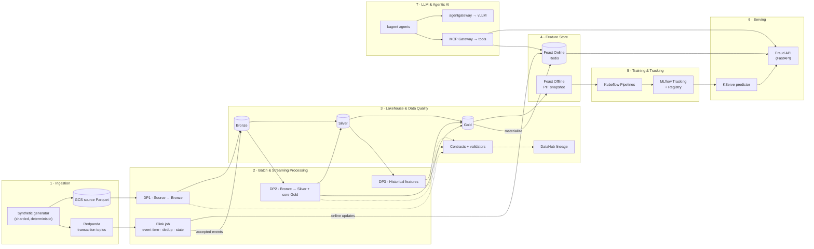
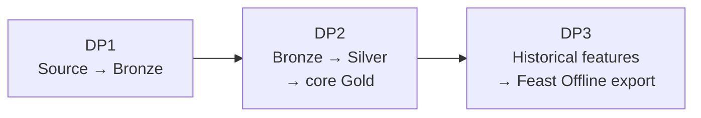
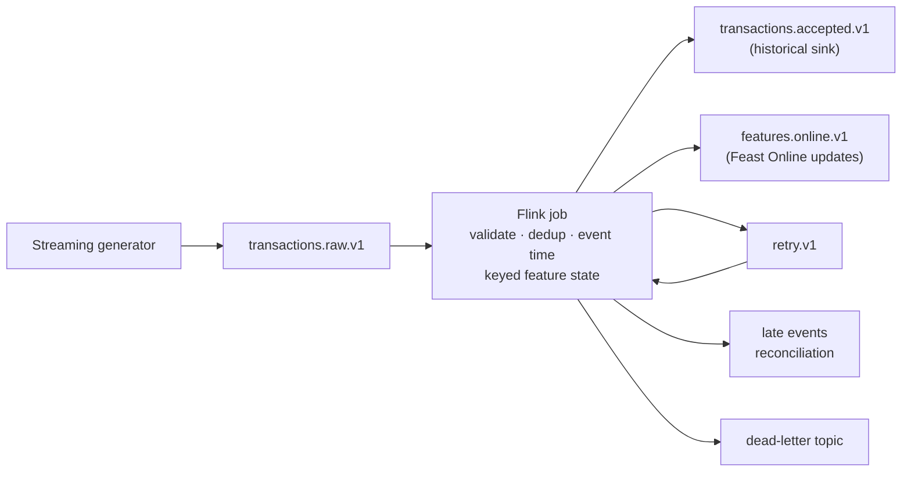
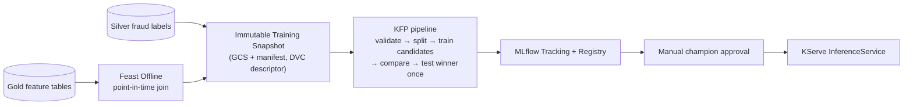
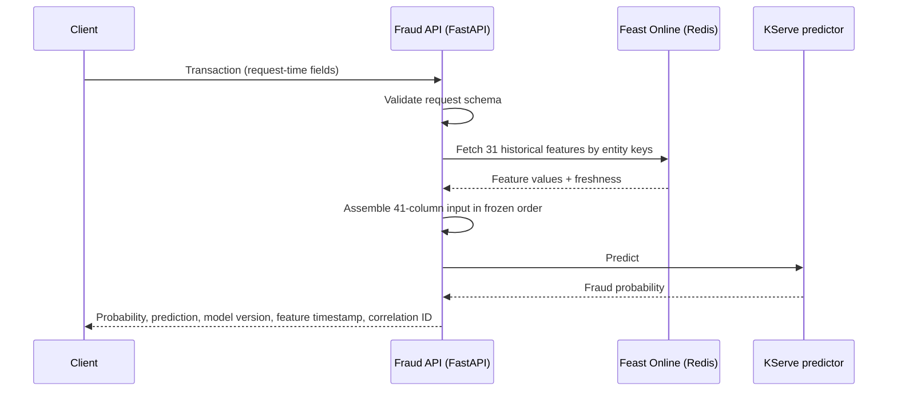
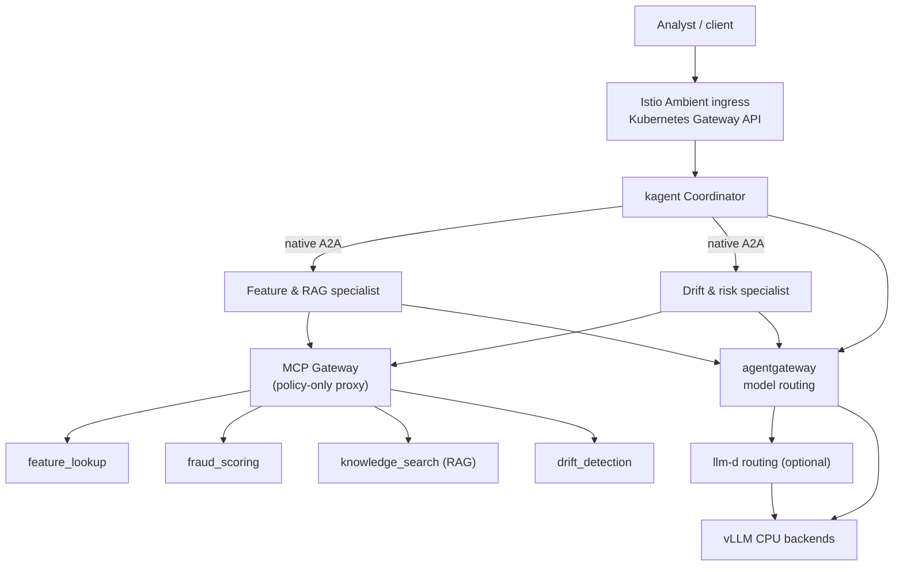

# E-Wallet Data & AI Platform

An end-to-end data and fraud-intelligence platform for e-wallet transactions,
built on Google Cloud. It covers the full path from synthetic transaction data
to explainable, AI-assisted fraud investigation:

**Data Engineering → Streaming → Feature Engineering → MLOps → Real-Time Fraud Detection → LLM & Agentic AI**

The platform generates realistic wallet activity at scale, curates it through a
Delta Lake medallion lakehouse on GCS, and derives point-in-time-correct fraud
features from both batch and streaming paths. Those features are served through
Feast, used for reproducible training orchestrated by Kubeflow Pipelines and
tracked in MLflow, and consumed by a low-latency Fraud API backed by KServe. A
CPU-first LLM layer with a kagent multi-agent system and policy-gated MCP tools
then turns scores, features and policy documents into cited investigation
answers.

> This is a coursework and research project. It is not an end-user wallet
> application, and all transaction data is synthetic.

---

## Contents

- [Business Problems](#business-problems)
- [Key Capabilities](#key-capabilities)
- [System Architecture](#system-architecture)
- [Technology Stack](#technology-stack)
- [Data Processing Pipeline](#data-processing-pipeline)
- [Streaming Pipeline](#streaming-pipeline)
- [Machine Learning Pipeline](#machine-learning-pipeline)
- [Real-Time Fraud Detection](#real-time-fraud-detection)
- [LLM & Agentic AI](#llm--agentic-ai)
- [Project Structure](#project-structure)
- [Getting Started](#getting-started)
- [Cloud Deployment](#cloud-deployment)
- [Testing & Reproducibility](#testing--reproducibility)
- [Documentation](#documentation)
- [Academic Context](#academic-context)

---

## Business Problems

| Problem | How the platform addresses it |
|---|---|
| **Fraud detection** | Supervised models trained on four labelled synthetic fraud scenarios (velocity, amount anomaly, account takeover, merchant burst) with leakage-safe temporal splits. |
| **Real-time transaction monitoring** | An event-time streaming job deduplicates, orders and enriches transactions as they arrive and keeps per-entity feature state current. |
| **Historical and streaming feature engineering** | One feature contract for user, account, device and merchant behaviour, computed in batch for training and incrementally for serving. |
| **Reproducible ML training** | Immutable training snapshots, locked dependency environments, pinned images, and every run recorded in MLflow. |
| **Low-latency fraud scoring** | A Fraud API that assembles the exact 41-feature model input from Feast Online and calls a KServe predictor. |
| **AI-assisted fraud investigation** | Specialist agents that query features, scores, drift signals and a fraud-policy corpus, then return structured, cited answers. |

---

## Key Capabilities

- **Large-scale batch processing.** Apache Spark on Dataproc Serverless processes
  a canonical dataset sized at 100 GB through Bronze, Silver and Gold Delta tables.
- **Event-driven streaming.** Redpanda topics and an Apache Flink (PyFlink) job
  provide event-time processing, deduplication, late-event reconciliation,
  bounded retries and a dead-letter path.
- **Lakehouse storage.** Delta Lake on Google Cloud Storage provides ACID
  tables, schema enforcement and versioned reads. A MinIO profile keeps the
  same code runnable locally.
- **Feature Store.** Feast defines four entities and four FeatureViews. The
  Offline Store serves point-in-time training retrieval, and the Redis-backed
  Online Store serves request-time lookups.
- **Experiment tracking and model versioning.** MLflow uses a PostgreSQL
  backend and a GCS artifact store. DVC versions the provenance descriptors of
  the training snapshots.
- **ML workflow orchestration.** A compiled Kubeflow Pipelines (KFP 2.17.3)
  DAG validates the snapshot, trains the candidate models, compares them and
  registers the winner.
- **Model serving.** KServe hosts the fraud model behind an immutable model
  version and image digest.
- **Real-time fraud scoring.** A FastAPI service validates requests, retrieves
  online features, assembles the model input and returns the fraud
  probability and prediction together with the model version, feature timestamp
  and correlation ID.
- **LLM inference.** vLLM serves a checksummed small model on CPU, and
  agentgateway owns model routing and resilience. Optional llm-d inference
  routing is also available.
- **Multi-agent orchestration.** A kagent Coordinator delegates to specialist
  agents over native A2A.
- **Secure tool integration.** Agents reach MCP tool services only through a
  policy-enforcing MCP Gateway, inside an Istio Ambient mesh with
  deny-by-default network policies.
- **Data governance.** Versioned YAML data contracts, fail-hard validators for
  each layer, and DataHub metadata, lineage and assertions.
- **Infrastructure and delivery.** Terraform-managed GCP foundation, Helm
  charts, Jenkins pipelines that test against lockfiles, Trivy image scanning,
  and OpenTelemetry instrumentation with Grafana dashboards.

---

## System Architecture

The platform is organised in eight layers. Each layer has explicit, versioned
contracts with its neighbours, so the batch, streaming, training and serving
paths share one definition of the data and features.



**Layer 8, Infrastructure, Security & Observability**, spans all of the above:
GKE, Dataproc, GCS and Artifact Registry are provisioned with Terraform. Istio
Ambient and the Kubernetes Gateway API handle ingress and the mesh,
Workload Identity provides cloud access, Jenkins provides CI/CD, and
OpenTelemetry provides telemetry.

| # | Layer | Responsibility | Primary source |
|---|---|---|---|
| 1 | Data Ingestion | Deterministic sharded generation, schema evolution, fraud ground truth, Redpanda topics, PostgreSQL/Debezium CDC | [`data_platform/generation`](data_platform/generation), [`data_platform/ingestion`](data_platform/ingestion), [`data_platform/streaming/generator`](data_platform/streaming/generator) |
| 2 | Batch & Streaming Processing | Spark DP1/DP2/DP3 jobs orchestrated by Airflow; Flink event-time feature job | [`data_platform/processing/spark`](data_platform/processing/spark), [`data_platform/orchestration/airflow/dags`](data_platform/orchestration/airflow/dags), [`data_platform/streaming`](data_platform/streaming) |
| 3 | Lakehouse & Data Quality | Delta Lake on GCS, data contracts, layer validators, DataHub metadata | [`data_platform/storage`](data_platform/storage), [`data_platform/contracts`](data_platform/contracts), [`data_platform/quality`](data_platform/quality), [`data_platform/metadata`](data_platform/metadata) |
| 4 | Feature Store | Feast entities and FeatureViews, PIT validation, snapshot export | [`ai_platform/features/feast`](ai_platform/features/feast) |
| 5 | ML Training & Tracking | Training dataset contract, candidate models, KFP pipeline, MLflow tracking, DVC operator | [`ai_platform/ml`](ai_platform/ml) |
| 6 | Model Serving & Fraud API | Request schemas, feature assembly, Feast Online client, KServe client, FastAPI app | [`ai_platform/inference`](ai_platform/inference) |
| 7 | LLM & Agentic AI | MCP tool services, RAG pipeline, agent contracts, LLM benchmark harness | [`ai_platform/llm_agent`](ai_platform/llm_agent), [`infra/helm/llm-agent-platform`](infra/helm/llm-agent-platform) |
| 8 | Infrastructure, Security & Observability | Terraform, Kubernetes manifests, Helm, Docker images, Jenkins, operator tooling | [`infra`](infra), [`ops`](ops), [`scripts`](scripts), [`Jenkinsfile.llm-agent`](Jenkinsfile.llm-agent) |

---

## Technology Stack

| Layer | Technologies |
|---|---|
| Data Engineering | Apache Spark, Google Cloud Dataproc Serverless, Delta Lake, Apache Airflow, Trino |
| Streaming | Redpanda (Kafka API), Apache Flink 1.19 (PyFlink), Debezium / Kafka Connect |
| Storage | Google Cloud Storage, MinIO (local profile), PostgreSQL, Redis |
| Data Governance | YAML data contracts, layer validators, DataHub |
| Feature Engineering | Feast 0.66 (Offline + Redis Online) |
| ML & MLOps | scikit-learn, Kubeflow Pipelines 2.17, MLflow 3.17, DVC 3.63 |
| Serving | KServe, FastAPI |
| LLM | vLLM (CPU), agentgateway, llm-d inference routing |
| Agents | kagent, native A2A, Model Context Protocol (MCP), RAG |
| Infrastructure | Google Kubernetes Engine, Docker, Kubernetes, Helm, Terraform, Artifact Registry, KEDA |
| Networking & Security | Istio Ambient, Kubernetes Gateway API, NetworkPolicy, Workload Identity, Trivy |
| CI/CD | Jenkins, GitHub |
| Observability | OpenTelemetry Collector, Grafana dashboards |
| Python tooling | `uv` with per-deployment `pyproject.toml` + `uv.lock` |

---

## Data Processing Pipeline

### Source data generation

A deterministic, sharded generator produces eight related datasets: users,
accounts, devices, merchants, transactions, balance snapshots, login events and
fraud labels. It injects realistic data problems on purpose: duplicates, skewed
merchants, late and out-of-order events, and a V1 → V2 schema change that adds
`channel`. Fraud ground truth is written to a separate dataset, so features can
never read labels by accident. Source files are published to an immutable,
versioned GCS location together with a manifest. See
[`docs/01_data_generator.md`](docs/01_data_generator.md) and
[`docs/cloud/source_dataset_generation.md`](docs/cloud/source_dataset_generation.md).

### Medallion lakehouse

| Layer | Purpose |
|---|---|
| **Bronze** | Raw, append-only Delta tables. Keeps duplicates and schema-evolution nulls, and merges transactions V1 and V2. |
| **Silver** | Typed, cleaned and deduplicated tables. Normalises domains and enforces keys, ranges and foreign keys. Fraud labels stay in a thin target table. |
| **Gold** | Dimensions, facts, a transaction OBT, merchant analytics, and four point-in-time behaviour tables (user, account, device, merchant). |

### Airflow data pipelines

Three manual-trigger DAGs run each stage as an idempotent, evidence-producing
unit. Spark runs on Dataproc, never inside the scheduler.



- **DP1:** preflight → verify source shards → Bronze Spark batch → Bronze validation.
- **DP2:** Silver batch → Silver validation → core Gold batch → Gold validation.
- **DP3:** four historical feature tables → temporal-contract validation →
  Feast snapshot export and point-in-time parity check.

Each DAG publishes lineage and run evidence, and marks a run successful only
after validation and read-back. DAG sources are in
[`data_platform/orchestration/airflow/dags`](data_platform/orchestration/airflow/dags).

### Data quality and validation

- **Contracts:** nine versioned YAML contracts describe the stable Silver and
  Gold interfaces ([`data_platform/contracts`](data_platform/contracts)).
- **Validators:** fail-hard Bronze, Silver and Gold validators read the
  persisted Delta data and return non-zero on any violation
  ([`data_platform/quality`](data_platform/quality)).
- **Point-in-time rules:** historical features use a strict `[T − window, T)`
  window with same-timestamp exclusion, and are never computed from
  `fraud_labels`.
- **Semantic equivalence:** optimised Spark variants are compared against their
  baselines by content fingerprints, so a performance change cannot silently
  change results.
- **Lineage:** DataHub receives dataset and job lineage derived from the actual
  implementation, with assertion results attached.

---

## Streaming Pipeline

The streaming path handles transactions as they arrive and keeps online
features current between batch materialisations.



- **Typed contracts** for events, topics (partitions, retention) and feature
  keys, shared by the generator, the Flink job and the sinks
  ([`data_platform/streaming/contracts`](data_platform/streaming/contracts)).
- **Event-time semantics:** watermarks, a bounded allowed lateness, and
  deduplication by transaction ID. Late records go to reconciliation instead of
  being dropped.
- **Feature state** per user, account, device and merchant, following the same
  entity keys as the batch features.
- **Failure routing:** a bounded retry topic and a dead-letter queue. Records
  with invalid fields are rejected, not relabelled.
- **Benchmark harness:** baseline and optimised Flink profiles (parallelism,
  checkpoint interval, incremental RocksDB checkpoints) run on a pinned local
  Flink + Redpanda Compose stack and are compared on the same replayed
  dataset. See [`docs/streaming/flink_local_benchmark.md`](docs/streaming/flink_local_benchmark.md).

---

## Machine Learning Pipeline



1. **Feast Offline.** Four entities (user, account, device, merchant) and four
   FeatureViews are read from a Gold snapshot that keeps microsecond
   precision. Point-in-time retrieval guarantees that each training row only
   sees features available strictly before its transaction time.
2. **Training Snapshot.** Request fields, PIT features and labels are combined
   into a one-row-per-transaction dataset with chronological train, validation
   and test splits. The snapshot is published once to immutable GCS with a
   SHA-256 manifest. DVC tracks only its small provenance descriptor; the
   lakehouse itself is never copied into DVC.
3. **KFP training.** A compiled KFP pipeline validates the snapshot contract
   and fits the configured candidates (Dummy baseline, Logistic Regression,
   Random Forest, Histogram Gradient Boosting). Preprocessing is fitted on the
   train split only. Validation PR-AUC, then F1, selects the winner, and only
   the winner is evaluated on the test split.
4. **MLflow.** Every candidate run, metric, parameter and artifact is logged.
   The winner is registered as a model version, and promotion to champion is a
   manual, auditable step.
5. **KServe.** The approved version is served from an immutable artifact and
   image digest.

### Feature contract

The model consumes exactly **41 inputs**, in a frozen column order shared by
training and inference:

| Group | Count | Source |
|---|---:|---|
| Historical features | 31 | Feast (user / account / device / merchant behaviour) |
| Request-time fields | 4 | The incoming transaction |
| Derived features | 6 | Shared transforms of request and historical values |
| **Total model inputs** | **41** | |

IDs, labels, fraud type, split markers, outcomes and ingestion timestamps never
enter the estimator. The full design is in
[`docs/ml/fraud_feature_design.md`](docs/ml/fraud_feature_design.md).

---

## Real-Time Fraud Detection



`Transaction → Fraud API → Feast Online → Feature Assembly → KServe → Fraud Score`

The API never accepts labels or client-computed aggregates. Requests are
validated against strict schemas, and missing or stale online features (beyond a
configured maximum staleness) fail closed with a typed error instead of being
scored on guessed values. Every response carries the model name and version,
the feature timestamp and a correlation ID, so each decision can be traced. Implementation:
[`ai_platform/inference`](ai_platform/inference).

---

## LLM & Agentic AI

The agentic layer helps analysts investigate flagged transactions. It does not
make autonomous decisions: agents may only call approved tools and must cite
what they return.



- **CPU-first inference.** vLLM serves a small open model from a checksummed,
  offline model image with primary and fallback backends. agentgateway owns
  model and backend routing, timeouts and retries. llm-d inference routing is
  an optional layer between them.
- **kagent Coordinator and specialists.** Agents run as sandboxed kagent
  resources with versioned prompts, fixed JSON answer shapes and explicit tool
  allow-lists. Delegation uses kagent's native A2A protocol, routed through
  agentgateway; there is no separate A2A runtime.
- **MCP Gateway.** The gateway is a policy-only proxy in front of four
  Streamable-HTTP MCP tool services. Agents cannot reach a tool server
  directly, and the servers keep a deny-all authenticator until access is
  explicitly configured.
- **RAG investigation.** An immutable, checksummed fraud-policy corpus is
  chunked, embedded and retrieved with exact source attribution, so answers
  can cite their sources. A manual Airflow DAG refreshes the index.
- **Security and policy.** The layer runs in an Istio Ambient mesh with
  deny-by-default authorization and NetworkPolicy, least-privilege service
  accounts and Workload Identity, with no static credentials in agent
  configuration. Tools fail closed: an unavailable model or retriever returns
  an error code, never a fabricated score or policy text.
- **Operations.** KEDA autoscaling, an OpenTelemetry collector with redaction,
  Grafana dashboards and an agent registry are packaged as opt-in components of
  the [`llm-agent-platform`](infra/helm/llm-agent-platform) Helm chart.

Design details: [`docs/llm_agent/agents.md`](docs/llm_agent/agents.md),
[`docs/llm_agent/mcp_gateway.md`](docs/llm_agent/mcp_gateway.md),
[`docs/llm_agent/phase_b_llm_gateway.md`](docs/llm_agent/phase_b_llm_gateway.md),
[`docs/llm_agent/llm_d_inference_routing.md`](docs/llm_agent/llm_d_inference_routing.md),
[`docs/llm_agent/phase_c_rag.md`](docs/llm_agent/phase_c_rag.md).

---

## Project Structure

```text
ewallet-data-ai-platform/
├── data_platform/                 # Data engineering domain
│   ├── generation/                # Offline + sharded synthetic data generators
│   ├── ingestion/                 # Redpanda topics, Debezium CDC, Spark ingestion
│   ├── processing/spark/          # Silver, Gold and historical-feature Spark jobs
│   ├── streaming/                 # Flink job, contracts, generator, sinks, benchmark
│   ├── storage/                   # Delta I/O, Trino config, table registration
│   ├── orchestration/airflow/     # DP1, DP2, DP3 and RAG DAGs
│   ├── quality/                   # Bronze / Silver / Gold validators
│   ├── contracts/                 # Versioned YAML data contracts
│   ├── metadata/datahub/          # Lineage, assertions, DataHub runtime
│   └── config/                    # Typed runtime-profile loader
├── ai_platform/                   # ML and AI domain
│   ├── features/feast/            # Feast repo, PIT validation, snapshot export
│   ├── ml/                        # Training, modeling, MLflow tracking
│   │   ├── pipelines/             # Kubeflow pipeline + compiler project
│   │   └── dvc-operator/          # Locked DVC operator environment
│   ├── inference/                 # Fraud API, feature assembly, KServe client
│   └── llm_agent/                 # MCP tools, RAG, agent contracts
├── configs/                       # Environment profiles (local/dev/gcp), MLOps, LLM, streaming
├── infra/
│   ├── terraform/gcp/             # GCP modules: network, IAM, GCS, GKE, Dataproc, AR, Jenkins VM
│   ├── kubernetes/                # MLflow, KFP, kagent, Istio Ambient manifests
│   ├── helm/                      # llm-agent-platform chart and upstream value overlays
│   └── docker/                    # Compose stacks and locked image builds
├── ops/                           # Operator tooling: GCP runners, preflights, validation
├── scripts/                       # Shell entry points for MLOps, LLM/agents, streaming
├── tests/                         # Unit, contract, inference, streaming and LLM tests
├── docs/                          # Architecture, runbooks and recorded evidence
├── notebooks/                     # Read-only validation and demo notebooks
└── Jenkinsfile.llm-agent          # CI pipeline for the LLM/agent platform
```

---

## Getting Started

### Prerequisites

- Linux or WSL2, Git, Docker Engine with Compose v2
- [`uv`](https://docs.astral.sh/uv/) 0.13 or newer (every Python environment is `uv`-locked)
- A Java runtime compatible with your PySpark version (local Spark only); Helm 3 and Terraform for the infrastructure checks
- For cloud work: the Google Cloud SDK and access to a GCP project

### 1. Clone and configure

```bash
git clone https://github.com/HuyyGiaa/ewallet-data-ai-platform.git
cd ewallet-data-ai-platform
cp .env.example .env        # fill in values for your environment; never commit .env
```

Runtime values come from `.env` keys and the profiles in
[`configs/environments`](configs/environments) (`local`, `dev`, `gcp`). See the
[runtime configuration guide](docs/cloud/configuration.md).

### 2. Install locked Python environments

Each deployable unit owns its own `pyproject.toml` and `uv.lock`. There is no
repository-wide environment, and builds never re-resolve dependencies.

| Project | Purpose |
|---|---|
| `ai_platform/features/feast` | Feast offline, PIT validation, snapshot export |
| `ai_platform/ml` | Training, evaluation, MLflow client, KFP components |
| `ai_platform/ml/pipelines` | KFP 2.17.3 pipeline compilation |
| `ai_platform/ml/dvc-operator` | DVC 3.63.0 operator |
| `infra/docker/flink-benchmark` | Streaming generator, PyFlink job, benchmark harness |
| `infra/docker/llm-agent-tooling` | MCP tool services and RAG |
| `infra/docker/vllm-cpu-model` | vLLM CPU model image remediation |
| `infra/kubernetes/mlflow/image` | MLflow server image |

```bash
uv lock --check --project ai_platform/features/feast    # verify the lock, never re-resolve
uv sync --locked --project ai_platform/features/feast   # install exactly the lock
```

The full contract is documented in
[`docs/ml/dependency_environments.md`](docs/ml/dependency_environments.md).

### 3. Run the source validation gates

```bash
python3 ops/validation/validate_runtime_config.py                 # profiles, literals, contracts
python3 -m ops.llm_agent.preflight --repository-root "$PWD"       # LLM/agent source contract
```

### 4. Run tests

```bash
# Feature store, data platform, inference and contract tests
PYTHONPATH=. uv run --locked --project ai_platform/features/feast \
  python -m unittest discover -s tests -t .

# Streaming (generator, Flink operators, benchmark harness)
PYTHONPATH=. uv run --locked --project infra/docker/flink-benchmark \
  python -m pytest -q tests/streaming

# MCP tools and RAG
uv run --locked --project infra/docker/llm-agent-tooling --extra feast \
  python -m unittest tests.llm_agent.test_phase_d_tools tests.llm_agent.test_mcp_sdk_conformance \
  tests.llm_agent.test_rag_online_retriever
```

Tests that need an optional runtime, such as PySpark, Airflow or Helm, skip
cleanly when it is missing. Spark-based tests need `PYSPARK_PYTHON` to point at
the interpreter running the tests.

### 5. Local platform stack (optional)

The local profile runs Redpanda, Kafka Connect, MinIO and Trino as a single
Compose project:

```bash
docker compose -p ewallet-data-ai-platform --project-directory . \
  --profile ingestion --profile storage \
  -f infra/docker/compose.messaging.yml \
  -f infra/docker/compose.ingestion.yml \
  -f infra/docker/compose.storage.yml \
  -f infra/docker/compose.query.yml \
  up -d
```

The local batch pipeline then runs stage by stage:

```bash
python -m data_platform.generation.src.offline.offline_generator
python -m data_platform.storage.scripts.init_storage --environment local --include-fraud-labels
python -m data_platform.quality.validate_bronze --environment local --include-fraud-labels
python -m data_platform.processing.spark.silver.silver_pipeline --environment local --include-fraud-labels
python -m data_platform.quality.validate_silver --environment local --include-fraud-labels
python -m data_platform.processing.spark.gold.gold_pipeline --environment local
python -m data_platform.quality.validate_gold --environment local
```

The local Flink benchmark stack is driven by
[`scripts/streaming/flink_bench.sh`](scripts/streaming/flink_bench.sh)
(`prereq`, `up`, `functional`, `perf`, `compare`, `down`). See its
[runbook](docs/streaming/flink_local_benchmark.md).

---

## Cloud Deployment

The Google Cloud deployment is split into reviewed, cost-gated stages, and each
stage has its own runbook. Project IDs, buckets, endpoints and credentials are
supplied at runtime and are never committed.

| Component | Role | Runbook |
|---|---|---|
| GCP project, VPC, IAM, GCS, Artifact Registry | Terraform foundation with remote state | [Terraform GCP foundation](docs/cloud/terraform_gcp_foundation.md) |
| Delta Lake on GCS | Lakehouse storage layout | [GCS Delta Lake](docs/cloud/gcs_delta_lake.md) |
| Dataproc Serverless | Spark runtime for DP1–DP3 | [Dataproc Delta smoke](docs/cloud/dataproc_delta_smoke.md), [Dataproc performance](docs/cloud/canonical_dataproc_performance.md) |
| Airflow DP1 / DP2 / DP3 | Data pipeline orchestration | [DP2 Method 2 runbook](docs/cloud/dp2_method2_single_dag_runbook.md), [100 GB readiness](docs/cloud/canonical_100gb_readiness.md) |
| Feast Offline + Training Snapshot | PIT retrieval and immutable snapshot | [Cloud Feast training snapshot](docs/ml/cloud_feast_training_snapshot.md), [ML-2 operator runbook](docs/ml/ml2_training_snapshot_operator_runbook.md) |
| GKE, MLflow, KFP | MLOps runtime on Kubernetes | [GKE MLOps runtime gate](docs/ml/gke_mlops_runtime_gate.md), [Canonical KFP](docs/ml/kfp_canonical.md), [F9 MLflow](docs/ml/f9_mlflow_canonical.md) |
| vLLM, agentgateway, kagent, MCP | LLM and agent platform on GKE (CPU) | [GKE CPU runtime](docs/llm_agent/gke_cpu_runtime.md), [Runtime runbook](docs/llm_agent/runtime_runbook.md) |
| Jenkins, image scanning | CI/CD and OTel | [CI/CD and observability](docs/llm_agent/cicd_observability.md) |

Operator entry points live in [`scripts/mlops`](scripts/mlops),
[`scripts/llm_agent`](scripts/llm_agent) and [`ops/gcp`](ops/gcp). Each runs a
dry run by default and needs an explicit flag before it changes anything.

---

## Testing & Reproducibility

| Practice | How it is enforced |
|---|---|
| **Unit and contract tests** | `tests/unit`, `tests/contract`, `tests/inference`, `tests/streaming`, `tests/llm_agent`, run in the locked environment that owns each component. |
| **Integration tests** | Fraud API, Feast Online and KServe client tests run the service end to end against test doubles; DAG-import tests load the Airflow DAGs in an isolated `AIRFLOW_HOME`. |
| **Schema and data quality** | Contract files plus fail-hard Bronze / Silver / Gold validators, and cloud-profile checks that reject stale local literals. |
| **Semantic equivalence** | Optimised Spark runs must match baseline content fingerprints (volatile audit columns excluded) before a performance comparison counts. |
| **Offline / online parity** | The Feast PIT validation and the 41-column frozen input order are tested on both the training and inference sides. |
| **Reproducible environments** | `uv lock --check` and `uv sync --locked` for every project. A contract test fails if a project is unlocked, an image installs outside its lock, or a protected pin (Feast, KFP, MCP, DVC, PyFlink) drifts. |
| **Image and version pinning** | Base images and tools are pinned by digest. Models are served from checksummed revisions, and KFP components reference immutable images. |
| **Benchmark methodology** | A/B runs use identical inputs and semantics and differ only in declared knobs. Each run records its config hash and identities. Invalid runs are rejected rather than compared. |
| **Evidence policy** | Runtime claims require machine-readable evidence under [`docs/evidence`](docs/evidence). Source, configuration and passing tests alone are not treated as deployment proof. |

---

## Documentation

| Area | Start here |
|---|---|
| Architecture | [System architecture](docs/00_system_architecture.md) · [Cloud platform design](docs/superpowers/specs/2026-10-21-cloud-platform-refactor-design.md) · [Docs index](docs/README.md) |
| Data platform | [Data generator](docs/01_data_generator.md) · [Schema design](docs/02_schema_design_example.md) · [Batch pipeline](docs/03_batch_pipeline.md) · [Airflow orchestration](docs/06_airflow_orchestration.md) · [Storage optimisation](docs/cloud/storage_optimization.md) |
| Streaming | [Streaming pipeline](docs/04_streaming_pipeline.md) · [Flink local benchmark](docs/streaming/flink_local_benchmark.md) · [Generator compatibility](docs/streaming/generator_compatibility_20261031.md) |
| Feast | [Feature design](docs/ml/fraud_feature_design.md) · [Feast offline](docs/ml/feast_offline.md) · [Cloud training snapshot](docs/ml/cloud_feast_training_snapshot.md) |
| MLOps | [Training dataset](docs/ml/fraud_training_dataset.md) · [Modeling](docs/ml/fraud_modeling.md) · [F9 MLflow](docs/ml/f9_mlflow_canonical.md) · [KFP](docs/ml/kfp_canonical.md) · [Dependency environments](docs/ml/dependency_environments.md) |
| LLM & agents | [Agents](docs/llm_agent/agents.md) · [MCP Gateway](docs/llm_agent/mcp_gateway.md) · [LLM gateway](docs/llm_agent/phase_b_llm_gateway.md) · [RAG](docs/llm_agent/phase_c_rag.md) · [Tool services](docs/llm_agent/phase_d_tool_services.md) |
| Infrastructure | [Runtime configuration](docs/cloud/configuration.md) · [Terraform](docs/cloud/terraform_gcp_foundation.md) · [GKE CPU runtime](docs/llm_agent/gke_cpu_runtime.md) · [CI/CD & observability](docs/llm_agent/cicd_observability.md) |
| Metadata & lineage | [DataHub lineage](docs/08_datahub_lineage.md) · [EDAI-1 workstream](docs/edai1/README.md) |
| Evidence & reports | [Evidence directory](docs/evidence) · [Rubric audit](docs/rubric/rubric_audit.md) · [Source consolidation](docs/integration/20261031_source_consolidation.md) · [Submission integration](docs/integration/20261101_submission_integration.md) |

---

## Academic Context

This repository was developed as a coursework and research project
on modern data, MLOps and agentic AI platforms. The mapping between the course
rubric and the repository evidence is in [`docs/rubric`](docs/rubric).

**Author and maintainer:** [@HuyyGiaa](https://github.com/HuyyGiaa)
