# E-Wallet Data & AI Platform

An end-to-end fraud-intelligence platform for synthetic e-wallet transactions,
built to study the engineering problems behind financial fraud detection:
high-volume data, late and duplicate events, point-in-time-correct features,
reproducible model training, low-latency inference, and grounded AI-assisted
investigation.

The repository connects a Delta Lake data platform, batch and event-time
streaming pipelines, Feast feature serving, Kubeflow and MLflow model
operations, KServe inference, and a CPU-first LLM/agent architecture. The
emphasis is not only on implementation, but on measured experiments,
correctness gates, immutable evidence, and explicit experiment boundaries.

> **Coursework scope.** This is a research and engineering project, not an
> end-user wallet application. All transaction data is synthetic; documented
> measurements apply only to the named fixtures, runs, and source versions.

---

## Contents

- [Project Overview](#project-overview)
- [Key Highlights](#key-highlights)
- [Experimental Results](#experimental-results)
- [System Architecture](#system-architecture)
- [Technology Stack](#technology-stack)
- [Data Engineering Platform](#data-engineering-platform)
- [ML Platform](#ml-platform)
- [LLM & Agentic AI](#llm--agentic-ai)
- [Novel Ideas](#novel-ideas)
- [Quick Start](#quick-start)
- [Documentation](#documentation)
- [Repository Structure](#repository-structure)

---

## Project Overview

Fraud detection is a systems problem before it is a modeling problem. Real
payment streams contain duplicates, skew, schema changes, out-of-order events,
late labels, and features that can silently leak future information. A useful
platform must preserve event-time semantics from ingestion to inference while
making every model and dataset version reproducible.

This project addresses that problem through three connected layers:

- **Data engineering:** deterministic offline data feeds the Bronze/Silver/Gold
  Delta Lake, while versioned stream events flow through Redpanda and Flink.
  Spark handles batch transformations, Airflow orchestrates bounded workflows,
  and DataHub records lineage and quality results.
- **Machine learning:** point-in-time feature tables feed Feast Offline and
  Online stores. Kubeflow Pipelines trains and evaluates candidates, MLflow
  records model/data lineage, and KServe hosts model-inside-image inference.
- **AI-assisted investigation:** kagent coordinates specialist agents through
  A2A and policy-gated MCP tools. Those tools retrieve fraud features, model
  results, and cited RAG context without changing the underlying fraud score.

The platform is intentionally modular. Each Python component owns its
`pyproject.toml` and `uv.lock`, infrastructure is separated from application
logic, and runtime claims are tied to preserved reports and evidence.

---

## Key Highlights

- **Deterministic data at 100 GB scale.** Stable shard identities, create-only
  publication, resume safety, and a final manifest make parallel generation
  reproducible across worker counts.
- **One lakehouse, distinct batch and streaming paths.** Spark implements the
  DP1/DP2/DP3 boundaries. Historical Flink evidence covers event-time behavior,
  while integrated Block A defines bootstrap, state, history, and online-update
  contracts.
- **Correctness before optimization.** A/B comparisons require equivalent
  inputs and semantic gates. Regressions and failed equivalence checks remain
  visible instead of being presented as gains.
- **Point-in-time-safe features.** Historical lookups use exclusive temporal
  windows, label columns are excluded from Feast, and an independent oracle
  checks retrieved values.
- **Reproducible ML delivery.** Immutable snapshots flow through a multi-step
  Kubeflow pipeline; MLflow binds the selected model to its dataset and runtime
  image; KServe serves the model from a digest-pinned image.
- **Governed orchestration.** Three manual-trigger Airflow DAGs own DP1, DP2,
  and DP3 separately. DataHub publishes verified lineage and selected
  result-bound assertions without treating every defined check as executed.
- **Measured storage design.** Delta compaction and PostgreSQL indexing are
  evaluated with before/after data, semantic equality checks, and documented
  read/write trade-offs.
- **Agentic investigation boundaries.** kagent, A2A, MCP, RAG, and model routing
  are separated from deterministic scoring, with Istio, AuthorizationPolicy,
  NetworkPolicy, and service identity forming the intended security boundary.

---

## Experimental Results

### At a Glance

| Experiment | Recorded result | Scope and source |
|---|---:|---|
| Canonical dataset | **100,156,470,260 bytes** across 3,696 shards | Immutable synthetic-data manifest; [generator report](docs/edai1/data_generator/DATA_GENERATION_AND_SIMULATION.md) |
| Duplicate simulation | **2.00%** added rows | 7,392,000 controlled duplicates in the canonical population; [generator report](docs/edai1/data_generator/DATA_GENERATION_AND_SIMULATION.md) |
| Flink acceptance p95 | **10,896 → 7,256 ms** | Historical 100 EPS / 120 s A/B, overall verdict `MIXED`; [streaming report](docs/edai1/streaming/FLINK_STREAMING.md) |
| Delta compaction | **2,188 → 151 files** | Bounded local Delta/Trino fixture with row/hash equality; [storage report](docs/edai1/storage/STORAGE_OPTIMIZATION.md) |
| PostgreSQL query latency | **65.776 → 19.913 ms** median | Seven-run, isolated 2-million-row local fixture; write overhead +78.14%; [storage report](docs/edai1/storage/STORAGE_OPTIMIZATION.md) |
| Feast Offline/Online parity | **155/155 comparisons** | Bounded MLOps campaign, 31 features, zero mismatches; [MLOps report](docs/edai2/mlops/MLOPS_FEATURE_STORE.md) |
| Kubeflow training | **Successful six-stage pipeline** | Run `dc29f5cc-cc9e-49ae-b861-eacddd6269b5`; [MLOps report](docs/edai2/mlops/MLOPS_FEATURE_STORE.md) |
| KServe inference | **HTTP 200 fraud predictions** | Baked model version 1 in a digest-pinned image; [MLOps report](docs/edai2/mlops/MLOPS_FEATURE_STORE.md) |
| PIT leakage validation | **310/310, zero mismatches** | 10 cases × 31 features, labels excluded; [PIT report](docs/edai1/novel_ideas/02_PIT_LEAKAGE_PREVENTION.md) |

The Spark experiments also produced important negative results. DP1 Bronze was
10.05% slower and DP2 Silver was 31.62% slower under the tested optimized
profiles. DP2 Gold showed a shorter runtime, but its final semantic-equivalence
gate failed for three double aggregates, so no optimized winner was selected.
See the [Spark Optimization Matrix](docs/edai1/OPTIMIZATION_MATRIX.md) for run
IDs, exact source versions, correctness decisions, and scientific limitations.

---

## System Architecture

```mermaid
flowchart LR
    subgraph DATA["Data Generation"]
        DG["Deterministic Offline Generator"]
        SRC[("Immutable GCS source<br/>Parquet + manifest")]
        SG["Streaming Generator"]
        RP["Redpanda"]
        DG --> SRC
        SG --> RP
    end

    subgraph LAKE["Delta Lakehouse on GCS / MinIO"]
        B[("Bronze<br/>raw")]
        S[("Silver<br/>clean + deduplicated")]
        G[("Core Gold<br/>dimensions · facts · OBT · aggregates")]
        DP3["DP3 historical<br/>feature computation"]
        HF[("Four historical<br/>feature tables")]
        SRC -->|DP1 · Spark ingest| B
        B -->|DP2 · normalize + validate| S
        S -->|DP2 · build Core Gold| G
        S --> DP3
        G --> DP3 --> HF
    end

    subgraph FEATURES["Feast Feature Store"]
        OFF[("Offline Store<br/>historical features")]
        MAT["Materialization"]
        ON[("Online Store<br/>Redis")]
        OFF --> MAT --> ON
    end

    subgraph ML["ML Platform"]
        KFP["Kubeflow Pipelines<br/>validate · train · select · evaluate"]
        MLF["MLflow<br/>lineage + registry"]
        BAKE["Bake selected model<br/>into immutable image"]
        KS["KServe<br/>model-inside-image"]
        API["Fraud API"]
        KFP --> MLF --> BAKE --> KS --> API
    end

    subgraph AI["LLM & Agentic AI"]
        CO["kagent Fraud Coordinator"]
        A2A["A2A Specialist Agents"]
        MCP["Policy-gated MCP Tools"]
        RAG[("Fraud RAG Context")]
        CO --> A2A --> MCP
        MCP --> RAG
    end

    RP --> FLINK["Integrated Flink Block A<br/>event-time feature processing"]
    S --> BOOT["Silver bootstrap<br/>and state cutover"] --> RP
    FLINK -.->|accepted-history contract| HIST[("Immutable stream history<br/>GCS offline boundary")]
    FLINK -.->|complete FeatureView rows| PUSH["Feast PushSource"]
    PUSH -.-> ON
    HF --> OFF
    OFF -->|PIT snapshot| KFP
    ON -->|request-time features| API
    API -->|score + model metadata| CO
    MCP -->|features| ON
    MCP -->|inference| KS

    AF1["Airflow DP1<br/>manual-trigger DAG"] -.-> B
    AF2["Airflow DP2<br/>manual-trigger DAG"] -.-> S
    AF2 -.-> G
    AF3["Airflow DP3<br/>manual-trigger DAG"] -.-> HF
    DH["DataHub<br/>lineage + selected quality"] -.-> B
    DH -.-> S
    DH -.-> G
    DH -.-> HF

    ISTIO["Istio service mesh<br/>Gateway API · policy · mTLS boundaries"]
    ISTIO -.-> API
    ISTIO -.-> CO
    ISTIO -.-> A2A
    ISTIO -.-> MCP
```



The primary scoring path is deterministic: validated data becomes historical
features, Kubeflow trains a versioned model, Feast provides request-time
features, and KServe returns a fraud prediction. The LLM layer consumes those
results for investigation; it does not alter the score. Dashed Flink edges
represent the immutable-history and PushSource interfaces rather than evidence
that both sinks were exercised together in the latest source version.

Istio is the networking foundation for the Kubernetes architecture. Gateway
API, service identity, AuthorizationPolicy, and NetworkPolicy are used where
implemented; the diagram does not imply that every external ingress or
security control has been exercised in one runtime campaign.

---

## Technology Stack

| Layer | Technologies |
|---|---|
| Data generation | Python, Faker, deterministic sharding, Parquet |
| Batch processing | Apache Spark, PySpark, Delta Lake, Dataproc Serverless |
| Streaming | Redpanda, Apache Flink / PyFlink, GCS history, Feast PushSource, Redis |
| Storage and query | Google Cloud Storage, MinIO, Delta Lake, Trino, PostgreSQL |
| Orchestration and governance | Apache Airflow, DataHub, data contracts |
| Feature platform | Feast Offline Store, Feast Online Store, Redis |
| Training and tracking | Kubeflow Pipelines, scikit-learn, MLflow, DVC |
| Model serving | KServe, FastAPI, Pydantic |
| LLM and agents | vLLM, kagent, agentgateway, MCP, A2A, RAG |
| Platform and security | Kubernetes, Helm, Terraform, Istio, NetworkPolicy |
| Reproducibility | `uv`, per-component lockfiles, immutable image digests |

---

## Data Engineering Platform

The data layer starts with immutable offline shards and controlled stream events. The generators deliberately introduce skew, duplicates, schema evolution, bursts, out-of-order delivery, and late arrival so pipeline behavior can be evaluated against known input characteristics.

### DP1 — Bronze

DP1 reads an immutable source manifest and Parquet datasets from GCS, submits a source-to-Bronze
Spark job, and verifies the exact eight-table Delta output. Bronze remains source-shaped: it
preserves raw business records while adding the ingestion information required to trace the run and
reconcile transaction V1/V2 physical files.

### DP2 — Silver and Core Gold

DP2 normalizes types, cleans records, handles additive schema evolution, deduplicates transaction
identities, and validates the eight Silver tables. It then builds the separate Core Gold boundary:
dimensions, facts, analytical aggregates, and the denormalized transaction OBT. Core Gold business
tables are not the four historical behavior-feature tables computed by DP3. The preserved Method 2
campaign produced both variants, but its final Gold semantic-equivalence gate failed; the shorter
observed Gold runtime was therefore not accepted as an optimization winner.

### DP3 — Historical Features

DP3 verifies the required validated Silver and Core Gold inputs, then computes four run-scoped
behavior tables for user, account, device, and merchant entities. Their event-time windows preserve
`[T-window,T)` semantics and form the historical feature boundary exported to Feast Offline. The
DP3 Airflow DAG validates the four physical Delta outputs; the later independent PIT/Feast
comparison and its DataHub events are not tasks inside the preserved DP3 DagRun.

### Flink Streaming

Two implementations have distinct evidence and responsibilities:

- The **historical EDAI-1 streaming benchmark** demonstrates event-time processing, watermarks,
  deduplication, late-event handling, windows, checkpoint behavior, and preserved runtime evidence.
- **Integrated Streaming Block A** adds historical bootstrap, 31-feature state maintenance,
  immutable GCS history, and Feast PushSource update contracts. Its source contracts do not by
  themselves prove a current-version run writing and reading back both sinks.

### Orchestration and Governance

DP1, DP2, and DP3 are separate manual-trigger Airflow DAGs (`schedule=None`), each with its own
upstream evidence, immutable run identity, and validation boundary; they are not one automatically
scheduled end-to-end DAG.

DataHub records metadata, deterministic lineage, contracts, and preserved quality events. Verified
read-back includes Silver checks and four PIT feature-group assertions. The defined Core Gold
row-level assertion has no execution history, so physical Gold verification is not presented as
proof that every DataHub assertion ran. See the [EDAI-1 documentation index](docs/edai1/README.md) for detailed inventories, run identities, and validation boundaries.

---

## ML Platform

The ML platform turns validated Gold feature tables into reproducible training
and inference inputs:

- **Feast** defines entity and feature-view contracts. Historical retrieval is
  point-in-time correct, while bounded materialization populates Redis for
  request-time lookup.
- **Kubeflow Pipelines** validates an immutable snapshot, verifies chronological
  splits, trains four candidates, selects on validation metrics, evaluates only
  the winner on the held-out test set, and publishes lineage.
- **MLflow** records parent/child runs, metrics, model artifacts, dataset
  identity, Git revision, and image digest. The bounded campaign registered
  `fraud-detector` model version 1 with the `candidate` alias.
- **KServe** runs the selected model inside an immutable predictor image. The
  Fraud API assembles online features and calls the private V2 inference path.

The verified campaign includes two Feast materialization windows, 155 parity
comparisons with zero mismatches, one successful Kubeflow run, MLflow model
registration, a ready KServe InferenceService, and successful fraud prediction
responses. The complete run identities and evidence are in the
[MLOps & Feature Store report](docs/edai2/mlops/MLOPS_FEATURE_STORE.md).

---

## LLM & Agentic AI

The AI investigation layer is designed around a strict separation of concerns:
the fraud model scores a transaction, while agents retrieve and explain the
evidence behind that score.

- **Fraud Coordinator:** a kagent resource classifies the investigation intent
  and delegates work rather than directly owning every data integration.
- **Specialist agents:** context and risk specialists communicate through A2A
  and retain separate tool grants.
- **MCP tools:** authenticated tools expose bounded access to Feast features,
  KServe results, and RAG retrieval; authorization applies to both discovery
  and invocation.
- **RAG:** fraud policies and technical context are retrieved with citations so
  an answer can be traced back to source material.
- **Networking:** agentgateway and Istio provide routing and policy boundaries;
  Kubernetes Secrets and service identity keep credentials out of prompts and
  responses.

Historical bounded evidence demonstrates a synthetic Coordinator-to-specialist
path through A2A, MCP, Feast/KServe, and RAG. That result is tied to its recorded
runtime source and is not used here to claim that every newer agent source
revision or platform control has been deployed.

---

## Novel Ideas

### 1. Deterministic Sharding

Large synthetic datasets are normally difficult to reproduce after a partial
failure or a change in worker count. This project derives each shard from a
stable identity and deterministic seed, writes through create-only publication,
and commits a final manifest only after the complete shard set is valid.

The implementation produced byte-identical bounded outputs across one, two,
and four workers and published a complete 100,156,470,260-byte canonical
manifest. See [Deterministic Sharding](docs/edai1/novel_ideas/01_DETERMINISTIC_SHARDING.md).

### 2. Point-in-Time Leakage Prevention

Feature parity alone does not prove temporal correctness. The PIT validator
therefore compares Feast retrieval against an independent direct-Gold oracle,
uses exclusive historical windows, rejects label columns, and publishes
result-bound governance events.

The preserved run evaluated 10 cases × 31 features: all 310 comparable values
matched, zero mismatches were recorded, and labels were not passed to Feast.
See [Point-in-Time Leakage Prevention](docs/edai1/novel_ideas/02_PIT_LEAKAGE_PREVENTION.md).

---

## Quick Start

### Prerequisites

- Linux or WSL2, Git, and Docker Engine with Compose v2
- [`uv`](https://docs.astral.sh/uv/) 0.13 or newer
- A Java runtime compatible with the selected PySpark environment
- Helm, Terraform, and Google Cloud SDK only for the corresponding
  infrastructure workflows

### Clone and configure

```bash
git clone https://github.com/HuyyGiaa/ewallet-data-ai-platform.git
cd ewallet-data-ai-platform
cp .env.example .env
```

Runtime profiles live under [`configs/environments`](configs/environments).
Never commit `.env`, credentials, project IDs, tokens, or production secrets.

### Install a locked component environment

There is no repository-wide Python environment. Each deployable component owns
its dependency graph and lockfile:

```bash
uv lock --check --project ai_platform/features/feast
uv sync --locked --project ai_platform/features/feast
```

Use the same `--project` pattern for `ai_platform/ml`,
`ai_platform/ml/pipelines`, `ai_platform/inference`, or the relevant project
under `infra/docker/`.

### Run bounded validation

```bash
# Feature Store tests in the locked Feast environment
PYTHONPATH=. uv run --locked --project ai_platform/features/feast \
  python -m unittest discover -s tests -t .

# Streaming tests in the locked benchmark environment
PYTHONPATH=. uv run --locked --project infra/docker/flink-benchmark \
  python -m pytest -q tests/streaming

# Runtime-profile and source-contract checks
python3 ops/validation/validate_runtime_config.py
python3 -m ops.llm_agent.preflight --repository-root "$PWD"
```

Tests requiring optional services or runtimes skip when their prerequisites are
unavailable. No benchmark or cloud workload is required to browse the reports
and preserved evidence.

### Start the local data services

```bash
docker compose -p ewallet-data-ai-platform --project-directory . \
  --profile ingestion --profile storage \
  -f infra/docker/compose.messaging.yml \
  -f infra/docker/compose.ingestion.yml \
  -f infra/docker/compose.storage.yml \
  -f infra/docker/compose.query.yml \
  up -d
```

For the streaming benchmark lifecycle, use
[`scripts/streaming/flink_bench.sh`](scripts/streaming/flink_bench.sh). Cloud,
MLOps, and agent operations have separate cost-gated runbooks and should not be
inferred from the local quick start.

---

## Documentation

### Canonical Reports

| Area | Report | What it contains |
|---|---|---|
| EDAI-1 | [Documentation Index](docs/edai1/README.md) | Submission entry point, experiment summary, evidence navigation |
| EDAI-1 | [Rubric Evidence Matrix](docs/edai1/EDAI1_RUBRIC_COVERAGE.md) | Requirement-to-source and requirement-to-evidence mapping |
| Engineering | [Docker Optimization](docs/edai1/docker/DOCKER_OPTIMIZATION.md) | Multi-stage build and image-size A/B evidence |
| Data | [Data Generation & Simulation](docs/edai1/data_generator/DATA_GENERATION_AND_SIMULATION.md) | Canonical dataset, skew, duplicates, schema evolution, late arrival |
| Data | [Schema Design](docs/edai1/SCHEMA_DESIGN.md) | Zone schemas, SCD Type 2, feature timestamps, relationships |
| Processing | [Spark Optimization Matrix](docs/edai1/OPTIMIZATION_MATRIX.md) | DP1/DP2/DP3 performance and correctness decisions |
| Streaming | [Flink Streaming](docs/edai1/streaming/FLINK_STREAMING.md) | Event time, windows, late data, state, historical benchmark |
| Orchestration | [Airflow DP1/DP2/DP3](docs/edai1/AIRFLOW_DP1_DP2_DP3_EVIDENCE.md) | DAG dependencies, validation, genuine historical UI evidence |
| Storage | [Storage Optimization](docs/edai1/storage/STORAGE_OPTIMIZATION.md) | Delta compaction, pruning, PostgreSQL indexing |
| Governance | [DataHub Governance](docs/edai1/datahub/DATAHUB_GOVERNANCE.md) | Lineage, contracts, assertions, evidence provenance |
| Novel Idea | [Deterministic Sharding](docs/edai1/novel_ideas/01_DETERMINISTIC_SHARDING.md) | Reproducible parallel generation and immutable publication |
| Novel Idea | [PIT Leakage Prevention](docs/edai1/novel_ideas/02_PIT_LEAKAGE_PREVENTION.md) | Independent oracle, label exclusion, governance events |
| EDAI-2 | [MLOps & Feature Store](docs/edai2/mlops/MLOPS_FEATURE_STORE.md) | Feast, Kubeflow, MLflow, KServe contracts and runtime evidence |

Supporting architecture, runbooks, manifests, screenshots, and raw artifacts
remain under [`docs/`](docs) and [`docs/evidence/`](docs/evidence). Historical
evidence is labeled by its actual run and source version; rendered benchmark
panels are not presented as native application UI.

---

## Repository Structure

```text
ewallet-data-ai-platform/
├── data_platform/
│   ├── generation/                # Deterministic offline and stream generators
│   ├── ingestion/                 # Redpanda, Kafka Connect and source ingestion
│   ├── processing/spark/          # Bronze, Silver, Gold and feature jobs
│   ├── streaming/                 # Flink contracts, operators and sinks
│   ├── orchestration/airflow/     # DP1, DP2, DP3 and RAG DAGs
│   ├── quality/                   # Fail-hard zone validators
│   ├── contracts/                 # Versioned data contracts
│   ├── metadata/datahub/          # Lineage and quality publication
│   └── storage/                   # Delta, GCS/MinIO and Trino integration
├── ai_platform/
│   ├── features/feast/            # Feature definitions, PIT validation, snapshots
│   ├── ml/                        # Training, MLflow and Kubeflow components
│   ├── inference/                 # Fraud API, Feast assembly, KServe client
│   └── llm_agent/                 # RAG, MCP tools and agent contracts
├── configs/                       # Typed local, development and GCP profiles
├── infra/
│   ├── docker/                    # Compose stacks and locked image projects
│   ├── kubernetes/                # MLflow, KFP, KServe, kagent and Istio resources
│   ├── helm/                      # Application charts and value overlays
│   └── terraform/gcp/             # GCP infrastructure modules
├── ops/                           # Validation, GCP and deployment operators
├── scripts/                       # MLOps, streaming and agent entry points
├── tests/                         # Unit, contract, integration and bounded E2E tests
├── docs/                          # Technical reports, runbooks and evidence
└── notebooks/                     # Read-only validation and demonstration notebooks
```

The repository follows domain boundaries rather than one global Python
environment. Exact dependency versions, runtime profiles, experiment IDs, and
evidence locations are documented by the component that owns them.

---

Developed as coursework and applied research in data engineering, MLOps, and
agentic AI. Maintained by [@HuyyGiaa](https://github.com/HuyyGiaa).
