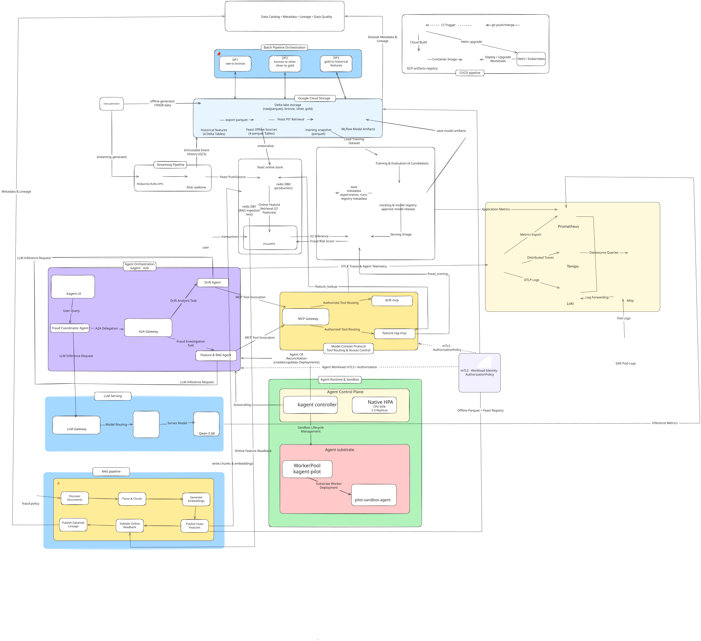
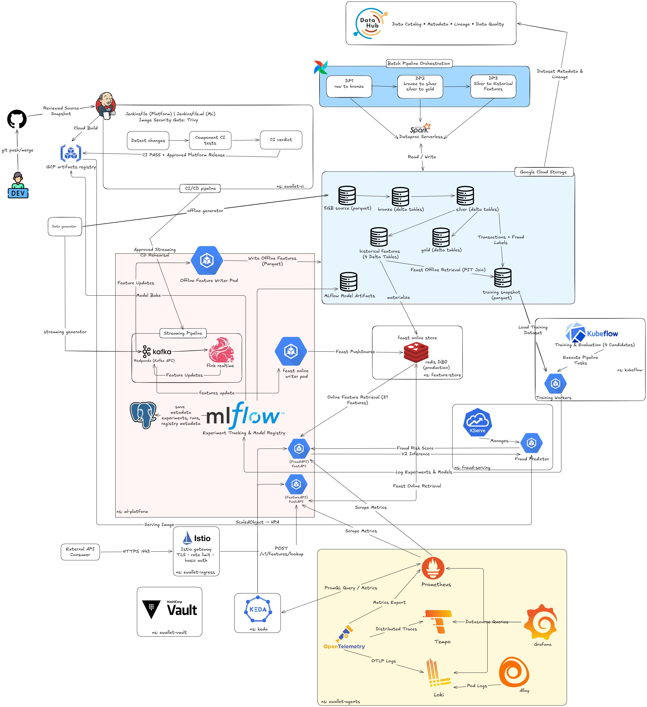

# E-Wallet Data & AI Platform

An end-to-end fraud-intelligence platform for synthetic e-wallet transactions,
built to study the engineering problems behind financial fraud detection:
high-volume data, late and duplicate events, point-in-time-correct features,
reproducible model training, low-latency inference, and grounded AI-assisted
investigation.

The repository connects a Delta Lake data platform, batch and event-time
streaming pipelines, Feast feature serving, Kubeflow and MLflow model
operations, KServe inference, a CPU-served LLM, and a sandboxed multi-agent
investigation platform on GKE. Around them sit source-to-digest CI/CD, an
Istio-based external gateway, an ambient service mesh, and a metrics, logs and
traces stack. The emphasis is not only on implementation, but on measured
experiments, correctness gates, immutable evidence, and explicit experiment
boundaries.

> **Coursework scope.** This is a research and engineering project, not an
> end-user wallet application. All transaction data is synthetic; documented
> measurements apply only to the named fixtures, runs, and source versions.

---

## Contents

- [Project Overview](#project-overview)
- [Key Highlights](#key-highlights)
- [Experimental Results](#experimental-results)
- [System Architecture](#system-architecture)
- [Technology Stack](#technology-stack)
- [Data Engineering Platform](#data-engineering-platform)
- [ML Platform](#ml-platform)
- [LLM & Agentic AI](#llm--agentic-ai)
- [CI/CD and Release Engineering](#cicd-and-release-engineering)
- [Platform Infrastructure and Security](#platform-infrastructure-and-security)
- [Novel Ideas](#novel-ideas)
- [Quick Start](#quick-start)
- [Documentation](#documentation)
- [Repository Structure](#repository-structure)

---

## Project Overview

Fraud detection is a systems problem before it is a modeling problem. Real
payment streams contain duplicates, skew, schema changes, out-of-order events,
late labels, and features that can silently leak future information. A useful
platform must preserve event-time semantics from ingestion to inference while
making every model and dataset version reproducible.

This project addresses that problem through four connected layers:

```text
Data engineering → Feature Store → ML training and serving → LLM-assisted agent investigation
```

- **Data engineering:** deterministic offline data feeds the Bronze/Silver/Gold
  Delta Lake, while versioned stream events flow through Redpanda and Flink.
  Spark on Dataproc Serverless handles batch transformations, Airflow
  orchestrates bounded workflows, and DataHub holds verified lineage and
  quality results.
- **Feature Store:** point-in-time feature tables feed Feast Offline (GCS) and
  Online (Redis) stores, refreshed by Airflow-orchestrated incremental
  materialization and by a Flink streaming job through a Feast PushSource.
- **Machine learning:** Kubeflow Pipelines trains and evaluates candidates,
  MLflow records model and data lineage, and KServe hosts model-inside-image
  inference behind the Fraud API.
- **AI-assisted investigation:** a Fraud Coordinator agent turns an analyst's
  question into a typed investigation, delegates it over A2A to sandboxed
  specialist agents, and those agents reach features, model scores and cited
  policy knowledge through policy-gated MCP tools. The fraud score always comes
  from the model, never from the LLM.

An operational platform runs alongside: Jenkins CI/CD with Cloud Build and
Trivy, Prometheus/Grafana/Loki/Tempo observability, a private-by-default
external gateway, Istio ambient mTLS with default-deny policies, and Terraform
for the GCP foundation.

The platform is intentionally modular. Each Python component owns its
`pyproject.toml` and `uv.lock`, infrastructure is separated from application
logic, and runtime claims are tied to preserved reports and evidence.

---

## Key Highlights

- **Deterministic, manifest-backed data.** Stable shard identities, create-only
  publication, resume safety, and a final manifest make the 5 GB source dataset
  reproducible across worker counts.
- **Verified batch orchestration and governance.** Three Airflow DAGs run the
  DP1/DP2/DP3 Spark stages on Dataproc Serverless. Their lineage and 263
  result-bound quality assertions are published to DataHub and read back
  exactly.
- **Correctness before optimization.** A/B comparisons require equivalent
  inputs and semantic gates. Regressions and failed equivalence checks remain
  visible instead of being presented as gains.
- **Point-in-time-safe features, batch and streaming.** Historical lookups use
  exclusive temporal windows, label columns are excluded from Feast, and both
  the incremental batch path and the Flink streaming path are checked value by
  value against the offline store on GKE.
- **Reproducible ML delivery.** Immutable snapshots flow through a six-stage
  Kubeflow pipeline; MLflow binds the selected model to its dataset and runtime
  image; KServe serves the model from a digest-pinned image.
- **Grounded agent orchestration.** A BYO kagent Coordinator uses the LLM only
  for natural-language intake; typed requests go to two BYO SandboxAgents that
  run under gVisor on one shared, KEDA-scaled WorkerPool.
- **Source-to-digest CI/CD.** Jenkins builds from an immutable Git snapshot,
  Cloud Build produces digest-addressed images, Trivy gates them, and releases
  end in bounded rehearsals with production promotion kept behind an operator
  boundary.
- **Private-by-default edge and layered security.** External routing uses an
  Istio gateway with Gateway API, TLS, Basic Auth, rate limits and source
  restrictions, published only during supervised campaigns. Internally, Istio
  ambient workload identity, AuthorizationPolicy and NetworkPolicy enforce
  default deny.

---

## Experimental Results

### At a Glance

| Experiment | Recorded result | Scope and source |
|---|---:|---|
| Source dataset `rehearsal-5gb-v1` | **5,000,608,241 bytes** across 186 shards | 18.6 M logical transactions; immutable manifest pinned by every DagRun; [generator report](docs/edai1/data_generator/DATA_GENERATION_AND_SIMULATION.md) |
| Duplicate simulation | **2.00%** added rows | 372,000 controlled duplicates, all removed in Silver (18,972,000 → 18,600,000); [generator report](docs/edai1/data_generator/DATA_GENERATION_AND_SIMULATION.md) |
| Flink acceptance p95 | **10,896 → 7,256 ms** | 100 events/s for 120 s, baseline vs optimised profile; [streaming report](docs/edai1/streaming/FLINK_STREAMING.md) |
| Docker image (5GB verifier) | **396.9 → 44.2 MB** content (−88.87 %) | 95.8 % from the slim base, 4.2 % from multi-stage packaging; same 45-check fingerprint; [Docker report](docs/edai1/docker/DOCKER_OPTIMIZATION.md) |
| Delta partition pruning (5GB) | **7 of 151 files, 3.0–3.3× faster** | Compaction was a no-op and Z-order was not adopted (no I/O reduction); isolated Dataproc clones; [storage report](docs/edai1/storage/STORAGE_OPTIMIZATION.md) |
| PostgreSQL index (5GB) | **174.073 → 0.108 ms** median | Covering B-tree on 3.8 M real Gold rows, +17 % WAL; [storage report](docs/edai1/storage/STORAGE_OPTIMIZATION.md) |
| DataHub governance (5GB) | **141/141 records read back, 263/263 assertions PASS** | 44 datasets, 3 DataFlows, 8 DataJobs, 34 lineage aspects; 260 executed Spark rules give 263 outcomes; local DataHub; [DataHub report](docs/edai1/datahub/DATAHUB_GOVERNANCE.md) |
| Feature Store consistency (5GB) | **0 mismatches** | Airflow incremental window, 8/8 tasks, read back from Redis (155 comparisons); streaming Offline↔Online on GKE (203 comparisons, 26/26 point-in-time); [Feature Store](docs/edai2/mlops/FEATURE_STORE.md) |
| Kubeflow training | **Successful six-stage pipeline** | Run `dc29f5cc-cc9e-49ae-b861-eacddd6269b5`; [ML pipeline report](docs/edai2/mlops/ML_PIPELINE_SERVING.md) |
| KServe inference | **HTTP 200 fraud predictions** | Baked model version 1 in a digest-pinned image; [ML pipeline report](docs/edai2/mlops/ML_PIPELINE_SERVING.md) |
| Serving autoscaling (KEDA) | **1 → 2 → 1 replicas, 0 failures** | Feature API and Fraud API, 20-user Locust runs on GKE; no throughput or latency gain shown; [KEDA report](docs/edai2/mlops/SERVING_AUTOSCALING_KEDA.md) |
| LLM CPU thread binding (EXP-V1) | **+54.5 % output tokens/s at c=4** | `OBSERVED_IMPROVEMENT`; one baseline/optimized pair; [benchmark report](docs/edai2/llm/BENCHMARK_RESULTS.md) |
| llm-d EPP routing (EXP-V2) | **−47.5 % p95 at c=2, +101.9 % at c=4** | `OBSERVED_MIXED`; benchmark arm only, not deployed; [benchmark report](docs/edai2/llm/BENCHMARK_RESULTS.md) |
| Agent Platform load (G5) | **100/100 tasks; Coordinator and WorkerPool 2 → 3 → 2** | Owner replay `replay-20261118T161231Z` on GKE; the added worker ran Sandbox actors; [Agent evidence](docs/edai2/agents/AGENT_PLATFORM_EVIDENCE.md) |
| Agent sessions (G6) | **24/24 turns** on 2 shared workers | Same replay; Registry 3 Agents, 2 MCP servers, 3 Prompts; [Agent evidence](docs/edai2/agents/AGENT_PLATFORM_EVIDENCE.md) |
| CI/CD V2 release campaign | **6 successful CD executions, 6 of 7 release groups** | Every verdict `stage: rehearsal`, `production_changed: false`; streaming rehearsal 182 comparisons, 0 mismatches; [release evidence](docs/edai2/cicd/CICD_RELEASE_EVIDENCE.md) |
| External gateway acceptance (G3-B) | **4 routes over HTTPS, cleanup COMPLETE** | Supervised campaign `g3b-owner-evidence-20261124T083106Z`; DNS back offline, GKE back to 0 nodes; [gateway evidence](docs/edai2/gateway/EXTERNAL_GATEWAY_EVIDENCE.md) |
| Point-in-time validation (5GB) | **0 mismatches** | Feast historical retrieval vs an independent oracle (155 comparisons, 0 ambiguous); streaming Offline verification 26/26; an earlier direct-Gold run on the 100 GB snapshot matched 310/310; [PIT report](docs/edai1/novel_ideas/02_PIT_LEAKAGE_PREVENTION.md) |

The DP1–DP3 batch pipelines ran end to end on Dataproc under Airflow for the
5 GB campaign `ab-20261110225456`, once per Spark profile. All validations passed,
and the Baseline and Optimised outputs are semantically equivalent across all 34
tables. The Optimised profile was not faster in this single trial: application
runtime rose 6.7–47.7 % per stage, within the run-to-run variation measured on
unchanged validators, while AQE cut Gold shuffle by 20.5 %. See
[Batch Processing and Orchestration](docs/edai1/BATCH_PROCESSING_AND_ORCHESTRATION.md).

All data-engineering, storage, governance, schema and Feature Store results
above use the same 5 GB source dataset, `rehearsal-5gb-v1`. They describe
behaviour at that scale and do not extrapolate to larger data. The same
generator earlier published a 100 GB dataset (100,156,470,260 bytes, 3,696
shards); it is documented as history in the generator report.

---

## System Architecture



*Figure 1. Owner-approved end-to-end E-Wallet platform architecture. Numbered
arrows follow the direction of data or requests, while colour separates the
major data, ML, agent, observability, delivery and security flows.*

[Open the editable Excalidraw source](docs/architecture/ewallet_system_architecture.excalidraw).

The diagram is a navigation view rather than standalone runtime proof: not
every component it shows was independently runtime-verified. The
[EDAI-1 reports](docs/edai1/README.md) cover data generation, batch and stream
processing, orchestration, governance and storage. The [EDAI-2 reports](docs/edai2/README.md)
cover feature engineering, training, serving, LLMs, RAG, agents, delivery,
gateways, security and observability, each with its evidence and limitations.
Evidence status and unresolved proof gaps remain in the separate internal
indexes linked from the [documentation index](docs/README.md).

### Data + ML Overall System Flow

The following diagram presents the end-to-end Data and ML platform. Airflow
orchestrates the DP1/DP2/DP3 batch pipelines on Spark (Dataproc Serverless),
which turn generated sources into bronze, silver, gold and historical-feature
Delta tables on Google Cloud Storage, with lineage and quality in DataHub.
Streaming events flow through Redpanda into Apache Flink, which keeps the Feast
online store (Redis) fresh. The Feast offline store produces point-in-time
training snapshots. Kubeflow Pipelines trains and evaluates candidate models
and logs them to MLflow. KServe serves the fraud predictor behind the Fraud API,
and the Feature API serves online features through the Istio gateway with KEDA
autoscaling. Jenkins CI/CD with Trivy image gates and OpenTelemetry, Prometheus,
Grafana, Loki and Tempo observability complete the platform. The Vault
integration shown in the figure is implemented and locally validated, but not
deployed on GKE (see [Platform Infrastructure and Security](#platform-infrastructure-and-security)).

Related documentation:
[Batch Processing and Orchestration](docs/edai1/BATCH_PROCESSING_AND_ORCHESTRATION.md) ·
[Flink Streaming](docs/edai1/streaming/FLINK_STREAMING.md) ·
[Feature Store](docs/edai2/mlops/FEATURE_STORE.md) ·
[ML Pipeline and Serving](docs/edai2/mlops/ML_PIPELINE_SERVING.md) ·
[CI/CD Architecture](docs/edai2/cicd/CICD_ARCHITECTURE.md) ·
[Observability](docs/edai2/observability/OBSERVABILITY.md)



---

## Technology Stack

| Layer | Technologies |
|---|---|
| Data generation | Python, Faker, deterministic sharding, Parquet |
| Batch processing | Apache Spark, PySpark, Delta Lake, Dataproc Serverless |
| Streaming | Redpanda, Apache Flink / PyFlink, GCS history, Feast PushSource, Redis |
| Storage and query | Google Cloud Storage, MinIO, Delta Lake, Trino, PostgreSQL |
| Orchestration and governance | Apache Airflow, DataHub, data contracts |
| Feature platform | Feast Offline Store (GCS), Feast Online Store (Redis) |
| Training and tracking | Kubeflow Pipelines, scikit-learn, MLflow, DVC |
| Model serving | KServe, FastAPI, Pydantic, KEDA |
| LLM serving | vLLM (CPU), Qwen3-0.6B, agentgateway, kagent ModelConfig |
| Agent platform | kagent BYO Agent, Agent Substrate SandboxAgents and WorkerPool, gVisor, A2A, MCP, Agent Registry, KEDA |
| RAG | Fraud-policy corpus, `all-MiniLM-L6-v2` embeddings, Feast, Airflow, DataHub |
| CI/CD | Jenkins on GKE (CasC, Job DSL), Cloud Build, Artifact Registry, Trivy |
| Observability | Prometheus, Grafana, Loki, Tempo, OpenTelemetry Collector, Grafana Alloy |
| Networking and security | Istio ambient (ztunnel), Istio gateway with Gateway API, AuthorizationPolicy, NetworkPolicy, Vault (local validation) |
| Infrastructure and reproducibility | GKE, Kubernetes, Helm, Terraform, `uv`, per-component lockfiles, immutable image digests |

---

## Data Engineering Platform

The data layer starts with immutable offline shards and controlled stream events. The generators deliberately introduce skew, duplicates, schema evolution, bursts, out-of-order delivery, and late arrival so pipeline behavior can be evaluated against known input characteristics.

### DP1 — Bronze

DP1 reads an immutable source manifest and Parquet datasets from GCS, submits a source-to-Bronze
Spark job, and verifies the exact nine-table Delta output. Bronze remains source-shaped: it
preserves raw business records while adding the ingestion information required to trace the run and
reconcile transaction V1/V2 physical files.

### DP2 — Silver and Core Gold

DP2 normalizes types, cleans records, handles additive schema evolution, deduplicates transaction
identities, and validates the nine Silver tables. It then builds the separate Core Gold boundary:
dimensions, facts, analytical aggregates, and the denormalized transaction OBT. Core Gold business
tables are not the four historical behavior-feature tables computed by DP3. In the 5 GB campaign
both Spark profiles passed the 93-rule Gold validation (including the SCD Type 2 merchant
dimension), and their outputs were semantically equivalent.

### DP3 — Historical Features

DP3 verifies the required validated Silver and Core Gold inputs, then computes four run-scoped
behavior tables for user, account, device, and merchant entities. Their event-time windows preserve
`[T-window,T)` semantics and form the historical feature boundary exported to Feast Offline. The
DP3 Airflow DAG validates the four physical Delta outputs; the later independent PIT/Feast
comparison and its DataHub events are not tasks inside the preserved DP3 DagRun.

### Flink Streaming

Three pieces of work have distinct evidence and responsibilities:

- The **historical EDAI-1 streaming benchmark** demonstrates event-time processing, watermarks,
  deduplication, late-event handling, windows, checkpoint behavior, and preserved runtime evidence.
- **The streaming feature job** adds historical bootstrap, 31-feature state maintenance,
  immutable GCS history, and Feast PushSource updates. Its Offline↔Online consistency was verified
  in a dedicated GKE campaign (see the [Feature Store](docs/edai2/mlops/FEATURE_STORE.md) report),
  and separately in the CI/CD streaming rehearsal.
- The **Flink local benchmark** compares baseline and optimised profiles on a local Flink +
  Redpanda stack: identical output at 100 events/s with lower latency for the parallel profile;
  at 500 events/s neither profile keeps up. See the [Flink report](docs/edai1/streaming/FLINK_STREAMING.md).

### Orchestration and Governance

DP1, DP2, and DP3 are separate manual-trigger Airflow DAGs (`schedule=None`) that submit
Dataproc Serverless Spark batches. Each has its own upstream evidence, immutable run identity, and
validation boundary; they are not one automatically scheduled end-to-end DAG.

DataHub lineage and assertions are built only from verified campaign evidence. For the 5 GB
campaign, the checksum-chained manifests give 44 datasets, 3 DataFlows, 8 DataJobs and 34 lineage
aspects (45 upstream links). All 141 metadata records were published and read back with 0
mismatches. The validators executed 260 Spark rules, which yield 263 assertion outcomes because one
DP3 rule applies to all four feature tables; all 263 passed, and their definitions and run events
were published and read back. Publication targeted a local DataHub instance. See
[DataHub Governance](docs/edai1/datahub/DATAHUB_GOVERNANCE.md).

---

## ML Platform

The ML platform turns validated Gold feature tables into reproducible training
and inference inputs:

- **Feast** defines entity and feature-view contracts. Historical retrieval is
  point-in-time correct. An Airflow DAG runs windowed incremental
  materialization into Redis, and the Flink streaming job pushes fresh values
  through a Feast PushSource.
- **Kubeflow Pipelines** validates an immutable snapshot, verifies chronological
  splits, trains four candidates, selects on validation metrics, evaluates only
  the winner on the held-out test set, and publishes lineage.
- **MLflow** records parent/child runs, metrics, model artifacts, dataset
  identity, Git revision, and image digest. The bounded campaign registered
  `fraud-detector` model version 1 with the `candidate` alias.
- **KServe** runs the selected model inside an immutable predictor image. The
  Fraud API assembles online features and calls the private V2 inference path;
  the Feature API serves online feature lookups.
- **KEDA** scales the Feature API and the Fraud API from a Prometheus request
  rate between 1 and 3 replicas. In the owner-run experiments both APIs scaled
  1 → 2 → 1 with 0 failures; the runs did not show a throughput or latency gain
  over the fixed baseline, and the single KServe predictor bounds Fraud API
  throughput.

The Feature Store's batch and streaming paths are verified on GKE with the
5GB dataset; see the [Feature Store](docs/edai2/mlops/FEATURE_STORE.md) report.
The training and serving campaign includes one successful Kubeflow run, MLflow
model registration, a ready KServe InferenceService, and successful fraud
prediction responses. The complete run identities and evidence are in the
[ML pipeline report](docs/edai2/mlops/ML_PIPELINE_SERVING.md) and the
[KEDA report](docs/edai2/mlops/SERVING_AUTOSCALING_KEDA.md).

---

## LLM & Agentic AI

The AI investigation layer is designed around a strict separation of concerns:
the fraud model scores a transaction, while agents retrieve and explain the
evidence behind that score.

### LLM serving

A pinned Qwen3-0.6B runs on CPU vLLM in GKE, baked into a digest-pinned image.
Agents never call vLLM directly: **agentgateway** authenticates clients,
enforces request and token budgets, applies nested timeouts, and fails over
between backends. One global kagent **ModelConfig**, `ewallet-global-llm`,
defines the model, endpoint and credential reference. Because a kagent BYO
agent cannot reference a ModelConfig natively, a small **BYO ModelConfig
Resolver** reads it once at Coordinator start-up under a single-name RBAC
grant.

```text
Fraud Coordinator --(start-up, configuration read)--> ModelConfig ewallet-global-llm
Fraud Coordinator --(runtime request)--> agentgateway --> vLLM CPU (Qwen3-0.6B)
```

The ModelConfig is configuration, not a network hop. It is deployed, and the
resolver configuration is live in the current release; resolver log lines were
captured in an earlier production run but not under the current release. The
two serving benchmarks are single baseline/optimized pairs: CPU thread binding
(EXP-V1) showed an improvement, while llm-d EPP routing (EXP-V2) gave mixed
results and is not part of the deployed routing. See the
[LLM Inference Platform](docs/edai2/llm/LLM_PLATFORM.md) and
[LLM Benchmark Results](docs/edai2/llm/BENCHMARK_RESULTS.md).

### Agent Platform

| Agent | Runtime | Role |
|---|---|---|
| Fraud Coordinator | kagent BYO Agent (Deployment) | Natural-language intake with the LLM, then typed delegation |
| Feature-RAG Specialist | BYO SandboxAgent on the shared WorkerPool | Features, model score and cited policy retrieval through MCP |
| Drift Specialist | BYO SandboxAgent on the shared WorkerPool | Drift evidence through MCP |

A request reaches the Coordinator, which uses the LLM only to turn the
analyst's question into a validated typed investigation. The typed request
goes through the **A2A Gateway** to the specialist SandboxAgents, which call
MCP tools only through the **MCP Gateway**; the tools reach Feast, KServe and
the RAG store. Specialists receive typed requests and do not call the LLM. The
specialists' actors run under **gVisor** on one Agent Substrate **WorkerPool**
shared by both agents, and KEDA scales the Coordinator and the WorkerPool
independently. An **Agent Registry** catalogs the agents, MCP servers and
system prompts.

The owner-run replay `replay-20261118T161231Z` on GKE exercised the deployed
platform: the Fraud, Drift and Combined workflows each completed through the
full Coordinator → A2A Gateway → SandboxAgent → MCP Gateway → MCP server chain,
the security probes were denied, and the G5 load test completed 100/100 tasks
while the Coordinator and the WorkerPool each scaled 2 → 3 → 2 and the added
worker executed real Sandbox actors. Telemetry was present in Grafana, Tempo
and Loki. Open observations are listed in the
[Agent Platform evidence](docs/edai2/agents/AGENT_PLATFORM_EVIDENCE.md);
the design is in the [architecture report](docs/edai2/agents/AGENT_PLATFORM_ARCHITECTURE.md).

In an earlier release the Feature-RAG Specialist ran as a BYO Deployment and
the Drift Specialist as a kagent Declarative agent; those records remain as
historical evidence.

### RAG knowledge pipeline

Internal fraud-policy documents are parsed into deterministic chunks, embedded
(384-dimensional, L2-normalized), published through Feast, and retrieved with
citations that trace each answer to its source. An Airflow DAG orchestrates
ingestion and DataHub records its lineage and assertions. The owner-run Hybrid
campaign on GKE passed every check on a deliberately small corpus (2
documents, 4 chunks, 2 queries); it validates the pipeline, not large-scale
retrieval quality. See the [RAG Knowledge Pipeline](docs/edai2/rag/RAG_PIPELINE.md).

---

## CI/CD and Release Engineering

CI/CD V2 is built around one rule: a release must be traceable from a reviewed
Git SHA to the image digest that ran, and nothing may reach production by side
effect.

- **Jenkins on GKE** (namespace `ewallet-ci`, configuration as code) does not
  pull from GitHub. Jobs check out a Git bundle baked into a digest-pinned
  snapshot image, and the controller refuses to start unless the bundle
  matches the recorded revision.
- **Component CI** runs from a component catalog. The root `Jenkinsfile`,
  `Jenkinsfile.ml` and `Jenkinsfile.llm-agent` all load the shared
  [`componentPipeline.groovy`](jenkins/pipeline/componentPipeline.groovy)
  with different profiles; `Jenkinsfile.rag` is a separate RAG ingestion
  pipeline.
- **Release units** decide what is deployed and in which order, behind an
  explicit approval. Changing a file never deploys anything by itself.
- **Images** are built by Cloud Build, pushed to Artifact Registry, read back
  by digest, and gated by a Trivy scan policy that fails closed.
- **Release orchestration** ends in bounded rehearsals, Agent staging, and a
  streaming consistency rehearsal. Production promotion is an operator step.

The published campaign records six successful CD executions covering six of
the seven release groups. **Every release verdict is a rehearsal with
`production_changed: false`.** The production promotion and rollback paths
exist in source but are not runtime-verified. The streaming rehearsal
compared 182 online feature values with a replay of history and found 0
mismatches; it is a separate campaign from the Feature Store's own streaming
verification. See the [CI/CD architecture](docs/edai2/cicd/CICD_ARCHITECTURE.md),
[operations](docs/edai2/cicd/CICD_OPERATIONS.md) and
[release evidence](docs/edai2/cicd/CICD_RELEASE_EVIDENCE.md), and
[Testing and Continuous Verification](docs/edai2/testing/TESTING.md) for the
test strategy.

---

## Platform Infrastructure and Security

Istio plays two distinct roles in this platform:

- **Internal service mesh.** The agent namespaces, and selected platform
  workloads such as the KEDA operator, run in **Istio ambient mode**: ztunnel provides mTLS and workload identities without a
  sidecar per pod. A default-deny `AuthorizationPolicy` plus one allow rule per
  declared flow governs who may call whom, and a matching Kubernetes
  `NetworkPolicy` restricts the network path. Gateways strip client
  credentials and set their own, and MCP tools use per-subject credentials with
  per-tool grants.
- **External gateway.** An **Istio gateway with Gateway API** handles external
  HTTPS. It is two Helm releases: `ewallet-edge-gateway` (the Envoy proxy) and
  `ewallet-edge` (Gateway, HTTPRoutes, ReferenceGrants, TLS, Basic Auth, rate
  limits, source restrictions and backend NetworkPolicies). The Gateway binds
  to the existing proxy Service rather than provisioning its own. It is **not**
  an NGINX Ingress.

The external gateway is **private by default** (a `ClusterIP` Service, no DNS).
During an approved, supervised campaign it becomes reachable through a GCP load
balancer and publishes exactly four interfaces: the Feature API, the kagent UI,
the Agent Registry and Grafana. The accepted G3-B campaign passed deployment,
security and public end-to-end checks, then cleaned up completely: DNS
returned offline and GKE returned to zero nodes. See the
[External Gateway architecture](docs/edai2/gateway/EXTERNAL_GATEWAY_ARCHITECTURE.md),
[operations](docs/edai2/gateway/EXTERNAL_GATEWAY_OPERATIONS.md) and
[evidence](docs/edai2/gateway/EXTERNAL_GATEWAY_EVIDENCE.md).

The GCP foundation (network, GKE, IAM and Workload Identity, storage, Artifact
Registry, Dataproc and CI build identities) is defined in Terraform; see
[Platform Infrastructure and Security](docs/edai2/platform/GATEWAY_IAC_SECURITY_AB.md).
**Vault** centralized secrets are implemented and validated on a local
deployment, but **not deployed on GKE**; workloads on GKE still use Kubernetes
Secrets. See [Vault](docs/edai2/platform/VAULT.md).

Observability is a single stack: Prometheus for metrics, Loki for logs
(forwarded by Grafana Alloy and by OTLP), Tempo for distributed traces from the
OpenTelemetry Collector, and Grafana dashboards as code. It covers the serving
APIs, KServe, vLLM, the gateways and agent execution, with redaction of
credentials and prompts before export. See
[Observability](docs/edai2/observability/OBSERVABILITY.md).

---

## Novel Ideas

### 1. Deterministic Sharding

Large synthetic datasets are normally difficult to reproduce after a partial
failure or a change in worker count. This project derives each shard from a
stable identity and deterministic seed, writes through create-only publication,
and commits a final manifest only after the complete shard set is valid.

The implementation produced byte-identical bounded outputs across one, two,
and four workers and published the 5,000,608,241-byte `rehearsal-5gb-v1`
dataset in 186 shards behind one verified manifest. See [Deterministic Sharding](docs/edai1/novel_ideas/01_DETERMINISTIC_SHARDING.md).

### 2. Point-in-Time Leakage Prevention

Feature parity alone does not prove temporal correctness. Spark builds features
with exclusive historical windows, label columns never reach Feast, and the
validators compare Feast retrieval with an oracle that does not use Feast.

On the 5 GB data, historical retrieval matched the independent oracle in all 155
comparisons with no ambiguous entity, and the streaming campaign verified 26/26
point-in-time values. An earlier ten-case direct-Gold validation on the 100 GB
snapshot matched all 310 values.
See [Point-in-Time Leakage Prevention](docs/edai1/novel_ideas/02_PIT_LEAKAGE_PREVENTION.md).

### 3. Grounded Agent Intake and Exact Agent Telemetry

On the EDAI-2 side, the LLM only selects a tool and its arguments, each
argument validated against the analyst's text, and never produces a fraud
score; and agent call counts stay exact across replicas and restarts. See
[Grounded Agent Intake and Exact Agent Telemetry](docs/edai2/novel_ideas/NOVEL_IDEAS.md).

---

## Quick Start

The Quick Start is local and bounded. Local Compose services are not
equivalent to the GKE deployment, and nothing here deploys to the cloud.

### Prerequisites

- Linux or WSL2, Git, and Docker Engine with Compose v2
- [`uv`](https://docs.astral.sh/uv/) 0.13 or newer
- A Java runtime compatible with the selected PySpark environment
- Helm, Terraform, and Google Cloud SDK only for the corresponding
  infrastructure workflows

### Clone and configure

```bash
git clone https://github.com/HuyyGiaa/ewallet-data-ai-platform.git
cd ewallet-data-ai-platform
cp .env.example .env
```

Runtime profiles live under [`configs/environments`](configs/environments).
Never commit `.env`, credentials, project IDs, tokens, or production secrets.

### Install a locked component environment

There is no repository-wide Python environment. Each deployable component owns
its dependency graph and lockfile:

```bash
uv lock --check --project ai_platform/features/feast
uv sync --locked --project ai_platform/features/feast
```

Use the same `--project` pattern for `ai_platform/ml`,
`ai_platform/ml/pipelines`, `ai_platform/inference`, or the relevant project
under `infra/docker/`.

### Run bounded validation

```bash
# Feature Store tests in the locked Feast environment
PYTHONPATH=. uv run --locked --project ai_platform/features/feast \
  python -m unittest discover -s tests -t .

# Streaming tests in the locked benchmark environment
PYTHONPATH=. uv run --locked --project infra/docker/flink-benchmark \
  python -m pytest -q tests/streaming

# Runtime-profile and source-contract checks
python3 ops/validation/validate_runtime_config.py
python3 -m ops.llm_agent.preflight --repository-root "$PWD"
```

Tests requiring optional services or runtimes skip when their prerequisites are
unavailable. No benchmark or cloud workload is required to browse the reports
and preserved evidence.

### Start the local data services

```bash
docker compose -p ewallet-data-ai-platform --project-directory . \
  --profile ingestion --profile storage \
  -f infra/docker/compose.messaging.yml \
  -f infra/docker/compose.ingestion.yml \
  -f infra/docker/compose.storage.yml \
  -f infra/docker/compose.query.yml \
  up -d
```

For the streaming benchmark lifecycle, use
[`scripts/streaming/flink_bench.sh`](scripts/streaming/flink_bench.sh).

GKE, MLOps, agent, gateway and CI/CD operations have separate runbooks in the
[runbook index](docs/runbooks/README.md). They require explicit owner approval,
run against real cloud resources that incur cost, and should not be inferred
from this local quick start.

---

## Documentation

All technical reports live under [`docs/`](docs). Each one explains a component's design, implementation, execution and results, with the screenshots and source references that support them. The [documentation index](docs/README.md) is the reviewer entry point.

### EDAI-1: Data Engineering

| Area | Report |
|---|---|
| Overview | [EDAI-1 index](docs/edai1/README.md) |
| Containers | [Docker Optimisation](docs/edai1/docker/DOCKER_OPTIMIZATION.md) |
| Data generation | [Data Generation and Simulation](docs/edai1/data_generator/DATA_GENERATION_AND_SIMULATION.md) |
| Batch Processing & Orchestration — DP1/DP2/DP3 | [Batch Processing and Orchestration](docs/edai1/BATCH_PROCESSING_AND_ORCHESTRATION.md) |
| Stream processing | [Flink Streaming](docs/edai1/streaming/FLINK_STREAMING.md) |
| Storage | [Lakehouse and Warehouse Storage Optimisation](docs/edai1/storage/STORAGE_OPTIMIZATION.md) |
| Governance | [DataHub Governance](docs/edai1/datahub/DATAHUB_GOVERNANCE.md) |
| Data model | [Schema Design](docs/edai1/schema/SCHEMA_DESIGN.md) |
| Novel ideas | [Deterministic Sharded Generation](docs/edai1/novel_ideas/01_DETERMINISTIC_SHARDING.md), [Point-in-Time Leakage Prevention](docs/edai1/novel_ideas/02_PIT_LEAKAGE_PREVENTION.md) |

### EDAI-2: ML, LLM and Agent Platform

| Area | Report |
|---|---|
| Overview | [EDAI-2 index](docs/edai2/README.md) |
| Feature store | [Feature Store](docs/edai2/mlops/FEATURE_STORE.md), [runbook](docs/runbooks/edai2/FEATURE_STORE_RUNBOOK.md) |
| Training, registry, serving | [ML Pipeline and Serving](docs/edai2/mlops/ML_PIPELINE_SERVING.md) |
| Serving autoscaling | [Serving Autoscaling with KEDA](docs/edai2/mlops/SERVING_AUTOSCALING_KEDA.md) |
| LLM serving, gateway, ModelConfig, benchmarks | [LLM Inference Platform](docs/edai2/llm/LLM_PLATFORM.md), [LLM Benchmark Results](docs/edai2/llm/BENCHMARK_RESULTS.md) |
| Agents, MCP tools, registry, gateways | [Agent Platform architecture](docs/edai2/agents/AGENT_PLATFORM_ARCHITECTURE.md), [operations](docs/edai2/agents/AGENT_PLATFORM_OPERATIONS.md), [evidence](docs/edai2/agents/AGENT_PLATFORM_EVIDENCE.md) |
| RAG | [RAG Knowledge Pipeline](docs/edai2/rag/RAG_PIPELINE.md) |
| CI/CD | [CI/CD architecture](docs/edai2/cicd/CICD_ARCHITECTURE.md), [operations](docs/edai2/cicd/CICD_OPERATIONS.md), [release evidence](docs/edai2/cicd/CICD_RELEASE_EVIDENCE.md) |
| External gateway | [External Gateway architecture](docs/edai2/gateway/EXTERNAL_GATEWAY_ARCHITECTURE.md), [operations](docs/edai2/gateway/EXTERNAL_GATEWAY_OPERATIONS.md), [evidence](docs/edai2/gateway/EXTERNAL_GATEWAY_EVIDENCE.md) |
| Infrastructure and security | [Platform Infrastructure and Security](docs/edai2/platform/GATEWAY_IAC_SECURITY_AB.md), [Vault](docs/edai2/platform/VAULT.md) |
| Observability | [Observability](docs/edai2/observability/OBSERVABILITY.md) |
| Testing | [Testing and Continuous Verification](docs/edai2/testing/TESTING.md) |
| Novel ideas | [Grounded Agent Intake and Exact Agent Telemetry](docs/edai2/novel_ideas/NOVEL_IDEAS.md) |

### Operations

[Runbook index](docs/runbooks/README.md), including the
[Terraform GCP foundation runbook](docs/cloud/terraform_gcp_foundation.md),
the [Feature Store runbook](docs/runbooks/edai2/FEATURE_STORE_RUNBOOK.md) and
the [UI access runbook](docs/runbooks/edai2/UI_REPLAY.md).

---

## Repository Structure

```text
ewallet-data-ai-platform/
├── data_platform/
│   ├── generation/                # Deterministic offline and stream generators
│   ├── ingestion/                 # Redpanda, Kafka Connect and source ingestion
│   ├── processing/spark/          # Bronze, Silver, Gold and feature jobs
│   ├── streaming/                 # Flink contracts, operators and sinks
│   ├── orchestration/airflow/     # DP1, DP2, DP3, Feast materialization and RAG DAGs
│   ├── quality/                   # Fail-hard zone validators
│   ├── contracts/                 # Versioned data contracts
│   ├── metadata/datahub/          # Lineage and quality publication
│   └── storage/                   # Delta, GCS/MinIO and Trino integration
├── ai_platform/
│   ├── features/feast/            # Feature definitions, PIT validation, snapshots
│   ├── ml/                        # Training, MLflow and Kubeflow components
│   ├── inference/                 # Fraud API, Feature API, Feast assembly, KServe client
│   └── llm_agent/                 # Coordinator, SandboxAgents, MCP tools, RAG, ModelConfig resolver
├── configs/                       # Typed local, development and GCP profiles
├── infra/
│   ├── docker/                    # Compose stacks and locked image projects
│   ├── kubernetes/                # Agent sandbox, Jenkins, Istio ambient, KServe, KFP, Vault and more
│   ├── helm/                      # llm-agent-platform, ewallet-edge, ewallet-serving, KEDA charts
│   └── terraform/gcp/             # GCP infrastructure modules
├── jenkins/                       # Shared pipeline, component and release catalogs, CD contracts
├── Jenkinsfile*                   # Thin CI/CD entry points (platform, ml, llm-agent, rag)
├── ops/                           # Validation, GCP, CI and deployment operators
├── scripts/                       # CI, edge, MLOps, streaming and agent entry points
├── tests/                         # Unit, contract, integration and bounded E2E tests
├── docs/                          # Technical reports, runbooks and evidence
└── notebooks/                     # Read-only validation and demonstration notebooks
```

The repository follows domain boundaries rather than one global Python
environment. Exact dependency versions, runtime profiles, experiment IDs, and
evidence locations are documented by the component that owns them.

---

Developed as coursework and applied research in data engineering, MLOps, and
agentic AI. Maintained by [@HuyyGiaa](https://github.com/HuyyGiaa).
