# 5GB Rehearsal Benchmark `ab-20261110225456`: Baseline vs Optimised

> **Archived 2026-11-11 — not part of the submission.** This report covered the first write-up of the 5GB rehearsal `ab-20261110225456`. DP1–DP3 are now documented only in [Batch Processing and Orchestration — DP1/DP2/DP3](../../../../../docs/edai1/BATCH_PROCESSING_AND_ORCHESTRATION.md), from the 5GB campaign. Kept unchanged below for audit; it was moved from `docs/edai1/spark/REHEARSAL_5GB_BENCHMARK.md`.

This report covers the first complete Dataproc run of the three-DAG pipeline (DP1 → DP2 → DP3): one Baseline campaign and one Optimised campaign over the 5 GB rehearsal dataset.

The rehearsal was meant to prove **correctness, execution, orchestration and provenance** before the 100 GB run, and to take a first look at performance. It was not meant to choose the best Spark configuration.

- **Historical 100 GB results:** [Spark Optimisation](OPTIMIZATION_MATRIX.md).
- **Orchestration:** [Airflow Pipelines](../airflow/AIRFLOW_DP1_DP2_DP3_EVIDENCE.md) §10.
- **Operating procedure:** the [runbook](../../../../../docs/runbooks/edai1/cloud/edai1_campaign_runbook.md).
- **Evidence:** in [`rehearsal-5gb-ab-20261110225456/`](../../../../../docs/evidence/edai1/spark/rehearsal-5gb-ab-20261110225456/README.md).

## 1. Executive summary

- **Execution and orchestration: verified.**
  - All 6 DagRuns succeeded, with all 51 Airflow tasks on try 1.
  - All 16 Dataproc batches succeeded: 8 transformations and 8 validators.
  - All 6 handoff manifests are published and hash-verified.
- **Data quality: verified per run.**
  - 260 validation rules per profile ran inside Airflow, and all passed: 54 Bronze, 60 Silver, 93 Gold and 53 features.
  - Both profiles produced identical observed values for every rule.
  - The rules cover referential integrity, deduplication, merchant history, SCD Type 2, the feature `created` timestamp and point-in-time recomputation.
- **Semantic equivalence between the profiles: PENDING / NOT VERIFIED.** The comparison batch `c1-20261110225456` was still running when this report was written (§7.4).
- **Performance: the Optimised profile was not faster in this trial.**
  - Spark application runtime rose in every stage: +29.5 % Bronze, +47.7 % Silver, +6.7 % Gold, +22.8 % features.
  - The validators run identical settings in both campaigns, so they act as a control. They also slowed by 6–54 % in the Optimised time window. Most of the difference is therefore run-to-run variation, not an effect of the profile.
- **Plan-level effects of AQE are real:**
  - Task counts fell 14.6 % in Bronze and roughly halved in Silver, Gold and DP3.
  - Gold switched joins to broadcast and wrote 20.5 % less shuffle.
  - Coalescing to 64 MiB left some Silver and DP3 stages with fewer tasks than cores.
- **This rehearsal does not establish which configuration will perform best at 100 GB** (§10).

## 2. Dataset and experimental setup

| Item | Value |
|---|---|
| Dataset | `rehearsal-5gb-v1`: 186 Parquet shards, 5,000,608,241 bytes; transactions in two schema versions (V1 without `channel`, V2 with it) plus 2 % duplicate deliveries |
| Source manifest SHA-256 | `ac2dfb0eac16e173261b3c3f65e83a03d388528538daefd9ec669bef7123eb80`, identical for both profiles |
| Code | Git `aae22b08eee20fa055c4aefc8d23c14cc3ae5f8c`, pinned at preparation, recorded in both manifests and on all 16 batches as a label |
| Platform | Dataproc Serverless runtime 2.2.90 (Spark 3.5, Scala 2.13.12, Java 17), Standard tier, `asia-southeast1` |
| Resources (both profiles) | 4-core driver and executors, 9,600 MB heap + 3,840 MB overhead; dynamic allocation 2 / 6 / 7 (min / initial / max); 192 MB broadcast threshold |
| Windows | Baseline 2026-11-10 22:56Z – 2026-11-11 00:15Z; Optimised 2026-11-11 07:09Z – 08:54Z |
| Trials | One per profile |

**Volumes per stage.** These are Delta add-statistics. Row counts are equal in both profiles for all 34 tables.

| Zone | Tables | Largest table |
|---|---:|---|
| Bronze | 9 | `transactions` 18,972,000 rows, 3.26 GB |
| Silver | 9 | `transactions` 18,600,000 rows, after deduplication |
| Gold | 12 | `obt_transaction_enriched` 18,600,000 rows, 4.27 GB |
| Features | 4 | `feat_account_behavior` 18,599,553 rows |

## 3. Architecture and execution flow

Three independent Airflow DAGs run each profile in turn. Each DAG ends by publishing an immutable handoff manifest, and the next DAG starts only after verifying it.

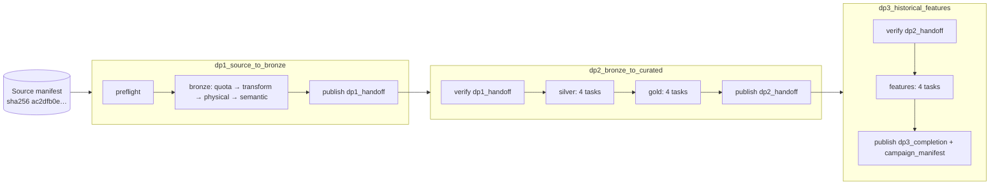

Each stage group has the same four tasks:

| Task | Role |
|---|---|
| `wait_quota` | Checks that regional CPU quota allows 28 vCPU |
| `submit_transformation` | One Dataproc batch, whose ID is the run ID |
| `physical_validation` | Checks that the exact Delta table set exists |
| `semantic_validation` | A separate validator batch that writes a JSON report and must report `PASS` |

Outputs go to run-scoped prefixes (`lakehouse/runs/<run>/<zone>`) that are never overwritten. A retry gets a new validator batch and report, never a rewrite.

The six DagRuns are shown in the [Airflow report §10](../airflow/AIRFLOW_DP1_DP2_DP3_EVIDENCE.md#10-three-dag-run-on-the-5gb-rehearsal-ab-20261110225456).

## 4. Reproducibility and configuration

**Identity chain.** Each handoff records:

- dataset, Source SHA-256 and Git SHA;
- profile and run IDs;
- the producing DagRun;
- the validation verdict and report URI.

The next DAG refuses to start unless all of these match.

`scripts/edai1/verify_handoffs.sh --benchmark-id ab-20261110225456 --profile 
` re-checks the chain read-only. On 2026-11-11 it returned `PASS` for all three handoffs of both profiles, and each manifest's SHA-256 matched the published object.

**Configuration actually applied.** These values come from `gcloud dataproc batches describe`, and the Environment-tab screenshots confirm them.

| Stage | Baseline | Optimised |
|---|---|---|
| DP1 Bronze | AQE off, 200 partitions | AQE on, 200 partitions, `dynamicAllocation.profile=performance` |
| DP2 Silver | AQE off, 200 partitions | AQE on, 200 partitions, coalescing on, `parallelismFirst=false`, advisory 64 MiB |
| DP2 Gold | AQE off, 200 partitions | AQE on, 400 partitions (coalescing at Spark default: on) |
| DP3 features | AQE off, 200 partitions | AQE on, 200 partitions, coalescing on, `parallelismFirst=false`, advisory 64 MiB |

Skew join is off everywhere. The validators use their own fixed session (AQE on) in both campaigns.

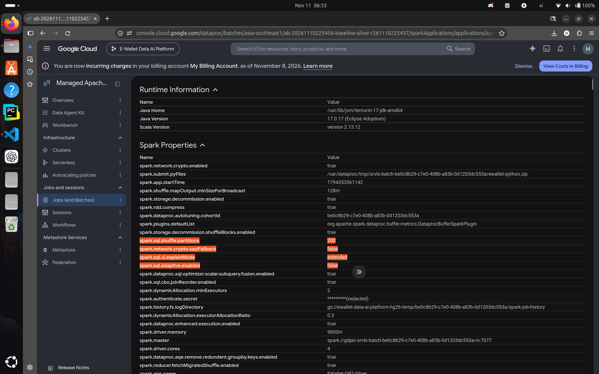

*DP2 Silver Baseline, Spark Environment, application `app-20261110233243555-0298` (identified by `spark.app.startTime` 1794353561142):*

- *Java 17.0.17, Scala 2.13.12;*
- *`spark.sql.adaptive.enabled=false`, `spark.sql.shuffle.partitions=200`;*
- *same driver memory and allocation ratio as the Optimised run.*

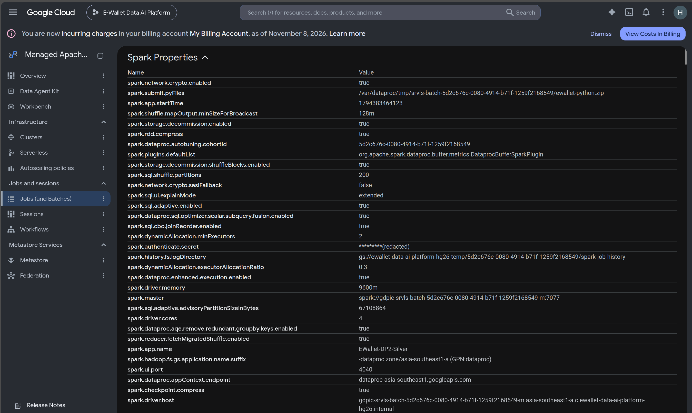

*DP2 Silver Optimised, `app-20261111075108016-0209`: `adaptive.enabled=true`, `advisoryPartitionSizeInBytes=67108864`, still 200 partitions. Only the AQE settings differ from the Baseline.*

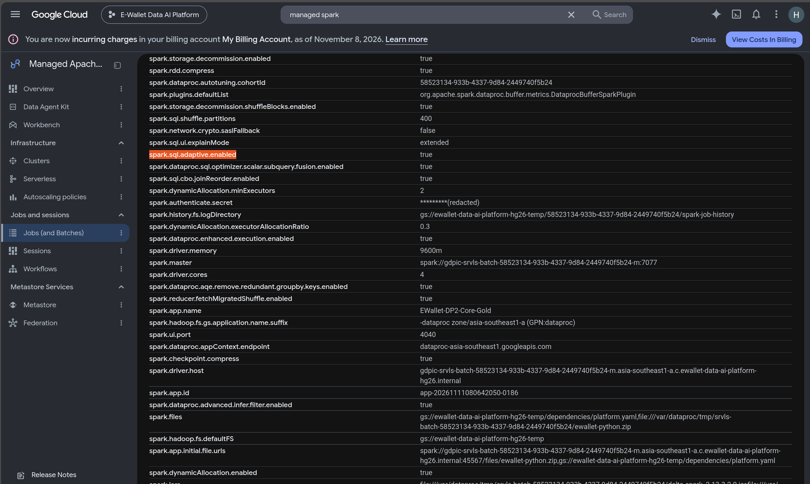

*DP2 Gold Optimised, `spark.app.id` `app-20261111080642050-0186`: AQE on with 400 shuffle partitions. The DP1 Optimised equivalent (AQE on, 200 partitions) is [screenshot 12](../../../../../docs/evidence/edai1/spark/rehearsal-5gb-ab-20261110225456/screenshots/12_dp1_optimized_spark_environment_01.png).*

## 5. Baseline vs Optimised comparison

There are four different durations here. They are reported separately and never added together:

| Duration | Covers | Source |
|---|---|---|
| **Airflow DagRun** | Preflight, quota waits, the transformation and validator batches, and publication | Airflow metadata |
| **Dataproc batch** | Batch creation to final state, including provisioning | `gcloud dataproc batches describe` |
| **Spark application runtime** | Application start to end | Event log; the basis for speed-ups, as in [Spark Optimisation](OPTIMIZATION_MATRIX.md) §3 |
| **Stage and task metrics** | Work inside the application | Event log via `spark_stage_report.py` |

Changes are Optimised against Baseline; positive means the Optimised run was higher. GB = 10⁹ bytes.

### 5.1 Spark application runtime (transformations)

These values are reconciled with `stage_reports/*-transform.json`.

| Pipeline | Baseline | Optimised | Change |
|---|---:|---:|---:|
| DP1 Bronze | 165.1 s | 213.8 s | +29.5 % |
| DP2 Silver | 197.9 s | 292.3 s | +47.7 % |
| DP2 Gold | 314.9 s | 335.8 s | +6.7 % |
| DP3 features | 160.2 s | 196.7 s | +22.8 % |

### 5.2 Airflow DagRun and Dataproc batch durations

| DagRun (whole pipeline, including validation) | Baseline | Optimised | Change |
|---|---:|---:|---:|
| DP1 | 563.9 s | 693.4 s | +23.0 % |
| DP2 (Silver and Gold) | 1,708.9 s | 1,931.7 s | +13.0 % |
| DP3 | 636.4 s | 831.2 s | +30.6 % |

| Transformation batch | Batch duration B → O | DCU-hours B → O | Change |
|---|---:|---:|---:|
| DP1 Bronze | 245.5 → 317.1 s | 1.390 → 1.849 | +33.0 % |
| DP2 Silver | 260.1 → 389.8 s | 1.626 → 2.180 | +34.1 % |
| DP2 Gold | 389.2 → 432.0 s | 2.483 → 2.533 | +2.0 % |
| DP3 features | 240.4 → 295.5 s | 1.418 → 1.680 | +18.5 % |
| **Total** | | 6.917 → 8.242 | **+19.2 %** |

DCU-hours are Dataproc's approximate usage, not billed cost. The 8 validator batches used 7.753 (Baseline) and 9.404 (Optimised), so the whole benchmark used 32.32 DCU-hours.

### 5.3 Stage and task metrics (transformations)

| Pipeline | Tasks | Shuffle read = write | Spill | Executor run time | Failed tasks |
|---|---:|---:|---:|---:|---:|
| DP1 Bronze | 3,751 → 3,202 (−14.6 %) | 1.39 → 1.39 GB | 0 → 0 | 1,794 → 1,867 s (+4.1 %) | 0 |
| DP2 Silver | 5,631 → 2,933 (−47.9 %) | 19.08 → 19.06 GB | 0 → 0 | 2,536 → 3,426 s (+35.1 %) | 0 |
| DP2 Gold | 5,136 → 2,923 (−43.1 %) | 24.44 → 19.42 GB (**−20.5 %**) | 0 → 0 | 4,229 → 4,036 s (**−4.6 %**) | 0 |
| DP3 features | 1,391 → 695 (−50.0 %) | 7.90 → 8.05 GB | 0 → 0 | 1,895 → 2,253 s (+18.9 %) | 0 |

Representative stages:

| Stage | Baseline | Optimised |
|---|---|---|
| Silver: transaction dedup shuffle (`row_number`) | stage 72: 200 tasks, 14.8 s | stage 115: 200 tasks, 19.8 s |
| Gold: date-repartitioned write | stage 125: 160 tasks, 30.4 s; slowest task 20.1 s against median 4.3 s | stage 173: 160 tasks, 40.6 s; slowest 27.3 s against median 4.4 s |
| DP3: largest windowed shuffle | stage 8: 200 tasks, 19.3 s; median task 1.09 s | stage 13: 23 tasks, 18.5 s; median task 14.87 s |

### 5.4 Control: the validators

Each validator runs the same code, with the same fixed settings, over outputs with equal row counts, in both campaigns. Shuffle volume and task count are identical across the two runs.

| Validator | App runtime B → O | Change | Executor run time | DCU-hours |
|---|---:|---:|---:|---:|
| Bronze | 134.1 → 166.1 s | +23.9 % | −2.0 % | +36.0 % |
| Silver | 314.3 → 343.6 s | +9.3 % | +6.8 % | +10.3 % |
| core Gold | 332.6 → 353.5 s | +6.3 % | +6.0 % | +6.7 % |
| features | 183.0 → 281.6 s | +53.8 % | +39.9 % | +55.8 % |

Every application in the Optimised window also waited longer for its first executor: 13.2–15.9 s, against 7.7–12.2 s in the Baseline window.

## 6. Spark execution analysis

**6.1 Runtime differences are mostly window variance.** The control in §5.4 slowed by 6–54 % with nothing changed. Transformation slowdowns of 7–48 % in the same window therefore cannot be attributed to the profiles from one trial each.

Silver is the only stage whose slowdown clearly exceeds its own control: +47.7 % runtime and +35.1 % executor time, against +9.3 % and +6.8 %. Sections 6.3 and 6.4 give the deterministic reasons that can explain part of it.

**6.2 AQE changed the plans as intended.** The final plans show these changes (`derived_metrics.json`):

| Pipeline | Coalesced `AQEShuffleRead` | Broadcast joins B → O | Sort-merge joins B → O | Spark jobs B → O |
|---|---:|---:|---:|---:|
| DP1 Bronze | 3 | 0 → 0 | 0 → 0 | 64 → 89 |
| DP2 Silver | 15 | 0 → 0 | 0 → 0 | 64 → 119 |
| DP2 Gold | 14 | 3 → 8 | 4 → 6 | 68 → 116 |
| DP3 features | 4 | 1 → 2 | 0 → 0 | 14 → 26 |

**Gold** is the one stage where the change reduced work. Runtime statistics let AQE broadcast 5 more join sides, so shuffle fell 20.5 % (24.44 → 19.42 GB) and executor time fell 4.6 %. Over the same window, the Gold validator's executor time rose 6.0 %. The application was still 6.7 % slower, within the control's range, so no Gold speed-up is claimed.

**DP1** reads Parquet and writes Delta with almost no shuffle (1.39 GB). AQE has little to re-plan there, as in the 100 GB run.

**6.3 Coalescing to 64 MiB with `parallelismFirst=false` reduces parallelism at 5 GB.** Each run starts with 24 cores. In Optimised DP3, 4 of the 8 shuffle stages reading over 256 MiB ran with only 9, 17, 17 and 23 tasks, taking 61.4 s of stage time. Silver had 5 such stages, at 12–16 tasks.

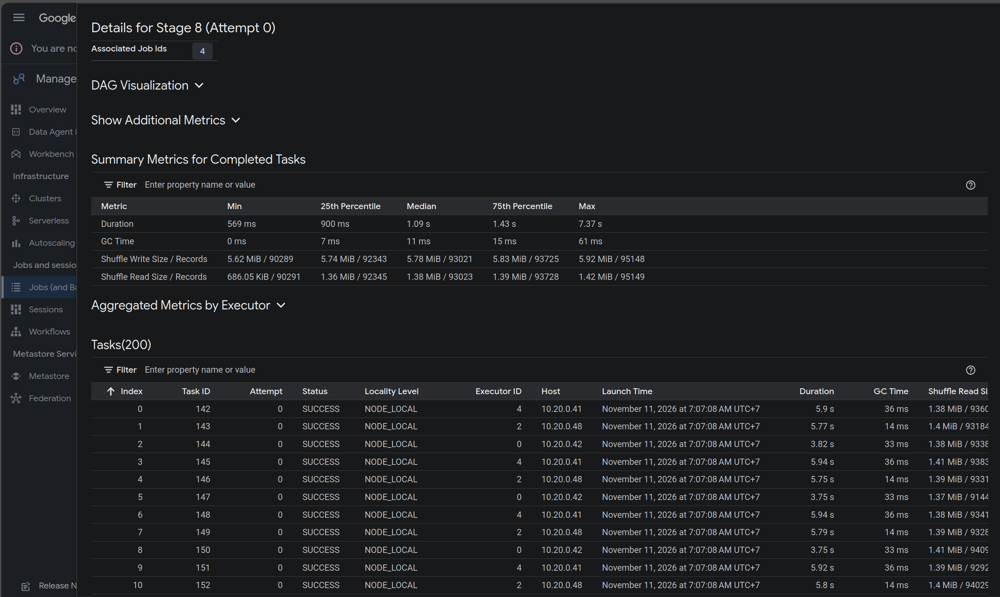

*DP3 Baseline (`app-20261111000612449-0263`), stage 8: 200 tasks, median 1.09 s, median shuffle read 1.38 MiB. These are many small partitions, each mostly scheduling overhead.*

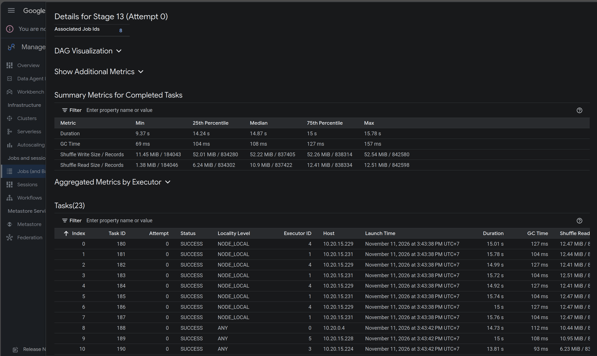

*The equivalent shuffle in DP3 Optimised (`app-20261111084230605-0566`), stage 13: AQE merged it into 23 tasks of about 10–12 MiB, median 14.87 s. Overhead disappears, but 23 tasks cannot fill 24–28 cores, and each task now runs about 15 s. Stage wall time was about the same (19.3 s against 18.5 s).*

At 100 GB the same 64 MiB target yields about 20 times more partitions, so this effect is specific to small inputs.

**6.4 Caching under AQE adds a job and a re-read.** Silver, Gold and DP3 each persist one large frame. Under AQE the cache is built by its own job (`TableCacheQueryStage`), and the next stage reads it back. Spark counts that read as input bytes. I checked the three cases per SQL execution:

| Pipeline | SQL execution | Source scan (both profiles) | Extra cache read (Optimised) | Spark jobs B → O |
|---|---|---:|---:|---:|
| Silver | 51 | 3.26 GB | 3.76 GB | 1 → 4 |
| Gold | 57 | 3.67 GB | 3.72 GB | 1 → 3 |
| DP3 | 6 | 2.40 GB | about 2.47 GB | 1 → 4 |

This is why "input bytes" rise 16–31 %. GCS reads did not grow. The extra job and the re-read are real overhead.

**6.5 Remaining skew is in the write layout, in both profiles.** The writer repartitions each date-partitioned table by `event_date` into 128 or 160 partitions (`RepartitionByExpression [event_date], 128` in the plans below). There are 151 event dates, so some partitions receive two dates. The slowest-to-median task ratio is 4.3–6.7× in both profiles.

AQE neither coalesces nor splits a repartition with an explicit partition count, and skew join only applies to joins. So this skew is unchanged by either profile.

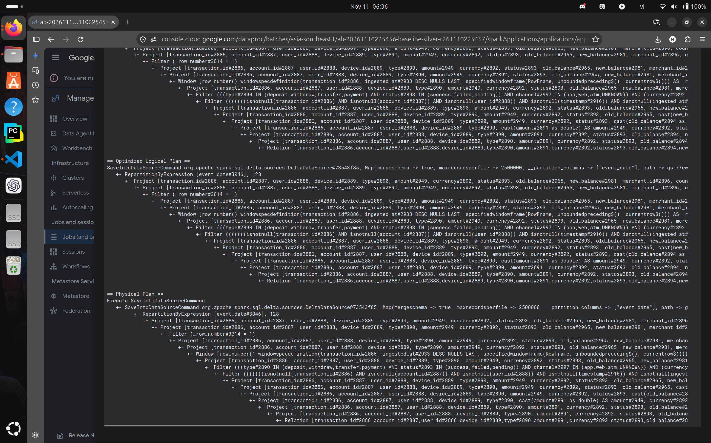

*DP2 Silver Baseline, SQL plan of the transactions write (the same `RepartitionByExpression [event_date], 128` appears in the Gold write plan, [screenshot 17](../../../../../docs/evidence/edai1/spark/rehearsal-5gb-ab-20261110225456/screenshots/17_dp2_gold_baseline_physical_plan_fact_transactions.png)):*

- *`Window row_number()` partitioned by `transaction_id` and ordered by `ingested_at DESC`, then `Filter (_row_number = 1)`: the deduplication of §7.2;*
- *the Silver domain filters (type, status, channel incl. `UNKNOWN`, currency);*
- *`RepartitionByExpression [event_date], 128` before the Delta write.*

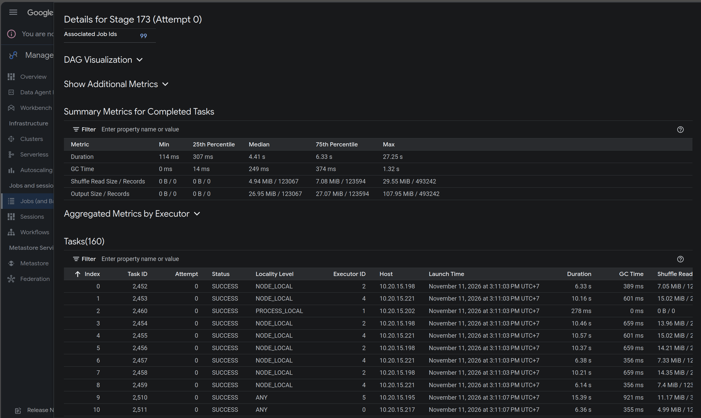

*DP2 Gold Optimised (`app-20261111080642050-0186`), stage 173, a 160-task date-repartitioned write: median task 4.41 s, maximum 27.25 s, matching the event log (4,436.5 ms and 27,253 ms). The Baseline equivalent, stage 125, has median 4.3 s and maximum 20.1 s.*

**6.6 No spill, failures or executor loss.** All 16 applications had zero spill, zero failed tasks and no removed executor. The bottleneck the 100 GB optimisations target (187–682 GB of spill in Silver and Gold) does not occur at 5 GB, so this rehearsal cannot test them.

## 7. Data quality and correctness

The validators are Spark batches that run as the `semantic_validation` task of each stage. Each writes `validation-<scope>-a1.json`, and the DAG fails unless the report says `PASS` with no failed rule.

All 8 reports are copied in [`validation_reports/`](../../../../../docs/evidence/edai1/spark/rehearsal-5gb-ab-20261110225456/validation_reports). Every rule's observed value is identical between the two profiles.

### 7.1 Source and Bronze (54 rules)

| What was verified | How | Observed |
|---|---|---|
| Source integrity | DP1 preflight re-reads the Source manifest and checks its SHA-256 and shard inventory before any paid job | 186 shards, SHA-256 `ac2dfb0e…` in both campaigns; the Bronze job lists the 186 paths ([screenshot 11](../../../../../docs/evidence/edai1/spark/rehearsal-5gb-ab-20261110225456/screenshots/11_dp1_baseline_spark_stages_overview.png)) |
| All 9 Bronze tables are readable Delta with the required columns and compatible types | `delta_readable`, `required_columns`, `compatible_types`, `persisted_data_scan`, `non_empty` per table | 45 PASS |
| Schema evolution | `transactions.channel_schema`: the unified table has `channel` as a string after V1 (no column) and V2 are unioned | PASS |
| Fraud labels are consistent | Labels in {0,1}; `fraud_type` present only when label = 1; no duplicate `transaction_id`; every label refers to a Bronze transaction and every distinct transaction has one label | 0 violations; 18,600,000 labels = 18,600,000 distinct transactions |

Why it matters: Bronze is the replayable copy of the Source. A schema or label defect caught here never reaches Silver.

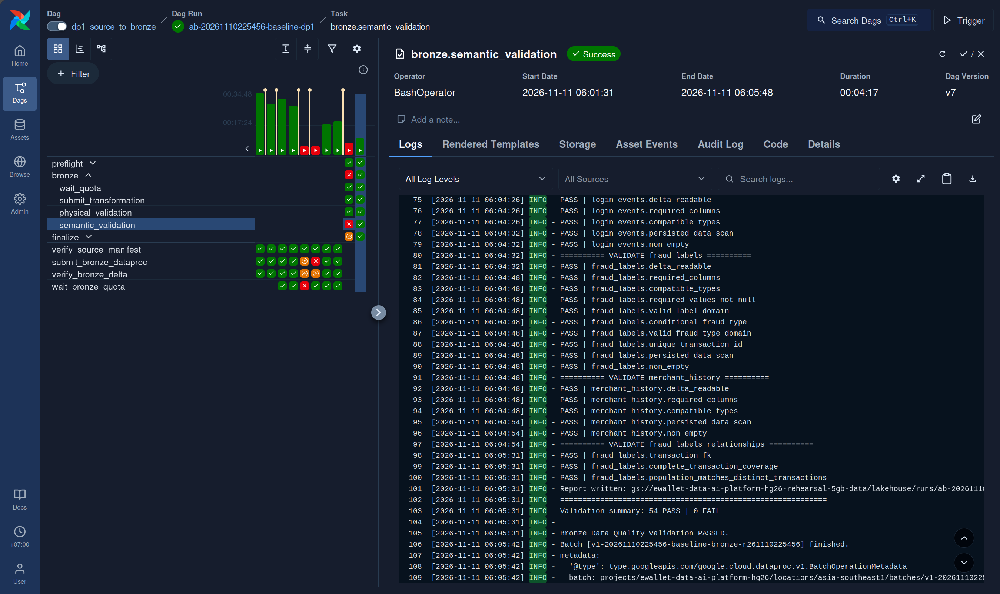

*Airflow, `bronze.semantic_validation` of DagRun `ab-20261110225456-baseline-dp1`:*

- *the fraud-label relationship rules;*
- *the report written to GCS;*
- *`Validation summary: 54 PASS | 0 FAIL`;*
- *the validator batch `v1-20261110225456-baseline-bronze-r261110225456`.*

*The red cells in the left grid belong to earlier DagRuns and DAG versions, not to this run.*

### 7.2 Silver (60 rules)

| What was verified | How | Observed |
|---|---|---|
| Deduplication | `duplicate_key` on every keyed table; Bronze and Silver populations compared | Bronze `transactions` 18,972,000 rows → Silver 18,600,000: 372,000 duplicate deliveries (2 %) removed, 0 duplicate keys left |
| Domain rules | Valid type, status, channel and currency (VND); amount > 0; non-negative balances; `merchant_id` required for payments and `counterparty_account_id` for transfers | 0 violations |
| Referential integrity | 11 orphan-key checks: transactions → users, accounts, devices and merchants; balances → accounts; logins → users and devices | 0 orphans |
| Merchant history | Schema, unique `snapshot_id` and (`merchant_id`, `snapshot_ts`); synthetic provenance; the latest snapshot equals `merchants` | PASS; 334,800 history rows for 55,800 merchants |

Why it matters: Silver is the deduplicated, typed domain that Gold and the features read. Orphan keys or duplicates here would silently distort every aggregate downstream.

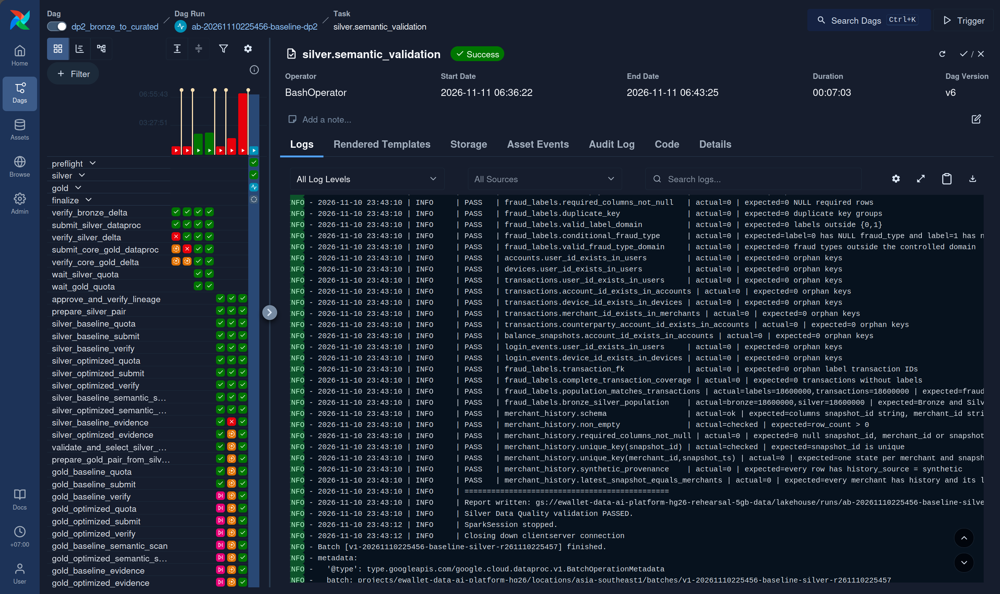

*Airflow, `silver.semantic_validation` of `ab-20261110225456-baseline-dp2`. It shows the orphan-key rules (`actual=0`), the fraud-label population (`labels=18600000, transactions=18600000`), the merchant-history rules and `Silver Data Quality validation PASSED`.*

### 7.3 Gold and SCD Type 2 (93 rules)

| What was verified | How | Observed |
|---|---|---|
| Keys and required columns | Non-empty, no NULL required columns, unique primary key, for all 12 Gold tables | PASS |
| Silver-to-Gold completeness | Row counts of each dimension and fact against its Silver source, facts against the OBT, and dimensions against aggregates | All equal, e.g. 18,600,000 transactions in Silver, `fact_transactions` and `obt_transaction_enriched` |
| Referential integrity | 15 fact→dimension and aggregate→dimension orphan-key checks, including `date_key → dim_date` | 0 orphans |
| SCD Type 2 (`dim_merchant_scd2`, 78,294 versions of 55,800 merchants) | 13 rules, listed below | 0 violations |
| Materialisation timestamp | `feat_user_90d.created` has one value per table, equal to the clock recorded in the Delta commit and to the legacy `created_timestamp` | PASS |

The 13 SCD Type 2 rules check:

- `valid_to_ts > valid_from_ts`;
- `is_current` exactly when `valid_to_ts IS NULL`;
- exactly one current version per merchant;
- contiguous, non-overlapping intervals;
- no redundant versions;
- the current version equals `dim_merchant`;
- every transaction with a merchant resolves to exactly one version in [`valid_from_ts`, `valid_to_ts`).

Why it matters: the SCD Type 2 rules prove the dimension can answer "which merchant attributes were true when this transaction happened" without gaps or double matches. The SCD implementation is `data_platform/processing/spark/gold/scd2.py` (commit `356b2123`).

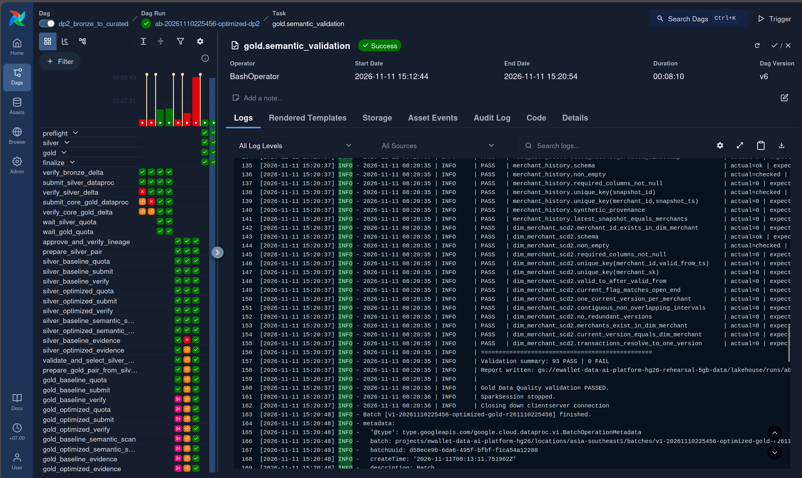

*Airflow, `gold.semantic_validation` of `ab-20261110225456-optimized-dp2`. It shows the merchant-history rules and the 13 `dim_merchant_scd2` rules, then `Validation summary: 93 PASS | 0 FAIL` and the batch `v1-20261110225456-optimized-gold-r261110225458`.*

### 7.4 Features and point-in-time correctness (53 rules)

| What was verified | How | Observed |
|---|---|---|
| Grain and completeness | Unique (entity, `event_timestamp`) per table; one feature row per Silver transaction per entity (payments only for merchants) | 18,599,553 / 18,599,553 / 18,599,560 / 7,439,478 rows, each equal to its Silver population |
| Value sanity | Non-negative metrics; rates within [0, 1]; a smaller window count never exceeds a larger one | 0 violations |
| `event_timestamp` and `created` | Both are typed `timestamp` and not null; one `created` per table, equal to the clock recorded in the Delta commit and shared by all four tables of the run | PASS |
| Point-in-time correctness | For a 1/1000 sample of entities, the 1-hour transaction count is recomputed from Silver over [T − 3600 s, T) and compared with the stored value | 0 mismatches over 18,217 / 18,873 / 18,048 / 10,376 sampled rows (user / account / device / merchant) |
| Referential integrity | Each feature entity exists in its dimension | 0 orphans |

Why it matters: a feature computed with data from at or after its own `event_timestamp` leaks the future into training. The recomputation proves the stored values use only strictly earlier events. The plan below shows how the window enforces this.

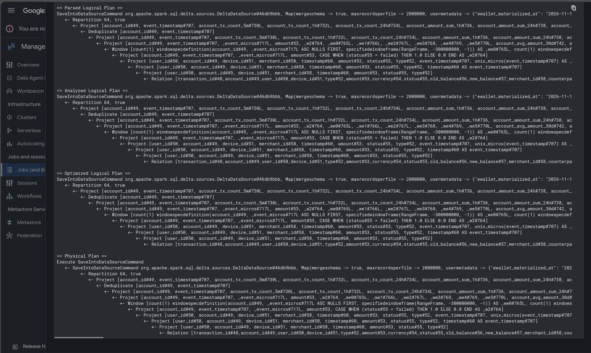

*DP3 Baseline, SQL plan of an account-feature write. The window is `RangeFrame(-300000000, -1)` in microseconds over `_event_micros`: the 5 minutes ending 1 µs before the current event. The current and later events are excluded. Below it are `Deduplicate [account_id, event_timestamp]` and `Repartition 64`.*

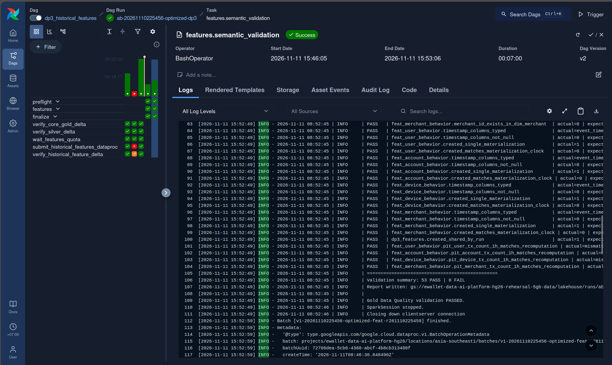

*Airflow, `features.semantic_validation` of `ab-20261110225456-optimized-dp3`. It shows the `created` and `timestamp_columns` rules, `dp3_features.created_shared_by_run`, the four `pit_*_matches_recomputation` rules, then `53 PASS | 0 FAIL`.*

### 7.5 Handoff provenance and campaign identity

| What was verified | How | Observed |
|---|---|---|
| Each DAG consumed exactly the previous DAG's verified output | DP2 and DP3 preflight read the handoff, compare its identity fields and re-check the validation reports it names | Input roots of every stage equal the previous stage's output roots in the same profile |
| Handoffs are tamper-evident | The campaign manifest records each handoff's SHA-256, and `dp3_completion` records the campaign manifest's | All 6 hashes match the published objects |
| The two campaigns are comparable | Same benchmark, dataset, Source SHA-256 and Git SHA | Identical; the comparator's own `manifest_problems()` returns none |

### 7.6 Semantic comparison between the profiles: PENDING / NOT VERIFIED

Batch `c1-20261110225456` (`ops/gcp/submit_campaign_comparison.py`) was submitted by the owner at 10:15Z. The last read-only check, at 10:30Z, found it `RUNNING`, and `comparison.json` did not exist.

When complete, it will compare all 34 tables:

- row by row on logical keys, with Bronze as an exact multiset;
- floats within 1e-12 relative and 1e-9 absolute;
- excluding only the `created` and `created_timestamp` audit columns.

Matching schemas, equal row counts and passing per-run validators are **necessary but not sufficient**. They do not show that the two profiles produced the same values, so equivalence is not claimed here.

## 8. Evidence references

| Evidence | Location |
|---|---|
| Handoff and campaign manifests, both profiles | `manifests/<profile>/` |
| 8 validation reports | `validation_reports/` |
| Per-application metrics and pair comparisons (`spark_stage_report.py`) | `stage_reports/`, `stage_comparisons/` |
| AQE plan facts, coalescing, executor start | `derived_metrics.json` (`tools/derive_metrics.py`) |
| Dataproc usage and applied properties; Airflow durations | `dataproc_usage.json`, `airflow_dagruns.json` |
| Event logs (in GCS; checksums only) | `EVENT_LOGS.sha256` |
| 21 genuine screenshots with purpose, verified reference and SHA-256 | [`screenshots/MANIFEST.md`](../../../../../docs/evidence/edai1/spark/rehearsal-5gb-ab-20261110225456/screenshots/MANIFEST.md) |

All paths are relative to [`docs/evidence/edai1/spark/rehearsal-5gb-ab-20261110225456/`](../../../../../docs/evidence/edai1/spark/rehearsal-5gb-ab-20261110225456/README.md), and checksums are in `SHA256SUMS`.

## 9. Limitations and lessons learned

**Limitations.**

- **One trial per profile.** The windows were 8 hours apart, and the control varied up to 54 %.
- **5 GB never spills, and stages last seconds.** Fixed costs dominate: executor start, AQE re-planning and Delta log work.
- **Bundled changes.** Bronze changes AQE and the allocation profile together, and Gold changes AQE and the partition count together, so their effects cannot be separated.
- **Semantic equivalence between the profiles is pending** (§7.6).
- **DataHub was not part of this run.** The rehearsal emitted no lineage or assertion events.

**Lessons learned.**

1. **Keep an A/A control.** Without the validators, the raw numbers would read as "AQE made everything 7–48 % slower".
2. **Measure work as well as time.** Shuffle bytes, task counts, executor time and plan shape are deterministic and attributable. Wall time is not.
3. **Size coalescing to the cluster.** `parallelismFirst=false` honours the advisory size even when that leaves cores idle.
4. **Check what the metric counts.** Spark's input metric includes cache re-reads.
5. **Validate inside the orchestrator.** Running every validator as a DAG task, with handoffs gated on reports, made each result traceable from a DagRun to a JSON report and a batch.

## 10. Conclusions and future 100GB evaluation

The 5 GB rehearsal establishes that the three-DAG pipeline runs end to end on Dataproc and that both profiles produce outputs passing 260 validation rules each, with full provenance. It does **not** establish which Spark configuration will perform best at 100 GB. With one trial and a ±50 % run-to-run spread, it only shows how each setting changes the plan.

For the 100 GB evaluation:

1. **Close this rehearsal first.** Record the `c1-20261110225456` verdict in §7.6.
2. **Run repeated, interleaved trials.** At least three Baseline/Optimised pairs, alternating order or in one window, reporting the median and spread. Keep the validators as the control.
3. **Treat Gold (AQE, 400 partitions) as the main candidate.** It is the only stage whose work fell here, and it matches the 100 GB direction. Adopt it only with `SEMANTIC_EQUIVALENT` under the float tolerance.
4. **Re-measure Silver and DP3 coalescing at full size**, where partitions are far larger. Revisit `parallelismFirst` if cores still idle.
5. **Measure what 5 GB could not show:** spill, DP3 merchant-window skew, executor loss, and the write-layout skew of §6.5.

This report does not retune the profiles. Any change is a separate, measured experiment.
