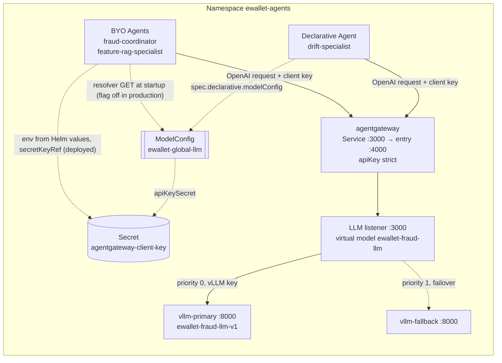

# Global ModelConfig for all agents

Rubric row: **deploy one global ModelConfig for agents to use** (edai-2, 2 points).

One kagent `ModelConfig`, `ewallet-agents/ewallet-global-llm`, is the configuration
configuration for the e-wallet LLM route: provider, logical model, endpoint and credential
reference. It is configuration, not a network hop. Agents call agentgateway at runtime.

| Agent | kagent type | How it consumes `ewallet-global-llm` |
|---|---|---|
| drift-specialist | Declarative | natively: `spec.declarative.modelConfig: ewallet-global-llm`; kagent resolves it |
| fraud-coordinator | BYO | Deployed: Helm environment variables from the same values. With `modelConfig.byoResolver` on: reads the CR at startup through the Kubernetes API |
| feature-rag-specialist | BYO | Same as the Coordinator (its natural-language intake is the only LLM call it makes) |

Status is in §7: the resolver is integrated in source, tested, and was validated on GKE in an
isolated namespace. **It is not deployed**: production BYO agents still use the Helm
environment configuration.



Dashed arrows are configuration references or the failover path; solid arrows are requests.
The chart also has an optional llm-d route, which is off in the deployed configuration.

## 1. What the ModelConfig controls

```yaml
apiVersion: kagent.dev/v1alpha2
kind: ModelConfig
metadata: {name: ewallet-global-llm, namespace: ewallet-agents}
spec:
  provider: OpenAI                      # OpenAI-compatible Chat Completions
  model: ewallet-fraud-llm              # agentgateway's logical model, not a vLLM name
  openAI:
    apiFormat: chatCompletions
    baseUrl: http://agentgateway.ewallet-agents.svc.cluster.local:3000/v1
    timeout: 200                        # outermost timeout budget
  apiKeySecret: agentgateway-client-key # gateway client key, never the vLLM backend key
  apiKeySecretKey: api-key
```

agentgateway maps `ewallet-fraud-llm` to the CPU vLLM (Qwen3-0.6B, served as
`ewallet-fraud-llm-v1`) with its fallback. Changing the model or the route is a change of
this one object (plus a BYO restart, §4, once the resolver is on).

### 1.1 Fields

| Field (source) | Value | What it does and why |
|---|---|---|
| `metadata.name` | `ewallet-global-llm` (`modelConfig.name`) | The single name agents reference |
| `metadata.namespace` | `ewallet-agents` (`namespace.name`) | A ModelConfig is namespaced, so "global" means shared by the agents of this platform namespace, not cluster-wide |
| `spec.provider` | `OpenAI` | agentgateway and vLLM expose the OpenAI Chat Completions API, so kagent uses its OpenAI client. No OpenAI service is involved |
| `spec.model` | `ewallet-fraud-llm` | The gateway's **virtual** model. Agents do not depend on a backend or on the served name `ewallet-fraud-llm-v1` |
| `spec.openAI.baseUrl` | `http://agentgateway.<ns>.svc.cluster.local:3000/v1` | Sends every request through the gateway, never directly to vLLM |
| `spec.apiKeySecret`, `spec.apiKeySecretKey` | `agentgateway-client-key`, `api-key` | Names the Secret that holds the **gateway client key**. The chart stores only this reference; agents never hold the vLLM key |
| `spec.openAI.timeout` | 200 s on GKE (`values-gke-cpu.yaml`), 35 s chart default | The outermost budget. The chart refuses to render unless it is above the gateway's timeouts |
| Agent `spec.declarative.modelConfig` | `ewallet-global-llm` | The reference that reuses this configuration |

### 1.2 How the request reaches the model

1. The agent sends an OpenAI-format request with the client key to the `agentgateway` Service on port 3000, which targets the `entry` port (4000).
2. The entry route enforces `apiKey: mode: strict`, then forwards to the in-process LLM listener on `127.0.0.1:3000`.
3. The listener applies rate limits, token budgets and timeouts, and resolves `ewallet-fraud-llm` to its backends: primary at priority 0, fallback at priority 1.
4. The gateway replaces the client key with `$VLLM_API_KEY` and calls vLLM, which serves `ewallet-fraud-llm-v1`.

## 2. Why BYO agents need a resolver

The installed CRD (`kagent-crds-0.10.3`, read live, [kagent-api.txt](../../../../../docs/evidence/edai2/llm/global_modelconfig_20261109/compat/kagent-api.txt)):

- `spec.declarative` has `modelConfig`;
- `spec.byo` has only `deployment` (image, env, volumes, ServiceAccount, …), so a BYO
  Agent cannot reference a ModelConfig, and kagent does not inject one;
- the BYO agents run their own A2A runtime (`ai_platform/llm_agent/byo_coordinator.py`,
  `byo_feature_rag_specialist.py`) and call the gateway themselves.

**The gap the resolver closes.** With the resolver off, as deployed, the chart renders
`EWALLET_LLM_MODEL` and `EWALLET_LLM_BASE_URL` for the BYO pods from the same Helm values
as the ModelConfig. The values match, but the ModelConfig object is not what the BYO agents
read: editing the CR changes nothing for them, and only the Helm values are the real source.

The fix keeps kagent 0.10.3, keeps both agents BYO, and adds no controller.

## 3. The BYO resolver

[`ai_platform/llm_agent/model_config.py`](../../../../../ai_platform/llm_agent/model_config.py),
called from `planner_from_env()` in [`nl_intake.py`](../../../../../ai_platform/llm_agent/nl_intake.py),
which both BYO executors already use to build their LLM client. With
`EWALLET_LLM_CONFIG_SOURCE=modelconfig` the agent, at startup:

1. refuses a second authority: `EWALLET_LLM_BASE_URL` or `EWALLET_LLM_MODEL` in the env
   stops the agent;
2. requires the gateway client key (`EWALLET_LLM_API_KEY`, a kubelet-resolved Secret
   reference);
3. `GET /apis/kagent.dev/v1alpha2/namespaces/<own namespace>/modelconfigs/ewallet-global-llm`
   with a projected ServiceAccount token, over TLS verified against the cluster CA; 3
   attempts for 5xx/429/connection errors, none for 401/403/404;
4. validates the object:

   | Check | Failure code |
   |---|---|
   | `kagent.dev/v1alpha2` `ModelConfig`, name and namespace as requested, not being deleted | `modelconfig_invalid` |
   | `provider == OpenAI` | `modelconfig_provider_unsupported` |
   | `model` is a logical model name; `apiFormat` is `chatCompletions` | `modelconfig_invalid` |
   | `baseUrl` is exactly `http://agentgateway.ewallet-agents.svc.cluster.local:3000/v1` | `modelconfig_endpoint_unauthorized` |
   | `timeout` between 1 and 200 s | `modelconfig_invalid` |
   | `apiKeySecret/apiKeySecretKey` equal the Secret mounted in the pod (`EWALLET_LLM_API_KEY_SECRET_REF`) | `modelconfig_secret_mismatch` |
   | `Accepted=True` at the current generation (`observedGeneration == generation`) | `modelconfig_not_accepted` |
   | RBAC or token rejected; object absent; API unreachable | `modelconfig_forbidden`, `modelconfig_not_found`, `modelconfig_unavailable` |

5. builds the planner from the CR: model and base URL from it; the timeout is
   `min(agent deadline, CR timeout)` (the CR is the ceiling); A/B variants keep their own
   models but use the CR's route;
6. logs one JSON line, `modelconfig.resolved`, with the CR's uid, generation,
   resourceVersion, model, URL, timeout and Secret *names* (never a value).

Any failure raises at startup, so the pod never becomes Ready and a rolling update stops
with the previous pods still serving. Natural-language intake off means no LLM client and
no API call. The default `EWALLET_LLM_CONFIG_SOURCE=env` keeps the old behaviour for local
profiles and tests.

**Why the Secret is not read from the API.** The pod gets the key the usual way
(`secretKeyRef`), so no Secret-read permission exists. The resolver only proves that the
CR still names that Secret; a CR moved to another Secret stops the agent instead of
running with a key the CR no longer authorises.

## 4. How a ModelConfig change propagates

The resolver reads once, at startup; there is no watch. After editing the CR:

```bash
kubectl -n ewallet-agents rollout restart deploy/fraud-coordinator deploy/feature-rag-specialist
```

New pods resolve the new generation; a CR that fails validation leaves the new pods
un-Ready and the old ones serving. The Declarative drift agent is reconciled by kagent.
Verified on GKE in the canary (§6.2): the running pod kept generation 2 after the CR moved
to generation 3, and the restarted pod resolved the new model.

## 5. Permissions and network

[`templates/modelconfig-rbac.yaml`](../../../../../infra/helm/llm-agent-platform/templates/modelconfig-rbac.yaml),
rendered only with `modelConfig.byoResolver.enabled=true`:

- **Role** `ewallet-global-llm-reader`: `get` on `modelconfigs.kagent.dev`,
  `resourceNames: [ewallet-global-llm]`. No list, watch, update, Secrets or other kinds.
- **RoleBinding**: only the ServiceAccounts of BYO agents with natural-language intake on
  (today `fraud-coordinator`, `feature-rag-specialist`), computed from the values.
- **NetworkPolicy** `allow-byo-modelconfig-to-kube-apiserver`: egress from those pods to the
  API server's Service IP and endpoint IPs on 443 only (`byoResolver.apiServer.cidrs`; the
  chart refuses to render without them). Nothing else is opened.
- **Token**: a projected volume per BYO pod (`token` with the API-server audience, 3600 s,
  `ca.crt` from `kube-root-ca.crt`, the namespace from the downward API) at
  `/var/run/secrets/ewallet/kube-api`. The ServiceAccounts keep
  `automountServiceAccountToken: false`.

RBAC matrix read on GKE with `kubectl auth can-i --as` ([06-rbac-can-i.txt](../../../../../docs/evidence/edai2/llm/global_modelconfig_20261109/canary/06-rbac-can-i.txt)):
both bound ServiceAccounts answer `yes` only to `get modelconfigs/ewallet-global-llm`;
`get` of another ModelConfig, `list`, `watch`, `update`, `get/list secrets` and
`get agents` are `no`; the unbound ServiceAccount gets `no` everywhere.

## 6. Verification

Evidence: [`docs/evidence/edai2/llm/global_modelconfig_20261109/`](../../../../../docs/evidence/edai2/llm/global_modelconfig_20261109/README.md)
(runs between 2026-11-08 17:50Z and 18:30Z).

### 6.1 Tests

- `tests/llm_agent/test_global_modelconfig_resolver.py` (21 tests): resolution of the live
  object shape; provider, endpoint (8 URLs), Secret binding, acceptance and malformed-field
  rejections; GET path and bearer token; 404, 401/403 (no retry), 5xx retry; missing token
  and CA; second-authority env; missing gateway key (no API call); intake off (no API
  call); unchanged tool selection with the resolved planner; A/B variants on the resolved
  route; no credential in the log line.
- `tests/llm_agent/test_global_modelconfig_chart.py` (6 tests): off renders the legacy
  bridge; on changes only the LLM-calling BYO Agents and adds exactly Role, RoleBinding
  and NetworkPolicy; env and projected volume; drift keeps its native reference;
  least-privilege rules; render guards. Agent specs validated against the kagent CRD
  schema.
- On the original development branch, all of `tests/llm_agent`: 702 passed, 36 skipped; the 11
  failures and 5 collection errors matched its base commit (RAG/MCP modules missing from the
  test environment).

### 6.2 Isolated canary on GKE (namespace `kagent-pilot`)

[`infra/k8s/modelconfig-canary/`](../../../../../infra/k8s/modelconfig-canary) builds the canary
from the chart itself: `helm template` with the production values and
`namespace.name=kagent-pilot`, from which it takes the Role, RoleBinding, NetworkPolicy and
the Coordinator Agent's deployment block; the ModelConfig is a copy of the live production
spec. Three kagent BYO Agents run the deployed Coordinator image with `model_config.py`
mounted (the image predates it) and perform only the startup resolution. kagent watches
`kagent-pilot`, so the Accepted status is real. The namespace has no route to agentgateway;
the canary makes no LLM call. Everything was deleted afterwards ([99-teardown.txt](../../../../../docs/evidence/edai2/llm/global_modelconfig_20261109/canary/99-teardown.txt)).

| Case | Result |
|---|---|
| Coordinator and Feature-RAG ServiceAccounts, chart RBAC and egress policy | resolved `ewallet-fraud-llm`, agentgateway URL, timeout 200, Ready |
| ServiceAccount without the RoleBinding | `modelconfig_forbidden` (HTTP 403), never Ready |
| Egress to another in-cluster Service from a resolver pod | blocked (timeout) |
| CR model changed to `ewallet-fraud-llm-canary-v2` | running pod still on the old generation; after restart: new model, new generation |
| CR `baseUrl` set to the vLLM Service (bypassing the gateway) | `modelconfig_endpoint_unauthorized`, never Ready |
| CR `apiKeySecret` moved to another Secret | `modelconfig_secret_mismatch`, never Ready |
| CR deleted | `modelconfig_not_found`, never Ready |
| CR restored | resolved again (new uid), Ready |
| kagent-rendered Deployment | carries the projected volume and mount from `spec.byo.deployment` ([05-kagent-rendered-deployment.yaml](../../../../../docs/evidence/edai2/llm/global_modelconfig_20261109/canary/05-kagent-rendered-deployment.yaml)) |

### 6.3 Live CR → resolver → Coordinator LLM call → agentgateway → CPU vLLM

[`scripts/llm_agent/modelconfig_runtime_check.py`](../../../../../scripts/llm_agent/modelconfig_runtime_check.py)
runs the Coordinator's `planner_from_env()` with the chart's resolver env against the
**production** CR, then five cases of the fixed agent suite through the production `plan`
path. The URL stays the approved in-cluster one; only the connection goes through a
`kubectl port-forward` of `svc/agentgateway`. Locally the Kubernetes API token is the
operator's GKE token instead of the projected ServiceAccount token.
([summary.json](../../../../../docs/evidence/edai2/llm/global_modelconfig_20261109/runtime/summary.json))

| Result | Value |
|---|---|
| resolved | `ewallet-global-llm` uid `663305be…`, generation 1, model `ewallet-fraud-llm`, agentgateway URL, timeout 200 → planner deadline 190 s |
| business cases | 4/4 `investigate_transaction`, grounded arguments, 0 invalid tool calls, 0 invalid arguments |
| off-topic case | refused (`unsupported_request`) |
| served by | agentgateway backend `primary`, vLLM model `ewallet-fraud-llm-v1` (CPU Qwen3-0.6B) |
| latency | p50 60 s, p95 83 s (CPU generation) |

### 6.4 Production unchanged

`llm-agent` stayed at revision 42 and no pod in `ewallet-agents` restarted
([before.txt](../../../../../docs/evidence/edai2/llm/global_modelconfig_20261109/production/before.txt) /
[after.txt](../../../../../docs/evidence/edai2/llm/global_modelconfig_20261109/production/after.txt)). The
chart with `byoResolver` off renders the deployed manifest exactly (0 objects differ).

## 7. Status and production promotion

| Component | Status | Record |
|---|---|---|
| Global ModelConfig CR | Previously deployed | [`00-production-modelconfig.json`](../../../../../docs/evidence/edai2/llm/global_modelconfig_20261109/canary/00-production-modelconfig.json), read 2026-11-08 |
| Declarative Agent native reference | Previously verified | [`drift-native-reference.txt`](../../../../../docs/evidence/edai2/llm/global_modelconfig_20261109/production/drift-native-reference.txt) |
| BYO resolver source | Integrated in this branch; off by default | §9 |
| BYO resolver local tests | Verified locally | §6.1 |
| Resolver in a BYO pod with the chart's RBAC, token and egress policy | Verified 2026-11-08 in an isolated canary, since deleted | §6.2 |
| Live CR → resolver → Coordinator planner → agentgateway → CPU vLLM | Verified 2026-11-08 from the laptop (operator token, port-forward), not from a production pod | §6.3 |
| BYO resolver production deployment | **NOT DEPLOYED** | [`verify-current-production.json`](../../../../../docs/evidence/edai2/llm/global_modelconfig_20261109/production/verify-current-production.json) |
| Production BYO configuration | Existing Helm environment configuration | same |

No live cluster check was made when this source was integrated. A Git merge does not change any of the above.

Promotion is two owner-run steps
([GLOBAL_MODELCONFIG_RUNBOOK.md](../../../../../docs/runbooks/edai2/GLOBAL_MODELCONFIG_RUNBOOK.md)):

1. **Images only**: build and push both BYO images from this commit and promote them with
   `scripts/ci/release_state.py` (it proves the change is image-only). With
   `byoResolver` off the new code runs the same env path, so behaviour is unchanged.
2. **Configuration**: `helm upgrade` with `modelConfig.byoResolver.enabled=true` and the API
   server CIDRs. The diff is exactly five objects
   ([helm-diff-resolver-on.txt](../../../../../docs/evidence/edai2/llm/global_modelconfig_20261109/production/helm-diff-resolver-on.txt)),
   accepted by a server-side dry run. Rollback: `helm rollback llm-agent <revision of step 1>`.

## 8. Limits

- Startup-time resolution: a ModelConfig change needs a BYO restart (no watch, by design).
- The approved endpoint is fixed in code (agentgateway in `ewallet-agents`); moving the
  gateway is a code change, not a CR edit.
- The live LLM leg ran outside the pod; the in-pod leg runs after the promotion
  (runbook step 4).

## 9. Source code

Repository links are in the first column; line ranges are pinned to GitHub commits.

| File | Lines | What it configures |
|---|---|---|
| [`templates/modelconfig.yaml`](../../../../../infra/helm/llm-agent-platform/templates/modelconfig.yaml) | [L1–17](https://github.com/HuyyGiaa/ewallet-data-ai-platform/blob/b95b160f3dbfb295bda483c5324873bb58505ae2/infra/helm/llm-agent-platform/templates/modelconfig.yaml#L1-L17) | The ModelConfig resource |
| [`values.yaml`](../../../../../infra/helm/llm-agent-platform/values.yaml) | [L868–874](https://github.com/HuyyGiaa/ewallet-data-ai-platform/blob/b95b160f3dbfb295bda483c5324873bb58505ae2/infra/helm/llm-agent-platform/values.yaml#L868-L874) | `modelConfig.byoResolver`, `enabled: false` by default |
| [`templates/modelconfig-rbac.yaml`](../../../../../infra/helm/llm-agent-platform/templates/modelconfig-rbac.yaml) | [L1–72](https://github.com/HuyyGiaa/ewallet-data-ai-platform/blob/b95b160f3dbfb295bda483c5324873bb58505ae2/infra/helm/llm-agent-platform/templates/modelconfig-rbac.yaml#L1-L72) | Role, RoleBinding and egress NetworkPolicy, rendered only with the flag on |
| [`templates/agents.yaml`](../../../../../infra/helm/llm-agent-platform/templates/agents.yaml) | [L190–205](https://github.com/HuyyGiaa/ewallet-data-ai-platform/blob/b95b160f3dbfb295bda483c5324873bb58505ae2/infra/helm/llm-agent-platform/templates/agents.yaml#L190-L205) | Flag on: resolver env. Flag off: the Helm environment bridge |
| [`model_config.py`](../../../../../ai_platform/llm_agent/model_config.py) | [L40–42](https://github.com/HuyyGiaa/ewallet-data-ai-platform/blob/b95b160f3dbfb295bda483c5324873bb58505ae2/ai_platform/llm_agent/model_config.py#L40-L42), [L109–258](https://github.com/HuyyGiaa/ewallet-data-ai-platform/blob/b95b160f3dbfb295bda483c5324873bb58505ae2/ai_platform/llm_agent/model_config.py#L109-L258) | Approved endpoint; parsing, fetch and resolution |
| [`nl_intake.py`](../../../../../ai_platform/llm_agent/nl_intake.py) | [L329–341](https://github.com/HuyyGiaa/ewallet-data-ai-platform/blob/b95b160f3dbfb295bda483c5324873bb58505ae2/ai_platform/llm_agent/nl_intake.py#L329-L341) | Selects the source with `EWALLET_LLM_CONFIG_SOURCE` (default `env`) |
| [`values.yaml`](../../../../../infra/helm/llm-agent-platform/values.yaml) | [L851–861](https://github.com/HuyyGiaa/ewallet-data-ai-platform/blob/22018233adb172767a267a9bf76ad295d17ac6cf/infra/helm/llm-agent-platform/values.yaml#L851-L861) | Name, model, default timeout, Secret reference |
| [`values-gke-cpu.yaml`](../../../../../infra/helm/llm-agent-platform/values-gke-cpu.yaml) | [L64–65](https://github.com/HuyyGiaa/ewallet-data-ai-platform/blob/22018233adb172767a267a9bf76ad295d17ac6cf/infra/helm/llm-agent-platform/values-gke-cpu.yaml#L64-L65) | GKE timeout of 200 s |
| [`n11/values-n11-agents.yaml`](../../../../../infra/helm/llm-agent-platform/n11/values-n11-agents.yaml) | [L5–15](https://github.com/HuyyGiaa/ewallet-data-ai-platform/blob/22018233adb172767a267a9bf76ad295d17ac6cf/infra/helm/llm-agent-platform/n11/values-n11-agents.yaml#L5-L15) | Enables LLM intake for both BYO agents |
| [`templates/agents.yaml`](../../../../../infra/helm/llm-agent-platform/templates/agents.yaml) | [L263–266](https://github.com/HuyyGiaa/ewallet-data-ai-platform/blob/22018233adb172767a267a9bf76ad295d17ac6cf/infra/helm/llm-agent-platform/templates/agents.yaml#L263-L266) | Declarative agents reference the ModelConfig |
| [`templates/agents.yaml`](../../../../../infra/helm/llm-agent-platform/templates/agents.yaml) | [L183–207](https://github.com/HuyyGiaa/ewallet-data-ai-platform/blob/22018233adb172767a267a9bf76ad295d17ac6cf/infra/helm/llm-agent-platform/templates/agents.yaml#L183-L207) | BYO agents: endpoint, model and client key through environment variables |
| [`templates/agents.yaml`](../../../../../infra/helm/llm-agent-platform/templates/agents.yaml) | [L8–9](https://github.com/HuyyGiaa/ewallet-data-ai-platform/blob/22018233adb172767a267a9bf76ad295d17ac6cf/infra/helm/llm-agent-platform/templates/agents.yaml#L8-L9) | Agents cannot render without the ModelConfig |
| [`templates/agentgateway.yaml`](../../../../../infra/helm/llm-agent-platform/templates/agentgateway.yaml) | [L6–12](https://github.com/HuyyGiaa/ewallet-data-ai-platform/blob/22018233adb172767a267a9bf76ad295d17ac6cf/infra/helm/llm-agent-platform/templates/agentgateway.yaml#L6-L12) | Timeout nesting guard |
| [`templates/agentgateway.yaml`](../../../../../infra/helm/llm-agent-platform/templates/agentgateway.yaml) | [L43–56](https://github.com/HuyyGiaa/ewallet-data-ai-platform/blob/22018233adb172767a267a9bf76ad295d17ac6cf/infra/helm/llm-agent-platform/templates/agentgateway.yaml#L43-L56) | Entry route: strict client authentication, forward to the LLM listener |
| [`templates/agentgateway.yaml`](../../../../../infra/helm/llm-agent-platform/templates/agentgateway.yaml) | [L101–110](https://github.com/HuyyGiaa/ewallet-data-ai-platform/blob/22018233adb172767a267a9bf76ad295d17ac6cf/infra/helm/llm-agent-platform/templates/agentgateway.yaml#L101-L110) | Primary backend: vLLM URL and backend key |
| [`templates/agentgateway.yaml`](../../../../../infra/helm/llm-agent-platform/templates/agentgateway.yaml) | [L157–167](https://github.com/HuyyGiaa/ewallet-data-ai-platform/blob/22018233adb172767a267a9bf76ad295d17ac6cf/infra/helm/llm-agent-platform/templates/agentgateway.yaml#L157-L167) | Virtual model `ewallet-fraud-llm` and failover priorities |
| [`templates/agentgateway.yaml`](../../../../../infra/helm/llm-agent-platform/templates/agentgateway.yaml) | [L264–272](https://github.com/HuyyGiaa/ewallet-data-ai-platform/blob/22018233adb172767a267a9bf76ad295d17ac6cf/infra/helm/llm-agent-platform/templates/agentgateway.yaml#L264-L272) | Service port 3000 to the entry port |
| [`values.yaml`](../../../../../infra/helm/llm-agent-platform/values.yaml) | [L279–281](https://github.com/HuyyGiaa/ewallet-data-ai-platform/blob/22018233adb172767a267a9bf76ad295d17ac6cf/infra/helm/llm-agent-platform/values.yaml#L279-L281) | Gateway client-key Secret reference |
| [`templates/vllm.yaml`](../../../../../infra/helm/llm-agent-platform/templates/vllm.yaml) | [L128–129](https://github.com/HuyyGiaa/ewallet-data-ai-platform/blob/22018233adb172767a267a9bf76ad295d17ac6cf/infra/helm/llm-agent-platform/templates/vllm.yaml#L128-L129) | vLLM served model name |
| [`values.yaml`](../../../../../infra/helm/llm-agent-platform/values.yaml) | [L200–200](https://github.com/HuyyGiaa/ewallet-data-ai-platform/blob/22018233adb172767a267a9bf76ad295d17ac6cf/infra/helm/llm-agent-platform/values.yaml#L200-L200) | Served name `ewallet-fraud-llm-v1` |

Tests: [`test_global_modelconfig_resolver.py`](../../../../../tests/llm_agent/test_global_modelconfig_resolver.py), [`test_global_modelconfig_chart.py`](../../../../../tests/llm_agent/test_global_modelconfig_chart.py), [`test_r1_runtime_prep.py`](../../../../../tests/llm_agent/test_r1_runtime_prep.py).
