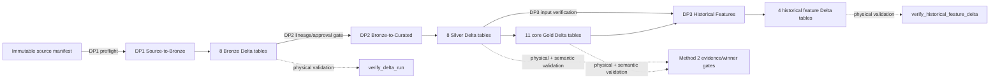

# EDAI-1 Airflow DP1, DP2 and DP3 Orchestration Evidence

## 1. Introduction and rubric mapping

This report documents the Airflow orchestration of the E-Wallet lakehouse from immutable source data through Bronze, Silver, core Gold and historical feature tables. It covers EDAI-1 rubric rows 22–27. It distinguishes source implementation, task-log evidence, preserved DagRun state, validator output and downstream DataHub publication; these are not interchangeable forms of proof.

The exact EDAI-1 workbook wording is:

| Row | Item | Requirement | Proof requirement | Points |
|---:|---|---|---|---:|
| 22 | Pipeline to ingest raw data into bronze zone (DP1) | Ingest stage | Document showing images of all three Airflow pipelines and explaining every pipeline and component | 2 |
| 23 | Pipeline to ingest raw data into bronze zone (DP1) | Validate stage | Inherited proof scope from row 22 | 2 |
| 24 | Pipeline to ingest data from bronze zone into silver and gold zone (or bronze → gold only) (DP2) | Ingest stage | Inherited proof scope from row 22 | 2 |
| 25 | Same DP2 pipeline | Validate stage | Inherited proof scope from row 22 | 2 |
| 26 | Pipeline to compute offline feature table (DP3) | Ingest stage | Inherited proof scope from row 22 | 2 |
| 27 | Same DP3 pipeline | Validate stage | Inherited proof scope from row 22 | 2 |

The workbook also states that reusable connections and variables should be placed inside Airflow. The current DAGs use validated Airflow `Param` values and a shared Python-runtime environment, but do not define Airflow Connection or Variable objects. That gap is reported rather than hidden.

## 2. Architecture and overall dataflow

Airflow is the control plane; Spark transformations execute in Dataproc Serverless. Outputs are immutable and run-scoped in GCS. All three DAGs are manually triggered (`schedule=None`), disable catchup and permit only one active run.

The current canonical DAG sources are:

- `data_platform/orchestration/airflow/dags/dp1_source_to_bronze.py`
- `data_platform/orchestration/airflow/dags/dp2_bronze_to_curated.py`
- `data_platform/orchestration/airflow/dags/dp3_historical_features.py`
- shared runtime: `data_platform/orchestration/airflow/python_runtime.py`

## 3. DP1 — immutable source to Bronze

DP1 verifies that the source completion manifest exists, waits for bounded regional quota, submits the source-to-Bronze Dataproc job and verifies the exact eight-table Bronze Delta output.

| Order | Current task | Responsibility | Retry/failure behavior |
|---:|---|---|---|
| 1 | `verify_source_manifest` | Require `source/<dataset_version>/_control/dataset_manifest.json` | One retry; fails before paid work if absent |
| 2 | `wait_bronze_quota` | Wait for Dataproc quota and record handoff evidence | No DAG-level retry; 20-minute timeout |
| 3 | `submit_bronze_dataproc` | Invoke `ops.gcp.submit_source_to_bronze` with dataset, benchmark, run, profile, Git and pair-manifest identities | No automatic retry; immutable output; 10-hour timeout |
| 4 | `verify_bronze_delta` | Require the exact eight Bronze tables and valid Delta roots | One retry; 15-minute timeout |

Inputs are an immutable dataset version and source manifest. Output is `gs://<data_bucket>/lakehouse/runs/<bronze_run_id>/bronze` containing users, accounts, merchants, devices, transactions, balance snapshots, login events and fraud labels.

### DP1 execution evidence

Historical logs preserve baseline run `ab-20261025134342-baseline-dp1-r261025134410` and optimized run `ab-20261025134342-optimized-dp1-r261025174525`. All four task logs in each run ended with return code 0. The optimized Bronze batch identity was `ab-20261025134342-optimized-bronze-r261025174525`.

Those recovered logs prove successful task processes and persisted-output
validation for that earlier DAG revision. A later Method 2 campaign at Git SHA
`62f17ba6fe306b5cf74621b787249f8b71ccd8e8` also retained a genuine Airflow
DagRun UI capture for optimized run
`ab-20261029174838-optimized-dp1-r261029174838`. This later screenshot is the
runtime UI proof used in Section 9; it must not be conflated with the older
`bbae48c` log set or the previously inspected empty metadata snapshot.

## 4. DP2 — Bronze to Silver and core Gold

The current DP2 implementation is a fail-closed Method 2 A/B workflow. It validates a DP1 winner artifact, runs baseline and optimized Silver sequentially, performs physical and semantic scans, selects an immutable Silver winner, then repeats the process for core Gold. Sequential ordering protects the small Dataproc quota.

```mermaid
flowchart LR
    A[Approve and verify\nDP1 lineage] --> PS[Prepare Silver pair]
    PS --> SB[Baseline Silver\nquota → submit → verify]
    SB --> SO[Optimized Silver\nquota → submit → verify]
    SO --> SS[Two semantic scans\n+ evidence artifacts]
    SS --> SW[Validate/select\nSilver winner]
    SW --> PG[Prepare Gold pair]
    PG --> GB[Baseline Gold\nquota → submit → verify]
    GB --> GO[Optimized Gold\nquota → submit → verify]
    GO --> GS[Two semantic scans\n+ evidence artifacts]
    GS --> GW[Validate/select\nGold winner]
```

The helper `step()` constructs 25 sequential `BashOperator` tasks around `ops.gcp.dp2_method2`. Parameter schemas restrict IDs, hashes, absolute paths, project, region and bucket values before shell interpolation. The approval remains `NOT_APPROVED` unless the explicit paid-job token is supplied.

### DP2 final campaign status

The preserved canonical-volume logs belong to an earlier seven-task DP2 DAG with `verify_bronze_delta`, two quota waits, two submit tasks and Silver/Gold physical validators. They show successful baseline run `ab-20261025134342-baseline-dp2-r261025144416` and optimized run `ab-20261025134342-optimized-dp2-r261025181923`; all fourteen logs ended with return code 0. The optimized outputs are Silver `ab-20261025134342-optimized-silver-r261025181923` and Gold `ab-20261025134342-optimized-gold-r261025181923`.

Those logs remain valid historical proof for the earlier DAG revision. The later 25-task Method 2 campaign was executed as DagRun `dp2-method2-ab-20261031035745`. Its baseline and optimized Silver and Gold transformations completed and produced immutable outputs, and 24 of 25 tasks succeeded. The final task, `validate_and_select_gold_winner`, failed, so the historical DagRun remains `FAILED` and no optimized Gold winner was selected.

The failure was isolated to exact-bit semantic fingerprints for three Spark `double` aggregate columns: `feat_user_90d.f_user_avg_transaction_amount_90d`, `opt_merchant_performance.total_amount` and `opt_merchant_performance.avg_amount`. Different partitioning/AQE profiles changed the IEEE-754 reduction order; observed relative differences were at most approximately `2.6e-15`. This is a representational difference in non-associative floating-point reduction, not evidence that the transformation tasks failed. Nevertheless, the final semantic gate correctly remained failed under the validator contract used by that DagRun.

A validator correction was subsequently implemented to compare these floating-point fingerprints under a bounded canonicalization policy, and 18 focused local regression tests passed. Cloud validation-only recovery was `NOT_EXECUTED`; therefore the fix does not retroactively change the DagRun state and does not establish a selected production winner.

### DP2 validation boundary

Historical `verify_bronze_delta`, `verify_silver_delta` and `verify_core_gold_delta` logs returned 0, establishing physical table-set/Delta validation for the earlier DAG. In the Method 2 campaign, the baseline and optimized Gold outputs were generated and the preceding physical/data validations succeeded within their recorded scope, but the final semantic-equivalence gate failed as described above. Later DataHub read-back records two Silver checks as PASS: zero NULL `channel` values and zero duplicate `transaction_id` groups.

The DataHub definition `fact_transactions.row_level_integrity` exists for Gold, but its assertion-run history is empty. **DP2 Gold row-level validation remains `NOT_EXECUTED`.** Gold transformation and physical Delta verification succeeded; that does not imply the separate row-level assertion passed.

## 5. DP3 — historical offline features

DP3 verifies exact upstream Silver and core Gold sets, waits for quota, submits a run-scoped historical feature job and verifies four feature Delta tables.

| Dependency | Current task | Responsibility |
|---|---|---|
| Parallel preflight | `verify_silver_delta` | Require exact eight-table Silver input |
| Parallel preflight | `verify_core_gold_delta` | Require exact eleven-table core Gold input |
| After both preflights | `wait_features_quota` | Enforce Gold-to-feature quota handoff |
| Transform | `submit_historical_features_dataproc` | Build four run-scoped feature tables from explicit Silver/Gold runs |
| Physical validate | `verify_historical_feature_delta` | Require user, account, device and merchant feature Delta outputs |

The feature output root is `gs://<data_bucket>/lakehouse/runs/<feature_run_id>/gold`. Submission has no automatic retry because the output prefix is immutable. Read-only upstream/output validators retry once.

### DP3 execution and recovery evidence

The baseline run `ab-20261025134342-baseline-dp3-r261025171232` succeeded. The first optimized attempt, `ab-20261025134342-optimized-dp3-r261026024739`, failed in `submit_historical_features_dataproc` with return code 1. That failure is preserved. A fresh immutable run, `ab-20261025134342-optimized-dp3-r261026025955`, then completed all five tasks with return code 0 and produced feature run `ab-20261025134342-optimized-feat-r261026025955`.

These measurements belong only to the historical configuration at Git SHA `bbae48c` (`AQE=false`, 200 shuffle partitions for baseline; `AQE=true`, 400 shuffle partitions and the `performance` dynamic-allocation profile for the historical optimized run). The newer optimized configuration was `NOT_EXECUTED`. No performance gain or runtime validation is claimed for that unexecuted configuration.

The Airflow task validates physical feature outputs only. A later, separately operated Feast validator compared ten cases × 31 features and produced 310/310 matches, zero mismatches and label exclusion; four result-bound DataHub PIT events were later read back PASS. These support DP3 correctness, but they were not Airflow tasks in the preserved DP3 DagRun. Row 27 is therefore not presented as a fully Airflow-owned validation chain.

## 6. Configuration, Connections and Variables

| Mechanism | Current use | Verification |
|---|---|---|
| DAG `Param` | Dataset/benchmark/run IDs, Git SHA, pair manifest, profile, TTL, project, region, bucket and DP2 approval/evidence paths | Implemented; DP2 applies regex/enum constraints |
| `EWALLET_AIRFLOW_PYTHON` | Explicit interpreter override shared by Bash tasks | `python_runtime.py` validates executable and required module imports |
| Airflow Connection | No project-specific Connection lookup in DP1–DP3 source | OPEN rubric gap |
| Airflow Variable | No project-specific Variable lookup in DP1–DP3 source | OPEN rubric gap |
| Google authentication | Inherited by `gcloud`/submission modules from the Airflow worker environment | Operational dependency; no secret values documented |

No secret values are included. The absence of Airflow Connections/Variables means reusable non-secret configuration currently lives primarily in DAG parameters; this only partially satisfies the workbook note.

## 7. Idempotency, retries and failure handling

- All outputs use explicit run IDs and immutable prefixes. A retry that needs to write output must use a fresh run ID.
- `max_active_runs=1` prevents overlapping instances of each DAG.
- Submission tasks have no automatic retry; operators do not blindly resubmit paid work.
- Read-only DP1/DP3 physical validators retry once after one minute.
- DP2 Method 2 is fail-closed and sequential: no Gold preparation occurs before Silver evidence and winner finalization.
- DP2 requires explicit approval and SHA-bound upstream winner evidence.
- DP3 recovery retained the failed attempt and used a fresh optimized run instead of reusing a partially touched prefix.

## 8. Runtime and evidence chronology

### Bounded Airflow replay

`docs/evidence/cloud/s1b_airflow_bounded_verification.json` records Airflow 3.3.1 and three successful bounded DagRuns on pilot dataset `r4-pilot-1gb-v1`:

| DAG | Airflow run ID | State | Validators actually replayed |
|---|---|---|---|
| DP1 | `manual__2026-10-22T18:29:50.251574+00:00` | success | source manifest; exact 8-table Bronze Delta set |
| DP2 | `manual__2026-10-22T18:30:14.787854+00:00` | success | exact 8 Bronze, 8 Silver and 11 core Gold sets |
| DP3 | `manual__2026-10-22T18:30:55.495937+00:00` | success | exact 8 Silver, 11 core Gold and 4 feature sets |

Submission tasks were marked successful because the bounded Dataproc batches had already succeeded; they were not resubmitted during replay. This evidence supports orchestration and validator behavior, not a new Spark execution.

### Canonical-volume recovered logs

The read-only collector preserved 36 task logs across seven runs: 35 return-code-0 successes and one failed DP3 submit. Artifact:

`/home/huyy-giaa/ewallet-evidence/edai1-campaign-20261029/20261029T093417Z/artifacts/airflow_dp1_dp2_dp3_evidence.json`

- SHA-256: `1f548b6ceb015196557129ca3efc3c4fb2c693ceddfd47c21f6f010bf2acb35a`
- scope: existing logs only; no DAG or workload rerun;
- log timestamps span the preserved October 25–26, 2026 executions;
- historical cloud source/feature identity: `bbae48caef7f65fda0c9375a7a49afb2eca5eef4`;
- current documentation HEAD: `dedea5ed3db495dec7791745eaf0c4c8bfb86582`.

On 2026-10-29 at `07:22:34.789986+00:00`, the local Airflow health endpoint was unavailable. The read-only metadata snapshot (`airflow.db`, modified `2026-10-25T09:38:04.992512+00:00`) contained 113 DAG rows but zero DagRuns, zero TaskInstances and no DP DAG entries. Historical logs therefore cannot be promoted into current Airflow UI/API state.

## 9. Screenshot evidence

Three genuine historical Airflow UI captures were recovered from the owner's
existing evidence. Each was inspected visually, copied without changing its
bytes, and bound to supporting run artifacts. They prove the displayed
historical DagRun and task state only; they are not current deployment
screenshots.

### DP1 — successful optimized historical run

*Airflow Task Instances view for DAG `dp1_source_to_bronze`, run
`ab-20261029174838-optimized-dp1-r261029174838`, Git SHA
`62f17ba6fe306b5cf74621b787249f8b71ccd8e8`. The UI records manual execution
from 2026-10-30 14:57:06 to 15:15:57 (+07:00), overall `Success`, and successful
`verify_source_manifest → wait_bronze_quota → submit_bronze_dataproc →
verify_bronze_delta` task states. The corresponding baseline and optimized
artifacts are summarized in the [Spark optimization report](OPTIMIZATION_MATRIX.md).
The optimized profile was slower, so baseline was selected after equivalence;
this successful screenshot does not prove an optimization gain.*

### DP2 — transformations completed, final DagRun failed

*Airflow Details view for DAG `dp2_bronze_to_curated`, run
`dp2-method2-ab-20261031035745`, Git SHA
`e58a5006296839730e7ecf96ec2eb5fe4d76889b`. It ran from 2026-10-31 10:58:37
to 17:54:21 (+07:00) and visibly ended `Failed`. Silver and Gold baseline and
optimized transformations completed, but `validate_and_select_gold_winner`
failed; 24 of 25 tasks succeeded and no Gold winner was selected. See the
[preserved DP2 evidence report](../evidence/dp2_method2_ab-20261031035745/README.md)
and its raw `dagrun-tasks.txt`. A successful submit or transform task must not
be interpreted as an overall successful DagRun.*

### DP3 — historical configuration only

*Airflow Task Instances view for DAG `dp3_historical_features`, historical run
`ab-20261025134342-optimized-dp3-r261026025955`, source Git SHA `bbae48c`. The
replacement run executed from 2026-10-26 09:59:59 to 10:32:23 (+07:00), ended
`Success`, and shows both upstream validators followed by quota wait, Dataproc
submission and feature-table validation. The UI history also retains a prior
failed attempt. See the [historical DP3 evidence report](../evidence/dp3_historical_features_ab-20261025134342/README.md).
This screenshot is `HISTORICAL_EXECUTED`; the newer optimized configuration
remains `NOT_EXECUTED`.*

### Transfer manifest

| Original source | Canonical destination | SHA-256 | What it proves |
|---|---|---|---|
| `~/ewallet-evidence/spark-method2-final/ab-20261029174838/dp1-airflow-preserved-20261030T140501Z/DAG1_optimized/DP1_Optimized_Airflow.png` | `docs/evidence/edai1/airflow/01_dp1_optimized_run_success_20261030.png` | `37b7fcc7c55a9b496aeb8e83379051808663ea8fabea4881f63f47c73d42d2ff` | DP1 optimized historical DagRun and all four tasks succeeded. |
| `docs/evidence/dp2_method2_ab-20261031035745/screenshots/03_dp2_run_details.png` | `docs/evidence/edai1/airflow/02_dp2_method2_run_failed_20261031.png` | `d833d752f966d199ee6dc63c0ae731357b49bb35f5808fb3c5063fd6dc77fc04` | DP2 Method 2 transformations ran, but the overall DagRun failed. |
| `docs/evidence/dp3_historical_features_ab-20261025134342/screenshots/03_dp3_optimized_run.png` | `docs/evidence/edai1/airflow/03_dp3_historical_optimized_run_success_20261026.png` | `b5d91e49de662c67b86bc46f08b92d44029257a891fa833ebb919f950118bbbd` | Historical DP3 replacement run and five task states succeeded. |

The older `ewallet_batch_pipeline` image remains at
`docs/evidence/airflow/01_batch_dag_graph.png`. It is excluded from DP1–DP3
rubric proof because it represents a removed legacy DAG.

## 10. Archived reproducibility boundary

No further DP2/DP3 workload is planned for this submission. The following records what a future separately authorized bounded campaign would need; it is not a request to execute recovery now:

1. Record the exact Git SHA, Airflow version, dataset version and immutable input/output IDs.
2. Validate the Airflow Python interpreter and parse all three DAGs with zero import errors.
3. Use a pilot or already approved bounded dataset and dry-run submission commands first.
4. Trigger each DAG manually with SHA-bound parameters and fresh output IDs. Never reuse an output prefix after a failed submit.
5. Export DagRun and TaskInstance API responses, task logs and validator JSON before metadata cleanup.
6. For DP2 Method 2, retain approval, pair manifests, semantic scans, evidence artifacts and winner hashes. Do not claim Gold row-level PASS until that check executes and is read back.
7. For DP3, attach the PIT validator as an explicit downstream evidence/read-back step or clearly retain it as a separately owned dependency.
8. Preserve the recovered historical UI captures. If a current-source rerun is
   separately authorized, capture its graph and task states without replacing
   the historical evidence.

## 11. Six-row rubric acceptance matrix

| Row | Requirement | Implementation | Runtime evidence | Status | Remaining gap |
|---:|---|---|---|---|---|
| 22 | DP1 ingest stage | Manifest → quota → source-to-Bronze submit → eight-table output | Genuine run-bound UI shows optimized DagRun and submit task success; matched baseline/optimized artifacts and logs retained | RUNTIME_VERIFIED (HISTORICAL) | Current-source reproduction is optional strengthening; baseline was the measured winner |
| 23 | DP1 validate stage | Source-manifest and exact Bronze Delta-set validators | UI shows both validation task states successful; equivalence and output artifacts retained | RUNTIME_VERIFIED (HISTORICAL) | Current-source reproduction is optional strengthening |
| 24 | DP2 ingest stage | Current 25-task Method 2 Silver/Gold A/B workflow | Genuine run-bound UI plus artifacts show baseline/optimized Silver and Gold transformations completed; 24/25 tasks succeeded | RUNTIME_VERIFIED FOR TRANSFORMATIONS / FINAL DAG FAILED | Final semantic gate failed; no optimized Gold winner was selected |
| 25 | DP2 validate stage | Physical verify, semantic scan, evidence and winner gates | Prior physical/data checks passed within scope; final Gold semantic-equivalence task failed; validator fix has 18 local tests only | FAILED / RECOVERY NOT_EXECUTED | Cloud validation-only recovery and independent DP2 Gold DataHub row-level assertion are both NOT_EXECUTED |
| 26 | DP3 offline feature computation | Verify Silver/Gold → submit → four-table feature verify | Genuine run-bound UI shows the historical `bbae48c` replacement run and all five tasks succeeded; failed prior attempt retained | RUNTIME_VERIFIED / HISTORICAL_EXECUTED | New optimized configuration remains NOT_EXECUTED |
| 27 | DP3 validate stage | Exact four-table Delta validator; external PIT validator | Physical validator passed; later PIT 310/310 and four DataHub events PASS | PARTIAL | PIT/Feast validation is not a task in preserved Airflow run |

Rows 22, 23, 24 and 26 now have genuine historical UI evidence. Rows 25 and
27 remain partial because screenshots cannot turn a failed final DP2 gate or an
externally owned DP3 PIT validation into successful Airflow validation.

## 12. Outstanding gaps

1. DP2 cloud validation-only recovery was not executed; the final submission preserves the failed historical DagRun and makes no winner claim.
2. DP2 Gold row-level integrity validation remains independently `NOT_EXECUTED` in DataHub.
3. Add a first-class DP1 row/schema reconciliation artifact to the Airflow evidence chain if the existing output/equivalence artifacts are not sufficient for assessor review.
4. The newer DP3 optimized configuration was not executed; retain historical run/configuration labels and do not infer gains for it. DP3 PIT/Feast validation also remains externally owned rather than a task in the preserved Airflow run.
5. Current-source DagRun/API reproduction remains unavailable; it is separate from the recovered historical run-bound UI evidence.
6. Decide and document the Airflow Connections/Variables strategy required by the rubric without exposing credentials.

The implementation and historical evidence are substantial, but these gaps prevent a defensible claim of all 12 points today.
