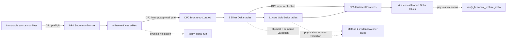
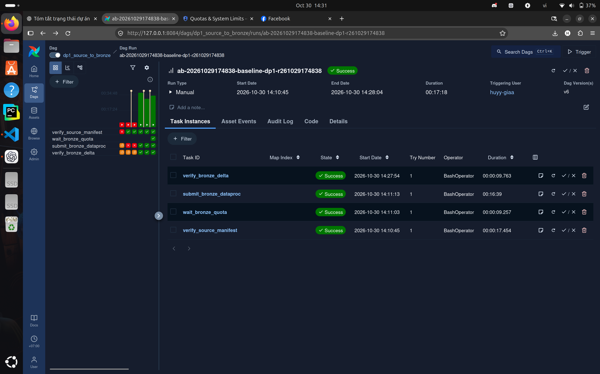
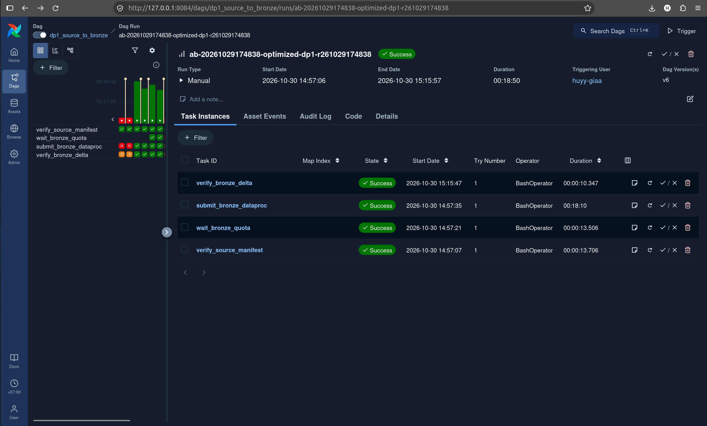
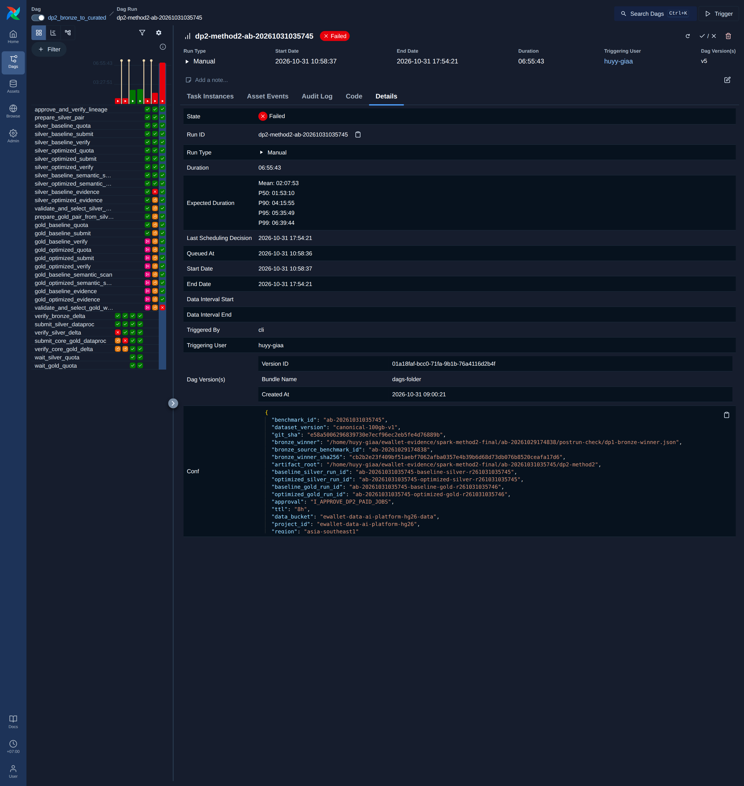
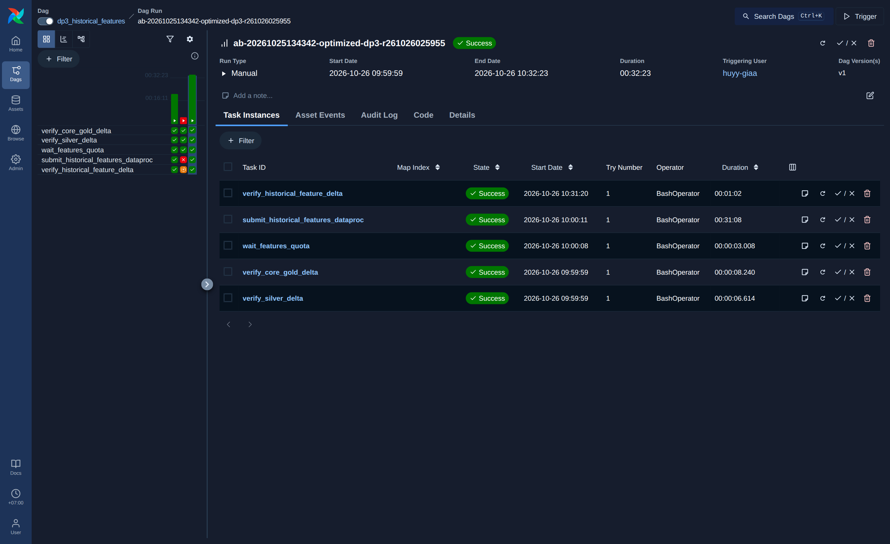

# Airflow Pipelines: DP1, DP2 and DP3

## 1. Overview

Three Airflow DAGs orchestrate the batch lakehouse:

| DAG | Pipeline | Stages |
|---|---|---|
| [`dp1_source_to_bronze`](../../data_platform/orchestration/airflow/dags/dp1_source_to_bronze.py) | DP1: raw source → Bronze | **ingest:** quota wait, Dataproc submit; **validate:** source manifest, exact Bronze Delta set |
| [`dp2_bronze_to_curated`](../../data_platform/orchestration/airflow/dags/dp2_bronze_to_curated.py) | DP2: Bronze → Silver → Gold | **ingest:** Silver and Gold baseline/optimised transforms; **validate:** physical checks, semantic scans, winner gates |
| [`dp3_historical_features`](../../data_platform/orchestration/airflow/dags/dp3_historical_features.py) | DP3: Silver + Gold → offline feature tables | **ingest:** upstream verification, quota wait, Dataproc submit; **validate:** four-table feature Delta check |

Airflow is the control plane; the Spark work runs on Dataproc Serverless, and every output is written to an immutable, run-scoped GCS prefix. All three DAGs are triggered manually (`schedule=None`), disable catch-up and allow one active run. The shared task runtime is [`python_runtime.py`](../../data_platform/orchestration/airflow/python_runtime.py).

## 2. Architecture and overall dataflow

The current canonical DAG sources are:

- `data_platform/orchestration/airflow/dags/dp1_source_to_bronze.py`
- `data_platform/orchestration/airflow/dags/dp2_bronze_to_curated.py`
- `data_platform/orchestration/airflow/dags/dp3_historical_features.py`
- shared runtime: `data_platform/orchestration/airflow/python_runtime.py`

## 3. DP1 — immutable source to Bronze

DP1 verifies that the source completion manifest exists, waits for bounded regional quota, submits the source-to-Bronze Dataproc job and verifies the exact eight-table Bronze Delta output.

| Order | Current task | Responsibility | Retry/failure behavior |
|---:|---|---|---|
| 1 | `verify_source_manifest` | Require `source/<dataset_version>/_control/dataset_manifest.json` | One retry; fails before paid work if absent |
| 2 | `wait_bronze_quota` | Wait for Dataproc quota and record handoff evidence | No DAG-level retry; 20-minute timeout |
| 3 | `submit_bronze_dataproc` | Invoke `ops.gcp.submit_source_to_bronze` with dataset, benchmark, run, profile, Git and pair-manifest identities | No automatic retry; immutable output; 10-hour timeout |
| 4 | `verify_bronze_delta` | Require the exact eight Bronze tables and valid Delta roots | One retry; 15-minute timeout |

Inputs are an immutable dataset version and source manifest. Output is `gs://<data_bucket>/lakehouse/runs/<bronze_run_id>/bronze` containing users, accounts, merchants, devices, transactions, balance snapshots, login events and fraud labels.

### DP1 execution

DP1 has run successfully in two campaigns:

- **October 25.** Baseline and optimised runs (`ab-20261025134342-…-dp1-…`); every task log ended with return code 0.
- **October 29–30.** Commit `62f17ba6…`, baseline run `ab-20261029174838-baseline-dp1-r261029174838` and optimised run `…-optimized-dp1-r261029174838`. The screenshots in §8 come from this campaign.

## 4. DP2 — Bronze to Silver and core Gold

The current DP2 implementation is a fail-closed Method 2 A/B workflow. It validates a DP1 winner artifact, runs baseline and optimized Silver sequentially, performs physical and semantic scans, selects an immutable Silver winner, then repeats the process for core Gold. Sequential ordering protects the small Dataproc quota.

```mermaid
flowchart LR
    A[Approve and verify\nDP1 lineage] --> PS[Prepare Silver pair]
    PS --> SB[Baseline Silver\nquota → submit → verify]
    SB --> SO[Optimized Silver\nquota → submit → verify]
    SO --> SS[Two semantic scans\n+ evidence artifacts]
    SS --> SW[Validate/select\nSilver winner]
    SW --> PG[Prepare Gold pair]
    PG --> GB[Baseline Gold\nquota → submit → verify]
    GB --> GO[Optimized Gold\nquota → submit → verify]
    GO --> GS[Two semantic scans\n+ evidence artifacts]
    GS --> GW[Validate/select\nGold winner]
```

The helper `step()` constructs 25 sequential `BashOperator` tasks around `ops.gcp.dp2_method2`. Parameter schemas restrict IDs, hashes, absolute paths, project, region and bucket values before shell interpolation. Paid Dataproc work starts only when an explicit approval token is supplied as a parameter.

### DP2 execution

The preserved canonical-volume logs belong to an earlier seven-task DP2 DAG with `verify_bronze_delta`, two quota waits, two submit tasks and Silver/Gold physical validators. They show successful baseline run `ab-20261025134342-baseline-dp2-r261025144416` and optimized run `ab-20261025134342-optimized-dp2-r261025181923`; all fourteen logs ended with return code 0. The optimized outputs are Silver `ab-20261025134342-optimized-silver-r261025181923` and Gold `ab-20261025134342-optimized-gold-r261025181923`.

The current 25-task Method 2 campaign was executed as DagRun `dp2-method2-ab-20261031035745`. Its baseline and optimized Silver and Gold transformations completed and produced immutable outputs, and 24 of 25 tasks succeeded. The final task, `validate_and_select_gold_winner`, failed, so the historical DagRun remains `FAILED` and no optimized Gold winner was selected.

The failure was isolated to exact-bit semantic fingerprints for three Spark `double` aggregate columns: `feat_user_90d.f_user_avg_transaction_amount_90d`, `opt_merchant_performance.total_amount` and `opt_merchant_performance.avg_amount`. Different partitioning/AQE profiles changed the IEEE-754 reduction order; observed relative differences were at most approximately `2.6e-15`. This is a representational difference in non-associative floating-point reduction, not evidence that the transformation tasks failed. Nevertheless, the final semantic gate correctly remained failed under the validator contract used by that DagRun.

A validator correction that compares these floating-point fingerprints under a bounded canonicalisation policy has since been implemented and covered by 18 focused regression tests. It has not yet been re-run in the cloud, so the recorded DagRun remains failed and no optimised Gold winner has been selected.

### DP2 validation

Historical `verify_bronze_delta`, `verify_silver_delta` and `verify_core_gold_delta` logs returned 0, establishing physical table-set/Delta validation for the earlier DAG. In the Method 2 campaign, the baseline and optimized Gold outputs were generated and the preceding physical/data validations succeeded within their recorded scope, but the final semantic-equivalence gate failed as described above. Later DataHub read-back records two Silver checks as PASS: zero NULL `channel` values and zero duplicate `transaction_id` groups.

A Gold row-level integrity assertion (`fact_transactions.row_level_integrity`) is defined in DataHub but has not yet been executed; Gold is validated by the physical Delta checks and the semantic-equivalence gate described above.

## 5. DP3 — historical offline features

DP3 verifies exact upstream Silver and core Gold sets, waits for quota, submits a run-scoped historical feature job and verifies four feature Delta tables.

| Dependency | Current task | Responsibility |
|---|---|---|
| Parallel preflight | `verify_silver_delta` | Require exact eight-table Silver input |
| Parallel preflight | `verify_core_gold_delta` | Require exact eleven-table core Gold input |
| After both preflights | `wait_features_quota` | Enforce Gold-to-feature quota handoff |
| Transform | `submit_historical_features_dataproc` | Build four run-scoped feature tables from explicit Silver/Gold runs |
| Physical validate | `verify_historical_feature_delta` | Require user, account, device and merchant feature Delta outputs |

The feature output root is `gs://<data_bucket>/lakehouse/runs/<feature_run_id>/gold`. Submission has no automatic retry because the output prefix is immutable. Read-only upstream/output validators retry once.

### DP3 execution and recovery

The baseline run `ab-20261025134342-baseline-dp3-r261025171232` succeeded. The first optimized attempt, `ab-20261025134342-optimized-dp3-r261026024739`, failed in `submit_historical_features_dataproc` with return code 1. That failure is preserved. A fresh immutable run, `ab-20261025134342-optimized-dp3-r261026025955`, then completed all five tasks with return code 0 and produced feature run `ab-20261025134342-optimized-feat-r261026025955`.

These runs used the configuration at commit `bbae48c` (baseline: AQE off, 200 shuffle partitions; optimised: AQE on, 400 partitions and the `performance` allocation profile). A newer optimised configuration exists in the source but has not been run.

The Airflow task validates physical feature outputs only. A later, separately operated Feast validator compared ten cases × 31 features and produced 310/310 matches, zero mismatches and label exclusion; four result-bound DataHub PIT events were later read back PASS. These checks confirm DP3's correctness, but they run as a separate validation job rather than as tasks of the DP3 DAG.

## 6. Configuration, Connections and Variables

| Mechanism | Current use | Verification |
|---|---|---|
| DAG `Param` | Dataset/benchmark/run IDs, Git SHA, pair manifest, profile, TTL, project, region, bucket and DP2 approval/evidence paths | Implemented; DP2 applies regex/enum constraints |
| `EWALLET_AIRFLOW_PYTHON` | Explicit interpreter override shared by Bash tasks | `python_runtime.py` validates executable and required module imports |
| Airflow Connection | Not used by DP1–DP3 | Credentials come from the worker's Google identity instead |
| Airflow Variable | Not used by DP1–DP3 | Non-secret configuration is passed as validated DAG parameters |
| Google authentication | Inherited by `gcloud`/submission modules from the Airflow worker environment | Operational dependency; no secret values documented |

No secret values are stored in DAG code or parameters.

## 7. Idempotency, retries and failure handling

- All outputs use explicit run IDs and immutable prefixes. A retry that needs to write output must use a fresh run ID.
- `max_active_runs=1` prevents overlapping instances of each DAG.
- Submission tasks have no automatic retry; operators do not blindly resubmit paid work.
- Read-only DP1/DP3 physical validators retry once after one minute.
- DP2 Method 2 is fail-closed and sequential: no Gold preparation occurs before Silver evidence and winner finalization.
- DP2 requires explicit approval and SHA-bound upstream winner evidence.
- DP3 recovery retained the failed attempt and used a fresh optimized run instead of reusing a partially touched prefix.

## 8. Execution

### DP1: Source to Bronze

*Airflow, DAG `dp1_source_to_bronze`, run `ab-20261029174838-baseline-dp1-r261029174838`: manual run from 14:10:45 to 14:28:04 (+07:00), status Success. The four tasks `verify_source_manifest → wait_bronze_quota → submit_bronze_dataproc` (16 min 39 s) `→ verify_bronze_delta` all succeeded. Earlier red and orange cells in the grid are previous attempts of the same DAG.*

*The optimised run of the same campaign (`ab-20261029174838-optimized-dp1-r261029174838`, commit `62f17ba6…`): 14:57:06 to 15:15:57, Success. The Dataproc submit took 18 min 10 s. The optimised profile was slower than the baseline, so the baseline was kept (see [Spark Optimisation](OPTIMIZATION_MATRIX.md)).*

### DP2: Bronze to Silver and Gold

*Airflow, DAG `dp2_bronze_to_curated`, run `dp2-method2-ab-20261031035745` (commit `e58a5006…`), from 10:58:37 to 17:54:21 (+07:00). All Silver and Gold transformations and their physical validations completed, and 24 of 25 tasks succeeded. The final `validate_and_select_gold_winner` task failed on exact floating-point fingerprints (§4), so the run is marked Failed and no optimised Gold output was promoted. Evidence: [DP2 run record](../evidence/dp2_method2_ab-20261031035745/README.md).*

### DP3: offline features

*Airflow, DAG `dp3_historical_features`, run `ab-20261025134342-optimized-dp3-r261026025955` (commit `bbae48c`), from 09:59:59 to 10:32:23 (+07:00): Success. The two upstream validators run in parallel, followed by the quota wait, the Dataproc submission and the feature-table validation. The earlier failed attempt is still visible in the grid. Evidence: [DP3 run record](../evidence/dp3_historical_features_ab-20261025134342/README.md).*

Task logs of the earlier October 25–26 runs (36 logs over seven runs: 35 successful and the one failed DP3 submission) are preserved with the evidence (`airflow_dp1_dp2_dp3_evidence.json`, SHA-256 `1f548b6c…`).

## 9. Limitations

- **DP2 final gate.** The DP2 run ended in a failed final gate, as explained above. The corrected validator has not been re-run in the cloud.
- **DP3.** The DP3 screenshots belong to an earlier configuration; the newer optimised configuration has not been run. The point-in-time validation of DP3 output runs as a separate job, not as a DAG task.
- **Configuration.** The DAGs use validated parameters and the worker's Google identity rather than Airflow Connections and Variables.
- **Gold row-level assertion.** The DataHub Gold row-level assertion is defined but has not been executed.

## Appendix: screenshot integrity

| File | Original | SHA-256 |
|---|---|---|
| `n13_curated/01_dp1_baseline_airflow_run_success_20261030.png` | DP1 baseline capture, campaign `ab-20261029174838` | see [`PROVENANCE.json`](../evidence/edai1/n13_curated/PROVENANCE.json) |
| `airflow/01_dp1_optimized_run_success_20261030.png` | DP1 optimised capture, campaign `ab-20261029174838` | `37b7fcc7c55a9b496aeb8e83379051808663ea8fabea4881f63f47c73d42d2ff` |
| `airflow/02_dp2_method2_run_failed_20261031.png` | `dp2_method2_ab-20261031035745/screenshots/03_dp2_run_details.png` | `d833d752f966d199ee6dc63c0ae731357b49bb35f5808fb3c5063fd6dc77fc04` |
| `airflow/03_dp3_historical_optimized_run_success_20261026.png` | `dp3_historical_features_ab-20261025134342/screenshots/03_dp3_optimized_run.png` | `b5d91e49de662c67b86bc46f08b92d44029257a891fa833ebb919f950118bbbd` |
