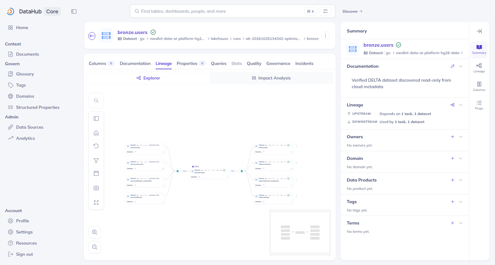
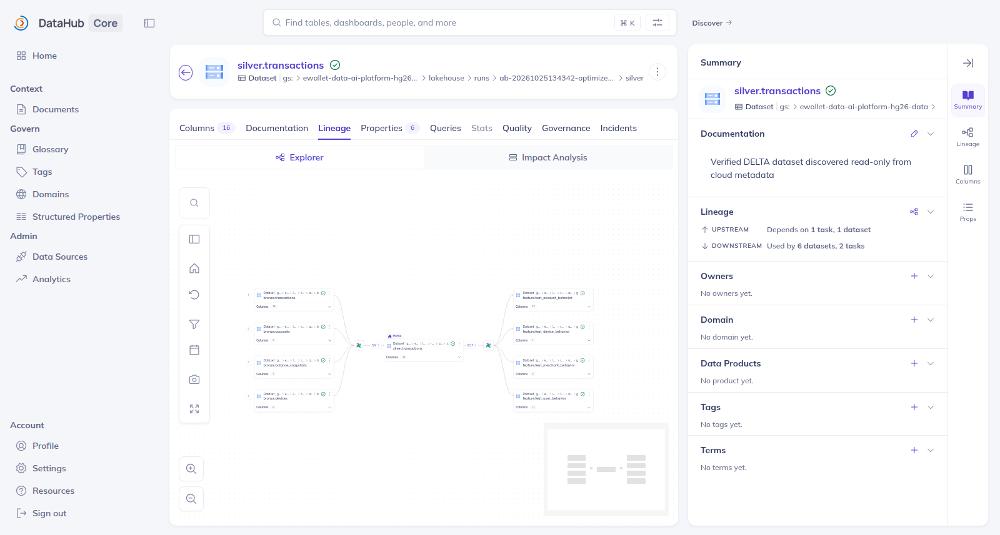
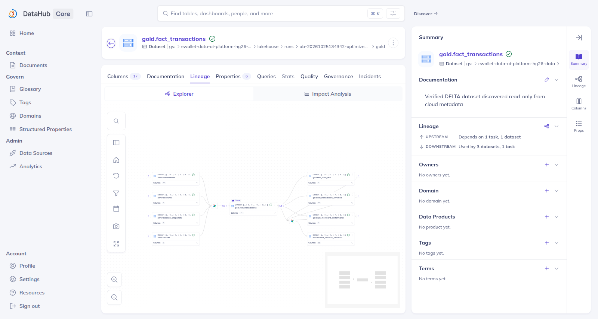
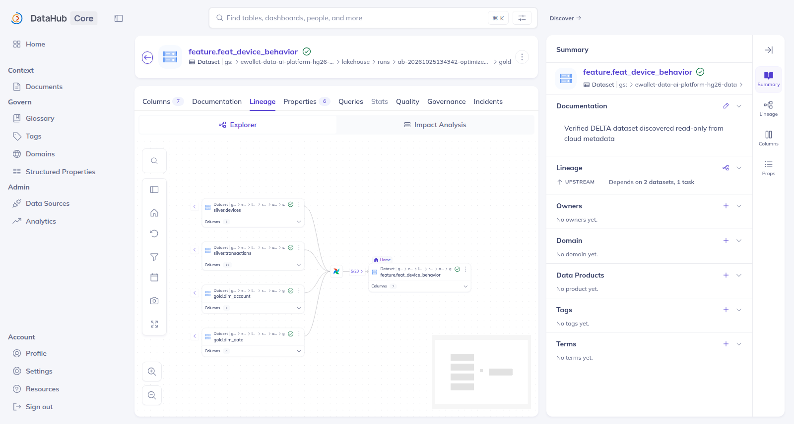

# All-Zones Schema

| Zone | Canonical inventory | Naming / role |
|---|---:|---|
| Source | 8 logical source tables, one immutable manifest dataset in DataHub | generator output, never overwritten |
| Bronze | 8 | raw, source-shaped Delta; zone-qualified (`bronze.<table>`), no `raw_` prefix |
| Silver | 8 | cleansed/conformed Delta; business table names, zone-qualified (`silver.<table>`), **no `stg_` prefix** (see the [naming conventions](SCHEMA_DESIGN.md#8-naming-conventions)) |
| Gold core | 11 | `dim_`, `fact_`, `obt_` analytical contracts |
| Gold feature | 4 | `feat_` historical feature contracts |

Total logical inventory: 39 tables. DataHub represents them as 32 physical datasets, because the eight logical source tables share one immutable manifest dataset. The role of every table is described in [SCHEMA_DESIGN.md](SCHEMA_DESIGN.md#3-table-catalog).

## Tables and relationships per zone

The DataHub lineage views below show the tables of each zone and how each zone is derived from the previous one. They were captured during the 2026-10-25/26 pipeline runs.

*Source → Bronze (DP1): `source.users` upstream of `bronze.users`, with the downstream Silver context.*

*Bronze → Silver (DP2).*

*Silver → Gold (DP2), centred on `gold.fact_transactions`. Upstream: `silver.transactions`, `silver.accounts`, `silver.balance_snapshots` and `silver.devices`. Downstream: `gold.feat_user_90d`, `gold.obt_transaction_enriched`, `gold.agt_merchant_performance` and `feature.feat_account_behavior`. This is a lineage view, not a dim ↔ fact ER diagram.*

*Silver / Gold → Gold feature tables (DP3): `silver.devices`, `silver.transactions`, `gold.dim_account` and `gold.dim_date` upstream of `feature.feat_device_behavior`.*

The dimension–fact relationships within Gold are shown in the [ER diagram](SCHEMA_DESIGN.md#7-dimensionfact-relationships).
