# Batch Processing and Orchestration — DP1/DP2/DP3

This document covers the Spark batch pipelines DP1–DP3 and their Airflow orchestration, as implemented today. They were run once with a Baseline Spark profile and once with an Optimised profile on the 5 GB rehearsal dataset.

Every number below comes from the campaign's stored artifacts in [`docs/evidence/edai1/spark/rehearsal-5gb-ab-20261110225456/`](../evidence/edai1/spark/rehearsal-5gb-ab-20261110225456/README.md), which is called `evidence/` from here on. Every screenshot is a genuine capture, with its source identity in the [screenshot manifest](../evidence/edai1/spark/rehearsal-5gb-ab-20261110225456/screenshots/MANIFEST.md).

**Rubric map.**

| Row | Requirement | Where it is answered |
|---:|---|---|
| 11 | Spark baseline, each optimisation step, Spark UI, Airflow integration | §A.4, §B–D (Spark UI per pipeline), §F |
| 12 | Handle skew, with explanation | §C.3, §F.4 |
| 13 | Handle schema evolution, with explanation | §B.2 |
| 14 | Handle another offline problem (duplicates), with explanation | §C.2 |
| 15 | Spark integrated into the pipelines | §E |
| 22–27 | DP1/DP2/DP3 ingest and validate stages in Airflow | §B.4, §C.6, §D.4, §E |

## A. Overview and architecture

### A.1 Dataset and experiment

| Item | Value |
|---|---|
| Dataset | `rehearsal-5gb-v1`: 186 Parquet shards, 5,000,608,241 bytes |
| Source manifest SHA-256 | `ac2dfb0eac16e173261b3c3f65e83a03d388528538daefd9ec669bef7123eb80` (both profiles) |
| Benchmark | `ab-20261110225456` |
| Code | Git `aae22b08eee20fa055c4aefc8d23c14cc3ae5f8c`, pinned before the first run and recorded on every batch |
| Platform | Dataproc Serverless runtime 2.2.90 (Spark 3.5, Scala 2.13, Java 17), Standard tier, `asia-southeast1` |
| Orchestration | Airflow 3 (local scheduler), three DAGs, six DagRuns |

The experiment has two goals:

1. Prove the pipeline is correct and traceable end to end on Dataproc: every stage validated, every hand-over verified.
2. Measure how the Optimised Spark profile changes execution compared with the Baseline on the same immutable input.

It is **one trial per profile**, so it describes behaviour. It does not rank configurations (§F.6).

### A.2 Data flow

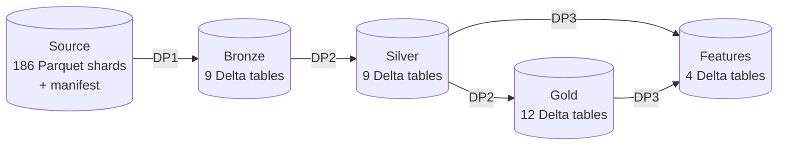

| Component | Role |
|---|---|
| Spark on Dataproc Serverless | Runs every transformation and every validator as a separate batch. No cluster is kept running |
| GCS | Holds the immutable Source, each run's Delta output under `lakehouse/runs/<run>/<zone>/`, the Spark event logs, the validation reports and the handoff manifests |
| Airflow | Control plane only: decides when a batch may run, submits it, waits, checks results and publishes the handoff. No data passes through Airflow |

### A.3 Control flow

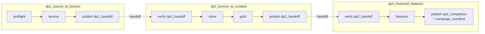

Each stage group (`bronze`, `silver`, `gold`, `features`) has the same four tasks: `wait_quota` → `submit_transformation` → `physical_validation` → `semantic_validation`. The DAGs are separate, and they are linked only by the handoff manifests (§E.3).

### A.4 How Baseline and Optimised run

Both profiles run the same code on the same Source. Each is a separate set of three DagRuns: `ab-20261110225456-baseline-dp{1,2,3}` and `…-optimized-dp{1,2,3}`. The profile only changes Spark SQL settings. The resources are identical: 4-core driver and executors, 9,600 MB heap plus 3,840 MB overhead, dynamic allocation 2 / 6 / 7 (min / initial / max) executors, and a 192 MB broadcast threshold.

Profiles are defined in [`data_platform/config/spark_profiles.py`](../../data_platform/config/spark_profiles.py) and applied both to the Dataproc batch properties and to the SparkSession ([`common/spark_session.py`](../../data_platform/processing/spark/common/spark_session.py)).

| Pipeline | Baseline | Optimised |
|---|---|---|
| DP1 Bronze | AQE off, 200 shuffle partitions | AQE on, 200 partitions, `dynamicAllocation.profile=performance` |
| DP2 Silver | AQE off, 200 | AQE on, 200, coalescing on, `parallelismFirst=false`, advisory 64 MiB |
| DP2 Gold | AQE off, 200 | AQE on, 400 (coalescing at Spark default: on) |
| DP3 features | AQE off, 200 | AQE on, 200, coalescing on, `parallelismFirst=false`, advisory 64 MiB |

These are the properties the batches actually received (`evidence/dataproc_usage.json`). AQE skew-join handling is off everywhere. The validators use one fixed session (AQE on) in both campaigns, which makes them a control for run-to-run variation (§F.5).

## B. DP1 — Source to Bronze

### B.1 Input, output and transformation

| | |
|---|---|
| Input | `gs://…-rehearsal-5gb-data/source/rehearsal-5gb-v1/` and its `_control/dataset_manifest.json` |
| Code | [`ingestion/spark/source_to_bronze.py`](../../data_platform/ingestion/spark/source_to_bronze.py) |
| Output | 9 Bronze Delta tables: `users`, `accounts`, `merchants`, `devices`, `transactions`, `balance_snapshots`, `login_events`, `fraud_labels`, `merchant_history` |
| Largest table | `transactions`: 18,972,000 rows (duplicates still included), 3.26 GB |

DP1 reads each entity's Parquet shards, aligns the transaction schema versions and writes run-scoped Delta tables. It is a read–transform–write job with little shuffle (1.39 GB in both profiles).

### B.2 Schema evolution (row 13)

**Problem.** Transactions before 2026-03-15 (V1) have no `channel` column; later ones (V2) do.

**Implementation.** DP1 aligns the two versions explicitly instead of relying on a permissive merge:

```python
def combine_transaction_versions(v1: DataFrame, v2: DataFrame) -> DataFrame:
    v1_with_channel = v1.withColumn("channel", F.lit(None).cast("string"))
    return v1_with_channel.unionByName(v2, allowMissingColumns=False)
```

`allowMissingColumns=False` makes any other, unexpected schema difference fail the job rather than silently produce nulls. Silver then maps a missing channel to `UNKNOWN`, and trims and lower-cases present values ([`silver/transactions.py`](../../data_platform/processing/spark/silver/transactions.py)).

**Result.**

- Bronze rule `transactions.channel_schema`: `channel` exists and is a string. PASS.
- Silver rules `channel_not_null` and `valid_channel`: 0 violations.
- The Silver plan filters `channel IN (app, web, atm, UNKNOWN)` (image in §C.2).

### B.3 Bronze validation (54 rules)

| Check | Observed (both profiles) |
|---|---|
| Source integrity: preflight re-reads the manifest, its SHA-256 and the shard listing before any paid job | 186 shards, SHA-256 `ac2dfb0e…` |
| All 9 tables: Delta readable, required columns, compatible types, full scan, non-empty | 45 PASS |
| Fraud labels: domain {0,1}; `fraud_type` present only when label = 1; unique `transaction_id` | 0 violations |
| Labels against transactions: every label has a transaction, and every distinct transaction has a label | 18,600,000 labels = 18,600,000 distinct transactions |

Report: `evidence/validation_reports/<profile>-bronze.json`.

### B.4 Airflow, Spark UI and results

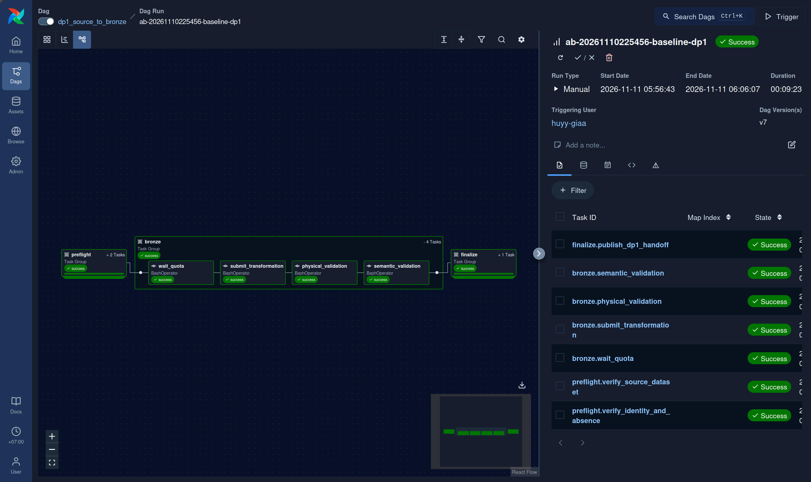

*DagRun `ab-20261110225456-baseline-dp1`: preflight (2 tasks) → `bronze` (wait_quota → submit_transformation → physical_validation → semantic_validation) → finalize. All Success, 00:09:23 (563.9 s in the Airflow metadata). The Optimised run, `…-optimized-dp1`, took 00:11:33 ([screenshot 02](../evidence/edai1/spark/rehearsal-5gb-ab-20261110225456/screenshots/02_dp1_optimized_airflow_success.png)).*

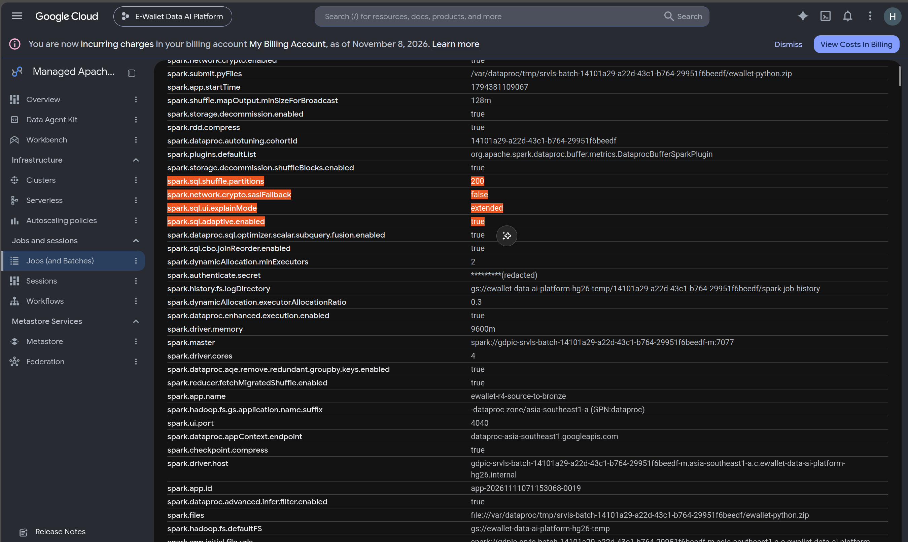

*Spark Environment of the Optimised Bronze application `app-20261111071153068-0019` (its `spark.app.id` is visible): `spark.sql.adaptive.enabled=true`, 200 shuffle partitions. This shows the profile was actually applied. In the Baseline application the same key is `false`.*

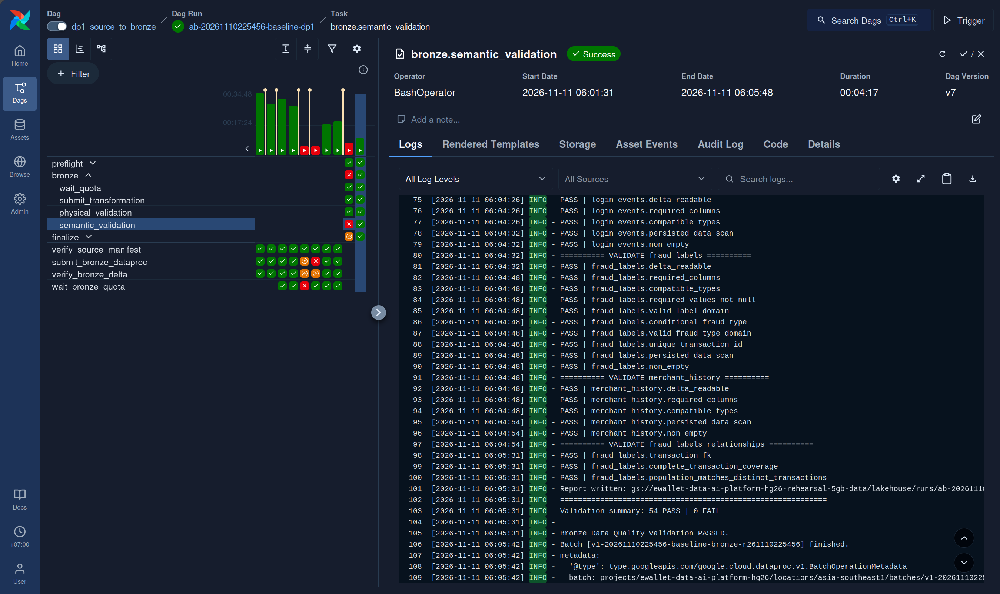

*Task log of `bronze.semantic_validation` (Baseline):*

- *the fraud-label relationship rules;*
- *the report URI;*
- *`Validation summary: 54 PASS | 0 FAIL`;*
- *validator batch `v1-20261110225456-baseline-bronze-r261110225456`.*

*The red cells in the left grid are earlier DagRuns and DAG versions, not this run.*

The DP1 Baseline Stages view ([screenshot 11](../evidence/edai1/spark/rehearsal-5gb-ab-20261110225456/screenshots/11_dp1_baseline_spark_stages_overview.png), captured while the job was running) shows `Listing leaf files and directories for 186 paths`: the 186 Source shards.

| DP1 | Baseline | Optimised | Change |
|---|---:|---:|---:|
| Spark application runtime | 165.1 s | 213.8 s | +29.5 % |
| Tasks | 3,751 | 3,202 | −14.6 % |
| Shuffle read = write | 1.39 GB | 1.39 GB | 0 |
| Executor run time | 1,794 s | 1,867 s | +4.1 % |

**Explanation.** DP1 has almost no shuffle, so AQE has little to re-plan: only 3 coalesced shuffle reads. The executor work barely changed (+4.1 %). The higher runtime is within the variation of the control (§F.5).

## C. DP2 — Bronze to Silver and Gold

### C.1 Silver transformations

[`silver/silver_pipeline.py`](../../data_platform/processing/spark/silver/silver_pipeline.py) reads the DP1 Bronze run named in the DP1 handoff and writes 9 Silver tables:

- type casting and domain filters: transaction type and status, channel, VND currency, amount > 0, non-negative balances;
- deduplication (§C.2);
- merchant history kept as point-in-time snapshots.

Date-partitioned tables are written with a fixed task count per table ([`common/write_layout.py`](../../data_platform/processing/spark/common/write_layout.py)): `transactions` 128 tasks, `balance_snapshots` and `login_events` 48.

### C.2 Deduplication (row 14)

**Problem.** 2 % of transactions are delivered twice with the same `transaction_id` (at-least-once delivery).

**Implementation.** Silver keeps the most recently ingested copy:

```python
window_spec = Window.partitionBy("transaction_id").orderBy(F.col("ingested_at").desc())
df = (df.withColumn("_row_number", F.row_number().over(window_spec))
        .filter(F.col("_row_number") == 1).drop("_row_number"))
```

([`silver/transactions.py`](../../data_platform/processing/spark/silver/transactions.py)). The other entities use `dropDuplicates` on their business keys ([`silver/cleaners.py`](../../data_platform/processing/spark/silver/cleaners.py)).

**Result.**

- Bronze `transactions` had 18,972,000 rows and Silver has 18,600,000, so 372,000 duplicate deliveries were removed.
- `duplicate_key` = 0 on all 8 keyed Silver tables.
- Fraud labels: 18,600,000 in Bronze and Silver, equal to the Silver transactions.

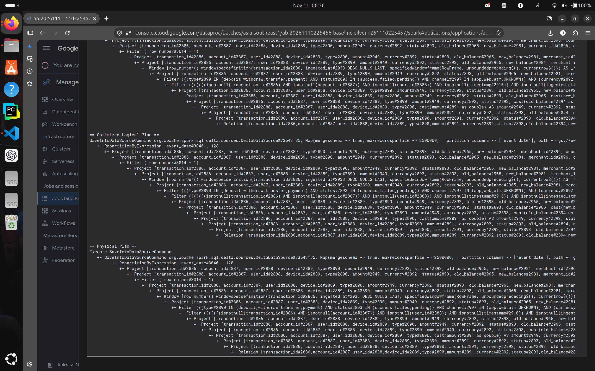

*SQL plan of the Silver `transactions` write (Baseline batch `ab-20261110225456-baseline-silver-r261110225457`, URL visible). From bottom to top:*

- *type casts;*
- *the domain filter, including `channel IN (app, web, atm, UNKNOWN)` and `currency = VND`;*
- *`Window row_number()` partitioned by `transaction_id` and ordered by `ingested_at DESC`, then `Filter (_row_number = 1)`;*
- *`RepartitionByExpression [event_date], 128` before the Delta write.*

### C.3 Data skew: what the implementation does (row 12)

The synthetic data is skewed by design: payment traffic concentrates on a few merchants and on peak hours. The current implementation handles skew with three mechanisms:

| Mechanism | Where | Effect on skew |
|---|---|---|
| AQE in the Optimised profile | `spark_profiles.py` | Re-plans each shuffle from measured sizes: coalesces small partitions and converts joins to broadcast when one side turns out small |
| Broadcast threshold 192 MB (both profiles) | resource contract | A join side estimated below 192 MB is broadcast instead of shuffled, so a skewed key on the large side does not need a shuffle join. The final plans contain 3 (Baseline) and 8 (Optimised) broadcast joins in Gold; the event log does not show which tables |
| Fixed write layout | `write_layout.py` | Bounds output file count and size per table; this is not a skew remedy (§F.4) |

AQE skew-join handling is off in both profiles. It only splits oversized *join* partitions, and the measured skew in this run is in write repartitions (§F.4), where it would not apply.

### C.4 Gold transformations

[`gold/gold_pipeline.py`](../../data_platform/processing/spark/gold/gold_pipeline.py) reads the Silver run and writes 12 Gold tables:

| Group | Tables | Builder |
|---|---|---|
| Dimensions | `dim_user`, `dim_account`, `dim_merchant`, `dim_device`, `dim_date` | `dimension_builder.py` |
| SCD Type 2 | `dim_merchant_scd2` (78,294 versions of 55,800 merchants) | `scd2.py` |
| Facts | `fact_transactions`, `fact_login_events`, `fact_balance_snapshot` | `fact_builder.py` |
| Wide table and aggregates | `obt_transaction_enriched`, `feat_user_90d`, `opt_merchant_performance` | `obt_builder.py`, `feature_builder.py`, `analytics_builder.py` |

Write layout: `fact_transactions` 128 tasks, the other two facts 48, and `obt_transaction_enriched` 160.

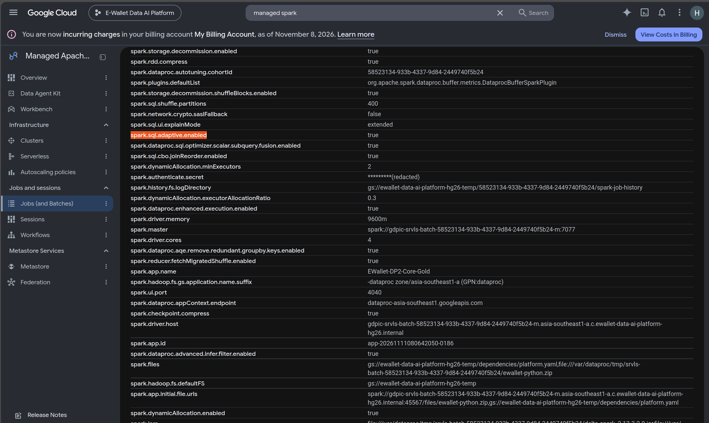

*Spark Environment of the Gold Optimised application `app-20261111080642050-0186` (its `spark.app.id` is visible): AQE on with 400 shuffle partitions, the only two settings that differ from the Baseline.*

### C.5 Validation (Silver 60 rules, Gold 93 rules)

| Check | How | Observed (both profiles) |
|---|---|---|
| Silver keys and domains | Duplicate keys, NOT NULL, the domain rules of §C.1, `merchant_id` required for payments and `counterparty_account_id` for transfers | 0 violations |
| Silver referential integrity | 11 orphan-key checks: transactions → users, accounts, devices and merchants; balances → accounts; logins → users and devices; labels → transactions | 0 orphans |
| Merchant history | Schema; unique `snapshot_id` and (`merchant_id`, `snapshot_ts`); synthetic provenance; latest snapshot equals `merchants` | PASS; 334,800 history rows |
| Gold keys | Non-empty, required columns, unique primary key, for all 12 tables | PASS |
| Silver-to-Gold completeness | Each dimension and fact against its Silver source; facts against the OBT | Equal, e.g. 18,600,000 = `fact_transactions` = `obt_transaction_enriched` |
| Gold referential integrity | 15 fact→dimension and aggregate→dimension checks, including `date_key → dim_date` | 0 orphans |
| SCD Type 2 | 13 rules, listed below | 0 violations |
| `feat_user_90d.created` | One value per table, equal to the clock recorded in the Delta commit | PASS |

The 13 SCD Type 2 rules check:

- `valid_to_ts > valid_from_ts`;
- `is_current` exactly when `valid_to_ts IS NULL`;
- one current version per merchant;
- contiguous, non-overlapping intervals;
- no redundant versions;
- the current version equals `dim_merchant`;
- every transaction with a merchant resolves to exactly one version.

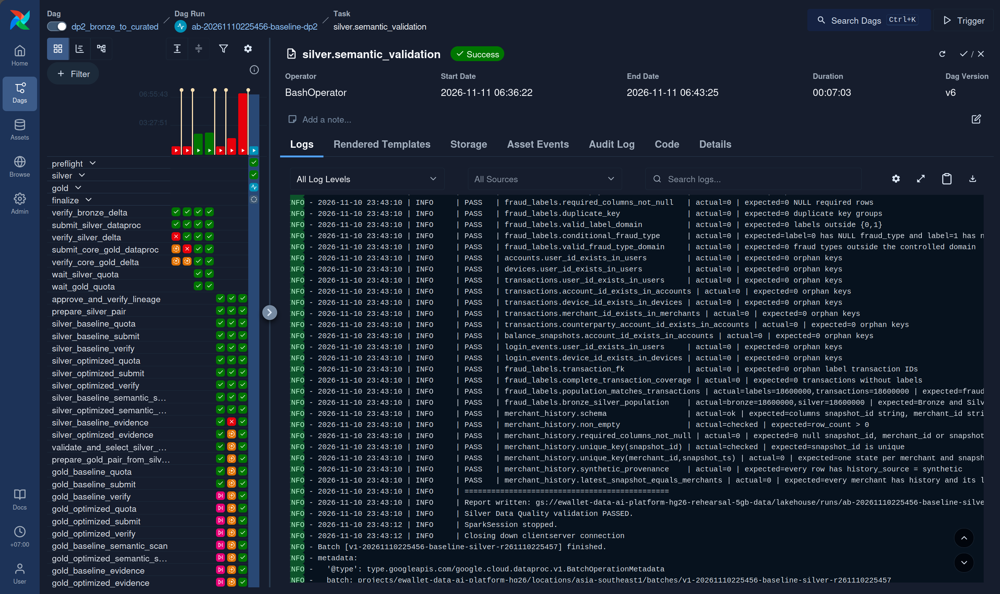

*`silver.semantic_validation` of `ab-20261110225456-baseline-dp2`. It shows the orphan-key rules (`actual=0`), the label population (`labels=18600000, transactions=18600000`), the merchant-history rules and `Silver Data Quality validation PASSED`, from batch `v1-20261110225456-baseline-silver-r261110225457`.*

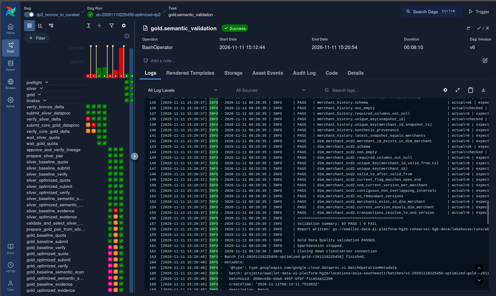

*`gold.semantic_validation` of `ab-20261110225456-optimized-dp2`. It shows the 13 `dim_merchant_scd2` rules and `Validation summary: 93 PASS | 0 FAIL`, from batch `v1-20261110225456-optimized-gold-r261110225458`.*

### C.6 Airflow and results

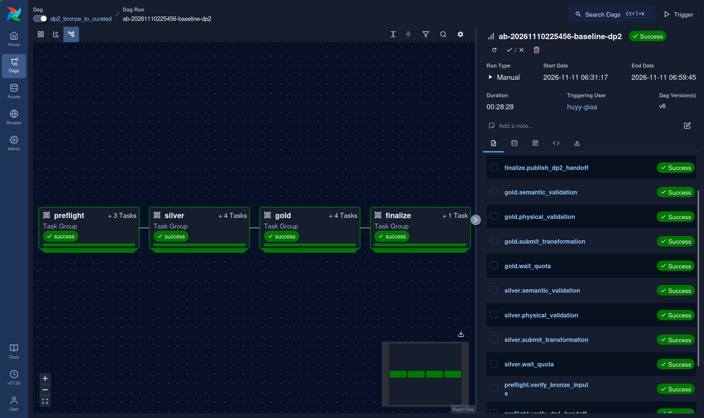

*DagRun `ab-20261110225456-baseline-dp2`: preflight (3 tasks) → `silver` (4) → `gold` (4) → finalize. All Success, 00:28:28 (1,708.9 s). The Optimised run took 00:32:11 ([screenshot 04](../evidence/edai1/spark/rehearsal-5gb-ab-20261110225456/screenshots/04_dp2_optimized_airflow_dag_success.png)).*

| DP2 | Silver Baseline | Silver Optimised | Gold Baseline | Gold Optimised |
|---|---:|---:|---:|---:|
| Spark application runtime | 197.9 s | 292.3 s (+47.7 %) | 314.9 s | 335.8 s (+6.7 %) |
| Tasks | 5,631 | 2,933 (−47.9 %) | 5,136 | 2,923 (−43.1 %) |
| Shuffle read = write | 19.08 GB | 19.06 GB | 24.44 GB | **19.42 GB (−20.5 %)** |
| Executor run time | 2,536 s | 3,426 s (+35.1 %) | 4,229 s | **4,036 s (−4.6 %)** |
| Broadcast / sort-merge joins in final plans | 0 / 0 | 0 / 0 | 3 / 4 | 8 / 6 |

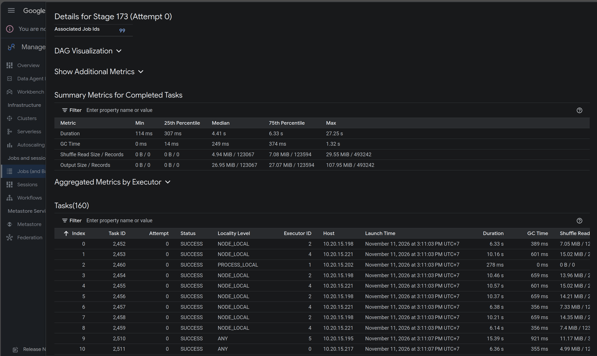

*Gold Optimised application `app-20261111080642050-0186`, stage 173. This is the 160-task repartition of `obt_transaction_enriched` by `event_date` before its Delta write. Median task 4.41 s, maximum 27.25 s, matching the event log (4,436.5 and 27,253 ms). The Baseline equivalent, stage 125, has median 4.3 s and maximum 20.1 s. The plan of a 128-task Gold write is [screenshot 17](../evidence/edai1/spark/rehearsal-5gb-ab-20261110225456/screenshots/17_dp2_gold_baseline_physical_plan_fact_transactions.png).*

**Explanation.**

- **Gold is the one stage where AQE reduced work.** With measured sizes, AQE broadcast 5 more join sides, which cut shuffle by 20.5 % and executor time by 4.6 %. The application was still 6.7 % slower, which is within the control's variation (§F.5).
- **Silver is the one stage slower by more than its control.** Its runtime rose 47.7 % against 9.3 % for the Silver validator. Two deterministic causes are visible in the event log:
  - coalescing reduced 5 large shuffle stages to 12–16 tasks on 24 cores;
  - under AQE, the cached transactions frame is built by a separate job and read back (§F.3).

## D. DP3 — Historical feature engineering

### D.1 Input, output and transformation

| | |
|---|---|
| Input | The Silver and Gold runs named in the DP2 handoff |
| Code | [`gold/historical_feature_pipeline.py`](../../data_platform/processing/spark/gold/historical_feature_pipeline.py) and [`gold/features/`](../../data_platform/processing/spark/gold/features/) (user, account, device and merchant builders) |
| Output | 4 tables, one row per entity per event: `feat_user_behavior` and `feat_account_behavior` (18,599,553 rows each), `feat_device_behavior` (18,599,560), `feat_merchant_behavior` (7,439,478; payments only) |
| Write layout | 64 tasks per table |

Each row holds windowed aggregates (counts, sums, failure rates over 5 minutes to 30 days) of the entity's **earlier** events, plus `event_timestamp` (the event time) and `created` (the materialisation time).

### D.2 Event time and point-in-time correctness

**Problem.** A feature computed from events at or after its own `event_timestamp` leaks the future into model training.

**Implementation.** Every window ends 1 µs before the current event ([`features/temporal.py`](../../data_platform/processing/spark/gold/features/temporal.py)):

```python
def historical_window(entity_column: str, seconds: int):
    """Return an exclusive point-in-time window: [T-seconds, T)."""
    return (Window.partitionBy(entity_column).orderBy(F.col("_event_micros"))
            .rangeBetween(-seconds * MICROSECONDS_PER_SECOND, -1))
```

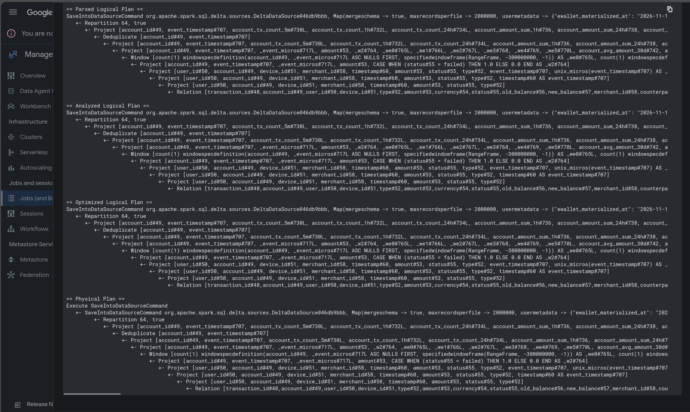

*SQL plan of an account-feature write (DP3 Baseline, from the owner's capture label). The window is `RangeFrame(-300000000, -1)` over `_event_micros`: 5 minutes ending 1 µs before the event. Below it are `Deduplicate [account_id, event_timestamp]` and `Repartition 64`.*

### D.3 Validation (53 rules)

| Check | How | Observed (both profiles) |
|---|---|---|
| Grain and completeness | Unique (entity, `event_timestamp`); one row per Silver transaction per entity | Each table equals its Silver population (above) |
| Value sanity | Non-negative metrics; rates within [0, 1]; smaller windows never exceed larger ones | 0 violations |
| `event_timestamp` and `created` | Both typed `timestamp` and not null; one `created` per table, equal to the recorded clock and shared by all 4 tables | PASS |
| Point-in-time correctness | For a 1/1000 sample of entities, the 1-hour count is recomputed from Silver over [T − 3600 s, T) and compared | 0 mismatches over 18,217 / 18,873 / 18,048 / 10,376 sampled rows (user / account / device / merchant) |
| Referential integrity | Each entity exists in its dimension | 0 orphans |

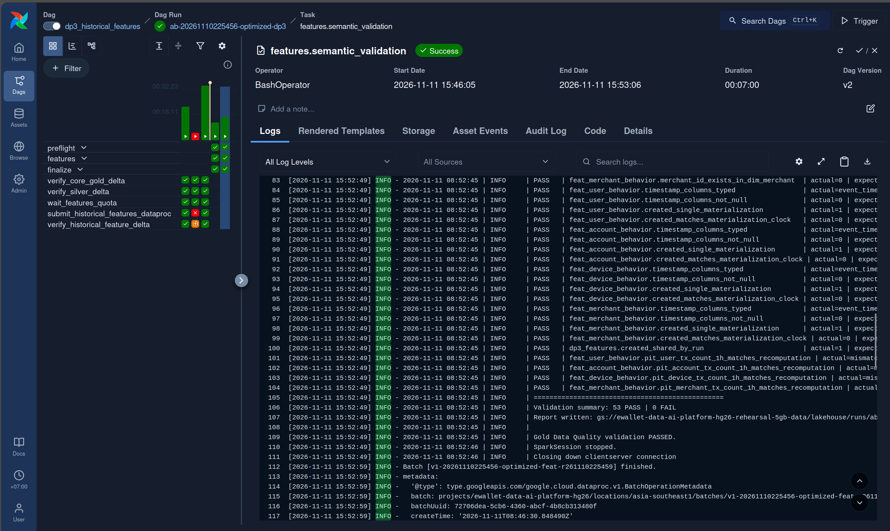

*`features.semantic_validation` of `ab-20261110225456-optimized-dp3`. It shows the `created` and timestamp rules, `dp3_features.created_shared_by_run`, the four `pit_*_matches_recomputation` rules and `53 PASS | 0 FAIL`, from batch `v1-20261110225456-optimized-feat-r261110225459`.*

### D.4 Airflow, Spark UI and results

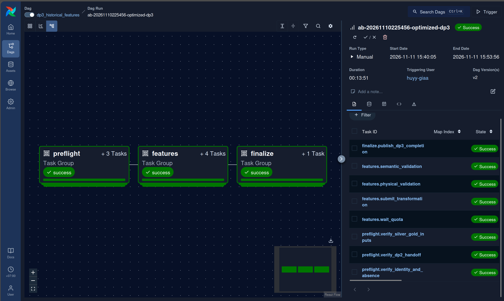

*DagRun `ab-20261110225456-optimized-dp3`: preflight (3 tasks) → `features` (4) → finalize, all Success, 00:13:51 (831.2 s).*

*In the Baseline capture ([screenshot 05](../evidence/edai1/spark/rehearsal-5gb-ab-20261110225456/screenshots/05_dp3_baseline_airflow_success.png), 00:10:36), the run header shows Success but the task list still shows `publish_dp3_completion` as Running. That is a UI refresh lag: the metadata records `success`, try 1.*

| DP3 | Baseline | Optimised | Change |
|---|---:|---:|---:|
| Spark application runtime | 160.2 s | 196.7 s | +22.8 % |
| Tasks | 1,391 | 695 | −50.0 % |
| Shuffle read = write | 7.90 GB | 8.05 GB | +1.8 % |
| Executor run time | 1,895 s | 2,253 s | +18.9 % |

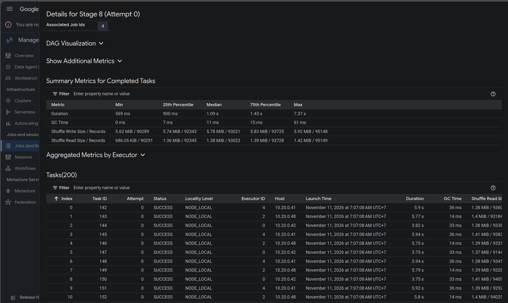

*Baseline application `app-20261111000612449-0263`, stage 8, the largest windowed shuffle: 200 tasks, median 1.09 s, median shuffle read 1.38 MiB. These are many small partitions.*

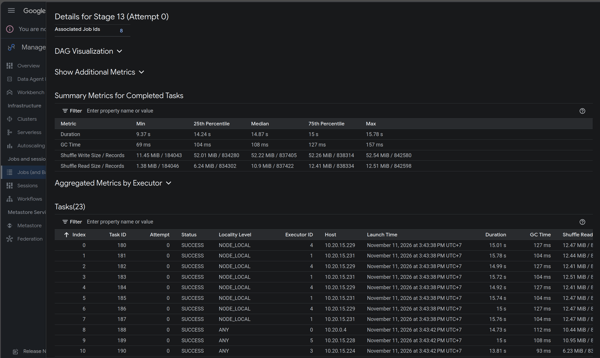

*The same shuffle in the Optimised application `app-20261111084230605-0566`, stage 13: AQE merged it into 23 tasks of about 10–12 MiB, median 14.87 s. Stage wall time was about the same (19.3 s against 18.5 s). Fewer tasks removed overhead, but 23 tasks leave cores idle.*

**Explanation.** With an advisory size of 64 MiB and `parallelismFirst=false`, AQE honours the partition size even when that leaves fewer tasks than cores. At 5 GB, 4 of DP3's 8 large shuffle stages (over 256 MiB) ran with 9–23 tasks on 24 cores. The validator control also slowed by 53.8 % in the same window, so DP3's +22.8 % runtime cannot be attributed to the profile.

## E. Airflow orchestration

### E.1 The three DAGs

| DAG | File | Task groups | Publishes |
|---|---|---|---|
| `dp1_source_to_bronze` | [`dags/dp1_source_to_bronze.py`](../../data_platform/orchestration/airflow/dags/dp1_source_to_bronze.py) | preflight → bronze → finalize | `dp1_handoff.json` |
| `dp2_bronze_to_curated` | [`dags/dp2_bronze_to_curated.py`](../../data_platform/orchestration/airflow/dags/dp2_bronze_to_curated.py) | preflight → silver → gold → finalize | `dp2_handoff.json` |
| `dp3_historical_features` | [`dags/dp3_historical_features.py`](../../data_platform/orchestration/airflow/dags/dp3_historical_features.py) | preflight → features → finalize | `dp3_completion.json`, `campaign_manifest.json` |

All three are built by [`edai1_pipeline.py`](../../data_platform/orchestration/airflow/edai1_pipeline.py). Each task is a `BashOperator` that runs one action of [`ops/gcp/campaign_task.py`](../../ops/gcp/campaign_task.py). Parameters reach it through environment variables, never through shell text. Every DAG is manual (`schedule=None`), with `catchup=False`, `max_active_runs=1` and `max_active_tasks=1`. Dependencies are strictly linear.

### E.2 Tasks: ingest and validate

| Task | Stage | Retries | Timeout | What it does |
|---|---|---:|---|---|
| `preflight.verify_identity_and_absence` | validate | 0 | 30 min | Checks every parameter, including the pipeline-bound approval token, and that none of this run's batches, outputs or manifests exist |
| `preflight.verify_source_dataset` (DP1) | validate | 2 | 30 min | Re-reads the Source manifest; checks its SHA-256 and the object listing |
| `preflight.verify_dp1_handoff` / `verify_dp2_handoff` | validate | 2 | 30 min | Reads the upstream handoff, compares its identity with this run and re-checks the validation reports it names |
| `preflight.verify_bronze_inputs` / `verify_silver_gold_inputs` | validate | 2 | 30 min | Checks the exact upstream Delta table set |
| `<stage>.wait_quota` | ingest | 0 | 20 min | Waits until regional CPU quota allows the 28 vCPU a batch starts with |
| `<stage>.submit_transformation` | ingest | 0 | 10 h | Submits the Dataproc batch, named by its run ID; records the Spark application and event log |
| `<stage>.physical_validation` | validate | 2 | 30 min | Checks the exact expected Delta table set at the run's output prefix |
| `<stage>.semantic_validation` | validate | 0 | 8 h | Runs the validator batch `v<try>-<run>`; fails unless its JSON report says `PASS` |
| `finalize.publish_*` | publish | 2 | 30 min | Writes the handoff once; a retry can only find identical content |

### E.3 Handoffs

Each handoff (`gs://<bucket>/lakehouse/campaigns/<benchmark>/<profile>/…`) records:

- the dataset, Source SHA-256, Git SHA, profile and run IDs;
- the producing DAG and DagRun;
- each stage's validation status and report URI;
- the SHA-256 of the upstream handoff.

DP2 and DP3 refuse to start unless the upstream handoff exists and matches. `campaign_manifest.json` records the SHA-256 of each handoff, and `dp3_completion.json` records the manifest's.

`scripts/edai1/verify_handoffs.sh` re-checks the chain read-only. It returned PASS for all three handoffs of both profiles, and all six recorded hashes match the published objects (`evidence/manifests/`).

### E.4 Retries, failures and idempotency

- **Paid work never retries automatically.** The transformation and validator batches have `retries=0`. Read-only checks and the write-once publication retry twice, one minute apart.
- **Outputs are immutable.** Every run writes under its own run ID, and preflight refuses an existing output or batch. A failed transformation is therefore never re-run over its output: a new benchmark starts from DP1.
- **A validator retry is a new attempt.** Clearing `semantic_validation` gives batch `v2-…` and report `…-a2.json`. No report is overwritten.
- **A failed validation blocks the hand-over.** The handoff is published only after `PASS`, so a downstream DAG cannot read unvalidated data.

### E.5 Parameters, connections and configuration

| Mechanism | Use |
|---|---|
| DAG `Param`s | Dataset, benchmark, profile, Git SHA, Source SHA, run IDs, project, region, bucket, Dataproc TTL and the approval token; each is validated by a regex or enum, and the defaults never execute |
| Approval token | `EXECUTE-PAID-DATAPROC:<DP1\|DP2\|DP3>:<benchmark>:<profile>:<dataset>:<sha12>`, which binds a DagRun to one pipeline and one run |
| Airflow Connections and Variables | Not used. Google credentials come from the worker's identity, and non-secret configuration is passed as validated parameters. No secret is stored in DAG code or parameters |
| Operator scripts | `scripts/edai1/{prepare_campaign,run_dp1,run_dp2,run_dp3,status_campaign,verify_handoffs}.sh` ([runbook](../runbooks/edai1/cloud/edai1_campaign_runbook.md)) |

### E.6 The six DagRuns

| DagRun | State | Duration (metadata) | Screenshot |
|---|---|---:|---|
| `ab-20261110225456-baseline-dp1` | success | 563.9 s | [01](../evidence/edai1/spark/rehearsal-5gb-ab-20261110225456/screenshots/01_dp1_baseline_airflow_success.png) |
| `ab-20261110225456-baseline-dp2` | success | 1,708.9 s | [03](../evidence/edai1/spark/rehearsal-5gb-ab-20261110225456/screenshots/03_dp2_baseline_airflow_success.png) |
| `ab-20261110225456-baseline-dp3` | success | 636.4 s | [05](../evidence/edai1/spark/rehearsal-5gb-ab-20261110225456/screenshots/05_dp3_baseline_airflow_success.png) |
| `ab-20261110225456-optimized-dp1` | success | 693.4 s | [02](../evidence/edai1/spark/rehearsal-5gb-ab-20261110225456/screenshots/02_dp1_optimized_airflow_success.png) |
| `ab-20261110225456-optimized-dp2` | success | 1,931.7 s | [04](../evidence/edai1/spark/rehearsal-5gb-ab-20261110225456/screenshots/04_dp2_optimized_airflow_dag_success.png) |
| `ab-20261110225456-optimized-dp3` | success | 831.2 s | [06](../evidence/edai1/spark/rehearsal-5gb-ab-20261110225456/screenshots/06_dp3_optimized_airflow_success.png) |

All 51 task instances succeeded on try 1 (`evidence/airflow_dagruns.json`).

## F. Experimental results and discussion

### F.1 Four kinds of duration

These are measured separately and never added together:

| Duration | Covers | Source |
|---|---|---|
| Airflow DagRun | Preflight, quota waits, the transformation and validator batches, and publication | Airflow metadata |
| Dataproc batch | Batch creation to final state, including provisioning | `gcloud dataproc batches describe` |
| Spark application runtime | Application start to end; the basis for comparisons | Event log (`spark_stage_report.py`) |
| Stage and task metrics | Work inside the application | Event log |

### F.2 Summary (transformations)

| Pipeline | DagRun B → O | Batch B → O | Spark app B → O | Change | DCU-hours B → O |
|---|---:|---:|---:|---:|---:|
| DP1 Bronze | 563.9 → 693.4 s | 245.5 → 317.1 s | 165.1 → 213.8 s | +29.5 % | 1.390 → 1.849 |
| DP2 Silver | 1,708.9 → 1,931.7 s (DP2 total) | 260.1 → 389.8 s | 197.9 → 292.3 s | +47.7 % | 1.626 → 2.180 |
| DP2 Gold | (same DagRun) | 389.2 → 432.0 s | 314.9 → 335.8 s | +6.7 % | 2.483 → 2.533 |
| DP3 features | 636.4 → 831.2 s | 240.4 → 295.5 s | 160.2 → 196.7 s | +22.8 % | 1.418 → 1.680 |

- **Resources.** Transformation DCU-hours, Dataproc's approximate usage rather than billed cost, rose from 6.917 to 8.242 (+19.2 %).
- **No spill and no failures.** All 16 applications had 0 spill, 0 failed tasks and no executor removed.
- **Executor utilisation** (busy over allocated core time) was 0.39–0.55 in every transformation.
- **Per-application detail:** `evidence/stage_reports/` and `evidence/stage_comparisons/`.

### F.3 What AQE changed

| Pipeline | Coalesced shuffle reads | Broadcast joins B → O | Spark jobs B → O | Effect |
|---|---:|---:|---:|---|
| DP1 | 3 | 0 → 0 | 64 → 89 | Little to re-plan |
| Silver | 15 | 0 → 0 | 64 → 119 | Tasks −48 %; some stages below the core count |
| Gold | 14 | 3 → 8 | 68 → 116 | Shuffle −20.5 %, executor time −4.6 % |
| DP3 | 4 | 1 → 2 | 14 → 26 | Tasks −50 %; 4 stages below the core count |

**Cache re-reads.** Silver, Gold and DP3 each cache one large frame. Under AQE the cache is materialised by its own job, and the next stage reads it back, which adds 3.7–3.8 GB of cache reads per pipeline (2.5 GB in DP3). The Spark "input bytes" metric counts those reads, so it rose 16–31 %. GCS reads did not grow. This was checked per SQL execution (`derived_metrics.json`, `tools/derive_metrics.py`).

### F.4 Skew observed

The remaining skew is in the **write layout**, in both profiles. Each date-partitioned table is repartitioned by `event_date` into a fixed number of tasks (128 or 160). The data has 151 event dates, so some tasks receive two dates. The slowest task is 4.3–6.7× the median (Silver stage 76; Gold stages 125 and 173).

AQE neither coalesces nor splits a repartition with an explicit count, and skew join only applies to joins. Neither profile therefore changes this skew, and the run shows **no measured improvement of skew over the Baseline** (rubric row 12 stays PARTIAL). In DP3, the Baseline had no skew-flagged stage. The Optimised run had one short stage (stage 4, 50 tasks, slowest task 10.4 s). Merchant-window skew at full volume remains unmeasured.

### F.5 Control: the validators

| Validator (same code and settings in both campaigns) | App runtime B → O | Change |
|---|---:|---:|
| Bronze | 134.1 → 166.1 s | +23.9 % |
| Silver | 314.3 → 343.6 s | +9.3 % |
| core Gold | 332.6 → 353.5 s | +6.3 % |
| features | 183.0 → 281.6 s | +53.8 % |

The Optimised campaign ran 8 hours after the Baseline. Executors also started later: 13.2–15.9 s after application start, against 7.7–12.2 s.

Validators with nothing changed varied by 6–54 %. The transformation runtime differences are of the same size, so they **cannot be attributed to the profiles** from one trial each. What *can* be attributed are the deterministic plan changes in §F.3.

### F.6 Correctness, semantic equivalence and limitations

**Per-run validation.** All 260 rules per profile passed (54 + 60 + 93 + 53), with identical observed values in both profiles (`evidence/validation_reports/`).

**Semantic equivalence: `SEMANTIC_EQUIVALENT`.** The read-only comparison batch `c1-20261110225456` (SUCCEEDED 2026-11-11 10:31Z, 7.20 DCU-hours) compared all 34 tables of the two campaigns:

- Silver, Gold and features row by row on logical keys, and Bronze as an exact multiset;
- floats within 1e-12 relative and 1e-9 absolute tolerance;
- excluding only the `created` and `created_timestamp` audit columns.

Every table passed with 0 differences (`evidence/comparison.json`, `evidence/comparison_batch.json`). The Optimised plans therefore changed how the work was done, not what it produced.

**Limitations.**

- One trial per profile, 8 hours apart, with ±50 % run-to-run variation.
- At 5 GB nothing spills and stages last seconds, so fixed costs dominate: executor start, AQE re-planning and Delta log work.
- Bronze and Gold change two settings at once, so their effects cannot be separated.
- The 5 GB run cannot show behaviour at full volume: spill, merchant-window skew, executor loss.

**Conclusion.** The rehearsal shows that DP1–DP3 run end to end on Dataproc under Airflow, validated at every step and traceable from the Source manifest to each output. Both profiles produced semantically equivalent results. The Optimised profile was **not faster** in this trial. AQE reduced Gold's shuffle and halved task counts, but at 5 GB coalescing also left cores idle and caching added extra jobs. Choosing a configuration for larger data needs repeated, interleaved trials at that scale. This run does not settle it.

## G. Evidence index

| Evidence | Location in `evidence/` |
|---|---|
| Handoff and campaign manifests, both profiles | `manifests/<profile>/` |
| 8 validation reports | `validation_reports/` |
| Semantic comparison report and batch record | `comparison.json`, `comparison_batch.json` |
| Per-application Spark metrics and pair comparisons | `stage_reports/`, `stage_comparisons/` |
| AQE plan facts, coalescing, executor start | `derived_metrics.json`, `tools/derive_metrics.py` |
| Applied properties, Dataproc usage, Airflow durations | `dataproc_usage.json`, `airflow_dagruns.json` |
| Spark event logs (stored in GCS) | `EVENT_LOGS.sha256` |
| 21 screenshots with purpose, identity and SHA-256 | [`screenshots/MANIFEST.md`](../evidence/edai1/spark/rehearsal-5gb-ab-20261110225456/screenshots/MANIFEST.md) |
| Checksums of every file | `SHA256SUMS` |

Silver Environment captures of both profiles ([13](../evidence/edai1/spark/rehearsal-5gb-ab-20261110225456/screenshots/13_dp2_silver_baseline_spark_environment_01.png), [14](../evidence/edai1/spark/rehearsal-5gb-ab-20261110225456/screenshots/14_dp2_silver_optimized_environment_01.png)) confirm the Silver settings of §A.4: AQE `false` against `true`, and advisory size 67108864.
