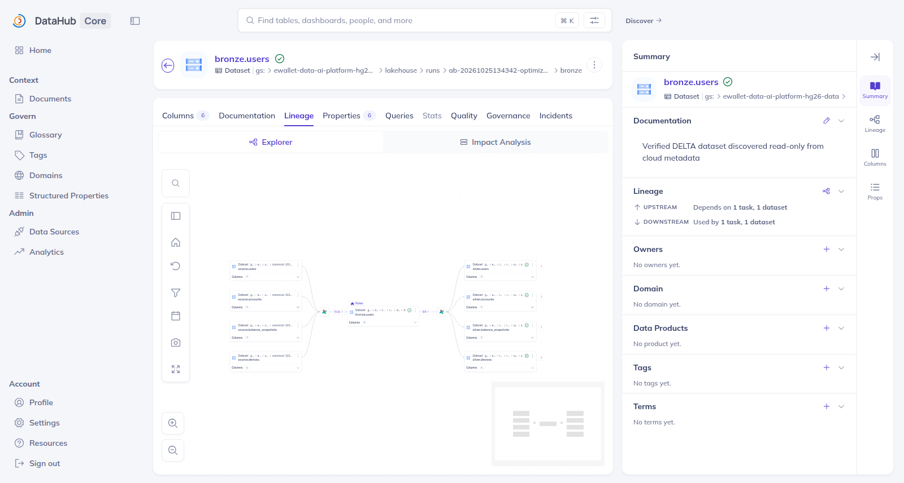
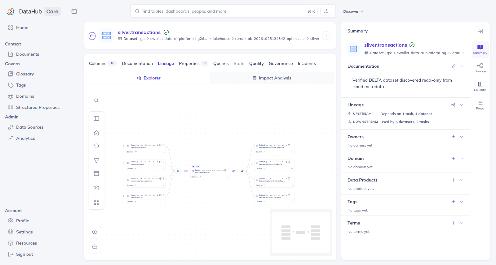
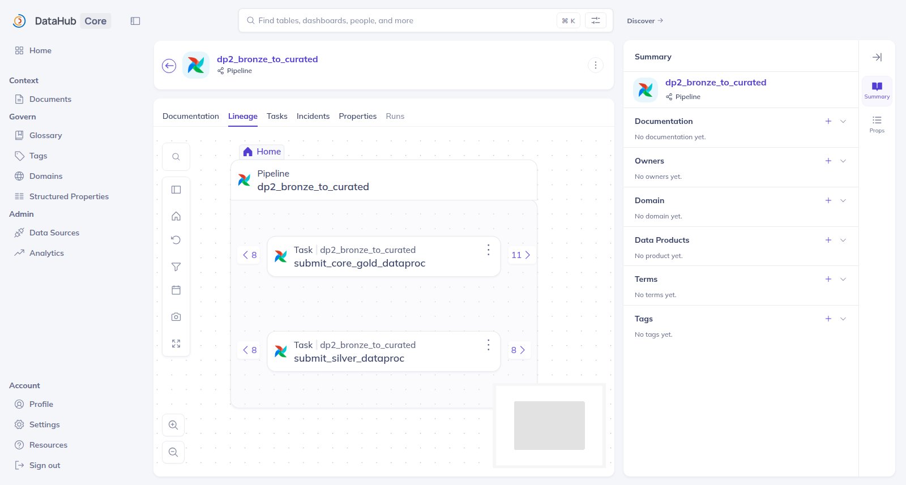
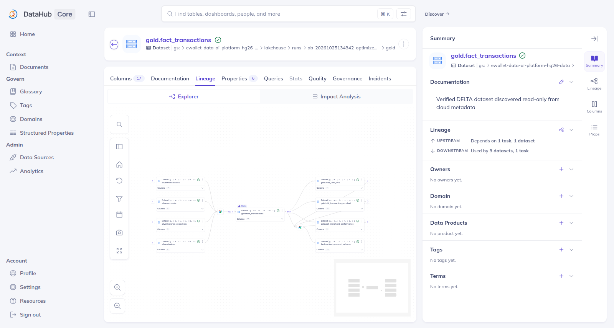
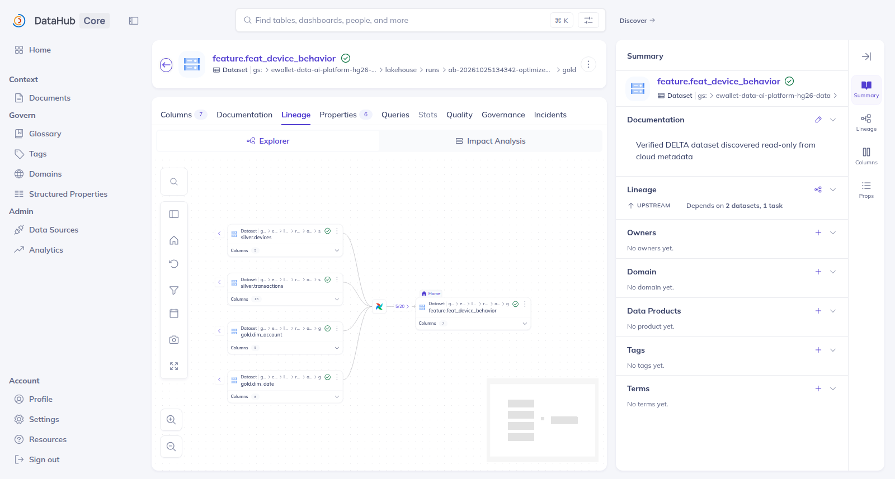
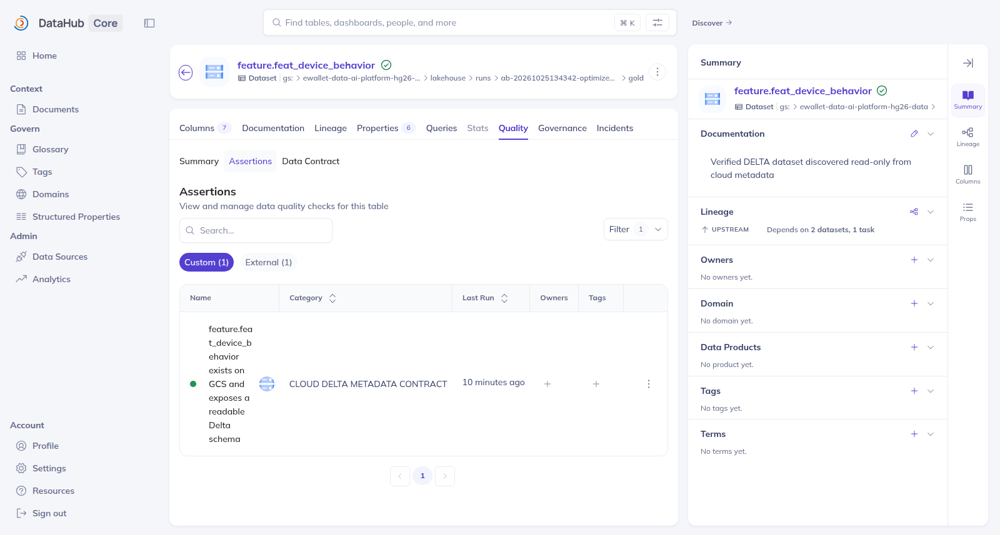
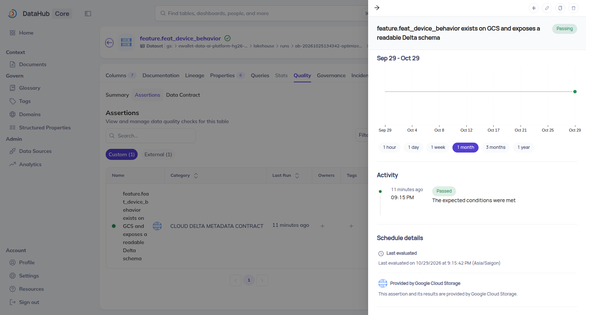
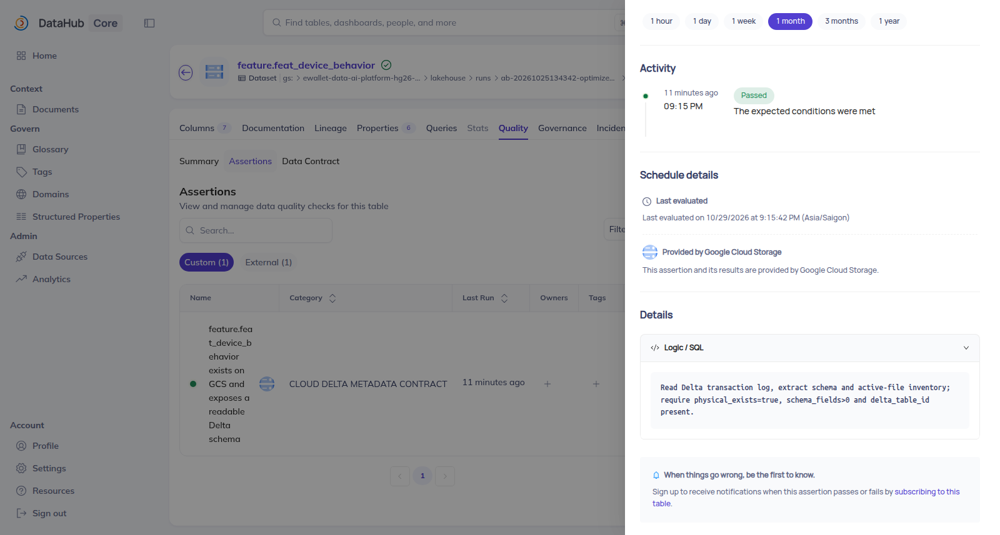
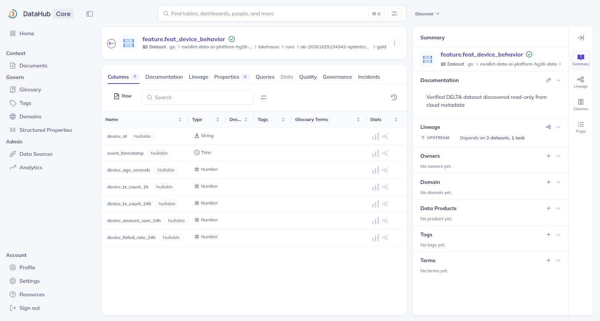

# DataHub lineage and assertions evidence

## A. Overview

DataHub is the governance/catalogue layer for the E-Wallet platform. It records
cloud-derived dataset metadata, Airflow DataFlow/DataJob identities, dataset
upstream/downstream relationships, schemas and assertions. This report explains
what the available UI images prove; the manifest and raw API bundle remain the
integrity and readback sources of truth.

The historical graph contains 3 DataFlows, 4 DataJobs and 31 dataset lineage
aspects. The result-bound campaign published 8 new assertion definitions and 7
evidence-backed historical PASS events. It preserved 31 older Cloud Delta
Metadata Contract assertions. DP2 Gold has a definition but no run event.

## B. DP1 lineage — rubric R28

`dp1_source_to_bronze` created Bronze run
`ab-20261025134342-optimized-bronze-r261025174525`. The screen shows
`source.users` upstream of `bronze.users` and the downstream Silver context.
This is historical cloud-derived lineage, not a new pipeline execution.

## C. DP1 data validation — rubric R29

Rule `source_to_bronze.row_reconciliation` evaluated all eight DP1 tables and
observed `mismatch_count=0`. It executed on 2026-10-25 and was published to real
DataHub GMS 1.7.0.1 on 2026-10-31 UTC. The UI shows `Passing` and historical
`Passed` activity. Semantic and raw API readback matched the assertion URN,
Bronze dataset URN, run ID, timestamp and evidence hash; idempotent republish
kept one timeseries value.

## D. DP2 lineage and validation — rubric R30–R31

The screens show Bronze → Silver → Gold/Feature relationships and the
`submit_silver_dataproc` plus `submit_core_gold_dataproc` DataJobs. For Silver,
two actual historical checks passed: zero NULL `channel` rows and zero duplicate
`transaction_id` groups. Their two assertion definitions and two PASS events
were published and read back, but no dedicated Silver assertion UI screenshot
was captured.

The Gold `fact_transactions.row_level_integrity` assertion is
**NOT_EXECUTED**. DataHub has its definition and zero run events because the
historical artifacts do not contain a persisted row-level Gold validation
result. The Gold lineage image does not prove a Gold quality PASS.

## E. DP3 lineage and validation — rubric R32–R33

The graph shows `silver.devices`, `silver.transactions`, `gold.dim_account` and
`gold.dim_date` upstream of `feature.feat_device_behavior` for run
`ab-20261025134342-optimized-feat-r261026025955`.

Four result-bound assertions correspond to the user, account, device and
merchant FeatureViews. Their shared real Feast G3 result was 310/310 comparable
values, zero mismatches, labels excluded, with per-view source paths and
`event_timestamp`; all four PASS events were published and read back. No new
PIT assertion UI screenshot was captured, so the following older screens are
only preservation/context evidence for the metadata assertions:

These three images prove Delta physical/schema metadata checks; they do **not**
prove the four PIT validations.

## F. Datasets and schema — rubric R34–R38

The lineage images jointly visualize Source, Bronze, Silver, Gold and Feature
datasets. The DP2 Gold and DP3 graphs provide representative fact/dimension and
dimension/feature relationships, but they do not enumerate every relationship.

The schema visibly contains `event_timestamp`; it does not contain a visible
`created` field. No available UI image proves `valid_from_ts`, `valid_to_ts` and
`is_current` on all required dimensions. Names such as `fact_transactions`,
`dim_account`, `obt_transaction_enriched` and `feat_device_behavior` support the
zone/naming convention, with a known `opt_merchant_performance` exception.

### Rubric crosswalk (not an official grade)

| Row | Requirement | Supported status | Evidence boundary |
|---|---|---|---|
| R28 | DP1 lineage | STRONG EVIDENCE | Cloud-run Source → Bronze UI plus existing 31-aspect readback. |
| R29 | DP1 validation | STRONG EVIDENCE | Actual Passing UI and matching semantic/raw readback. |
| R30 | DP2 lineage | STRONG EVIDENCE | Bronze → Silver → Gold screens and two DataJobs. |
| R31 | DP2 validation | PARTIAL EVIDENCE | Two Silver PASS events; Gold remains NOT_EXECUTED; Silver/Gold assertion UI missing. |
| R32 | DP3 lineage | STRONG EVIDENCE | Representative Feature lineage and existing lineage readback. |
| R33 | DP3 validation | PARTIAL EVIDENCE | Four PIT PASS events/readback; new PIT assertion UI missing. Older metadata UI is not a substitute. |
| R34 | Dataset visualization | STRONG EVIDENCE | UI coverage across Source, Bronze, Silver, Gold and Feature zones. |
| R35 | SCD Type 2 | MISSING | Required `valid_from_ts`, `valid_to_ts`, `is_current` are not visually verified. |
| R36 | Feature timestamps | PARTIAL EVIDENCE | `event_timestamp` visible; required `created` field missing/not verified. |
| R37 | Dimension/fact relationships | PARTIAL EVIDENCE | Representative relationships visible, not a complete relationship inventory. |
| R38 | Naming conventions | PARTIAL EVIDENCE | Representative zone-qualified names visible; policy/completeness not independently verified. |

## G. Evidence limitations and reproducibility

- Screenshots included: 10 (5 lineage, 4 assertions, 1 schema).
- Missing UI: DP2 Silver result-bound assertions, DP2 Gold zero-run state and
  all four DP3 PIT result-bound assertions.
- Historical screens date from 2026-10-25 through 2026-10-29. The DP1 screen is
  a current publication/capture of an historical 2026-10-25 result.
- Raw result bundle:
  `/home/huyy-giaa/ewallet-evidence/datahub-assertions-20261101/runtime-20261031T220705Z/`.
- Publication/readback is verified for 8 definitions and 7 PASS events. Gold is
  definition-only and NOT_EXECUTED.
- This branch has not been merged to official `main`; POST_MERGE_REPRODUCED is
  still pending. Follow
  [`DATAHUB_ASSERTIONS_REPRODUCIBILITY.md`](../runbooks/DATAHUB_ASSERTIONS_REPRODUCIBILITY.md)
  from the exact future merged-main SHA.

Checksums and absolute source provenance are in
[`IMAGE_MANIFEST.csv`](../evidence/images/datahub/IMAGE_MANIFEST.csv).
