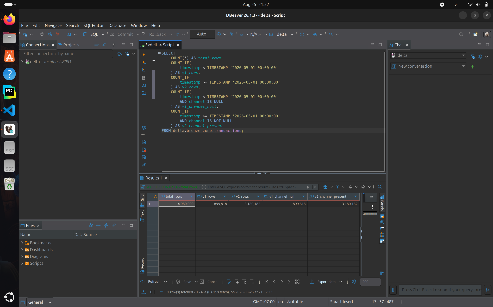
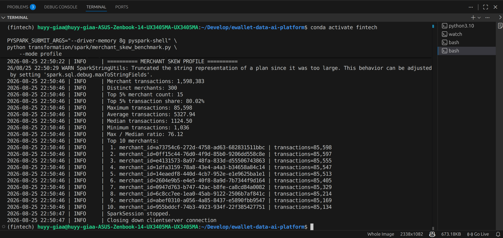
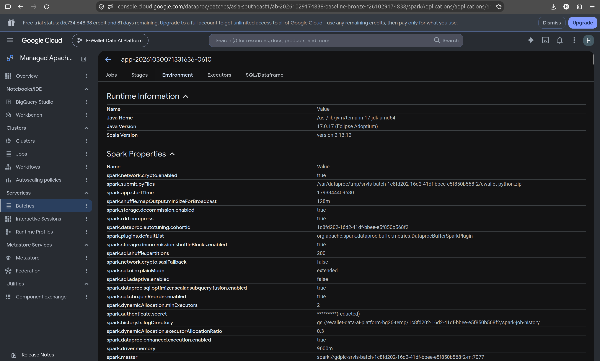
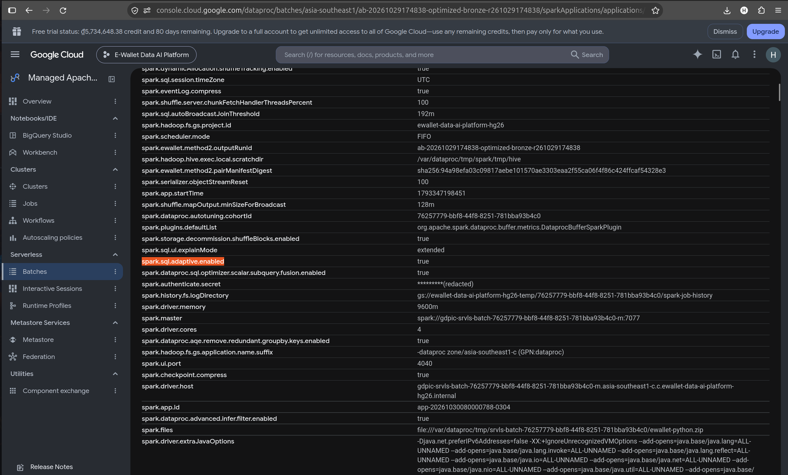
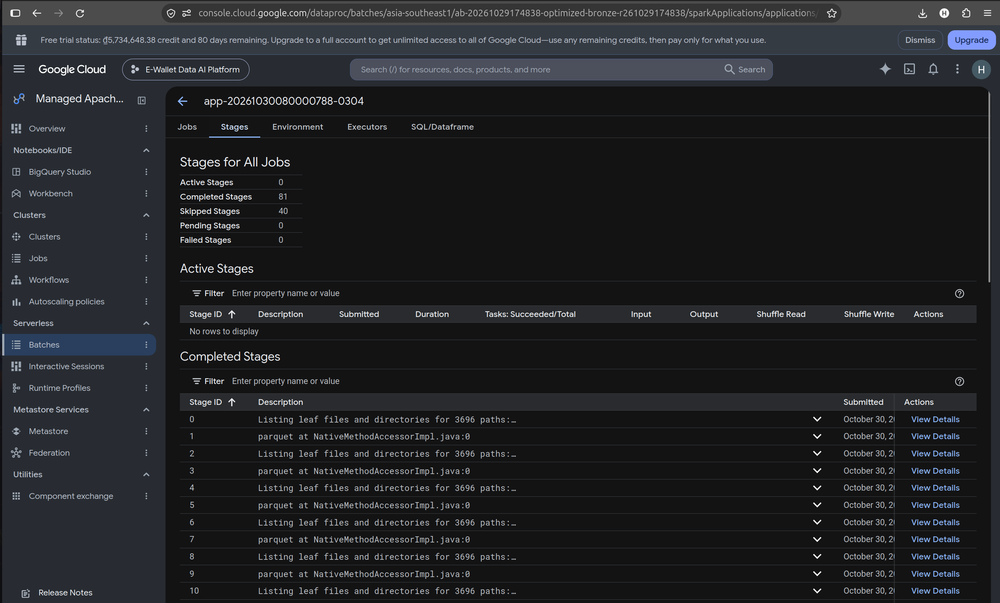

# Spark Batch Processing and Optimisation

This report describes:

- the Spark batch pipelines DP1, DP2 and DP3;
- how they handle the offline data problems built into the dataset: skew, schema evolution and duplicates;
- the baseline-versus-optimised experiments run on the 100 GB dataset on Dataproc Serverless.

Orchestration of these jobs is covered in [Airflow Pipelines](AIRFLOW_DP1_DP2_DP3_EVIDENCE.md).

## 1. Problem definition

The batch platform processes `canonical-100gb-v1`: 369.6 million logical transactions in 3,696 shards (see [Data Generation](data_generator/DATA_GENERATION_AND_SIMULATION.md)).

| Pipeline | Input → output | Main work |
|---|---|---|
| DP1 | Source Parquet → 8 Bronze Delta tables | Read 33,264 objects; union the two transaction schema versions; write Delta |
| DP2 Silver | Bronze → 8 Silver tables | Type casting, domain validation, deduplication |
| DP2 Gold | Silver → 13 Gold tables | Joins and aggregations into dimensions, facts, the OBT and aggregates |
| DP3 | Silver + Gold → 4 feature tables | Point-in-time windowed aggregates per user, account, device and merchant |

The data carries three deliberate problems:

- **Skew.** The top 5 % of merchants receive about 80 % of payment traffic, and activity is concentrated in peak hours. Joins and aggregations keyed by merchant produce a few very large partitions.
- **Schema evolution.** Transactions before 2026-03-15 (V1) have no `channel` column; later ones (V2) do.
- **Duplicates.** 2 % of transactions appear twice with the same `transaction_id`, modelling at-least-once delivery.

## 2. How the pipelines handle the data problems

### 2.1 Schema evolution

DP1 aligns the two versions *explicitly* rather than relying on a permissive merge. V1 receives a typed null `channel`, and the union is strict ([`source_to_bronze.py`](../../data_platform/ingestion/spark/source_to_bronze.py)):

```python
def combine_transaction_versions(v1: DataFrame, v2: DataFrame) -> DataFrame:
    v1_with_channel = v1.withColumn("channel", F.lit(None).cast("string"))
    return v1_with_channel.unionByName(v2, allowMissingColumns=False)
```

`allowMissingColumns=False` makes any *unexpected* schema difference fail the job instead of silently producing nulls.

Silver then gives downstream consumers one stable domain ([`silver/transactions.py`](../../data_platform/processing/spark/silver/transactions.py)). A missing historical channel becomes `UNKNOWN`, and present values are trimmed and lower-cased.



*DBeaver/Trino query over the Bronze transactions (local 500k-user dataset). 899,818 V1 rows, all with a null `channel`, and 3,180,182 V2 rows, all with a populated `channel`, in one unified table.*

### 2.2 Duplicates

Silver keeps exactly one row per `transaction_id`: the most recently ingested one.

```python
window_spec = Window.partitionBy("transaction_id").orderBy(F.col("ingested_at").desc())
df = (df.withColumn("_row_number", F.row_number().over(window_spec))
        .filter(F.col("_row_number") == 1)
        .drop("_row_number"))
```

The other Silver entities use `dropDuplicates` on their business keys ([`silver/cleaners.py`](../../data_platform/processing/spark/silver/cleaners.py)).

On the 4-million-transaction validation dataset, Silver removed exactly the 80,000 injected duplicates, and no label was duplicated.

### 2.3 Skew

Skew is handled through Spark configuration, not query rewrites:

- **Adaptive Query Execution** (`spark.sql.adaptive.enabled`) re-plans shuffles at runtime and coalesces small partitions.
- **AQE skew-join handling** (`spark.sql.adaptive.skewJoin.enabled`) splits oversized join partitions.
- **The shuffle partition count** sets the initial parallelism.

Profiles are defined in [`common/spark_session.py`](../../data_platform/processing/spark/common/spark_session.py) and applied per batch.

A dedicated benchmark ([`benchmark/merchant_skew_benchmark.py`](../../data_platform/processing/spark/benchmark/merchant_skew_benchmark.py)) first profiles the real merchant distribution, then runs the same merchant-keyed workload with AQE and skew-join off and on.



*The profile mode on the local 500k-user dataset:*

- *1,598,383 merchant transactions over 300 merchants;*
- *the top 5 % of merchants carry **80.02 %** of the transactions;*
- *the largest merchant has 85,598 transactions against a median of 1,124.5 (max/median ratio 76.1).*

## 3. Methodology

All timings use `application_runtime_seconds` from the preserved Spark event logs. Dataproc batch set-up and teardown, and Airflow validation, are reported separately and excluded from speed-ups.

```text
speed-up      = baseline application runtime / optimised application runtime
improvement % = (baseline − optimised) / baseline × 100
```

**Equal inputs.** For DP1 and DP2, both variants read exactly the same immutable input: the same source manifest, or the same frozen Silver run for Gold.

**Correctness before speed.** An optimised variant is adopted only if its output is semantically equivalent to the baseline: row counts, schemas, keys, nulls and table fingerprints. A faster job that changes results is rejected.

**Environment.** Dataproc Serverless 2.2.89, Standard tier, 4-core driver and executors with 9,600 MB heap. DP1 and DP2 use dynamic allocation with 2 / 6 / 7 min / initial / max executors.

| Stage | Baseline | Optimised variant |
|---|---|---|
| DP1 Bronze | AQE off, 200 partitions | AQE on, `performance` allocation profile |
| DP2 Silver | AQE off, 200 partitions | 304 partitions |
| DP2 Gold | AQE off, 200 partitions | AQE on, 400 partitions |
| DP3 features | AQE off, 200 partitions | AQE on, skew join on, 400 partitions, `performance` profile |

## 4. Results

### 4.1 Summary

| Stage | Baseline | Optimised | Change | Output equivalent | Decision |
|---|---:|---:|---:|---|---|
| DP1 Bronze | 845.4 s | 930.4 s | +10.05 % | yes | keep baseline |
| DP2 Silver | 2,656.6 s | 3,496.5 s | +31.62 % | yes, 8/8 tables | keep baseline |
| DP2 Gold | 7,810.3 s | 6,005.5 s | **−23.11 %** | **no**: 3 floating-point columns differ | not adopted |
| DP3 features | 1,073.9 s | 1,787.1 s | +66.41 % | yes (physical checks) | keep baseline |

### 4.2 DP1: Bronze ingestion

Benchmark `ab-20261029174838` ran from commit `62f17ba6…`.

| Metric | Baseline | Optimised | Change |
|---|---:|---:|---:|
| Application runtime | 845.4 s | 930.4 s | +10.05 % |
| Batch runtime | 915.8 s | 1,007.6 s | +10.02 % |
| DCU-hours | 7.23 | 8.06 | +11.41 % |
| Shuffle storage (GB-s) | 2,636,400 | 2,937,200 | +11.41 % |
| Spill | 0 | 0 | — |
| Tasks | 37,390 | 37,195 | −0.52 % |
| Output | 1,808 files, 118.3 GB | identical | — |

DP1 is essentially a read–transform–write job over many files, and it had **no spill** in either variant. AQE therefore had little to re-optimise. The extra cost most plausibly comes from AQE planning and the larger allocation profile, but the retained metrics cannot isolate the cause. The baseline was kept after the outputs were shown to be equivalent.



*Spark UI, Environment tab of the baseline batch: `spark.sql.adaptive.enabled=false`, `spark.sql.shuffle.partitions=200`.*



*The optimised batch: `spark.sql.adaptive.enabled=true`. The Environment tab confirms which settings were actually in effect for each run.*



*Spark UI, Stages tab of the optimised batch: 81 completed stages, 40 skipped (their shuffle output was reused), 0 failed.*

### 4.3 DP2: Silver

Campaign `dp2-method2-ab-20261031035745` ran from commit `e58a5006…`. Both variants read the same Bronze run; only the shuffle partition count changed, from 200 to 304.

| Metric | Baseline | Optimised | Change |
|---|---:|---:|---:|
| Application runtime | 2,656.6 s | 3,496.5 s | +31.62 % |
| DCU-hours | 20.41 | 30.43 | +49.09 % |
| Spill | 187.2 GB | 188.0 GB | +0.39 % |
| Tasks | 6,819 | 8,379 | +22.88 % |
| Output files | 763 | 763 | — |

The extra partitions created 1,560 more tasks, but did not reduce spill, so the job paid more scheduling and shuffle overhead for no benefit.

An earlier campaign produced the opposite ordering for the same pair (2,630.6 s optimised versus 3,495.7 s baseline). The Silver difference is therefore within run-to-run variance, and no general conclusion about 304 partitions is drawn.

### 4.4 DP2: Gold

Both variants read the same frozen Silver run. The optimised variant enabled AQE and 400 partitions.

| Metric | Baseline | Optimised | Change |
|---|---:|---:|---:|
| Application runtime | 7,810.3 s | 6,005.5 s | **−23.11 %** |
| DCU-hours | 68.01 | 52.29 | −23.11 % |
| Spill | 681.9 GB | 450.4 GB | **−33.95 %** |
| Tasks | 10,050 | 10,443 | +3.91 % |
| Output files | 969 | 969 | — |

Gold is dominated by wide joins and merchant- and user-level aggregations, which is where the skew sits. Finer initial partitioning plus AQE reduced spill by a third and runtime by 23 %.

One confounder: the baseline lost an executor and recomputed after a `FetchFailedException`, which may have inflated its runtime.

**Correctness.** The final equivalence gate failed:

- 11 of 13 tables matched exactly;
- in `feat_user_90d` and `opt_merchant_performance`, three `double` sum/average columns differed by at most about 2.6 × 10⁻¹⁵ relative;
- row counts, schemas, keys, nulls and all non-floating columns matched.

This is consistent with floating-point reduction order changing when the partitioning changes. Exact equality is the rule, so the faster Gold job was **not adopted**. A validator with a documented floating-point tolerance has been written and unit-tested, but it has not been re-run in the cloud.

### 4.5 DP3: features

These runs come from an earlier configuration (commit `bbae48ca…`, benchmark `ab-20261025134342`).

| Metric | Baseline | Optimised | Change |
|---|---:|---:|---:|
| Application runtime | 1,073.9 s | 1,787.1 s | +66.41 % |
| DCU-hours | 9.20 | 15.39 | +67.35 % |

The optimised profile (AQE, skew join, 400 partitions, the `performance` profile) was slower and more expensive for this four-table workload. The two runs read different historical Silver/Gold runs of the same dataset, so the comparison is less strict than for DP1 and DP2. Both outputs passed the four-table Delta checks.

## 5. Discussion

- **There is no universal setting.** AQE and higher partition counts helped only where the job had skewed, spill-heavy shuffles (DP2 Gold). They hurt where the work was I/O-bound (DP1) or small (DP3).
- **Equivalence checks catch real issues.** The Gold result shows why the equivalence gate matters: a 23 % gain came with non-bit-identical aggregates, and it was not adopted without an explicit tolerance decision.
- **Single trials.** Each pair was run once; the Silver result reversed between two campaigns. Repeated trials would be needed to quantify variance.
- **Missing Spark UI evidence.** Spark UI captures were retained for DP1 only. For DP2 and DP3, the analysis relies on Spark event-log metrics.

Raw artefacts:

- DP2: `docs/evidence/dp2_method2_ab-20261031035745/`;
- DP3: `docs/evidence/dp3_historical_features_ab-20261025134342/`;
- the Spark UI images listed in `docs/evidence/edai1/spark/SHA256.txt`.

## 6. Other optimisations

| Optimisation | Baseline | Optimised | Report |
|---|---:|---:|---|
| Docker image size | 381,961,667 B | 44,171,603 B (−88.44 %) | [Docker](docker/DOCKER_OPTIMIZATION.md) |
| Delta compaction (local 500k) | 2,188 files, 0.219 s query | 151 files, 0.108 s | [Storage](storage/STORAGE_OPTIMIZATION.md) |
| PostgreSQL index | median 65.8 ms | 19.9 ms (−69.7 %), inserts +78 % | [Storage](storage/STORAGE_OPTIMIZATION.md) |
