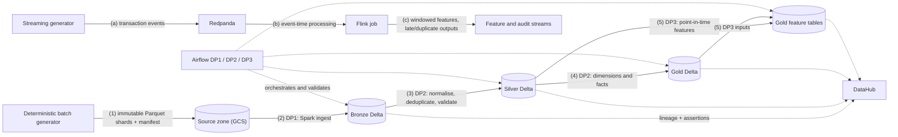

# EDAI-1: Data Engineering Platform

The E-Wallet data engineering platform turns synthetic financial events into governed analytical and feature datasets. Its components are:

- deterministic batch and streaming data generators;
- a Bronze / Silver / Gold Delta Lakehouse on GCS;
- Spark batch pipelines on Dataproc Serverless, orchestrated by Airflow;
- Flink event-time stream processing;
- DataHub lineage and data-quality assertions;
- physical storage optimisation;
- a PostgreSQL warehouse indexing study.

## Architecture

**How to read the diagram:**

- **Batch flow (1)–(5).** Generation → Bronze → Silver → Gold → features. Each step is a Spark job on Dataproc Serverless, submitted by an Airflow DAG.
- **Streaming flow (a)–(c).** The streaming generator → Redpanda → Flink.
- **Dashed edges.** These carry orchestration and metadata, not data.

## Technical reports

| Topic | Report |
|---|---|
| Containers and Compose | [Docker Optimisation](docker/DOCKER_OPTIMIZATION.md) |
| Data generation | [Data Generation and Simulation](data_generator/DATA_GENERATION_AND_SIMULATION.md) |
| **Batch Processing & Orchestration — DP1/DP2/DP3** | [Batch Processing and Orchestration](BATCH_PROCESSING_AND_ORCHESTRATION.md): Spark DP1–DP3, the three Airflow DAGs and the 5GB Baseline/Optimised campaign `ab-20261110225456` |
| Stream processing | [Flink Streaming](streaming/FLINK_STREAMING.md) |
| Storage | [Lakehouse and Warehouse Storage Optimisation](storage/STORAGE_OPTIMIZATION.md) |
| Governance | [DataHub Lineage and Data Quality](datahub/DATAHUB_GOVERNANCE.md) |
| Data model | [Schema Design](schema/SCHEMA_DESIGN.md) and [All-Zones Schema](schema/ALL_ZONES_SCHEMA.md) |
| Novel idea 1 | [Deterministic Sharded Generation](novel_ideas/01_DETERMINISTIC_SHARDING.md) |
| Novel idea 2 | [Point-in-Time Leakage Prevention](novel_ideas/02_PIT_LEAKAGE_PREVENTION.md) |

## Key results

| Area | Result | Interpretation |
|---|---|---|
| Docker (5GB workload) | Baseline/optimized images of the campaign verifier, with a base-image × packaging control matrix; official sizes pending the owner run | The October 88.44 % result is historical and not reused |
| Dataset | **100,156,470,260 bytes** in 3,696 shards: 369.6 M logical transactions plus a controlled 2 % duplicate rate | A deterministic, resumable publication with a final manifest |
| DP1–DP3 on Dataproc, 5GB (`ab-20261110225456`) | 6 DagRuns and 16 batches succeeded; 260 validation rules per profile passed; Baseline and Optimised outputs `SEMANTIC_EQUIVALENT` across all 34 tables | The pipeline is correct and traceable end to end |
| Spark Baseline vs Optimised, 5GB | Application runtime 165.1/197.9/314.9/160.2 s → 213.8/292.3/335.8/196.7 s (DP1/Silver/Gold/DP3); Gold shuffle −20.5 % | Not faster in one trial. The validator control varied 6–54 %, so the runtime differences are not attributable; plan-level AQE effects are |
| Flink (100 events/s, 120 s) | Both profiles accepted 12,000 unique events out of 12,180 raw arrivals; the optimised profile lowered p95 latency from 10.9 s to 7.3 s | Deduplication and late-event routing behave identically in both profiles |
| Storage (5GB) | Lakehouse: the 5GB Gold tables already hold one ~24 MiB file per daily partition, so compaction is expected to be a no-op; the Z-order and pruning effects are measured on isolated clones (owner Dataproc run pending). Warehouse: PostgreSQL index benchmark on 3.8 M real Gold rows (official run pending) | Earlier 500k-row and synthetic 2M-row results are historical |
| Point-in-time validation | 10 cases × 31 features = 310/310 values equal to an independent oracle; labels excluded from Feast | Training features cannot see the future |

## Evidence

Screenshots and raw artifacts are organised under [`docs/evidence/edai1/`](../evidence/edai1). Each report embeds genuine images where available and links raw records where an authentic capture was not retained.

| Folder | Content |
|---|---|
| `spark/rehearsal-5gb-ab-20261110225456/` | DP1–DP3 campaign: manifests, validation and comparison reports, Spark metrics, Airflow and Spark UI screenshots |
| `streaming/` | Flink Dashboard captures |
| `datahub/` | DataHub lineage and assertion captures |
| `storage/` | Historical local storage captures (500k fixture, synthetic PostgreSQL); the 5GB captures are pending |
| `novel_ideas/` | Google Cloud Run and Cloud Logging captures of the point-in-time validation |
| `dp2/`, `dp3/` | Clearly labelled local-fixture tests of SCD2 and feature timestamps |

Programmatic terminal-like renders are not embedded in the final reports.
The Docker and storage reports are being rerun on the 5GB campaign; their result
tables stay marked PENDING until the owner's official run and screenshots exist.

## Limitations

- **DP1–DP3 performance.** One Baseline and one Optimised trial on 5 GB, run 8 hours apart. Runtime differences are within run-to-run variation, and the rehearsal does not show which configuration performs best on larger data.
- **Streaming.** The Flink measurements come from a local cluster. The newer streaming implementation, which writes to the feature store, has not been run end to end.
- **Skew.** The 5GB run diagnoses write-layout skew in the Spark UI, but no method is shown to improve it over the Baseline.
- **SCD2 and feature timestamps.** These are materialised and validated on the 5GB cloud run. Their schema documentation still shows local-fixture screenshots.

## Internal tracking

These files are maintained for project tracking. They are not part of the technical narrative:

- [Rubric evidence index](RUBRIC_EVIDENCE_INDEX.md)
- [Gap ledger](GAP_LEDGER.md)
- [Screenshot audit](SCREENSHOT_AUDIT.md)
- [Historical documents](HISTORICAL_DOCUMENTS.md)
