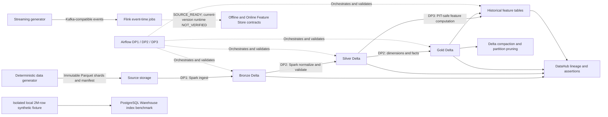

# EDAI-1 Data Engineering Platform

## Project overview

The E-Wallet Data Engineering Platform provides a reproducible path from
synthetic financial events to governed analytical and feature datasets. It
combines deterministic batch and streaming data generation, a Bronze/Silver/Gold
Delta Lakehouse, Spark batch transformations, Flink event-time processing,
Airflow orchestration, DataHub lineage and quality metadata, PostgreSQL
Warehouse indexing, feature engineering and physical storage optimization.

The diagram summarizes logical data movement and orchestration. The dashed
Flink edge is a source-ready contract, not verified current-version Offline and
Online Store dataflow. The PostgreSQL node is a separate local benchmark and is
not a deployed Gold-to-Warehouse pipeline. Historical
experiments were executed at several source versions; the reports below bind
each result to its actual run and do not imply that every result was reproduced
at the latest repository HEAD.

## Technical documentation index

| # | Report | Scope |
|---:|---|---|
| 1 | [Docker Optimization](docker/DOCKER_OPTIMIZATION.md) | Multi-stage image build, Compose hardening and matched image-size A/B evidence. |
| 2 | [Data Generation and Simulation](data_generator/DATA_GENERATION_AND_SIMULATION.md) | Canonical 100 GB publication, skew, duplicates, schema evolution and late-arrival simulation. |
| 3 | [Spark Optimization Matrix](OPTIMIZATION_MATRIX.md) | DP1, DP2 and historical DP3 baseline/optimized performance and correctness decisions. |
| 4 | [Flink Streaming](streaming/FLINK_STREAMING.md) | Event time, windows, late data, deduplication, checkpoints and historical UI evidence. |
| 5 | [Airflow DP1/DP2/DP3](AIRFLOW_DP1_DP2_DP3_EVIDENCE.md) | DAG responsibilities, task dependencies, run-bound UI captures and final statuses. |
| 6 | [Storage Optimization](storage/STORAGE_OPTIMIZATION.md) | Delta compaction, partition pruning and PostgreSQL Warehouse indexing. |
| 7 | [DataHub Governance](datahub/DATAHUB_GOVERNANCE.md) | Pipeline-to-table lineage, result-bound validation and screenshot provenance. |
| 8 | [Schema Design](SCHEMA_DESIGN.md) | Zone catalogs, SCD Type 2, feature timestamps, relationships and naming conventions. |
| 9 | [Deterministic Sharding](novel_ideas/01_DETERMINISTIC_SHARDING.md) | Reproducible parallel generation, immutable publication and resume safety. |
| 10 | [PIT Leakage Prevention](novel_ideas/02_PIT_LEAKAGE_PREVENTION.md) | Independent point-in-time oracle, label exclusion and DataHub assertion results. |

## Experimental results

| Area | Verified historical result | Decision and boundary |
|---|---|---|
| Docker | 381,961,667 → 44,171,603 bytes, **88.44% reduction**, with identical smoke-output hash. | Verified local historical A/B; evidence images are artifact renderings, not Docker Desktop UI. |
| Canonical dataset | **100,156,470,260 bytes**, 3,696 shards, 369.6 million logical transactions and 2% controlled duplicate rows. | Runtime manifest verified. Merchant skew of 80.02% was measured on the 500k fixture, not by a full 100 GB column scan. |
| Spark DP1 Bronze | 845.381 s baseline versus 930.358 s optimized: **10.05% regression**. | Semantic equivalence passed; baseline selected. |
| Spark DP2 Silver | 2,656.612 s baseline versus 3,496.508 s optimized: **31.62% regression**. | Eight tables equivalent; baseline selected. Cross-run ordering was not stable. |
| Spark DP2 Gold | 7,810.271 s baseline versus 6,005.469 s optimized: **23.11% observed improvement**. | Final semantic-equivalence gate **FAILED** for three double aggregates; no winner was selected. |
| Spark DP3 | 1,073.903 s historical baseline versus 1,787.068 s historical optimized: **66.41% regression**. | Applies only to historical source `bbae48c`; the new optimized profile was not executed. |
| Flink | Baseline and optimized profiles processed the same 120-second, 100 EPS input; both accepted 12,000 unique events from 12,180 raw arrivals. | Historical functional comparison at source `22c0c7f` has a `MIXED` verdict. A separate 500 EPS campaign failed semantic parity; authoritative implementation `0466ba4` was not runtime-verified. |
| PostgreSQL Warehouse | Median query latency **65.776 → 19.913 ms**, a **69.73% improvement**; 100k-row insert overhead increased 78.14%. | Verified isolated 2-million-row local fixture with seven runs and semantic equality; not production Warehouse performance. |
| PIT validation | **10 cases × 31 features = 310/310 comparisons**, zero mismatches and labels excluded from Feast. | Historical Cloud Run and Cloud Logging UI verified; four DataHub PASS events have raw read-back evidence. |

## Rubric coverage

The complete evidence ledger is [EDAI-1 Rubric Coverage and Evidence Matrix](EDAI1_RUBRIC_COVERAGE.md).

| Evidence classification | Points |
|---|---:|
| `FULLY_EVIDENCED` | **59/100** |
| `PARTIALLY_EVIDENCED` | **41/100** |
| `NO_SUPPORTING_EVIDENCE` | **0/100** |

These values classify the available evidence against the rubric. They are not
self-awarded points or a guaranteed assessor grade. Supporting evidence for a
row does not necessarily satisfy every literal rubric condition. A
`PARTIALLY_EVIDENCED` row may have substantial implementation and runtime proof
while still missing a literal acceptance condition, current-version
reproduction or end-to-end gate. `NO_SUPPORTING_EVIDENCE = 0` means every row
has at least some support; it does not mean there are no remaining evidence
gaps.

## Evidence navigation

Canonical submission evidence is organized under [`docs/evidence/edai1/`](../evidence/edai1/):

- [`airflow/`](../evidence/edai1/airflow/) contains genuine historical Airflow
  run views for DP1, the failed DP2 final DagRun and historical DP3.
- [`datahub/`](../evidence/edai1/datahub/) contains checksum-verified lineage and
  assertion UI captures.
- [`streaming/`](../evidence/edai1/streaming/) contains genuine historical Flink
  Dashboard captures and the terminal comparison.
- [`spark/`](../evidence/edai1/spark/) contains genuine historical DP1 Spark UI
  configuration and stage captures; equivalent DP2/DP3 Spark UI remains
  unavailable.
- [`storage/`](../evidence/edai1/storage/) contains historical Delta/Trino UI
  captures, the PostgreSQL benchmark artifact and its raw JSON/log.
- [`novel_ideas/`](../evidence/edai1/novel_ideas/) contains genuine Google Cloud
  UI evidence for the PIT execution and validation result.
- [`dp2/`](../evidence/edai1/dp2/) and [`dp3/`](../evidence/edai1/dp3/) contain
  clearly labeled local-fixture evidence for SCD2 and feature timestamps.

Raw run artifacts that predate the canonical evidence structure remain in their
immutable historical locations under `/home/huyy-giaa/ewallet-evidence/` and
are referenced by the owning reports. Rendered Docker and PostgreSQL benchmark
panels are readable views of genuine raw artifacts; they are not native Docker
Desktop, pgAdmin or DBeaver screenshots. Each report states the exact claim
supported by every image.

## Known limitations

- The DP2 Method 2 DagRun remains **FAILED** at
  `validate_and_select_gold_winner`. The validator correction passed 18 local
  regression tests, but cloud validation-only recovery was not executed and no
  Gold winner was selected.
- The DP2 Gold DataHub row-level assertion remains `NOT_EXECUTED`; this is
  independent of the failed Airflow semantic-equivalence task.
- DP3 measurements belong to the older `bbae48c` configuration. The new
  optimized configuration is `NOT_EXECUTED`.
- The authentic Flink 100 EPS UI evidence belongs to source `22c0c7f`, while
  the authoritative Block A implementation is `0466ba4`. The newer source has
  no correlated runtime write/read-back evidence.
- The canonical 100 GB source has no full-column skew/cardinality scan. The
  documented 80.02% merchant-skew result belongs to the 500k fixture.
- SCD2 and feature timestamp rows have focused local-fixture/test evidence, not
  production Delta/Feast materialization evidence.
- Current all-zone UI/ERD evidence and explicit assessor acceptance of the
  zone-qualified Bronze/Silver naming convention remain open.
- Historical runtime proof does not establish successful execution at the
  current repository HEAD.

## Reproducibility and submission notes

Use the existing, version-bound instructions rather than reconstructing commands
from this index:

- [Canonical Dataproc performance evidence](../cloud/canonical_dataproc_performance.md)
  documents the DP1 evidence workflow and immutable run identities.
- [DP2 Method 2 single-DAG runbook](../cloud/dp2_method2_single_dag_runbook.md)
  records its fail-closed orchestration and recovery boundaries.
- [Data Generator reference](../01_data_generator.md) describes the generator
  contracts and parameters used by the platform.
- Each technical report above includes its own provenance, evidence checksums,
  bounded reproduction notes and restrictions.

Do not rerun a historical workload merely to replace its evidence. Any future
execution must use fresh immutable run IDs, preserve prior failures, record the
exact Git SHA and configuration, and keep source readiness separate from
runtime and business end-to-end verification.
