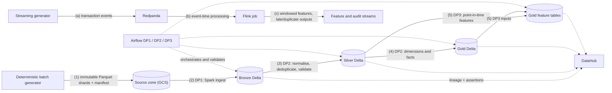

# EDAI-1: Data Engineering Platform

The E-Wallet data engineering platform turns synthetic financial events into governed analytical and feature datasets. Its components are:

- deterministic batch and streaming data generators;
- a Bronze / Silver / Gold Delta Lakehouse on GCS;
- Spark batch pipelines on Dataproc Serverless, orchestrated by Airflow;
- Flink event-time stream processing;
- DataHub lineage and data-quality assertions;
- physical storage optimisation;
- a PostgreSQL warehouse indexing study.

## Architecture

**How to read the diagram:**

- **Batch flow (1)–(5).** Generation → Bronze → Silver → Gold → features. Each step is a Spark job on Dataproc Serverless, submitted by an Airflow DAG.
- **Streaming flow (a)–(c).** The streaming generator → Redpanda → Flink.
- **Dashed edges.** These carry orchestration and metadata, not data.

## Technical reports

| Topic | Report |
|---|---|
| Containers and Compose | [Docker Optimisation](docker/DOCKER_OPTIMIZATION.md) |
| Data generation | [Data Generation and Simulation](data_generator/DATA_GENERATION_AND_SIMULATION.md) |
| Spark batch processing | [Spark Optimisation](spark/OPTIMIZATION_MATRIX.md) |
| Stream processing | [Flink Streaming](streaming/FLINK_STREAMING.md) |
| Orchestration | [Airflow Pipelines DP1, DP2, DP3](airflow/AIRFLOW_DP1_DP2_DP3_EVIDENCE.md) |
| Storage | [Lakehouse and Warehouse Storage Optimisation](storage/STORAGE_OPTIMIZATION.md) |
| Governance | [DataHub Lineage and Data Quality](datahub/DATAHUB_GOVERNANCE.md) |
| Data model | [Schema Design](schema/SCHEMA_DESIGN.md) and [All-Zones Schema](schema/ALL_ZONES_SCHEMA.md) |
| Novel idea 1 | [Deterministic Sharded Generation](novel_ideas/01_DETERMINISTIC_SHARDING.md) |
| Novel idea 2 | [Point-in-Time Leakage Prevention](novel_ideas/02_PIT_LEAKAGE_PREVENTION.md) |

## Key results

| Area | Result | Interpretation |
|---|---|---|
| Docker | Image size 381,961,667 → 44,171,603 bytes (**−88.44 %**), identical smoke-test output | A multi-stage build with a minimal runtime image |
| Dataset | **100,156,470,260 bytes** in 3,696 shards: 369.6 M logical transactions plus a controlled 2 % duplicate rate | A deterministic, resumable publication with a final manifest |
| Spark DP1 (Bronze) | 845.4 s baseline vs 930.4 s with AQE and skew settings (+10.05 %) | Outputs equivalent. The optimisation did not pay off for this ingest, so the baseline was kept |
| Spark DP2 (Silver) | 2,656.6 s vs 3,496.5 s (+31.62 %) | Outputs equivalent; baseline kept |
| Spark DP2 (Gold) | 7,810.3 s vs 6,005.5 s (−23.11 %) | Faster, but the equivalence check found differences in three floating-point aggregates, so the optimised Gold job was not adopted |
| Spark DP3 (features) | 1,073.9 s vs 1,787.1 s (+66.41 %) | Baseline kept |
| Flink (100 events/s, 120 s) | Both profiles accepted 12,000 unique events out of 12,180 raw arrivals; the optimised profile lowered p95 latency from 10.9 s to 7.3 s | Deduplication and late-event routing behave identically in both profiles |
| PostgreSQL warehouse | Median query latency 65.8 → 19.9 ms (**−69.7 %**) with a partial covering index; inserts became 78 % slower | The classic read/write trade-off of an index |
| Point-in-time validation | 10 cases × 31 features = 310/310 values equal to an independent oracle; labels excluded from Feast | Training features cannot see the future |

## Evidence

Screenshots and raw artifacts are organised under [`docs/evidence/edai1/`](../evidence/edai1). Each report embeds genuine images where available and links raw records where an authentic capture was not retained.

| Folder | Content |
|---|---|
| `airflow/` | Airflow run views of DP1, DP2 and DP3 |
| `spark/` | Spark UI environment and stage views of DP1 |
| `streaming/` | Flink Dashboard captures |
| `datahub/` | DataHub lineage and assertion captures |
| `storage/` | DBeaver/Trino captures, benchmark output and the PostgreSQL benchmark artifact |
| `novel_ideas/` | Google Cloud Run and Cloud Logging captures of the point-in-time validation |
| `dp2/`, `dp3/` | Clearly labelled local-fixture tests of SCD2 and feature timestamps |

Programmatic terminal-like renders are not embedded in the final reports.
Docker and PostgreSQL sections use preserved raw JSON/log excerpts and mark the
missing original UI/terminal captures explicitly.

## Limitations

- **DP2.** The pipeline's final Gold equivalence gate failed, as described in the Airflow and Spark reports. A corrected validator exists, but it has not been re-run in the cloud.
- **DP3 configuration.** The DP3 measurements belong to an earlier configuration. The newer optimised configuration has not been run.
- **Streaming.** The Flink measurements come from a local cluster. The newer streaming implementation, which writes to the feature store, has not been run end to end.
- **Skew measurement.** The merchant skew was measured on a 500k-row sample, not on the full 100 GB dataset.
- **SCD2 and feature timestamps.** These are verified with local fixtures only. They have not been materialised in a cloud run.

## Internal tracking

These files are maintained for project tracking. They are not part of the technical narrative:

- [Rubric evidence index](RUBRIC_EVIDENCE_INDEX.md)
- [Gap ledger](GAP_LEDGER.md)
- [Screenshot audit](SCREENSHOT_AUDIT.md)
- [Historical documents](HISTORICAL_DOCUMENTS.md)
