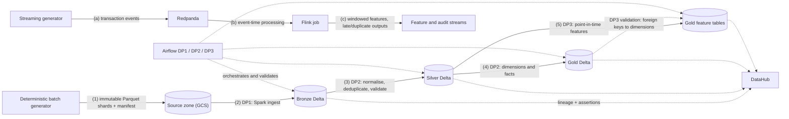

# EDAI-1: Data Engineering Platform

The E-Wallet data engineering platform turns synthetic financial events into governed analytical and feature datasets. Its components are:

- deterministic batch and streaming data generators;
- a Bronze / Silver / Gold Delta Lakehouse on GCS;
- Spark batch pipelines on Dataproc Serverless, orchestrated by Airflow;
- Flink event-time stream processing;
- DataHub lineage and data-quality assertions;
- physical storage optimisation;
- a PostgreSQL warehouse indexing study.

## Architecture

**How to read the diagram:**

- **Batch flow (1)–(5).** Generation → Bronze → Silver → Gold → features. Each step is a Spark job on Dataproc Serverless, submitted by an Airflow DAG.
- **Streaming flow (a)–(c).** The streaming generator → Redpanda → Flink.
- **Dashed edges.** These carry orchestration and metadata, not data.

## Technical reports

Each module report ends with a *Traceability* section that links every result to its implementation (with line anchors), its machine-readable execution artifact and its screenshot. The [rubric evidence index](RUBRIC_EVIDENCE_INDEX.md#module-traceability-rows-34-2021-2838) maps each rubric row to the same four kinds of proof.

| Topic | Rubric rows | Report | Evidence |
|---|---|---|---|
| **Docker & Compose** | 3, 4 | [Docker Optimization](docker/DOCKER_OPTIMIZATION.md) | [`docker/5gb/`](../evidence/edai1/docker/5gb/MANIFEST.md) |
| Data generation | 5–10 | [Data Generation and Simulation](data_generator/DATA_GENERATION_AND_SIMULATION.md) | [`data_generator/`](../evidence/edai1/data_generator/) |
| **Batch Processing & Orchestration — DP1/DP2/DP3** | 11–15, 22–27 | [Batch Processing and Orchestration](BATCH_PROCESSING_AND_ORCHESTRATION.md): Spark DP1–DP3, the three Airflow DAGs and the 5GB Baseline/Optimised campaign `ab-20261110225456` | [`spark/rehearsal-5gb-ab-20261110225456/`](../evidence/edai1/spark/rehearsal-5gb-ab-20261110225456/README.md) |
| Stream processing | 16–19 | [Flink Streaming](streaming/FLINK_STREAMING.md) | [`streaming/`](../evidence/edai1/streaming/) |
| **Storage optimization** | 20, 21 | [Lakehouse and Warehouse Storage Optimization](storage/STORAGE_OPTIMIZATION.md) | [`storage/5gb/`](../evidence/edai1/storage/5gb/MANIFEST.md) |
| **Data Governance** | 28–33 | [DataHub Governance](datahub/DATAHUB_GOVERNANCE.md): DP1–DP3 lineage and executed-rule assertions of the 5GB campaign | [`datahub/rehearsal-5gb/`](../evidence/edai1/datahub/rehearsal-5gb/MANIFEST.md) |
| **Schema Design** | 34–38 | [Schema Design](schema/SCHEMA_DESIGN.md): all-zone inventory, ERDs, SCD2, feature timestamps, naming | [`schema/rehearsal-5gb/`](../evidence/edai1/schema/rehearsal-5gb/MANIFEST.md) |
| Novel idea 1 | 39 | [Deterministic Sharded Generation](novel_ideas/01_DETERMINISTIC_SHARDING.md) | [`novel_ideas/`](../evidence/edai1/novel_ideas/) |
| Novel idea 2 | 40 | [Point-in-Time Leakage Prevention](novel_ideas/02_PIT_LEAKAGE_PREVENTION.md) | [`novel_ideas/`](../evidence/edai1/novel_ideas/) |

Owner procedures: [Docker and storage](../runbooks/edai1/DOCKER_STORAGE_5GB_OWNER_EVIDENCE.md), [DataHub and schema](../runbooks/edai1/DATAHUB_SCHEMA_OWNER_EVIDENCE.md).

## Key results

| Area | Result | Interpretation |
|---|---|---|
| Docker (5GB workload) | Campaign-verifier image 396.9 MB → 44.2 MB content (−88.87 %); 95.8 % of the reduction from the slim base, 4.2 % from multi-stage packaging; identical 45-check fingerprint in all four variants; non-root hardened Compose run exit 0 | No run-time gain is claimed (start-up dominated). The October 88.44 % result is historical |
| Dataset | **100,156,470,260 bytes** in 3,696 shards: 369.6 M logical transactions plus a controlled 2 % duplicate rate | A deterministic, resumable publication with a final manifest. The DP1–DP3, storage, governance and schema results use the 5GB rehearsal dataset `rehearsal-5gb-v1` |
| DP1–DP3 on Dataproc, 5GB (`ab-20261110225456`) | 6 DagRuns and 16 batches succeeded; 260 validation rules per profile passed; Baseline and Optimised outputs `SEMANTIC_EQUIVALENT` across all 34 tables | The pipeline is correct and traceable end to end |
| Spark Baseline vs Optimised, 5GB | Application runtime 165.1/197.9/314.9/160.2 s → 213.8/292.3/335.8/196.7 s (DP1/Silver/Gold/DP3); Gold shuffle −20.5 % | Not faster in one trial. The validator control varied 6–54 %, so the runtime differences are not attributable; plan-level AQE effects are |
| Flink (100 events/s, 120 s) | Both profiles accepted 12,000 unique events out of 12,180 raw arrivals; the optimised profile lowered p95 latency from 10.9 s to 7.3 s | Deduplication and late-event routing behave identically in both profiles |
| Storage (5GB) | Lakehouse (`storage-5gb-20261112t142522`): compaction a true no-op (one ~24 MiB file per daily partition); Z-order rewrote 7.9 GB but read the same files and bytes, so DO_NOT_ADOPT; partition pruning 7 of 151 files, 3.0–3.3× faster in Spark. Warehouse: covering index 174.073 → 0.108 ms median on 3.8 M real Gold rows, +17 % WAL | An identical-layout A/A arm showed 5–18 % drift, which bounds the Z-order effect. Earlier 500k-row and synthetic 2M-row results are historical |
| Data Governance (5GB) | 44 datasets, 3 DataFlows, 8 DataJobs and 34 lineage aspects published to DataHub with 141/141 readback `MATCH`; 260 executed validation rules published as 263 assertions with 263 run events, all `SUCCESS` | Everything in DataHub traces to a verified campaign run; nothing is inferred |
| Schema Design (5GB) | 44 tables registered read-only in Trino (10/9/9/16); 33 logical references, 32 checked by validator rules; `dim_merchant_scd2` 78,294 versions (55,800 current); feature `event_timestamp`/`created` typed; 44/44 tables classified by the naming convention | Relationships are logical (Delta enforces no keys); integrity rests on the validators |
| Point-in-time validation | 10 cases × 31 features = 310/310 values equal to an independent oracle; labels excluded from Feast | Training features cannot see the future |

## Evidence

Screenshots and raw artifacts are organised under [`docs/evidence/edai1/`](../evidence/edai1). Each report embeds genuine images where available and links raw records where an authentic capture was not retained.

| Folder | Content |
|---|---|
| `spark/rehearsal-5gb-ab-20261110225456/` | DP1–DP3 campaign: manifests, validation and comparison reports, Spark metrics, Airflow and Spark UI screenshots |
| `streaming/` | Flink Dashboard captures |
| `datahub/rehearsal-5gb/`, `schema/rehearsal-5gb/` | Owner captures and publication or Trino artifacts of the 5GB governance and schema runs, with `MANIFEST.md` and `SHA256SUMS`; other files in `datahub/` and `schema/` are historical |
| `datahub/`, `schema/` (top level) | Historical 100GB-era captures and logs, kept for provenance only |
| `docker/5gb/`, `storage/5gb/` | Owner captures and raw artifacts of the 5GB Docker, lakehouse and warehouse runs, with `MANIFEST.md` and `SHA256SUMS`; older files in `docker/` and `storage/` are historical ([docker](../evidence/edai1/docker/README.md), [storage](../evidence/edai1/storage/README.md)) |
| `novel_ideas/` | Google Cloud Run and Cloud Logging captures of the point-in-time validation |
| `dp2/`, `dp3/` | Clearly labelled local-fixture tests of SCD2 and feature timestamps (not cited as runtime proof) |

Programmatic terminal-like renders are not embedded in the final reports.

## Limitations

- **DP1–DP3 performance.** One Baseline and one Optimised trial on 5 GB, run 8 hours apart. Runtime differences are within run-to-run variation, and the rehearsal does not show which configuration performs best on larger data.
- **Streaming.** The Flink measurements come from a local cluster. The newer streaming implementation, which writes to the feature store, has not been run end to end.
- **Skew.** The 5GB run diagnoses write-layout skew in the Spark UI, but no method is shown to improve it over the Baseline.
- **Optimizations without a measured gain.** The Docker images run no faster (start-up dominated); lakehouse compaction was a no-op and Z-order was not adopted. Both are reported as results.
- **Governance.** Lineage and assertions are published from the verified campaign record after the run, not emitted live by the Airflow tasks, and only the `optimized` profile is published.
- **Schema.** Relationships are logical; Delta enforces no keys, so integrity holds for runs that pass the validators. The SCD2 attribute history is synthetic.

## Internal tracking

These files are maintained for project tracking. They are not part of the technical narrative:

- [Rubric evidence index](RUBRIC_EVIDENCE_INDEX.md)
- [Gap ledger](GAP_LEDGER.md)
- [Screenshot audit](SCREENSHOT_AUDIT.md)
- [Historical documents](HISTORICAL_DOCUMENTS.md)
