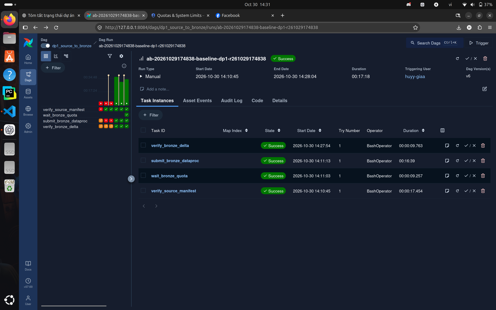

# EDAI-1 rubric evidence index (rows 3–40, 100 points)

**Authority:** the original workbook `EDAI K11.xlsx`, sheet `edai-1 (50%)`.
The row table below uses short reviewer-facing labels; the exact requirement,
Proof/Deliverables wording and raw points are preserved by sheet and row in the
[93-row workbook extract](../rubric/edai_k11_workbook_extract.json).

This index is the N13 reviewer entry point. It reconciles three sources:
- [EDAI1_RUBRIC_COVERAGE.md](../../archive/legacy-docs/docs/edai1/EDAI1_RUBRIC_COVERAGE.md), the committed detailed matrix (kept unchanged);
- the N10-E2 93-row matrix;
- the actual content of the submission tree.

The status vocabulary and gap classes are the same as in the [EDAI-2 index](../edai2/RUBRIC_EVIDENCE_INDEX.md). Details are in [GAP_LEDGER.md](GAP_LEDGER.md). Screenshot classification and per-row screenshot coverage are in [SCREENSHOT_AUDIT.md](SCREENSHOT_AUDIT.md).

## 5GB rehearsal update (2026-11-11, read first)

The three-DAG pipeline ran end to end on Dataproc for benchmark `ab-20261110225456` (`rehearsal-5gb-v1`, Git `aae22b08`, Baseline and Optimised). Its evidence is in the [5GB Rehearsal Benchmark](spark/REHEARSAL_5GB_BENCHMARK.md) and [Airflow §10](airflow/AIRFLOW_DP1_DP2_DP3_EVIDENCE.md#10-three-dag-run-on-the-5gb-rehearsal-ab-20261110225456), with 21 genuine screenshots ([manifest](../evidence/edai1/spark/rehearsal-5gb-ab-20261110225456/screenshots/MANIFEST.md)).

Rows 11, 14, 15, 25, 27, 35 and 36 changed from PARTIAL to COMPLETE (5GB rehearsal), adding 15 points. Note 1 below is superseded: the SCD2 and `created` code is committed (`356b2123`) and was validated on the cloud outputs.

The rehearsal does **not** change:
- the DataHub rows 28–33, because the run emitted no lineage or assertion events;
- the DBeaver rows 34, 37 and 38;
- row 12, because no skew method was shown to improve on the baseline;
- the Flink rows.

Semantic equivalence between the two profiles is PENDING (comparison batch `c1-20261110225456` still running at the time of writing). No row depends on it.

## N13 reconciliation notes

1. **Rows 35–36: source is not in the submission tree.** [SCHEMA_DESIGN.md](schema/SCHEMA_DESIGN.md) describes `data_platform/processing/spark/gold/scd2.py`, `tests/test_merchant_scd2.py` and the additive `created` column. These files exist only as **uncommitted** work in the owner's main checkout (`feature/phase2-fraud-platform`, untracked or modified). The submission tree does not contain them. The SCD2 and feature-timestamp screenshots are labelled **LOCAL FIXTURE — NOT PRODUCTION RUNTIME**. Until the owner commits that work, these rows are `IMPLEMENTATION_MISSING` in the submitted tree.
2. **Rows 22–27: Airflow.** Only three images are run-bound:
   - DP1: optimized run `ab-20261029174838-optimized-dp1-…`, 4/4 Success, plus the baseline run added in N13 (below);
   - DP2: Method-2 run **FAILED** at the final Gold equivalence gate, 24/25 tasks succeeded;
   - DP3: historical replacement run, 5/5 Success.

   The 13 Airflow images in `edai1-final-evidence` are `LOCAL_AIRFLOW_PARSE_ONLY_NO_DAGRUN` (DAG structure only). They are **not** used as run evidence.
3. **Rows 9–10 and 16–19: Flink.**
   - The local Flink UI A/B at `22c0c7f` (11 images in [FLINK_STREAMING.md](streaming/FLINK_STREAMING.md)) is historical evidence.
   - The latest Block A source `0466ba4` was never executed.
   - Rows 9, 10 and 18 are accepted as *historical*. Row 19 is complete through the code section added in N13.
   - Rows 16–17 stay PARTIAL.
   - The disagreements with the N10-E2 matrix and the N13 inventory are recorded at the end of this file.
4. **New in N13:** one authentic DP1 image curated with SHA-256 from `spark-method2-final/ab-20261029174838` ([`n13_curated/PROVENANCE.json`](../evidence/edai1/n13_curated/PROVENANCE.json)):

*Airflow 3 at 127.0.0.1:8084, DAG `dp1_source_to_bronze`, run `ab-20261029174838-baseline-dp1-r261029174838`, Success, 2026-10-30 14:10:45–14:28:04.*

| Task | Result |
|---|---|
| `verify_source_manifest` | Success |
| `wait_bronze_quota` | Success |
| `submit_bronze_dataproc` | Success, 16:39 |
| `verify_bronze_delta` | Success |

*The earlier red/orange cells in the grid are previous attempts. They stay visible and are not hidden.*

The Dataproc Serverless read-back of the same A/B is in the owner evidence root, `spark-method2-final/ab-20261029174838/{baseline,optimized}/dataproc-batch.json`. Its terminal image (`DAG1_optimized/DP1_AB_Dataproc_Comparison.png`) was not copied into the repository because it also shows unrelated editor UI.

| | State | Lifecycle | DCU-hours | Shuffle storage |
|---|---|---|---|---|
| Baseline | SUCCEEDED | 915.82 s | 7.2318 | 2,636,400 GB-s |
| Optimized | SUCCEEDED | 1007.61 s | 8.0569 | 2,937,200 GB-s |

*The optimized run was **slower**. This confirms the decision recorded in [OPTIMIZATION_MATRIX.md](spark/OPTIMIZATION_MATRIX.md) to keep the baseline for DP1.*

## Row index

| Row | Pts | Requirement | Status | Document | Key evidence | Gap |
|---:|---:|---|---|---|---|---|
| 3 | 2 | Docker & Docker Compose | COMPLETE (historical) | [DOCKER_OPTIMIZATION](docker/DOCKER_OPTIMIZATION.md) | digest-pinned Dockerfile, hardened Compose, preserved raw records + N15 genuine terminal view | Benchmark/run remains historical; N15 did not rerun Compose |
| 4 | 3 | Optimize Dockerfile (multi-stage) | COMPLETE (historical) | [DOCKER_OPTIMIZATION](docker/DOCKER_OPTIMIZATION.md) | 88.44 % size reduction, matched smoke hash + N15 genuine terminal view | Measurement remains historical; N15 did not rebuild |
| 5 | 2 | Simulate skew (≥ 100 GB) | PARTIAL | [DATA_GENERATION](data_generator/DATA_GENERATION_AND_SIMULATION.md) | volume, schema and duplicate proof | RUNTIME_EVIDENCE_MISSING (full-column skew/cardinality scan of 100 GB) |
| 6 | 2 | Schema evolution | COMPLETE (historical) | same | V1/V2 fingerprints | — |
| 7 | 2 | Another offline problem (duplicates) | COMPLETE (historical) | same | 369.6 M logical / 376.99 M physical rows | — |
| 8 | 2 | Store generated data for Bronze | COMPLETE (historical) | same | immutable GCS shards + COMPLETE manifest | — |
| 9 | 2 | Late arrivals | COMPLETE (historical) | same, [FLINK_STREAMING](streaming/FLINK_STREAMING.md) | 528 on-time / 72 too-late of 600 | Latest source not run (note 3) |
| 10 | 2 | Another streaming problem (duplicates) | COMPLETE (historical) | same | 12,000 + 180 duplicates → 12,000 unique | Latest source not run (note 3) |
| 11 | 2 | Spark baseline | COMPLETE (5GB rehearsal) | [5GB REHEARSAL](spark/REHEARSAL_5GB_BENCHMARK.md), [OPTIMIZATION_MATRIX](spark/OPTIMIZATION_MATRIX.md) | Baseline and optimised profile per stage; Spark UI environment, SQL plans and stage metrics for DP1, DP2 Silver/Gold and DP3; event-log metrics; Airflow integration (`ab-20261110225456`) | Assessor acceptance; the optimised profile was not faster in one 5GB trial |
| 12 | 3 | Handle skew with explanation | PARTIAL | [5GB REHEARSAL](spark/REHEARSAL_5GB_BENCHMARK.md) §6.5, [OPTIMIZATION_MATRIX](spark/OPTIMIZATION_MATRIX.md) | Spark UI diagnosis of write-layout skew (Gold stage 173: 160 tasks, median 4.41 s, max 27.25 s, both profiles); 100GB A/B | RUNTIME_EVIDENCE_MISSING (no method measured to improve skew over baseline; 5GB has no spill) |
| 13 | 3 | Handle schema evolution with explanation | PARTIAL | same, [SCHEMA_DESIGN](schema/SCHEMA_DESIGN.md) | V1/V2 normalization | DOCUMENTATION_MISSING (row-specific experiment chain) |
| 14 | 3 | Handle other offline problem | COMPLETE (5GB rehearsal) | [5GB REHEARSAL](spark/REHEARSAL_5GB_BENCHMARK.md) §7.2 | Duplicate deliveries: `row_number()` dedup plan in Spark UI; Bronze 18,972,000 → Silver 18,600,000 transactions; `duplicate_key` = 0, validated in Airflow (both profiles) | The 100GB Gold equivalence gate (historical) still failed |
| 15 | 2 | Spark integrated in pipelines | COMPLETE (5GB rehearsal) | [AIRFLOW §10](airflow/AIRFLOW_DP1_DP2_DP3_EVIDENCE.md#10-three-dag-run-on-the-5gb-rehearsal-ab-20261110225456) | 6 DagRuns Success: each Spark job and its validator are DAG tasks | — |
| 16 | 2 | Flink baseline | PARTIAL | [FLINK_STREAMING](streaming/FLINK_STREAMING.md) | historical A/B, 9 UI images | RUNTIME_EVIDENCE_MISSING (`0466ba4`) |
| 17 | 3 | Late arrival handling | PARTIAL | same | watermarks, allowed lateness | RUNTIME_EVIDENCE_MISSING |
| 18 | 3 | Other streaming problem | COMPLETE (historical) | [FLINK_STREAMING](streaming/FLINK_STREAMING.md) | dedup 12,180 → 12,000 at `22c0c7f`; backpressure UI baseline vs optimized | Latest source not run; failed 500 EPS run stays visible (note 3) |
| 19 | 2 | Window processing | COMPLETE | [FLINK_STREAMING §Row 19](streaming/FLINK_STREAMING.md#31-window-processing-in-code) | verbatim watermark + tumbling-window + allowed-lateness code with explanation (added in N13) | — (the deliverable is code + explanation) |
| 20 | 3 | Lakehouse optimization | COMPLETE (historical) | [STORAGE_OPTIMIZATION](storage/STORAGE_OPTIMIZATION.md) | partition pruning, compaction, 7 images | — |
| 21 | 3 | Warehouse optimization (indexing) | COMPLETE (historical) | same, [WAREHOUSE_INDEX_BENCHMARK](../../archive/legacy-docs/docs/edai1/WAREHOUSE_INDEX_BENCHMARK.md) | matched PostgreSQL 16 A/B in preserved JSON/log + N15 genuine terminal view | Benchmark remains historical; N15 did not rerun it |
| 22 | 2 | DP1 ingest | COMPLETE (historical) | [AIRFLOW](airflow/AIRFLOW_DP1_DP2_DP3_EVIDENCE.md) | DP1 optimized + baseline runs Success | — |
| 23 | 2 | DP1 validate | COMPLETE (historical) | same | `verify_source_manifest`, `verify_bronze_delta` Success | — |
| 24 | 2 | DP2 ingest | COMPLETE (historical) | same | all Silver/Gold transformation tasks succeeded | DagRun overall FAILED (row 25) |
| 25 | 2 | DP2 validate | COMPLETE (5GB rehearsal) | [AIRFLOW §10](airflow/AIRFLOW_DP1_DP2_DP3_EVIDENCE.md#10-three-dag-run-on-the-5gb-rehearsal-ab-20261110225456), [5GB REHEARSAL](spark/REHEARSAL_5GB_BENCHMARK.md) §7.2–7.3 | `silver.semantic_validation` (60 rules) and `gold.semantic_validation` (93 rules) PASS in both DagRuns | Historical 100GB gate stays FAILED |
| 26 | 2 | DP3 ingest | COMPLETE (historical) | same | 5/5 tasks Success | — |
| 27 | 2 | DP3 validate | COMPLETE (5GB rehearsal) | [AIRFLOW §10](airflow/AIRFLOW_DP1_DP2_DP3_EVIDENCE.md#10-three-dag-run-on-the-5gb-rehearsal-ab-20261110225456), [5GB REHEARSAL](spark/REHEARSAL_5GB_BENCHMARK.md) §7.4 | `features.semantic_validation` (53 rules) incl. PIT recomputation, 0 mismatches, as an Airflow task | — |
| 28 | 2 | DP1 lineage | COMPLETE (historical) | [DATAHUB_GOVERNANCE](datahub/DATAHUB_GOVERNANCE.md) | DataFlow/DataJob → 8 Bronze datasets | — |
| 29 | 2 | DP1 validation | COMPLETE (historical) | same | `mismatch_count=0`, Passed | — |
| 30 | 2 | DP2 lineage | COMPLETE (historical) | same | Bronze → Silver → Gold, 3 images | — |
| 31 | 2 | DP2 validation | PARTIAL | same | Silver checks PASS | RUNTIME_EVIDENCE_MISSING (Gold assertion NOT_EXECUTED) |
| 32 | 2 | DP3 lineage | COMPLETE (historical) | same | Silver/Gold → 4 feature datasets | — |
| 33 | 2 | DP3 validation | COMPLETE (historical) | same | assertion run events | — |
| 34 | 2 | Visualize tables on all zones | PARTIAL | [ALL_ZONES_SCHEMA](schema/ALL_ZONES_SCHEMA.md) (zone visuals added in N13), [SCHEMA_DESIGN](schema/SCHEMA_DESIGN.md) | DataHub lineage per zone (HISTORICAL_UI ×4); 40-table inventory read back through Trino from the cloud runs (TRINO_METADATA_VERIFIED) | OWNER_SCREENSHOT_PENDING (DBeaver E01–E04) |
| 35 | 2 | Dim with SCD2 | COMPLETE (5GB rehearsal) | [SCHEMA_DESIGN](schema/SCHEMA_DESIGN.md), [5GB REHEARSAL](spark/REHEARSAL_5GB_BENCHMARK.md) §7.3 | `scd2.py` committed (`356b2123`); cloud `dim_merchant_scd2` (78,294 versions, `valid_from_ts`/`valid_to_ts`/`is_current`) passed 13 SCD2 rules in both profiles | DBeaver view of the table (row 34/37 screenshots) |
| 36 | 2 | `feat_` tables with `event_timestamp` + `created` | COMPLETE (5GB rehearsal) | [SCHEMA_DESIGN](schema/SCHEMA_DESIGN.md), [5GB REHEARSAL](spark/REHEARSAL_5GB_BENCHMARK.md) §7.4 | All 4 DP3 tables and `feat_user_90d`: both columns typed `timestamp`, not null, `created` equals the recorded materialisation clock | — |
| 37 | 2 | Dim/fact relationships (DBeaver-like export) | PARTIAL | [SCHEMA_DESIGN](schema/SCHEMA_DESIGN.md), [GOLD_ERD](schema/generated/GOLD_ERD.md) | 13 logical edges with cardinality; DBeaver virtual-key specification | OWNER_SCREENSHOT_PENDING (DBeaver ER diagram E05/E06) |
| 38 | 2 | Naming convention | PARTIAL | same | zone-qualified names; explicit `raw_`/`stg_` equivalence (§8); catalog listing | OWNER_SCREENSHOT_PENDING (E07); assessor acceptance of "similar" |
| 39 | 10 | Novel idea 1 | COMPLETE | [01_DETERMINISTIC_SHARDING](novel_ideas/01_DETERMINISTIC_SHARDING.md) | runtime + business E2E | Assessor acceptance |
| 40 | 10 | Novel idea 2 | COMPLETE | [02_PIT_LEAKAGE_PREVENTION](novel_ideas/02_PIT_LEAKAGE_PREVENTION.md) | runtime + business E2E | Assessor acceptance |

## Summary

These are evidence-coverage buckets, not a predicted grade.

| Bucket | Rows | Points |
|---|---|---:|
| Complete deliverables (incl. historical and 5GB rehearsal) | 3, 4, 6–11, 14, 15, 18–30, 32, 33, 35, 36, 39, 40 (29 rows) | 79 |
| Missing only a screenshot or documentation | 13, 34, 37, 38 (4 rows) | 9 |
| Missing runtime evidence | 5, 12, 16, 17, 31 (5 rows) | 12 |
| Missing implementation (in the submission tree) | none | 0 |
| **Total** | 38 rows | **100** |

## Reconciliation with the external N13 inventory (quality gate, 2026-11-04)

**Inventory:** the owner's N13 evidence inventory (`FINAL_EVIDENCE_INVENTORY.md`, `FINAL_RUBRIC_STATUS.md`; external, 2026-11-04) reports EDAI-1 secured coverage 73/100. This index does not adopt it blindly. The two agree on rows 3, 4, 6–8, 15–17, 20, 21, 25, 27–30, 32, 33, 35, 36, 39 and 40.

| Row | N13 inventory | This index | Decision and evidence |
|---:|---|---|---|
| 5 | PASS | PARTIAL | [DATA_GENERATION](data_generator/DATA_GENERATION_AND_SIMULATION.md) itself states that the 100 GB skew/cardinality scan is `NOT_EXECUTED`. Only a 500k local profile exists |
| 9, 10 | PARTIAL | COMPLETE (historical) | The inventory's reason (dirty Block A source, no Redpanda runtime) concerns the newer Block A. The rows ask for documented late/duplicate characteristics, which the legacy generator evidence provides (12 % late, 528/72 of 600; 12,180 → 12,000) at an identified source |
| 11, 12, 13, 14 | HISTORICAL_PASS | PARTIAL | The deliverable needs Spark UI per optimization step. Only DP1 Spark UI exists (and the optimized run was slower). There is no Spark UI skew diagnosis, the schema-evolution chain is not consolidated, and the DP2 Gold equivalence gate FAILED (row 14). See [SCREENSHOT_AUDIT](SCREENSHOT_AUDIT.md) |
| 18 | HISTORICAL_PASS | COMPLETE (historical) | Agreed (changed in this pass) |
| 19 | HISTORICAL_PASS | COMPLETE | Agreed after the code-and-explanation section was added in N13. Before that, the document had **no code snippet**, which is the literal deliverable |
| 22, 23, 24, 26 | PARTIAL ("authoritative DagRun closure absent") | COMPLETE (historical) | The deliverable is Airflow images plus an explanation of each pipeline and component. The DP1 runs `ab-20261029174838-{baseline,optimized}-dp1-…` are real executions (`submit_bronze_dataproc` 16:39, Dataproc batches SUCCEEDED). The "replay-marked" note applies only to the 2026-10-22 bounded replay, not to these runs |
| 31 | HISTORICAL_PASS | PARTIAL | No DP2 assertion UI. The DP2 Gold assertion was `NOT_EXECUTED` ([EDAI1_RUBRIC_COVERAGE](../../archive/legacy-docs/docs/edai1/EDAI1_RUBRIC_COVERAGE.md)) |
| 34 | HISTORICAL_PASS | PARTIAL | DataHub lineage shows tables across zones (now embedded), but not the relationships within a zone |
| 37 | HISTORICAL_PASS | PARTIAL | DataHub lineage is not a dimension ↔ fact relationship export. No ERD exists |
| 38 | HISTORICAL_PASS | PARTIAL | Bronze/Silver have no `raw_`/`stg_` prefix ([SCHEMA_DESIGN](schema/SCHEMA_DESIGN.md) naming table). Acceptance as "similar" is the assessor's call. [ALL_ZONES_SCHEMA](schema/ALL_ZONES_SCHEMA.md) wrongly claimed a `stg_` prefix; corrected in N13 |

**Coverage after reconciliation (N13):** 64/100 points in complete rows. The inventory reported 73: 73 − 21 (rows 5, 11–14, 31, 34, 37, 38 not accepted here) + 12 (rows 9, 10, 22–24, 26 accepted here) = 64.

**Coverage after the 5GB rehearsal (2026-11-11):** 79/100 points in complete rows (64 + 15 from rows 11, 14, 15, 25, 27, 35 and 36).
