# EDAI-1 Schema Design

## 1. Introduction and rubric mapping

Schema design is the contract connecting ingestion, data quality, analytics and point-in-time feature computation. This report documents the implementation currently present in source and historical evidence. The SCD2 implementation described below is source-ready and fixture-verified only; it is not represented as a deployed production dimension.

| Row | Exact requirement | Points |
|---:|---|---:|
| 34 | Visualize tables on all zones; capture tables and relationships in each zone and explain every table | 2 |
| 35 | Dimension table with SCD Type 2: `valid_from_ts`, `valid_to_ts`, `is_current` | 2 |
| 36 | Feature tables (`feat_`) with `event_timestamp` and `created` columns | 2 |
| 37 | Relationship between dimension and fact tables; DBeaver or a similar export is acceptable | 2 |
| 38 | Naming convention: Gold `dim_`, `fact_`, `obt_`, `feat_`, `raw` or similar; Bronze/Silver `raw_`, `stg_` or similar | 2 |

No points are self-awarded. Statuses distinguish implemented source, historical runtime evidence and literal rubric gaps.

## 2. Medallion data architecture

The canonical inventory contains 39 logical tables: 8 Source, 8 Bronze, 8 Silver and 15 Gold. DataHub represents 32 physical datasets because the eight logical Source tables share one immutable manifest dataset.

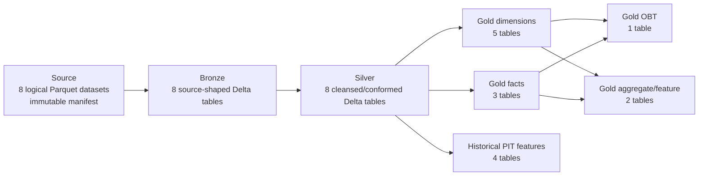

- **Source:** deterministic, immutable Parquet shards plus a completion manifest.
- **Bronze:** source-shaped Delta; preserves raw business content while reconciling transaction V1/V2 physical files.
- **Silver:** cleans, normalizes and deduplicates; transaction-like tables gain operational date columns used for partitioning.
- **Core Gold:** full-refresh dimensions, facts, a denormalized OBT, a 90-day feature aggregate and merchant analytics.
- **Historical features:** four event-time snapshots with strict `[T-window, T)` semantics.

Inventory source: `data_platform/contracts/schema_inventory.py`; canonical lists: `data_platform/storage/scripts/config.py`.

## 3. Verified table catalog

### 3.1 Source, Bronze and Silver

Each row below represents three verified logical tables with the same business name: `source.<name> → bronze.<name> → silver.<name>`. Source and Bronze preserve source grain; Silver enforces the stated logical key and normalized types. Cloud writes are run-scoped and immutable.

| Table path across zones | Business purpose | Grain and key | Important columns / evolution | Silver partition | Downstream |
|---|---|---|---|---|---|
| `users` | Customer identity and KYC profile | One row per `user_id` | `full_name`, contact fields, `kyc_verified`, `created_at` | None | `dim_user`; user features |
| `accounts` | E-wallet accounts owned by users | One row per `account_id`; business relation `user_id` | `account_type`, `currency`, `created_at` | None | `dim_account`; balances; transaction joins |
| `merchants` | Merchant master data | One row per `merchant_id` | `merchant_name`, `category` | None | `dim_merchant`; merchant analytics/features |
| `devices` | Devices associated with users | One row per `device_id`; relation `user_id` | `device_type`, `os`, `first_seen_at` | None | `dim_device`; device features |
| `transactions` | Financial transaction attempts | Bronze may include controlled duplicates; Silver is one row per `transaction_id` | V1 lacks `channel`; Bronze adds nullable channel before union, Silver normalizes missing values to `UNKNOWN`; amount, balance, status and event time | `event_date` | `fact_transactions`; all PIT behavior features |
| `balance_snapshots` | Daily account closing balance | One row per `(account_id, snapshot_date)` | `closing_balance` | `snapshot_date` | `fact_balance_snapshot` |
| `login_events` | Authentication attempts | One row per `login_id` | `user_id`, `device_id`, `is_success`, `login_ts` | `login_date` | `fact_login_events` |
| `fraud_labels` | Synthetic fraud ground truth | One row per `transaction_id` | `label`, nullable conditional `fraud_type`; excluded from feature inputs | None | Validation/training boundary; no Gold feature edge |

This catalog accounts for 24 logical tables: the same eight business datasets in Source, Bronze and Silver.

### 3.2 Gold core and historical feature tables

| Gold table | Purpose | Grain / logical key | Important columns | Partition | Upstream |
|---|---|---|---|---|---|
| `dim_user` | User descriptive attributes | One row per `user_id` | identity, contact, KYC, `created_at` | None | `silver.users` |
| `dim_account` | Account descriptive attributes | One row per `account_id` | `user_id`, type, currency, `created_at` | None | `silver.accounts` |
| `dim_merchant` | Merchant descriptive attributes | One row per `merchant_id` | name, category | None | `silver.merchants` |
| `dim_device` | Device descriptive attributes | One row per `device_id` | `user_id`, type, OS, first seen | None | `silver.devices` |
| `dim_date` | Shared calendar dimension | One row per `date_key` / calendar date | day, month, quarter, year, weekday/weekend | None | Silver transaction, login and balance dates |
| `fact_transactions` | Central transaction fact | One row per `transaction_id` | dimension keys, `date_key`, type/status/channel, amounts, `timestamp`, `ingested_at` | `event_date` | `silver.transactions` |
| `fact_login_events` | Login-attempt fact | One row per `login_id` | `user_id`, `device_id`, `date_key`, result, `login_ts` | `event_date` | `silver.login_events` |
| `fact_balance_snapshot` | Daily balance fact | One row per `(account_id, snapshot_date)` | `date_key`, closing balance | `snapshot_date` | `silver.balance_snapshots` |
| `obt_transaction_enriched` | Denormalized transaction analytics | One row per `transaction_id` | fact metrics plus user/account/device/merchant/date attributes | `event_date` | Transaction fact + five dimensions |
| `feat_user_90d` | Latest-window user aggregate | One row per `user_id` | 4 metrics, `event_timestamp`, existing `created_timestamp`, additive `created` alias | None | Transaction fact + user dimension |
| `opt_merchant_performance` | Merchant aggregate analytics | One row per `merchant_id` | transaction/amount/success/failure/user counts | None | Transaction fact + merchant dimension |
| `feat_user_behavior` | Point-in-time user behavior | `(user_id, event_timestamp)` | ten historical user metrics, `created` | None | `silver.transactions` |
| `feat_account_behavior` | Point-in-time account behavior | `(account_id, event_timestamp)` | eleven historical account metrics, `created` | None | `silver.transactions` |
| `feat_device_behavior` | Point-in-time device behavior | `(device_id, event_timestamp)` | age, count, amount and failure-rate metrics, `created` | None | `silver.transactions`, `silver.devices` |
| `feat_merchant_behavior` | Point-in-time payment-merchant behavior | `(merchant_id, event_timestamp)` for eligible payments | eight historical merchant metrics, `created` | None | `silver.transactions` |

Core builders are in `data_platform/processing/spark/gold/`; PIT builders are under `data_platform/processing/spark/gold/features/`. YAML contracts under `data_platform/contracts/` define the strongest fact, OBT, Silver transaction/label and feature contracts.

## 4. Schema evolution

The generator produces two transaction physical schemas. V1 does not contain `channel`; V2 does. `data_platform/ingestion/spark/source_to_bronze.py` adds a nullable string `channel` to V1 and performs a name-aligned union. Silver then normalizes missing historical values to `UNKNOWN`, validates the domain and deduplicates by transaction identity.

This is controlled additive evolution: downstream tables expose one stable transaction schema while retaining older rows. It does not imply arbitrary backward/forward compatibility for every future change.

The following screenshots are local 500k historical evidence, not canonical 100 GB cloud read-back:

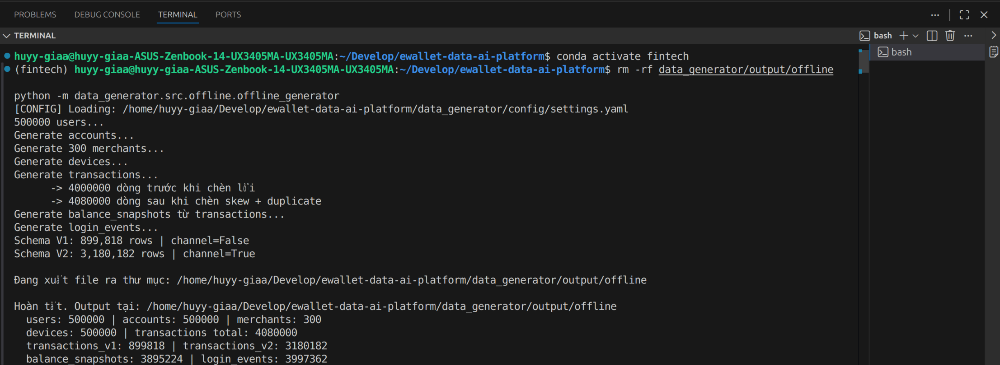

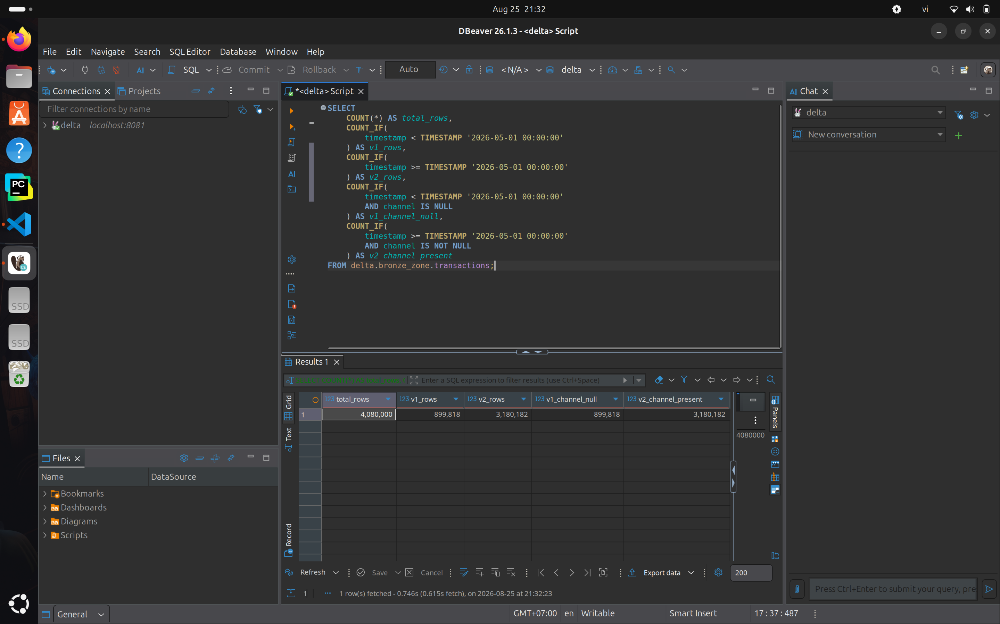

Their SHA-256 values are respectively `1821c5472d13c74304db9fc3295309198b25da8615b989d9322b71d94a8c7c2a` and `9d809903451e5c258aeb267cde95ad2ce240df6d160ab21dae8ff54320311d73`.

## 5. Slowly Changing Dimension Type 2

### 5.1 Selection and production limitation

`dim_merchant` was selected because its two descriptive attributes (`merchant_name` and `category`) make version transitions easy to verify without changing a fact contract. The actual `silver.merchants` source contains only `merchant_id`, `merchant_name` and `category`; it has no effective timestamp and the repository retains no historical merchant snapshots. Consequently, production history cannot be reconstructed honestly from the current dataset.

The existing `build_dim_merchant` and `gold_pipeline.py` remain unchanged in behavior and continue to produce the current-state three-column table. The new builder is separate and is not called by DP2/DP3. This preserves all existing Gold, OBT, feature and validation contracts.

### 5.2 Minimal snapshot implementation

`data_platform/processing/spark/gold/scd2.py` implements the bounded snapshot algorithm, and `build_dim_merchant_scd2` in `dimension_builder.py` binds it to merchant attributes. Its input contract is one state per `(merchant_id, snapshot_ts)`; a retained real snapshot timestamp is mandatory. PySpark window functions:

1. order snapshots by `snapshot_ts` within each `merchant_id`;
2. compare a deterministic hash of name/category with `lag` and remove consecutive unchanged snapshots;
3. use `lead` of the next changed snapshot as `valid_to_ts`;
4. rename the first changed snapshot timestamp to `valid_from_ts`; and
5. set `is_current = true` only when `valid_to_ts` is null.

The result supports multiple versions per key and uses the required half-open interval `[valid_from_ts, valid_to_ts)`. This means a fact exactly at the next boundary resolves only to the new version.

### 5.3 Deterministic fixture result

Because real historical snapshots are absent, the focused test uses a bounded synthetic fixture. It is demonstration evidence, not production/runtime evidence. An unchanged `2026-02-01` snapshot is deliberately included and correctly collapses into the first version.

| merchant_id | merchant_name | category | valid_from_ts | valid_to_ts | is_current |
|---|---|---|---|---|---|
| `m1` | Corner Shop | GROCERY | 2026-01-01 | 2026-03-01 | false |
| `m1` | Corner Shop | PREMIUM_GROCERY | 2026-03-01 | 2026-04-15 | false |
| `m1` | Corner Market | PREMIUM_GROCERY | 2026-04-15 | null | true |
| `m2` | Transit Hub | TRANSPORT | 2026-01-10 | null | true |

The following terminal captures are genuine **LOCAL FIXTURE — NOT PRODUCTION RUNTIME** evidence. Their checksums are recorded in `docs/evidence/edai1/SCHEMA_ROWS_35_36_SHA256.txt`.

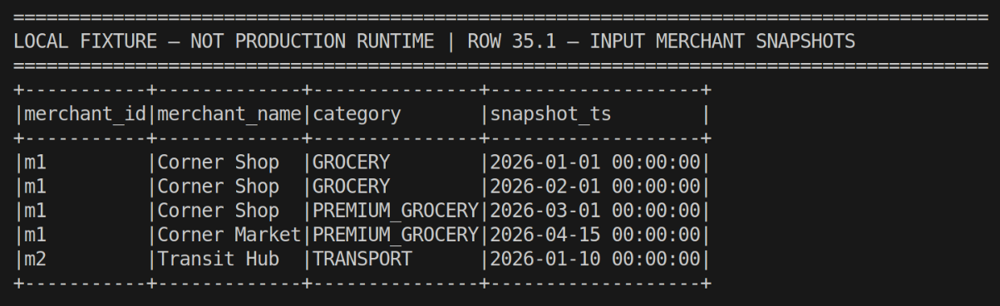

*Figure 35.1 — Deterministic input snapshots for two merchant keys. The repeated `m1` state demonstrates that an unchanged snapshot does not create an additional SCD2 version.*

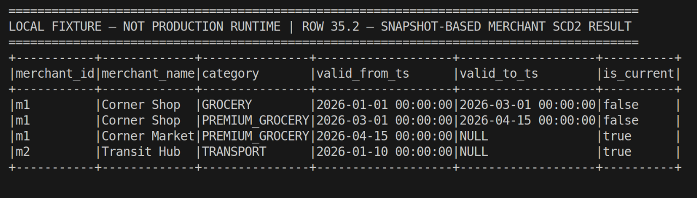

*Figure 35.2 — The bounded SCD2 result exposes `valid_from_ts`, exclusive `valid_to_ts`, and `is_current`; `m1` retains three attribute versions while `m2` has one current version.*

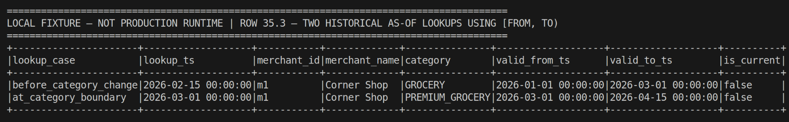

*Figure 35.3 — Two `[valid_from_ts, valid_to_ts)` as-of lookups select the correct historical version before and exactly at the category boundary. A historical lookup can correctly return `is_current=false`: the flag describes whether that dimension version is current now, not whether it was valid at the requested historical time.*

`tests/test_merchant_scd2.py` verifies version transitions and unchanged-snapshot collapse, exactly one current version per business key, adjacent non-overlapping intervals, and historical lookup before/on/after a boundary. On 2026-11-02, all four focused tests passed locally with Spark 4.1.1. The first invocation exposed a local driver/worker Python mismatch (3.10/3.13); rerunning with both PySpark interpreter variables bound to the existing `fintech` Python 3.10 environment passed. No dependency or `uv.lock` change was made.

Current verification status is **SOURCE_READY / FIXTURE_VERIFIED / NOT_RUNTIME_VERIFIED**. The output schema contains all three rubric fields:

- `valid_from_ts`
- `valid_to_ts`
- `is_current`

Closing Row 35 as production evidence still requires a real retained snapshot/effective-timestamp source, an owner-approved versioned Gold output (without overwriting current `dim_merchant`), and runtime schema/result capture. CDC, incremental MERGE, late-arrival correction and a generic SCD framework are intentionally outside this implementation.

## 6. Feature timestamp contract

All five `feat_` builders now expose the rubric-literal `event_timestamp` and `created` timestamp columns. Their meanings remain intentionally separate:

- `event_timestamp` is business/event time and remains the Feast `timestamp_field` used for point-in-time lookup. The four DP3 windows still end one microsecond before the event, enforcing `[T-window, T)` and excluding current/future information.
- `created` is UTC record materialization time. `historical_feature_pipeline.feature_definitions` captures it once per DP3 run and passes the same value to all four builders. Direct builder use defaults to Spark `current_timestamp()` at evaluation time.
- `feat_user_90d` already had the trustworthy write-time `created_timestamp`; its new `created` field is an explicit alias of that value. The old column is retained for backward compatibility.
- Historical outputs produced before this source change do not contain `created`. They are not rewritten and no timestamp is inferred from event time. A new bounded/cloud run is required to materialize the additive schema.

Implementation paths are `data_platform/processing/spark/gold/features/temporal.py`, the four modules under `gold/features/`, `gold/feature_builder.py`, `gold/historical_feature_pipeline.py`, the five YAML contracts, and `quality/validate_gold.py`. Write-time columns are excluded from semantic A/B fingerprints but remain schema/null checked.

| Feature table | Entity/grain | `event_timestamp` | `created` implementation | Source status |
|---|---|---|---|---|
| `feat_user_90d` | One row per user | Reference event time | Alias of existing `created_timestamp` | SOURCE_READY |
| `feat_user_behavior` | User + event time | Transaction time | DP3 run materialization time | SOURCE_READY |
| `feat_account_behavior` | Account + event time | Transaction time | DP3 run materialization time | SOURCE_READY |
| `feat_device_behavior` | Device + event time | Transaction time | DP3 run materialization time | SOURCE_READY |
| `feat_merchant_behavior` | Merchant + event time | Eligible payment time | DP3 run materialization time | SOURCE_READY |

Focused local tests validate both fields and timestamp types, non-null `created`, one shared DP3 creation time, preserved representative feature values, strict PIT behavior, and the unchanged 31-value Feast feature inventory. Feast definitions require no timestamp mapping change: `event_timestamp` remains the source timestamp and the export adapter projects out `created` as non-model metadata while accepting both legacy and additive Delta schemas. On 2026-11-02, 16 focused tests passed with Spark 4.1.1. This is **SOURCE_READY / LOCALLY_VERIFIED / NOT_RUNTIME_VERIFIED**; it does not prove that an existing cloud Delta table has the new field.

The following terminal captures are genuine **LOCAL FIXTURE — NOT PRODUCTION RUNTIME** evidence. They show the actual bounded Spark fixture output, not a cloud or previously materialized Delta schema.

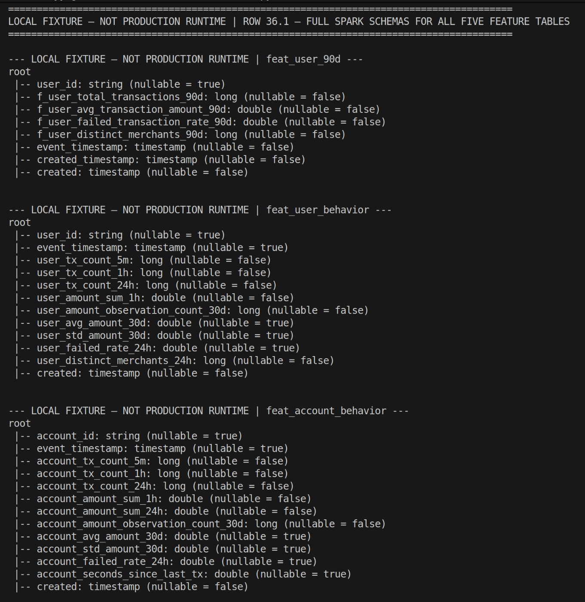

*Figure 36.1 — Spark schemas for `feat_user_90d`, `feat_user_behavior`, and `feat_account_behavior` expose both the business-time `event_timestamp` and materialization-time `created`; the legacy `created_timestamp` remains on `feat_user_90d`.*

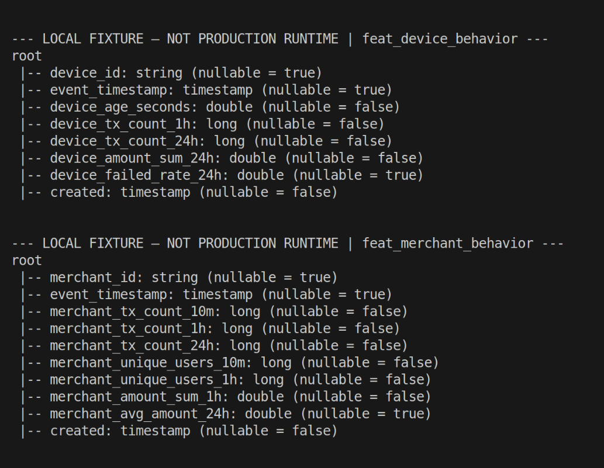

*Figure 36.2 — Spark schemas for `feat_device_behavior` and `feat_merchant_behavior` include the additive non-null `created` timestamp without changing entity keys or computed feature columns.*

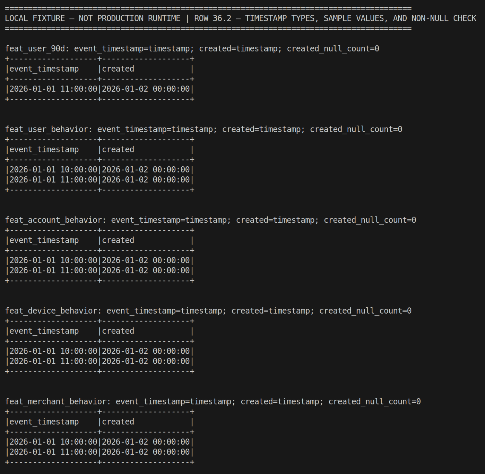

*Figure 36.3 — Actual fixture samples distinguish event time from the shared materialization time, report Spark `timestamp` types, and show `created_null_count=0` for all five feature tables.*

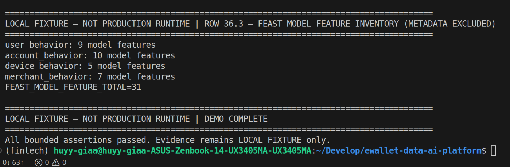

*Figure 36.4 — Feast continues to expose 9 user, 10 account, 5 device, and 7 merchant values—exactly 31 model features—while `created` remains Gold metadata rather than a model feature.*

## 7. Dimension–fact relationships

Relationships are logical contracts enforced by transformations and validators; Delta files do not declare database foreign-key constraints.

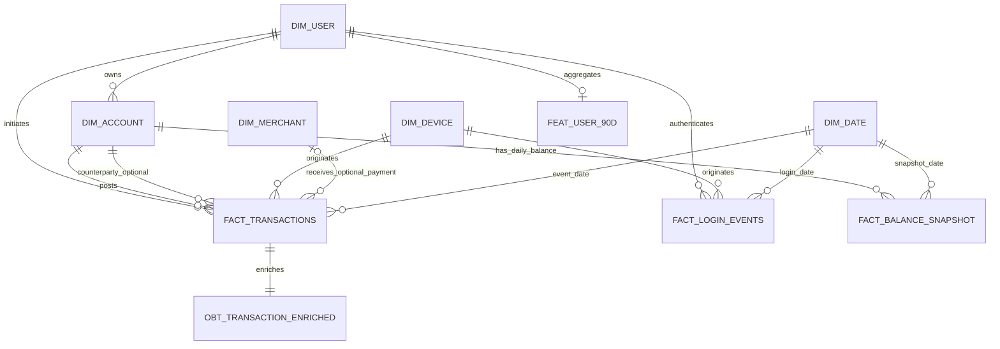

`gold_fact_transactions.yml` declares logical foreign keys to user, account, device, merchant and date dimensions; merchant and counterparty account are conditional/nullable. The OBT uses LEFT JOINs so its population remains equal to `fact_transactions`. Historical PIT features join back to entities by their entity key and event timestamp, but are not conventional fact-table foreign-key targets.

No current DBeaver/Trino relationship export is present. The Mermaid ERD is source-derived and does not substitute for the screenshot explicitly suggested by the rubric.

## 8. Naming conventions

| Zone | Implemented convention | Rubric comparison |
|---|---|---|
| Source | Business table names under immutable Source path | No prefix required by row 38 |
| Bronze | Business table names such as `transactions`; zone encoded by storage root/schema | No `raw_` prefix; zone separation is an equivalent layer mechanism but literal convention deviates |
| Silver | Same business names; zone encoded by storage root/schema | No `stg_` prefix; literal convention deviates |
| Gold | `dim_`, `fact_`, `obt_`, `feat_`, plus `opt_` for analytics | Matches the required semantic prefixes |

Naming is consistent within the implementation and collision-free because layer is part of the dataset identity. Nevertheless, row 38 explicitly asks for Bronze/Silver prefixes “or similar”; whether zone-qualified names count as similar remains an assessor decision, so the status is `PARTIAL`, not `RUBRIC_VERIFIED`.

## 9. Validation, runtime evidence and provenance

### Source and tests

- Source/Bronze reconciliation: `data_platform/ingestion/spark/source_to_bronze.py`.
- Silver transformations and quality: `data_platform/processing/spark/silver/` and `data_platform/quality/validate_silver.py`.
- Gold builders and validation: `data_platform/processing/spark/gold/` and `data_platform/quality/validate_gold.py`.
- Inventory guard: `tests/unit/test_schema_inventory.py` requires 8/8/8/15 tables and labels both proposed changes as not deployed.
- Historical PIT baseline: 31 focused/regression tests passed; Gold validation reported 99 PASS / 0 FAIL on the local 4M-transaction dataset.

Historical local PIT artifact:

`/home/huyy-giaa/ewallet-evidence/edai1-deep-audit-20261029/20261029T071108Z/source_evidence/f5_historical_feature_baseline.json`

- source commit `99ddfe708d7b3f8253e0444a966d62fcd5a655da`;
- measured `2026-10-04` with Spark 4.1.1;
- four historical feature outputs and strict PIT tests PASS;
- explicitly local baseline evidence, not canonical cloud execution.

Canonical cloud identities reused by this report are dataset `canonical-100gb-v1`, Silver run `ab-20261025134342-optimized-silver-r261025181923`, core Gold run `ab-20261025134342-optimized-gold-r261025181923`, feature run `ab-20261025134342-optimized-feat-r261026025955`, and implementation identity `bbae48caef7f65fda0c9375a7a49afb2eca5eef4`. Current documentation HEAD is `dedea5ed3db495dec7791745eaf0c4c8bfb86582`; no post-merge reproduction is claimed.

### Evidence transfer/capture manifest

The approved schema evidence destination is not populated with all required captures. Existing resolvable local screenshots above remain in place; nothing is copied in this task.

| Source | Destination | SHA-256 | Claim | Status |
|---|---|---|---|---|
| `.worktrees/codex-final-integration/docs/evidence/images/datahub/datasets_schema/feature_device_schema_historical_20261029.png` | `docs/evidence/edai1/schema/feature_device_schema_historical_20261029.png` | `323af87b654bdeb9b78020ffeff21ae8efcfab3344750eba734ec4bda998c679` | Historical device feature schema visibly has `event_timestamp` and no `created` | PENDING_TRANSFER |
| Not available | `docs/evidence/edai1/schema/all_zones_inventory.png` | OPEN | Source/Bronze/Silver/Gold table inventory from canonical run | EVIDENCE_CAPTURE_REQUIRED |
| Not available | `docs/evidence/edai1/schema/dimension_fact_erd.png` | OPEN | DBeaver/Trino or equivalent dimension–fact relationship view | EVIDENCE_CAPTURE_REQUIRED |
| Local evidence demo | `docs/evidence/edai1/dp2/01_scd2_input_snapshots.png` | `0a744457f5939180b021cdfb99ff9b59d779a9bc4c55b2ab89008a7783d137bb` | Deterministic merchant snapshot input | LOCAL_FIXTURE_VERIFIED |
| Local evidence demo | `docs/evidence/edai1/dp2/02_scd2_version_history.png` | `7ed8ef1d4db999e9bf073be58f18ff40b2c9ca6e44931e7ad02765e99394d48e` | SCD2 fields, intervals and multiple versions | LOCAL_FIXTURE_VERIFIED |
| Local evidence demo | `docs/evidence/edai1/dp2/03_scd2_historical_lookup.png` | `9cf9af0e173d16811459f2783153f798c10b857b970585ae9eef143e2c8a475b` | Historical `[from,to)` selection, including `is_current=false` | LOCAL_FIXTURE_VERIFIED |
| Local evidence demo | `docs/evidence/edai1/dp3/01_feature_timestamp_schema_user_account.png` | `3e66bc134381ccc7d072386af3835ca092ba1f4c26b218246d3098ae7154aca2` | User/account feature timestamp schemas | LOCAL_FIXTURE_VERIFIED |
| Local evidence demo | `docs/evidence/edai1/dp3/02_feature_timestamp_schema_device_merchant.png` | `ad2026c42b4dc2da9013e142adf2b6ddae3f02ddc3d20e42639079cc006a8661` | Device/merchant feature timestamp schemas | LOCAL_FIXTURE_VERIFIED |
| Local evidence demo | `docs/evidence/edai1/dp3/03_feature_timestamp_validation.png` | `843937be92d393537c62114ad86f011f8d6a0fe8d82c1f67165b3f62ec0a2c5e` | Timestamp types, sample values and non-null checks | LOCAL_FIXTURE_VERIFIED |
| Local evidence demo | `docs/evidence/edai1/dp3/04_feast_feature_inventory.png` | `0f239c7efafa6c993acbabf0f70f447ed9f2dab4db3bf230dd99395f299a6fa1` | Feast retains exactly 31 model feature values | LOCAL_FIXTURE_VERIFIED |

## 10. Reproducibility

In a read-only or bounded authorized environment, record the exact Git SHA and run IDs, render `data_platform.contracts.schema_inventory` to JSON/Mermaid, compare the inventory to GCS/Delta or Trino read-back, parse all YAML contracts, and run focused inventory/schema tests. Export table schemas for all zones and a logical ERD from the query engine without mutating tables. Verify that images and raw exports are bound to the same run.

After separate owner-approved changes, SCD2 must be tested for one current row per natural key, non-overlapping effective intervals, correct as-of joins and idempotent reruns. Feature timestamps now have bounded local verification; production closure still requires a new immutable output, runtime schema/null read-back and Feast export/materialization evidence from that exact run.

## 11. Rubric acceptance matrix

| Row | Requirement | Implementation | Evidence | Status | Missing Gap |
|---:|---|---|---|---|---|
| 34 | Visualize and explain all-zone tables | 8 Source + 8 Bronze + 8 Silver + 15 Gold catalog and Mermaid topology | Source inventory, contracts and historical/cloud identities | PARTIAL | Current all-zone UI/query screenshot |
| 35 | SCD2 dimension with three required fields | Separate snapshot-based merchant builder produces `valid_from_ts`, `valid_to_ts`, `is_current`; existing Gold remains unchanged | Four focused Spark tests plus Figures 35.1–35.3 with checksum manifest; no production snapshots or runtime table | SOURCE_READY / FIXTURE_VERIFIED | Retain real snapshots/effective timestamps, publish owner-approved versioned output and capture runtime evidence |
| 36 | `feat_` tables with `event_timestamp` and `created` | All five builders/contracts expose both; write time is distinct from event time and 31 feature values are unchanged | 16 focused local tests plus Figures 36.1–36.4 with checksum manifest; no cloud read-back | SOURCE_READY / LOCALLY_VERIFIED | Materialize a new immutable run and capture runtime Delta/Feast evidence |
| 37 | Dimension–fact relationships | Logical star joins and validators implemented; Mermaid ERD documented | Builders and Gold contracts | SOURCE_READY / PARTIAL | Runtime DBeaver/Trino ERD capture |
| 38 | Zone naming conventions | Gold prefixes comply; Bronze/Silver rely on zone-qualified unprefixed names | Canonical inventories and storage configuration | PARTIAL | Assessor acceptance or implement documented `raw_`/`stg_` convention |

## 12. Actionable implementation gaps

1. Provide a real retained merchant snapshot/effective timestamp source, publish the source-ready SCD2 output under an owner-approved non-destructive Gold contract, and capture runtime schema/version evidence.
2. Materialize a new immutable feature output, verify non-null UTC `created` in all five runtime schemas, and capture Delta/Feast read-back evidence; do not retrofit old backfills with invented timestamps.
3. Capture a current, run-bound all-zone table inventory and dimension–fact ERD.
4. Formally document whether layer-qualified Bronze/Silver names are the accepted equivalent to `raw_`/`stg_`; otherwise introduce a migration plan rather than ad-hoc renaming.

Rows 35 and 36 cannot be closed as production/runtime evidence through documentation alone. Row 35 has source and fixture verification; Row 36 has source and focused local verification but still needs immutable runtime evidence.
