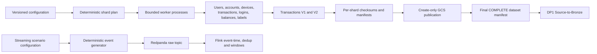
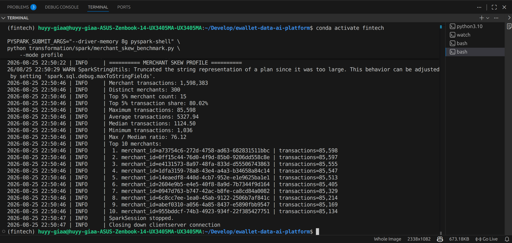
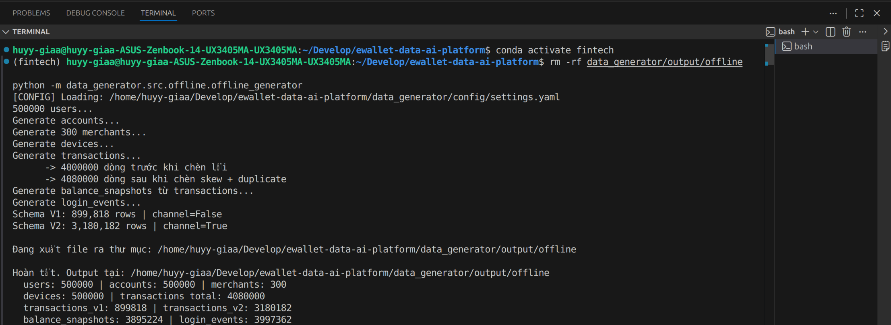
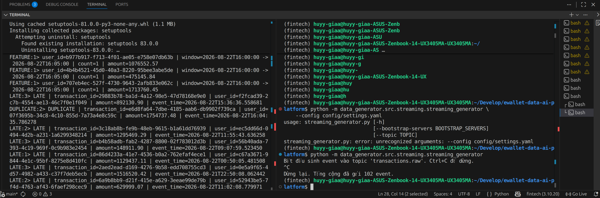
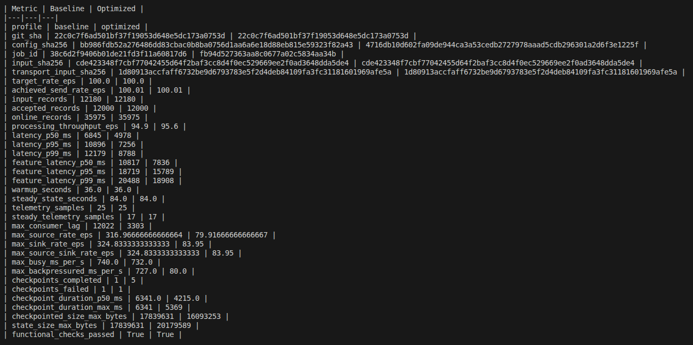

# Data Generation and Simulation

## Scope and provenance

This report covers EDAI-1 rubric rows 5–10. The authoritative rubric is
`EDAI K11.xlsx`, sheet `edai-1 (50%)`, SHA-256
`1b0f880124da3cab4e7cca8e24568d89a3d67c119029f1a71ab39f9eb6fa6081`.

Two immutable offline datasets are relevant:

- the 4-million-transaction F4C validation run, which contains detailed schema
  and population validation and was generated in 1,034.85 seconds;
- cloud dataset `canonical-100gb-v1`, tied by historical audit to source SHA
  `bbae48caef7f65fda0c9375a7a49afb2eca5eef4`, whose final GCS manifest is
  `COMPLETE` at 100,156,470,260 bytes.

Streaming behavior is evidenced separately by historical Flink campaigns. No
generator, Docker, Spark, Flink, or cloud workload was run for this report.

## Exact rubric mapping

| Row | Points | Original requirement | Evidence decision |
| ---: | ---: | --- | --- |
| 5 | 2 | Offline data generator, minimum 100 GB: simulate skew and document skewed columns/ratios, high cardinality, schema evolution, duplicate rate, and volume. | `RUNTIME_VERIFIED` for volume, duplicate rate, schemas and transaction cardinality. `PARTIAL` for skew: configuration and a measured 500k profile exist, but the canonical 100 GB full-column distribution scan was not executed. |
| 6 | 2 | Simulate schema evolution. | `RUNTIME_VERIFIED`: non-empty V1 and V2 Parquet populations have distinct schema fingerprints; V2 adds `channel`. |
| 7 | 2 | Simulate another offline problem, for example 2% duplicates. | `RUNTIME_VERIFIED`: exact 2.00% added duplicate population in both F4C and canonical 100 GB manifests. |
| 8 | 2 | Store generated data so it can later be ingested into Bronze. | `RUNTIME_VERIFIED`: immutable GCS source manifest is complete and was consumed by downstream DP1. |
| 9 | 2 | Simulate late arrivals and document which data is late and by how long. | `HISTORICAL_RUNTIME_VERIFIED`: configured 12%, delay 5 minutes–1 day; historical functional replay observed 72/600 `TOO_LATE`. |
| 10 | 2 | Simulate another streaming problem, for example 1.5% duplicates. | `HISTORICAL_RUNTIME_VERIFIED`: 100 EPS replay emitted 12,000 logical events plus 180 duplicate arrivals; dedup accepted 12,000 unique IDs in both profiles. |

## Generator architecture



Principal implementation references:

- [offline generator](../../../data_platform/generation/src/offline/offline_generator.py)
- [streaming generator](../../../data_platform/generation/src/streaming/streaming_generator.py)
- [sharded generator](../../../data_platform/generation/src/sharded/generator.py)
- [immutable manifest publisher](../../../data_platform/generation/src/sharded/manifest.py)
- [canonical 100 GB profile](../../../configs/generation/cloud-canonical-100gb.yaml)
- [deterministic-sharding report](../novel_ideas/01_DETERMINISTIC_SHARDING.md)

The sharding report documents plan digests, stable shard seeds, create-only
publication, resumability, conflict detection, and deterministic finalization.
Those controls are referenced here rather than duplicated.

## Offline dataset schema

The logical source contains eight datasets represented by nine Parquet outputs:

| Dataset | Key fields and purpose |
| --- | --- |
| `users` | User identity, KYC status, creation time |
| `accounts` | Account ownership, type, currency, creation time |
| `merchants` | Merchant identity, name and category |
| `devices` | Device ownership, type, OS and `first_seen_at` |
| `transactions_v1` | Transaction identifiers, entities, type, amount, balances, status, business/ingestion timestamps; 14 columns |
| `transactions_v2` | V1 plus `channel`; 15 columns |
| `balance_snapshots` | Account/date closing balance derived from transaction history |
| `login_events` | Login identity, user/device, timestamp, success flag |
| `fraud_labels` | One row per logical transaction with binary label and scenario |

Relationships are generated consistently: accounts and devices belong to
users, payment rows can reference merchants, transfers can reference
counterparty accounts, and balance snapshots are derived rather than sampled
independently.

## Determinism and configuration

The canonical cloud plan uses:

| Parameter | Value |
| --- | ---: |
| Dataset version | `canonical-100gb-v1` |
| Global seed | 7001 |
| Shards | 3,696 |
| Users per shard | 12,500 |
| Merchants per shard | 300 |
| Logical transactions per shard | 100,000 |
| Target / tolerance | 100,000,000,000 bytes / ±5% |

Each shard derives its own seed from the frozen plan and shard ID. A bounded
four-shard benchmark produced byte-identical Parquet, manifests, checksums and
final ordering with 1, 2, and 4 workers. Measured wall times were 98.791,
47.094, and 28.212 seconds respectively; four workers achieved 3.50× speedup
with 1.314 GB peak aggregate RSS. Upload time was excluded.

## Canonical 100 GB characteristics

The final manifest was created at `2026-10-24T06:54:00.544Z` with generation
`1792824840507681`, plan digest
`da043b9ad8a1121cad93fd5bca9633d036c7e2c9da3894cfd85b7d3af793046f`,
and status `COMPLETE`.

| Characteristic | Verified value |
| --- | ---: |
| Total physical bytes | **100,156,470,260** |
| Shards | 3,696 |
| Logical transactions | 369,600,000 |
| Physical transaction rows | 376,992,000 |
| Added duplicate rows | 7,392,000 |
| Added-duplicate rate | **2.00% of logical transactions** |
| Unique-ID ratio in physical transactions | 98.0392% |
| Fraud-label rows | 369,600,000 |
| Transaction V1 rows / bytes | 182,250,817 / 22,735,275,158 |
| Transaction V2 rows / bytes | 194,741,183 / 24,333,983,035 |
| Login-event rows / bytes | 369,609,248 / 21,450,554,837 |
| Total Parquet objects | 33,264 |

The complete machine-readable manifest summary has SHA-256
`df52b39ac7951523661cd88f5d8ce705835f8d8b22b6c44543d91193ebfffc73`.
The older readiness artifact says the canonical run had not yet executed; it is
correct for its earlier timestamp but is superseded for volume status by the
later immutable GCS manifest.

The exact end-to-end generation/upload duration was not preserved in the final
manifest. Calibration measured one 100,000-transaction shard at 27,059,611
bytes, 20.585 seconds, and 300,478,464 bytes peak RSS. These values must not be
multiplied into a claimed canonical runtime.

## Skew and cardinality

The offline generator intentionally configures three skew dimensions:

- time: `skew_ratio_hour: 0.75` concentrates 75% of rows around peak hours;
- channel: `skew_ratio_channel: 0.60` plus `channel_loyal_weight: 0.9` creates
  non-uniform app/web/ATM preference;
- merchant: the top 5% of merchants are intended to receive 80% of payment
  traffic.

A historical 500k-user source profile measured **80.02%** of merchant traffic
at the top 5%, confirming that implementation for that fixture:



*Historical 500k local source evidence. It demonstrates the intended merchant
distribution but is not a full scan of `canonical-100gb-v1`.*

The canonical manifest proves the intended schema, volume, duplicates, and
high-cardinality transaction identity. It does not contain value-frequency
histograms for hour, channel, or merchant columns. Additionally, canonical
merchants were generated per shard, producing 1,108,800 shard-local merchant
rows rather than one global 300-merchant namespace. The full 100 GB skew and
cardinality scan therefore remains `NOT_EXECUTED`; configuration alone is not
reported as measured distribution evidence.

## Schema evolution

The configured cutover is `2026-03-15T00:00:00`, inside the fixed generation
window `2026-01-01` through `2026-05-31`. Records before the cutover are written
as V1 without `channel`; records from the cutover onward are written as V2 with
`channel`. Both populations are non-empty.

Canonical schema fingerprints are distinct:

- V1: `75899a6d550880446fdb9a5524f7df7be3c61f4793f51165e729db46f91f6b76`;
- V2: `5a3e4259fb8d67dbdc156ba9e067dee3031412485d91580d8d9b7d5ea32969ca`.



*Historical 500k source screenshot: V1 physically lacks `channel`, while V2
contains it. The canonical 100 GB manifest independently records the two
different schema fingerprints and non-empty row populations.*

Bronze ingests V1 first and appends V2 with schema merge. Missing V1 `channel`
values become null at the unified Bronze boundary; the generator does not fake
evolution by writing a nullable V2 column into the V1 file.

## Offline duplicate simulation

`duplicate_rate_offline: 0.02` adds a second physical row with the same logical
`transaction_id`. Labels stay at logical grain. This contract is verified at
two scales:

- F4C: 4,000,000 logical transactions plus 80,000 duplicates equals 4,080,000
  physical rows;
- canonical 100 GB: 369,600,000 logical plus 7,392,000 duplicates equals
  376,992,000 physical rows.

The successful F4C validation recorded 80,000 duplicates removed by Silver and
no duplicate labels. The canonical manifest calculation independently
reconciles to exactly 2.00%.

## Storage and partition strategy

Workers write bounded Parquet shards and calculate row counts, bytes, SHA-256,
MD5, and schema fingerprints. The coordinator publishes files to the immutable
GCS dataset-version prefix with create-only preconditions, writes per-shard
manifests only after object verification, and writes the final dataset manifest
last.

The source layout is organized by dataset version and shard rather than by
high-cardinality business identifiers. DP1 consumes the final manifest and
ingests V1/V2 into one Bronze transaction table. Successful downstream DP1
consumption demonstrates that the stored source was usable, not merely present.

The final volume required a bounded 35-object size remediation. Generation
preconditions, the immutable plan, and a rollback ledger preserved the other
33,229 verified objects. The result must not be described as a single
uninterrupted first attempt.

No authentic GCS Console screenshot of the final manifest was found. The
immutable manifest metadata and downstream DP1 identity are the authoritative
runtime evidence; a UI capture remains `EVIDENCE_CAPTURE_REQUIRED` for
presentation only.

## Streaming late-arrival simulation

The streaming source defines:

```yaml
late_arrival_rate: 0.12
late_delay_min_max: [5, 1440]
```

Late events retain their business event time but have arrival time delayed by
5 minutes to one day. This allows Flink to distinguish on-time, accepted-late,
and too-late events using watermarks and allowed lateness.

The historical functional Block A replay used 600 unique events and recorded
528 `ON_TIME` plus 72 `TOO_LATE`, exactly 12%, with identical baseline and
optimized accepted/late digests. This result belongs to its historical Flink
source, not the current canonical HEAD.



*Historical local terminal evidence showing actual `LATE`, `DUPLICATE`, and
five-minute `FEATURE` outputs. Its original screenshot has no visible Git SHA or
run ID, so its claim is limited to the displayed behavior.*

## Streaming duplicate and burst simulation

`duplicate_rate_stream: 0.015` re-emits the same `transaction_id` to model
producer retries. In the recovered 100 EPS campaign, each profile received
12,180 raw records: 12,000 logical events plus exactly 180 duplicate arrivals.
Flink accepted 12,000 unique records in both profiles, and
`functional_checks_passed=True`.



*Historical comparison at Flink SHA `22c0c7f`: identical input digests,
12,180 raw records, 12,000 accepted unique records, and passing bounded
functional checks for both baseline and optimized jobs.*

The generator also supports burst windows at 12:00–12:20 and 17:20–17:40. A
base rate of 50 events/minute with multiplier 30 produces approximately 1,500
events/minute. Historical terminal evidence recorded burst windows above the
configured threshold, but burst behavior is supplementary to the row 10
duplicate proof.

## Reproducibility boundary

No command below was executed during this documentation task. An authorized
offline reproduction must pin the configuration, dataset version, source SHA,
global seed, dependency environment, and output prefix. Run calibration first,
verify disk safety and plan digest, generate/resume immutable shards, finalize
only after all shards validate, and retain the final manifest plus checksums.
Never overwrite `canonical-100gb-v1`; changes require a new dataset version.

Streaming reproduction must record the generator seed, rate, duration, logical
and physical record counts, event-time/arrival-time delay distribution, input
digest, topic/partition identity, Flink job ID, dedup before/after counts, and
late dispositions. Source generation and Flink processing evidence must remain
separate.

## Limitations

- The final 100 GB manifest does not contain measured merchant/hour/channel
  frequency histograms; canonical skew distribution remains a rubric gap.
- The 500k merchant profile and F4C source validation are genuine but are not
  substitutes for scanning the 100 GB source.
- Canonical generation/upload wall time is unavailable; calibration and local
  parallel timings are bounded measurements only.
- Late and duplicate runtime proof belongs to historical Flink versions.
- No final GCS Console or generator dashboard screenshot was recovered.
- Synthetic fraud and traffic distributions are controlled test data, not
  statistically representative banking behavior.

## Acceptance matrix

| Row | Source | Runtime evidence | Status | Remaining gap |
| ---: | --- | --- | --- | --- |
| 5 — skew and 100 GB characteristics | Time/channel/merchant skew and sharded 100 GB source implemented | COMPLETE 100,156,470,260-byte manifest; 500k merchant scan 80.02% | **Partial** | Measure hour, channel, merchant and requested cardinality ratios on canonical source. |
| 6 — schema evolution | Physical V1/V2 split at fixed cutover | Non-empty canonical populations with distinct schema hashes | **Supported** | Optional GCS UI capture. |
| 7 — offline duplicates | Configured 2% post-label injection | 7,392,000 canonical duplicate rows; F4C Silver removed 80,000 | **Supported** | None for generation claim. |
| 8 — stored source | Immutable Parquet shards and final manifest | COMPLETE GCS manifest and downstream DP1 consumption | **Supported** | GCS Console screenshot for presentation. |
| 9 — late arrivals | 12%, delayed 5–1,440 minutes | Historical 528 on-time / 72 too-late functional replay plus terminal output | **Historically supported** | Exact-version current runtime and full delay histogram. |
| 10 — streaming duplicates | Configured 1.5% duplicate injection | Historical 12,180 raw → 12,000 accepted; 180 duplicate arrivals | **Historically supported** | Exact-version current runtime/recovery proof. |
