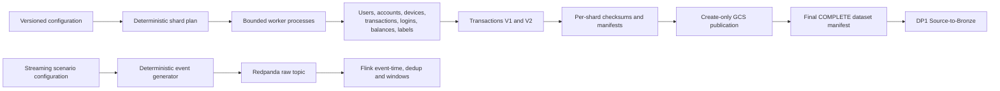
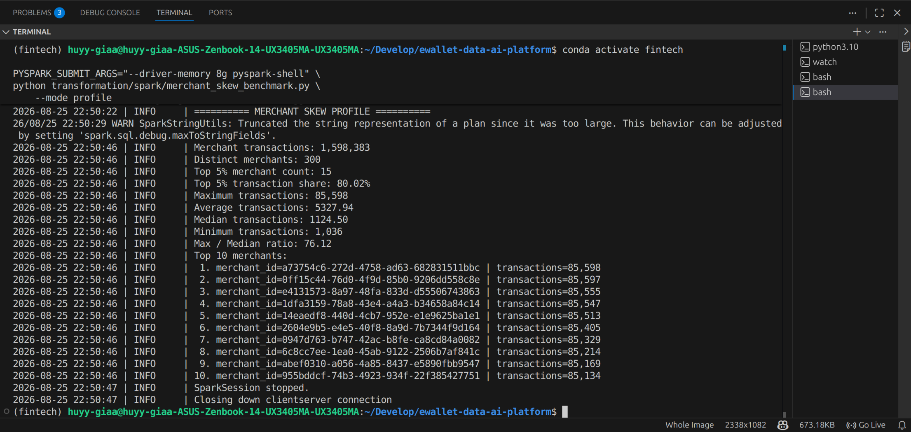
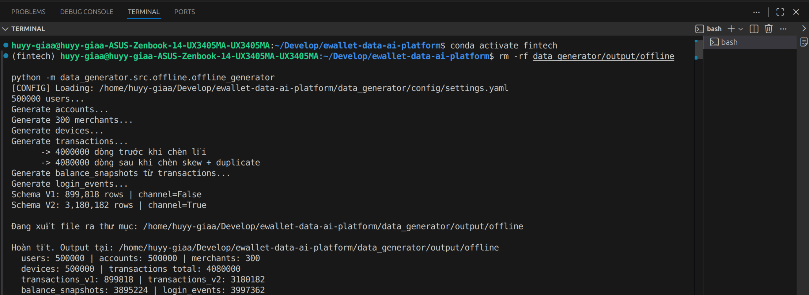
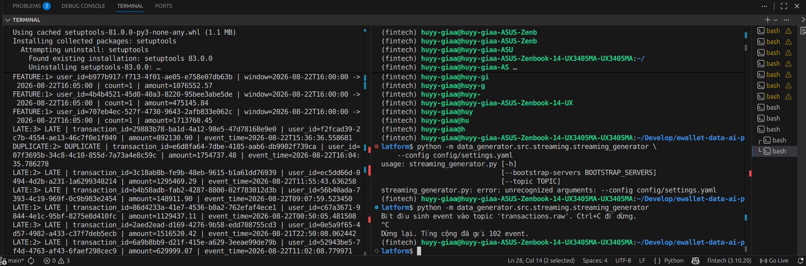
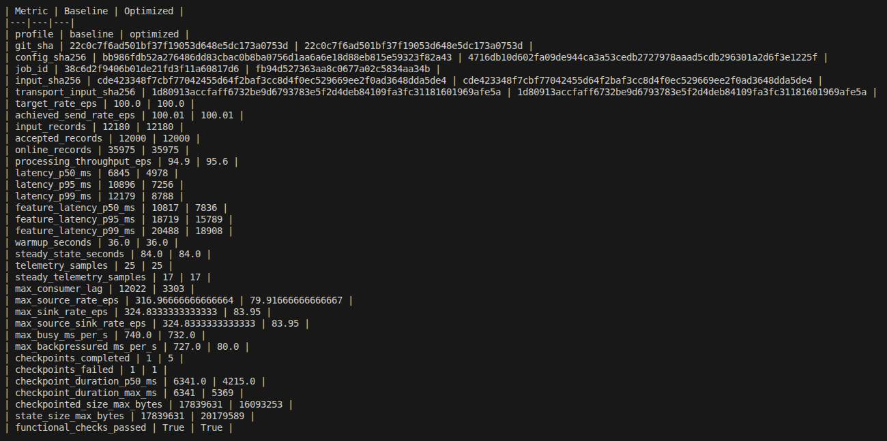

# Data Generation and Simulation

## Overview

The platform needs realistic, *reproducible* input data with the problems that real payment data has:

- skewed traffic;
- high-cardinality identifiers;
- a schema that changes over time;
- duplicate records;
- late and duplicated streaming events.

This report describes the batch and streaming generators that produce such data, and the characteristics of the generated datasets.

The project dataset is `rehearsal-5gb-v1`: an immutable, manifest-backed source
of 5,000,608,241 bytes in 186 shards, published and verified on GCS on
2026-11-10. Every DP1–DP3, storage, governance, schema and Feature Store result in
the project uses it. A smaller 4-million-transaction validation run (F4C), which
contains detailed schema and population validation and was generated in 1,034.85
seconds, is used for the local checks described below. An earlier, larger
dataset, `canonical-100gb-v1`, was generated with the same code and is
summarised briefly in [Earlier 100 GB dataset](#earlier-100-gb-dataset).

Streaming behaviour is measured through the Flink campaigns described in the [Flink report](../streaming/FLINK_STREAMING.md).

## Generator architecture



Principal implementation references:

- [offline generator](../../../data_platform/generation/src/offline/offline_generator.py)
- [streaming generator](../../../data_platform/generation/src/streaming/streaming_generator.py)
- [sharded generator](../../../data_platform/generation/src/sharded/generator.py)
- [immutable manifest publisher](../../../data_platform/generation/src/sharded/manifest.py)
- [5GB dataset profile](../../../configs/generation/cloud-rehearsal-5gb.yaml) and its [generator configuration](../../../data_platform/generation/config/settings_merchant_history.yaml)
- [source verifier](../../../ops/gcp/verify_source_dataset.py)
- [deterministic-sharding report](../novel_ideas/01_DETERMINISTIC_SHARDING.md)

The sharding report documents plan digests, stable shard seeds, create-only
publication, resumability, conflict detection, and deterministic finalization.
Those controls are referenced here rather than duplicated.

## Offline dataset schema

The logical source contains eight datasets represented by nine Parquet outputs:

| Dataset | Key fields and purpose |
| --- | --- |
| `users` | User identity, KYC status, creation time |
| `accounts` | Account ownership, type, currency, creation time |
| `merchants` | Merchant identity, name and category |
| `devices` | Device ownership, type, OS and `first_seen_at` |
| `transactions_v1` | Transaction identifiers, entities, type, amount, balances, status, business/ingestion timestamps; 14 columns |
| `transactions_v2` | V1 plus `channel`; 15 columns |
| `balance_snapshots` | Account/date closing balance derived from transaction history |
| `login_events` | Login identity, user/device, timestamp, success flag |
| `fraud_labels` | One row per logical transaction with binary label and scenario |

Relationships are generated consistently: accounts and devices belong to
users, payment rows can reference merchants, transfers can reference
counterparty accounts, and balance snapshots are derived rather than sampled
independently.

## Determinism and configuration

The 5GB plan uses:

| Parameter | Value |
| --- | ---: |
| Dataset version | `rehearsal-5gb-v1` |
| Global seed | 7001 |
| Shards | 186 |
| Users per shard | 12,500 |
| Merchants per shard | 300 |
| Logical transactions per shard | 100,000 |
| Target / tolerance | 5,000,000,000 bytes / ±10% (the verifier accepts 4.5–5.5 GB) |
| Plan digest | `422c15a169165158fcd7d432a7943d50812b5f3e55e7d0c6aec7c457371c6c83` |

Each shard derives its own seed from the frozen plan and shard ID. A bounded
local benchmark of four shards with these per-shard dimensions produced
byte-identical Parquet, manifests, checksums and final ordering with 1, 2, and 4
workers. Measured wall times were 98.791, 47.094, and 28.212 seconds
respectively; four workers achieved 3.50× speedup with 1.314 GB peak aggregate
RSS. Upload time was excluded.

## 5GB dataset characteristics

`rehearsal-5gb-v1` was generated with two workers, one shard at a time per
worker, each shard uploaded with create-only preconditions and verified before
its local staging was removed. The final manifest has SHA-256
`ac2dfb0eac16e173261b3c3f65e83a03d388528538daefd9ec669bef7123eb80`; every
downstream DagRun pins that value.

| Characteristic | Verified value |
| --- | ---: |
| Total physical bytes | **5,000,608,241** |
| Shards | 186 (about 26.9 MB each on average) |
| Logical transactions | 18,600,000 |
| Physical transaction rows | 18,972,000 |
| Added duplicate rows | 372,000 |
| Added-duplicate rate | **2.00% of logical transactions** |
| Fraud-label rows | 18,600,000 |
| Users / accounts / devices | 2,325,000 / 3,137,729 / 2,662,450 |
| Merchants / merchant-history rows | 55,800 / 334,800 |
| Balance snapshots | 18,106,858 |
| Login events | 18,586,786 |

The byte count and manifest identity come from the source manifest as recorded
by DP1. The row counts are the Bronze and Silver validation results of the 5GB
campaign `ab-20261110225456` (rules `*.non_empty`, `fraud_labels.*`), so they are
measured on the stored data rather than derived from the plan.

## Earlier 100 GB dataset

Before the project standardised on 5 GB, the same generator published
`canonical-100gb-v1` ([profile](../../../configs/generation/cloud-canonical-100gb.yaml),
source SHA `bbae48caef7f65fda0c9375a7a49afb2eca5eef4`). Its final GCS manifest was
created at `2026-10-24T06:54:00.544Z` with status `COMPLETE` and plan digest
`da043b9ad8a1121cad93fd5bca9633d036c7e2c9da3894cfd85b7d3af793046f`.

| Characteristic | Verified value |
| --- | ---: |
| Total physical bytes | 100,156,470,260 |
| Shards / Parquet objects | 3,696 / 33,264 |
| Logical / physical transactions | 369,600,000 / 376,992,000 |
| Added duplicates | 7,392,000 (2.00%) |

Reaching the size target required a bounded 35-object size remediation that
preserved the other 33,229 verified objects, so the run must not be described as
a single uninterrupted first attempt. No result in the current reports depends on
this dataset; its procedures are kept in the
[100 GB readiness runbook](../../runbooks/edai1/cloud/canonical_100gb_readiness.md).

## Skew and cardinality

The offline generator intentionally configures three skew dimensions:

- time: `skew_ratio_hour: 0.75` concentrates 75% of rows around peak hours;
- channel: `skew_ratio_channel: 0.60` plus `channel_loyal_weight: 0.9` creates
  non-uniform app/web/ATM preference;
- merchant: the top 5% of merchants are intended to receive 80% of payment
  traffic.

A historical 500k-user source profile measured **80.02%** of merchant traffic
at the top 5%, confirming that implementation for that fixture:



*Historical 500k local source evidence. It demonstrates the intended merchant
distribution but is not a full scan of `rehearsal-5gb-v1`.*

The 5GB manifest and validation reports establish the schema, volume, duplicates,
and high-cardinality transaction identity. They do not contain value-frequency
histograms for hour, channel, or merchant columns. Merchants are generated per
shard, producing 55,800 shard-local merchants rather than one global
300-merchant namespace. The skew ratios above are therefore reported as
configured values plus the measured 500k profile; the skew that the Spark
pipelines actually meet on the 5GB data is analysed in
[Batch Processing and Orchestration](../BATCH_PROCESSING_AND_ORCHESTRATION.md).

## Schema evolution

The configured cutover is `2026-03-15T00:00:00`, inside the fixed generation
window `2026-01-01` through `2026-05-31`. Records before the cutover are written
as V1 without `channel`; records from the cutover onward are written as V2 with
`channel`. Both populations are non-empty.

Each source table records the set of schema fingerprints of its files, and the
source verifier fails on an unexpected set. On the 5GB data, DP1 aligned the two
versions and the Bronze rule `transactions.channel_schema` and the Silver rules
`channel_not_null` and `valid_channel` all passed.



*Historical 500k source screenshot: V1 physically lacks `channel`, while V2
contains it. The same generator code produced `rehearsal-5gb-v1`.*

Bronze ingests V1 first and appends V2 with schema merge. Missing V1 `channel`
values become null at the unified Bronze boundary; the generator does not fake
evolution by writing a nullable V2 column into the V1 file.

## Offline duplicate simulation

`duplicate_rate_offline: 0.02` adds a second physical row with the same logical
`transaction_id`. Labels stay at logical grain. This contract is verified at
two scales:

- F4C: 4,000,000 logical transactions plus 80,000 duplicates equals 4,080,000
  physical rows;
- 5GB: 18,600,000 logical plus 372,000 duplicates equals 18,972,000 physical
  rows.

Both F4C and the 5GB campaign removed exactly the added duplicates in Silver
(80,000 and 372,000) and kept one fraud label per logical transaction.

## Storage and partition strategy

Workers write bounded Parquet shards and calculate row counts, bytes, SHA-256,
MD5, and schema fingerprints. The coordinator publishes files to the immutable
GCS dataset-version prefix with create-only preconditions, writes per-shard
manifests only after object verification, and writes the final dataset manifest
last.

The source layout is organized by dataset version and shard rather than by
high-cardinality business identifiers. DP1 consumes the final manifest and
ingests V1/V2 into one Bronze transaction table. Successful downstream DP1
consumption demonstrates that the stored source was usable, not merely present.

The publication is evidenced by the immutable manifest, by the source verifier
(manifest and plan, 186 shards, seed, generator configuration, size band and every
object's size and MD5), and by its consumption in DP1; no GCS console screenshot
of the final manifest was kept.

## Streaming late-arrival simulation

The streaming source defines:

```yaml
late_arrival_rate: 0.12
late_delay_min_max: [5, 1440]
```

Late events retain their business event time but have arrival time delayed by
5 minutes to one day. This allows Flink to distinguish on-time, accepted-late,
and too-late events using watermarks and allowed lateness.

The historical functional Block A replay used 600 unique events and recorded
528 `ON_TIME` plus 72 `TOO_LATE`, exactly 12%, with identical baseline and
optimized accepted/late digests. This result belongs to its historical Flink
source, not the current HEAD.



*Historical local terminal evidence showing actual `LATE`, `DUPLICATE`, and
five-minute `FEATURE` outputs. Its original screenshot has no visible Git SHA or
run ID, so its claim is limited to the displayed behavior.*

## Streaming duplicate and burst simulation

`duplicate_rate_stream: 0.015` re-emits the same `transaction_id` to model
producer retries. In the recovered 100 EPS campaign, each profile received
12,180 raw records: 12,000 logical events plus exactly 180 duplicate arrivals.
Flink accepted 12,000 unique records in both profiles, and
`functional_checks_passed=True`.



*Historical comparison at Flink SHA `22c0c7f`: identical input digests,
12,180 raw records, 12,000 accepted unique records, and passing bounded
functional checks for both baseline and optimized jobs.*

The generator also supports burst windows at 12:00–12:20 and 17:20–17:40. A
base rate of 50 events/minute with multiplier 30 produces approximately 1,500
events/minute. Historical terminal evidence recorded burst windows above the
configured threshold, but burst behavior is supplementary to the duplicate
results above.

## Reproducing the datasets

An offline reproduction must pin the configuration, dataset version, source SHA,
global seed, dependency environment, and output prefix. Run calibration first,
verify disk safety and plan digest, generate/resume immutable shards, finalize
only after all shards validate, and retain the final manifest plus checksums.
Never overwrite `rehearsal-5gb-v1`; changes require a new dataset version. The
exact commands are in the [EDAI-1 campaign runbook](../../runbooks/edai1/cloud/edai1_campaign_runbook.md).

Streaming reproduction must record the generator seed, rate, duration, logical
and physical record counts, event-time/arrival-time delay distribution, input
digest, topic/partition identity, Flink job ID, dedup before/after counts, and
late dispositions. Source generation and Flink processing evidence must remain
separate.

## Limitations

- The 5GB manifest does not contain merchant/hour/channel frequency
  histograms; the configured skew has not been measured by a full scan.
- The 500k merchant profile and F4C source validation are genuine but are not
  substitutes for scanning the 5GB source.
- The 5GB generation/upload wall time was not recorded in the manifest; the
  local parallel timings are bounded measurements only.
- Late and duplicate runtime proof belongs to historical Flink versions.
- No final GCS Console or generator dashboard screenshot was recovered.
- Synthetic fraud and traffic distributions are controlled test data, not
  statistically representative banking behavior.
