# DataHub Data Governance — DP1, DP2, DP3

This is the governance report for EDAI-1 rubric rows 28–33. It covers the 5GB batch campaign that DataHub now describes:

| Identity | Value |
|---|---|
| Benchmark | `ab-20261110225456` |
| Dataset version | `rehearsal-5gb-v1` |
| Spark profile | `optimized` |
| Pipeline Git SHA | `aae22b08eee20fa055c4aefc8d23c14cc3ae5f8c` |
| Source manifest SHA-256 | `ac2dfb0eac16e173261b3c3f65e83a03d388528538daefd9ec669bef7123eb80` |
| Campaign manifest SHA-256 | `820994eff2bf80a1cf68513987baa0d597b267c58921f4360d77a9ddcde6197c` |

The campaign itself, which ran as three Airflow DAGs submitting Spark batches, is described in [Batch Processing and Orchestration](../BATCH_PROCESSING_AND_ORCHESTRATION.md). All figures below come from the campaign's committed evidence and from the DataHub publication outputs in [`docs/evidence/edai1/datahub/rehearsal-5gb/`](../../evidence/edai1/datahub/rehearsal-5gb/MANIFEST.md).

## Summary

| Area | Result |
|---|---|
| Metadata | 44 datasets (10 Source, 9 Bronze, 9 Silver, 12 Gold, 4 historical feature tables), each with its observed physical schema |
| Pipelines | 3 DataFlows (one per Airflow DAG) and 8 DataJobs (the transformation and validation task of each stage) |
| Lineage | 34 `upstreamLineage` aspects, one per non-Source dataset, holding 45 upstream links taken from the Spark builder code |
| Publication | 141 metadata records published and read back, 0 mismatches |
| Data quality | 263 assertion outcomes from 260 executed Spark rules, 263 PASS; 263 definitions and 263 run events published, 0 skipped, 263 readback-verified |
| Evidence | 19 screenshots of DataHub for checkpoints DG01–DG08, plus the 5 publication outputs, with SHA-256 checksums |

| Row | Requirement | Evidence | Status |
|---:|---|---|---|
| 28 | DP1 lineage | §3.1, DG01 | DATAHUB_READBACK_VERIFIED, OWNER_SCREENSHOT_CAPTURED |
| 29 | DP1 validation | §4, DG02 | DATAHUB_READBACK_VERIFIED, OWNER_SCREENSHOT_CAPTURED |
| 30 | DP2 lineage | §3.1, DG03, DG04 | DATAHUB_READBACK_VERIFIED, OWNER_SCREENSHOT_CAPTURED |
| 31 | DP2 validation | §4, DG05, DG06 | DATAHUB_READBACK_VERIFIED, OWNER_SCREENSHOT_CAPTURED |
| 32 | DP3 lineage | §3.1, DG07 | DATAHUB_READBACK_VERIFIED, OWNER_SCREENSHOT_CAPTURED |
| 33 | DP3 validation | §4, DG08 | DATAHUB_READBACK_VERIFIED, OWNER_SCREENSHOT_CAPTURED |

## 1. Objectives and architecture

### 1.1 Objectives

The rubric asks three questions of each pipeline:
1. Are its tables visible in DataHub?
2. Is it clear which Airflow pipeline produces each table?
3. Is the data validation of those tables visible in DataHub?

We added a fourth requirement of our own. Everything DataHub shows must be traceable to a run that actually happened. That means:
- no lineage inferred from table names;
- no assertion without an executed result;
- no metadata from another dataset size or another run.

### 1.2 How the platform fits together

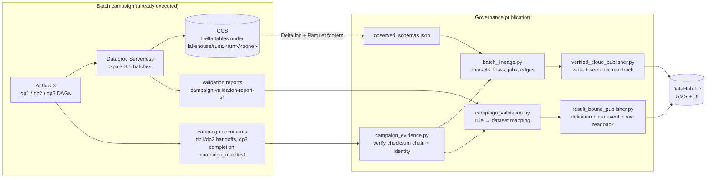

**The campaign side** was already in place.
- Airflow ran three DAGs: `dp1_source_to_bronze`, `dp2_bronze_to_curated` and `dp3_historical_features`.
- Each stage is one Spark transformation batch and one Spark validation batch on Dataproc Serverless.
- Each transformation writes Delta tables to a run-scoped GCS root, for example `gs://…-rehearsal-5gb-data/lakehouse/runs/ab-20261110225456-optimized-gold-r261110225458/gold/`.
- Each validation batch writes a JSON report.
- The DAGs record what ran in four write-once campaign documents. Each document pins the SHA-256 of the previous ones.

**The governance side** is what this report adds.
- It reads only those committed documents, the reports and an observed-schema export.
- From them it builds the DataHub metadata, and it publishes nothing it cannot trace back to them.
- Lineage is therefore published after the run, from the campaign record, rather than emitted live by the Airflow tasks (§8).

## 2. Metadata management

### 2.1 Datasets and URNs

Every physical dataset is one DataHub dataset on the `gcs` platform. Its URN is built from its exact GCS location:

```text
urn:li:dataset:(urn:li:dataPlatform:gcs,gs://ewallet-data-ai-platform-hg26-rehearsal-5gb-data/lakehouse/runs/ab-20261110225456-optimized-gold-r261110225458/gold/dim_merchant_scd2,PROD)
```

Because the URN contains the run id, two runs or two dataset sizes can never share an entity. The run roots come from the verified campaign manifest, not from the command line. The display name follows the naming convention of each zone:

| Zone | Count | Location | Display name |
|---|---:|---|---|
| Source | 10 | `…/source/rehearsal-5gb-v1/<physical table>` (Parquet) | `source_zone.<table>` |
| Bronze | 9 | `…/lakehouse/runs/…-optimized-bronze-r261110225456/bronze/<table>` (Delta) | `bronze_zone.<table>` |
| Silver | 9 | `…/lakehouse/runs/…-optimized-silver-r261110225457/silver/<table>` | `silver_zone.<table>` |
| Gold | 12 | `…/lakehouse/runs/…-optimized-gold-r261110225458/gold/<table>` | `gold_zone.<table>` |
| Historical features | 4 | `…/lakehouse/runs/…-optimized-feat-r261110225459/gold/feat_*_behavior` | `gold_zone.feat_*_behavior` |

The Source zone has 10 physical datasets for 9 logical tables. Transactions arrive as two schema versions, `transactions_v1` and `transactions_v2`. The expected tables of every zone come from [`schema_inventory.py`](../../../data_platform/contracts/schema_inventory.py). If a zone is missing a table, the plan fails instead of publishing a partial zone.

### 2.2 Dataset properties and observed schemas

Each dataset carries a `datasetProperties` aspect with:
- a description naming the DAG, task and DagRun that wrote it;
- custom properties for zone, table, GCS URI, producer DAG and task, DagRun and run id;
- the campaign identity (benchmark, profile, dataset version, Git SHA, source and campaign manifest SHA-256).

It also carries a `schemaMetadata` aspect with its physical columns. These come from [`observed_schemas.json`](../../../data_platform/schema/generated/observed_schemas.json), which was exported from the Delta transaction logs and Parquet footers of this same campaign profile. Across the 44 datasets that is 323 fields. The 7 tables partitioned by date are marked `isPartitioningKey`.

The exporter records its provenance: benchmark, profile, dataset version and both manifest checksums. The lineage plan refuses any export whose provenance differs from the campaign being published, so a schema from another run cannot be attached by mistake.

### 2.3 DataFlows and DataJobs

| DataFlow (Airflow DAG) | DataJob (Airflow task) | Inputs | Outputs | Run identity |
|---|---|---:|---:|---|
| `dp1_source_to_bronze` | `bronze.submit_transformation` | 10 Source | 9 Bronze | DagRun `…-optimized-dp1`, batch `…-bronze-r261110225456` |
| | `bronze.semantic_validation` | 9 Bronze | — | batch `v1-…-optimized-bronze-r261110225456` |
| `dp2_bronze_to_curated` | `silver.submit_transformation` | 9 Bronze | 9 Silver | DagRun `…-optimized-dp2`, batch `…-silver-r261110225457` |
| | `silver.semantic_validation` | 9 Silver | — | batch `v1-…-optimized-silver-r261110225457` |
| | `gold.submit_transformation` | 8 Silver | 12 Gold | batch `…-gold-r261110225458` |
| | `gold.semantic_validation` | 12 Gold + `silver.merchant_history` | — | batch `v1-…-optimized-gold-r261110225458` |
| `dp3_historical_features` | `features.submit_transformation` | `silver.transactions`, `silver.devices` | 4 features | DagRun `…-optimized-dp3`, batch `…-feat-r261110225459` |
| | `features.semantic_validation` | 4 features | — | batch `v1-…-optimized-feat-r261110225459` |

URNs are `urn:li:dataFlow:(airflow,<dag_id>,ewallet-gcp)` and `urn:li:dataJob:(<flow urn>,<task_id>)`.

Each DataJob carries custom properties:
- the DagRun id;
- the Dataproc batch id;
- the Spark application id;
- for transformations, the job start and end times;
- for validations, the validation status and the GCS URI of its report.

A transformation job's inputs are the union of its outputs' upstreams. A validation job's inputs are exactly the datasets its rules check. No job uses an "every input to every output" shortcut.

### 2.4 Coverage

| Aspect | Records |
|---|---:|
| `datasetProperties` | 44 |
| `schemaMetadata` | 44 |
| `dataFlowInfo` | 3 |
| `dataJobInfo` | 8 |
| `dataJobInputOutput` | 8 |
| `upstreamLineage` | 34 |
| **Total** | **141** |

## 3. Data lineage

### 3.1 Source → Bronze → Silver → Gold → historical features

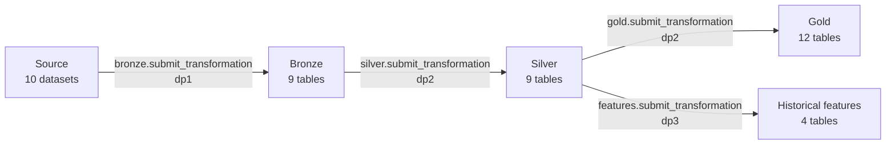

Each edge is read from the builder function that produces the table. The dependency table [`TABLE_DEPENDENCIES`](../../../data_platform/metadata/datahub/lineage/batch_lineage.py) cites the Spark pipeline it follows. Nothing is inferred from column names.

**DP1, Source → Bronze (9 aspects, 10 links).**
- Bronze is table-preserving: each Bronze table has its own Source table.
- The exception is `bronze_zone.transactions`, which has two upstreams: `transactions_v1` and `transactions_v2`.

**DP2, Bronze → Silver (9 aspects, 9 links).** Silver is also table-preserving: [`silver_pipeline.py`](../../../data_platform/processing/spark/silver/silver_pipeline.py) runs one cleaner per table.

**DP2, Silver → Gold (12 aspects, 21 links).** `gold.submit_transformation` reads 8 Silver tables; it does not read `fraud_labels`. The relationships worth noting:
- **SCD2 dimension.** `dim_merchant_scd2` is built only from `silver.merchant_history` (`build_dim_merchant_scd2(merchant_history_df)`), not from the current-state `merchants` table.
- **Date dimension.** `dim_date` is built from the three event tables: `transactions`, `login_events` and `balance_snapshots`.
- **Other dimensions and facts.** Each of these is built from its own Silver table: `dim_user`, `dim_account`, `dim_merchant`, `dim_device`, `fact_transactions`, `fact_login_events` and `fact_balance_snapshot`.
- **Derived tables.** `obt_transaction_enriched` joins `fact_transactions` with five dimensions. `feat_user_90d` and `opt_merchant_performance` aggregate `fact_transactions` with `dim_user` or `dim_merchant`.

**DP3, Silver → historical features (4 aspects, 5 links).**
- The point-in-time feature tables read Silver directly, never Gold.
- `feat_device_behavior` reads `silver.transactions` and `silver.devices`.
- The other three feature tables read `silver.transactions` only.

In total there are 34 lineage aspects, one per non-Source dataset, holding 45 upstream links.

### 3.2 What the lineage proves

- **Producer.** Every non-Source dataset's description and properties name the DAG, task and DagRun that wrote it. DataHub's lineage graph connects it to that task.
- **Exact inputs.** The SCD2 dimension shows exactly one upstream dataset (DG04), and DP3 shows two Silver inputs (DG07). These are the actual reads, not a zone-level approximation.
- **Same run end to end.** Every node in a lineage path belongs to the same benchmark and profile, because the run id is part of every URN.

## 4. Data quality

### 4.1 From Spark validation to DataHub assertions

1. **Execution in Spark.** After each transformation, Airflow submitted a separate Dataproc validation batch. The validators are [`validate_bronze.py`](../../../data_platform/quality/validate_bronze.py), [`validate_silver.py`](../../../data_platform/quality/validate_silver.py), [`validate_gold.py`](../../../data_platform/quality/validate_gold.py) and [`scd2_quality.py`](../../../data_platform/quality/scd2_quality.py).
   - Each validator checks the tables just written: row counts, required columns and types, keys and uniqueness, domains, foreign keys, SCD2 intervals and point-in-time recomputation.
   - Each writes a `campaign-validation-report-v1` report to the run's GCS root.
   - Byte copies of the reports are committed in [`validation_reports/`](../../evidence/edai1/spark/rehearsal-5gb-ab-20261110225456/validation_reports/).
2. **Report verification.** [`campaign_validation.py`](../../../data_platform/metadata/datahub/assertions/campaign_validation.py) accepts a report only if all of the following equal the verified campaign stage:
   - its schema, dataset version, run id, scope and status;
   - every run root it names.
   - Its `passed_rules` and `failed_rules` must also agree with its result list.
   - A missing report is an error, not a skip.
3. **Rule mapping.** Each executed rule becomes one outcome on the dataset it checks.
   - `<table>.<check>` maps to that table.
   - In the core-gold scope, `merchant_history.*` maps to the **Silver** `merchant_history` of this campaign: the Gold validator re-checks the SCD2 input.
   - `…_count_equals_<t>_count` and `…_population_equals_<t>` map to the Gold or feature table `<t>`.
   - The cross-table rule `dp3_features.created_shared_by_run` becomes one outcome on each of the four DP3 tables.
   - An unknown rule name raises an error rather than being guessed.
   - Where a rule is also declared in a data contract under [`data_platform/contracts/`](../../../data_platform/contracts/), the assertion description quotes the contract.
4. **Publication.** [`result_bound_publisher.py`](../../../data_platform/metadata/datahub/assertions/result_bound_publisher.py) writes one custom assertion definition per outcome. For an executed rule it also writes one `assertionRunEvent` with:
   - `SUCCESS` or `FAILURE`;
   - the observed value copied unchanged from the report;
   - the report's own `generated_at` as the event time.
   - An outcome without an executed boolean result would be published as a definition only. In this campaign there were none.

Each run event carries its provenance in `nativeResults`:
- the validated run id;
- the validation batch id;
- the Git SHA;
- the report's GCS URI;
- the SHA-256 of the committed report copy.

The assertion URN is `urn:li:assertion:edai1.ab-20261110225456.optimized.<scope>.<rule>`. The run id is `<dag_id>:<validated run id>:<rule>`.

### 4.2 Why 260 rules give 263 outcomes

The validators executed 260 rules: 54 Bronze, 60 Silver, 93 Gold and 53 features. One of the feature rules, `dp3_features.created_shared_by_run`, checks a property shared by all four DP3 tables: one materialization time per run. It is therefore attached to each of the four tables, so 53 rules give 56 outcomes, and 260 rules give 263 outcomes. The other 259 rules map one to one.

### 4.3 Outcomes per dataset

| Pipeline | Scope | Rules | Outcomes | Datasets checked | Result |
|---|---|---:|---:|---|---|
| DP1 | bronze | 54 | 54 | 9 Bronze | 54 PASS |
| DP2 | silver | 60 | 60 | 9 Silver | 60 PASS |
| DP2 | core-gold | 93 | 93 | 12 Gold (86), Silver `merchant_history` (7) | 93 PASS |
| DP3 | features | 53 | 56 | 4 feature tables (14 each) | 56 PASS |
| **Total** | | **260** | **263** | **34 datasets** | **263 PASS** |

## 5. Execution provenance

Every published entity can be traced back to the campaign at four levels:

| Level | Field | Value for this campaign |
|---|---|---|
| Campaign | `benchmark_id`, `spark_profile`, `dataset_version` | `ab-20261110225456`, `optimized`, `rehearsal-5gb-v1` |
| Code | `git_sha` | `aae22b08eee20fa055c4aefc8d23c14cc3ae5f8c` |
| Input data | `source_manifest_sha256` | `ac2dfb0e…7123eb80`, the Source manifest of `rehearsal-5gb-v1` |
| Campaign record | `campaign_manifest_sha256` | `820994ef…dcde6197c` |
| Orchestration | `dag_run_id` | `ab-20261110225456-optimized-dp1`, `-dp2`, `-dp3` |
| Execution | `run_id`, `dataproc_batch_id`, `spark_application_id` | per stage, for example `ab-20261110225456-optimized-gold-r261110225458` / `app-20261111080642050-0186` |
| Validation | `source_batch_id`, `source_artifact`, `source_artifact_sha256` | per assertion run, for example batch `v1-20261110225456-optimized-gold-r261110225458` and report `…/evidence/validation-core-gold-a1.json` |

Before anything is built, [`campaign_evidence.py`](../../../data_platform/metadata/datahub/campaign_evidence.py) verifies the campaign documents:
- **Checksum chain.** `dp3_completion.json` pins the campaign manifest, and the manifest pins both handoffs. A copy edited after download is refused.
- **Identity.** Dataset version, bucket, benchmark, profile, Git SHA and source manifest SHA-256 must agree across all four documents.
- **Stages.** Every stage must be a SUCCEEDED Dataproc batch that wrote exactly one run root inside this dataset's bucket.

This is also what keeps historical results out: the 100GB campaign has a different dataset version, bucket and manifest, so its documents cannot pass the check for `rehearsal-5gb-v1`.

## 6. Implementation

| Module | Responsibility |
|---|---|
| [`campaign_evidence.py`](../../../data_platform/metadata/datahub/campaign_evidence.py) | Loads and verifies one profile's campaign documents. Pipeline names, DAG ids and validation scopes come from `ops/gcp/campaign_task.py`, the module that ran the campaign |
| [`urns.py`](../../../data_platform/metadata/datahub/urns.py) | URN conventions for datasets, DataFlows and DataJobs, shared with the Feast materialization publisher |
| [`schema_inventory.py`](../../../data_platform/contracts/schema_inventory.py) | Expected tables of every zone for a dataset version |
| [`lineage/batch_lineage.py`](../../../data_platform/metadata/datahub/lineage/batch_lineage.py) | Builds the plan: datasets with schemas, flows, jobs and the builder dependency table. CLI: dry run by default, `--publish` to write |
| [`lineage/verified_cloud_publisher.py`](../../../data_platform/metadata/datahub/lineage/verified_cloud_publisher.py) | Turns the plan into aspects, refusing undeclared datasets. Writes each aspect through the DataHub SDK and reads it back, stopping at the first difference |
| [`assertions/campaign_validation.py`](../../../data_platform/metadata/datahub/assertions/campaign_validation.py) | Verifies the reports and maps rules to datasets. Writes the deterministic `datahub-quality-validation-v1` artifact |
| [`assertions/validation_artifact.py`](../../../data_platform/metadata/datahub/assertions/validation_artifact.py) | The outcome model; executed and non-executed states are kept apart |
| [`assertions/result_bound_publisher.py`](../../../data_platform/metadata/datahub/assertions/result_bound_publisher.py) | Publishes definitions and run events. Reads each back through the typed SDK and the raw timeseries API |

**Design properties:**
- **Read-only towards the campaign.** Publication never reads data files and never writes to GCS, Airflow or Dataproc.
- **Opt-in writes.** Both CLIs default to a dry run that writes the exact records to a file. Publishing needs `--publish --gms-url …`. A token, when used, comes from `DATAHUB_GMS_TOKEN`.
- **Idempotent.** URNs, run ids and event times are derived from the campaign. Publishing again rewrites the same values instead of adding new entities or run events.
- **Verified writes.** Every aspect, definition and run event is read back and compared field by field before it counts as published.
- **One profile per DataFlow.** DataFlow and DataJob URNs are per DAG and task, so only one profile is published to avoid overwriting their inputs and outputs. We publish `optimized`. Its outputs are semantically equivalent to `baseline` across all 34 tables ([`comparison.json`](../../evidence/edai1/spark/rehearsal-5gb-ab-20261110225456/comparison.json)).

**Tests.** These tests run offline against in-memory adapters:
- [`test_batch_governance.py`](../../../tests/unit/test_batch_governance.py) covers the plan counts, the builder edges, tampered or foreign campaign documents, foreign schema snapshots and the rule mapping.
- [`test_datahub_result_assertions.py`](../../../tests/unit/test_datahub_result_assertions.py) covers the result semantics, idempotency and readback failures.

## 7. Experimental results

### 7.1 Metadata and lineage publication

| Measure | Expected | Published | Readback |
|---|---:|---:|---|
| Datasets | 44 | 44 | MATCH |
| DataFlows | 3 | 3 | MATCH |
| DataJobs | 8 | 8 | MATCH |
| Lineage aspects (45 upstream links) | 34 | 34 | MATCH |
| Metadata records | 141 | 141 | 141 MATCH, 0 mismatches |

Source: [`04_lineage_publish.json`](../../evidence/edai1/datahub/rehearsal-5gb/raw/04_lineage_publish.json), mode `PUBLISH_WITH_READBACK`. The dry run [`03_lineage_dry_run.json`](../../evidence/edai1/datahub/rehearsal-5gb/raw/03_lineage_dry_run.json) holds the 141 records with `schema_source` `observed`.

### 7.2 Data quality publication

| Pipeline | Stage | Outcomes | PASS | Definitions | Run events |
|---|---|---:|---:|---:|---:|
| DP1 | Bronze | 54 | 54 | 54 | 54 |
| DP2 | Silver | 60 | 60 | 60 | 60 |
| DP2 | Gold | 93 | 93 | 93 | 93 |
| DP3 | Features | 56 | 56 | 56 | 56 |
| **Total** | | **263** | **263** | **263** | **263** |

- **Publication counts.** The publisher reported 263 definitions, 263 run events (all `SUCCESS`), 0 skipped and 263 verification records with raw API readback.
- **Publication time.** It ran from 2026-11-13 06:49:00Z to 07:02:08Z. The run events themselves are dated at the validation time on 2026-11-11, which is why the DataHub UI shows "Nov 11".
- **Sources:**
  - artifact: [`05_validation_artifact.json`](../../evidence/edai1/datahub/rehearsal-5gb/raw/05_validation_artifact.json);
  - dry run: [`06_assertions_dry_run.json`](../../evidence/edai1/datahub/rehearsal-5gb/raw/06_assertions_dry_run.json);
  - publication: [`07_assertions_publish.json`](../../evidence/edai1/datahub/rehearsal-5gb/raw/07_assertions_publish.json).

### 7.3 Pipeline context

| Measure | Result | Source |
|---|---|---|
| DagRuns | 6/6 success, 54/54 task instances on try 1 (both profiles) | [`airflow_dagruns.json`](../../evidence/edai1/spark/rehearsal-5gb-ab-20261110225456/airflow_dagruns.json) |
| Validation rules | 260/260 PASS per profile | [`validation_reports/`](../../evidence/edai1/spark/rehearsal-5gb-ab-20261110225456/validation_reports/) |
| Profile equivalence | `SEMANTIC_EQUIVALENT` across 34 tables | [`comparison.json`](../../evidence/edai1/spark/rehearsal-5gb-ab-20261110225456/comparison.json) |

## 8. Evidence DG01–DG08

The owner captured all screenshots from the local DataHub UI on 2026-11-13, after both publications. They are byte copies of the originals, listed with their SHA-256 in the [evidence manifest](../../evidence/edai1/datahub/rehearsal-5gb/MANIFEST.md).

The lineage graphs of the three DataFlows also show tasks named `submit_*_dataproc`. These are DataJobs left from earlier publications of the same DAGs. They carry no 5GB campaign properties and are not part of the 8 DataJobs above (§9).

### 8.1 DP1 — Source → Bronze (rows 28–29)

**DG01 — DP1 lineage.**

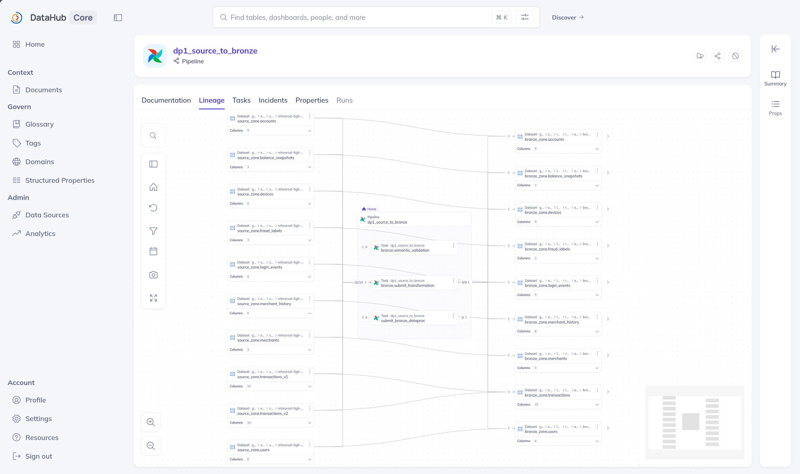

*The `dp1_source_to_bronze` DataFlow. Task `bronze.submit_transformation` reads the 10 Source datasets of `rehearsal-5gb-v1` (10/10), including `transactions_v1` and `transactions_v2`, and writes the 9 Bronze Delta tables (9/9). `bronze.semantic_validation` checks the same 9 tables.*

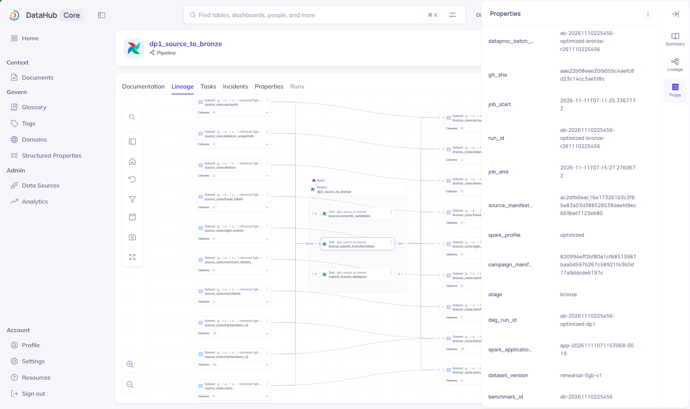

*Properties of `bronze.submit_transformation`:*
- *DagRun `ab-20261110225456-optimized-dp1`;*
- *run and Dataproc batch `ab-20261110225456-optimized-bronze-r261110225456`;*
- *Spark application `app-20261111071153068-0019`;*
- *job window 07:11:25–07:15:27Z;*
- *Git SHA, source and campaign manifest SHA-256, profile `optimized`.*

**DG02 — DP1 validation on `bronze_zone.transactions`.**

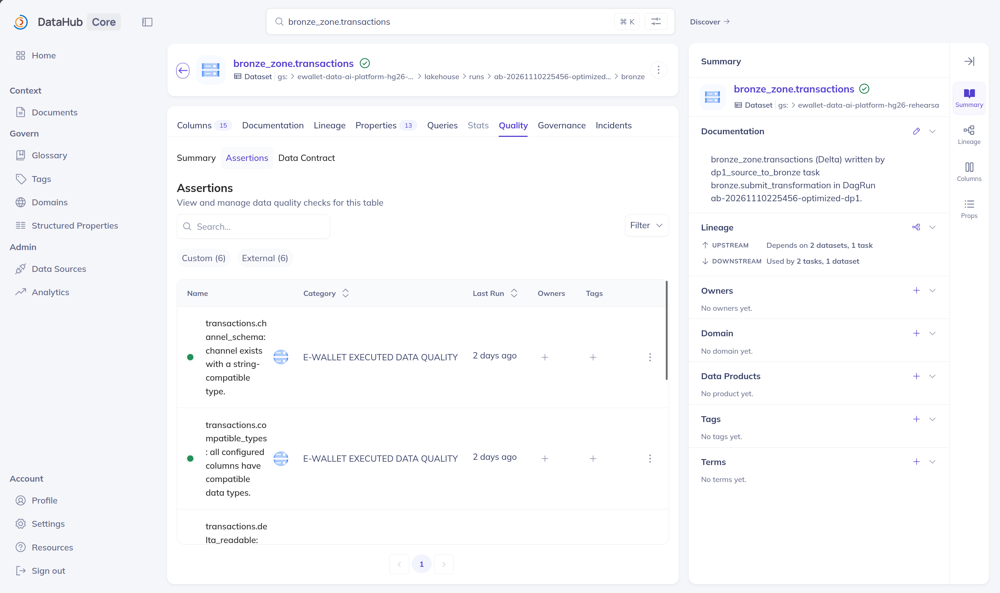
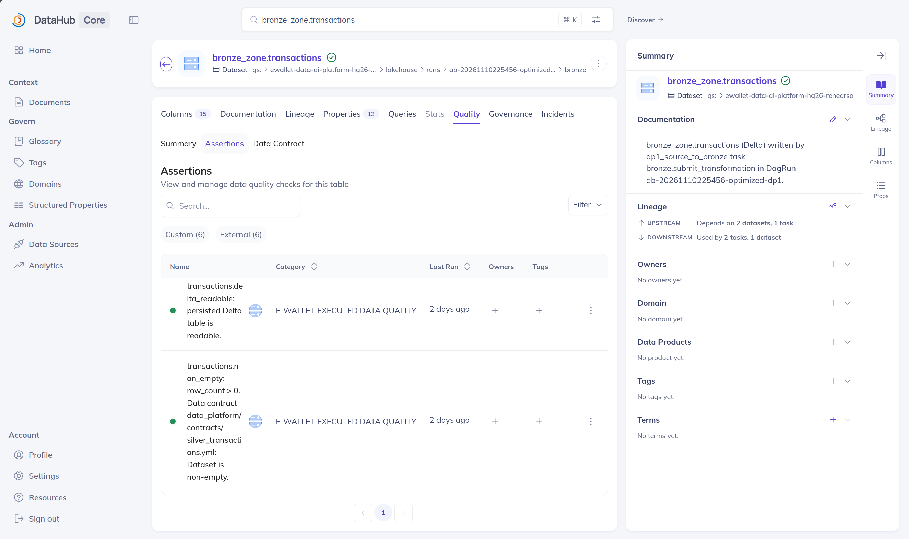
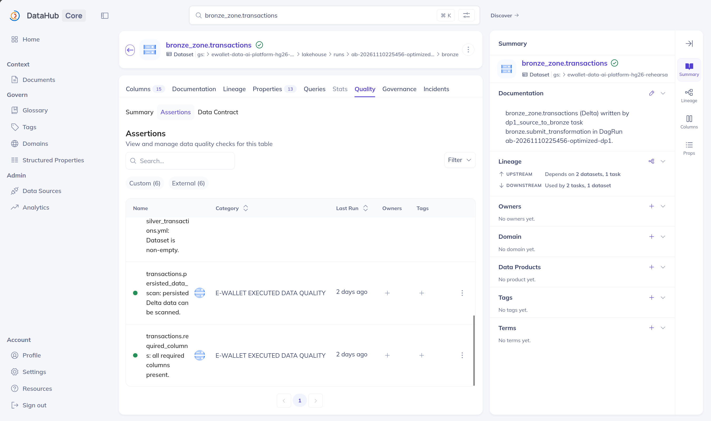

*The Quality tab of `bronze_zone.transactions` in run `…-optimized-bronze-r261110225456` shows 6 assertions, all passing: `channel_schema`, `compatible_types`, `delta_readable`, `non_empty`, `persisted_data_scan` and `required_columns`. The summary attributes the table to task `bronze.submit_transformation` in DagRun `…-optimized-dp1`.*

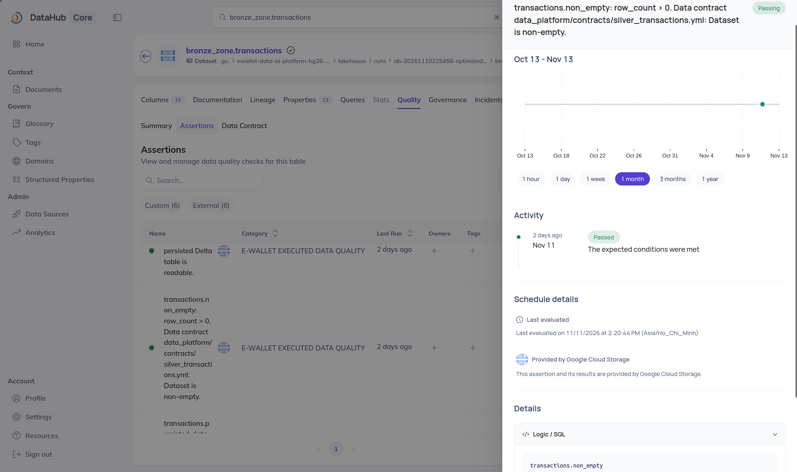

*Run detail of `transactions.non_empty`: Passed, last evaluated 2026-11-11 14:20:44 (+07:00). That is the `generated_at` time of the Bronze validation report (07:20:44Z), so the result shown is the executed one.*

### 8.2 DP2 — Bronze → Silver → Gold (rows 30–31)

**DG03 — Bronze → Silver lineage.**

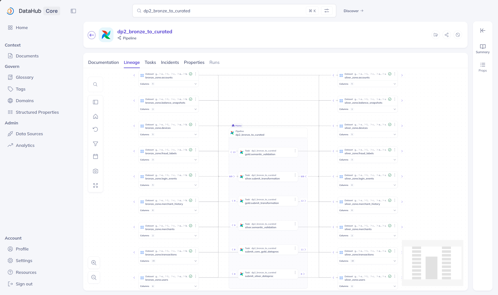

*The `dp2_bronze_to_curated` DataFlow. `silver.submit_transformation` reads the 9 Bronze tables (9/9) and writes the 9 Silver tables (9/9), one cleaner per table.*

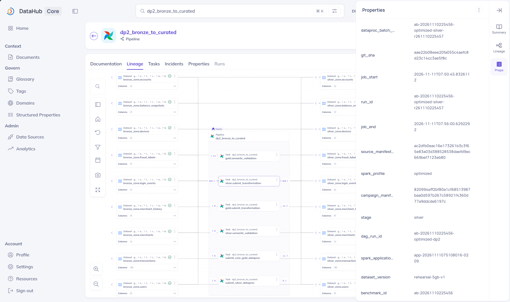

*Properties of `silver.submit_transformation`: DagRun `ab-20261110225456-optimized-dp2`, run `…-optimized-silver-r261110225457`, Spark application `app-20261111075108016-0209`, job window 07:50:45–07:56:00Z.*

**DG04 — Silver → Gold lineage, including the SCD2 dimension.**

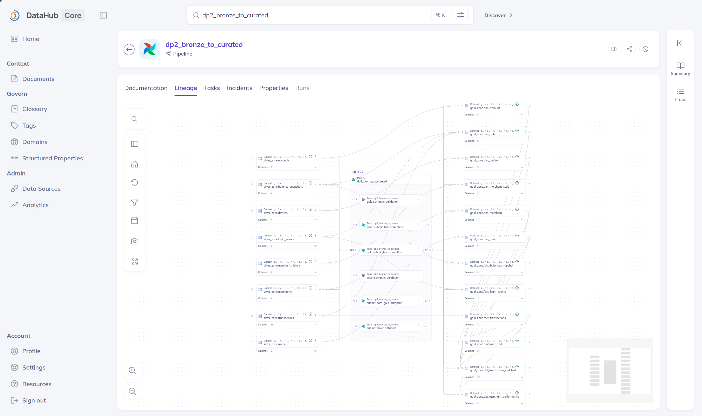

*`gold.submit_transformation` reads 8 Silver tables (8/8; `fraud_labels` is not a Gold input) and writes the 12 core Gold tables (12/12): dimensions, facts, `dim_merchant_scd2`, the OBT and two aggregates.*

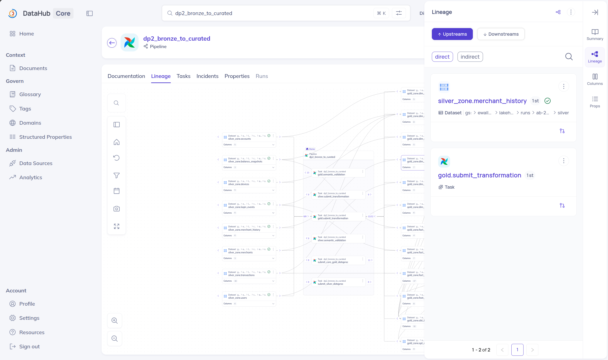

*Direct upstreams of `gold_zone.dim_merchant_scd2`: only `silver_zone.merchant_history` (Silver run `…-optimized-silver-r261110225457`) and the task `gold.submit_transformation` (2 of 2). The SCD2 dimension is built from the merchant change history, not from current-state merchants.*

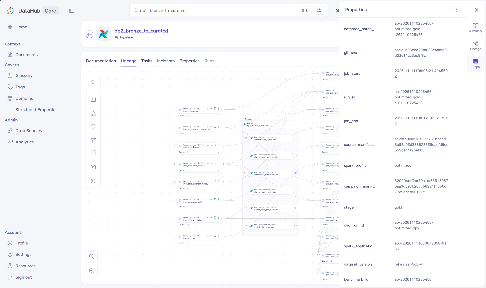

*Properties of `gold.submit_transformation`: DagRun `…-optimized-dp2`, run `…-optimized-gold-r261110225458`, Spark application `app-20261111080642050-0186`, job window 08:06:21–08:12:18Z.*

**DG05 — Silver validation on `silver_zone.transactions`.**

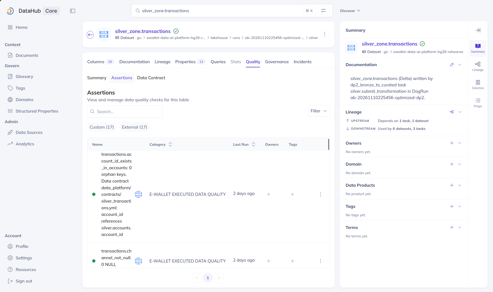

*The Quality tab of `silver_zone.transactions` shows 17 assertions, all passing. They cover keys, domains, conditional requirements and 5 foreign keys to the Silver master tables.*

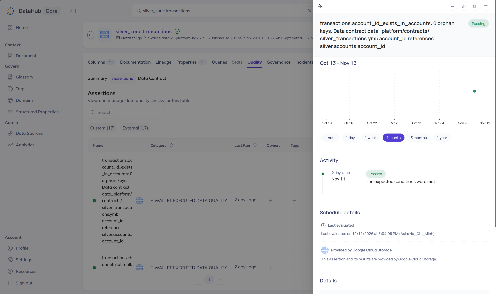

*Run detail of `transactions.account_id_exists_in_accounts`: 0 orphan keys, quoting the data contract `silver_transactions.yml`, Passed. Last evaluated 2026-11-11 15:04:08 (+07:00), the Silver report time (08:04:08Z).*

**DG06 — Gold validation on `gold_zone.dim_merchant_scd2`.**

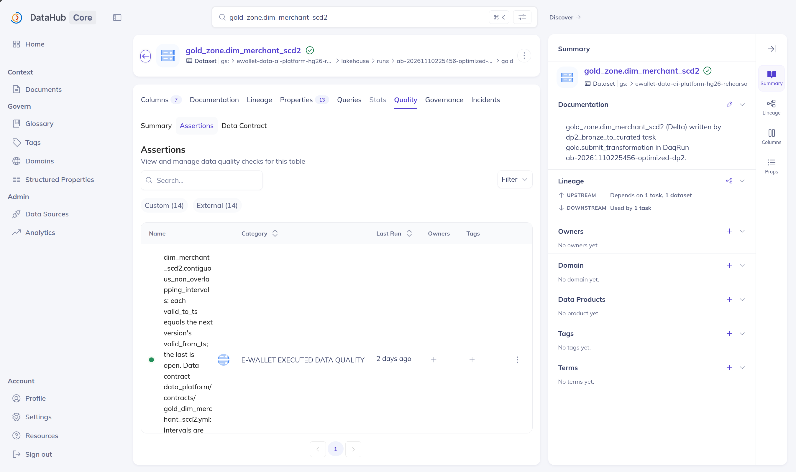

*The Quality tab of `gold_zone.dim_merchant_scd2` shows 14 assertions, all passing. They are the SCD2 rules of the core-gold validation batch `v1-20261110225456-optimized-gold-r261110225458`.*

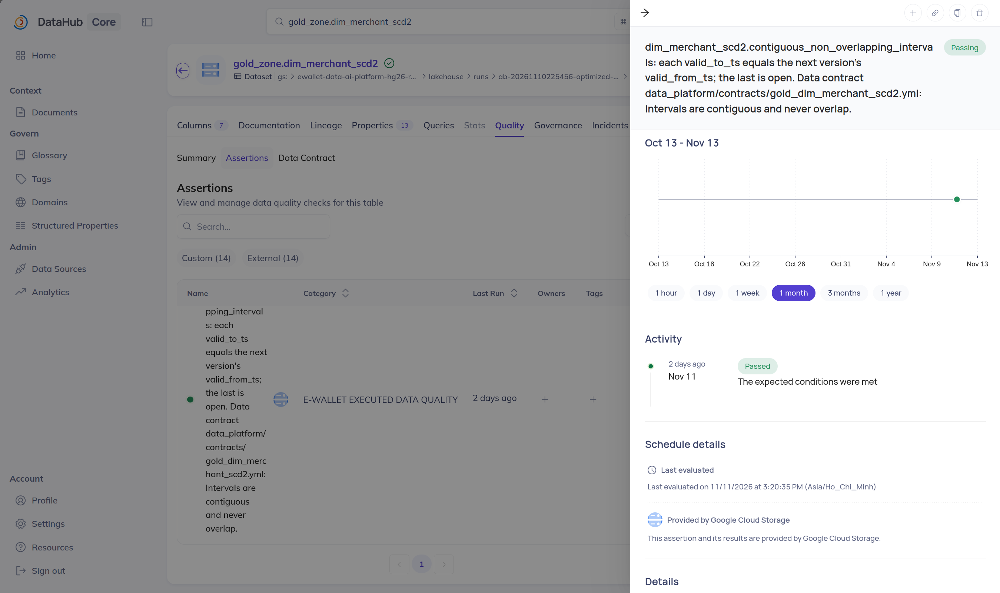

*`dim_merchant_scd2.contiguous_non_overlapping_intervals`: each `valid_to_ts` equals the next version's `valid_from_ts` and the last interval is open (contract `gold_dim_merchant_scd2.yml`). Passed with observed value 0 violations; last evaluated 2026-11-11 15:20:35 (+07:00), the core-gold report time.*

### 8.3 DP3 — historical features (rows 32–33)

**DG07 — DP3 lineage.**

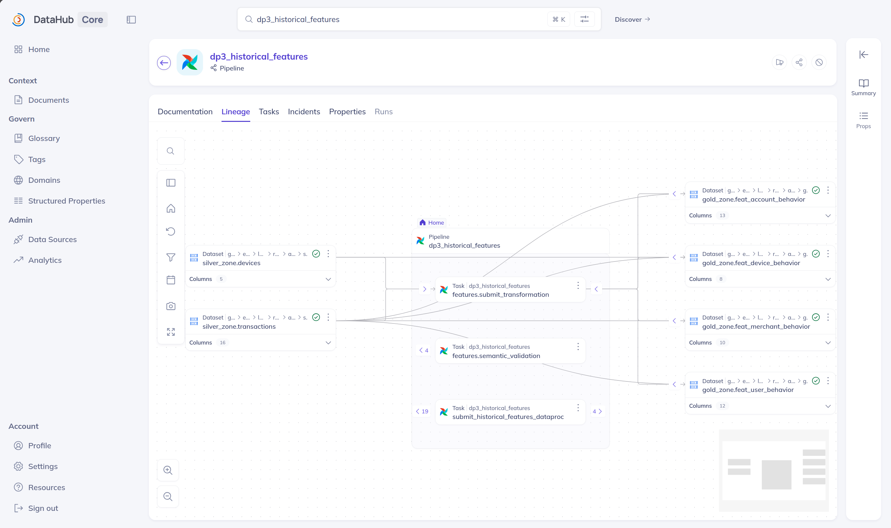

*The `dp3_historical_features` DataFlow. `features.submit_transformation` reads only `silver_zone.transactions` and `silver_zone.devices` and writes the four point-in-time tables `feat_user_behavior`, `feat_account_behavior`, `feat_device_behavior` and `feat_merchant_behavior`. `features.semantic_validation` checks the 4 tables.*

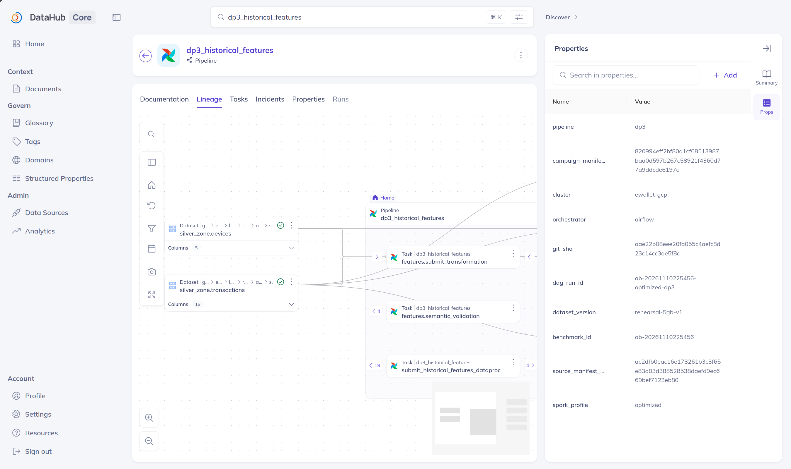

*DataFlow properties: pipeline `dp3`, DagRun `ab-20261110225456-optimized-dp3`, benchmark, dataset version, profile `optimized`, Git SHA, and both manifest checksums.*

**DG08 — DP3 validation.**

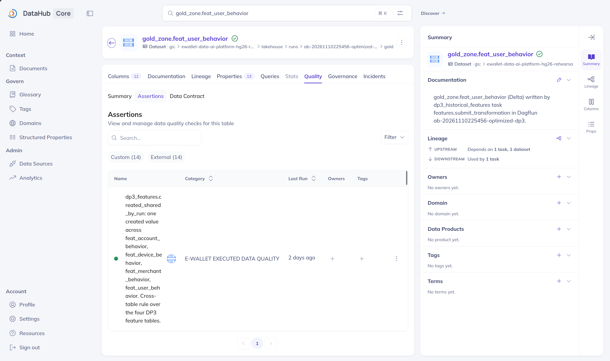

*The Quality tab of `gold_zone.feat_user_behavior` shows 14 assertions, all passing. Among them is the cross-table rule `dp3_features.created_shared_by_run`, which also appears on the three other feature tables. Together the four tables hold the 56 DP3 outcomes, all PASS (§4.3).*

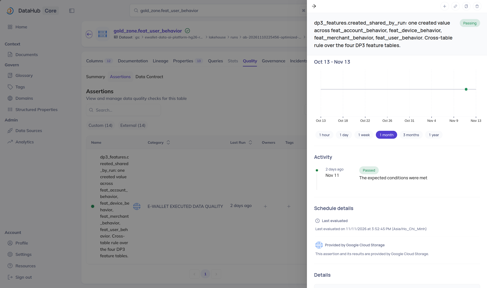

*Run detail of `dp3_features.created_shared_by_run`: one materialization time across the four DP3 tables, Passed. Last evaluated 2026-11-11 15:52:45 (+07:00), the features report time (08:52:45Z).*

### 8.4 Historical captures

The images directly under [`docs/evidence/edai1/datahub/`](../../evidence/edai1/datahub/) come from the October 2026 100GB runs. They are kept only as history. They show the old dataset identities and an old lineage that wrongly listed `users` as an input of `dim_account` and `dim_device`. None of them supports a claim in this report.

## 9. Limitations

- **Lineage is retrospective.** Lineage and assertions are published from the verified campaign record after the run; the Airflow tasks do not emit them as they run. The properties tie each entity to the DagRun and batch that ran, but a future run is only in DataHub once it is published the same way.
- **One profile.** Only `optimized` is published, because DataFlow and DataJob URNs are shared between profiles (§6). The `baseline` profile's lineage and assertions are not in DataHub.
- **Assertions are recorded, not evaluated, by DataHub.** They are custom assertions holding results computed by the Spark validators. DataHub does not re-run them, and no DataHub-native monitor is scheduled. A new result requires a new validation run and a new publication.
- **Leftover DataJobs in the shared DataFlows.** Earlier publications left four `submit_*_dataproc` DataJobs under the same DataFlow URNs. They appear in the lineage graphs but carry no campaign properties. Removing them would need a deletion in DataHub, which was not done.
- **Local DataHub.** Publication went to a local DataHub Quickstart, not to a shared server. On 2026-11-13, a full disk made its search layer stop answering until it was repaired. The stored metadata was unaffected, and all 141 records read back intact afterwards. The repair procedure is in the [runbook](../../runbooks/edai1/DATAHUB_SCHEMA_OWNER_EVIDENCE.md) troubleshooting.
- **Duplicated adapter code.** `cloud_publisher.DataHubSdkAdapter`, used by the Feast publisher, overlaps with `verified_cloud_publisher.DataHubAdapter`. They are kept separate so the Feast publisher stays unchanged.
- **Frozen 100GB plan.** `lineage/cloud_lineage.py` is the old 100GB plan. It is kept because the `datahub-publisher` image build executes it for the Docker-optimization evidence. It only prints a plan and cannot publish.

## 10. Reproduction

To run the offline checks:

```bash
PYTHONPATH=$PWD uv run --locked --project data_platform/metadata/datahub python -m pytest -q \
  tests/unit/test_batch_governance.py tests/unit/test_datahub_result_assertions.py
```

The dry runs and the publication commands are in Stage 3 of [DATAHUB_SCHEMA_OWNER_EVIDENCE.md](../../runbooks/edai1/DATAHUB_SCHEMA_OWNER_EVIDENCE.md).

To verify the evidence files, run `sha256sum -c SHA256SUMS` in [`docs/evidence/edai1/datahub/rehearsal-5gb/`](../../evidence/edai1/datahub/rehearsal-5gb/MANIFEST.md).
