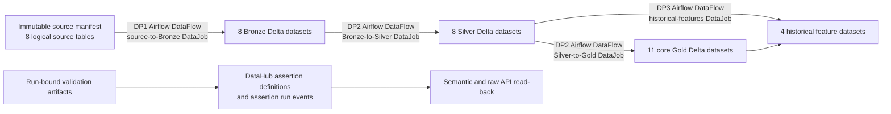
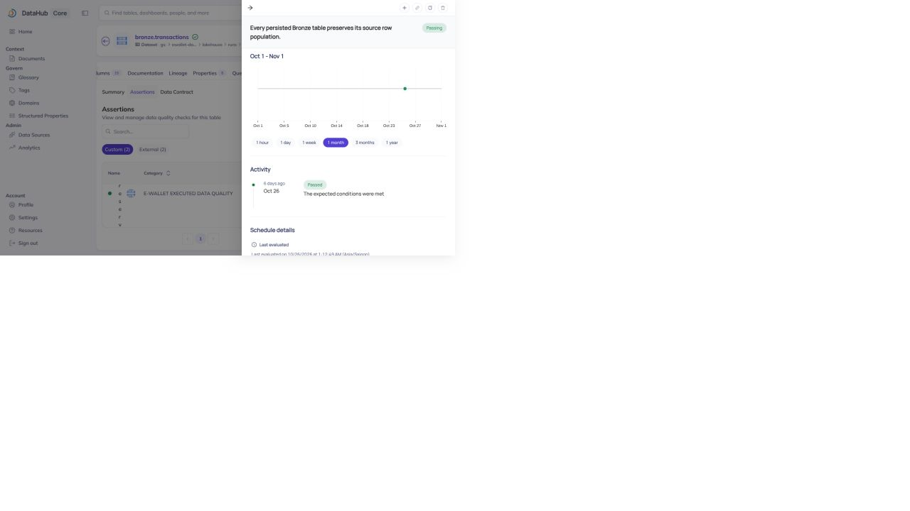
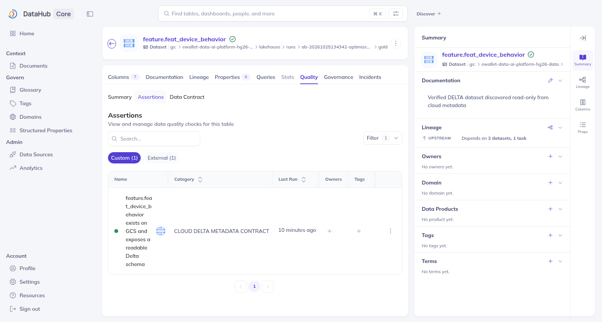
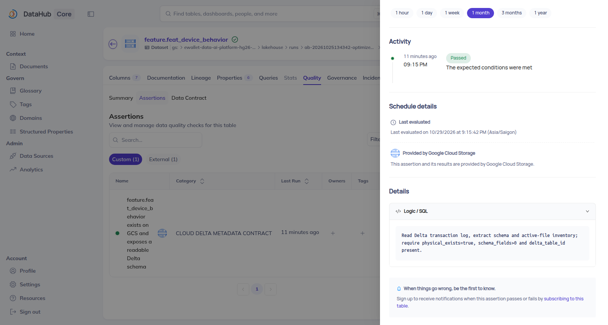

# DataHub Lineage and Data Quality

## 1. Introduction

This report describes how the batch pipelines DP1, DP2 and DP3 are governed in DataHub:

- every table is registered with lineage to the Airflow pipeline and job that produced it;
- data-quality checks are published as assertions bound to the actual run they validated.

An assertion that is only defined is never presented as one that ran.

## 2. Motivation

The platform spans source manifests, Bronze, Silver, Gold and historical feature datasets. Without machine-readable lineage, an operator cannot reliably determine which Airflow job produced a table or which downstream features may be affected by a source change. Without result-bound validation, a registered rule can appear complete even when it was never executed against the cited run.

The governance design therefore separates three questions:

1. **What should exist?** Dataset, DataFlow, DataJob and assertion definitions.
2. **What ran?** Immutable run identifiers and validation artifacts bound to those runs.
3. **What did DataHub retain?** Semantic and raw-API read-back after publication.

This separation prevents a metadata-only assertion or a lineage screenshot from being misreported as a successful data-quality result.

## 3. Architecture and pipeline integration

Discovery produced **3 DataFlows**, **4 DataJobs** and **31 dataset upstream-lineage aspects**. The inventory contains **32 physical GCS datasets** representing **39 logical tables**: one immutable source manifest represents eight logical source tables, followed by 8 Bronze, 8 Silver, 11 core Gold and 4 feature datasets.

### 3.1 Dataset contract

Datasets use stable DataHub URNs derived from their physical storage identity. Cloud discovery enumerates source and Delta Lake locations and constructs upstream edges without relying on UI state. The source-manifest compression from eight logical sources to one physical manifest is explicit; it is not a loss of logical-table scope.

### 3.2 DataFlow and DataJob contract

Each pipeline is represented as a DataFlow, with a DataJob for each independently attributable transformation stage:

| Pipeline | DataFlow scope | DataJob scope | Run binding |
|---|---|---|---|
| DP1 | Source to Bronze | Source-to-Bronze processing | `ab-20261025134342-optimized-bronze-r261025174525` |
| DP2 | Bronze through curated layers | `submit_silver_dataproc` | `ab-20261025134342-optimized-silver-r261025181923` |
| DP2 | Bronze through curated layers | `submit_core_gold_dataproc` | `ab-20261025134342-optimized-gold-r261025181923` |
| DP3 | Historical feature generation | `submit_historical_features_dataproc` | `ab-20261025134342-optimized-feat-r261026025955` |

Airflow ownership is preserved in the DAG sources:

- `data_platform/orchestration/airflow/dags/dp1_source_to_bronze.py`
- `data_platform/orchestration/airflow/dags/dp2_bronze_to_curated.py`
- `data_platform/orchestration/airflow/dags/dp3_historical_features.py`

## 4. Pipeline-table lineage implementation

`data_platform/metadata/datahub/lineage/cloud_discovery.py` discovers datasets and their URNs. `data_platform/metadata/datahub/lineage/cloud_lineage.py` binds datasets and jobs to concrete runs through `RunLineage`, `dataset_lineage_for_runs`, `jobs_for_runs` and `build_plan`. `data_platform/metadata/datahub/lineage/verified_cloud_publisher.py` converts the plan to records and performs publication plus read-back through `records`, `publish_with_readback` and `DataHubAdapter`. The lower-level `cloud_publisher.py` provides `aspect_records` and its own `publish_with_readback` path.

The inspected historical read-back reports 31 upstream-lineage aspects after publication. This is stronger than UI-only evidence because it verifies persisted DataHub aspects. Screenshots remain useful presentation evidence but are not the source of truth.

### 4.1 DP1 lineage

DP1 connects the immutable source manifest to all eight Bronze datasets and identifies the source-to-Bronze Airflow job. The historical lineage image also contains downstream Silver context, but only the source-to-Bronze edge is used to satisfy DP1 lineage scope.

The lineage was published to DataHub and read back.

*DataHub lineage from the 2026-10-25 campaign: the source manifest feeding the Bronze tables (for example `source.users` → `bronze.users`), with the downstream Silver context.*

### 4.2 DP2 lineage

DP2 records Bronze-to-Silver and Silver-to-Gold transformations and represents the two independently executed Dataproc submission jobs. The inspected evidence includes a Bronze/Silver graph, a DataFlow view containing both DataJobs, and a Silver/Gold graph. The historical DataFlow screenshot does not expose an original run ID; the run IDs above come from the recovered run-bound evidence, not from that screenshot.

The lineage was published to DataHub and read back.

*Bronze-to-Silver lineage with downstream feature context.*

*DP2 DataFlow view containing the Silver and Gold DataJobs. The screenshot does not expose the original run ID; run binding comes from retained machine-readable evidence.*

*Silver-to-Gold lineage centred on `gold.fact_transactions`, with its Silver inputs and the downstream `obt_`, aggregate and feature tables.*

### 4.3 DP3 lineage

DP3 connects Silver and Gold inputs to four historical feature datasets. Representative evidence shows a device feature dataset with upstream `silver.devices`, `silver.transactions` and relevant Gold dimensions. The plan associates these edges with the historical-feature Airflow job and its run ID.

The lineage was published to DataHub and read back.

*DP3 feature lineage: `feature.feat_device_behavior` with upstream `silver.devices`, `silver.transactions`, `gold.dim_account` and `gold.dim_date`.*

## 5. Data validation and assertions implementation

The result-bound assertion model is implemented in [`data_platform/metadata/datahub/assertions/`](../../../data_platform/metadata/datahub/assertions):

- `data_platform/metadata/datahub/assertions/validation_artifact.py` defines `ValidationOutcome` and `ValidationArtifact`.
- `data_platform/metadata/datahub/assertions/recover_validation_results.py` recovers DP1, DP2 and DP3 outcomes and explicitly models `dp2_gold_not_executed`.
- `data_platform/metadata/datahub/assertions/result_bound_publisher.py` creates definitions and run results using `definition`, `run_result` and `publish_with_readback`. It refuses to emit a successful run result for an unexecuted validation.
- `data_platform/metadata/datahub/assertions/cloud_inventory_assertions.py` publishes the older inventory/metadata contracts.
- `data_platform/metadata/datahub/assertions/publish_assertions.py` supplies generic assertion evaluation/publication behavior.

The published campaign contains **8 assertion definitions** and **7 PASS run events**; semantic and raw API read-back agreed. The eighth definition, the DP2 Gold row-level check, has not been executed and therefore has no run event.

The earlier inventory contains 31 “Cloud Delta Metadata Contract” assertions. Those assertions are retained as physical/schema context, but they do not substitute for row reconciliation, duplicate/null checks or point-in-time feature validation.

### 5.1 DP1 validation

The `source_to_bronze.row_reconciliation` assertion covers all eight DP1 logical tables. The recovered artifact records `mismatch_count = 0`; a DataHub assertion run event was read back as Passing. The available UI screenshot shows the published assertion and historical Passed activity.

*DP1 row-reconciliation assertion in DataHub, status Passing, with its run activity.*

### 5.2 DP2 validation

Two Silver validation checks have actual PASS events:

- zero NULL values in `channel`;
- zero duplicate `transaction_id` groups.

These results are bound to the Silver run and retained as semantic and raw API read-back.

The Gold row-level check `fact_transactions.row_level_integrity` is defined but has not yet been executed, so it has no run result.

### 5.3 DP3 validation

Four point-in-time (PIT) assertions cover user, account, device and merchant feature groups. Historical Feast evidence records **310/310 comparable values**, **zero mismatches**, labels excluded from comparison, and `event_timestamp` retained. Four actual PASS events were present in semantic and raw read-back.

The PIT results are retained as machine-readable read-back. The screenshots below show the separate feature metadata-contract assertions (schema and physical checks) on the same datasets.

*Feature metadata-contract assertions (schema and physical controls).*

*Detail of one metadata-contract assertion.*

*The assertion logic. The 310-value point-in-time comparison is recorded in the PIT run events, not in these metadata assertions.*

## 6. Execution environment and methodology

The inspected runtime report records:

| Attribute | Value |
|---|---|
| Publication source HEAD | `a0a48171ebc4a64707b7ff03661224b73295e75e` |
| DataHub server | `1.7.0.1`, commit `e99431ec510d7a2001f815c6bf70913c493af76e` |
| DataHub SDK | `1.7.0.5` |
| Python | `3.10.22` |
| uv | `0.13.5` |
| Publication interval | `2026-10-31T22:07:48.422080Z`–`2026-10-31T22:08:05.068541Z` |
| Lock validation | `uv lock --check`: PASS |
| Locked environment sync | `uv sync --locked`: PASS |
| Focused tests | 24 passed, 12 optional Feast tests skipped, 1 warning |

The workflow was: discover physical datasets; recover run-bound validation results; build lineage and assertion publication plans; publish definitions and eligible run events; perform semantic and raw API read-back; repeat publication to verify idempotency; and verify lineage preservation. 

## 7. Raw evidence and provenance

Authoritative historical runtime directory:

`/home/huyy-giaa/ewallet-evidence/datahub-assertions-20261101/runtime-20261031T220705Z/`

Key files inspected by the prior evidence audit include:

- `FINAL_RUNTIME_REPORT.md`
- `semantic-readback.json`
- `assertion-inventory.csv` and `assertion-inventory.json`
- `raw-api-readback/*-assertionInfo.json`
- `raw-api-readback/*-assertionRunEvent.json`
- `publication-results-first.json`
- `publication-results-second-idempotency.json`
- `lineage-preservation.json`
- `git-provenance.json`

Integrity anchors recorded in the runtime report:

| Artifact | SHA-256 |
|---|---|
| Validation artifact | `d57fb6dca057d038c79033d3e00370fb92b6a1cc0d7a5d95984fc391e9c958de` |
| Publication plan | `c3e3384a285b260078023a4c2446e599eab0f09373df76b68681a60336c04d28` |
| Older 31-assertion read-back | `727a9a6f82b75ed60b27edb25bfb1f4c88ffd74cd3148b5733172a3e1dc076ec` |
| Lineage read-back | `32ac61378702d1ba257496b055cef30c26f3cad87c7907f094db5cb40af0caa9` |

The publication was produced from source `a0a48171…`, recorded in `git-provenance.json`.

## 8. Limitations

- **DP2 Gold check.** The DP2 Gold row-level check is defined but has not been executed.
- **Missing assertion screenshots.** The DP2 Silver checks and the DP3 point-in-time assertions have no UI screenshot; their results are retained as semantic and raw API read-back.
- **Local deployment.** DataHub ran as a local deployment during publication and was stopped afterwards. The read-back performed during publication is the retained proof.

## 9. Reproducing the publication

1. Use the locked environment (`uv lock --check`, `uv sync --locked`) and run the focused assertion and lineage tests.
2. Discover the datasets and build the lineage plan with `cloud_discovery.py` and `cloud_lineage.py`. Check that it contains the expected 3 DataFlows, 4 DataJobs and 31 upstream-lineage aspects.
3. Recover the validation artefacts from the immutable run outputs. Publish them through the result-bound publisher, which refuses to emit a run result for a check that did not run.
4. Capture the semantic and raw read-back, then publish a second time to verify idempotency.

## Appendix: screenshot integrity

The DataHub screenshots are byte-identical copies of the original captures:

| File | SHA-256 |
|---|---|
| `dp1_source_bronze_historical_20261025.png` | `a2f5bb8882214f3efe5494effff641256775c7474e90b27f222f01537a82ec79` |
| `dp1_bronze_result_bound_published_20261031.jpg` | `cf0789830082e9ed5a7910570f552f9926771fb3cb271bac480ff73e8a138436` |
| `dp2_bronze_silver_historical_20261025.png` | `389d3cf015968115b67fb43491ad5ae085707919ea150b463c1bec18c15894f3` |
| `dp2_dataflow_jobs_historical_20261025.png` | `689cce6e5f9aeac7946dd4e4963eb8d50c0b8aab96ad374bce1ef73eccbc8016` |
| `dp2_silver_gold_historical_20261025.png` | `e4db319ec291907abc5ce45f3e15a292ac2515dbb32fdd71957103a1e144610e` |
| `dp3_historical_features_historical_20261026.png` | `f843553d227fc542b74c316df5a09b8833ba3c7b27a0b7782dcb0a42fe12f3eb` |
| `feature_metadata_contract_list_historical_20261029.png` | `7c91daba9be05e80f2511305adeed430601741ce57dcf8e5be9eec93474924e4` |
| `feature_metadata_contract_detail_historical_20261029.png` | `06d1bb71a3c59d48d1a14ff306b090084591d60c50b1d028a9c22db594618525` |
| `feature_metadata_contract_logic_historical_20261029.png` | `9a22c92bb13749d5b88e717a59a0bbc5cd9ce70ae5bd1d03463c55adf67e7db1` |

