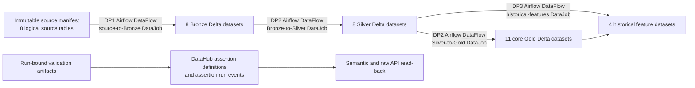

# EDAI-1 DataHub Governance: Lineage and Validation Evidence

## 1. Introduction and rubric mapping

This report documents the implemented DataHub governance controls for EDAI-1 data pipelines DP1, DP2 and DP3. It consolidates source-code contracts, historical runtime read-back, validation artifacts and screenshot provenance for rubric rows 28–33. It does not treat an assertion definition as evidence that an assertion ran or passed.

The original rubric wording available in the project evidence is:

| Rubric row | Item | Requirement | Available proof description | Maximum |
|---:|---|---|---|---:|
| 28 | DP1 linked with related tables | Lineage between the pipeline and tables | Document shows tables on DataHub, which Airflow pipeline generated them, and validation | 2 |
| 29 | DP1 linked with related tables | Data validation | Same proof scope as row 28 | 2 |
| 30 | DP2 linked with related tables | Lineage between the pipeline and tables | Document shows tables on DataHub, which Airflow pipeline generated them, and validation | 2 |
| 31 | DP2 linked with related tables | Data validation | Same proof scope as row 30 | 2 |
| 32 | DP3 linked with related tables | Lineage between the pipeline and tables | Document shows tables on DataHub, which Airflow pipeline generated them, and validation | 2 |
| 33 | DP3 linked with related tables | Data validation | Same proof scope as row 32 | 2 |

No points are claimed as formally awarded in this report. `RUNTIME_VERIFIED` means that historical publication and read-back evidence was inspected; it is not equivalent to `POST_MERGE_REPRODUCED` or assessor acceptance.

## 2. Motivation

The platform spans source manifests, Bronze, Silver, Gold and historical feature datasets. Without machine-readable lineage, an operator cannot reliably determine which Airflow job produced a table or which downstream features may be affected by a source change. Without result-bound validation, a registered rule can appear complete even when it was never executed against the cited run.

The governance design therefore separates three questions:

1. **What should exist?** Dataset, DataFlow, DataJob and assertion definitions.
2. **What ran?** Immutable run identifiers and validation artifacts bound to those runs.
3. **What did DataHub retain?** Semantic and raw-API read-back after publication.

This separation prevents a metadata-only assertion or a lineage screenshot from being misreported as a successful data-quality result.

## 3. Architecture and pipeline integration

Historical discovery produced **3 DataFlows**, **4 DataJobs** and **31 dataset upstream-lineage aspects**. The inventory contains **32 physical GCS datasets** representing **39 logical tables**: one immutable source manifest represents eight logical source tables, followed by 8 Bronze, 8 Silver, 11 core Gold and 4 feature datasets.

### 3.1 Dataset contract

Datasets use stable DataHub URNs derived from their physical storage identity. Cloud discovery enumerates source and Delta Lake locations and constructs upstream edges without relying on UI state. The source-manifest compression from eight logical sources to one physical manifest is explicit; it is not a loss of logical-table scope.

### 3.2 DataFlow and DataJob contract

Each pipeline is represented as a DataFlow, with a DataJob for each independently attributable transformation stage:

| Pipeline | DataFlow scope | DataJob scope | Run binding |
|---|---|---|---|
| DP1 | Source to Bronze | Source-to-Bronze processing | `ab-20261025134342-optimized-bronze-r261025174525` |
| DP2 | Bronze through curated layers | `submit_silver_dataproc` | `ab-20261025134342-optimized-silver-r261025181923` |
| DP2 | Bronze through curated layers | `submit_core_gold_dataproc` | `ab-20261025134342-optimized-gold-r261025181923` |
| DP3 | Historical feature generation | `submit_historical_features_dataproc` | `ab-20261025134342-optimized-feat-r261026025955` |

Airflow ownership is preserved in the DAG sources:

- `data_platform/orchestration/airflow/dags/dp1_source_to_bronze.py`
- `data_platform/orchestration/airflow/dags/dp2_bronze_to_curated.py`
- `data_platform/orchestration/airflow/dags/dp3_historical_features.py`

## 4. Pipeline-table lineage implementation

`data_platform/metadata/datahub/lineage/cloud_discovery.py` discovers datasets and their URNs. `data_platform/metadata/datahub/lineage/cloud_lineage.py` binds datasets and jobs to concrete runs through `RunLineage`, `dataset_lineage_for_runs`, `jobs_for_runs` and `build_plan`. `data_platform/metadata/datahub/lineage/verified_cloud_publisher.py` converts the plan to records and performs publication plus read-back through `records`, `publish_with_readback` and `DataHubAdapter`. The lower-level `cloud_publisher.py` provides `aspect_records` and its own `publish_with_readback` path.

The inspected historical read-back reports 31 upstream-lineage aspects after publication. This is stronger than UI-only evidence because it verifies persisted DataHub aspects. Screenshots remain useful presentation evidence but are not the source of truth.

### 4.1 DP1 lineage

DP1 connects the immutable source manifest to all eight Bronze datasets and identifies the source-to-Bronze Airflow job. The historical lineage image also contains downstream Silver context, but only the source-to-Bronze edge is used to satisfy DP1 lineage scope.

**Verification:** `RUNTIME_VERIFIED` from historical lineage publication/read-back. No post-merge rerun was performed for this documentation task.

*Historical DataHub lineage view from the 2026-10-25 campaign. It demonstrates the published Source-to-Bronze relationship and downstream context; it is not a post-merge reproduction.*

### 4.2 DP2 lineage

DP2 records Bronze-to-Silver and Silver-to-Gold transformations and represents the two independently executed Dataproc submission jobs. The inspected evidence includes a Bronze/Silver graph, a DataFlow view containing both DataJobs, and a Silver/Gold graph. The historical DataFlow screenshot does not expose an original run ID; the run IDs above come from the recovered run-bound evidence, not from that screenshot.

**Verification:** `RUNTIME_VERIFIED` for lineage. The Silver-to-Gold image proves a lineage relationship only; it does not prove that the DP2 Gold quality assertion ran.

*Historical Bronze-to-Silver lineage with downstream feature context.*

*Historical DP2 DataFlow view containing the Silver and Gold DataJobs. The screenshot does not expose the original run ID; run binding comes from retained machine-readable evidence.*

*Historical Silver-to-Gold lineage only. This image is not evidence that the DP2 Gold row-level assertion executed or passed.*

### 4.3 DP3 lineage

DP3 connects Silver and Gold inputs to four historical feature datasets. Representative evidence shows a device feature dataset with upstream `silver.devices`, `silver.transactions` and relevant Gold dimensions. The plan associates these edges with the historical-feature Airflow job and its run ID.

**Verification:** `RUNTIME_VERIFIED` from historical publication/read-back.

*Representative historical DP3 feature lineage showing upstream Silver and Gold datasets; not a current canonical-runtime capture.*

## 5. Data validation and assertions implementation

The result-bound model inspected in the historical/final-integration source is distinct from the older metadata-contract model. The first three modules below are not present at the current canonical preflight HEAD, so they are historical implementation references rather than claims about the canonical tree:

- `data_platform/metadata/datahub/assertions/validation_artifact.py` defines `ValidationOutcome` and `ValidationArtifact`.
- `data_platform/metadata/datahub/assertions/recover_validation_results.py` recovers DP1, DP2 and DP3 outcomes and explicitly models `dp2_gold_not_executed`.
- `data_platform/metadata/datahub/assertions/result_bound_publisher.py` creates definitions and run results using `definition`, `run_result` and `publish_with_readback`. It refuses to emit a successful run result for an unexecuted validation.
- `data_platform/metadata/datahub/assertions/cloud_inventory_assertions.py` publishes the older inventory/metadata contracts.
- `data_platform/metadata/datahub/assertions/publish_assertions.py` supplies generic assertion evaluation/publication behavior.

The historical result-bound campaign contains **8 definitions** and **7 actual PASS run events**. Semantic and raw API read-back agreed. The eighth definition is the DP2 Gold check, which correctly has no run event and remains `NOT_EXECUTED`.

The earlier inventory contains 31 “Cloud Delta Metadata Contract” assertions. Those assertions are retained as physical/schema context, but they do not substitute for row reconciliation, duplicate/null checks or point-in-time feature validation.

### 5.1 DP1 validation

The `source_to_bronze.row_reconciliation` assertion covers all eight DP1 logical tables. The recovered artifact records `mismatch_count = 0`; a DataHub assertion run event was read back as Passing. The available UI screenshot shows the published assertion and historical Passed activity.

**Verification:** `RUNTIME_VERIFIED`. The historical screenshot has been checksum-verified and transferred into the canonical evidence directory.

*Historical DP1 result-bound row-reconciliation assertion showing published Passing activity, corroborated by the retained semantic and raw API read-back.*

### 5.2 DP2 validation

Two Silver validation checks have actual PASS events:

- zero NULL values in `channel`;
- zero duplicate `transaction_id` groups.

These results are bound to the recovered Silver run. No dedicated Silver assertion screenshot was found, so the support is raw/semantic read-back rather than UI evidence.

The defined Gold check, `fact_transactions.row_level_integrity`, has **no assertion run event**. It is recorded as `NOT_EXECUTED`. Neither the existence of its definition nor the Silver-to-Gold lineage screenshot is evidence of a PASS.

**Verification:** DP2 Silver is `RUNTIME_VERIFIED`; DP2 Gold is `NOT_EXECUTED`; the combined rubric row is therefore `PARTIAL`.

### 5.3 DP3 validation

Four point-in-time (PIT) assertions cover user, account, device and merchant feature groups. Historical Feast evidence records **310/310 comparable values**, **zero mismatches**, labels excluded from comparison, and `event_timestamp` retained. Four actual PASS events were present in semantic and raw read-back.

No PIT assertion screenshots were found. Older feature metadata-contract screenshots are context only and must not be captioned as proof of PIT correctness.

**Verification:** `RUNTIME_VERIFIED` through run-bound artifacts and DataHub read-back; UI screenshot coverage is `PARTIAL`.

*Historical list of feature metadata-contract assertions. Context only: it does not prove PIT value equality.*

*Historical metadata-contract detail showing the physical/schema control, not a PIT validation result.*

*Historical metadata-contract logic view. The independent 310-value comparison and four result-bound PIT PASS events remain supported by machine-readable evidence, not these screenshots.*

## 6. Execution environment and methodology

The inspected runtime report records:

| Attribute | Value |
|---|---|
| Publication source HEAD | `a0a48171ebc4a64707b7ff03661224b73295e75e` |
| DataHub server | `1.7.0.1`, commit `e99431ec510d7a2001f815c6bf70913c493af76e` |
| DataHub SDK | `1.7.0.5` |
| Python | `3.10.22` |
| uv | `0.13.5` |
| Publication interval | `2026-10-31T22:07:48.422080Z`–`2026-10-31T22:08:05.068541Z` |
| Lock validation | `uv lock --check`: PASS |
| Locked environment sync | `uv sync --locked`: PASS |
| Focused tests | 24 passed, 12 optional Feast tests skipped, 1 warning |

The workflow was: discover physical datasets; recover run-bound validation results; build lineage and assertion publication plans; publish definitions and eligible run events; perform semantic and raw API read-back; repeat publication to verify idempotency; and verify lineage preservation. This documentation pass did not start DataHub, Airflow, Spark, containers or cloud services.

## 7. Raw evidence and provenance

Authoritative historical runtime directory:

`/home/huyy-giaa/ewallet-evidence/datahub-assertions-20261101/runtime-20261031T220705Z/`

Key files inspected by the prior evidence audit include:

- `FINAL_RUNTIME_REPORT.md`
- `semantic-readback.json`
- `assertion-inventory.csv` and `assertion-inventory.json`
- `raw-api-readback/*-assertionInfo.json`
- `raw-api-readback/*-assertionRunEvent.json`
- `publication-results-first.json`
- `publication-results-second-idempotency.json`
- `lineage-preservation.json`
- `git-provenance.json`

Integrity anchors recorded in the runtime report:

| Artifact | SHA-256 |
|---|---|
| Validation artifact | `d57fb6dca057d038c79033d3e00370fb92b6a1cc0d7a5d95984fc391e9c958de` |
| Publication plan | `c3e3384a285b260078023a4c2446e599eab0f09373df76b68681a60336c04d28` |
| Older 31-assertion read-back | `727a9a6f82b75ed60b27edb25bfb1f4c88ffd74cd3148b5733172a3e1dc076ec` |
| Lineage read-back | `32ac61378702d1ba257496b055cef30c26f3cad87c7907f094db5cb40af0caa9` |

The current canonical documentation HEAD at preflight was `dedea5ed3db495dec7791745eaf0c4c8bfb86582` (tree `825fc51a639d58ccac0a70e6e5f58c044561f57d`). The runtime was produced from a different, explicitly recorded source HEAD. Consequently, this report does not claim post-merge reproduction.

## 8. Evidence screenshot transfer manifest

The nine manifest-listed screenshots were copied individually from the preserved final-integration sources into the approved canonical evidence directory. Source files were retained, destination collisions were checked before copying, and destination SHA-256 values were verified against this manifest. Their historical provenance and claim boundaries remain unchanged.

| Rubric row | Source path under `.worktrees/codex-final-integration/` | Proposed canonical destination | SHA-256 | Caption | Status |
|---:|---|---|---|---|---|
| 28 | `docs/evidence/images/datahub/lineage/dp1_source_bronze_historical_20261025.png` | `docs/evidence/edai1/datahub/dp1_source_bronze_historical_20261025.png` | `a2f5bb8882214f3efe5494effff641256775c7474e90b27f222f01537a82ec79` | DP1 cloud-derived Source-to-Bronze lineage, with downstream Silver context | VERIFIED_TRANSFERRED |
| 29 | `docs/evidence/images/datahub/assertions/dp1_bronze_result_bound_published_20261031.jpg` | `docs/evidence/edai1/datahub/dp1_bronze_result_bound_published_20261031.jpg` | `cf0789830082e9ed5a7910570f552f9926771fb3cb271bac480ff73e8a138436` | DP1 result-bound assertion showing Passing status and historical Passed activity | VERIFIED_TRANSFERRED |
| 30 | `docs/evidence/images/datahub/lineage/dp2_bronze_silver_historical_20261025.png` | `docs/evidence/edai1/datahub/dp2_bronze_silver_historical_20261025.png` | `389d3cf015968115b67fb43491ad5ae085707919ea150b463c1bec18c15894f3` | DP2 Bronze-to-Silver lineage with downstream feature context | VERIFIED_TRANSFERRED |
| 30 | `docs/evidence/images/datahub/lineage/dp2_dataflow_jobs_historical_20261025.png` | `docs/evidence/edai1/datahub/dp2_dataflow_jobs_historical_20261025.png` | `689cce6e5f9aeac7946dd4e4963eb8d50c0b8aab96ad374bce1ef73eccbc8016` | DP2 DataFlow containing Silver and Gold DataJobs; screenshot does not expose the original run ID | VERIFIED_TRANSFERRED |
| 30 | `docs/evidence/images/datahub/lineage/dp2_silver_gold_historical_20261025.png` | `docs/evidence/edai1/datahub/dp2_silver_gold_historical_20261025.png` | `e4db319ec291907abc5ce45f3e15a292ac2515dbb32fdd71957103a1e144610e` | DP2 Silver-to-Gold lineage; not evidence of Gold assertion PASS | VERIFIED_TRANSFERRED |
| 32 | `docs/evidence/images/datahub/lineage/dp3_historical_features_historical_20261026.png` | `docs/evidence/edai1/datahub/dp3_historical_features_historical_20261026.png` | `f843553d227fc542b74c316df5a09b8833ba3c7b27a0b7782dcb0a42fe12f3eb` | DP3 representative historical-feature lineage and upstream datasets | VERIFIED_TRANSFERRED |
| 33 | `docs/evidence/images/datahub/assertions/feature_metadata_contract_list_historical_20261029.png` | `docs/evidence/edai1/datahub/feature_metadata_contract_list_historical_20261029.png` | `7c91daba9be05e80f2511305adeed430601741ce57dcf8e5be9eec93474924e4` | Older feature metadata-contract list; context only, not PIT validation proof | VERIFIED_TRANSFERRED |
| 33 | `docs/evidence/images/datahub/assertions/feature_metadata_contract_detail_historical_20261029.png` | `docs/evidence/edai1/datahub/feature_metadata_contract_detail_historical_20261029.png` | `06d1bb71a3c59d48d1a14ff306b090084591d60c50b1d028a9c22db594618525` | Older feature metadata-contract detail; context only, not PIT validation proof | VERIFIED_TRANSFERRED |
| 33 | `docs/evidence/images/datahub/assertions/feature_metadata_contract_logic_historical_20261029.png` | `docs/evidence/edai1/datahub/feature_metadata_contract_logic_historical_20261029.png` | `9a22c92bb13749d5b88e717a59a0bbc5cd9ce70ae5bd1d03463c55adf67e7db1` | Older feature metadata-contract logic; context only, not PIT validation proof | VERIFIED_TRANSFERRED |

## 9. Limitations and genuinely missing evidence

1. **DP2 Gold validation was not executed.** Its definition exists, but there is no run event. A successful execution and read-back are required.
2. **DP2 Silver lacks a dedicated UI screenshot.** Raw and semantic read-back support the result, but presentation evidence is incomplete.
3. **DP3 PIT assertions lack UI screenshots.** Existing feature metadata screenshots prove a different control and are context only.
4. **Canonical screenshot transfer is complete for the nine manifest-listed historical images.** Dedicated DP2 Silver and DP3 PIT UI screenshots still do not exist.
5. **No post-merge reproduction exists.** Historical evidence is tied to source HEAD `a0a4817…`, not the current canonical HEAD.
6. **Global live read-back after shutdown was unavailable.** The historical runtime was stopped after publication; retained artifacts document the successful bounded read-back performed during the campaign.
7. **Rubric acceptance is not recorded.** Runtime verification does not constitute assessor approval.

## 10. Reproducibility instructions

Reproduction must be performed in an authorized bounded environment; it is not part of this documentation task.

1. Record the exact Git commit/tree and confirm a clean source checkout.
2. Verify the historical input, validation-artifact and publication-plan checksums against `git-provenance.json` and the runtime report.
3. Use the locked Python environment and require `uv lock --check` and `uv sync --locked` to pass.
4. Re-run focused assertion and lineage tests, including the optional Feast/PIT cases when their dependencies are available. Record skips explicitly.
5. Discover datasets and construct the lineage plan using `cloud_discovery.py` and `cloud_lineage.py`; review the expected 3 DataFlows, 4 DataJobs and 31 upstream-lineage aspects before publication.
6. Recover DP1/DP2/DP3 validation artifacts from immutable run outputs. Do not convert `NOT_EXECUTED` into PASS and do not create a run event for DP2 Gold until the check actually executes.
7. Publish through the verified/result-bound publishers to an approved DataHub endpoint. Capture the first publication, an idempotent second publication, semantic read-back, raw `assertionInfo`, raw `assertionRunEvent`, and lineage-preservation outputs.
8. Execute the DP2 Gold row-level integrity check in the correct run context, then publish and read back its genuine result.
9. Capture dedicated DP2 Silver and DP3 PIT assertion UI evidence. Transfer approved screenshots into `docs/evidence/edai1/datahub/`, verify SHA-256 values, and only then add relative image links.
10. Update this report with the new source SHA, timestamps, run IDs, test counts and `POST_MERGE_REPRODUCED` status. Preserve the older campaign as historical evidence.

## 11. Rubric acceptance checklist

| Rubric Row | Requirement | Implementation | Evidence | Status | Remaining Gap |
|---:|---|---|---|---|---|
| 28 | DP1 — Lineage between the pipeline and tables | Source manifest → 8 Bronze datasets; DP1 DataFlow/DataJob bound to the Bronze run | Historical lineage aspect read-back; verified transferred screenshot | RUNTIME_VERIFIED | Post-merge reproduction and assessor acceptance |
| 29 | DP1 — Data validation | `source_to_bronze.row_reconciliation` across 8 logical tables | `mismatch_count=0`; PASS run event in semantic/raw read-back; verified transferred Passing UI screenshot | RUNTIME_VERIFIED | Post-merge reproduction and assessor acceptance |
| 30 | DP2 — Lineage between the pipeline and tables | Bronze → Silver → Gold; two DP2 DataJobs | Historical lineage read-back and three verified transferred screenshots | RUNTIME_VERIFIED | Post-merge reproduction and assessor acceptance |
| 31 | DP2 — Data validation | Silver null/duplicate checks plus defined Gold row-level check | Two Silver PASS events; Gold definition with no run event | PARTIAL / NOT_EXECUTED | Execute and read back DP2 Gold; capture Silver/Gold UI evidence |
| 32 | DP3 — Lineage between the pipeline and tables | Silver/Gold → four historical feature datasets; DP3 DataFlow/DataJob | Historical lineage read-back; verified transferred representative screenshot | RUNTIME_VERIFIED | Post-merge reproduction and assessor acceptance |
| 33 | DP3 — Data validation | Four result-bound PIT assertions for user/account/device/merchant | 310/310 comparable values, zero mismatch; four PASS events in semantic/raw read-back | RUNTIME_VERIFIED | Capture PIT-specific UI evidence; post-merge reproduction and assessor acceptance |

Acceptance remains pending until the missing evidence is resolved and the evaluator confirms rows 28–33. The document deliberately does not label any row `POST_MERGE_REPRODUCED` or `RUBRIC_VERIFIED`.
