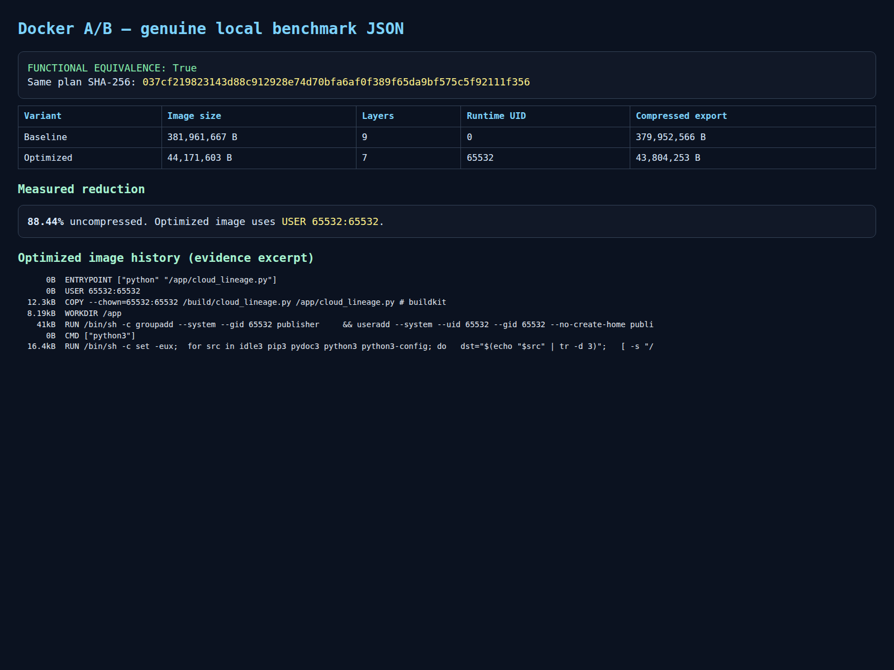
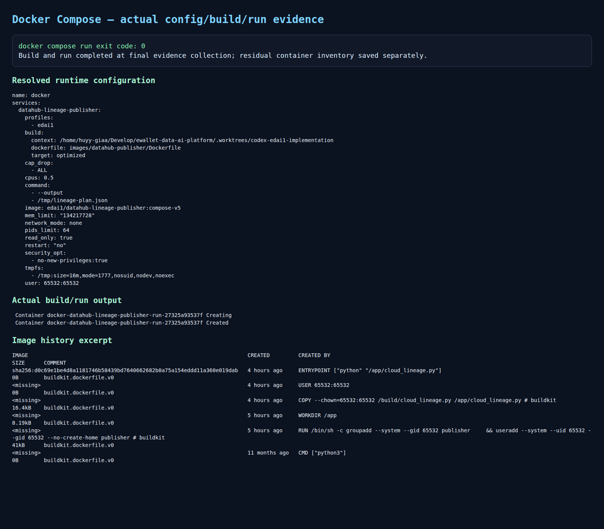

# Docker and Docker Compose Optimization

## Scope and evidence status

This report covers EDAI-1 rubric rows 3–4. The authoritative source is
`EDAI K11.xlsx`, sheet `edai-1 (50%)`, SHA-256
`1b0f880124da3cab4e7cca8e24568d89a3d67c119029f1a71ab39f9eb6fa6081`.
The Docker experiment was a local, controlled A/B campaign on 2026-10-29 at
historical source SHA `561910eeb10e5c5a5c064879acc0692df823dc5b`.
It is runtime evidence for that version, not proof that every repository image
has been optimized.

Status terms used here are `SOURCE_READY`, `TEST_PASS`,
`HISTORICAL_RUNTIME_VERIFIED`, `NOT_EXECUTED`, and
`EVIDENCE_CAPTURE_REQUIRED`.

## Exact rubric mapping

| Row | Points | Original requirement | Evidence decision |
| ---: | ---: | --- | --- |
| 3 | 2 | `Có sử dụng Docker & Docker Compose` | `HISTORICAL_RUNTIME_VERIFIED`: Dockerfile, hardened Compose service, successful build, and one-shot Compose run with exit code 0. |
| 4 | 3 | `Optimize Dockerfile (ví dụ multistage build)` | `HISTORICAL_RUNTIME_VERIFIED`: matched baseline/optimized builds reduced measured image size by 88.44% with identical smoke output. |

The workbook asks the documentation to explain how the image was optimized and
how its final size changed relative to the original. The sections below bind
those claims to immutable JSON, logs, image history, and screenshots.

## Container architecture

The bounded experiment packages the deterministic DataHub lineage-plan
publisher rather than the full platform. This makes the baseline and optimized
images directly comparable: both execute the same
`data_platform/metadata/datahub/lineage/cloud_lineage.py` entrypoint and emit
the same three flows, four jobs, and 32 datasets.

```mermaid
flowchart LR
    S[cloud_lineage.py] --> B[Docker build target]
    B --> I[Optimized runtime image]
    I --> C[Compose one-shot service]
    C --> O[/tmp/lineage-plan.json]
    C --> V[Smoke validation and SHA-256]
```

Implementation references:

- [multi-stage Dockerfile](../../../images/datahub-publisher/Dockerfile)
- [bounded Compose profile](../../../infra/docker/compose.edai1.yml)
- [lineage publisher](../../../data_platform/metadata/datahub/lineage/cloud_lineage.py)

## Base-image and Dockerfile design

The baseline target uses digest-pinned
`python:3.13.9-bookworm`. The optimized build and runtime targets use
digest-pinned `python:3.13.9-slim-bookworm`. Pinning the digests prevents a
mutable tag from silently changing the comparison.

The actual optimization techniques are:

1. **Slim runtime base.** The optimized image removes the full Bookworm build
   toolchain and general-purpose packages retained by the baseline image.
2. **Multi-stage validation.** The `build` stage compiles the script, executes
   it, and asserts the expected `(flow_count, job_count, dataset_count)` tuple.
   Only the validated script crosses into the runtime stage.
3. **Minimal copied payload.** The final stage contains the application script,
   not the build workspace or compiler artifacts.
4. **Non-root execution.** UID/GID `65532:65532` is created explicitly, and the
   script is copied with matching ownership.
5. **Pinned build syntax and bases.** Dockerfile syntax 1.7 and both Python base
   digests are explicit.

This image has no third-party Python dependencies, so it does not require a
project `uv.lock`. Other repository images use lockfiles where applicable, but
they are outside this matched A/B. No dependency reduction is claimed here.

## Docker Compose runtime boundary

The opt-in `edai1` Compose profile builds the `optimized` target and applies:

- fixed UID/GID `65532:65532`;
- read-only root filesystem;
- 16 MiB `/tmp` tmpfs with `nosuid,nodev,noexec`;
- no network;
- all Linux capabilities dropped;
- `no-new-privileges`;
- 64-PID, 128-MiB, and 0.5-CPU limits;
- no restart and one-shot `--output /tmp/lineage-plan.json` execution.

The resolved configuration and build log show Compose 5.1.3 building the
intended target. The one-shot run exited `0`, and the residual-container
inventory was empty.

## Measured A/B result

The experiment used the same source and functional contract for both variants.

| Metric | Baseline | Optimized | Change |
| --- | ---: | ---: | ---: |
| Image ID | `sha256:87169e…` | `sha256:caeaf9…` | Distinct immutable images |
| Uncompressed image size | 381,961,667 B | 44,171,603 B | **−337,790,064 B (−88.44%)** |
| Compressed export | 379,952,566 B | 43,804,253 B | −88.47% |
| Recorded application layers | 9 | 7 | −2 |
| Runtime user | UID 0 | UID/GID 65532 | Root removed |
| Smoke output SHA-256 | `037cf219823143d88c912928e74d70bfa6af0f389f65da9bf575c5f92111f356` | Same | Functionally identical |
| Flow / job / dataset counts | 3 / 4 / 32 | 3 / 4 / 32 | Identical |

The campaign ran from `2026-10-29T08:56:58.252922Z` to
`2026-10-29T08:57:16.710838Z`. This interval covers the recorded local
campaign, but the evidence does not separate cold-pull, build, and runtime
latencies. No startup-performance improvement is claimed.

A later Compose build produced image
`sha256:d0c69e1be4d8a1181746b58439bd7640662682b0a75a154eddd11a360e019dab`
at 44,172,764 bytes and ran successfully as UID/GID 65532. The 1,161-byte
difference from the controlled optimized A/B is a later build artifact; it is
not substituted into the matched comparison.

## Runtime and screenshot evidence



*Historical evidence rendering derived from the genuine A/B JSON. It shows the
matched image sizes, layers, runtime users, identical output hash, and measured
88.44% reduction. It is not a Docker Desktop UI capture.*



*Historical Compose evidence rendering showing the resolved hardened service,
actual optimized build output, exit code 0, non-root image history, and empty
residual-container inventory.*

The copied PNG files are byte-identical to the originals:

| Evidence | SHA-256 |
| --- | --- |
| `01_docker_image_ab.png` | `1fdff2fb15cf48a329784d1a76b17492160fb13713a3d55c1757f34522dccf33` |
| `02_docker_compose_runtime.png` | `b53b3ea4d2331db3427f7832a2def3cae0004fd5bd6699ad815458ce9e8fc997` |

The underlying A/B JSON has SHA-256
`44590137932dc159fcd984ce947e6bc69bc5fa7e28ed37e8de0ace5a073dda89`.
No authentic Docker Desktop screenshot was found; the machine-readable records
and build/run evidence remain the stronger proof.

## Reproducibility boundary

No command was executed for this documentation task. A future authorized
reproduction should checkout the historical SHA, build both named targets from
the same Dockerfile and source tree, inspect immutable IDs and sizes, execute
both with the same output arguments, compare the output SHA-256 and counts, and
then run the isolated Compose profile. Preserve full build logs, `docker image
inspect`, `docker history`, exit codes, container inventory, timestamps, host
architecture, and Docker/Compose versions.

The result must not be reproduced by comparing unrelated applications or base
images with different functionality.

## Limitations and acceptance

- The benchmark covers one bounded Python publisher, not every platform image.
- Image size is Docker's uncompressed local image size; registry transfer size
  is represented separately by the compressed export.
- Build and startup durations were not isolated, so only size optimization is
  quantitatively established.
- The screenshots are evidence renderings, not Docker Desktop UI.
- The execution belongs to historical SHA `561910e`; no current-HEAD rebuild
  was performed.

| Rubric row | Source | Runtime evidence | Decision | Remaining gap |
| ---: | --- | --- | --- | --- |
| 3 | Dockerfile and hardened Compose profile | Successful real build/run, exit 0, no residual container | Supported | Optional Docker Desktop UI capture |
| 4 | Slim digest-pinned multi-stage non-root image | Matched A/B, identical smoke hash, 88.44% size reduction | Supported | No measured cold-build/startup comparison |
