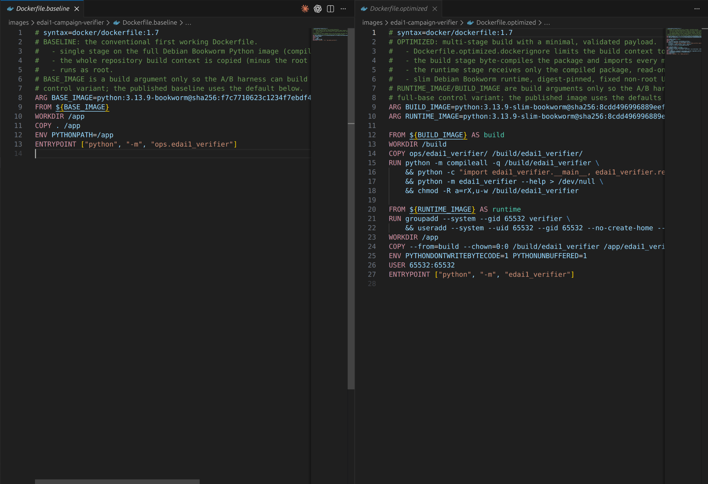
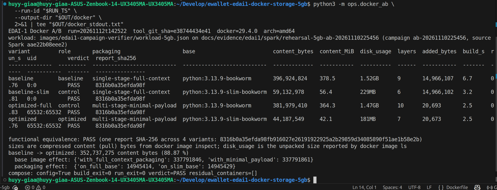
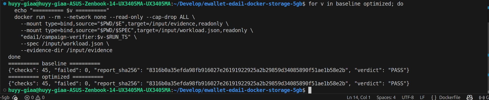
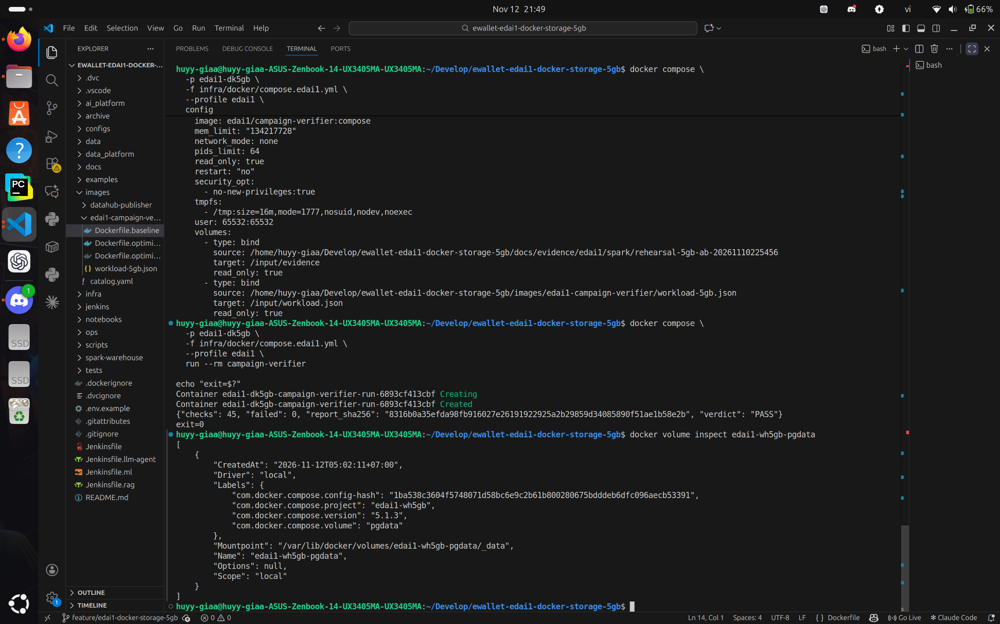

# Docker and Docker Compose Optimization

**Scope.** Container packaging of an EDAI-1 batch job: Dockerfile size and hardening, and its Docker Compose runtime.
**Official run.** `20261112t142522`, executed by the owner on 2026-11-12 (14:25–14:26 UTC), tool commit `e3874443`, Docker Engine 29.4.0, Buildx 0.33.0, Compose 5.1.3, amd64.
**Workload.** Verification of the 5GB campaign `ab-20261110225456` (`rehearsal-5gb-v1`, source Spark commit `aae22b08`).
**Evidence.** [docs/evidence/edai1/docker/5gb/](../../evidence/edai1/docker/5gb/MANIFEST.md): 10 owner screenshots and the raw `result.json`, `summary.txt`, build logs and Compose logs, all under `SHA256SUMS`.

## 1. Summary

| Result | Value |
|---|---|
| Image content size, baseline → optimized | 396,924,824 B → 44,187,549 B (−352,737,275 B, **−88.87 %**) |
| Unpacked disk usage (`docker image ls`) | 1.52 GB → 181 MB |
| Share of the reduction from the base image | **95.76 %** (337,791,846 B) |
| Share from the multi-stage packaging | **4.24 %** (14,945,414 B) |
| Functional result | Identical in all four images: 45 checks, report SHA-256 `8316b0a3…1ae1b58e2b` |
| Run time | No change (median 0.761 s → 0.757 s; start-up dominated) |
| Runtime user | root → UID/GID 65532, application files not writable |
| Tools shipped | `gcc`, `make`, `git`, `curl`, `apt-get` → `apt-get` only |
| Compose | Hardened one-shot service: config valid, run exit 0, verdict PASS, no residual containers |

The size reduction is real, but almost all of it comes from the choice of base image, not from the multi-stage build. The experiment was designed to show that split, and it does.

## 2. Problem

Every EDAI-1 job image used to start from the full `python:*-bookworm` image and copy the repository into it. That image carries a C toolchain, `git`, `curl` and Debian development packages. A pure-Python job never uses them, yet they inflate every pull and widen the attack surface. The image also ran as root with writable code.

The earlier experiment (October, 88.44 %, DataHub lineage-plan publisher) reported a single before/after number. It could not say *why* the image shrank, and its workload is no longer part of the platform. That result is kept as history (§10). This report measures a current workload and attributes the change.

## 3. Workload

Both images run the same program: [`ops/edai1_verifier`](../../../ops/edai1_verifier/). It is a deterministic, standard-library verifier of the committed campaign evidence in [`docs/evidence/edai1/spark/rehearsal-5gb-ab-20261110225456`](../../evidence/edai1/spark/rehearsal-5gb-ab-20261110225456/). It checks:

- the checksum chain of each profile's campaign documents (`dp3_completion` → `campaign_manifest` → `dp1`/`dp2` handoffs);
- the identity of every document: benchmark, profile, dataset version, source Spark commit and source manifest SHA-256;
- every stage's batch `SUCCEEDED` and validation `PASS`, with 260 rules per profile;
- the semantic comparison `SEMANTIC_EQUIVALENT` (9 / 9 / 12 / 4 tables per stage);
- the Airflow record: 6 DagRuns and 54 task instances, all successful.

The expectations live in [`workload-5gb.json`](../../../images/edai1-campaign-verifier/workload-5gb.json). The evidence folder and that file are bind-mounted read-only, so no data is baked into an image and every variant reads byte-identical inputs. The canonical report has no timestamps, host names or absolute paths. Its SHA-256 is therefore a functional fingerprint that can be compared across images.

## 4. Design

| Aspect | Baseline ([`Dockerfile.baseline`](../../../images/edai1-campaign-verifier/Dockerfile.baseline)) | Optimized ([`Dockerfile.optimized`](../../../images/edai1-campaign-verifier/Dockerfile.optimized)) |
|---|---|---|
| Stages | 1 | 2: `build`, `runtime` |
| Base | `python:3.13.9-bookworm@sha256:f7c77106…` | `python:3.13.9-slim-bookworm@sha256:8cdd4969…` |
| Build context | Whole repository (root `.dockerignore`) | `ops/edai1_verifier/` only ([`Dockerfile.optimized.dockerignore`](../../../images/edai1-campaign-verifier/Dockerfile.optimized.dockerignore)) |
| Payload | `COPY . /app` | Compiled package copied from `build` |
| Build-time checks | None | `compileall`, import of every module, `--help`; the build fails otherwise |
| Runtime user | root | `65532:65532`, files root-owned and read-only |



*DK01. Single-stage baseline (full Bookworm, whole repository, root) against the multi-stage optimized file (slim runtime, validated minimal payload, non-root).*

**Why multi-stage at all, if it saves little.** For a pure-Python program the multi-stage build is not a size tool. It earns its place in three ways:
- the runtime stage receives only a payload that compiled and imported successfully;
- the build context is an allow-list, so secrets or data in the repository cannot leak into the image;
- the runtime stage contains nothing the program does not need.

## 5. Methodology

[`python3 -m ops.docker_ab`](../../../ops/docker_ab/__main__.py) builds a 2×2 matrix on one host. Each control variant changes exactly one factor:

| Variant | Packaging | Base | Role |
|---|---|---|---|
| `baseline` | single-stage, full context | full Bookworm | baseline |
| `baseline-slim` | single-stage, full context | slim Bookworm | control for the base-image effect |
| `optimized-full` | multi-stage, minimal payload | full Bookworm | control for the packaging effect |
| `optimized` | multi-stage, minimal payload | slim Bookworm | optimized |

**Fairness controls.**
- Same commit, inputs, host and architecture. The tracked tree was clean (`tracked_tree_clean: true`).
- Base images are pulled by digest before the first build, so build times exclude downloads. Every build uses `--no-cache --pull=false`.
- Each image runs the verifier 5 times with `--network none --read-only --cap-drop ALL`. Every run must PASS with the same fingerprint, or the variant fails.

**Size metric.** On Docker 29 with the containerd image store, `docker image inspect .Size` is the compressed content of the layers, which is what a registry pull transfers. `docker image ls` shows the larger unpacked disk usage. Both are reported, and the attribution uses content bytes.

**Attribution.**
- Base-image effect = the size difference between the two bases at equal packaging.
- Packaging effect = the size difference between the two packagings at equal base.
- Each effect is measured at both levels of the other factor. The difference between the two measurements is the interaction.

## 6. Results

Values come from [`raw/result.json`](../../evidence/edai1/docker/5gb/raw/result.json) and [`raw/summary.txt`](../../evidence/edai1/docker/5gb/raw/summary.txt).

| Variant | Content bytes | Disk usage | Layers | Added by Dockerfile | Build s | Run s (median of 5) | UID | Verdict |
|---|---:|---:|---:|---:|---:|---:|---|---|
| baseline | 396,924,824 | 1.52 GB | 9 | 14,966,107 | 6.7 | 0.761 | 0:0 | PASS |
| baseline-slim | 59,132,978 | 229 MB | 6 | 14,966,102 | 3.2 | 0.810 | 0:0 | PASS |
| optimized-full | 381,979,410 | 1.47 GB | 10 | 20,693 | 2.5 | 0.834 | 65532:65532 | PASS |
| optimized | 44,187,549 | 181 MB | 7 | 20,673 | 2.5 | 0.757 | 65532:65532 | PASS |

| Attribution (content bytes) | At one level | At the other level | Share of the total |
|---|---:|---:|---:|
| Base image (full → slim) | 337,791,846 (full-context packaging) | 337,791,861 (minimal payload) | 95.76 % |
| Packaging (single-stage → multi-stage) | 14,945,414 (full base) | 14,945,429 (slim base) | 4.24 % |
| Interaction | −15 B | | ≈ 0 |
| **Total, baseline → optimized** | **352,737,275 B** | | **88.87 %** |

The two factors are additive to within 15 bytes. Changing the base removes the same ~338 MB whatever the packaging, and changing the packaging removes the same ~14.9 MB whatever the base. The shares therefore do not depend on the order in which the factors are applied.



*DK03. `summary.txt` of the official run: content bytes, disk usage and layers per variant, and the base-image and packaging effects.*

**Builds.** All four variants built from the same commit with exit code 0 (DK02: [baseline](../../evidence/edai1/docker/5gb/screenshots/DK02a_build_baseline.png), [optimized](../../evidence/edai1/docker/5gb/screenshots/DK02b_build_optimized.png), [both log tails](../../evidence/edai1/docker/5gb/screenshots/DK02c_build_logs_tail_exit_code_0.png)).

**Functional equivalence.** All 20 runs (4 variants × 5) passed 45 of 45 checks with the same report SHA-256, `8316b0a35efda98fb916027e26191922925a2b29859d34085890f51ae1b58e2b`. The owner then ran the baseline and optimized images by hand on the same read-only mounts:



*DK04. Same workload, same read-only inputs, identical 45-check report fingerprint.*

The first manual attempt failed. The shell had no `$SPEC`, so Docker bind-mounted the repository directory onto `/input/workload.json`, and both images reported `INVALID_SPEC` ([DK04a](../../evidence/edai1/docker/5gb/screenshots/DK04a_failed_attempt_spec_unset_invalid_spec.png)). The images behaved correctly: they refused an unreadable spec instead of passing. The runbook now guards the variables (`: "${E:?}" "${SPEC:?}"`) before any `docker run`.

## 7. Docker Compose runtime

[`infra/docker/compose.edai1.yml`](../../../infra/docker/compose.edai1.yml) runs the optimized image as a one-shot service, project `edai1-dk5gb`:

| Area | Setting |
|---|---|
| Inputs | Evidence folder and workload spec bind-mounted `read_only: true` |
| User | `65532:65532` |
| Filesystem | `read_only: true`, plus a 16 MiB `/tmp` tmpfs with `nosuid,nodev,noexec` |
| Network and privileges | `network_mode: none`, `cap_drop: [ALL]`, `no-new-privileges:true` |
| Resources | 64 PIDs, 128 MiB memory, 0.5 CPU |
| Lifecycle | `restart: "no"`; `run --rm`, after which no container of the project remains |

Official result: `config_valid: true`, build exit 0, run exit 0, verdict PASS with the same report SHA-256, and `residual_containers: []`.



*DK05. Hardened one-shot Compose run of the optimized image on read-only campaign evidence ([runtime and empty `ps -a`](../../evidence/edai1/docker/5gb/screenshots/DK05b_compose_runtime_no_residual_containers.png)).*

## 8. What did not improve

- **Run time.** The medians are 0.761 s (baseline) and 0.757 s (optimized). The verifier reads about 1 MB of JSON, so container start-up dominates. The four medians span 0.757–0.834 s with overlapping ranges. No run-time improvement is claimed.
- **Packaging size.** The multi-stage build removes 14.9 MB, the repository tree. On its own it would have reduced the full image by only 3.8 % (396.9 → 382.0 MB).
- **`apt-get`.** It remains in the optimized image, because it is part of the slim Debian base.
- **Build time.** 6.7 s → 2.5 s, but each variant was built once. That is a single observation, not a measured improvement.

## 9. Trade-offs and limitations

- **Maintenance.** Two stages and a dedicated `.dockerignore` are more to maintain than one `COPY . /app`.
- **Missing dependencies.** A future native dependency must be installed deliberately; the slim base will not already have a compiler.
- **Single host.** One host, one architecture (amd64), and base images pinned by digest. Other digests give other absolute sizes.
- **Single image.** One representative image was measured, not every image in the repository.
- **Coverage of the hand-run checks.** The manual DK04 check exercised two of the four variants. The harness exercised all four.

## 10. History

The October experiment (`images/datahub-publisher`, 88.44 %, DataHub lineage-plan workload) is superseded. Its image is still built by the `datahub` CI component and is unchanged. Its screenshots and raw files remain in [`docs/evidence/edai1/docker/`](../../evidence/edai1/docker/README.md) for provenance.

## 11. Reproduction

Commands, expected output and failure handling are in the [owner evidence runbook](../../runbooks/edai1/DOCKER_STORAGE_5GB_OWNER_EVIDENCE.md), Stage 1. In short:

```bash
python3 -m ops.docker_ab --run-id <new id> --output-dir <new directory>
```

| Concern | Code |
|---|---|
| Workload | `ops/edai1_verifier/` |
| Images | `images/edai1-campaign-verifier/` |
| Harness | `ops/docker_ab/` |
| Compose | `infra/docker/compose.edai1.yml` |
| Tests | `tests/unit/test_edai1_verifier.py`, `tests/unit/test_docker_ab.py` |
