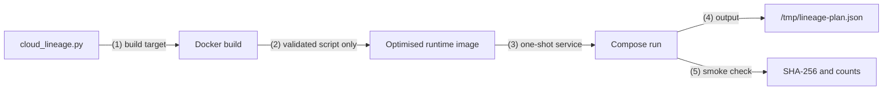

# Docker and Docker Compose Optimisation

## 1. Problem and approach

The platform's jobs and services are packaged as container images. Large images slow every pull, scan and deployment, and they widen the attack surface. The image-size reduction is demonstrated with a **matched A/B experiment**:

- the same application;
- the same functional contract;
- two Dockerfile targets: a conventional single-stage *baseline*, and an *optimised* multi-stage image.

Both are measured and functionally compared.

The application chosen for the experiment is the deterministic DataHub lineage-plan publisher ([`cloud_lineage.py`](../../../data_platform/metadata/datahub/lineage/cloud_lineage.py)). It is small and has no third-party dependencies. It produces a fixed output (3 flows, 4 jobs, 32 datasets), so the two images can be compared byte for byte.



**Source:**

- [multi-stage Dockerfile](../../../images/datahub-publisher/Dockerfile);
- [Compose profile](../../../infra/docker/compose.edai1.yml);
- [publisher](../../../data_platform/metadata/datahub/lineage/cloud_lineage.py).

## 2. Baseline

The baseline target uses the full `python:3.13.9-bookworm` image, pinned by digest. It copies the application and runs as root. This is the typical "first working Dockerfile".

## 3. Optimisation techniques

| Technique | Implementation | Effect |
|---|---|---|
| Slim runtime base | The build and runtime stages use `python:3.13.9-slim-bookworm` (digest-pinned) | Removes the compiler toolchain and general-purpose packages |
| Multi-stage build with validation | The `build` stage compiles and executes the script, and asserts the expected `(flows, jobs, datasets)` counts. Only the validated script is copied into the runtime stage | No build workspace or compiler artefacts in the final image; a broken script fails the build |
| Minimal payload | The runtime stage contains only the application file | Fewer and smaller layers |
| Non-root user | UID/GID `65532:65532` is created explicitly; files are copied with matching ownership | The container never runs as root |
| Reproducible inputs | Dockerfile syntax 1.7; both base images pinned by digest | A mutable tag cannot silently change the result |

The publisher has no third-party Python packages, so this experiment does not need a dependency lockfile. Other images in the repository install their dependencies from `uv.lock`.

## 4. Docker Compose runtime hardening

The `edai1` Compose profile builds the optimised target and runs it as a one-shot job. The service is hardened as follows:

| Area | Setting |
|---|---|
| User | Fixed UID/GID `65532:65532` |
| Filesystem | Read-only root filesystem; a 16 MiB `/tmp` tmpfs mounted `nosuid,nodev,noexec` |
| Network and privileges | No network; all Linux capabilities dropped; `no-new-privileges` |
| Resource limits | 64 PIDs, 128 MiB of memory, 0.5 CPU |
| Lifecycle | No restart policy; a single `--output /tmp/lineage-plan.json` run |

With Compose 5.1.3, the build used the intended target and the run exited with code 0. No container was left behind afterwards.

## 5. Results

Both variants were built from the same source (commit `561910ee…`) and run with the same arguments.

| Metric | Baseline | Optimised | Change |
|---|---:|---:|---:|
| Uncompressed image size | 381,961,667 B | 44,171,603 B | **−337,790,064 B (−88.44 %)** |
| Compressed export | 379,952,566 B | 43,804,253 B | −88.47 % |
| Application layers | 9 | 7 | −2 |
| Runtime user | UID 0 (root) | UID/GID 65532 | non-root |
| Smoke output SHA-256 | `037cf219…f356` | identical | same behaviour |
| Flows / jobs / datasets | 3 / 4 / 32 | 3 / 4 / 32 | identical |

The authoritative result is the preserved [Docker A/B JSON](../../evidence/edai1/docker/raw/docker_datahub_publisher_ab.json)
(SHA-256 `44590137932dc159fcd984ce947e6bc69bc5fa7e28ed37e8de0ace5a073dda89`).
The excerpt below is raw historical evidence, not a screenshot and not a new execution:

```json
{
  "started_at": "2026-10-29T08:56:58.252922+00:00",
  "finished_at": "2026-10-29T08:57:16.710838+00:00",
  "scope": "local Docker build; existing containers were not modified",
  "functional_equivalence": true,
  "variants": {
    "baseline": {"size_bytes": 381961667, "layer_count": 9},
    "optimized": {"size_bytes": 44171603, "layer_count": 7}
  }
}
```

Compose evidence is retained as original text: [resolved configuration](../../evidence/edai1/docker/raw/compose_config.txt),
[build log](../../evidence/edai1/docker/raw/compose_build.txt),
[run log](../../evidence/edai1/docker/raw/compose_run.txt),
[exit code](../../evidence/edai1/docker/raw/compose_run.exit_code),
[image inspection](../../evidence/edai1/docker/raw/image_inspect.json), and
[post-run container list](../../evidence/edai1/docker/raw/residual_containers.txt).
This is historical output from the recorded Compose run, not evidence that Compose is currently running.

```text
service: datahub-lineage-publisher
target: optimized
user: 65532:65532
read_only: true
network_mode: none
compose run exit code: 0
post-run container list: no containers
```

**Screenshot status:** `SCREENSHOT_MISSING`. No authentic Docker Desktop or
terminal-window capture from this historical run was retained; raw evidence is
used instead of the former programmatic terminal-like renders.

## 6. Discussion and limitations

- **Where the reduction comes from.** Almost the whole reduction comes from the base image: the full Bookworm image carries a compiler toolchain and system packages that a pure-Python job never uses. The multi-stage build makes the slim runtime safe, because the script is executed and validated in the build stage before it is copied.
- **Scope of the measurement.** Only image size is measured. The recorded run did not separate pull, build and start-up times, so no start-up improvement is claimed.
- **Scope of the experiment.** The experiment covers one representative image, not every image in the repository.
- **Later build.** A later Compose build of the same target produced an image of 44,172,764 bytes, 1,161 bytes larger. The difference is a rebuild artefact. The matched comparison above uses the images built in the same experiment.
