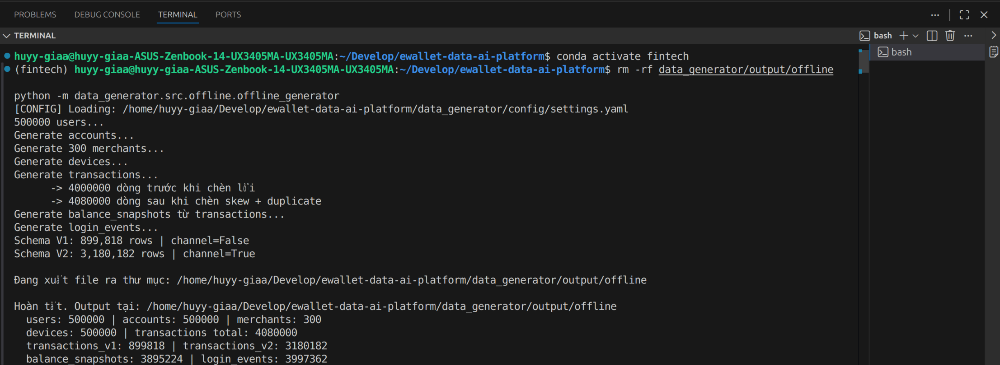

# Novel Idea 1: Deterministic Sharding and Immutable Dataset Publication

## 1. Summary

The idea is a reproducible data-product protocol for generating the 100 GB dataset:

- deterministic, bounded-memory shards;
- content identity for every file;
- resumable, create-only publication;
- a final immutable manifest that downstream pipelines verify before they read.

## 2. Problem and motivation

A single-process generator can satisfy a volume target but is operationally weak. A retry may produce different rows, partial uploads may look complete, and a changed configuration can silently reuse an existing dataset name. At 100 GB, restarting from zero after one failure is costly.

The system addresses those failure modes by making the generation plan and every published object independently verifiable. Dataset completeness is represented by a final manifest, not by the existence of a storage prefix.

## 3. Novel contribution

The contribution is the combination of:

- a canonical JSON plan digest that freezes configuration, version, seed and dimensions;
- a shard seed derived only from the immutable plan and shard ID;
- process-isolated shard generation with bounded in-flight work;
- per-file SHA-256, MD5, size, row count and schema fingerprint;
- create-only object writes with conflict detection and read-after-write verification;
- resumability that verifies completed shards before skipping them;
- a final manifest written only after every shard is present and valid;
- deterministic ordering and an explicit dataset-version identity for downstream provenance.

These controls turn a synthetic-data job into an immutable, retry-safe source dataset. This is an engineering novelty claim for this project, not a claim that hashing, sharding or manifests are new computer-science inventions.

## 4. Architecture and dataflow

The coordinator is the only process that schedules unfinished shards, publishes objects and finalizes the dataset. Worker-local randomness cannot leak across shards, and a failed worker leaves already verified shard manifests reusable.

## 5. Implementation map

| Module | Verified function or class | Responsibility |
|---|---|---|
| `data_platform/generation/src/sharded/planner.py` | `canonical_json_sha256`, `build_shard_plan`, `derive_shard_seed` | Freeze plan identity and derive stable 32-bit shard seeds |
| `data_platform/generation/src/sharded/models.py` | `ShardPlan`, `ShardFileMetadata`, `ShardManifest` | Typed plan and manifest contracts |
| `data_platform/generation/src/sharded/generator.py` | `generate_shard`, `_file_metadata` | Generate isolated shards and compute file metadata |
| `data_platform/generation/src/sharded/manifest.py` | `DatasetPublisher.ensure_plan`, `completed_shard`, `publish_shard`, `finalize` | Create-only publication, conflict detection, resume and final commit marker |
| `data_platform/generation/src/sharded/storage.py` | `ObjectStore`, `GcloudObjectStore` | Conditional storage writes and metadata read-back |
| `data_platform/generation/src/sharded/profile_manifest.py` | `build_profile` | Produce a profile bound to plan and final manifest |
| `ops/gcp/generate_source_dataset.py` | command entry point | Coordinate planning, workers, publication and resume |
| `ops/gcp/validate_canonical_source_gate.py` | command entry point | Validate object inventory, counts, sizes, MD5 and final status |

## 6. Algorithm and integrity contract

1. Normalize the generation configuration as canonical sorted JSON and hash it.
2. Build a `ShardPlan` containing schema version, dataset version, global seed, dimensions and configuration hash; hash that identity as `plan_digest`.
3. Derive each shard seed from dataset version, global seed, plan digest and shard ID.
4. Generate each shard in its own directory and record table-level rows, bytes, SHA-256, MD5 and schema SHA-256.
5. Upload each object with create-only semantics. If the path exists, require its size and checksum to match; otherwise fail with `ObjectConflictError`.
6. Publish a shard manifest only after every file is remotely verified.
7. On retry, validate the shard-manifest identity and every referenced object before treating the shard as complete.
8. Finalize only when all expected manifests exist. Aggregate counts and fingerprints in deterministic shard order, then write `dataset_manifest.json` as the completion marker.

Controlled duplicate generation remains explicit. The canonical population contains 369,600,000 logical transactions and 376,992,000 physical transaction rows, a difference of 7,392,000 or exactly 2%. Schema evolution is observable because each table records its set of schema SHA-256 values; an unexpected schema set fails the source gate rather than being silently accepted.

## 7. Experimental setup

The canonical profile used dataset version `canonical-100gb-v1`, global seed `7001`, 12,500 users, 300 merchants and 100,000 logical transactions per shard. One calibration shard measured 27,059,611 bytes, 20.585 seconds and 300,478,464 bytes peak RSS. The calibrated plan contained 3,696 shards.

A bounded local benchmark generated four identical canonical-size shards with 1, 2 and 4 workers. Upload and cloud-manifest publication were excluded, so these timings are not presented as the canonical cloud runtime.

## 8. Quantitative results

| Result | Value | Source |
|---|---:|---|
| Final manifest status | `COMPLETE` | final GCS manifest |
| Physical persisted bytes | 100,156,470,260 | final GCS manifest |
| Shards | 3,696 | final GCS manifest |
| Logical transactions | 369,600,000 | final GCS manifest |
| Physical transaction rows | 376,992,000 | final GCS manifest |
| Fraud-label rows | 369,600,000 | final GCS manifest |
| Controlled duplicate rows/rate | 7,392,000 / 2.00% | final GCS manifest |
| Parquet objects | 33,264 | source gate |
| Plan digest | `da043b9ad8a1121cad93fd5bca9633d036c7e2c9da3894cfd85b7d3af793046f` | final GCS manifest |
| GCS manifest generation | `1792824840507681` | final GCS manifest |
| 1-worker benchmark | 98.791 s / 1.00× | local benchmark |
| 2-worker benchmark | 47.094 s / 2.10× | local benchmark |
| 4-worker benchmark | 28.212 s / 3.50×; 1.314 GB peak aggregate RSS | local benchmark |

The three benchmark modes produced byte-identical Parquet files, identical per-shard manifests and identical checksums. The successful canonical source was consumed by downstream DP1; this is functional evidence that the manifest-backed source was usable, not merely present in GCS.

## 9. Correctness validation and provenance

The authoritative inspected summary is:

`/home/huyy-giaa/ewallet-evidence/edai1-deep-audit-20261029/20261029T071108Z/gcs_canonical_manifest_summary.json`

- SHA-256: `df52b39ac7951523661cd88f5d8ce705835f8d8b22b6c44543d91193ebfffc73`
- GCS object: `source/canonical-100gb-v1/_control/dataset_manifest.json`
- Created/updated: `2026-10-24T06:54:00.544Z`
- Object MD5: `zb4xFQ9uTRv4jH1mGZbulA==`

The dataset was generated by implementation commit `bbae48caef7f65fda0c9375a7a49afb2eca5eef4`.

## 10. Screenshot

*Generated source on the local 500k-user dataset: the V1 transaction files physically lack `channel`, and the V2 files contain it. The 100 GB dataset records the same two schema fingerprints in its manifest. (SHA-256 `1821c547…`)*

## 11. Limitations

- The local parallel benchmark excludes GCS upload and cannot establish end-to-end canonical runtime.
- The final source volume required a bounded 35-object size remediation. It used generation preconditions, an immutable plan and rollback ledger; it should not be presented as a single uninterrupted first-attempt run.
- Immutable publication prevents accidental overwrite but does not replace bucket retention, access control or disaster recovery.
- Determinism is proven for the measured shard modes and content contracts; changes to library versions or Parquet encoders require a new dataset version.

## 12. Reproducibility

Use the commands and safety gates in `docs/cloud/canonical_100gb_readiness.md`. First run the calibration and dry-run plan, verify that the plan resolves to 3,696 shards, then execute with the same dataset version and plan. Resume only with identical inputs. Finally run `ops.gcp.validate_canonical_source_gate` and retain the plan, all shard manifests, the final manifest, command logs, source SHA and downstream DP1 run identity.

Reproduction must use a new dataset version if any frozen input or dependency changes. Do not overwrite `canonical-100gb-v1`.
