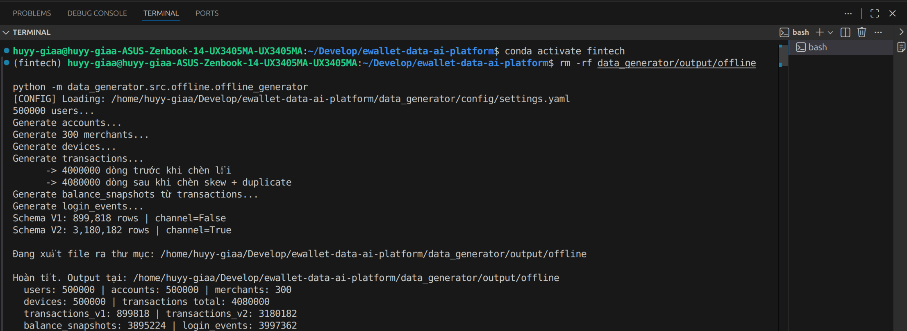

# Novel Idea 1: Deterministic Sharding and Immutable Dataset Publication

## 1. Summary

The idea is a reproducible data-product protocol for generating the project's 5GB source dataset, `rehearsal-5gb-v1`:

- deterministic, bounded-memory shards;
- content identity for every file;
- resumable, create-only publication;
- a final immutable manifest that downstream pipelines verify before they read.

## 2. Problem and motivation

A single-process generator can satisfy a volume target but is operationally weak. A retry may produce different rows, partial uploads may look complete, and a changed configuration can silently reuse an existing dataset name. Even at 5 GB, published over about 1.5 hours, restarting from zero after one failure is costly, and the cost grows with every larger dataset version.

The system addresses those failure modes by making the generation plan and every published object independently verifiable. Dataset completeness is represented by a final manifest, not by the existence of a storage prefix.

## 3. Novel contribution

The contribution is the combination of:

- a canonical JSON plan digest that freezes configuration, version, seed and dimensions;
- a shard seed derived only from the immutable plan and shard ID;
- process-isolated shard generation with bounded in-flight work;
- per-file SHA-256, MD5, size, row count and schema fingerprint;
- create-only object writes with conflict detection and read-after-write verification;
- resumability that verifies completed shards before skipping them;
- a final manifest written only after every shard is present and valid;
- deterministic ordering and an explicit dataset-version identity for downstream provenance.

These controls turn a synthetic-data job into an immutable, retry-safe source dataset. This is an engineering novelty claim for this project, not a claim that hashing, sharding or manifests are new computer-science inventions.

## 4. Architecture and dataflow

The coordinator is the only process that schedules unfinished shards, publishes objects and finalizes the dataset. Worker-local randomness cannot leak across shards, and a failed worker leaves already verified shard manifests reusable.

## 5. Implementation map

| Module | Verified function or class | Responsibility |
|---|---|---|
| `data_platform/generation/src/sharded/planner.py` | `canonical_json_sha256`, `build_shard_plan`, `derive_shard_seed` | Freeze plan identity and derive stable 32-bit shard seeds |
| `data_platform/generation/src/sharded/models.py` | `ShardPlan`, `ShardFileMetadata`, `ShardManifest` | Typed plan and manifest contracts |
| `data_platform/generation/src/sharded/generator.py` | `generate_shard`, `_file_metadata` | Generate isolated shards and compute file metadata |
| `data_platform/generation/src/sharded/manifest.py` | `DatasetPublisher.ensure_plan`, `completed_shard`, `publish_shard`, `finalize` | Create-only publication, conflict detection, resume and final commit marker |
| `data_platform/generation/src/sharded/storage.py` | `ObjectStore`, `GcloudObjectStore` | Conditional storage writes and metadata read-back |
| `data_platform/generation/src/sharded/profile_manifest.py` | `build_profile` | Produce a profile bound to plan and final manifest |
| `ops/gcp/generate_source_dataset.py` | command entry point | Coordinate planning, workers, publication and resume |
| `ops/gcp/verify_source_dataset.py` | command entry point | Validate manifest and plan, registry pins, object inventory, sizes, MD5 and final status |

## 6. Algorithm and integrity contract

1. Normalize the generation configuration as canonical sorted JSON and hash it.
2. Build a `ShardPlan` containing schema version, dataset version, global seed, dimensions and configuration hash; hash that identity as `plan_digest`.
3. Derive each shard seed from dataset version, global seed, plan digest and shard ID.
4. Generate each shard in its own directory and record table-level rows, bytes, SHA-256, MD5 and schema SHA-256.
5. Upload each object with create-only semantics. If the path exists, require its size and checksum to match; otherwise fail with `ObjectConflictError`.
6. Publish a shard manifest only after every file is remotely verified.
7. On retry, validate the shard-manifest identity and every referenced object before treating the shard as complete.
8. Finalize only when all expected manifests exist. Aggregate counts and fingerprints in deterministic shard order, then write `dataset_manifest.json` as the completion marker.

Controlled duplicate generation remains explicit. The 5GB population contains 18,600,000 logical transactions and 18,972,000 physical transaction rows, a difference of 372,000 or exactly 2%. Schema evolution is observable because each table records its set of schema SHA-256 values; an unexpected schema set fails the source gate rather than being silently accepted.

## 7. Experimental setup

The 5GB profile ([`cloud-rehearsal-5gb.yaml`](../../../configs/generation/cloud-rehearsal-5gb.yaml)) used dataset version `rehearsal-5gb-v1`, global seed `7001`, 12,500 users, 300 merchants and 100,000 logical transactions per shard, and 186 shards. It was published with two workers on 2026-11-10 to its own bucket, `ewallet-data-ai-platform-hg26-rehearsal-5gb-data`.

A bounded local benchmark generated four shards with the same per-shard dimensions with 1, 2 and 4 workers. Upload and cloud-manifest publication were excluded, so these timings are not presented as the cloud publication runtime.

## 8. Quantitative results

| Result | Value | Source |
|---|---:|---|
| Final manifest status | published and verified | source verifier, 2026-11-10 |
| Physical persisted bytes | 5,000,608,241 | final GCS manifest, as recorded by DP1 |
| Shards | 186 | final GCS manifest |
| Logical transactions | 18,600,000 | Silver validation |
| Physical transaction rows | 18,972,000 | Bronze validation |
| Fraud-label rows | 18,600,000 | Bronze and Silver validation |
| Controlled duplicate rows/rate | 372,000 / 2.00% | Bronze minus Silver |
| Plan digest | `422c15a169165158fcd7d432a7943d50812b5f3e55e7d0c6aec7c457371c6c83` | final GCS manifest |
| Manifest SHA-256 | `ac2dfb0eac16e173261b3c3f65e83a03d388528538daefd9ec669bef7123eb80` | pinned by every DP1–DP3 DagRun |
| 1-worker benchmark | 98.791 s / 1.00× | local benchmark |
| 2-worker benchmark | 47.094 s / 2.10× | local benchmark |
| 4-worker benchmark | 28.212 s / 3.50×; 1.314 GB peak aggregate RSS | local benchmark |

The three benchmark modes produced byte-identical Parquet files, identical per-shard manifests and identical checksums. The 5GB source was then consumed by DP1 in both Spark profiles of campaign `ab-20261110225456`, each run pinning the same manifest SHA-256; this is functional evidence that the manifest-backed source was usable, not merely present in GCS.

**Earlier 100 GB publication.** The same protocol first published `canonical-100gb-v1`: 100,156,470,260 bytes in 3,696 shards (33,264 Parquet objects), 369,600,000 logical and 376,992,000 physical transactions, final manifest `COMPLETE` on 2026-10-24 (plan digest `da043b9a…`), generated from commit `bbae48ca`. It needed a bounded 35-object size remediation, carried out under the same create-only preconditions and a rollback ledger. The current reports use only the 5GB dataset.

## 9. Correctness validation and provenance

- GCS object: `gs://ewallet-data-ai-platform-hg26-rehearsal-5gb-data/source/rehearsal-5gb-v1/_control/dataset_manifest.json`.
- Manifest SHA-256: `ac2dfb0eac16e173261b3c3f65e83a03d388528538daefd9ec669bef7123eb80`, recorded in the DP1 handoff manifests of both profiles ([baseline](../../evidence/edai1/spark/rehearsal-5gb-ab-20261110225456/manifests/baseline/dp1_handoff.json), [optimized](../../evidence/edai1/spark/rehearsal-5gb-ab-20261110225456/manifests/optimized/dp1_handoff.json)) together with `physical_bytes` and `plan_digest`.
- Row counts: the Bronze and Silver [validation reports](../../evidence/edai1/spark/rehearsal-5gb-ab-20261110225456/validation_reports/) of the same campaign.
- Verification: `ops.gcp.verify_source_dataset` checks the manifest and plan, the registry pins (186 shards, seed 7001, generator configuration, 4.5–5.5 GB) and every object's size and MD5, and exits non-zero on any violation.

## 10. Screenshot

*Generated source on the local 500k-user dataset: the V1 transaction files physically lack `channel`, and the V2 files contain it. The same generator code produced the V1/V2 split of `rehearsal-5gb-v1`, which DP1 aligned and validated. (SHA-256 `1821c547…`)*

## 11. Limitations

- The local parallel benchmark excludes GCS upload and cannot establish the end-to-end cloud publication runtime.
- The 5GB publication time (about 1.5 hours with two workers, per the runbook) is an operational estimate, not a recorded measurement.
- Immutable publication prevents accidental overwrite but does not replace bucket retention, access control or disaster recovery.
- Determinism is proven for the measured shard modes and content contracts; changes to library versions or Parquet encoders require a new dataset version.

## 12. Reproducibility

Use the commands and safety gates in the [EDAI-1 campaign runbook](../../runbooks/edai1/cloud/edai1_campaign_runbook.md) (Part 0 and Part 1). First run the dry-run plan and check that it resolves to 186 shards and plan digest `422c15a1…`, then execute with the same dataset version and plan. Resume only with identical inputs. Finally run `ops.gcp.verify_source_dataset` and retain the plan, all shard manifests, the final manifest, command logs, source SHA and downstream DP1 run identity.

Reproduction must use a new dataset version if any frozen input or dependency changes. Do not overwrite `rehearsal-5gb-v1`.
