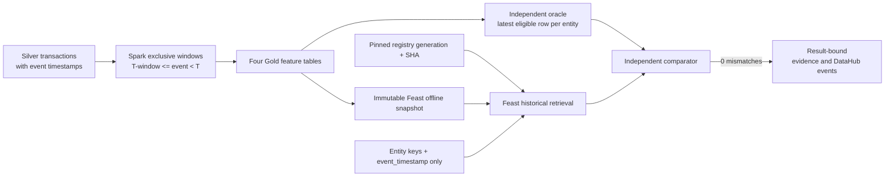
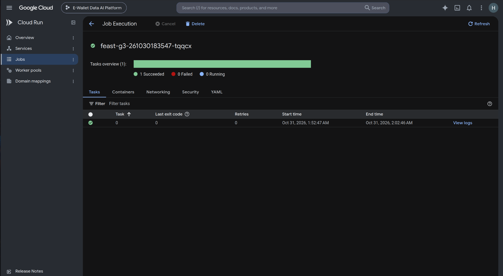
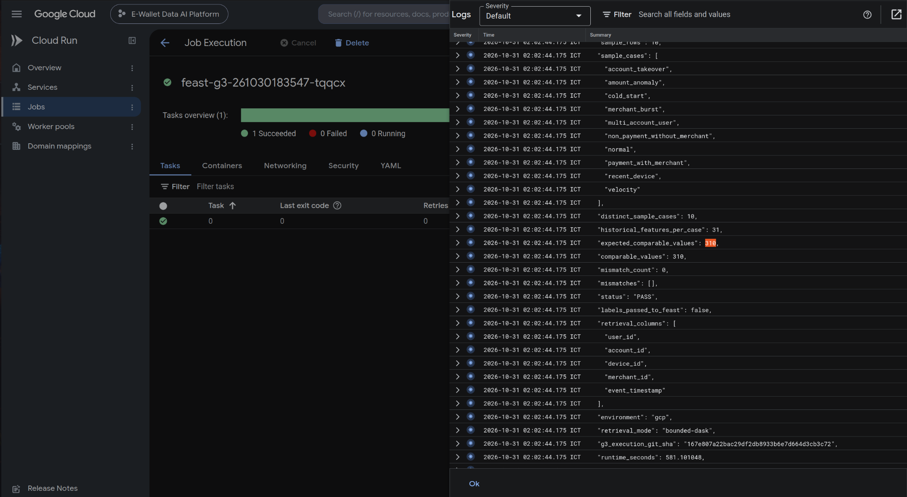
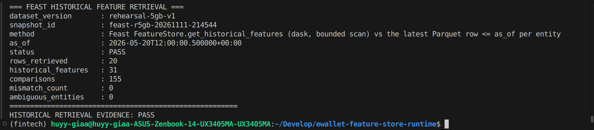
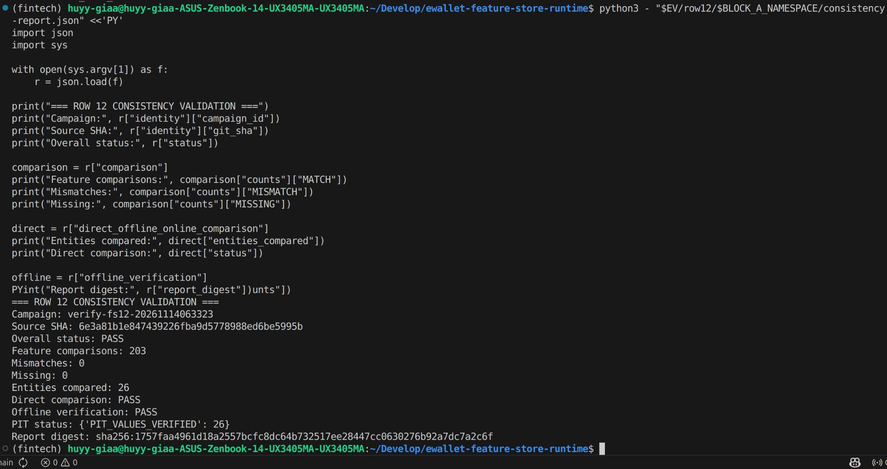

# Novel Idea 2: Independent Point-in-Time Correctness and Leakage Validation

## 1. Summary

Feast historical retrieval by itself is standard functionality and is not the contribution. The contribution has three parts:

- an independent, provenance-locked oracle that compares what Feast returns with values found without Feast, directly from the stored feature data;
- a check that rejects any label leakage;
- the publication of the verified outcome as result-bound DataHub assertions.

## 2. Problem and motivation

Fraud features must describe only information available before the scored transaction. A conventional aggregation that includes the current row or a future row leaks information and inflates offline model quality. A successful Feast API call proves neither that the upstream Gold features used an exclusive temporal boundary nor that labels were excluded from the retrieval payload.

The validation therefore tests both layers: Spark constructs features with strict event-time windows, while a separate validator retrieves the same cases through Feast and compares every value with an oracle that never goes through Feast.

## 3. Contribution and novelty boundary

The contribution is a fail-closed validation protocol:

- Spark windows encode `[T-window, T)` by ending at one microsecond before the current event;
- complete-history features likewise use only strictly earlier rows;
- ten deliberately different fraud and edge-case scenarios form a frozen sample contract;
- expected values are exported independently from Gold and bound to source/run identities;
- Feast receives only entity keys and timezone-aware `event_timestamp`;
- `label` and `fraud_type` are forbidden in retrieved columns;
- 31 expected values per case are compared with deterministic equality rules;
- registry generation and SHA-256 are read back and pinned before comparison;
- results are subsequently represented by four result-bound DataHub assertion runs.

The novelty is the cross-system validation methodology and evidence binding, not the use of Feast, temporal windows, or DataHub individually.

## 4. Architecture and dataflow

## 5. Implementation map

| Module | Verified function or contract | Responsibility |
|---|---|---|
| `data_platform/processing/spark/gold/features/temporal.py` | `historical_window`, `complete_history_window` | Enforce exclusive event-time windows ending at `T-1 microsecond` |
| `data_platform/processing/spark/gold/features/user_features.py` | `build_feat_user_behavior` | User historical aggregates |
| `data_platform/processing/spark/gold/features/account_features.py` | `build_feat_account_behavior` | Account historical aggregates |
| `data_platform/processing/spark/gold/features/device_features.py` | `build_feat_device_behavior` | Device historical aggregates |
| `data_platform/processing/spark/gold/features/merchant_features.py` | `build_feat_merchant_behavior` | Merchant historical aggregates |
| `data_platform/processing/spark/gold/features/validation.py` | `validate_feature_columns` | Feature-schema validation |
| `data_platform/processing/spark/gold/historical_feature_pipeline.py` | `feature_definitions`, `run_historical_feature_pipeline` | Build run-scoped feature outputs |
| `ai_platform/features/feast/retrieval/historical.py` | `retrieve_feature_view`, `retrieve_combined` | Perform historical retrieval through Feast |
| `ai_platform/features/feast/validation/contracts.py` | frozen 10-row/31-feature/310-value contracts | Reject sample or feature-contract drift (direct-Gold case validator) |
| `ai_platform/features/feast/validation/snapshot_retrieval.py` | snapshot retrieval check | Compare Feast historical retrieval with the latest eligible Parquet row per entity |
| `data_platform/streaming/verification/consistency.py` | streaming consistency report | Verify Offline point-in-time values and Online state after a streaming campaign |
| `ai_platform/features/feast/validation/canonical_sample.py` | `validate_sample_frame`, `validate_retrieved_frame`, `validate_canonical_sample` | Validate oracle, leakage, alignment and value equality |
| `ai_platform/features/feast/validation/precision_audit.py` | `audit_precision` | Quantify direct-Gold precision before comparison |

The result-bound publisher and raw read-back are documented separately in the [DataHub governance report](../datahub/DATAHUB_GOVERNANCE.md); they are not duplicated here.

## 6. Validation methodology

For a feature event at time `T`, Spark defines the finite historical window as:

`[T - window_seconds, T)`

Implementation uses a microsecond event key and `rangeBetween(-window × 1,000,000, -1)`. The current transaction is therefore excluded. Complete-history windows end at `-1` for the same reason.

The independent validator then:

1. Requires exactly ten unique named scenarios and a timezone-aware UTC timestamp.
2. Requires the frozen 31 expected feature columns.
3. Validates payment/non-payment merchant semantics.
4. Projects only `user_id`, `account_id`, `device_id`, `merchant_id` and `event_timestamp` into Feast.
5. Requires the immutable validation-export lineage and pinned registry read-back identity.
6. Retrieves four FeatureViews and verifies row shape and entity/timestamp alignment.
7. Fails if `label` or `fraud_type` appears in retrieval output.
8. Compares 10 × 31 values; floating-point values use `rel_tol=1e-9` and `abs_tol=1e-9`, while nulls match only nulls.
9. Emits a machine-readable result with mismatch details, runtime, memory, source roots and registry identity.

This oracle is stronger than checking that retrieval completed: it can detect temporal-boundary bugs, contract drift, row misalignment, label leakage and registry/snapshot identity mismatch.

## 7. Experimental setup and identities

The protocol was exercised on the 5GB dataset `rehearsal-5gb-v1` by two independent checks, both run as part of the [Feature Store](../../edai2/mlops/FEATURE_STORE.md) campaigns.

| Attribute | Historical retrieval check | Streaming Offline verification |
|---|---|---|
| Source | DP3 feature run `ab-20261110225456-optimized-feat-r261110225459` (Git `aae22b08`) | streaming campaign `verify-fs12-20261114063323` (source commit `6e3a81b1`) |
| Offline snapshot | `feast-r5gb-20261111-214544` | the campaign's Offline path |
| Oracle | the latest Parquet row at or before `as_of`, found per entity without Feast | the latest eligible Parquet row per entity, found without Feast |
| Feast call | `get_historical_features()` (Dask, bounded scan) at `as_of` 2026-05-20T12:00:00.5Z | `get_historical_features()` per entity |

Before any comparison, the export of the four feature views was verified independently: 63,238,144 rows in total, each view's row count equal to its source manifest, the column contract satisfied and Delta version 0 ([`independent_verification.txt`](../../evidence/edai2/feature-store/fs-20261112/phase-a-export/independent_verification.txt)). The exported views carry only entity keys, timestamps and the 31 features, so no `label` or `fraud_type` column can reach Feast.

## 8. Quantitative results

| Metric | Historical retrieval | Streaming Offline verification |
|---|---:|---:|
| Historical features | 31 | 31 |
| Rows retrieved / entities | 20 rows | 26 entities |
| Comparisons | 155 | 203 |
| Mismatches | 0 | 0 |
| Ambiguous entities | 0 | — |
| Point-in-time values verified | — | 26/26 (`PIT_VALUES_VERIFIED`) |

The results show no mismatch and no detected leakage for the evaluated samples. They do not prove absence of leakage for every transaction or future code version.

**Earlier direct-Gold validation (100 GB snapshot).** The ten-case direct-Gold validator described in §6 ran once, as Cloud Run job `feast-g3-261030183547` (validator SHA `167e807a`, 2026-10-30), on a training snapshot of the earlier 100 GB dataset. It compared 10 cases × 31 features: **310/310 values matched, 0 mismatches**, labels were not passed to Feast, and four result-bound DataHub assertion runs were recorded as PASS. It has not been re-run on the 5GB dataset; the 5GB evidence above comes from the two Feast-independent oracles.

*Cloud Run execution `feast-g3-261030183547-tqqcx` of the earlier direct-Gold validation: one task succeeded, zero failed.*

*Its Cloud Logging result: 10 cases, 31 features per case, 310 comparisons, `mismatch_count: 0`, `status: PASS`, `labels_passed_to_feast: false`.*

## 9. Raw evidence and correctness validation

- Historical retrieval: [`historical_retrieval.json`](../../evidence/edai2/feature-store/fs-20261112/phase-a-export/historical_retrieval.json) (`status: PASS`, `mismatch_count: 0`, `ambiguous_entities: 0`) and its export manifest and lineage in the same folder.
- Streaming consistency: the report of campaign `verify-fs12-20261114063323`, whose SHA-256 digest is recomputed by `verification.cli check-report`; see [Feature Store §9.2](../../edai2/mlops/FEATURE_STORE.md#92-streaming-verification-on-gke).

## 10. Evidence screenshots

*`get_historical_features` on the 5GB snapshot at 2026-05-20T12:00:00.5Z: 20 rows and 31 features, 155 comparisons, 0 mismatches, 0 ambiguous entities.*

*Consistency report of campaign `verify-fs12-20261114063323`: 203 feature comparisons over 26 entities, 0 mismatches and 0 missing values, 26/26 point-in-time values verified.*

## 11. Limitations

- Standard Feast PIT retrieval is not itself a novel contribution. The defensible contribution is the Feast-independent oracle and the immutable provenance checks.
- The 5GB checks sample 20 rows and 26 entities; they are not exhaustive or statistically representative of the full dataset. The ten curated edge cases of the direct-Gold validator ran only on the earlier 100 GB snapshot.
- Zero mismatches proves parity between the selected oracle and retrieved values; a common upstream semantic bug could evade detection if both inputs inherited it. The separate Spark exclusive-window tests reduce, but do not eliminate, that risk.
- The report does not claim deterministic Feast serialization across independent registry publications.

## 12. Reproducibility

Use a new run identity and immutable output prefix. Record the source SHA, lock hash, container digest, feature/Silver run IDs, snapshot ID, validation-export lineage and registry generation/SHA before execution. Run the focused temporal and validator tests, then run the snapshot retrieval check and, for the streaming path, the consistency validator, as described in the [Feature Store runbook](../../runbooks/edai2/FEATURE_STORE_RUNBOOK.md). Require zero mismatches, zero ambiguous entities and every sampled point-in-time value verified. Preserve the output JSON, execution metadata and logs by checksum. Publish DataHub result-bound events only from the completed artifact and read them back.

Do not republish or overwrite the existing registry merely to reproduce this report; use create-only recovery semantics or a new registry generation.
