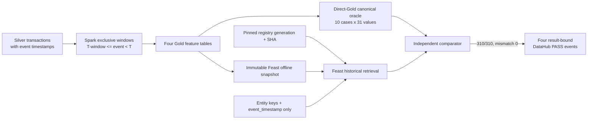
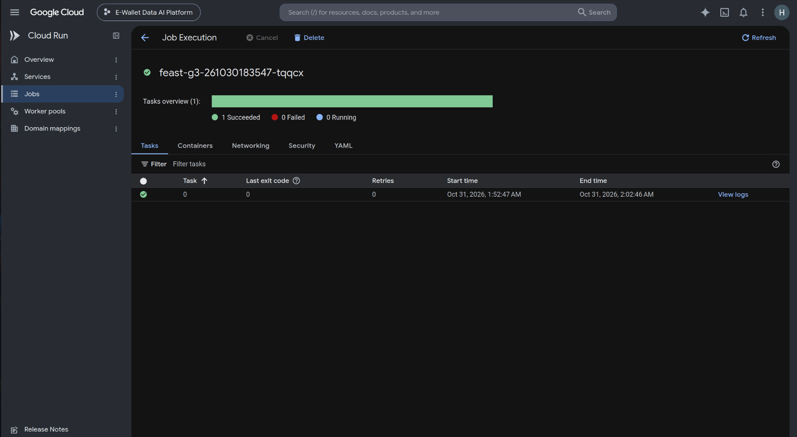
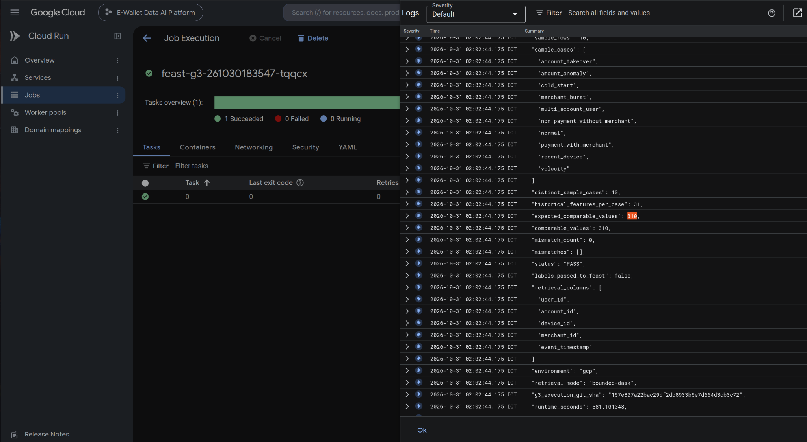

# Novel Idea 2: Independent Point-in-Time Correctness and Leakage Validation

## 1. Summary

Feast historical retrieval by itself is standard functionality and is not the contribution. The contribution has three parts:

- an independent, provenance-locked oracle that compares values computed directly from Gold with what Feast returns;
- a check that rejects any label leakage;
- the publication of the verified outcome as result-bound DataHub assertions.

## 2. Problem and motivation

Fraud features must describe only information available before the scored transaction. A conventional aggregation that includes the current row or a future row leaks information and inflates offline model quality. A successful Feast API call proves neither that the upstream Gold features used an exclusive temporal boundary nor that labels were excluded from the retrieval payload.

The validation therefore tests both layers: Spark constructs features with strict event-time windows, while a separate validator retrieves the same canonical cases through Feast and compares every value with a direct-Gold oracle.

## 3. Contribution and novelty boundary

The contribution is a fail-closed validation protocol:

- Spark windows encode `[T-window, T)` by ending at one microsecond before the current event;
- complete-history features likewise use only strictly earlier rows;
- ten deliberately different fraud and edge-case scenarios form a frozen sample contract;
- expected values are exported independently from Gold and bound to source/run identities;
- Feast receives only entity keys and timezone-aware `event_timestamp`;
- `label` and `fraud_type` are forbidden in retrieved columns;
- 31 expected values per case are compared with deterministic equality rules;
- registry generation and SHA-256 are read back and pinned before comparison;
- results are subsequently represented by four result-bound DataHub assertion runs.

The novelty is the cross-system validation methodology and evidence binding, not the use of Feast, temporal windows, or DataHub individually.

## 4. Architecture and dataflow

## 5. Implementation map

| Module | Verified function or contract | Responsibility |
|---|---|---|
| `data_platform/processing/spark/gold/features/temporal.py` | `historical_window`, `complete_history_window` | Enforce exclusive event-time windows ending at `T-1 microsecond` |
| `data_platform/processing/spark/gold/features/user_features.py` | `build_feat_user_behavior` | User historical aggregates |
| `data_platform/processing/spark/gold/features/account_features.py` | `build_feat_account_behavior` | Account historical aggregates |
| `data_platform/processing/spark/gold/features/device_features.py` | `build_feat_device_behavior` | Device historical aggregates |
| `data_platform/processing/spark/gold/features/merchant_features.py` | `build_feat_merchant_behavior` | Merchant historical aggregates |
| `data_platform/processing/spark/gold/features/validation.py` | `validate_feature_columns` | Feature-schema validation |
| `data_platform/processing/spark/gold/historical_feature_pipeline.py` | `feature_definitions`, `run_historical_feature_pipeline` | Build run-scoped feature outputs |
| `ai_platform/features/feast/retrieval/historical.py` | `retrieve_feature_view`, `retrieve_combined` | Perform historical retrieval through Feast |
| `ai_platform/features/feast/validation/contracts.py` | frozen 10-row/31-feature/310-value contracts | Reject sample or feature-contract drift |
| `ai_platform/features/feast/validation/canonical_sample.py` | `validate_sample_frame`, `validate_retrieved_frame`, `validate_canonical_sample` | Validate oracle, leakage, alignment and value equality |
| `ai_platform/features/feast/validation/precision_audit.py` | `audit_precision` | Quantify direct-Gold precision before comparison |

The result-bound publisher and raw read-back are documented separately in the [DataHub governance report](../datahub/DATAHUB_GOVERNANCE.md); they are not duplicated here.

## 6. Validation methodology

For a feature event at time `T`, Spark defines the finite historical window as:

`[T - window_seconds, T)`

Implementation uses a microsecond event key and `rangeBetween(-window × 1,000,000, -1)`. The current transaction is therefore excluded. Complete-history windows end at `-1` for the same reason.

The independent validator then:

1. Requires exactly ten unique named scenarios and a timezone-aware UTC timestamp.
2. Requires the frozen 31 expected feature columns.
3. Validates payment/non-payment merchant semantics.
4. Projects only `user_id`, `account_id`, `device_id`, `merchant_id` and `event_timestamp` into Feast.
5. Requires the immutable validation-export lineage and pinned registry read-back identity.
6. Retrieves four FeatureViews and verifies row shape and entity/timestamp alignment.
7. Fails if `label` or `fraud_type` appears in retrieval output.
8. Compares 10 × 31 values; floating-point values use `rel_tol=1e-9` and `abs_tol=1e-9`, while nulls match only nulls.
9. Emits a machine-readable result with mismatch details, runtime, memory, source roots and registry identity.

This oracle is stronger than checking that retrieval completed: it can detect temporal-boundary bugs, contract drift, row misalignment, label leakage and registry/snapshot identity mismatch.

## 7. Experimental setup and identities

| Attribute | Verified value |
|---|---|
| Environment | GCP Cloud Run job |
| Validation run ID | `feast-g3-261030183547` |
| Cloud Run execution | `feast-g3-261030183547-tqqcx` |
| Validator source SHA | `167e807a22bac29df2db8933b6e7d664d3cb3c72` |
| Feature source SHA | `bbae48caef7f65fda0c9375a7a49afb2eca5eef4` |
| Validation-export SHA | `b093547eff1f163491070b69eda27ff4fdc4f5ec` |
| Feature run | `ab-20261025134342-optimized-feat-r261026025955` |
| Silver run | `ab-20261025134342-optimized-silver-r261025181923` |
| Snapshot | `canonical-training-v1-20261028-101106-recovered` |
| Registry generation | `1793255806863364` |
| Registry SHA-256 | `d3e721969c81db12e6180a4f5f9b7ac2a6db95cdc56034eced2ea4780d439b9a` |
| Retrieval mode | `bounded-dask` |
| Cloud Run start | `2026-10-30T18:52:39.971605Z` |
| Cloud Run completion | `2026-10-30T19:02:48.129301Z` |

The ten cases are account takeover, amount anomaly, cold start, merchant burst, multi-account user, non-payment without merchant, normal, payment with merchant, recent device and velocity.

## 8. Quantitative results

| Metric | Result |
|---|---:|
| Sample cases | 10/10 distinct |
| Historical features per case | 31 |
| Comparable values | 310/310 |
| Mismatches | 0 |
| Labels passed to Feast | `false` |
| FeatureViews retrieved | 4 |
| End-to-end validator runtime | 581.101048 s |
| Peak RSS | 2,098,597,888 bytes |
| DataHub PIT assertion runs | 4 PASS |

The result demonstrates no mismatch or detected leakage for the evaluated ten cases. It does not prove absence of leakage for every possible transaction or future code version.

## 9. Raw evidence and correctness validation

Primary artifact:

`/home/huyy-giaa/ewallet-evidence/feast-pit/feast-g3-261030183547/pit-validation.json`

- SHA-256: `dcebde23b144ec77a092bca8ce9758483c32eee4dc1a928fd804718b890eed41`
- Status: `PASS`
- Evidence URI: `gs://ewallet-data-ai-platform-hg26-data/ml/training-staging/canonical-100gb-v1/canonical-training-v1-20261028-101106-recovered/g3/feast-g3-261030183547/evidence/pit-validation.json`

Execution request evidence:

`/home/huyy-giaa/ewallet-evidence/feast-pit/feast-g3-261030183547/cloudrun-execute.json`

- SHA-256: `58a8124c7f014ebe0a9954953775c57636782d20ba1b4bcccfca38963d15f509`
- Recorded command exit code: `0`

DataHub raw read-back is under:

`/home/huyy-giaa/ewallet-evidence/datahub-assertions-20261101/runtime-20261031T220705Z/raw-api-readback/`

It contains `assertionInfo` and `assertionRunEvent` for user, account, device and merchant PIT checks. The four run events are COMPLETE/SUCCESS and preserve the PIT artifact SHA and source run identity.

## 10. Evidence screenshots

The validation ran as a Google Cloud Run job. The screenshots show the job execution and its Cloud Logging result (SHA-256 values in `docs/evidence/edai1/novel_ideas/PIT_UI_SHA256.txt`).

*Google Cloud Run Job Execution UI for `feast-g3-261030183547-tqqcx`, showing one task succeeded, zero failed and zero running. The task ran from 2026-10-31 01:52:47 to 02:02:46 ICT, corresponding to the retained Cloud Run execution window.*

*Original Cloud Logging output at 2026-10-31 02:02:44.175 ICT for execution `feast-g3-261030183547-tqqcx`. It shows ten distinct cases, 31 historical features per case, 310 expected and 310 actual comparisons, `mismatch_count: 0`, `status: PASS`, and `labels_passed_to_feast: false`. The visible execution Git SHA is `167e807a22bac29df2db8933b6e7d664d3cb3c72`.*

The raw oracle JSON and the DataHub API read-back are the machine-readable record. The four DataHub point-in-time assertion events are COMPLETE/SUCCESS in both semantic and raw read-back; no DataHub UI screenshot of them was kept.

## 11. Limitations

- Standard Feast PIT retrieval is not itself a novel contribution. The defensible contribution is the independent direct-Gold oracle and immutable provenance checks.
- Ten curated cases provide high-value boundary coverage but are not exhaustive or statistically representative of the full dataset.
- Zero mismatches proves parity between the selected oracle and retrieved values; a common upstream semantic bug could evade detection if both inputs inherited it. The separate Spark exclusive-window tests reduce, but do not eliminate, that risk.
- No DataHub UI screenshot of the four point-in-time assertion events was kept; they are documented by API read-back.
- Registry bytes were read back and pinned for this run. The report does not claim deterministic Feast serialization across independent publication invocations.

## 12. Reproducibility

Use a new run identity and immutable output prefix. Record the source SHA, lock hash, container digest, feature/Silver run IDs, snapshot ID, validation-export lineage and registry generation/SHA before execution. Run the focused temporal and validator tests, then invoke the canonical sample validator in GCP mode with explicit snapshot and registry locations. Require exactly 10 cases, 31 features, 310 comparisons, zero mismatches and `labels_passed_to_feast=false`. Preserve the output JSON, execution metadata and logs by checksum. Publish DataHub result-bound events only from the completed artifact and read them back through both semantic and raw APIs.

Do not republish or overwrite the existing registry merely to reproduce this report; use create-only recovery semantics or a new registry generation.
