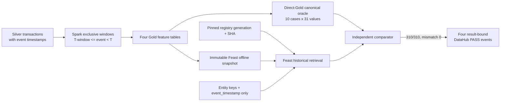

# Novel Idea 2: Independent Point-in-Time Correctness and Leakage Validation

## 1. Rubric mapping

This report addresses **EDAI-1 rubric row 40**, worth 10 points.

| Rubric row | Group | Item | Requirement | Required proof |
|---:|---|---|---|---|
| 40 | Novel ideas — a researched tool or technique not taught in EDAI is acceptable | Idea 2 | Idea 2 | Document the idea and prove that it worked |

Feast historical retrieval by itself is standard functionality and is not claimed as novel. The project contribution is an independent, provenance-locked oracle that compares direct Gold expectations with Feast results, rejects label leakage and publishes the verified outcome as result-bound DataHub assertions.

## 2. Problem and motivation

Fraud features must describe only information available before the scored transaction. A conventional aggregation that includes the current row or a future row leaks information and inflates offline model quality. A successful Feast API call proves neither that the upstream Gold features used an exclusive temporal boundary nor that labels were excluded from the retrieval payload.

The validation therefore tests both layers: Spark constructs features with strict event-time windows, while a separate validator retrieves the same canonical cases through Feast and compares every value with a direct-Gold oracle.

## 3. Contribution and novelty boundary

The contribution is a fail-closed validation protocol:

- Spark windows encode `[T-window, T)` by ending at one microsecond before the current event;
- complete-history features likewise use only strictly earlier rows;
- ten deliberately different fraud and edge-case scenarios form a frozen sample contract;
- expected values are exported independently from Gold and bound to source/run identities;
- Feast receives only entity keys and timezone-aware `event_timestamp`;
- `label` and `fraud_type` are forbidden in retrieved columns;
- 31 expected values per case are compared with deterministic equality rules;
- registry generation and SHA-256 are read back and pinned before comparison;
- results are subsequently represented by four result-bound DataHub assertion runs.

The novelty is the cross-system validation methodology and evidence binding, not the use of Feast, temporal windows, or DataHub individually.

## 4. Architecture and dataflow

## 5. Implementation map

| Module | Verified function or contract | Responsibility |
|---|---|---|
| `data_platform/processing/spark/gold/features/temporal.py` | `historical_window`, `complete_history_window` | Enforce exclusive event-time windows ending at `T-1 microsecond` |
| `data_platform/processing/spark/gold/features/user_features.py` | `build_feat_user_behavior` | User historical aggregates |
| `data_platform/processing/spark/gold/features/account_features.py` | `build_feat_account_behavior` | Account historical aggregates |
| `data_platform/processing/spark/gold/features/device_features.py` | `build_feat_device_behavior` | Device historical aggregates |
| `data_platform/processing/spark/gold/features/merchant_features.py` | `build_feat_merchant_behavior` | Merchant historical aggregates |
| `data_platform/processing/spark/gold/features/validation.py` | `validate_feature_columns` | Feature-schema validation |
| `data_platform/processing/spark/gold/historical_feature_pipeline.py` | `feature_definitions`, `run_historical_feature_pipeline` | Build run-scoped feature outputs |
| `ai_platform/features/feast/retrieval/historical.py` | `retrieve_feature_view`, `retrieve_combined` | Perform historical retrieval through Feast |
| `ai_platform/features/feast/validation/contracts.py` | frozen 10-row/31-feature/310-value contracts | Reject sample or feature-contract drift |
| `ai_platform/features/feast/validation/canonical_sample.py` | `validate_sample_frame`, `validate_retrieved_frame`, `validate_canonical_sample` | Validate oracle, leakage, alignment and value equality |
| `ai_platform/features/feast/validation/precision_audit.py` | `audit_precision` | Quantify direct-Gold precision before comparison |

The result-bound publisher and raw read-back are documented separately in the [DataHub governance report](../datahub/DATAHUB_GOVERNANCE.md); they are not duplicated here.

## 6. Validation methodology

For a feature event at time `T`, Spark defines the finite historical window as:

`[T - window_seconds, T)`

Implementation uses a microsecond event key and `rangeBetween(-window × 1,000,000, -1)`. The current transaction is therefore excluded. Complete-history windows end at `-1` for the same reason.

The independent validator then:

1. Requires exactly ten unique named scenarios and a timezone-aware UTC timestamp.
2. Requires the frozen 31 expected feature columns.
3. Validates payment/non-payment merchant semantics.
4. Projects only `user_id`, `account_id`, `device_id`, `merchant_id` and `event_timestamp` into Feast.
5. Requires the immutable validation-export lineage and pinned registry read-back identity.
6. Retrieves four FeatureViews and verifies row shape and entity/timestamp alignment.
7. Fails if `label` or `fraud_type` appears in retrieval output.
8. Compares 10 × 31 values; floating-point values use `rel_tol=1e-9` and `abs_tol=1e-9`, while nulls match only nulls.
9. Emits a machine-readable result with mismatch details, runtime, memory, source roots and registry identity.

This oracle is stronger than checking that retrieval completed: it can detect temporal-boundary bugs, contract drift, row misalignment, label leakage and registry/snapshot identity mismatch.

## 7. Experimental setup and identities

| Attribute | Verified value |
|---|---|
| Environment | GCP Cloud Run job |
| G3 run ID | `feast-g3-261030183547` |
| Cloud Run execution | `feast-g3-261030183547-tqqcx` |
| Validator source SHA | `167e807a22bac29df2db8933b6e7d664d3cb3c72` |
| Feature source SHA | `bbae48caef7f65fda0c9375a7a49afb2eca5eef4` |
| Validation-export SHA | `b093547eff1f163491070b69eda27ff4fdc4f5ec` |
| Feature run | `ab-20261025134342-optimized-feat-r261026025955` |
| Silver run | `ab-20261025134342-optimized-silver-r261025181923` |
| Snapshot | `canonical-training-v1-20261028-101106-recovered` |
| Registry generation | `1793255806863364` |
| Registry SHA-256 | `d3e721969c81db12e6180a4f5f9b7ac2a6db95cdc56034eced2ea4780d439b9a` |
| Retrieval mode | `bounded-dask` |
| Cloud Run start | `2026-10-30T18:52:39.971605Z` |
| Cloud Run completion | `2026-10-30T19:02:48.129301Z` |

The ten cases are account takeover, amount anomaly, cold start, merchant burst, multi-account user, non-payment without merchant, normal, payment with merchant, recent device and velocity.

## 8. Quantitative results

| Metric | Result | Status |
|---|---:|---|
| Sample cases | 10/10 distinct | RUNTIME_VERIFIED |
| Historical features per case | 31 | RUNTIME_VERIFIED |
| Comparable values | 310/310 | RUNTIME_VERIFIED |
| Mismatches | 0 | RUNTIME_VERIFIED |
| Labels passed to Feast | `false` | RUNTIME_VERIFIED |
| FeatureViews retrieved | 4 | RUNTIME_VERIFIED |
| End-to-end validator runtime | 581.101048 s | RUNTIME_VERIFIED |
| Peak RSS | 2,098,597,888 bytes | RUNTIME_VERIFIED |
| DataHub PIT assertion runs | 4 PASS | RUNTIME_VERIFIED |

The result demonstrates no mismatch or detected leakage for the evaluated ten cases. It does not prove absence of leakage for every possible transaction or future code version.

## 9. Raw evidence and correctness validation

Primary artifact:

`/home/huyy-giaa/ewallet-evidence/feast-pit/feast-g3-261030183547/pit-validation.json`

- SHA-256: `dcebde23b144ec77a092bca8ce9758483c32eee4dc1a928fd804718b890eed41`
- Status: `PASS`
- Evidence URI: `gs://ewallet-data-ai-platform-hg26-data/ml/training-staging/canonical-100gb-v1/canonical-training-v1-20261028-101106-recovered/g3/feast-g3-261030183547/evidence/pit-validation.json`

Execution request evidence:

`/home/huyy-giaa/ewallet-evidence/feast-pit/feast-g3-261030183547/cloudrun-execute.json`

- SHA-256: `58a8124c7f014ebe0a9954953775c57636782d20ba1b4bcccfca38963d15f509`
- Recorded command exit code: `0`

DataHub raw read-back is under:

`/home/huyy-giaa/ewallet-evidence/datahub-assertions-20261101/runtime-20261031T220705Z/raw-api-readback/`

It contains `assertionInfo` and `assertionRunEvent` for user, account, device and merchant PIT checks. The four run events are COMPLETE/SUCCESS and preserve the PIT artifact SHA and source run identity.

The current documentation preflight HEAD is `dedea5ed3db495dec7791745eaf0c4c8bfb86582`, not the validator source SHA. This is historical runtime evidence and is not labeled post-merge reproduction.

## 10. Evidence screenshots

Two genuine Google Cloud UI screenshots are retained in the canonical evidence directory. Their SHA-256 values match `docs/evidence/edai1/novel_ideas/PIT_UI_SHA256.txt`. They show the historical execution and its original Cloud Logging result; they are not a post-merge rerun.

*Google Cloud Run Job Execution UI for `feast-g3-261030183547-tqqcx`, showing one task succeeded, zero failed and zero running. The task ran from 2026-10-31 01:52:47 to 02:02:46 ICT, corresponding to the retained Cloud Run execution window.*

*Original Cloud Logging output at 2026-10-31 02:02:44.175 ICT for execution `feast-g3-261030183547-tqqcx`. It shows ten distinct cases, 31 historical features per case, 310 expected and 310 actual comparisons, `mismatch_count: 0`, `status: PASS`, and `labels_passed_to_feast: false`. The visible execution Git SHA is `167e807a22bac29df2db8933b6e7d664d3cb3c72`.*

| Evidence file | SHA-256 | Directly visible claim | Status |
|---|---|---|---|
| `docs/evidence/edai1/novel_ideas/02_pit_cloud_run_success.png` | `6889e5d9c174b36d307cfdb28f0b44a16352008d7261d03975c912393370cd32` | Historical Cloud Run execution: 1 succeeded, 0 failed | VERIFIED_UI_EVIDENCE |
| `docs/evidence/edai1/novel_ideas/03_pit_cloud_logging_310_pass.png` | `b6273d73740b683d499b2fb4e2f004ecefe4c32509c2f5c437319172bda34a81` | 10 × 31 = 310 comparisons, zero mismatch, PASS and label exclusion | VERIFIED_UI_EVIDENCE |
| DataHub PIT assertion UI screenshots | OPEN | Four result-bound PIT assertion SUCCESS events | UI_UNAVAILABLE |

The raw oracle JSON and DataHub API read-back remain the authoritative machine-readable evidence. The four DataHub PIT assertion events are retained as COMPLETE/SUCCESS in raw and semantic read-back, but no genuine DataHub UI screenshots are available; metadata-contract screenshots are deliberately not substituted.

## 11. Limitations and failed attempts

- An earlier audit on 2026-10-29 correctly marked row 40 `PARTIAL`: the planned 10 × 31 cloud comparison had not run. The later G3 campaign completed it; both states are retained rather than rewriting history.
- Standard Feast PIT retrieval is not itself a novel contribution. The defensible contribution is the independent direct-Gold oracle and immutable provenance checks.
- Ten curated cases provide high-value boundary coverage but are not exhaustive or statistically representative of the full dataset.
- Zero mismatches proves parity between the selected oracle and retrieved values; a common upstream semantic bug could evade detection if both inputs inherited it. The separate Spark exclusive-window tests reduce, but do not eliminate, that risk.
- Google Cloud UI evidence exists for the PIT execution and validation result. Dedicated DataHub UI screenshots for the four PIT assertion events remain unavailable; older DataHub physical/schema assertions must not be substituted.
- Registry bytes were read back and pinned for this run. The report does not claim deterministic Feast serialization across independent publication invocations.
- Formal rubric acceptance remains open.

## 12. Reproducibility

Use a new authorized run identity and immutable output prefix. Record the source SHA, lock hash, container digest, feature/Silver run IDs, snapshot ID, validation-export lineage and registry generation/SHA before execution. Run the focused temporal and validator tests, then invoke the canonical sample validator in GCP mode with explicit snapshot and registry locations. Require exactly 10 cases, 31 features, 310 comparisons, zero mismatches and `labels_passed_to_feast=false`. Preserve the output JSON, execution metadata and logs by checksum. Publish DataHub result-bound events only from the completed artifact and read them back through both semantic and raw APIs.

Do not republish or overwrite the existing registry merely to reproduce this report; use create-only recovery semantics or a new authorized registry generation.

## 13. Rubric acceptance checklist

| Acceptance item | Evidence | Status | Remaining gap |
|---|---|---|---|
| Idea is distinct from standard Feast retrieval | Independent Gold oracle, leakage guards and provenance pinning | SOURCE_READY | Assessor confirmation |
| Exclusive `[T-window,T)` implementation exists | Spark microsecond windows end at `-1` | SOURCE_READY / TEST_PASS | Repeat after changes |
| Deterministic validation contract exists | Frozen 10 cases, 31 features and equality rules | SOURCE_READY | None |
| Cloud experiment worked | Cloud Run UI shows 1 succeeded/0 failed; Cloud Logging UI shows 10 × 31 = 310/310, zero mismatch, PASS, `labels_passed_to_feast=false`, execution ID and Git SHA | RUNTIME_VERIFIED / VERIFIED_UI_EVIDENCE | Post-merge rerun |
| Governance proof exists | Four result-bound DataHub PASS events with raw and semantic read-back | RUNTIME_VERIFIED | DataHub PIT assertion UI is `UI_UNAVAILABLE` |
| No overclaim of universal leakage freedom | Scope limited to evaluated cases and source identities | VERIFIED | Expand adversarial cases if desired |
| Rubric row awarded | No assessor decision in evidence | OPEN | Lecturer review |

The implementation and historical runtime support the proposed contribution, but this report does not self-award 10 points or label row 40 `RUBRIC_VERIFIED`.
