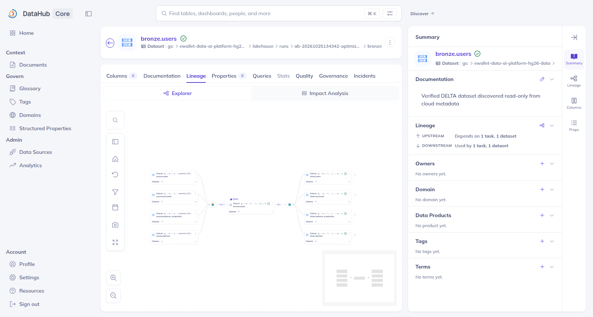
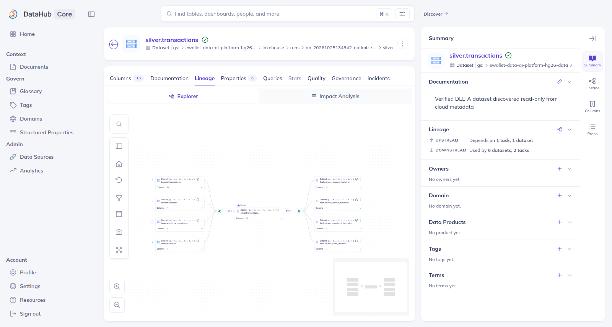
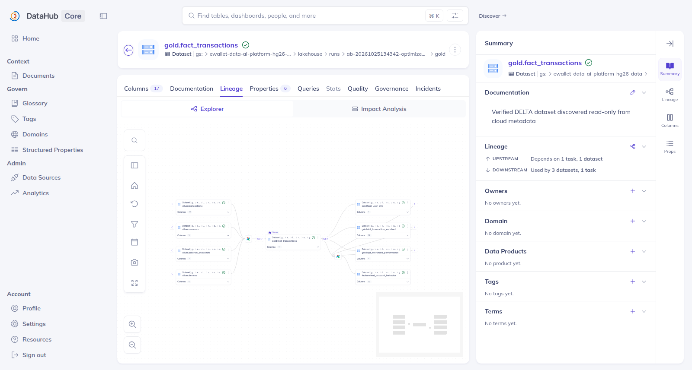
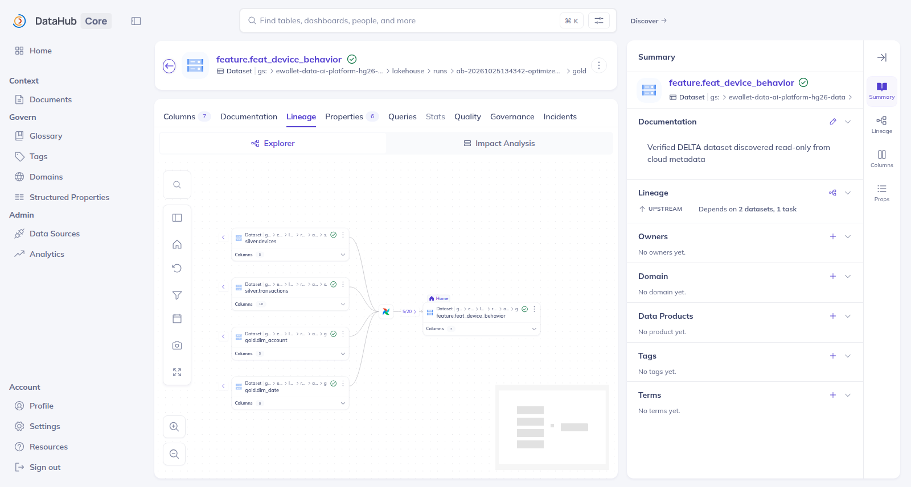

# All-Zones Schema

## 1. Context and objective

This report shows the actual tables and schemas of the four zones (Source, Bronze, Silver, Gold) for the canonical 100 GB cloud dataset. Every table can be opened in a database tool.

The schemas come from the stored data itself: the Delta transaction logs and the Parquet footers on GCS. They do not come from an illustrative diagram. The Gold dimension–fact relationships and the naming conventions are covered in [SCHEMA_DESIGN.md](SCHEMA_DESIGN.md#7-dimensionfact-relationships).

## 2. Architecture of the zones

| Zone | Responsibility | Format | Trino location | GCS location |
|---|---|---|---|---|
| Source | Immutable generator output, the system of record for the synthetic data | Parquet shards and a completion manifest | `hive.source_zone` (external tables) | `source/canonical-100gb-v1/<dataset>/shard-NNNNN.parquet` |
| Bronze | Source-shaped copy; reconciles the two transaction schema versions | Delta | `delta.bronze_zone` | `lakehouse/runs/<bronze run>/bronze/<table>` |
| Silver | Typed, deduplicated, keyed business tables | Delta | `delta.silver_zone` | `lakehouse/runs/<silver run>/silver/<table>` |
| Gold | Dimensions, facts, OBT, aggregate and point-in-time features | Delta | `delta.gold_zone` | `lakehouse/runs/<gold or feature run>/gold/<table>` |

Cloud writes are run-scoped and immutable, so one Trino schema per zone always points to one named run.

| Zone | Canonical run or dataset |
|---|---|
| Source | `canonical-100gb-v1` (plan digest `da043b9a…`, status `COMPLETE`) |
| Bronze | `ab-20261025134342-optimized-bronze-r261025174525` |
| Silver | `ab-20261025134342-optimized-silver-r261025181923` |
| Gold core | `ab-20261025134342-optimized-gold-r261025181923` |
| Gold features | `ab-20261025134342-optimized-feat-r261026025955` |

## 3. Table inventory

| Zone | Logical tables | Physical tables in Trino | Columns |
|---|---:|---:|---:|
| Source | 8 | 9 | 59 |
| Bronze | 8 | 8 | 45 |
| Silver | 8 | 8 | 47 |
| Gold | 15 (5 `dim_`, 3 `fact_`, 1 `obt_`, 5 `feat_`, 1 `opt_`) | 15 | 142 |
| **Total** | **39** | **40** | **293** |

Source has one more physical table than logical tables: `transactions` is stored as `transactions_v1` (without `channel`) and `transactions_v2`. DataHub shows 32 datasets, because it represents the eight Source tables as one manifest dataset.

The complete column lists of all 40 tables are generated in [ZONE_COLUMNS.md](generated/ZONE_COLUMNS.md).

### Source

| Logical table | Physical datasets | Rows (manifest) | Business key (Silver contract) |
|---|---|---:|---|
| `users` | `users` | 46,200,000 | `user_id` |
| `accounts` | `accounts` | 62,370,510 | `account_id` |
| `merchants` | `merchants` | 1,108,800 | `merchant_id` |
| `devices` | `devices` | 52,918,675 | `device_id` |
| `transactions` | `transactions_v1` + `transactions_v2` | 182,250,817 + 194,741,183 | `transaction_id` |
| `balance_snapshots` | `balance_snapshots` | 359,769,100 | `account_id, snapshot_date` |
| `login_events` | `login_events` | 369,609,248 | `login_id` |
| `fraud_labels` | `fraud_labels` | 369,600,000 | `transaction_id` |

Each dataset has 3,696 shards. The schema was read from the footer of shard 0 of each dataset. It matches the manifest's `schema_sha256`, and the manifest records a single schema for all shards, so this one schema is the schema of every shard.

The two transaction datasets hold 376,992,000 physical rows for 369,600,000 logical transactions. The difference is the controlled duplicates that Silver removes.

Source declares no keys: the business keys above are first enforced in Silver.

### Bronze

Bronze keeps the Source shape: same table names, same columns. The two transaction versions become one table. Bronze adds a nullable `channel` to V1 rows and unions them by name, so `bronze.transactions` has the 15 columns of V2.

Timestamps are stored as `timestamp_ntz` (shown by Trino as `timestamp(6)`). Bronze declares no keys and still contains the duplicate transactions.

### Silver

Silver holds the same eight business tables with normalized types. Timestamps become `timestamp` (Trino: `timestamp(3) with time zone`). Missing `channel` values become `UNKNOWN`, and duplicates are removed by `transaction_id`.

Transaction-like tables gain a partition date: `transactions.event_date` and `login_events.login_date`. `balance_snapshots` is partitioned by its own `snapshot_date`.

| Table | Logical key | Partition | Columns |
|---|---|---|---:|
| `users` | `user_id` | - | 6 |
| `accounts` | `account_id` | - | 5 |
| `merchants` | `merchant_id` | - | 3 |
| `devices` | `device_id` | - | 5 |
| `transactions` | `transaction_id` | `event_date` | 16 |
| `balance_snapshots` | `account_id, snapshot_date` | `snapshot_date` | 3 |
| `login_events` | `login_id` | `login_date` | 6 |
| `fraud_labels` | `transaction_id, label` | - | 3 |

### Gold

The 15 Gold tables, their grains and partitions are listed in [SCHEMA_DESIGN.md §3.2](SCHEMA_DESIGN.md#32-gold-core-and-historical-feature-tables). The eight dimension and fact tables of the ER diagram are specified in [GOLD_ERD.md](generated/GOLD_ERD.md).

## 4. Visualization method

The zones are browsed in **DBeaver** through a local **Trino 483** that reads the cloud datasets directly on GCS. No data is copied into another database.

```text
DBeaver ─JDBC─► Trino (container, 127.0.0.1:8091)
                 ├─ delta catalog (Delta Lake connector) ─► GCS Bronze/Silver/Gold runs
                 └─ hive catalog  (external Parquet)     ─► GCS Source dataset
```

| Design choice | Reason |
|---|---|
| Separate Trino stack ([infra/docker/schema-viz/](../../../infra/docker/schema-viz/compose.yml)), not the existing one | The existing Trino (`infra/docker/compose.query.yml`) reads local MinIO, not the cloud runs. The new stack has its own container, port and volume, so it cannot disturb other stacks |
| Local file metastore | There is no cloud Trino or metastore in this project. Registering a table records only its GCS location and schema, in a Docker volume |
| Access rules ([rules.json](../../../infra/docker/schema-viz/rules.json)) | DBeaver connects as `viewer`, which cannot create, drop or call procedures. Only the scripted `registrar` user may register tables |
| Generated SQL | [trino_register_tables.sql](generated/trino_register_tables.sql) and [trino_metadata_queries.sql](generated/trino_metadata_queries.sql) are rendered from [observed_schemas.json](generated/observed_schemas.json). Locations and columns therefore cannot drift from the recorded schemas |
| Source as external Parquet tables | Source is not Delta. External Hive tables over the real shard directories let DBeaver show it beside the other zones. The tables are physical (`transactions_v1`/`_v2`), not an invented logical view |

Separate views per zone are kept: four navigator schemas and one ER diagram for Gold. A single 40-table diagram would be unreadable.

**Screenshots.**

| Evidence | Content | Status |
|---|---|---|
| E01 | `hive.source_zone`: 9 tables; columns of `transactions_v1`/`_v2` | OWNER_SCREENSHOT_PENDING |
| E02 | `delta.bronze_zone`: 8 tables; columns of `transactions` | OWNER_SCREENSHOT_PENDING |
| E03 | `delta.silver_zone`: 8 tables; columns of `transactions` | OWNER_SCREENSHOT_PENDING |
| E04 | `delta.gold_zone`: 15 tables; columns of `fact_transactions` | OWNER_SCREENSHOT_PENDING |

The capture steps are in the [DBeaver runbook](../../runbooks/edai1/SCHEMA_VISUALIZATION_DBEAVER.md#j-evidence-matrix).

## 5. Lineage between zones

The DataHub lineage views below show how each zone is derived from the previous one. They were captured during the 2026-10-25/26 pipeline runs.



*Source → Bronze (DP1): `source.users` upstream of `bronze.users`, with the downstream Silver context.*



*Bronze → Silver (DP2).*



*Silver → Gold (DP2), centred on `gold.fact_transactions`. Upstream: `silver.transactions`, `silver.accounts`, `silver.balance_snapshots` and `silver.devices`. Downstream: `gold.feat_user_90d`, `gold.obt_transaction_enriched`, `gold.agt_merchant_performance` and `feature.feat_account_behavior`. This is a lineage view, not a dim ↔ fact ER diagram.*



*Silver / Gold → Gold feature tables (DP3): `silver.devices`, `silver.transactions`, `gold.dim_account` and `gold.dim_date` upstream of `feature.feat_device_behavior`.*

The dimension–fact relationships within Gold are shown in the [ER diagram](SCHEMA_DESIGN.md#7-dimensionfact-relationships).

## 6. Runtime validation

| Category | Result | Evidence |
|---|---|---|
| SOURCE_VERIFIED | Table lists in `data_platform/storage/scripts/config.py` equal the observed tables of every zone; Trino schema names equal its `BRONZE_SCHEMA`/`SILVER_SCHEMA`/`GOLD_SCHEMA` | `tests/unit/test_schema_visualization.py` |
| CLOUD_DATA_VERIFIED (metadata) | 31/31 Delta tables each have exactly one commit, so commit 0 holds the current schema; 9/9 Source footers hash to the manifest `schema_sha256` | [observed_schemas.json](generated/observed_schemas.json), [verification summary](../../evidence/edai1/schema/trino_verification_20261108.json) |
| TRINO_METADATA_VERIFIED | 2026-11-08: 40 tables registered; `information_schema.columns` of all 40 tables (293 columns) equals the observed schemas by name and order; `SHOW CREATE TABLE` returns the canonical `gs://` locations | [readback](../../evidence/edai1/schema/trino_metadata_readback_20261108T171351Z.txt) |
| Production unchanged | A list-only snapshot of every `_delta_log` object (name, generation, size) and of the Source control files was identical before registration and after all queries | [before](../../evidence/edai1/schema/gcs_log_snapshot_before_20261108T170630Z.txt) / [after](../../evidence/edai1/schema/gcs_log_snapshot_after_20261108T171500Z.txt) |
| LOCAL_TESTED | Generated artifacts match their inputs; SQL is metadata-only; access rules and isolation | `tests/unit/test_schema_visualization.py`, `tests/unit/test_schema_diagrams.py` |
| DBEAVER_VISUAL_VERIFIED | Not yet: the DBeaver screens are an owner step | — |
| OWNER_SCREENSHOT_PENDING | E01–E04 | runbook §J |

## 7. Limitations

- **Row counts** come from the Source manifest. Trino does not count rows here, because counting would scan up to 100 GB.
- **Write protection** comes from Trino's access rules, not from IAM: the credential used can write to the bucket. A read-only service account would remove that dependency, but needs an IAM change that is outside this task.
- **One registration per metastore.** The registration statements are not idempotent. Re-registering requires a fresh volume (`down -v`).
- **Run selection.** The registered runs are the canonical runs named above. A newer run is not picked up until `observed_schemas.json` is re-exported and the SQL re-rendered.

## 8. Reproduction

- Re-export the schemas (list and range reads only):
  ```bash
  uv run --locked --project data_platform/generation python -m ops.schema.export_observed_schemas \
    --bucket ewallet-data-ai-platform-hg26-data \
    --bronze-run-id ab-20261025134342-optimized-bronze-r261025174525 \
    --silver-run-id ab-20261025134342-optimized-silver-r261025181923 \
    --gold-run-id ab-20261025134342-optimized-gold-r261025181923 \
    --feature-run-id ab-20261025134342-optimized-feat-r261026025955 \
    --source-dataset canonical-100gb-v1 --output docs/edai1/schema/generated/observed_schemas.json
  ```
- Re-render the generated artifacts: `uv run --locked --project data_platform/generation python -m ops.schema.render_schema_diagrams`.
- Open the zones in DBeaver: [SCHEMA_VISUALIZATION_DBEAVER.md](../../runbooks/edai1/SCHEMA_VISUALIZATION_DBEAVER.md).
