# Schema Design

This is the schema-design report for EDAI-1 rubric rows 34–38. It covers the canonical 5GB campaign:

| Identity | Value |
|---|---|
| Benchmark | `ab-20261110225456` |
| Spark profile | `optimized` |
| Dataset version | `rehearsal-5gb-v1` |
| Pipeline Git SHA | `aae22b08eee20fa055c4aefc8d23c14cc3ae5f8c` |
| GCS bucket | `ewallet-data-ai-platform-hg26-rehearsal-5gb-data` |
| Source manifest SHA-256 | `ac2dfb0eac16e173261b3c3f65e83a03d388528538daefd9ec669bef7123eb80` |

How the campaign ran is described in [Batch Processing and Orchestration](../BATCH_PROCESSING_AND_ORCHESTRATION.md). The evidence (screenshots, Trino logs and checksums) is in [`docs/evidence/edai1/schema/rehearsal-5gb/`](../../evidence/edai1/schema/rehearsal-5gb/MANIFEST.md). Historical 100GB outputs are not used as results here; they appear only in §8, where the isolated metastore keeps them apart.

| Row | Requirement | Section | Evidence | Status |
|---:|---|---|---|---|
| 34 | Tables of all zones | §2, §8 | SC01, SC02, SC03 | IMPLEMENTED, RUNTIME_VERIFIED, OWNER_SCREENSHOT_CAPTURED |
| 35 | Dimension with SCD Type 2 | §5 | SC05, SC06 | IMPLEMENTED, RUNTIME_VERIFIED, OWNER_SCREENSHOT_CAPTURED |
| 36 | Feature tables with `event_timestamp` and `created` | §6 | SC07 | IMPLEMENTED, RUNTIME_VERIFIED, OWNER_SCREENSHOT_CAPTURED |
| 37 | Dimension–fact relationships | §3 | SC02, SC03, SC04 | IMPLEMENTED, RUNTIME_VERIFIED (by validator rules), OWNER_SCREENSHOT_CAPTURED |
| 38 | Naming convention | §7 | SC08 | IMPLEMENTED, RUNTIME_VERIFIED, OWNER_SCREENSHOT_CAPTURED |

## 1. Objectives and scope

The schema design has to make every table of the platform understandable and checkable. A reviewer should be able to:
1. see which tables exist in each zone and what they contain;
2. see how the analytical tables join, and which joins are guaranteed;
3. follow attribute history (SCD Type 2) and feature time (point-in-time features);
4. read a table's role from its name.

**Architecture.** The platform follows the Medallion architecture on GCS:
- Spark on Dataproc Serverless writes Delta tables per run;
- Airflow orchestrates the three batch pipelines DP1, DP2 and DP3;
- a local, read-only Trino exposes the cloud tables for inspection.

**Scope.** Everything reported here is the output of one campaign: `rehearsal-5gb-v1`, profile `optimized`, 44 physical tables. The `baseline` profile produced semantically equivalent outputs, so it is not repeated. Its equivalence is recorded in [`comparison.json`](../../evidence/edai1/spark/rehearsal-5gb-ab-20261110225456/comparison.json): `SEMANTIC_EQUIVALENT` over 34 tables.

## 2. Schema architecture

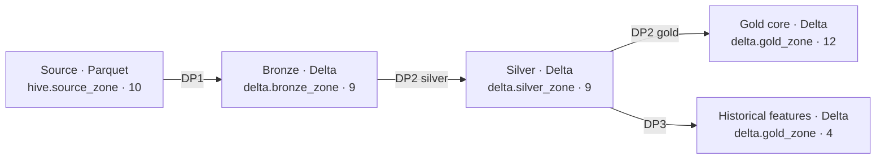

| Zone | Trino schema | Tables | Format | Role |
|---|---|---:|---|---|
| Source | `hive.source_zone` | 10 | Parquet, 186 shards per dataset | Immutable synthetic input with a manifest. `transactions_v1` and `transactions_v2` are two physical schema versions of one logical table, so 10 datasets carry 9 logical tables |
| Bronze | `delta.bronze_zone` | 9 | Delta | Source-shaped ingestion. Bronze unions the two transaction versions by column name and adds a nullable `channel` to v1 |
| Silver | `delta.silver_zone` | 9 | Delta | Cleaned, typed and deduplicated tables. Event tables gain a date partition column |
| Gold core | `delta.gold_zone` | 12 | Delta | Dimensional model: 6 dimensions, 3 facts, 1 OBT, 1 analytical output, 1 user aggregate feature table |
| Historical features | `delta.gold_zone` | 4 | Delta | Point-in-time feature snapshots written by DP3 |
| **Total** | | **44** | | |

The Source manifest pins 1,860 Parquet files and 5,000,608,241 bytes. Every pipeline run writes to its own root, `gs://…-rehearsal-5gb-data/lakehouse/runs/<run id>/<zone>/<table>`. The expected tables of each zone are defined once, in [`schema_inventory.py`](../../../data_platform/contracts/schema_inventory.py). The observed-schema export, the DBML renderer and the DataHub publisher all compare against that module.

**Tables.** Row counts come from the campaign comparison, which read every Delta table of both profiles. Column counts are the observed physical schema.

| Zone | Table | Rows | Columns | Logical key | Purpose |
|---|---|---:|---:|---|---|
| Bronze / Silver | `users` | 2,325,000 | 6 / 6 | `user_id` | Customer identity and KYC |
| Bronze / Silver | `accounts` | 3,137,729 | 5 / 5 | `account_id` | Wallet accounts of a user |
| Bronze / Silver | `merchants` | 55,800 | 3 / 3 | `merchant_id` | Current merchant state |
| Bronze / Silver | `devices` | 2,662,450 | 5 / 5 | `device_id` | Devices of a user |
| Bronze / Silver | `transactions` | 18,972,000 / 18,600,000 | 15 / 16 | `transaction_id` | Payments and transfers. Silver removes controlled duplicates and adds `event_date` |
| Bronze / Silver | `balance_snapshots` | 18,106,858 | 3 / 3 | `(account_id, snapshot_date)` | Daily closing balance |
| Bronze / Silver | `login_events` | 18,586,786 | 5 / 6 | `login_id` | Login attempts. Silver adds `login_date` |
| Bronze / Silver | `fraud_labels` | 18,600,000 | 3 / 3 | `transaction_id` | Ground-truth labels, kept out of every feature |
| Bronze / Silver | `merchant_history` | 334,800 | 6 / 6 | `snapshot_id` | Merchant attribute snapshots, the SCD2 input |
| Gold | `dim_user`, `dim_account`, `dim_merchant`, `dim_device` | 2,325,000 / 3,137,729 / 55,800 / 2,662,450 | 6 / 5 / 3 / 5 | entity id | Current-state dimensions |
| Gold | `dim_date` | 151 | 8 | `date_key` | Shared calendar |
| Gold | `dim_merchant_scd2` | 78,294 | 7 | `merchant_sk` | Merchant attribute history (§5) |
| Gold | `fact_transactions` | 18,600,000 | 17 | `transaction_id` | Central transaction fact |
| Gold | `fact_login_events` | 18,586,786 | 7 | `login_id` | Login fact |
| Gold | `fact_balance_snapshot` | 18,106,858 | 4 | `(account_id, snapshot_date)` | Daily balance fact |
| Gold | `obt_transaction_enriched` | 18,600,000 | 32 | `transaction_id` | Transaction fact with its dimension attributes |
| Gold | `opt_merchant_performance` | 55,800 | 9 | `merchant_id` | Merchant analytics output |
| Gold | `feat_user_90d` | 2,325,000 | 8 | `user_id` | 90-day user aggregate |
| Features | `feat_user_behavior` | 18,599,553 | 12 | `(user_id, event_timestamp)` | Point-in-time user behaviour |
| Features | `feat_account_behavior` | 18,599,553 | 13 | `(account_id, event_timestamp)` | Point-in-time account behaviour |
| Features | `feat_device_behavior` | 18,599,560 | 8 | `(device_id, event_timestamp)` | Point-in-time device behaviour |
| Features | `feat_merchant_behavior` | 7,439,478 | 10 | `(merchant_id, event_timestamp)` | Point-in-time merchant behaviour (payments only) |

**Partitioning.** Seven tables are partitioned by a date column:
- `event_date`: Silver `transactions`, and Gold `fact_transactions`, `fact_login_events` and `obt_transaction_enriched`;
- `login_date`: Silver `login_events`;
- `snapshot_date`: Silver `balance_snapshots` and Gold `fact_balance_snapshot`.

**Schema evolution.** `transactions_v1` has no `channel` column, and `transactions_v2` has one. Bronze holds 15 columns because it adds `channel` to v1 as a nullable column before the union. Silver normalizes a missing channel to `UNKNOWN`; the Silver rules `transactions.channel_not_null` and `transactions.valid_channel` both report 0 violations.

## 3. Logical data modeling

### 3.1 Three different things

| Layer | What it is | Where it lives | How it is checked |
|---|---|---|---|
| Logical relationships | Keys, references and cardinalities of the data model | [`schema_relationships.yml`](../../../data_platform/contracts/relationships/schema_relationships.yml), rendered as DBML `Ref`s | The renderer refuses a reference whose columns or types do not match the observed schema |
| Physical schema | Column names, types, nullability and partition columns of each Delta or Parquet table | Delta transaction logs and Parquet footers, exported to `observed_schemas.json` | Trino `DESCRIBE` and `information_schema` (SC01, SC05, SC07) |
| Referential integrity | Whether the rows actually satisfy each logical reference | Spark validator rules in the campaign's validation batches | Each rule's result in the committed validation reports; all PASS |

Delta Lake declares no primary or foreign key. Every column of the observed tables is physically nullable. The DBML `pk`, `Ref`, `not null` and `null` markers therefore describe the **logical** model and the business rules: `not null` on a referencing column means that the validator requires the value, not that the storage enforces it. The DBML files say this in their header. Integrity holds for every run that passes the validators.

### 3.2 Coverage of the contract

| Model | Tables | References | Enforcement |
|---|---:|---:|---|
| Silver | 9 | 12 | 12 validated |
| Gold core and historical features | 16 | 21 | 20 validated (16 core, 4 features), 1 builder-only |
| **Total** | **25** | **33** | **32 validated, 1 builder-only** |

A **validated** reference names the rule that checks it, for example `fact_transactions.merchant_id_exists_in_dim_merchant`. The renderer refuses to draw a validated reference unless that rule PASSed in both profiles of this campaign.

The one **builder-only** reference is `obt_transaction_enriched.transaction_id` → `fact_transactions`. It has no orphan rule. Its completeness rests on unique keys and the population rule `fact_transactions_count_equals_obt_transaction_enriched_count`.

### 3.3 Silver logical model

Silver keeps the operational entities and their natural keys. `users` is the root. `accounts` and `devices` reference it. `transactions` references users, accounts, devices and merchants. `login_events`, `balance_snapshots`, `fraud_labels` and `merchant_history` reference their owning entity.

Two transaction references are **optional**:
- `merchant_id` is required only for payments;
- `counterparty_account_id` is required only for transfers.

The contract marks them `nullable: true`. The validator checks them as conditional requirements (`merchant_id_required_for_payment`, `counterparty_account_id_required_for_transfer`) plus an orphan rule on the non-null values.

### 3.4 Gold dimensional model

Gold is a **fact constellation**:

| Group | Tables | Notes |
|---|---|---|
| Facts | `fact_transactions`, `fact_login_events`, `fact_balance_snapshot` | Many-to-one references to the shared dimensions; `date_key` joins `dim_date` |
| Dimensions | `dim_user`, `dim_account`, `dim_merchant`, `dim_device`, `dim_date`, `dim_merchant_scd2` | `dim_account` and `dim_device` reference `dim_user`, forming a small snowflake |
| OBT | `obt_transaction_enriched` | One row per transaction with the attributes of five dimensions, one-to-one with the fact |
| Analytical outputs | `opt_merchant_performance`, `feat_user_90d` | One row per merchant or user, one-to-one with their dimension and complete (count-equality rules) |
| Historical features | four `feat_*_behavior` tables | Many-to-one to their entity dimension (§6) |

`fact_transactions` carries the two optional references of Silver: `merchant_id` → `dim_merchant` and `counterparty_account_id` → `dim_account`. The SCD2 dimension sits beside `dim_merchant` rather than replacing it, so no existing join can fan out. Transactions reach a merchant version through an as-of join (§5), not through a key reference.

Cardinality is derived from the keys, never from column names. A reference is many-to-one unless the referencing column is the child's whole key. The renderer fails if a reference does not target the parent's whole key, or if the column types differ.

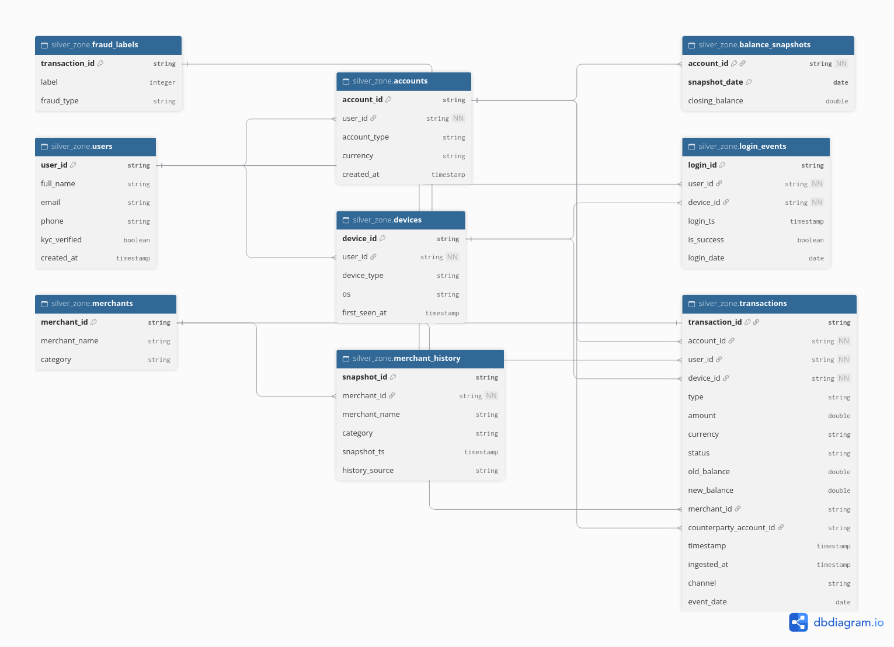

*SC02 — Silver logical ERD, `silver.dbml` imported at dbdiagram.io. 9 tables with their observed columns, logical keys and the 12 validated references. `transactions` is the hub; `merchant_id` and `counterparty_account_id` are the two optional references.*

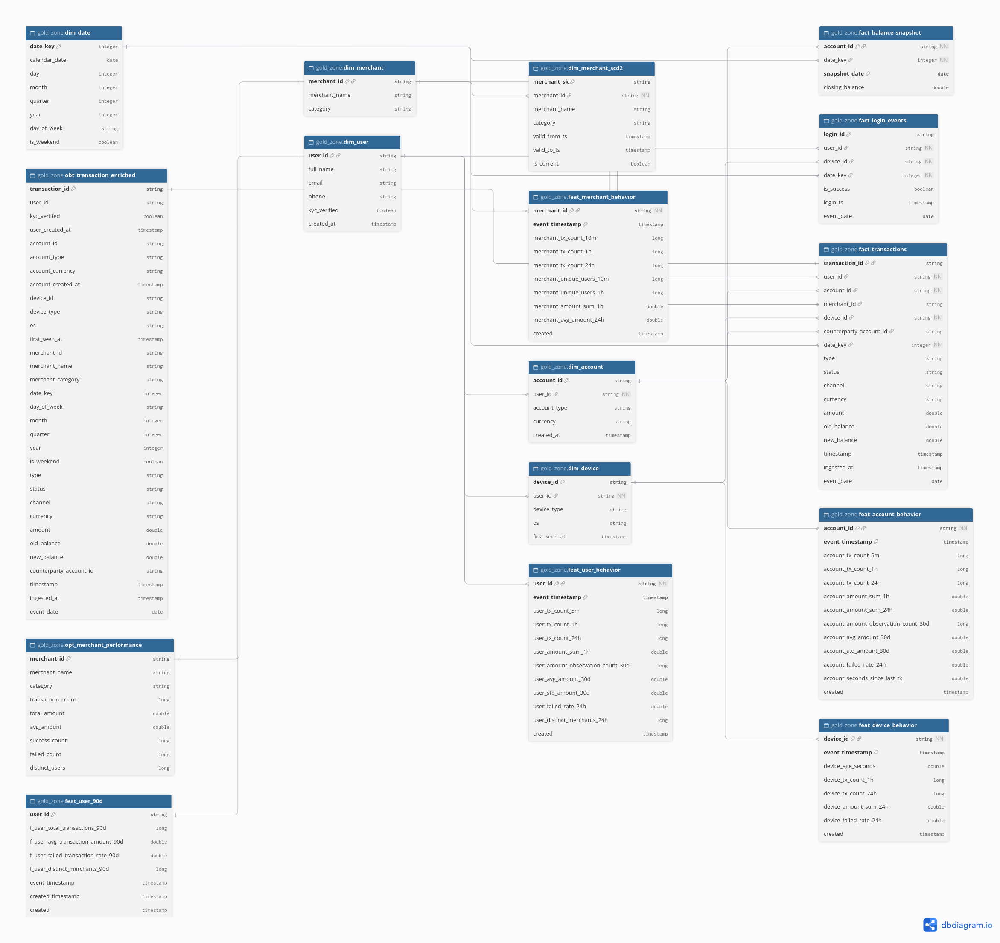

*SC03 — Gold logical ERD, `gold.dbml`. The 12 core tables and 4 historical feature tables with their 21 references:*
- *facts on the right and dimensions in the centre;*
- *the OBT and the analytical outputs on the left;*
- *`dim_merchant_scd2` beside `dim_merchant`.*

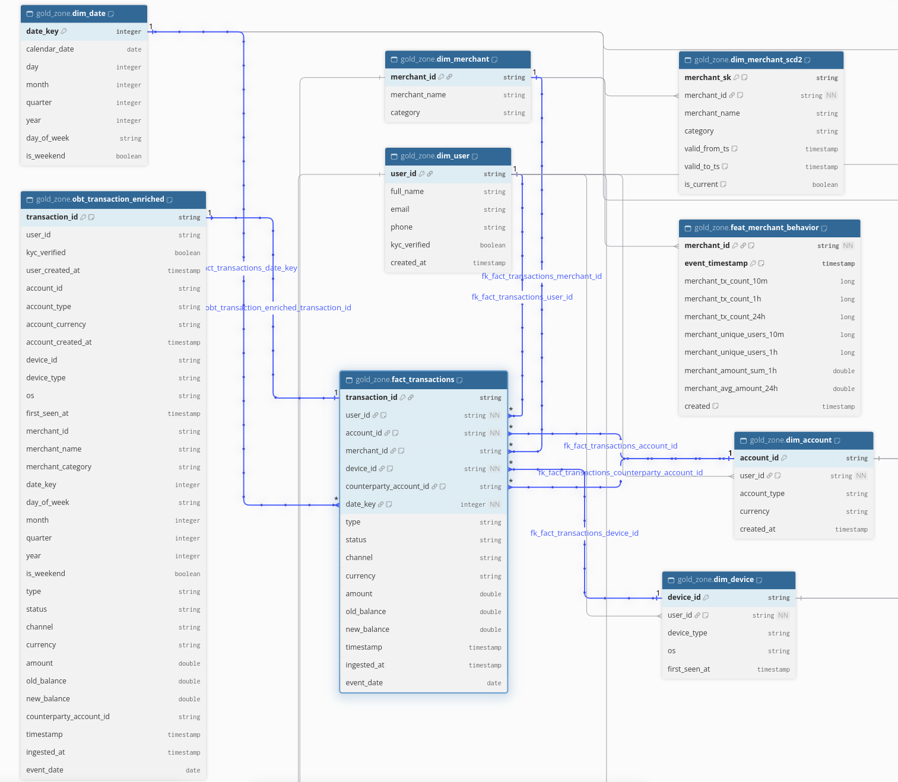

*SC04 — `fact_transactions` selected in the Gold ERD. The highlighted many-to-one references go to `dim_user`, `dim_account` (both `account_id` and `counterparty_account_id`), `dim_merchant`, `dim_device` and `dim_date`, and a one-to-one reference comes from `obt_transaction_enriched`. Each reference is labelled with its logical foreign-key name.*

## 4. Schema contracts and generation

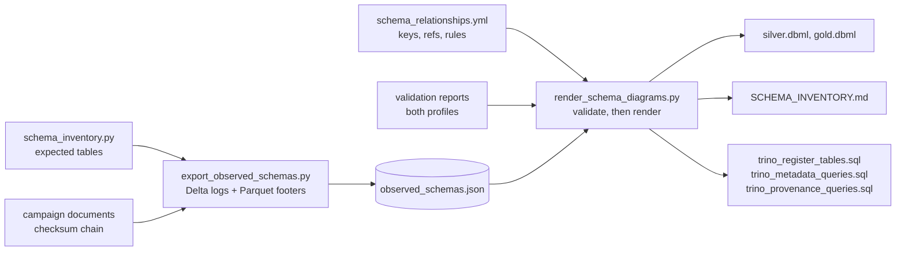

| Component | Path | Responsibility |
|---|---|---|
| Zone inventory | [`data_platform/contracts/schema_inventory.py`](../../../data_platform/contracts/schema_inventory.py) | Expected tables of every zone for a dataset version |
| Relationship contract | [`data_platform/contracts/relationships/schema_relationships.yml`](../../../data_platform/contracts/relationships/schema_relationships.yml) | Logical keys, unique keys, references (with nullability, enforcement and validator rule), table groups and column notes |
| Table contracts | [`data_platform/contracts/*.yml`](../../../data_platform/contracts/) | Quality rules of selected tables, for example [`gold_dim_merchant_scd2.yml`](../../../data_platform/contracts/gold_dim_merchant_scd2.yml) |
| Observed-schema export | [`data_platform/schema/export_observed_schemas.py`](../../../data_platform/schema/export_observed_schemas.py) | Metadata-only export of one verified campaign profile |
| Renderer | [`data_platform/schema/render_schema_diagrams.py`](../../../data_platform/schema/render_schema_diagrams.py) | Validates every input, then writes the DBML, the inventory and the Trino SQL |
| Generated artifacts | [`data_platform/schema/generated/`](../../../data_platform/schema/generated/README.md) | `observed_schemas.json`, `silver.dbml`, `gold.dbml`, [`SCHEMA_INVENTORY.md`](../../../data_platform/schema/generated/SCHEMA_INVENTORY.md) and the three Trino SQL files |
| Evidence queries | [`data_platform/schema/sql/schema_evidence_queries.sql`](../../../data_platform/schema/sql/schema_evidence_queries.sql) | Hand-written, read-only SCD2 and feature queries |
| Trino runtime | [`infra/docker/schema-viz/`](../../../infra/docker/schema-viz/compose.yml) | Compose stack, catalogs, access rules, `run_sql.sh`, the 5GB metastore override |

**Observed schema.** The exporter reads only metadata:
- **Source.** It reads the Source manifest and requires its SHA-256 to equal the campaign pin. It then reads one Parquet footer per Source dataset with a byte-range request; each footer must hash to the manifest's `schema_sha256`.
- **Delta tables.** It reads the last `metaData` action of each Delta log.
- **Checks.** Each zone's table set must equal the inventory, and its column names must equal the campaign comparison's.
- **Provenance.** The output carries a block with dataset, benchmark, profile and both manifest checksums.
- **Safety.** No data file is read and nothing is written to GCS.

**How the diagrams stay aligned with the data.** The renderer refuses to write anything when any of these holds:
- the snapshot is not bound to this campaign (wrong dataset, benchmark, profile or source manifest, or a snapshot without provenance such as the historical 100GB one);
- a zone's tables differ from the inventory;
- a key, reference or note names a missing column;
- the two sides of a reference have different types;
- a validated reference's rule did not PASS in both profiles.

The renderer is deterministic. `render_schema_diagrams --check` fails when a committed artifact differs from what the current inputs produce, and a unit test runs the same comparison. The DBML therefore cannot drift from the contract, the observed schema or the validation results without a test failing.

The Trino registration SQL is generated from the same observed snapshot. Its table locations are therefore exactly the run roots the export read.

## 5. SCD Type 2 design

**Why.** `merchants` holds only the current merchant state. A past transaction must be analysed with the merchant's attributes as they were at that time, so the history comes from persisted snapshots: `merchant_history`, 6 snapshots per merchant 30 days apart. It is never inferred from the current-state table.

| Step | Code | Output |
|---|---|---|
| Generate | [`merchant_history.py`](../../../data_platform/generation/src/offline/merchant_history.py) | `source.merchant_history` (`history_source = synthetic`) |
| Ingest, clean | `source_to_bronze.py`; [`cleaners.py`](../../../data_platform/processing/spark/silver/cleaners.py) `clean_merchant_history` | `bronze_zone` and `silver_zone.merchant_history` |
| Build | [`dimension_builder.py`](../../../data_platform/processing/spark/gold/dimension_builder.py) `build_dim_merchant_scd2` → [`scd2.py`](../../../data_platform/processing/spark/gold/scd2.py) | `gold_zone.dim_merchant_scd2` |
| Validate | [`scd2_quality.py`](../../../data_platform/quality/scd2_quality.py) | 14 rules in the core-gold validation report |

**Keys.**
- **Business key:** `merchant_id`. It identifies the merchant across all its versions and joins to `dim_merchant`.
- **Surrogate key:** `merchant_sk`. It identifies one version. It is the SHA-256 of `merchant_id` plus `valid_from_ts` in microseconds, so a rebuild produces identical keys.
- **Version key:** `(merchant_id, valid_from_ts)` is also unique.

**Effective time.**
- **New versions.** Within a merchant, a new version starts when `merchant_name` or `category` differs, null-safely, from the previous snapshot.
- **Interval.** `valid_from_ts` is the snapshot time. `valid_to_ts` is the next version's start, and NULL for the current version.
- **Current flag.** `is_current = (valid_to_ts IS NULL)`.
- **Lookup.** Versions are half-open UTC intervals, `[valid_from_ts, valid_to_ts)`. An as-of lookup matches `valid_from_ts <= t AND (valid_to_ts IS NULL OR t < valid_to_ts)`.

**Physical schema** (SC05):

| Column | Trino type | Role |
|---|---|---|
| `merchant_sk` | `varchar` | Surrogate key |
| `merchant_id` | `varchar` | Business key |
| `merchant_name` | `varchar` | Tracked attribute |
| `category` | `varchar` | Tracked attribute |
| `valid_from_ts` | `timestamp(3) with time zone` | Start of validity (inclusive) |
| `valid_to_ts` | `timestamp(3) with time zone` | End of validity (exclusive); NULL when current |
| `is_current` | `boolean` | Current-version flag |

**Runtime results** (SC06, queried in Trino on the 5GB tables):

| Metric | Result |
|---|---:|
| Total versions | 78,294 |
| Distinct merchants | 55,800 |
| Current versions | 55,800 |
| Historical versions | 22,494 |
| Current versions with `valid_to_ts IS NULL` | 55,800 |

Every merchant has exactly one current version, and every current version is open-ended. The 78,294 versions were built from 334,800 snapshots.

**Validator rules.** The core-gold validation report ([`optimized-gold.json`](../../evidence/edai1/spark/rehearsal-5gb-ab-20261110225456/validation_reports/optimized-gold.json), 93/93 PASS) holds 14 rules on `dim_merchant_scd2`. All passed, with 0 violations wherever a count is reported:
- **Shape:** `schema`, `non_empty`, `required_columns_not_null`.
- **Keys:** `unique_key(merchant_sk)`, `unique_key(merchant_id,valid_from_ts)`.
- **Intervals:** `valid_to_after_valid_from` and `contiguous_non_overlapping_intervals` (each `valid_to_ts` equals the next version's `valid_from_ts`; the last interval is open).
- **Current version:** `current_flag_matches_open_end`, `one_current_version_per_merchant`.
- **No redundant versions:** `no_redundant_versions`.
- **Consistency with `dim_merchant`:** `merchants_exist_in_dim_merchant`, `merchant_id_exists_in_dim_merchant`, `current_version_equals_dim_merchant`.
- **Transaction resolution:** `transactions_resolve_to_one_version` (every transaction with a merchant resolves to exactly one version).

The interval rule's run result is also published to DataHub (checkpoint DG06 of the [governance report](../datahub/DATAHUB_GOVERNANCE.md)).

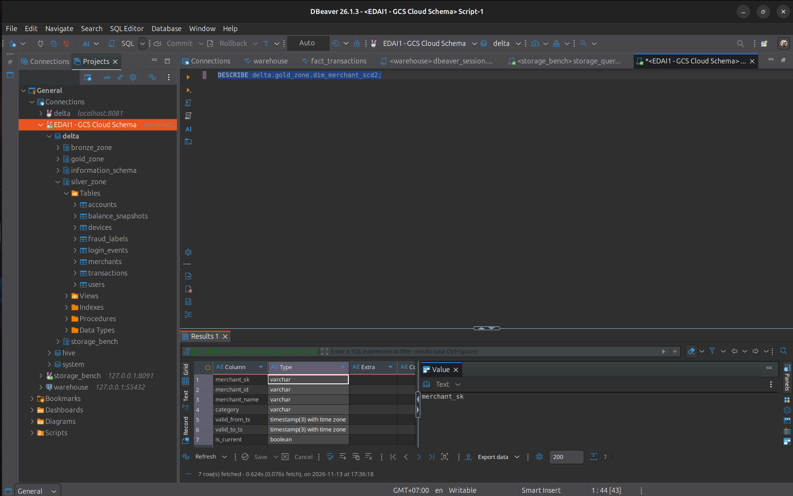

*SC05 — `DESCRIBE delta.gold_zone.dim_merchant_scd2` in DBeaver on the 5GB metastore. Surrogate and business keys, the two tracked attributes, the `timestamp(3) with time zone` validity interval and the `is_current` flag.*

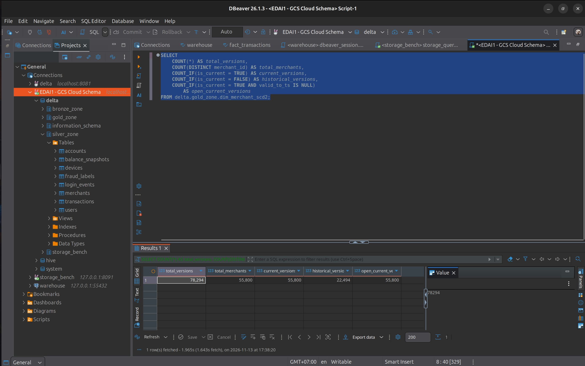

*SC06 — Version counts of `dim_merchant_scd2`: 78,294 versions of 55,800 merchants, 55,800 current and 22,494 historical, and all 55,800 current versions open-ended (`valid_to_ts IS NULL`).*

## 6. Historical feature schema

DP3 writes four point-in-time feature tables from Silver `transactions` (and, for devices, Silver `devices`):

| Table | Entity key | Rows | Grain |
|---|---|---:|---|
| `feat_user_behavior` | `user_id` | 18,599,553 | `(user_id, event_timestamp)` |
| `feat_account_behavior` | `account_id` | 18,599,553 | `(account_id, event_timestamp)` |
| `feat_device_behavior` | `device_id` | 18,599,560 | `(device_id, event_timestamp)` |
| `feat_merchant_behavior` | `merchant_id` | 7,439,478 | `(merchant_id, event_timestamp)` |

**The two timestamps answer different questions:**
- **`event_timestamp`: "as of when is this feature true?"** It is the event time of the transaction the row describes, and the point-in-time key for historical retrieval. Every window ends just before it: a 1-hour feature counts `[T − 1h, T)`.
- **`created`: "when was this row materialized?"** It is one UTC instant per DP3 run, shared by all four tables and recorded in each Delta commit.

No rule requires `created >= event_timestamp`, because the synthetic events are replayed and can be materialized before their event times.

**Types.** All eight columns (two per table) are `timestamp(3) with time zone` in Trino (SC07).

**Validator rules.** All PASS in the features report ([`optimized-features.json`](../../evidence/edai1/spark/rehearsal-5gb-ab-20261110225456/validation_reports/optimized-features.json), 53/53):
- **Per table:**
  - `timestamp_columns_typed`, `timestamp_columns_not_null`;
  - `created_single_materialization` (one value per table);
  - `created_matches_materialization_clock` (equal to the clock recorded in the commit);
  - `unique_key(<entity>, event_timestamp)`.
- **Across tables:** `dp3_features.created_shared_by_run`, one `created` value shared by the four tables.
- **Point in time:** `pit_<entity>_tx_count_1h_matches_recomputation`, a strict `[T − 1h, T)` recount on an entity sample.
- **Population:** each table's event population equals the Silver population it is built from.

The Gold user aggregate `feat_user_90d` also carries `event_timestamp` and `created`. Its legacy `created_timestamp` is checked equal to `created` (`feat_user_90d.created_matches_created_timestamp`). Its timestamp rules PASS in the Gold report; SC07 shows the four DP3 tables only.

This report claims the schema and the validated materialization semantics. The Feast offline-store retrieval built on these tables belongs to the Feature Store workstream and is not reported here.

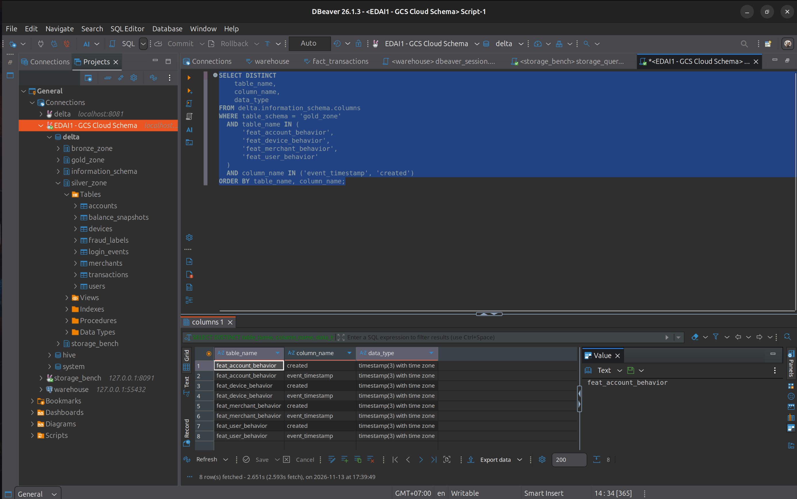

*SC07 — `delta.information_schema.columns` for the four DP3 feature tables. `event_timestamp` and `created` exist on every table, and all eight columns are `timestamp(3) with time zone`.*

## 7. Naming conventions

The table names are the ones the pipelines write; this section documents the convention they follow.

| Zone | Convention | Example |
|---|---|---|
| Source | Physical dataset name; a version suffix only for schema versions | `hive.source_zone.transactions_v2` |
| Bronze | `bronze_zone.<business name>` | `delta.bronze_zone.transactions` |
| Silver | `silver_zone.<business name>` | `delta.silver_zone.transactions` |
| Gold | `gold_zone.<role>_<subject>` | `delta.gold_zone.fact_transactions` |

**Gold role prefixes:**

| Prefix | Role | Tables |
|---|---|---|
| `dim_` | Dimension | `dim_user`, `dim_account`, `dim_merchant`, `dim_device`, `dim_date`, `dim_merchant_scd2` |
| `fact_` | Fact | `fact_transactions`, `fact_login_events`, `fact_balance_snapshot` |
| `feat_` | Feature | `feat_user_90d` (Gold core) and the four DP3 `feat_*_behavior` tables |
| `obt_` | One big table | `obt_transaction_enriched` |
| `opt_` | Analytical output | `opt_merchant_performance` |

Bronze and Silver keep the business name, so one entity can be followed across zones: `bronze_zone.users` → `silver_zone.users` → `gold_zone.dim_user`. The zone is part of every qualified name: the Trino schema, the GCS path `/<zone>/<table>` and the DataHub dataset name. That carries the information a `raw_` or `stg_` prefix would. Gold mixes several roles in one zone, so its tables carry a role prefix. A unit test checks that every Gold and feature table has a known role prefix.

**Verified classification** (SC08). The query classified the 44 registered tables by zone and, in Gold, by prefix:

| Class | Tables |
|---|---:|
| Source | 10 |
| Bronze | 9 |
| Silver | 9 |
| Dimension | 6 |
| Fact | 3 |
| Feature | 5 |
| OBT | 1 |
| Analytical output | 1 |
| **Total** | **44** |
| Unclassified | 0 |

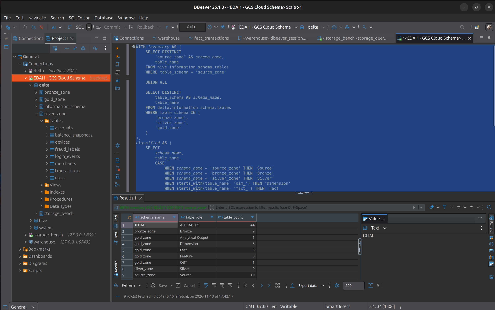

*SC08 — Classification of all 44 registered tables. Source 10, Bronze 9, Silver 9, and in `gold_zone` 6 dimensions, 3 facts, 5 features, 1 OBT and 1 analytical output; there is no `Unclassified` row.*

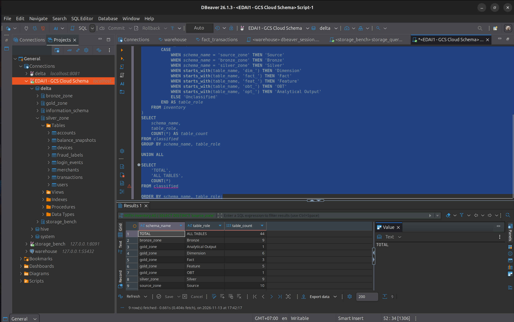

*SC08 detail — The same query, scrolled to the classification rules: the zone for Source, Bronze and Silver; the `dim_`, `fact_`, `feat_`, `obt_` and `opt_` prefixes for Gold; `ELSE 'Unclassified'`.*

## 8. Physical schema verification

The physical schemas are inspected through a task-owned Trino ([`infra/docker/schema-viz`](../../../infra/docker/schema-viz/compose.yml)). It reads the cloud tables in place.

| Aspect | Implementation |
|---|---|
| Data | Read from GCS with the owner's Application Default Credentials. Nothing is copied locally |
| Catalogs | `hive` for the Source Parquet datasets, as external tables (`hive.non-managed-table-writes-enabled=false`); `delta` for every Delta table |
| Metastore | A local file metastore in a Docker volume. It holds only table registrations |
| Users | `viewer` is read-only (file-based access control, [`rules.json`](../../../infra/docker/schema-viz/rules.json)) and is the user for queries and DBeaver. `registrar` has full access to the `delta` and `hive` catalogs and is used only to run the generated registration and provenance files |
| Registration | [`trino_register_tables.sql`](../../../data_platform/schema/generated/trino_register_tables.sql), generated from the observed snapshot: 4 `CREATE SCHEMA`, 34 `register_table` calls (Delta) and 10 `CREATE TABLE … external_location` (Hive) |

**Local metadata, not cloud mutation.** Registration writes only the local metastore volume. `register_table` records a Delta table's location; the Hive tables are external. No statement writes to GCS. The `viewer` probe confirms that the read-only user cannot create schemas or register tables.

**Isolated 5GB metastore.** The default metastore volume, `edai1-schema-viz_metastore`, holds registrations of the historical 100GB campaign `ab-20261025134342` and the `storage_bench` schema of the storage-optimization work. Registering the 5GB tables there would have mixed two campaigns under the same names.

Instead, the 5GB tables are registered in a separate volume, `edai1-schema-viz_metastore_5gb`. The override [`compose.metastore-5gb.yml`](../../../infra/docker/schema-viz/compose.metastore-5gb.yml) mounts it in place of the default. Both volumes serve the same container and port; the one mounted is the one Trino and DBeaver see. The historical metastore was checked before and after the 5GB registration: all 97 of its files have identical SHA-256, and its 6 `storage_bench` tables remain.

**Verification on 2026-11-13** (logs in [`runtime/`](../../evidence/edai1/schema/rehearsal-5gb/MANIFEST.md)):
- **Inventory:** 44 tables (10 / 9 / 9 / 16).
- **Locations:** all 44 equal the generated SQL and lie under `rehearsal-5gb-v1` or `ab-20261110225456-optimized-…`.
- **Reads:**
  - `silver_zone.merchant_history`: 334,800 rows;
  - `gold_zone.dim_merchant_scd2`: 78,294 versions;
  - representative tables of every zone return their campaign row counts.
- **Read-only access:** `viewer` is denied `CREATE SCHEMA` and `register_table`.

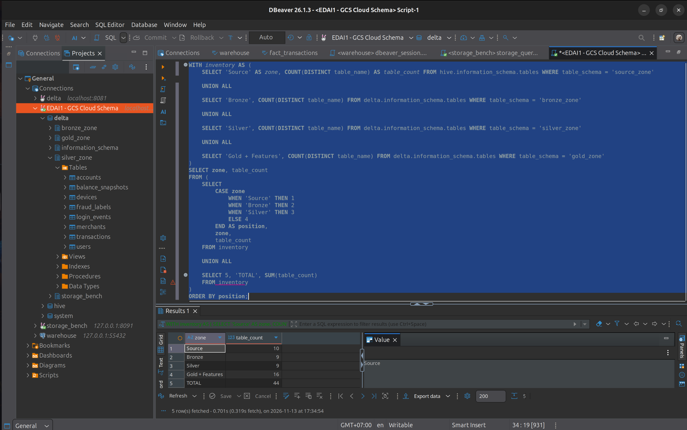

*SC01 — Per-zone table count in DBeaver on the 5GB metastore: Source 10, Bronze 9, Silver 9, Gold + Features 16, total 44. The counts come from `hive` and `delta` `information_schema`. The navigator on the left still lists a cached `storage_bench` node from an earlier session on the historical metastore. The 5GB metastore has no such schema (`SHOW SCHEMAS` in `runtime/09_verify_viewer.txt` and `12_viewer_readonly_probe.txt`); the query result is live.*

## 9. Experimental results

| Result | Value | Source |
|---|---|---|
| Physical inventory | 44 tables: Source 10, Bronze 9, Silver 9, Gold core 12, features 4 | SC01; `runtime/09_verify_viewer.txt` |
| Registration provenance | 44/44 locations in the 5GB campaign (34 Delta, 10 Hive) | `runtime/11_metastore_locations_5gb.tsv`, `10_provenance_registrar.txt` |
| Logical relationships | Silver 12, Gold + features 21; 32 validated, 1 builder-only | `silver.dbml`, `gold.dbml`, `schema_relationships.yml`; SC02, SC03 |
| Fact–dimension references | `fact_transactions` → 5 dimensions (6 references, 2 optional) | SC04; `gold.dbml` |
| SCD2 physical schema | 7 columns; validity bounds `timestamp(3) with time zone` | SC05 |
| SCD2 versions | 78,294 versions, 55,800 merchants, 55,800 current, 22,494 historical, 55,800 open-ended | SC06; `runtime/09_verify_viewer.txt` |
| SCD2 rules | 14/14 PASS, 0 interval violations | `validation_reports/optimized-gold.json`; DG06 |
| Feature timestamps | 4 DP3 tables × 2 columns, all `timestamp(3) with time zone` | SC07 |
| Feature rules | 53/53 PASS in the features report | `validation_reports/optimized-features.json` |
| Naming convention | 44 classified (6 dim, 3 fact, 5 feat, 1 obt, 1 opt; 10/9/9 Source/Bronze/Silver), 0 unclassified | SC08 |
| Read-only access | `viewer` denied `CREATE SCHEMA` and `register_table` | `runtime/12_viewer_readonly_probe.txt` |
| Historical metastore preserved | 97/97 files with identical SHA-256; 6 `storage_bench` tables | `runtime/old_metastore_files_sha256_{before,after}.txt` |
| Generated artifacts current | `render_schema_diagrams --check` exit 0 | §11 |
| Evidence | 9 screenshots (SC01–SC08, plus an SC08 detail) and 15 runtime files with SHA-256 | [MANIFEST](../../evidence/edai1/schema/rehearsal-5gb/MANIFEST.md) |

## 10. Evidence SC01–SC08

All screenshots were captured by the owner on 2026-11-13. SC02–SC04 come from dbdiagram.io; SC01 and SC05–SC08 come from DBeaver 26.1.3 connected to the isolated 5GB metastore. They are embedded with their captions in the sections they support:

| Checkpoint | Shows | Section |
|---|---|---|
| SC01 | Per-zone inventory, 44 tables | §8 |
| SC02 | Silver logical ERD | §3.4 |
| SC03 | Gold logical ERD | §3.4 |
| SC04 | `fact_transactions` and its dimension references | §3.4 |
| SC05 | SCD2 physical schema | §5 |
| SC06 | SCD2 version counts | §5 |
| SC07 | Feature timestamp types | §6 |
| SC08, SC08 detail | Naming-convention classification and its rules | §7 |

The files are byte copies of the originals, listed with their SHA-256 in the [evidence manifest](../../evidence/edai1/schema/rehearsal-5gb/MANIFEST.md). The manifest also lists the unnamed captures of the same session that were not used, with the reason for each.

## 11. Reproducibility

**Identifiers.** Benchmark `ab-20261110225456`, profile `optimized`, dataset `rehearsal-5gb-v1`. The campaign documents and validation reports are in [`docs/evidence/edai1/spark/rehearsal-5gb-ab-20261110225456/`](../../evidence/edai1/spark/rehearsal-5gb-ab-20261110225456/).

**Offline checks.** These need no cloud access or runtime:

```bash
export PYTHONPATH=$PWD UV_PROJECT_ENVIRONMENT=$HOME/.cache/ewallet-venvs/generation
uv run --locked --project data_platform/generation python -m data_platform.schema.render_schema_diagrams --check
uv run --locked --project data_platform/generation python -m pytest -q \
  tests/unit/test_schema_diagrams.py tests/unit/test_schema_inventory.py
```

**Runtime procedures.** These are in [DATAHUB_SCHEMA_OWNER_EVIDENCE.md](../../runbooks/edai1/DATAHUB_SCHEMA_OWNER_EVIDENCE.md):

| Stage | What | Preconditions and permissions |
|---|---|---|
| 1 | Observed-schema export (`python -m data_platform.schema.export_observed_schemas …`) | `gcloud` credentials with read access to the bucket. It reads metadata only, but rewrites `observed_schemas.json`; run it only to refresh the snapshot |
| 2 | Render DBML and SQL (`python -m data_platform.schema.render_schema_diagrams`), import at dbdiagram.io | None. It writes only `data_platform/schema/generated/` |
| 4 | Start Trino on the 5GB metastore, register once, run the read-only queries | ADC file; at least 4 GiB free RAM; port 8091 free. Registration (as `registrar`) writes the local metastore and is done only while the 5GB metastore is empty. Never run `docker compose … down -v` on this stack |

To switch between the 5GB and historical metastores:
- **5GB:** `docker compose -f infra/docker/schema-viz/compose.yml -f infra/docker/schema-viz/compose.metastore-5gb.yml up -d`
- **Historical:** the same command without the override.

**Read-only queries.**
- [`trino_metadata_queries.sql`](../../../data_platform/schema/generated/trino_metadata_queries.sql) and [`schema_evidence_queries.sql`](../../../data_platform/schema/sql/schema_evidence_queries.sql) run as `viewer`.
- [`trino_provenance_queries.sql`](../../../data_platform/schema/generated/trino_provenance_queries.sql) runs as `registrar`, because `SHOW CREATE TABLE` needs ownership.
- The SC01, SC06 and SC08 captures were taken from equivalent queries typed in DBeaver; their text is visible in the screenshots.

**Evidence integrity.** Run `sha256sum -c SHA256SUMS` in `docs/evidence/edai1/schema/rehearsal-5gb/`.

## 12. Limitations and conclusion

**Limitations:**
- **Relationships are logical.** Delta Lake declares no primary or foreign key, and every observed column is physically nullable. The relationships hold for runs that pass the validators; a writer outside these builders could break them, and storage would not stop it.
- **One builder-only reference.** `obt_transaction_enriched.transaction_id` → `fact_transactions` has no orphan rule. Its coverage rests on unique keys and a count-equality rule.
- **Synthetic history.** `merchant_history` is generated at 30-day intervals. The SCD2 mechanism and its rules are real, but the attribute changes are synthetic.
- **One campaign, one profile.** The results describe the 5GB rehearsal, profile `optimized`. `baseline` is equivalent by the campaign comparison but was not registered in Trino.
- **Two metastores share one endpoint.** Port 8091 serves whichever metastore is mounted. A client that cached the other metastore's tree, as in SC01, must refresh. The historical metastore is retained, not migrated.
- **Metadata verification, not business validation.** Trino and DBeaver verify schemas, types, counts and registration. Data correctness rests on the Spark validator rules in the campaign reports.
- **Naming.** Bronze and Silver use schema qualification instead of `raw_` or `stg_` prefixes. An assessor who expects prefixes in every zone may read this differently; renaming would change run paths, DataHub URNs and downstream readers.

**Conclusion.** The 5GB campaign's 44 tables are:
- **inventoried** from a campaign-bound, metadata-only export;
- **modelled** as a Silver entity model and a Gold fact constellation, with 33 logical references, 32 of them checked by executed validator rules;
- **rendered** as deterministic DBML that cannot drift from its inputs without a failing check;
- **inspected** read-only in Trino on an isolated metastore.

The SCD2 merchant dimension (78,294 versions, 14 rules PASS) and the timestamp schema of the historical feature tables are verified on the cloud tables. The naming convention classifies every table. Each claim above has a screenshot, a log or a validation report behind it.
