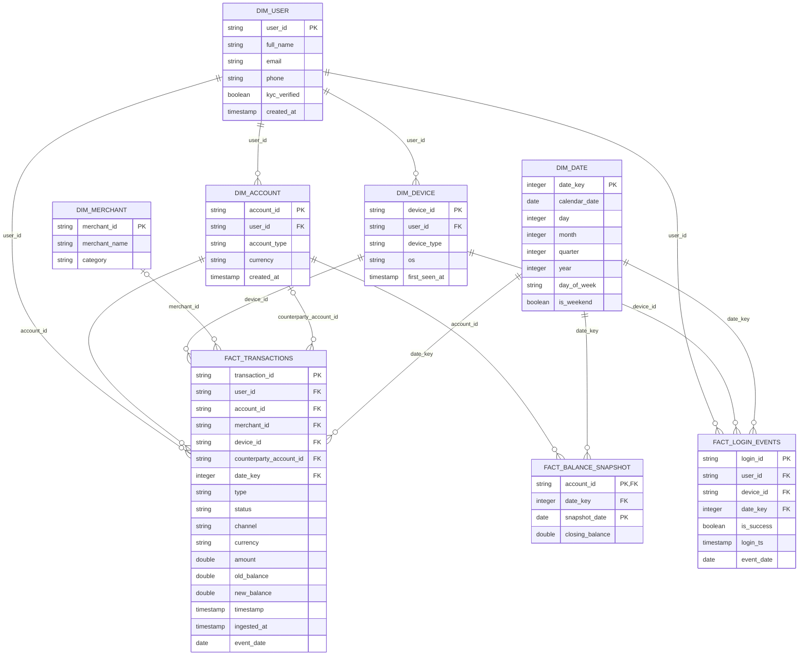

# Gold Dimension-Fact ERD Specification

Generated by `ops/schema/render_schema_diagrams.py` from [observed_schemas.json](observed_schemas.json) and `data_platform/contracts/relationships/schema_relationships.yml`. Do not edit by hand.

Delta declares no primary or foreign keys, so a database tool discovers none. Each edge below is a **logical** relationship: the builders produce it and, where marked `validated`, `data_platform/quality/validate_gold.py` checks it for orphans. In DBeaver it is reproduced as a *virtual* key, stored only in the DBeaver workspace.

## Diagram (source-derived, not a database export)

## Grain

| Table | Role | Grain (logical key) | Partition | Columns |
|---|---|---|---|---:|
| `dim_user` | Dimension | one row per `user_id` | - | 6 |
| `dim_account` | Dimension | one row per `account_id` | - | 5 |
| `dim_merchant` | Dimension | one row per `merchant_id` | - | 3 |
| `dim_device` | Dimension | one row per `device_id` | - | 5 |
| `dim_date` | Dimension | one row per `date_key` | - | 8 |
| `fact_transactions` | Fact | one row per `transaction_id` | event_date | 17 |
| `fact_login_events` | Fact | one row per `login_id` | event_date | 7 |
| `fact_balance_snapshot` | Fact | one row per `account_id, snapshot_date` | snapshot_date | 4 |

## Relationships

*Optional* means the referencing column may be null; a null key has no parent row. Physically every Delta column is nullable, so non-null keys are a validator rule, not a storage constraint.

| # | Child column | Parent key | Cardinality | Optional | Kind | Enforcement |
|---:|---|---|---|---|---|---|
| 1 | `dim_account.user_id` | `dim_user.user_id` | many-to-one | no | dimension-to-dimension | validated |
| 2 | `dim_device.user_id` | `dim_user.user_id` | many-to-one | no | dimension-to-dimension | validated |
| 3 | `fact_transactions.user_id` | `dim_user.user_id` | many-to-one | no | fact-to-dimension | validated |
| 4 | `fact_transactions.account_id` | `dim_account.account_id` | many-to-one | no | fact-to-dimension | validated |
| 5 | `fact_transactions.device_id` | `dim_device.device_id` | many-to-one | no | fact-to-dimension | validated |
| 6 | `fact_transactions.merchant_id` | `dim_merchant.merchant_id` | many-to-one | yes | fact-to-dimension | validated |
| 7 | `fact_transactions.counterparty_account_id` | `dim_account.account_id` | many-to-one | yes | fact-to-dimension | validated |
| 8 | `fact_transactions.date_key` | `dim_date.date_key` | many-to-one | no | fact-to-dimension | validated |
| 9 | `fact_login_events.user_id` | `dim_user.user_id` | many-to-one | no | fact-to-dimension | validated |
| 10 | `fact_login_events.device_id` | `dim_device.device_id` | many-to-one | no | fact-to-dimension | validated |
| 11 | `fact_login_events.date_key` | `dim_date.date_key` | many-to-one | no | fact-to-dimension | validated |
| 12 | `fact_balance_snapshot.account_id` | `dim_account.account_id` | many-to-one | no | fact-to-dimension | validated |
| 13 | `fact_balance_snapshot.date_key` | `dim_date.date_key` | many-to-one | no | fact-to-dimension | validated |

## DBeaver virtual keys

Create the virtual unique keys first; a virtual foreign key must reference one.

| Table | Virtual unique key columns |
|---|---|
| `gold_zone.dim_user` | `user_id` |
| `gold_zone.dim_account` | `account_id` |
| `gold_zone.dim_merchant` | `merchant_id` |
| `gold_zone.dim_device` | `device_id` |
| `gold_zone.dim_date` | `date_key` |
| `gold_zone.fact_transactions` | `transaction_id` |
| `gold_zone.fact_login_events` | `login_id` |
| `gold_zone.fact_balance_snapshot` | `account_id, snapshot_date` |

| # | On table | Column | References | Referenced virtual key |
|---:|---|---|---|---|
| 1 | `gold_zone.dim_account` | `user_id` | `gold_zone.dim_user` | `user_id` |
| 2 | `gold_zone.dim_device` | `user_id` | `gold_zone.dim_user` | `user_id` |
| 3 | `gold_zone.fact_transactions` | `user_id` | `gold_zone.dim_user` | `user_id` |
| 4 | `gold_zone.fact_transactions` | `account_id` | `gold_zone.dim_account` | `account_id` |
| 5 | `gold_zone.fact_transactions` | `device_id` | `gold_zone.dim_device` | `device_id` |
| 6 | `gold_zone.fact_transactions` | `merchant_id` | `gold_zone.dim_merchant` | `merchant_id` |
| 7 | `gold_zone.fact_transactions` | `counterparty_account_id` | `gold_zone.dim_account` | `account_id` |
| 8 | `gold_zone.fact_transactions` | `date_key` | `gold_zone.dim_date` | `date_key` |
| 9 | `gold_zone.fact_login_events` | `user_id` | `gold_zone.dim_user` | `user_id` |
| 10 | `gold_zone.fact_login_events` | `device_id` | `gold_zone.dim_device` | `device_id` |
| 11 | `gold_zone.fact_login_events` | `date_key` | `gold_zone.dim_date` | `date_key` |
| 12 | `gold_zone.fact_balance_snapshot` | `account_id` | `gold_zone.dim_account` | `account_id` |
| 13 | `gold_zone.fact_balance_snapshot` | `date_key` | `gold_zone.dim_date` | `date_key` |
