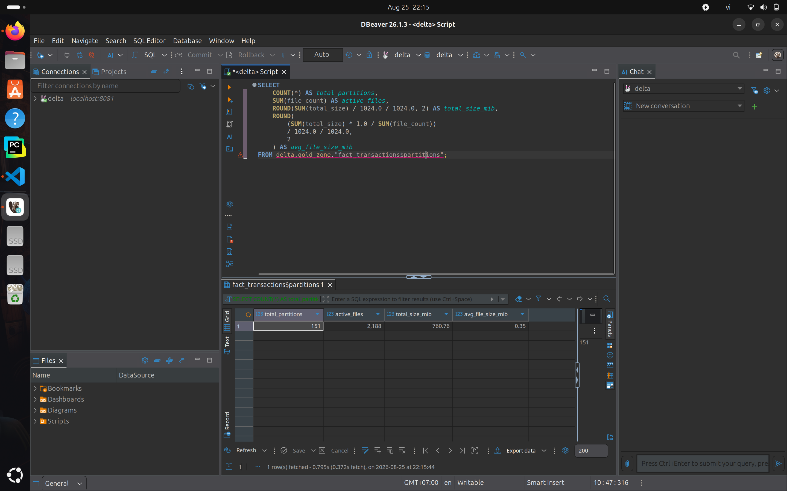
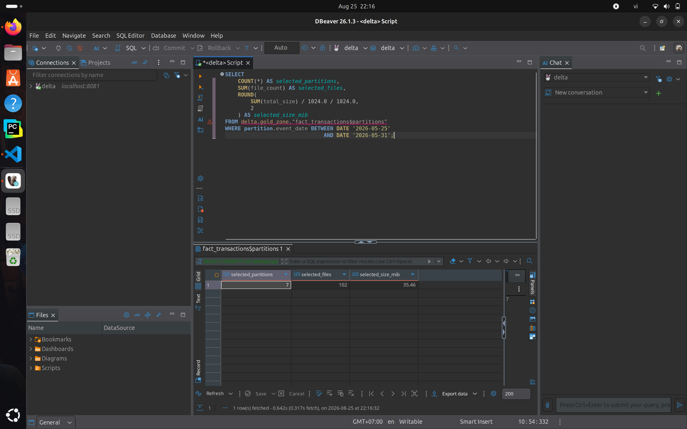
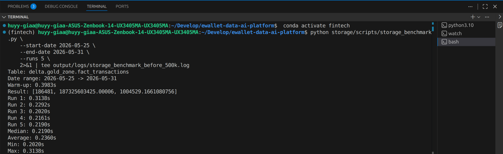
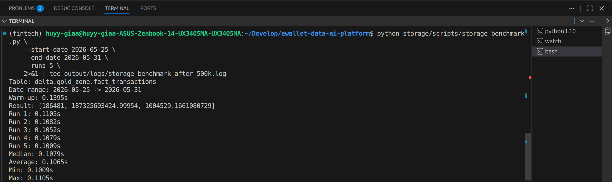
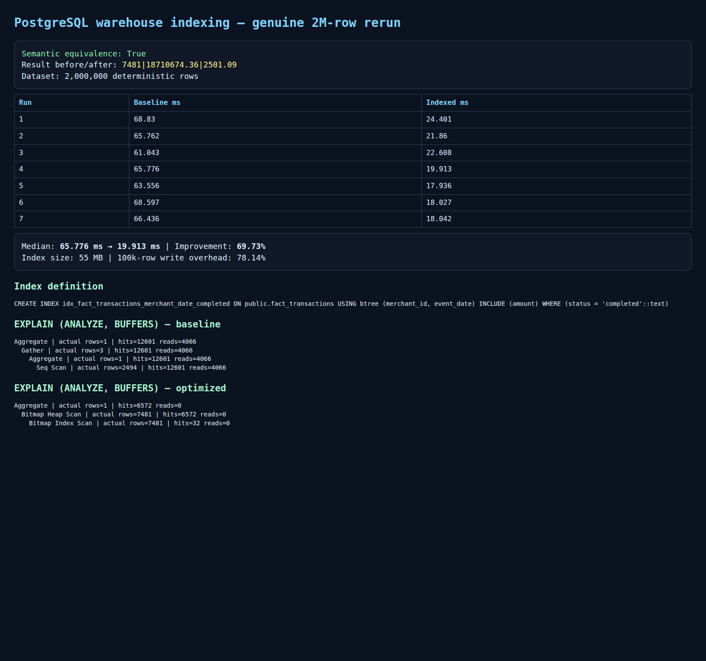

# EDAI-1 Storage Optimization

## Scope and evidence boundary

This report contains two separate historical local experiments: Delta/Trino
small-file compaction on a four-million-row Gold fixture and PostgreSQL
Warehouse index optimization on an isolated two-million-row synthetic fixture.
Neither experiment proves production cost-effectiveness or a deployed
Gold-to-PostgreSQL pipeline.

For the Delta/Trino experiment, the retained evidence provides the aggregate
query result, five-run summary statistics, physical-layout counts and six
captures. The exact analytical SQL beyond the documented date filter, Trino
version, host/resource specification, warm-up and cache policy, individual
timings, compaction duration, rewrite I/O and compute cost were not recovered.
Those missing controls limit causal and economic conclusions; no values are
reconstructed from screenshots.

## Before Optimization

### Physical Layout

The Gold `fact_transactions` table contains **4,000,000 rows** covering

**151 daily partitions**.

Before compaction:

| Metric | Value |
|---|---:|
| Partitions | 151 |
| Active files | 2,188 |
| Active data size | 760.76 MiB |
| Average file size | 0.35 MiB |

Although the table is partitioned by `event_date`, each daily partition

contains many small Parquet files. The table therefore exhibits a

**small-file problem**.

On average, each partition contains approximately **14 active files**.



### Partition Pruning

The benchmark query filters the following seven-day range:

`2026-05-25` to `2026-05-31`

Before compaction, this selects:

- 7 of 151 partitions
- 102 active files
- 35.46 MiB of active data

Partitioning by `event_date` therefore allows Trino to prune unrelated

date partitions. However, the selected partitions still contain many

small files.



### Query Benchmark Before Compaction

The benchmark performs an analytical aggregation over the seven-day

date range.

Business result:

- Transaction count: 186,481
- Total amount: 187,325,603,425.00006
- Average amount: 1,004,529.1661080756

Performance over five measured runs:

| Metric | Runtime |
|---|---:|
| Median | 0.2190 s |
| Average | 0.2360 s |
| Minimum | 0.2020 s |
| Maximum | 0.3138 s |



## Compaction

The table was compacted using Trino:

```sql
ALTER TABLE delta.gold_zone.fact_transactions
EXECUTE optimize(file_size_threshold => '16MB');
```

The goal of this operation is to rewrite many small Parquet files into

fewer larger files without changing the logical transaction data.

No `VACUUM` operation was performed because the experiment keeps Delta

history available for debugging and evidence.

## After Optimization

### Physical Layout

After compaction:

| Metric | Value |
|---|---:|
| Partitions | 151 |
| Active files | 151 |
| Active data size | 404.12 MiB |
| Average file size | 2.68 MiB |

The table still contains **151 daily partitions**, but now contains only

**151 active files**.

This means the compacted layout contains approximately **one active

Parquet file per daily partition**.


### Partition Pruning After Compaction

For the same seven-day query range:

`2026-05-25` to `2026-05-31`

Trino selects:

- 7 of 151 partitions
- 7 active files
- 18.73 MiB of active data

The partition pruning behavior remains unchanged, but compaction reduces

the number of files inside the selected partitions from **102 to 7**.


### Query Benchmark After Compaction

The same analytical workload was executed again after compaction.

Performance over five measured runs:

| Metric | Runtime |
|---|---:|
| Median | 0.1079 s |
| Average | 0.1065 s |
| Minimum | 0.1009 s |
| Maximum | 0.1105 s |

The transaction count remained **186,481**, confirming that the benchmark

continued to process the same logical data.

A very small difference in the aggregated floating-point amount was

observed after the physical rewrite. This is caused by aggregation order

when using floating-point `DOUBLE` values and does not indicate row loss.



## Final Comparison

| Metric | Before | After |
|---|---:|---:|
| Partitions | 151 | 151 |
| Active files | 2,188 | 151 |
| Active data size | 760.76 MiB | 404.12 MiB |
| Average file size | 0.35 MiB | 2.68 MiB |
| Files scanned for 7-day range | 102 | 7 |
| Data size for 7-day range | 35.46 MiB | 18.73 MiB |
| Median query runtime | 0.2190 s | 0.1079 s |
| Average query runtime | 0.2360 s | 0.1065 s |

Compaction reduced the number of active files from **2,188 to 151**,

corresponding to an approximately **93.10% reduction**.

For the seven-day benchmark range, the number of active files was reduced

from **102 to 7**, while partition pruning continued to select only the

seven relevant `event_date` partitions.

The median analytical query latency decreased from **0.2190 seconds**

to **0.1079 seconds**, corresponding to an approximately **50.73% runtime

reduction** and a **2.03x speedup**.

The average active file size increased from **0.35 MiB to 2.68 MiB**,

showing that the physical layout became substantially less fragmented.

The active Delta snapshot size decreased from **760.76 MiB to

404.12 MiB**. Old files may still physically remain in object storage

because Delta Lake preserves previous versions until a future `VACUUM`

operation removes files that are no longer required.

### Trade-off

Compaction requires an additional rewrite operation and therefore

consumes compute and I/O resources.

It should be executed when the performance benefit of reducing small

files outweighs the cost of rewriting data.

In this experiment, the observed read-latency and fragmentation improvements
show that compaction benefited this bounded query and table layout because the table

had a severe small-file problem and the analytical benchmark improved

from **0.2190 s to 0.1079 s median runtime**. Overall cost-effectiveness cannot
be concluded because compaction duration, compute consumption and rewrite I/O
cost were not measured in the retained evidence.

No `VACUUM` operation was performed in order to preserve Delta history

and debugging evidence.

## PostgreSQL Warehouse Index Optimization — Row 21

### Rubric mapping and status

EDAI-1 Row 21 is worth 3 points and requires `Datawarehouse (ví dụ
indexing)`. It inherits the Row 20 proof requirement to show the optimization
code and analyze what improved relative to the unoptimized baseline.

The recovered experiment satisfies that technical requirement with a matched,
historical local PostgreSQL indexing benchmark. Its classification is
`VERIFIED_WITH_RUNTIME_EVIDENCE`. This status applies only to the isolated
fixture workload described below. It is not evidence of canonical cloud or
production Warehouse performance.

### Experiment boundary

The benchmark ran from `2026-10-29T14:20:01.705901Z` to
`2026-10-29T14:20:13.592243Z` using implementation commit
`cf3e86747409641aff7e483181239b2fff52e9d6`. It used the digest-recorded
`postgres:16` image in a temporary, tmpfs-backed local container with no
exposed port and no connection to the project MLflow or cloud databases. The
artifact records the major PostgreSQL version and image digest, but not the
server's exact minor-version string.

The deterministic fixture contained 2,000,000 rows in
`fact_transactions`:

| Column | Type and role |
|---|---|
| `transaction_id` | `bigint`, primary key |
| `event_date` | `date`, query date range |
| `merchant_id` | `integer`, selective query key |
| `account_id` | `integer` |
| `status` | `text`, partial-index predicate |
| `amount` | `numeric(14,2)`, aggregate and included column |

Both variants used one warmup followed by seven measured
`EXPLAIN (ANALYZE, BUFFERS, FORMAT JSON)` executions of the same query and
unchanged data snapshot. The query filtered June 2026, merchant `42` and
`status='completed'`, then calculated count, total amount and average amount.

### Baseline and optimized configuration

The baseline had no workload-specific secondary index and used a parallel
sequential scan. The only read-path optimization was this 55 MB partial
covering B-tree index:

```sql
CREATE INDEX idx_fact_transactions_merchant_date_completed
ON public.fact_transactions USING btree (merchant_id, event_date)
INCLUDE (amount)
WHERE status = 'completed';
```

The optimized plan used a bitmap index scan followed by an exact bitmap heap
scan. The representative baseline plan read 4,066 shared blocks and hit
12,601; the optimized plan read zero shared blocks and hit 6,572. These are
point-in-time buffer observations from the retained plans, not general storage
guarantees.

### Measured result and trade-off

| Metric | Baseline | Indexed | Change |
|---|---:|---:|---:|
| Median query execution, 7 runs | 65.776 ms | 19.913 ms | 69.73% lower latency |
| Query result | `7481\|18710674.36\|2501.09` | Same | Exact match |
| Table signature | `2000000\|4999990000.00\|1\|2000000` | Same | Exact match |
| Insert 100,000 rows | 112.277 ms | 200.012 ms | 78.14% overhead |

The read improvement is calculated as
`(65.776 - 19.913) / 65.776 × 100 = 69.73%`. The exact query result and table
signature remained equal, so the faster plan did not change the observed
business result. The 78.14% write overhead shows why this index is appropriate
only when the measured read path justifies additional index maintenance.



*Readable rendering of the genuine historical benchmark artifact. This is not
a database-management UI screenshot. The raw JSON remains the authoritative
record for all seven timings, full plans, buffer counts, semantic signatures,
index definition and write measurement.*

### Evidence and limitations

- [Benchmark runner](../../../data_platform/storage/scripts/warehouse_benchmark.py),
  implementation commit `cf3e86747409641aff7e483181239b2fff52e9d6`.
- [Raw v2 benchmark JSON](../../evidence/edai1/storage/artifacts/postgres_warehouse_index_ab_v2.json), SHA-256
  `30858a9dda70f39989960e0baada108b926a5e4c849c9c487bd93ed29148a9bc`.
- [Benchmark summary log](../../evidence/edai1/storage/artifacts/postgres_warehouse_benchmark_v2.log), SHA-256
  `67b0c98c6defb319cc878d2be988a38d009c00f6e9d67f232c2ccf48afed63d7`.
- Evidence rendering SHA-256:
  `0db7f0a1cfbb2f5f7ad270a7bb39a0ed9b56bc707e8fc64b3c8d746e26b6b6ca`.
- Original immutable evidence root:
  `/home/huyy-giaa/ewallet-evidence/edai1-final-evidence/warehouse/`.
- The earlier retained run (`37.940 → 10.414 ms`, 72.55%, 122.25% write
  overhead) is a separate experiment. Its values are not mixed with v2.
- No authentic pgAdmin/DBeaver UI screenshot was found. The retained rendering
  is presentation evidence derived from the raw v2 JSON.
- The experiment used a synthetic local fixture and one selective aggregate
  query. It does not select PostgreSQL as the production analytics warehouse,
  authorize an index on a live table or prove performance for canonical data.
