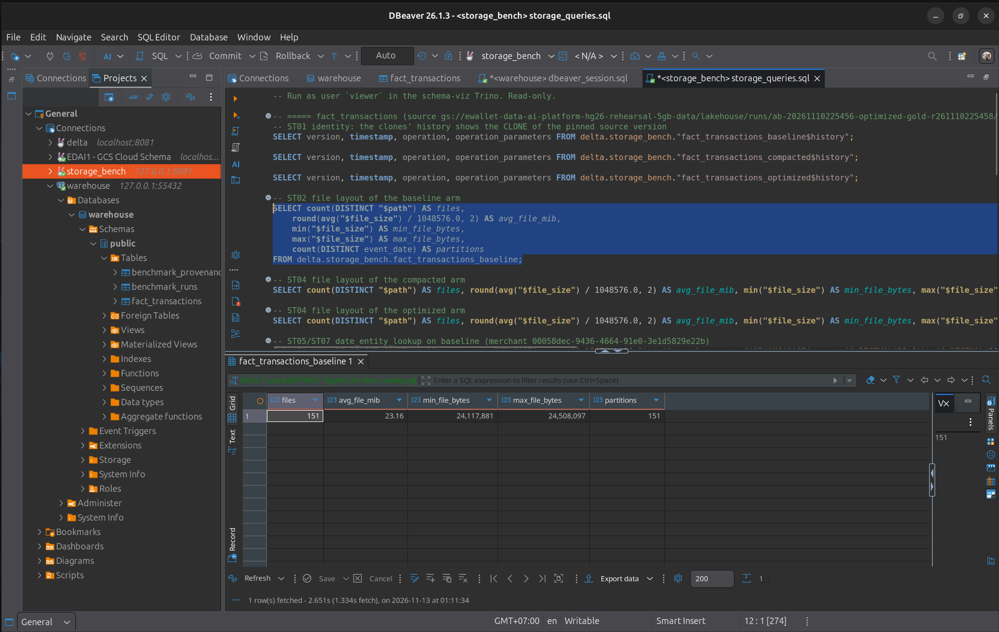
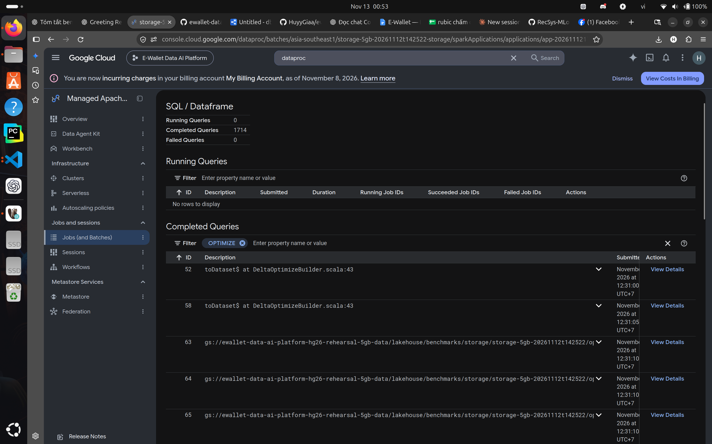
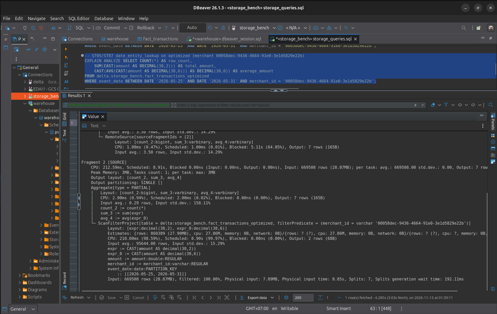
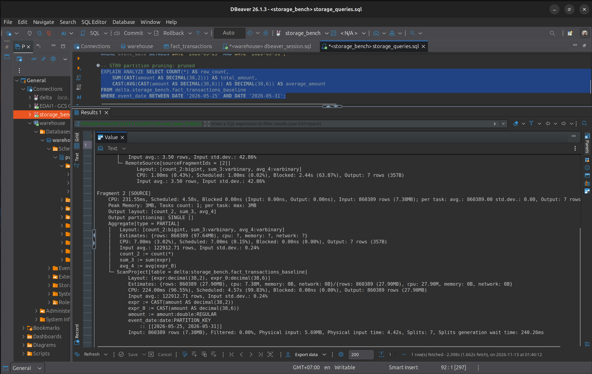
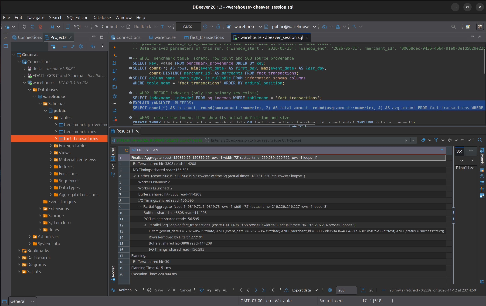
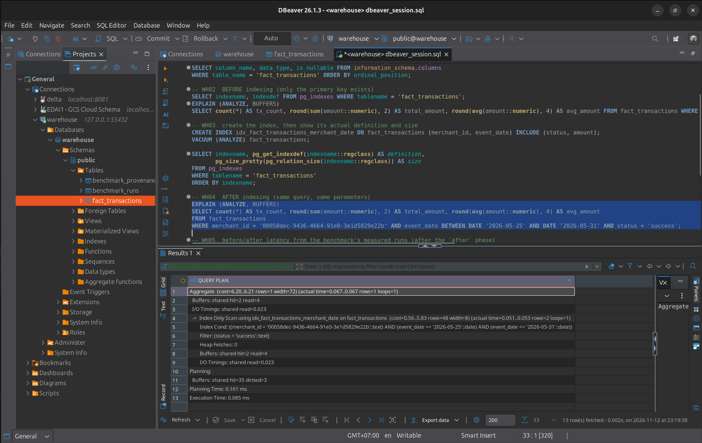

# Lakehouse and Warehouse Storage Optimization

**Scope.** EDAI-1 rubric rows 20 (lakehouse optimization: compaction, Z-order, partitioning) and 21 (data warehouse optimization).
**Data.** Real Gold tables of the 5GB campaign `ab-20261110225456`: dataset `rehearsal-5gb-v1`, optimized Spark profile, source Spark commit `aae22b08eee20fa055c4aefc8d23c14cc3ae5f8c`, Delta version 0.
**Official runs, both executed by the owner on 2026-11-12/13:**
- Lakehouse: benchmark `storage-5gb-20261112t142522`, Dataproc Serverless 2.2 batch `storage-5gb-20261112t142522-storage` in `asia-southeast1` (Spark 3.5.3, Delta 3.2.0, tool commit `f9be2776c3d617a7bfe32fdb0ff5c631d80080c5`), 17:29–17:37 UTC.
- Warehouse: PostgreSQL 16.15 on 3,816,574 real Gold rows, same tool commit.

**Evidence.** [docs/evidence/edai1/storage/5gb/](../../evidence/edai1/storage/5gb/MANIFEST.md): 73 owner screenshots (Trino/DBeaver, Dataproc Spark UI, PostgreSQL/DBeaver, terminal) and 25 raw artifacts, all under `SHA256SUMS`.

## 1. Summary

| Question | Answer | Basis |
|---|---|---|
| Does the 5GB Gold layout need compaction? | **No.** OPTIMIZE considered 151 files per table, skipped 151 and rewrote none. | `rewrite.json`, `$history`, Trino layout |
| Does Z-order on `merchant_id` help? | **Not adopted.** It rewrote 7.9 GB, but every query read the same files and bytes as before, and its runtime gain is no larger than the drift measured between two identical layouts. | Spark scan metrics, Trino physical input, A/A control |
| Does partition pruning help? | **Yes, and it is the effective optimization in this layout.** Reading 7 of 151 daily partitions is 3.0–3.3× faster in Spark and 17.8–22.6× faster in single Trino runs, with identical results. | `partition_pruning.json`, ST09 |
| Is the warehouse index worth it? | **Yes for this query**: 174.073 ms → 0.108 ms median (Seq Scan → Index Only Scan), with +17 % WAL on inserts and a 234 MB index. | `report.json`, WH01–WH06 |
| Did any optimization change results? | **No.** Every arm and every pruning side returned identical results, and all equivalence checks passed. | `equivalence.json`, `wh_d_semantics` |

The lakehouse result is mostly negative, and it is reported that way. The campaign's writers already produce one ~24 MiB file per daily partition, so there is nothing to compact. Z-order cannot narrow a scan that is already one file per partition.

## Part A — Lakehouse (row 20)

### A.1 Problem and starting layout

Small files and unclustered data are the usual reasons to run `OPTIMIZE` and `ZORDER BY` on a Delta table. Before spending a paid batch on them, the inspector ([`ops/gcp/inspect_storage_layout.py`](../../../ops/gcp/inspect_storage_layout.py)) read the Delta logs of the two largest Gold tables read-only. The owner confirmed the layout in Trino:

| Table | Files | Bytes | File size min / avg / max | Partitions (`event_date`) | Files per partition |
|---|---:|---:|---|---:|---:|
| `fact_transactions` | 151 | 3,667,633,194 | 24,117,881 B / 23.16 MiB / 24,508,097 B | 151 | 1 |
| `obt_transaction_enriched` | 151 | 4,271,165,936 | 28,090,019 B / 26.98 MiB / 28,554,997 B | 151 | 1 |



*ST02. Baseline layout in Trino: 151 files, 151 daily partitions, one file of about 23 MiB per partition ([obt](../../evidence/edai1/storage/5gb/lakehouse/screenshots/ST02_obt_baseline_layout.png)).*

The DP2 writers repartition by `event_date` before writing, so the campaign has no small-file problem. The inspector predicted `COMPACTION_ONLY` with no worthwhile Z-order column: all 151 files share almost the full `merchant_id` range. The experiment still executed every arm, so the conclusion rests on measurements rather than on the prediction.

### A.2 Experiment design

**Arms.** Each table is cloned three times below `gs://ewallet-data-ai-platform-hg26-rehearsal-5gb-data/lakehouse/benchmarks/storage/storage-5gb-20261112t142522/`, each as `SHALLOW CLONE … VERSION AS OF 0` of the pinned source:

| Arm | Operation after the clone |
|---|---|
| `baseline` | none |
| `compacted` | `OPTIMIZE` (bin-packing) |
| `optimized` | `OPTIMIZE … ZORDER BY (merchant_id)` |

The source tables were never written. No `VACUUM` runs; a unit test asserts this. Evidence objects are uploaded create-only.

**Workload.** The parameters are derived from the data and recorded in [`plan.json`](../../evidence/edai1/storage/5gb/lakehouse/raw/plan.json):

| Parameter | Value |
|---|---|
| Window | `event_date` 2026-05-25 … 2026-05-31: 860,389 rows, 41,218 merchants |
| Merchant | `00058dec-9436-4664-91e0-3e1d5829e22b`, the median-volume merchant in the window (2 rows) |
| Status in the window | success 814,001 · failed 29,763 · pending 16,625 |

| Query | Purpose |
|---|---|
| `window_aggregation` | count, exact sum and average over 7 days |
| `window_merchant_lookup` | the same 7 days, one merchant (the Z-order target) |
| `window_failed_by_channel` | 7 days, `status = 'failed'`, grouped by channel |
| Pruning sides | `window_aggregation` filtered on the partition column (`pruned`), on a `timestamp` range (`stats_only`), or on `date_format(timestamp)` (`full_scan`) |

**Measurement.**
- One warm-up and five measured runs per query and arm, in rotating arm order.
- Each run records its samples, physical plan and scan metrics (files, bytes, partitions read).
- Every arm must match the baseline on schema hash, row count, grain and business invariants, and an order-independent content fingerprint. Otherwise the batch fails before writing evidence.

**Verdict rule.** A descriptive noise band, not a significance test:
- `NO_CLEAR_IMPROVEMENT` when the medians differ by less than 5 %;
- `IMPROVED` / `REGRESSED` when they differ by at least 5 % and the sample ranges do not overlap;
- `INCONCLUSIVE` otherwise.

Three comparisons are kept apart: baseline → compaction, compaction → Z-order, and baseline → optimized. Z-order is credited only through its own incremental arm.

### A.3 Execution

The job ran about 8.6 minutes (17:29:17 → 17:37:51 UTC). Spark application `app-20261112172914785-0221` completed 1,714 SQL queries with 0 failures ([ST03b](../../evidence/edai1/storage/5gb/lakehouse/screenshots/ST03b_spark_ui_sql_dataframe_1714_completed.png)). The job status is `PASS`.



*ST03/ST06. Spark UI filtered on OPTIMIZE: query 52 is the compaction of the `compacted` arm ([details: OptimizeTableCommand, 4.62 s](../../evidence/edai1/storage/5gb/lakehouse/screenshots/ST03c_spark_ui_compaction_optimize_query_52.png)); query 58 is the Z-order of the `optimized` arm.*

### A.4 Results: rewrites

From [`rewrite.json`](../../evidence/edai1/storage/5gb/lakehouse/raw/evidence/rewrite.json):

| Table | Operation | Files considered / skipped | Removed → added | Bytes rewritten | Seconds |
|---|---|---|---|---:|---:|
| fact_transactions | compaction | 151 / 151 | 0 → 0 | 0 | 4.9 |
| fact_transactions | Z-order | 151 / 0 | 151 → 151 | 3,667,633,194 | 49.5 |
| obt_transaction_enriched | compaction | 151 / 151 | 0 → 0 | 0 | 3.2 |
| obt_transaction_enriched | Z-order | 151 / 0 | 151 → 151 | 4,271,165,936 | 55.2 |

**Compaction was a true no-op.** Delta skipped every single-file partition. The `compacted` clones' history holds only the `CLONE` commit ([ST01](../../evidence/edai1/storage/5gb/lakehouse/screenshots/ST01_fact_compacted_history_clone_v0.png)), and their Trino layout is identical to the baseline ([ST04](../../evidence/edai1/storage/5gb/lakehouse/screenshots/ST04_fact_compacted_layout_unchanged.png)). The job therefore reports `NOT_NEEDED` and claims no compaction gain.

**Z-order rewrote everything and changed no file size.** The optimized clones record `OPTIMIZE` with `zOrderBy ["merchant_id"]` at version 1 ([ST01](../../evidence/edai1/storage/5gb/lakehouse/screenshots/ST01_fact_optimized_history_clone_then_zorder.png)). Their files are new objects under the benchmark root, while the baseline still references the campaign's files ([ST04](../../evidence/edai1/storage/5gb/lakehouse/screenshots/ST04_fact_baseline_vs_optimized_file_paths.png)). Yet every one of the 151 partitions of both tables kept a single file of exactly the same byte size as before (`layout_baseline.json` against `layout_optimized.json`; [Trino](../../evidence/edai1/storage/5gb/lakehouse/screenshots/ST04_fact_optimized_layout.png)). One file per partition stays one file per partition, so Z-order created no new file-skipping opportunity.

### A.5 Results: query performance (Spark, five runs each)

From [`comparison.csv`](../../evidence/edai1/storage/5gb/lakehouse/raw/evidence/comparison.csv). Medians are in seconds, with the sample range in brackets.

| Table | Query | baseline | compacted | optimized (Z-order) | Files / bytes read, every arm |
|---|---|---|---|---|---|
| fact | window_aggregation | 0.798 [0.761–0.973] | 0.761 [0.713–0.883] | 0.639 [0.605–0.725] | 7 / 169,756,233 |
| fact | window_merchant_lookup | 0.778 [0.771–0.838] | 0.712 [0.697–0.767] | 0.622 [0.576–0.625] | 7 / 169,756,233 |
| fact | window_failed_by_channel | 0.849 [0.820–0.963] | 0.783 [0.717–0.807] | 0.681 [0.628–0.719] | 7 / 169,756,233 |
| obt | window_aggregation | 0.735 [0.685–0.798] | 0.668 [0.631–0.805] | 0.574 [0.552–0.667] | 7 / 197,768,225 |
| obt | window_merchant_lookup | 1.023 [0.966–1.055] | 0.839 [0.775–0.876] | 0.664 [0.623–0.715] | 7 / 197,768,225 |
| obt | window_failed_by_channel | 1.083 [1.056–1.119] | 0.930 [0.870–0.965] | 0.727 [0.707–0.836] | 7 / 197,768,225 |

| Comparison | fact verdicts (agg / merchant / failed) | obt verdicts (agg / merchant / failed) |
|---|---|---|
| baseline → compaction | NO_CLEAR (−4.6 %) / IMPROVED (−8.5 %) / IMPROVED (−7.8 %) | INCONCLUSIVE (−9.1 %) / IMPROVED (−18.0 %) / IMPROVED (−14.1 %) |
| compaction → Z-order | INCONCLUSIVE (−16.0 %) / IMPROVED (−12.7 %) / INCONCLUSIVE (−13.0 %) | INCONCLUSIVE (−14.1 %) / IMPROVED (−20.8 %) / IMPROVED (−21.9 %) |
| baseline → optimized | IMPROVED (−19.9 %) / IMPROVED (−20.1 %) / IMPROVED (−19.8 %) | IMPROVED (−21.9 %) / IMPROVED (−35.0 %) / IMPROVED (−32.9 %) |

**How to read these numbers.**

1. **The baseline → compaction comparison is an A/A control.** The `compacted` arm reads the same data files as the baseline (the OPTIMIZE wrote nothing). Its scans read the same 7 files and the same bytes. Yet it measured 4.6–18.0 % faster, and four of six queries passed the `IMPROVED` rule. That difference cannot come from the layout. It shows that run-to-run and arm-to-arm drift in this batch is of the order of 5–18 %. The data cannot tell the cause apart: executor warm-up, dynamic allocation (6 → 7 executors), or GCS and OS caching.
2. **The Z-order increment is of the same size as the A/A drift.** Compaction → Z-order measured −12.7 % to −21.9 %, with three of six queries `INCONCLUSIVE`. The Z-order arm also read the same 7 files and the same bytes as the other arms. The merchant lookup, the query Z-order targets, skipped no file. Every query became faster in the order baseline > compacted > optimized, including the queries Z-order cannot affect. That pattern fits drift better than a layout effect.
3. **Baseline → optimized is `IMPROVED` everywhere, but it adds the drift to the Z-order increment.** The recommendation logic does not credit it to Z-order.

The tool's recommendation, for both tables, is: `compaction: NOT_NEEDED`, `zorder: DO_NOT_ADOPT` (incremental INCONCLUSIVE, overall IMPROVED). This report agrees. Spending 50–55 s and 3.7–4.3 GB of rewrite per table per run for an effect indistinguishable from noise is not justified.

### A.6 Results: Trino cross-check (single runs)

The owner registered the six arms in the read-only schema-viz Trino 483 and ran `EXPLAIN ANALYZE` from DBeaver ([registration](../../evidence/edai1/storage/5gb/lakehouse/screenshots/ST00b_trino_register_benchmark_arms.png), [connection: user `viewer`, no password](../../evidence/edai1/storage/5gb/lakehouse/screenshots/ST00c_dbeaver_trino_viewer_connection.png)). Each figure is one run, so the execution times are illustrative only. The scan statistics, however, are deterministic.

| Table | Query | Arm | Input rows | Physical input | Splits | Execution |
|---|---|---|---:|---:|---:|---:|
| fact | merchant lookup | baseline / compacted / optimized | 669,508 each | 7.89 MB each | 7 each | — / — / 3.26 s |
| fact | date range | baseline / compacted / optimized | 860,389 each | 5.69 MB each | 7 each | 3.06 / 2.39 / 2.50 s |
| obt | merchant lookup | baseline / compacted / optimized | 689,163 each | 13.38 MB each | 7 each | 3.82 / 3.82 / 3.53 s |
| obt | date range | baseline / compacted / optimized | 860,389 each | 5.69 MB each | 7 each | 2.17 / 2.46 / 2.29 s |



*ST07. Merchant lookup on the Z-order arm: 669,508 input rows, 7.89 MB physical input and 7 splits, identical to the [baseline](../../evidence/edai1/storage/5gb/lakehouse/screenshots/ST05_fact_entity_lookup_baseline_scan.png) and [compacted](../../evidence/edai1/storage/5gb/lakehouse/screenshots/ST05_fact_entity_lookup_compacted_scan.png) arms.*

Trino confirms the Spark finding independently. Z-order did not reduce the data read for the merchant lookup by a single byte, and the execution times of the three arms move in no consistent direction. The two fact-table merchant-lookup overview captures do not show the Execution line legibly, so those two cells are left blank. All screenshots are listed in the [manifest](../../evidence/edai1/storage/5gb/MANIFEST.md).

### A.7 Results: partition pruning

**Spark, five runs each** ([`partition_pruning.json`](../../evidence/edai1/storage/5gb/lakehouse/raw/evidence/partition_pruning.json), baseline arm):

| Table | Side | Filter | Files read | Bytes read | Median s | Rows |
|---|---|---|---:|---:|---:|---:|
| fact | pruned | `event_date BETWEEN …` | 7 | 169,756,233 | 0.734 | 860,389 |
| fact | stats_only | `timestamp` range (UTC) | 7 | 169,756,233 | 0.812 | 860,389 |
| fact | full_scan | `date_format(timestamp, …)` | 151 | 3,667,633,194 | 2.217 | 860,389 |
| obt | pruned | `event_date BETWEEN …` | 7 | 197,768,225 | 0.728 | 860,389 |
| obt | stats_only | `timestamp` range (UTC) | 7 | 197,768,225 | 1.005 | 860,389 |
| obt | full_scan | `date_format(timestamp, …)` | 151 | 4,271,165,936 | 2.435 | 860,389 |

All six sides returned the same row count, exact sum (894,991,837,952.66) and average. Partition pruning reads 4.6 % of the bytes and runs 3.0× (fact) and 3.3× (obt) faster than the full scan.

The `stats_only` side shows that, with one day per file, Delta's per-file `timestamp` min/max statistics skip as many files as partition pruning does. It still costs more, because the predicate must be evaluated against file statistics and then row by row. Pruning on the partition column needs neither.

**Trino, single runs** (ST09):

| Table | Side | Splits | Input rows | Physical input | Execution |
|---|---|---:|---:|---:|---:|
| fact | pruned | 7 | 860,389 | 5.69 MB | 1.99 s |
| fact | full_scan | 151 | 18,600,000 | 178.81 MB | 35.38 s (17.8×) |
| obt | pruned | 7 | 860,389 | — | 2.21 s |
| obt | full_scan | 151 | 18,600,000 | — | 50.02 s (22.6×) |



*ST09. With the partition filter, Trino lists `event_date:date:PARTITION_KEY :: [[2026-05-25, 2026-05-31]]` and reads 7 splits. Without it ([full scan](../../evidence/edai1/storage/5gb/lakehouse/screenshots/ST09_fact_full_scan_scan.png)) it reads 151 splits and 18.6 million rows.*

**Caveat: the Trino `stats_only` capture is not comparable.** The Spark job runs with `spark.sql.session.timeZone=UTC`. In Trino, the Delta `timestamp` column is `timestamp(3) with time zone`, and a zone-less literal such as `TIMESTAMP '2026-05-25 00:00:00'` is interpreted in the client session zone. DBeaver sent the desktop zone, so the plan shows the bounds in `Asia/Ho_Chi_Minh` (+07:00). The window shifted by seven hours: 983,526 rows were read from 8 splits and 860,298 matched, instead of 860,389 ([capture](../../evidence/edai1/storage/5gb/lakehouse/screenshots/ST09_fact_stats_only_scan_session_tz_0700.png)). The Spark result above is unaffected.

The Trino SQL generator now writes explicit UTC literals (`TIMESTAMP '… UTC'`) and formats days `AT TIME ZONE 'UTC'`; a unit test covers it. A `stats_only` screenshot taken with the corrected SQL is not part of this evidence.

### A.8 Equivalence

[`equivalence.json`](../../evidence/edai1/storage/5gb/lakehouse/raw/evidence/equivalence.json) records `equivalent: true` with no differences for baseline → compacted and baseline → optimized on both tables. The method compares the schema hash, exact row count, grain and business invariants, and a partition-independent aggregate row fingerprint. Every query result also matched across arms, or the batch would have failed. The `$history` captures show that each clone starts from the pinned source version 0 ([ST01 set](../../evidence/edai1/storage/5gb/MANIFEST.md)).

## Part B — Warehouse (row 21)

### B.1 Problem and data

The serving question is: *what did one merchant take in successful payments over the last week?* In PostgreSQL, without a suitable index, that is a full table scan for two rows.

The rows are the campaign's own Gold `fact_transactions`, not generated:
- **Extraction.** [`warehouse/source.py`](../../../data_platform/storage/warehouse/source.py) pinned Delta version 0 and took the 31 most recent whole daily partitions (2026-05-01 … 2026-05-31), with no row sampling: 3,816,574 of 18,600,000 rows. The extracted count equals the Delta file statistics.
- **Snapshot.** The rows were written once as a Parquet snapshot (SHA-256 `583c1f2d…a0bab6`).
- **Loading.** The snapshot was loaded with `\copy`, then `VACUUM ANALYZE`. Its provenance is stored in a `benchmark_provenance` table ([WH01](../../evidence/edai1/storage/5gb/warehouse/screenshots/WH01_provenance_table.png)).

| Profile | Value |
|---|---|
| Rows / merchants | 3,816,574 / 55,623 |
| Status | success 3,610,710 (94.6 %) · failed 132,152 · pending 73,712 |
| Table size / primary-key index | 966,705,152 B / 290,963,456 B |

The benchmark used its own PostgreSQL 16.15 instance: container `edai1-wh5gb-evidence-postgres`, volume `edai1-wh5gb-evidence-pgdata`, `127.0.0.1:55432`, 4 GiB memory limit. Each CLI phase printed its target container ([WH00](../../evidence/edai1/storage/5gb/warehouse/screenshots/WH00_before_phase_terminal.png)). An earlier verification instance was left untouched.

### B.2 Design

The index follows from the data, by the rules in [`workload.py`](../../../data_platform/storage/warehouse/workload.py):
- `merchant_id` leads, because it is an equality predicate on a high-cardinality column (query selectivity 5.2 × 10⁻⁷);
- `event_date` follows, because it is a range predicate;
- `status` and `amount` are `INCLUDE`d, so the query never visits the heap.

A partial index on `status = 'success'` was rejected by rule. It would exclude only 5.4 % of rows, below the 20 % threshold.

```sql
CREATE INDEX idx_fact_transactions_merchant_date
    ON fact_transactions (merchant_id, event_date) INCLUDE (status, amount);
```

### B.3 Methodology

| Experiment | Procedure |
|---|---|
| WH-A read | 2 warm-ups + 11 `EXPLAIN (ANALYZE, BUFFERS)` runs without the index; the same with it. Then 10 interleaved pairs on the same warm table (index disabled via planner settings against enabled, alternating which runs first), because before and after differ in cache state. |
| WH-B index | The owner created the index in DBeaver. The tool verified the catalog definition (`pg_get_indexdef`) against the design and recorded the size. |
| WH-C write | Two empty twin tables (primary key only; primary key plus the index) received the same 8 deterministic batches of real rows (`abs(hashtext(transaction_id)) % 50`), in alternating order. Execution time and WAL bytes were recorded per batch. |
| WH-D equivalence | Table signature before and after indexing (count, exact sum, key range, merchant count, MD5 of ordered keys); the query result with and without the index; the twin tables after the inserts. |

### B.4 Results

From [`report.json`](../../evidence/edai1/storage/5gb/warehouse/raw/report.json) and [`summary.txt`](../../evidence/edai1/storage/5gb/warehouse/raw/summary.txt):

| Measure | Without index | With index | Verdict |
|---|---|---|---|
| WH-A median, 11 runs [range] | 174.073 ms [169.026–207.201] | 0.108 ms [0.102–0.151] | IMPROVED (−99.938 %) |
| WH-A interleaved, 10 pairs | 188.977 ms [170.776–207.125] | 0.104 ms [0.066–0.126] | IMPROVED (−99.945 %) |
| Access path | Parallel Seq Scan (2 workers + leader); 1,272,191 rows removed by filter per process; 115,296 blocks read | Index Only Scan; Heap Fetches 0; 6 blocks hit | — |
| WH-C insert median per batch, 8 batches [range] | 717.881 ms [653.933–801.407] | 895.781 ms [726.352–950.602] | INCONCLUSIVE (+24.8 %, ranges overlap) |
| WH-C WAL, 8 batches | 279,448,016 B | 327,038,736 B | +17.03 % |
| Index size | — | 245,489,664 B (234 MB, 25 % of the table) | — |
| WH-D semantic equivalence | — | — | PASS |



*WH02. Before: the merchant/week query scans the whole table (Execution Time 220.804 ms in this DBeaver run).*



*WH04. After: `Index Only Scan using idx_fact_transactions_merchant_date`, Heap Fetches 0, Execution Time 0.085 ms.*

In DBeaver, `CREATE INDEX` took 2.693 s and `VACUUM (ANALYZE)` 0.363 s ([WH03](../../evidence/edai1/storage/5gb/warehouse/screenshots/WH03_create_index_statistics.png)). The `benchmark_runs` table reproduces the medians above in [WH05](../../evidence/edai1/storage/5gb/warehouse/screenshots/WH05_read_latency_comparison.png) and [WH06](../../evidence/edai1/storage/5gb/warehouse/screenshots/WH06_write_overhead_wal.png).

**Write cost.** The index made every one of the 8 paired batches slower, by 11–28 %. However, the pooled sample ranges overlap (801 ms against 726 ms), so the declared rule returns `INCONCLUSIVE`. The rule is not overridden after the fact. The WAL overhead, which is deterministic, is +17 %.

**Equivalence.**
- The table signature was identical before and after indexing: `3816574 | 3973816005050.78 | … | 55623 | 7de9d530…`.
- The query returned `2 | 3783906.04 | 1891953.0200` with and without the index ([WH06](../../evidence/edai1/storage/5gb/warehouse/screenshots/WH06_query_result_verification.png)).
- Both twin tables hold the same 610,275 rows ([WH06](../../evidence/edai1/storage/5gb/warehouse/screenshots/WH06_twin_tables_equivalence.png)).

## 2. Engineering conclusions

1. **Measure the layout before optimizing it.** The 5GB Gold tables are already one ~24 MiB file per daily partition. Compaction is unnecessary, and the job proves it with a no-op rather than assuming it.
2. **Z-order is not adopted for these tables.** It is not cost-free (≈ 50 s and a full 3.7–4.3 GB rewrite per table), and it delivered no I/O reduction in Spark or Trino. Its runtime effect is within the drift measured by the A/A control. It would become worth re-testing if files grew to several per partition, or larger than one row group, so that file or row-group statistics could separate merchants.
3. **Partitioning by `event_date` is the effective lakehouse optimization.** It cuts reads to 7 of 151 files for a week's query, keeps identical results, and depends on queries filtering on `event_date`, not on a derived expression of `timestamp`.
4. **A narrow covering index is the right warehouse optimization for selective serving reads.** Expect a moderate write and WAL cost (+17 % WAL here) and an index a quarter of the table's size.
5. **Benchmarks need an A/A control.** Without the identical-layout `compacted` arm, the Z-order arm would have looked like a 13–22 % win.

## 3. Trade-offs and limitations

- **Single batch, single run each in Trino.** The Spark verdicts rest on five runs per arm in one batch, as a descriptive noise band, not a significance test. The Trino timings are single runs and are used only for scan statistics and illustration.
- **Arm order.** Arms ran in a rotating order, but drift in the batch still favoured later arms (A/A control). A future design should repeat the baseline arm at the end, or randomize across separate batches.
- **Two tables.** Only the two largest Gold tables were benchmarked. The other Gold and Silver tables have the same one-file-per-partition layout, but were not measured.
- **Trino `stats_only` capture.** It used the DBeaver session zone (A.7). The SQL is fixed, but the corrected capture was not taken.
- **Warehouse sample.** 31 of 151 days (20 % of the rows), chosen to fit the laptop's disk. `--days 151` loads the full table.
- **Hardware.** One laptop for PostgreSQL and one Dataproc Serverless batch. Other hardware changes the absolute numbers, not the access paths.
- **Cost.** The batch's DCU usage was not exported into the evidence, so no cost figure is claimed.

## 4. Historical results (superseded)

Earlier experiments used a local 500k-row Delta fixture and a synthetic 2M-row PostgreSQL table with a partial index on `'completed'`, a status value that does not exist in the campaign data. An even older local Delta run reported 2,188 → 151 files and 2.03×. None of these is a current result. Their files remain under [`docs/evidence/edai1/storage/`](../../evidence/edai1/storage/README.md) for provenance only.

## 5. Reproduction

Commands are in the [owner evidence runbook](../../runbooks/edai1/DOCKER_STORAGE_5GB_OWNER_EVIDENCE.md), Stages 2–4. The paid step is one Dataproc batch, gated by `--execute`, a clean tree and a matching tool commit. The general Dataproc storage procedure, including the 100GB notes, is in [cloud/storage_optimization.md](../../runbooks/edai1/cloud/storage_optimization.md).

| Concern | Code |
|---|---|
| Layout planning, verdicts, rewrite outcome | `data_platform/storage/cloud_optimization.py` |
| Plan (read-only) | `ops/gcp/inspect_storage_layout.py`, `scripts/inspect_storage_layout.sh` |
| Submitter (dry-run by default) | `ops/gcp/run_storage_benchmark.py`, `scripts/run_storage_benchmark.sh` |
| Dataproc job | `ops/gcp/storage_benchmark_job.py` |
| Trino SQL and summary | `ops/gcp/storage_benchmark_report.py` |
| Warehouse | `data_platform/storage/warehouse/` |
| Tests | `tests/unit/test_cloud_storage_optimization.py`, `tests/unit/test_warehouse_benchmark.py`, `tests/integration/test_storage_benchmark_delta_local.py` |
