# Flink Streaming: EDAI-1 and Feature-Store Handoff

## Scope and evidence standard

This report documents the implemented streaming mini-coursework and the later
canonical Streaming Block A/Block B design. It separates source, automated
tests, historical runtime output, and feature-store integration evidence.
Planned behavior is never described as deployed behavior.

The documentation review used canonical HEAD
`dedea5ed3db495dec7791745eaf0c4c8bfb86582`. The authoritative MLOps/Flink
source is the clean worktree
`.worktrees/codex-mlops-controlled-integration-20261101`, branch
`codex/mlops-controlled-integration-20261101`, at
`e7dbbc27436faef5b06ba4c40df66a1639f46a28`. Its actual Block A source commit
is `0466ba40e30d8e6a937ff66b47a20f1ab46559bd`. The committed trees for
`data_platform/streaming`, `configs/streaming`, and `tests/streaming` are
byte-identical to historical checkpoint
`3fa7c483d9e1596fb2ebd06b931403a38680b51b`; the MLOps lineage adds the
surrounding Feast Online/materialization implementation. The historical Block A
worktree is not authoritative and currently contains uncommitted changes.

Status terms:

| Status | Meaning |
| --- | --- |
| `SOURCE_READY` | Reviewable implementation and configuration exist. |
| `TEST_PASS` | Bounded automated tests passed. |
| `HISTORICAL_RUNTIME_VERIFIED` | Preserved terminal/UI evidence proves the stated historical execution. |
| `RUNTIME_VERIFIED` | The canonical component was executed with correlated runtime evidence. |
| `NOT_EXECUTED` | The stated integration was not run. |
| `EVIDENCE_CAPTURE_REQUIRED` | Rubric-specific UI or read-back proof is absent. |

## Exact rubric mapping

The authoritative workbook is `EDAI K11.xlsx`, sheet `edai-1 (50%)`.

| Row | Original requirement | Proof expectation | Points |
| ---: | --- | --- | ---: |
| 9 | `Simulate late arrivals` | `Dữ liệu nào late, late bao lâu; Tỷ lệ duplicate như nào...` | 2 |
| 10 | `Simulate another streaming data problem (Ví dụ: 1.5% duplicate rate)` | Demonstrate and explain the problem. | 2 |
| 16 | `Flink job to handle streaming data problems — Baseline (without optimization)` | `Document giải thích từng step optimize từ baseline như thế nào, dùng Flink UI như thế nào (nhớ show hình ảnh để thấy rõ các vấn đề, và giải thích vấn đề)` | 2 |
| 17 | `Handle late arrival with explanation` | Document implementation and behavior. | 3 |
| 18 | `Handle other streaming problem with explanation` | Document implementation and behavior. | 3 |
| 19 | `Window processing` | `Document show đoạn code thể hiện khả năng xử lý Window trong Flink, và giải thích đoạn code đó làm gì` | 2 |

EDAI-2 row 12 adds the final-coursework requirement to deploy streaming jobs
that write features to both Offline and Online Stores, with successful jobs,
data presence/read-back, and source links.

## Motivation and architecture

The streaming path serves two distinct goals:

1. the EDAI-1 mini-coursework demonstrates ingestion, duplicates, late and
   out-of-order events, event-time windows, and burst detection;
2. canonical Block A extends those semantics into 31 point-in-time-safe
   behavioral features, immutable history, and Feast Online maintenance.

Block B consumes features for online fraud inference. It does not calculate or
persist streaming features and therefore cannot satisfy EDAI-2 row 12 by
itself.

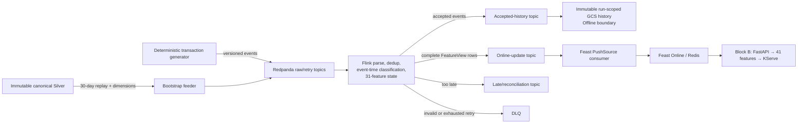

## Block responsibilities

### EDAI-1 mini-coursework pipeline

The canonical branch retains the original PyFlink demonstration in
`data_platform/processing/flink/streaming_pipeline.py` and the separate burst
monitor in `data_platform/processing/flink/burst_monitor.py`.

- Redpanda topic: `transactions.raw`.
- deduplication key: `transaction_id`, with 30-minute state TTL;
- business time: transaction `timestamp`;
- watermark: 10 seconds bounded out-of-orderness with 30 seconds idleness;
- allowed lateness: 60 seconds;
- window: five-minute tumbling event-time window by `user_id`;
- aggregate: transaction count and total amount;
- outputs: console `FEATURE`, `DUPLICATE`, and `LATE` records;
- separate burst monitor: ten-second processing-time window and threshold
  `event_count > 100`.

This is a genuine executed teaching pipeline, but its print sinks are not
Offline or Online Feature Stores.

### Block A — streaming feature production

Block A owns the 31 historical/behavioral features across user, account,
device, and merchant entities. Its authoritative implementation at source
commit `0466ba4`, contained by integration HEAD `e7dbbc2`, includes:

- deterministic event generation and versioned contracts;
- six Redpanda topics and explicit consumer groups;
- PyFlink parse, schema validation, deduplication, event-time disposition,
  entity fan-out, and managed rolling state;
- immutable Silver bootstrap and state cutover;
- immutable GCS history writer;
- Feast 0.66 PushSource writer to Redis;
- retry, DLQ, late reconciliation, parity, and freshness contracts.

All 31 features are classified `HYBRID`: they require correct historical state
at first deployment and can then be maintained incrementally. None is honestly
real-time-correct from empty state.

### Block B — online inference consumption

Block B is the fail-closed serving path:

```text
FastAPI request -> Feast Online/Redis read -> exact 41-column assembly
                -> KServe V2 prediction -> response and observability
```

It contributes feature freshness checks, missing/stale classification, exact
entity mapping, and readiness semantics. It does not write Offline history,
push Redis features, bootstrap Flink state, or prove row 12. The historical
Block B suite passed 55 tests; that is consumer-contract evidence, not a Flink
deployment result.

## Event-time and window semantics

### Mini-coursework

The original job assigns transaction business timestamps, then applies a
bounded out-of-orderness watermark. A five-minute tumbling window produces
non-overlapping intervals such as `[16:00,16:05)`. Moderately late events can
still update a window for 60 seconds; events beyond the final acceptance
boundary are routed to the `LATE` output. Duplicate IDs are removed before the
window aggregate.

The burst monitor intentionally uses processing time because it measures
current arrival rate, not business-time grouping.

### Block A

Block A uses a stricter feature contract:

- watermark: `max(event_time) - 2 minutes`;
- allowed lateness: 10 minutes;
- idle source timeout: 30 seconds;
- deduplication TTL: 48 hours;
- feature-state retention: 30 days + 10 minutes;
- every rolling window is left-inclusive and right-exclusive:
  `[T-window,T)`;
- same-timestamp peers share the same pre-event snapshot;
- `LATE_ACCEPTED` can correct state before finalization;
- `TOO_LATE` is retained in immutable history and reconciliation but is not
  allowed to mutate online state.

This preserves the batch DP3 point-in-time semantics instead of treating event
arrival time as feature time.

## Flink state, checkpoints, and recovery

The executable graph introduced by `0466ba4` and contained in integration HEAD
`e7dbbc2` uses managed keyed state
for transaction deduplication and the four entity feature states. Stable
operator UIDs are the restore contract. Baseline and optimized profiles retain
identical business semantics:

| Setting | Baseline | Optimized |
| --- | ---: | ---: |
| Parallelism | 1 | 4 |
| Checkpoint interval | 120 s | 30 s |
| Incremental checkpoints | false | true |
| Sink batch size | 1 | 250 |

Checkpoint storage is mandatory. Checkpoints cover Flink managed state and
source offsets; externalized checkpoints are retained on cancellation. The job
uses fixed-delay restart. First deployment must complete immutable Silver
bootstrap, emit `BOOTSTRAP_COMPLETE`, reach zero bootstrap lag, and complete a
checkpoint before a retained savepoint is created. Normal streaming and
restart recovery both require that savepoint rather than silently starting
with empty state.

Kafka output, immutable GCS history, and Feast pushes have separate commit
boundaries. The system therefore does **not** claim end-to-end exactly-once.
Replay safety instead relies on stable business keys, conditional GCS object
creation, feature timestamps, and committing consumer offsets only after
successful writes.

These mechanisms are `SOURCE_READY` and `TEST_PASS`; live checkpoint recovery
and savepoint restoration are `NOT_EXECUTED`.

## Bootstrap and real-time consistency

At cutover `T0`:

1. Feast materializes the latest complete DP3-derived FeatureView rows at or
   before `T0` into Redis; this provides immediate reads but not Flink history.
2. The bootstrap feeder validates the immutable Silver manifest and replays
   `[T0-30d,T0)` ordered by `(event_time, transaction_id)`, plus device
   `first_seen_at` and pre-window account anchors.
3. Bootstrap envelopes disable history and online writes to prevent duplicate
   publication.
4. A parity gate must compare state with DP3, including nulls, boundaries, and
   same-time peers.
5. Only after checkpoint/savepoint handoff may events at or after `T0` update
   the Online Store.

Tests verify deterministic replay ordering, identity mismatch failure,
required provenance, no use of the accepted topic as first-deploy history,
same-timestamp peer semantics, and refusal to run normal streaming without a
bootstrap savepoint. No live bootstrap/cutover run exists.

## Offline and Online Store contracts

### Offline boundary

Every unique valid event, including `TOO_LATE`, is published to
`ewallet.transactions.accepted.v1`. The history consumer writes immutable
NDJSON objects using:

```text
<history-root>/runs/<run-id>/partition=<partition>/
offset=<first-offset>-<content-digest>.jsonl
```

GCS generation precondition `0` prevents overwrite. An existing object is
accepted only if size and MD5 match. This is a reviewable immutable streaming
history boundary, not the canonical DP3 feature snapshot itself.

Status: `SOURCE_READY`, `TEST_PASS`, runtime write/read-back `NOT_EXECUTED`.

### Online boundary

Flink publishes complete per-view update envelopes to
`ewallet.features.online.v1`. The independent consumer decodes the envelope
and invokes `FeatureStore.push(<view>_push, frame, to=PushMode.ONLINE)`.
Applications never write raw Redis keys.

The four distinct time controls are:

- FeatureView TTL: 30 days + 10 minutes;
- serving maximum staleness: 10 minutes;
- Redis physical key TTL: unset in the pilot (`null`);
- Flink managed-state TTL: 30 days + 10 minutes.

Persistent Redis keys therefore still require feature-timestamp freshness
checks at retrieval.

Status: writer source and contract tests are `SOURCE_READY` / `TEST_PASS`;
Flink-originated PushSource write and correlated Redis read-back are
`NOT_EXECUTED`.

The separate 31-feature Feast batch campaign is real runtime evidence for
initial and incremental Offline-to-Online materialization, but it did not
originate from Flink. It cannot be used to close EDAI-2 row 12.

## Source and configuration map

The Block A paths below are present in the clean authoritative worktree at
`e7dbbc2` (implementation commit `0466ba4`); the legacy mini-coursework paths
are already present at canonical HEAD.

| Responsibility | Path |
| --- | --- |
| Legacy event generator | `data_platform/generation/src/streaming/streaming_generator.py` |
| Legacy Flink job | `data_platform/processing/flink/streaming_pipeline.py` |
| Legacy burst monitor | `data_platform/processing/flink/burst_monitor.py` |
| Block A configuration | `configs/streaming/block-a.yaml` |
| Event/topic contracts | `data_platform/streaming/contracts/` |
| Deterministic scenarios | `data_platform/streaming/generator/` |
| Bootstrap feeder | `data_platform/streaming/bootstrap/service.py` |
| Executable PyFlink graph | `data_platform/streaming/flink/job.py` |
| Managed operators | `data_platform/streaming/flink/operators.py` |
| Immutable history writer | `data_platform/streaming/sinks/historical_service.py` |
| Online envelope | `data_platform/streaming/sinks/online.py` |
| Feast PushSource consumer | `data_platform/streaming/feast/service.py` |
| Parity oracle | `data_platform/streaming/feast/parity.py` |
| Block A tests | `tests/streaming/` |
| Block B serving consumer | `ai_platform/inference/` and `tests/inference/` |

## Tests and runtime evidence

### Block A automated tests

The preserved historical log
`~/ewallet-evidence/block-a/p0-batch1-final-20261028T184024.log` records:

- Git checkpoint: `3fa7c483d9e1596fb2ebd06b931403a38680b51b`;
- 20 focused contract/source-wiring tests: `OK`;
- 45 full streaming tests: `OK`, one Feast-environment characterization test
  skipped;
- coverage of all 31 features, event domains, scenario determinism, exact
  window boundaries, same-time peers, late/too-late behavior, bootstrap,
  savepoint requirements, history provenance, PushSource mapping, freshness,
  retry/DLQ, and parity classifications.

The same log records uncommitted changes in Flink and test files. It is
therefore evidence for that historical working tree, not an exact test run of
committed `3fa7c48`, `0466ba4`, or integration HEAD `e7dbbc2`. The committed
streaming/config/test trees at `3fa7c48` and `e7dbbc2` are identical, but this
does not erase the dirty-worktree provenance. These deterministic
source/fixture results remain relevant historical evidence; the exact
authoritative commit still requires a clean focused rerun. They do not prove
live Flink, Redpanda, GCS, or Redis interoperability.

### Block B automated tests

`~/ewallet-evidence/block-b/final-tests-20261029T041112.log` records 55 tests,
all `OK`, for request contracts, 31-feature retrieval, 41-column assembly,
freshness and timeout handling, KServe transport, FastAPI, readiness, and
observability boundaries. Again, these are source-contract tests.

### Recovered local Block A A/B benchmark

The recovered benchmark is genuine historical runtime evidence for a divergent
benchmark branch, not runtime verification of the authoritative MLOps branch.
The captured 100 EPS jobs used Git SHA
`22c0c7f6ad501bf37f19053d648e5dc173a0753d` and Flink 1.19.1 on one local
WSL2/Docker host. Their job IDs were:

- baseline: `38c6d2f9406b01de21fd3f11a60817d6`;
- optimized: `fb94d527363aa8c0677a02c5834aa34b`.

Both jobs used one TaskManager with four slots. The benchmark Compose contract
limited that TaskManager to four CPUs and 7 GB RAM, the JobManager to one CPU
and 2 GB RAM, and Redpanda to two CPUs and 4 GB RAM. The Flink UI reported 7.00
GB physical TaskManager memory, 2.45 GB JVM heap, and 2.06 GB managed memory at
capture time. The raw `docker_stats.jsonl` files are not integrated, so actual
CPU utilization and sampled resident memory are unavailable and are not
reconstructed from resource limits.

#### Exact 100 EPS profiles

| Setting | Baseline | Optimized | Interpretation |
| --- | ---: | ---: | --- |
| Parallelism | 1 | 4 | Uses all four TaskManager slots only in the optimized profile. |
| Checkpoint interval | 120 s | 30 s | More frequent recovery points in the optimized profile. |
| State backend | RocksDB | RocksDB | Same backend. |
| Incremental checkpoints | false | true | Optimized profile writes incremental state snapshots. |
| Checkpoint mode | `EXACTLY_ONCE` | `EXACTLY_ONCE` | Scope is Flink state and Kafka offsets, not end-to-end sinks. |
| Restart policy | 3 attempts, 10 s delay | 3 attempts, 10 s delay | Identical. |
| Config SHA-256 | `bb986fdb52a276486dd83cbac0b8ba0756d1aa6a6e18d88eb815e59323f82a43` | `4716db10d602fa09de944ca3a53cedb2727978aaad5cdb296301a2d6f3e1225f` | Captured by the comparison artifact. |

The event-time business contract was identical: 120 seconds of production at
100 EPS, 20× event-time acceleration, a 36-second warm-up and 84-second steady
phase, two-minute bounded out-of-orderness, ten-minute allowed lateness,
48-hour transaction deduplication TTL, and 30-day-plus-ten-minute feature-state
retention. The only intended profile differences were execution parallelism and
checkpoint strategy.

#### Workload equivalence and measured comparison

The workload was genuinely equivalent at the recorded-input level. Both rows
have logical input SHA-256
`cde423348f7cbf77042455d64f2baf3cc8d4f0ec529669ee2f0ad3648dda5de4`
and transport-input SHA-256
`1d80913accfaff6732be9d6793783e5f2d4deb84109fa3fc31181601969afe5a`.
The generator emitted 12,180 records: 12,000 unique transactions plus 180
deterministic duplicate arrivals (1.5%). Both jobs accepted exactly 12,000
unique transactions after deduplication.

| Metric | Baseline | Optimized | Observed change |
| --- | ---: | ---: | ---: |
| Target / achieved producer rate | 100.0 / 100.01 EPS | 100.0 / 100.01 EPS | Equivalent input rate. |
| Raw / accepted records | 12,180 / 12,000 | 12,180 / 12,000 | Exact duplicate-filtering parity. |
| Online update envelopes | 35,975 | 35,975 | Exact output-count parity. |
| Processing throughput | 94.9 EPS | 95.6 EPS | +0.7 EPS (+0.75%); effectively throughput parity. |
| Accept latency p50 / p95 / p99 | 6,845 / 10,896 / 12,179 ms | 4,978 / 7,256 / 8,788 ms | Optimized lower by 27.3% / 33.4% / 27.8%. |
| Feature latency p50 / p95 / p99 | 10,817 / 18,719 / 20,488 ms | 7,836 / 15,789 / 18,908 ms | Optimized lower by 27.6% / 15.7% / 7.7%. |
| Maximum consumer lag | 12,022 | 3,303 | 72.5% lower maximum in the optimized run. |
| Maximum busy time | 740 ms/s | 732 ms/s | Similar sampled peak. |
| Maximum backpressured time | 72 ms/s | 80 ms/s | Telemetry maximum is slightly higher optimized; it does not contradict point-in-time UI captures. |
| Completed / failed checkpoints | 1 / 1 | 5 / 1 | Both had a failure but later completed checkpoints. |
| Checkpoint duration p50 / max | 6,341 / 6,341 ms | 4,215 / 5,369 ms | Optimized checkpoint duration was lower in this run. |
| Maximum checkpointed size | 17,839,631 B | 16,093,253 B | Optimized 9.8% lower. |
| Maximum state size | 17,839,631 B | 20,179,589 B | Optimized state size was higher. |
| Functional checks | PASS | PASS | Same bounded invariant set passed. |

Accept latency is Kafka accepted-topic LogAppendTime minus the first raw-topic
LogAppendTime for each transaction. Feature latency is online-update
LogAppendTime minus its source raw-event LogAppendTime. It includes event-time
timer delay and must not be presented as synchronous request latency. The
producer interval is exactly 120 seconds; total job/drain runtime is absent from
the integrated evidence and is therefore not claimed.

`35,975` counts per-FeatureView update envelopes, not transactions. Accepted
events are classified by event time; eligible events fan out to user, account,
device and, for qualifying payments, merchant state. `TOO_LATE` events remain
in accepted history but do not mutate online state. Equal counts and the
captured `functional_checks_passed=True` establish bounded functional parity;
the 100 EPS performance comparison did not run the independent full feature
oracle used by the separate functional campaign.

#### Backpressure, watermarks, and checkpoints

The baseline feature-state operator showed `HIGH` backpressure at 73% in one
Flink Dashboard capture, whereas the four optimized subtasks showed 0–3% and
`OK` in another. These are point-in-time UI observations, not run averages.
The comparison telemetry's maximum backpressured-time samples were 72 ms/s and
80 ms/s respectively, so the screenshots must not be generalized into a claim
that optimized backpressure was always lower.

The baseline UI shows the active watermark for its single subtask. The optimized
UI shows four equal per-subtask watermarks at capture time, supporting split
alignment for that instant. The benchmark used partition-wide drain markers so
tail timers could fire. This demonstrates event-time progress for the executed
branch, not deterministic watermark behavior under every production schedule.

Each run recorded one failed checkpoint and at least one subsequent completed
checkpoint. Since output counts and functional checks match, the failures did
not invalidate the bounded comparison. The failure exception and recovery log
are not in the integrated artifacts, however; the screenshots do not prove a
controlled failover or savepoint restore.

#### Genuine Flink UI and comparison evidence

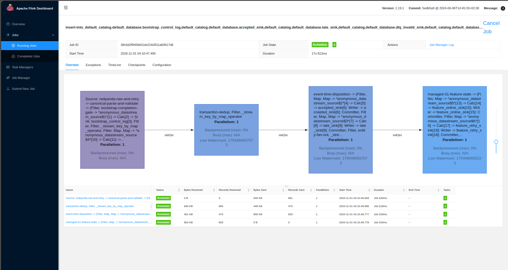

*Historical local Flink UI at source `22c0c7f`: baseline job `38c6d2…` is
RUNNING with source, parse/dedup, event-time, 31-feature-state and sink topology
at parallelism 1.*

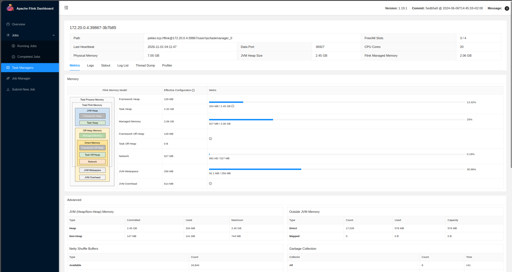

*Baseline TaskManager resource view: four slots, 7.00 GB physical memory, 2.45
GB JVM heap and 2.06 GB managed memory at capture time.*

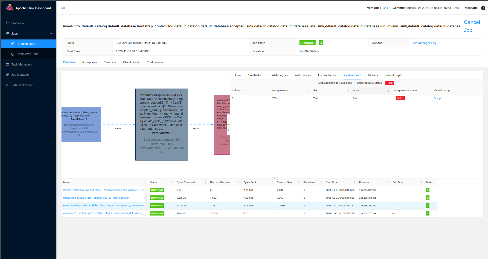

*Baseline feature-state operator reports HIGH backpressure (73%) in this UI
interval. This is not an average over the run.*

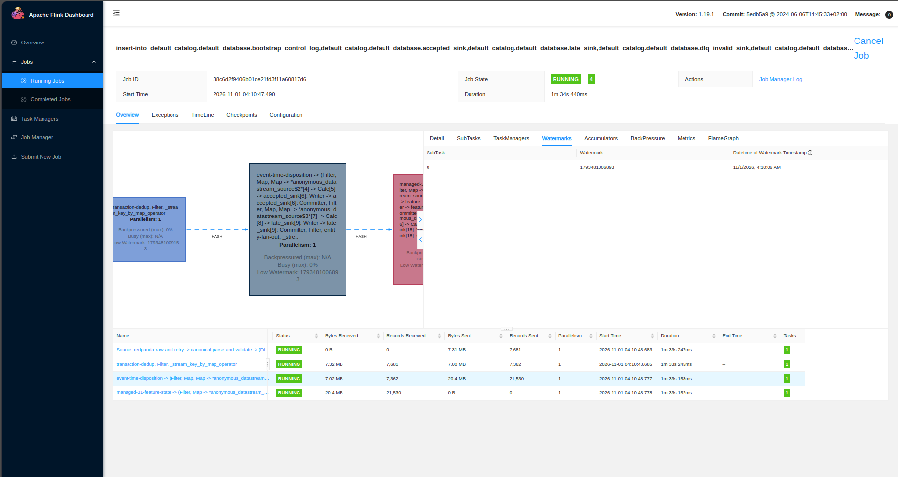

*Baseline single-subtask watermark at capture time; this evidences progress but
not the complete watermark history.*

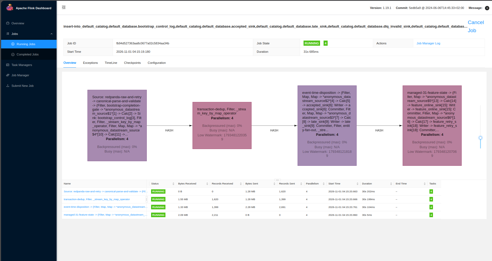

*Historical local Flink UI: optimized job `fb94d5…` runs the same logical
topology at parallelism 4.*

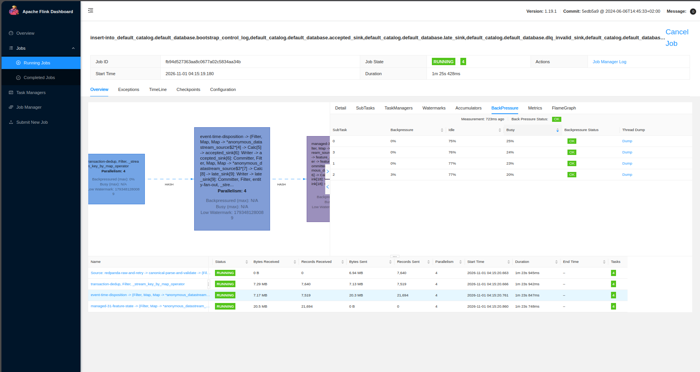

*The four optimized feature-state subtasks report 0–3% backpressure and OK at
this instant; no run-average claim is made.*

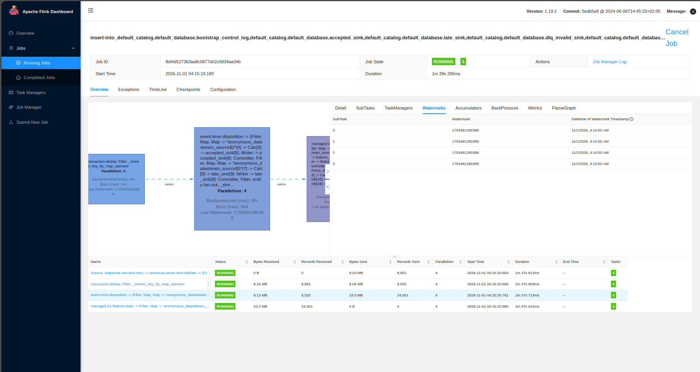

*All four optimized subtasks show equal watermarks at capture time, supporting
split alignment for this sample.*

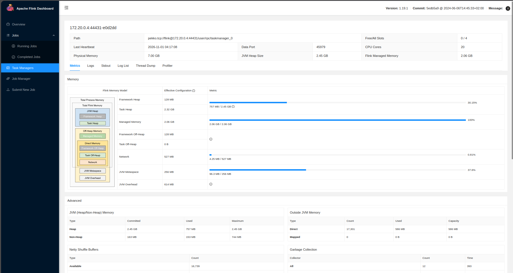

*Optimized TaskManager resource view: all four slots used and the same 7.00 GB
physical / 2.06 GB managed-memory allocation.*

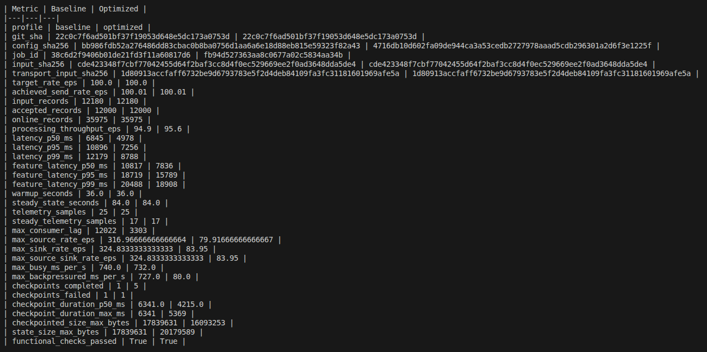

*Immutable terminal comparison for both job IDs: identical inputs, 12,000
accepted events, 35,975 online updates, measured latency/throughput, one failed
checkpoint per run, and `functional_checks_passed=True`.*

All nine copied files are byte-identical to their originals in
`.worktrees/codex-final-integration/docs/images/`; their SHA-256 values are
recorded in the evidence-transfer table below.

#### Separate 500 EPS campaign: correctness blocker

The 500 EPS campaign in the historical benchmark report used source commit
`f23d2cb` and different jobs: baseline
`1ec92230a6a630030c8bf9fd7c932631` and optimized
`3b9c1621f4facf227db7f68de5d2aaa6`. Both producers achieved 500.01 EPS, but
neither consumer kept up: processing throughput was 130.75 EPS baseline and
217.70 EPS optimized. Baseline emitted 165,624 online updates versus 179,356
optimized, so online semantic parity **failed**. Optimized output was itself
unstable across two runs (179,115 versus 179,356 updates).

The recorded diagnosis is event-time finalization under partition backlog:
watermarks were assigned after Kafka splits merged, allowing one partition to
advance timers before lagging records arrived. A later split-watermark change
at `22c0c7f` addressed the probable mechanism at source level, but no
correctness-qualified 500 EPS rerun exists. Therefore the 500 EPS numbers are
capacity observations only and cannot support an optimization-success claim.

#### Version reconciliation

The benchmark SHA `22c0c7f` is **not** an ancestor of authoritative Block A
commit `0466ba40e30d8e6a937ff66b47a20f1ab46559bd`; the histories diverge.
Compared with the benchmark branch, the authoritative implementation adds the
Silver bootstrap, immutable history writer, Feast PushSource/Redis service,
parity gates and production retry contracts, and introduces explicit sink batch
sizes of 1 baseline and 250 optimized (the benchmark profile had no
`sink_batch_size` setting). Conversely, it does not contain the benchmark
replay, metrics, output-comparison modules, Docker benchmark harness, or the
benchmark-specific per-split watermark correction found at `22c0c7f`; its job
assigns watermarks after the Kafka source stream is created. These differences
materially affect sink pressure, event-time behavior, and benchmark tooling.

The historical measurements remain valid for their executed SHA. They do not
verify authoritative implementation `0466ba4` or integration HEAD `e7dbbc2`.
An exact-version runtime benchmark of the authoritative worktree remains
`NOT_EXECUTED`.

### Historical mini-coursework runtime

The two preserved terminal screenshots were captured on 22 August 2026. They
prove local execution of the earlier mini-coursework, not canonical Block A.

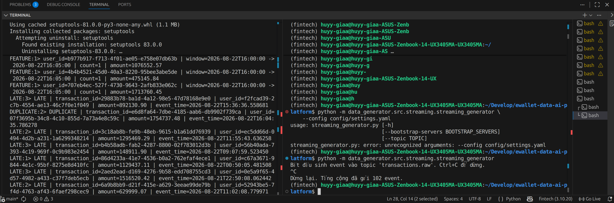

*Historical terminal evidence (`LOCAL RUNTIME`, 2026-08-22). The left terminal
shows five-minute `FEATURE` output plus `DUPLICATE` and `LATE` records; the
right terminal shows the Redpanda producer sending 102 events. It proves the
teaching pipeline's classifications and window output, not feature-store
writes.*

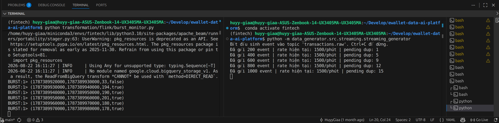

*Historical terminal evidence (`LOCAL RUNTIME`, 2026-08-22). A temporary
1,500-events/minute load produced ten-second windows of 194, 190, 201, 180,
and 178 events with `burst=true`. It proves processing-time burst detection,
not a Flink Dashboard deployment.*

No run ID or Git SHA is visible in these screenshots or a matching manifest;
their scope is therefore limited to what the terminal output directly proves.

## Evidence transfer manifest

The recovered benchmark screenshots were copied byte-for-byte into the approved
EDAI-1 streaming evidence directory. The two older mini-coursework screenshots
remain at their existing locations and are listed as pending transfer.

| Source | Proposed destination | SHA-256 | Evidence scope |
| --- | --- | --- | --- |
| `docs/evidence/flink/01_streaming_feature_late_duplicate.png` | `docs/evidence/edai1/streaming/01_feature_duplicate_late.png` | `f1cc1d5fabaaa3e93b08c0aa4a733f6289d071357f63e8b5d57e87c831220726` | Local feature/window, duplicate, late, and producer output. |
| `docs/evidence/flink/02_burst_detected_true.png` | `docs/evidence/edai1/streaming/02_burst_detected.png` | `cfa1bb47b13d2826d0d08b8a4111010b016d7f1eb082d34c15acbe2f849256a8` | Local processing-time burst output. |
| `.worktrees/codex-final-integration/docs/images/Screenshot From 2026-11-01 04-11-08.png` | `docs/evidence/edai1/streaming/03_flink_100eps_baseline_job.png` | `d8cf7b6dc55b50c7dcc7571fcb73e530187aa0769f133075a3a81821c56ad3ec` | Baseline job/topology, copied and verified. |
| `.worktrees/codex-final-integration/docs/images/Screenshot From 2026-11-01 04-11-56.png` | `docs/evidence/edai1/streaming/04_flink_100eps_baseline_resources.png` | `55d192cbd3bf66947b39f9d671128a86385ac2b888eeca1f3ce993c5d01a1798` | Baseline TaskManager resources, copied and verified. |
| `.worktrees/codex-final-integration/docs/images/Screenshot From 2026-11-01 04-12-16.png` | `docs/evidence/edai1/streaming/05_flink_100eps_baseline_backpressure.png` | `3ca1c6d2b35bc2e9bce739b7f147bbacff0852e7e19be8f986144eac605bc53d` | Baseline point-in-time backpressure, copied and verified. |
| `.worktrees/codex-final-integration/docs/images/Screenshot From 2026-11-01 04-12-23.png` | `docs/evidence/edai1/streaming/06_flink_100eps_baseline_watermark.png` | `b7ec00e62aae65c26b488e115dda9fdbdc8615a6999279ba7a568760b18bfe6f` | Baseline watermark, copied and verified. |
| `.worktrees/codex-final-integration/docs/images/Screenshot From 2026-11-01 04-15-53.png` | `docs/evidence/edai1/streaming/07_flink_100eps_optimized_job.png` | `3295878eba415fa3fd1d59110bf5e0f895ca9bc756b6ec097d5883d4a1f47425` | Optimized job/topology, copied and verified. |
| `.worktrees/codex-final-integration/docs/images/Screenshot From 2026-11-01 04-16-46.png` | `docs/evidence/edai1/streaming/08_flink_100eps_optimized_backpressure.png` | `efb5910fc90a1f5e96b8f460e353c3b580ed81c72b939c63c9650f6bc3e44796` | Optimized point-in-time backpressure, copied and verified. |
| `.worktrees/codex-final-integration/docs/images/Screenshot From 2026-11-01 04-17-00.png` | `docs/evidence/edai1/streaming/09_flink_100eps_optimized_watermarks.png` | `088470a565740685cf27766b6616f5b6117ef15272b476e8950d595141311e18` | Optimized aligned watermarks, copied and verified. |
| `.worktrees/codex-final-integration/docs/images/Screenshot From 2026-11-01 04-17-12.png` | `docs/evidence/edai1/streaming/10_flink_100eps_optimized_resources.png` | `cfb368730288d52921d677337eb97b8026bb79b0c73284b35308d5b1800f6767` | Optimized TaskManager resources, copied and verified. |
| `.worktrees/codex-final-integration/docs/images/Screenshot From 2026-11-01 04-25-06.png` | `docs/evidence/edai1/streaming/11_flink_100eps_comparison.png` | `6930d365c6a35b6483b36ccd7c4591686b414734f65fb441e3d01693a849ee95` | Baseline/optimized terminal comparison, copied and verified. |

## Missing UI and runtime evidence

Flink Dashboard evidence now exists for the historical benchmark SHA. No
screenshots or manifests were found for an **authoritative `0466ba4`** Block A
run, Redpanda consumer state, GCS history read-back, or Flink-originated
Feast/Redis read-back. Do not start services solely to capture them. During a
future authorized bounded run, capture:

1. **Flink Dashboard:** job ID, artifact/image digest, start/end time, source,
   parse/dedup/entity-state branches, history/online sinks, parallelism,
   backpressure, watermark, checkpoint history, and completed savepoint.
2. **Redpanda/Kafka UI:** the six versioned topics, partitions, producer and
   three consumer groups, offsets, lag, and one redacted accepted/online
   envelope tied to the same run ID.
3. **Offline read-back:** Google Cloud Storage console showing the immutable
   history run prefix and object names, plus a bounded redacted read-back with
   matching partition/offset/content digest.
4. **Online read-back:** Feast-supported retrieval for the same entity and
   feature timestamp, Redis/Feast UI where available, consumer offset, and a
   parity artifact comparing the expected 31 values.
5. **Recovery:** checkpoint success, induced bounded restart, restore from the
   retained savepoint, resumed offsets, and post-recovery parity.

Record the Block A run ID, dataset/Silver IDs, cutover `T0`, Git SHA, Flink
image and connector digests, topic offsets, timestamps, and screenshot SHA-256
in one manifest. Without correlated Offline and Online proof, EDAI-2 row 12
must remain `EVIDENCE_CAPTURE_REQUIRED`.

## Reproducibility boundary

No command below was executed for this documentation task. The legacy local
demo remains documented in `docs/04_streaming_pipeline.md`. The canonical
entrypoints, after source integration and explicit runtime authorization, are:

```bash
python -m data_platform.streaming.generator.cli --help
python -m data_platform.streaming.bootstrap.service --help
python -m data_platform.streaming.flink.job --help
python -m data_platform.streaming.sinks.historical_service --help
python -m data_platform.streaming.feast.service --help
```

The safe sequence is immutable-source preflight, topic creation, Feast repo
apply/materialization to `T0`, bootstrap replay with online/history emission
disabled, parity, checkpoint/savepoint handoff, normal streaming, then separate
history and Feast consumers. Never replace bootstrap with empty state or Redis
latest values, flush Redis as rollback, or claim exact-once beyond the Flink
checkpoint boundary.

## Limitations and implementation decision

1. Block A implementation commit `0466ba4` is contained in clean MLOps/Flink
   integration HEAD `e7dbbc2`, but is not present at canonical HEAD `dedea5e`.
2. Canonical Block A has not been deployed. Live connector compatibility,
   checkpoint recovery, 30-day bootstrap capacity, Offline history write,
   PushSource write, and read-back remain unverified.
3. The recovered Flink Dashboard screenshots are traceable to source `22c0c7f`
   and jobs `38c6d2…` / `fb94d5…`, but that benchmark branch diverges from the
   authoritative `0466ba4` implementation. The older August screenshots remain
   unversioned terminal evidence.
4. The legacy job uses console sinks and cannot satisfy feature-store rows.
5. Block B is runtime-verified elsewhere as an inference consumer, but it is
   not a streaming writer and cannot close Block A evidence gaps.
6. End-to-end exactly-once is intentionally not claimed.
7. The 45-test transcript belongs to a dirty historical worktree. A clean test
   rerun or benchmark at `e7dbbc2` was not executed during this documentation-only review.
8. The 100 EPS campaign supports a bounded functional historical comparison;
   its integrated screenshot does not expose every semantic digest. The
   separate 500 EPS campaign failed semantic parity and the overall optimization
   verdict remains `MIXED`.

Additional streaming implementation is **not worthwhile before integration**:
the missing work is primarily controlled deployment and correlated evidence,
not another parallel feature framework. The minimal next step is to integrate
`e7dbbc2`, run one bounded Block A bootstrap/cutover, and capture the five
evidence groups above.

## Rubric acceptance checklist

| Rubric | Source | Tests | Runtime evidence | Decision |
| --- | --- | --- | --- | --- |
| EDAI-1 row 9: simulate late arrival | Implemented in legacy generator and deterministic Block A scenarios | Historical dirty-worktree tests passed | Historical `LATE` output visible | **Supported**, but no rate/run manifest; latest-source tests unverified. |
| EDAI-1 row 10: another streaming problem | Duplicate and burst scenarios implemented | Historical dedup/burst contract tests passed | `DUPLICATE` and burst output visible | **Supported** by historical local evidence; latest-source tests unverified. |
| EDAI-1 row 16: baseline and optimization | Baseline/optimized profiles defined | Historical 100 EPS functional checks and equal semantic counts passed; 500 EPS parity failed | Genuine Flink UI A/B at `22c0c7f`; authoritative `0466ba4` not run | **Historically supported with `MIXED` verdict**; exact-version authoritative runtime remains `NOT_EXECUTED`. |
| EDAI-1 row 17: handle late arrival | Watermark, allowed lateness, late/too-late routing implemented | Historical boundary/disposition tests passed | Legacy late output plus recovered watermark UI; no complete 100 EPS late-metric artifact | **Supported historically; authoritative Block A runtime unverified**. |
| EDAI-1 row 18: other problem | Deduplication, retry/DLQ, and burst paths implemented | 12,180 raw → 12,000 unique accepted at 100 EPS; both functional checks PASS | Recovered comparison plus legacy duplicate/burst output | **Supported historically**; authoritative-source runtime pending. |
| EDAI-1 row 19: window processing | Five-minute tumbling legacy window; 31 rolling Block A windows | Historical exact `[T-window,T)` tests and 35,975 equal online updates | Flink feature-state topology, watermarks and historical `FEATURE` output visible | **Supported historically**; latest implementation runtime remains unverified. |
| EDAI-2 row 12: streaming to Offline and Online Stores | Both writers are `SOURCE_READY` at implementation commit `0466ba4` in `e7dbbc2` | 45 historical tests passed (1 skipped) in a dirty worktree; exact-version rerun absent | Historical divergent-branch Flink UI exists, but no authoritative correlated dual-store write/read-back or UI | **Not accepted at runtime; `NOT_EXECUTED` / `EVIDENCE_CAPTURE_REQUIRED`**. |
