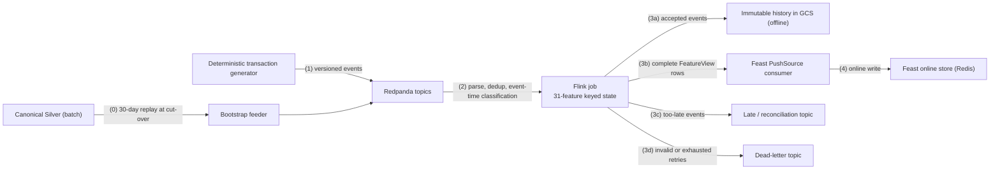

# Flink Stream Processing

This report describes the platform's stream processing:

- how transaction events flow through Redpanda into Apache Flink;
- how Flink handles duplicates, late and out-of-order events, and windowed aggregation;
- how the job was tuned from a baseline profile, using the Flink Dashboard to locate problems.

It also describes the streaming feature implementation that maintains the 31 model features for the online feature store, and how far that implementation has been exercised.

## 1. Overview and motivation

Payment events do not arrive in order or exactly once:

- producers retry, so the same transaction can arrive twice;
- mobile clients and partner systems deliver events minutes or hours after they happened;
- traffic arrives in bursts.

A stream processor that uses *arrival* time, or counts every arrival, computes wrong features. The platform therefore processes events in **event time**, and handles each problem explicitly:

| Problem | How it is handled |
|---|---|
| Duplicate deliveries | Deduplicated by `transaction_id`, using keyed state with a TTL |
| Late events | Watermarks with bounded out-of-orderness, plus allowed lateness. Events too late to update a window are routed to a separate output instead of being dropped silently |
| Feature windows | Tumbling or rolling event-time windows per entity |
| Bursts | A separate processing-time monitor flags windows above a threshold |

## 2. Architecture



There are two implementations:

1. **The windowed transaction pipeline** ([`data_platform/processing/flink/streaming_pipeline.py`](../../../data_platform/processing/flink/streaming_pipeline.py)). It demonstrates deduplication, late-event handling, five-minute windows and burst detection, and writes its results to console outputs.
2. **The streaming feature job** ([`data_platform/streaming/`](../../../data_platform/streaming)). It extends the same semantics to the 31 behavioural features used by the fraud model, with:
   - a bootstrap from batch Silver;
   - an immutable history sink;
   - a Feast PushSource writer;
   - retry and dead-letter handling;
   - a parity check against the batch features.

## 3. Windowed transaction pipeline

| Setting | Value |
|---|---|
| Source | Redpanda topic `transactions.raw` |
| Deduplication | key `transaction_id`, state TTL 30 minutes |
| Event time | the transaction's business `timestamp` |
| Watermark | bounded out-of-orderness of 10 s; idle sources ignored after 30 s |
| Window | 5-minute tumbling event-time window per `user_id` |
| Allowed lateness | 60 s |
| Aggregate | transaction count and total amount |
| Outputs | `FEATURE`, `DUPLICATE` and `LATE` records |
| Burst monitor | [`burst_monitor.py`](../../../data_platform/processing/flink/burst_monitor.py): 10-second processing-time windows, flagged when the count exceeds 100 |

### 3.1 Window processing in code

The excerpts below are copied verbatim from [`streaming_pipeline.py`](../../../data_platform/processing/flink/streaming_pipeline.py).

**Event time and watermark** (lines 223–239):

```python
def create_watermark_strategy() -> WatermarkStrategy:

    return (
        WatermarkStrategy
        .for_bounded_out_of_orderness(
            Duration.of_seconds(
                WATERMARK_DELAY_SECONDS
            )
        )
        .with_timestamp_assigner(
            TransactionTimestampAssigner()
        )
        .with_idleness(
            Duration.of_seconds(
                IDLE_TIMEOUT_SECONDS
            )
        )
    )
```

This snippet does three things:

- **Event time.** `TransactionTimestampAssigner` makes the transaction's business timestamp its event time, so the order of arrival does not matter.
- **Watermark.** The watermark trails the largest timestamp seen so far by `WATERMARK_DELAY_SECONDS = 10`. Events that are up to 10 s out of order still land in the correct window before it fires.
- **Idleness.** `with_idleness(30 s)` prevents an idle Kafka partition from holding the watermark back.

**Keyed tumbling window with allowed lateness** (lines 488–519):

```python
    windowed_stream = (
        timed_stream
        .key_by(
            lambda tx: tx[1],
            key_type=Types.STRING(),
        )
        .window(
            TumblingEventTimeWindows.of(
                Time.minutes(
                    WINDOW_MINUTES
                )
            )
        )
        .allowed_lateness(
            ALLOWED_LATENESS_SECONDS
            * 1000
        )
    )

    feature_stream = (
        windowed_stream
        .aggregate(
            TransactionAggregate(),
            window_function=UserWindowResult(),
            accumulator_type=Types.TUPLE([
                Types.LONG(),
                Types.DOUBLE(),
            ]),
            output_type=FEATURE_TYPE,
        )
        .name("user-5m-features")
    )
```

What the code does, step by step:

1. **Key.** `key_by(tx[1])` partitions the stream by `user_id`, so every user has independent window state.
2. **Window.** `TumblingEventTimeWindows.of(Time.minutes(5))` places each event in exactly one non-overlapping 5-minute event-time window, for example `[16:00, 16:05)`.
3. **Late updates.** `allowed_lateness(60 s)` keeps a window's state for 60 s after the watermark passes its end. A moderately late event updates the result and fires the window again.
4. **Too-late events.** Events later than *window end + 60 s* are classified by `ClassifyLateTransaction` (line 243) and emitted as `LATE` records instead of being dropped silently.
5. **Aggregate.** `aggregate(TransactionAggregate(), UserWindowResult())` keeps an incremental `(count, total_amount)` accumulator per window, rather than buffering every event.
6. **Emit.** `UserWindowResult.process` (line 324) emits `(user_id, window_start, window_end, count, total_amount)`.

### 3.2 Execution


*A local run of the windowed pipeline.*

- *Left: five-minute `FEATURE` rows such as `window=2026-08-22T16:00:00 -> 16:05:00 | count=1`, together with `DUPLICATE` records for re-delivered transaction IDs and `LATE` records for events whose event time is hours behind the watermark.*
- *Right: the generator producing events into `transactions.raw`.*


*The burst monitor under a temporary load of about 1,500 events per minute: consecutive 10-second windows of 194, 190, 201, 180 and 178 events are flagged `burst=true`.*

## 4. Streaming feature job

### 4.1 Design

The feature job maintains the 31 features of the fraud model (user, account, device, merchant) continuously, with the **same point-in-time semantics as the batch DP3 job**:

| Setting | Value |
|---|---|
| Watermark | `max(event_time) − 2 min` |
| Allowed lateness | 10 min; idle source timeout 30 s |
| Deduplication | TTL 48 h |
| Feature state | retained for 30 days + 10 min |
| Rolling windows | left-inclusive and right-exclusive, `[T − window, T)` |
| Same-timestamp events | share the same pre-event snapshot |
| `LATE_ACCEPTED` events | can still correct state before it is finalised |
| `TOO_LATE` events | kept in immutable history and reconciliation, but never mutate online state |

**Correct state from day one.** A feature such as "transactions in the last 30 days" cannot be computed correctly from empty state. At cut-over time `T0`:

1. Feast materialises the latest batch features into Redis, so reads are served immediately.
2. A bootstrap feeder replays the last 30 days of Silver into Flink with all outputs disabled.
3. A parity gate compares the rebuilt state with the batch features.
4. Only after a checkpoint and savepoint handoff are live events allowed to update the online store.

**Sinks and delivery guarantees.**

- Accepted events are written as immutable NDJSON objects under `runs/<run-id>/partition=<p>/offset=<first>-<digest>.jsonl`. A GCS generation precondition prevents overwrites.
- Complete per-FeatureView updates are pushed to Redis through Feast `PushSource`. Applications never write raw Redis keys.
- Kafka, GCS and Feast have separate commit boundaries, so the design does not claim end-to-end exactly-once. Replays are made safe by stable business keys, conditional object creation, feature timestamps, and committing offsets only after successful writes.

| Responsibility | Source |
|---|---|
| Configuration | [`configs/streaming/block-a.yaml`](../../../configs/streaming/block-a.yaml), [`flink-baseline.yaml`](../../../configs/streaming/flink-baseline.yaml), [`flink-optimized.yaml`](../../../configs/streaming/flink-optimized.yaml) |
| Event contracts and generator | [`data_platform/streaming/contracts/`](../../../data_platform/streaming/contracts), [`generator/`](../../../data_platform/streaming/generator) |
| Bootstrap | [`bootstrap/`](../../../data_platform/streaming/bootstrap) |
| Flink job and operators | [`flink/`](../../../data_platform/streaming/flink) |
| Feast push and parity | [`feast/`](../../../data_platform/streaming/feast) |
| Tests | [`tests/streaming/`](../../../tests/streaming): 103 tests run in CI, covering window boundaries, same-time peers, late and too-late handling, bootstrap, savepoint requirements, history provenance, PushSource mapping, freshness, retry/DLQ and parity |

### 4.2 Baseline versus optimised profile

**Setup.** The job was run twice on a local Flink 1.19.1 cluster: one TaskManager with 4 slots, 4 CPUs and 7 GB of memory, with Redpanda on the same host.

- The two runs used the same recorded input: 120 s at 100 events/s, 12,180 records, of which 180 (1.5 %) are deliberate duplicate deliveries.
- Only the execution profile changed:

| Setting | Baseline | Optimised |
|---|---:|---:|
| Parallelism | 1 | 4 |
| Checkpoint interval | 120 s | 30 s |
| Incremental checkpoints | off | on |
| State backend | RocksDB | RocksDB |

**Problem seen in the Flink Dashboard (baseline).**


*Flink Dashboard: baseline job `38c6d2…` running source → parse/dedup → event-time classification → 31-feature state → sinks, at parallelism 1.*


*The feature-state operator reports **HIGH backpressure (73 %)**. The single stateful subtask is the bottleneck, and upstream operators wait for it.*


*The single subtask's watermark is advancing; event-time progress is sound, but the work is serial.*


*The TaskManager offers 4 slots, but the baseline uses only one of them.*

**After optimisation.**


*Optimised job `fb94d5…`: the same logical topology at parallelism 4.*


*The four feature-state subtasks report 0–3 % backpressure (OK) at capture time.*


*All four subtasks show equal watermarks, so the parallel event-time progress is aligned.*


*All four slots are in use.*

### 4.3 Results

| Metric | Baseline | Optimised | Change |
|---|---:|---:|---:|
| Raw / accepted records | 12,180 / 12,000 | 12,180 / 12,000 | identical deduplication |
| Online update envelopes | 35,975 | 35,975 | identical output |
| Processing throughput | 94.9 events/s | 95.6 events/s | +0.7 % (input-bound at 100/s) |
| Accept latency p50 / p95 / p99 | 6,845 / 10,896 / 12,179 ms | 4,978 / 7,256 / 8,788 ms | −27 % / −33 % / −28 % |
| Feature latency p50 / p95 / p99 | 10,817 / 18,719 / 20,488 ms | 7,836 / 15,789 / 18,908 ms | −28 % / −16 % / −8 % |
| Maximum consumer lag | 12,022 | 3,303 | −72.5 % |
| Completed / failed checkpoints | 1 / 1 | 5 / 1 | more frequent recovery points |
| Checkpoint duration p50 | 6,341 ms | 4,215 ms | −33.5 % |
| Maximum backpressured time | 727 ms/s | 80 ms/s | −89 % |
| Functional checks | pass | pass | — |


*The comparison report written by the benchmark tool for both job IDs:*

- *identical input digests;*
- *12,000 accepted events and 35,975 online updates in both runs;*
- *the latency, lag and checkpoint metrics above;*
- *`functional_checks_passed: True`.*

**Interpretation.**

- **Correctness is unchanged.** Deduplication and output are identical across the two profiles: 180 duplicates removed, and the same 35,975 updates.
- **Latency and lag improved.** Throughput is capped by the 100 events/s input. Parallelism removed the single-subtask bottleneck, cutting latency by roughly a quarter to a third and the maximum consumer lag by 72 %.
- **Faster recovery points.** More frequent incremental checkpoints were also faster, which shortens recovery.
- **Backpressure.** The backpressure screenshots are point-in-time views. The run-level telemetry agrees with them: the maximum backpressured time fell from 727 ms/s to 80 ms/s, while the maximum busy time stayed similar (740 vs 732 ms/s). The bottleneck moved from waiting on one stateful subtask to doing useful work in four.
- **Accept latency** is measured from first arrival to the accepted topic. **Feature latency** includes event-time timer delay. Neither is a synchronous request latency.

**Higher load.** A separate run at 500 events/s showed that neither profile kept up: 131 and 218 events/s processed. The two profiles also produced different online update counts, because partitions with backlog advanced event-time timers before lagging records arrived. A per-split watermark change addresses this, but the 500 events/s figures are reported only as a capacity limit, not as an optimisation result.

## 5. Limitations

- **Local benchmark.** The benchmark ran on a local single-host Flink cluster. The feature job with its bootstrap, GCS history sink and Feast push has not been run against the cloud stores, so writing streaming features into the deployed offline and online stores has not been demonstrated.
- **Versions.** The benchmark build and the current feature-job implementation are related but not identical versions. The newer version adds the bootstrap, history writer and Feast push, and its runtime performance has not been measured.
- **Recovery.** Checkpoint recovery and savepoint restore are designed and unit-tested, but they were not exercised with an induced failure.
- **Repetition.** Each profile was run once at 100 events/s.

## Appendix: screenshot integrity

The Flink Dashboard screenshots are byte-identical copies of the original captures:

| File | SHA-256 |
|---|---|
| `03_flink_100eps_baseline_job.png` | `d8cf7b6dc55b50c7dcc7571fcb73e530187aa0769f133075a3a81821c56ad3ec` |
| `04_flink_100eps_baseline_resources.png` | `55d192cbd3bf66947b39f9d671128a86385ac2b888eeca1f3ce993c5d01a1798` |
| `05_flink_100eps_baseline_backpressure.png` | `3ca1c6d2b35bc2e9bce739b7f147bbacff0852e7e19be8f986144eac605bc53d` |
| `06_flink_100eps_baseline_watermark.png` | `b7ec00e62aae65c26b488e115dda9fdbdc8615a6999279ba7a568760b18bfe6f` |
| `07_flink_100eps_optimized_job.png` | `3295878eba415fa3fd1d59110bf5e0f895ca9bc756b6ec097d5883d4a1f47425` |
| `08_flink_100eps_optimized_backpressure.png` | `efb5910fc90a1f5e96b8f460e353c3b580ed81c72b939c63c9650f6bc3e44796` |
| `09_flink_100eps_optimized_watermarks.png` | `088470a565740685cf27766b6616f5b6117ef15272b476e8950d595141311e18` |
| `10_flink_100eps_optimized_resources.png` | `cfb368730288d52921d677337eb97b8026bb79b0c73284b35308d5b1800f6767` |
| `11_flink_100eps_comparison.png` | `6930d365c6a35b6483b36ccd7c4591686b414734f65fb441e3d01693a849ee95` |
| `flink/01_streaming_feature_late_duplicate.png` | `f1cc1d5fabaaa3e93b08c0aa4a733f6289d071357f63e8b5d57e87c831220726` |
| `flink/02_burst_detected_true.png` | `cfa1bb47b13d2826d0d08b8a4111010b016d7f1eb082d34c15acbe2f849256a8` |
