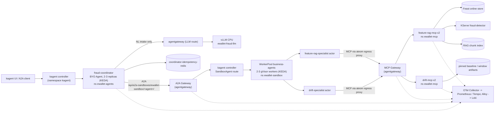

# Agent Platform: architecture

This page describes the Agent Platform that is deployed on GKE cluster `ewallet-dev`. It covers what each component does, which code implements it and how one request moves through the system.

- **Deployed state:** Helm release `llm-agent` revision 60 and `llm-agent-mcp` revision 19, as last verified by the owner replay `replay-20261118T161231Z` on 2026-11-19/20.
- **Related pages:**
  - Operations (deployment, autoscaling, policies, sleep/wake): [AGENT_PLATFORM_OPERATIONS.md](AGENT_PLATFORM_OPERATIONS.md)
  - Measured results and screenshots: [AGENT_PLATFORM_EVIDENCE.md](AGENT_PLATFORM_EVIDENCE.md)

> Every link below points at the code or configuration that runs in that release. Line anchors refer to the commit this page was written against. Some modules in [`ai_platform/llm_agent/`](../../../ai_platform/llm_agent/) belong to earlier designs or other campaigns and do not take part in this architecture; they are not described here.

## Contents

1. [The business problem: fraud investigation](#1-the-business-problem-fraud-investigation)
2. [Architecture diagram](#2-architecture-diagram)
3. [Fraud Coordinator](#3-fraud-coordinator)
4. [Fraud, Drift and Combined workflows](#4-fraud-drift-and-combined-workflows)
5. [Feature-RAG Specialist](#5-feature-rag-specialist)
6. [Drift Specialist](#6-drift-specialist)
7. [kagent and SandboxAgent](#7-kagent-and-sandboxagent)
8. [Agent Substrate and the shared WorkerPool](#8-agent-substrate-and-the-shared-workerpool)
9. [A2A delegation](#9-a2a-delegation)
10. [MCP Gateway and MCP tools](#10-mcp-gateway-and-mcp-tools)
11. [Integration with Feature Store, KServe and RAG](#11-integration-with-feature-store-kserve-and-rag)
12. [ModelConfig and the LLM integration](#12-modelconfig-and-the-llm-integration)
13. [Security and sandbox isolation](#13-security-and-sandbox-isolation)
14. [Source-code map](#14-source-code-map)

## 1. The business problem: fraud investigation

An analyst looking at an e-wallet payment wants a decision-support answer that is grounded in real data, not in what an LLM happens to generate. The answer should include:

- the account's and merchant's current behaviour features from the **Online Feature Store** (Feast);
- the fraud probability from the deployed **fraud model** (KServe `fraud-detector`);
- the internal **fraud policies** that apply, retrieved from the **RAG** index with citations;
- for model monitoring, the **drift** (PSI) of a feature between a pinned baseline and a current window.

The platform splits this work across three agents:

- **Fraud Coordinator:** receives the request, validates it and delegates it.
- **Feature-RAG Specialist:** answers the fraud question (features, score and policy citations).
- **Drift Specialist:** answers the drift question.

Two rules hold for every business value in an answer:

- It comes from a tool call through the MCP Gateway.
- It is validated before it is returned.

The LLM is used only to turn a natural-language question into a typed request ([§12](#12-modelconfig-and-the-llm-integration)). It never produces the numbers.

## 2. Architecture diagram



The diagram shows only components that run in the deployed release and appear in the live status output ([evidence §2](AGENT_PLATFORM_EVIDENCE.md#2-gke-workloads-and-platform-status)):

- Feature-RAG and Drift Specialists run **only** as SandboxAgents. The earlier Deployment-based Specialists were removed from the release, and the status check confirms they are absent.
- The Coordinator is the only kagent `Agent`, of type `BYO`.

## 3. Fraud Coordinator

The Coordinator is a kagent **BYO** ("bring your own") Agent: it is our own A2A server image, which kagent runs as a Deployment.

| Concern | Implementation |
|---|---|
| A2A server, health and readiness endpoints | [`build_app`](../../../ai_platform/llm_agent/byo_coordinator.py#L519): official A2A SDK app with `/health` ([L546](../../../ai_platform/llm_agent/byo_coordinator.py#L546)) and `/ready` ([L562](../../../ai_platform/llm_agent/byo_coordinator.py#L562)) |
| Agent Card published to kagent and the registry | [`agent_card`](../../../ai_platform/llm_agent/byo_coordinator.py#L476) |
| Task execution, cancellation, intake | [`CoordinatorExecutor.execute`](../../../ai_platform/llm_agent/byo_coordinator.py#L321), [`_intake`](../../../ai_platform/llm_agent/byo_coordinator.py#L260) (natural language → typed request) |
| Orchestration (deterministic) | [`ProgrammaticCoordinator.handle`](../../../ai_platform/llm_agent/programmatic_coordinator.py#L597) |
| Task persistence in the kagent controller, projected token, telemetry bootstrap | [`byo_runtime.py`](../../../ai_platform/llm_agent/byo_runtime.py): [`controller_task_store`](../../../ai_platform/llm_agent/byo_runtime.py#L113), [`configure_agent_metrics`](../../../ai_platform/llm_agent/byo_runtime.py#L175), [`configure_telemetry`](../../../ai_platform/llm_agent/byo_runtime.py#L267) |
| Idempotent replays of the same `request_id` | [`_run_idempotently`](../../../ai_platform/llm_agent/programmatic_coordinator.py#L520) backed by the `coordinator-idempotency-redis` StatefulSet ([`idempotency-redis.yaml`](../../../infra/helm/llm-agent-platform/templates/idempotency-redis.yaml)) |
| Kubernetes object | kagent `Agent` rendered by [`templates/agents.yaml` L91](../../../infra/helm/llm-agent-platform/templates/agents.yaml#L91). The Sandbox Specialists and their routes are injected as `EWALLET_SANDBOX_SPECIALISTS` ([L251–L259](../../../infra/helm/llm-agent-platform/templates/agents.yaml#L251-L259)) |

The adapter in [`byo_coordinator.py`](../../../ai_platform/llm_agent/byo_coordinator.py) only translates A2A events; all routing decisions live in [`programmatic_coordinator.py`](../../../ai_platform/llm_agent/programmatic_coordinator.py).

The Coordinator **never calls an MCP tool itself**. It only delegates to Specialists through the A2A Gateway ([§9](#9-a2a-delegation)).

## 4. Fraud, Drift and Combined workflows

[`ProgrammaticCoordinator.handle`](../../../ai_platform/llm_agent/programmatic_coordinator.py#L597) parses the inbound A2A message into one of three typed requests and dispatches on its type:

| Workflow | Typed request | Handler | Delegates to | Result contract |
|---|---|---|---|---|
| Fraud | `G3BusinessRequest` | [`_handle_fraud`](../../../ai_platform/llm_agent/programmatic_coordinator.py#L615) | `feature-rag-specialist` | `g3-orchestration/v1` |
| Drift | `G3DriftRequest` | [`_handle_workflow`](../../../ai_platform/llm_agent/programmatic_coordinator.py#L728) (`workflow = "drift"`) | `drift-specialist` | `g3-orchestration/v2` |
| Combined | `G3WorkflowRequest` (fraud + drift members) | [`_handle_workflow`](../../../ai_platform/llm_agent/programmatic_coordinator.py#L728) (`workflow = "combined"`) | both, **concurrently** in a thread pool | `g3-orchestration/v2` |

- **Combined status:** the overall status is `complete` when every Specialist answered `ok`, `partial` when some did and `unavailable` otherwise ([L776–L780](../../../ai_platform/llm_agent/programmatic_coordinator.py#L776-L780)).
- **Failures:** a failed member is listed under `unavailable` with its error code. The Coordinator never replaces a missing value with an invented one.
- **Business values** (features, score, citations, PSI) are copied from the validated Specialist evidence ([`_terminal_evidence`](../../../ai_platform/llm_agent/programmatic_coordinator.py#L305)).
- **Placeholders:** literal placeholder transaction IDs are rejected before any delegation ([L624](../../../ai_platform/llm_agent/programmatic_coordinator.py#L624)).

## 5. Feature-RAG Specialist

Module: [`byo_feature_rag_specialist.py`](../../../ai_platform/llm_agent/byo_feature_rag_specialist.py). This is the "fraud investigation / evidence" Specialist.

- **Tools:** it may call exactly three tools, `feature_lookup`, `fraud_scoring` and `knowledge_search` (`APPROVED_TOOLS`, [L80](../../../ai_platform/llm_agent/byo_feature_rag_specialist.py#L80)). The tool arguments come from the typed request ([`_tool_arguments`](../../../ai_platform/llm_agent/byo_feature_rag_specialist.py#L104)).
- **Session:** [`FeatureRagMCPClient._run_once`](../../../ai_platform/llm_agent/byo_feature_rag_specialist.py#L258) opens an official MCP Streamable HTTP session to the approved gateway route `/feature-rag/mcp`. It then checks that `tools/list` returns exactly the approved set before calling anything.
- **Validation:** each result is validated against the request:
  - [`_validated_features`](../../../ai_platform/llm_agent/byo_feature_rag_specialist.py#L135)
  - [`_validated_score`](../../../ai_platform/llm_agent/byo_feature_rag_specialist.py#L157)
  - [`_validated_citations`](../../../ai_platform/llm_agent/byo_feature_rag_specialist.py#L185)
- **Failover:** transient transport failures are retried on a new session, which can land on the other MCP replica. This uses [`with_failover`](../../../ai_platform/llm_agent/mcp_failover.py#L177) inside one overall deadline ([`run`](../../../ai_platform/llm_agent/byo_feature_rag_specialist.py#L236)). The deployed attempt budget is `EWALLET_MCP_MAX_ATTEMPTS=3` ([fleet manifest L48](../../../infra/kubernetes/agent-sandbox/fleet.yaml.tmpl#L48)).
- **Idempotency and output:** the executor ([L350](../../../ai_platform/llm_agent/byo_feature_rag_specialist.py#L350)) fingerprints each request so that a retried session returns the same evidence ([`_run_idempotently`](../../../ai_platform/llm_agent/byo_feature_rag_specialist.py#L381)). It emits one Coordinator-compatible terminal artifact.

## 6. Drift Specialist

Module: [`byo_drift_specialist.py`](../../../ai_platform/llm_agent/byo_drift_specialist.py).

- **Inputs and tool:** it receives one `G3DriftRequest`, in which feature, baseline revision and window are explicit. It calls the single tool `drift_detection` through the `/drift/mcp` gateway route ([`DriftMCPClient`](../../../ai_platform/llm_agent/byo_drift_specialist.py#L146)).
- **Result:** the PSI comes only from the drift MCP server ([`population_stability_index`](../../../ai_platform/llm_agent/tools/drift.py#L176)). [`evidence_from_envelope`](../../../ai_platform/llm_agent/byo_drift_specialist.py#L94) validates it and keeps the dataset revisions.
- **Tool rejections:** an unknown baseline or a window outside the approved observations comes back as structured `unavailable` evidence, never as a made-up value (module docstring, [L1–L14](../../../ai_platform/llm_agent/byo_drift_specialist.py#L1-L14)).
- **No LLM:** the Drift Specialist never calls an LLM.

## 7. kagent and SandboxAgent

[kagent](https://kagent.dev) 0.10.3 is the agent control plane. It provides:

- the controller, which persists tasks and sessions;
- the UI chat;
- the CRDs `Agent`, `SandboxAgent` and `ModelConfig`.

The two Specialists are declared as **`SandboxAgent`** resources of type `BYO` in [`infra/kubernetes/agent-sandbox/fleet.yaml.tmpl`](../../../infra/kubernetes/agent-sandbox/fleet.yaml.tmpl) ([feature-rag L25](../../../infra/kubernetes/agent-sandbox/fleet.yaml.tmpl#L25), [drift L80](../../../infra/kubernetes/agent-sandbox/fleet.yaml.tmpl#L80)):

```yaml
kind: SandboxAgent
spec:
  type: BYO
  byo:
    deployment:
      args: [-m, ai_platform.llm_agent.byo_feature_rag_specialist]   # same image, same module as above
      env:
        - {name: HTTP_PROXY, value: "http://169.254.17.1:3128"}       # ateom egress proxy (§13)
        - name: EWALLET_MCP_SERVICE_TOKEN                             # MCP credential from a Secret
  substrate:
    workerPoolRef: {apiGroup: ate.dev, kind: WorkerPool, name: business-agents}
  sandbox:
    network:
      allowedDomains: [mcp-gateway.ewallet-agents.svc, kagent-controller.kagent, otel-collector...]
```

For every SandboxAgent, kagent creates an `ActorTemplate` (sandbox class `gvisor`).

- Each A2A **session** (`contextId`) gets its own **actor**, a sandboxed process started from that template on a worker of the pool.
- After each response the actor is **suspended** to a snapshot. The next turn of the same session **resumes** it.

The Helm switch `runtime: sandbox` in [`agi/specialists-sandbox-only.yaml`](../../../infra/helm/llm-agent-platform/agi/specialists-sandbox-only.yaml) stops the chart from rendering any Deployment for the Specialists. Only their logical definitions remain, which the Coordinator and the gateway routes need.

## 8. Agent Substrate and the shared WorkerPool

Agent Substrate (`ate.dev`, v0.0.9 with a project patch) provides the warm worker fleet. The pool is declared in [`infra/kubernetes/agent-sandbox/namespace.yaml` L24–L47](../../../infra/kubernetes/agent-sandbox/namespace.yaml#L24-L47):

```yaml
kind: WorkerPool
metadata: {name: business-agents, namespace: ewallet-sandbox}
spec:
  ateomImage: .../substrate-ateom-gvisor:0.0.9-ewallet.0291af52.d8d1db43@sha256:68a6f1a8...
  replicas: 2                                 # creation value only; KEDA owns it afterwards
  scaleSelector: ate.dev/worker-pool=business-agents
  sandboxClass: gvisor
  template: {resources: {requests: {cpu: 500m, memory: 1Gi}, limits: {cpu: 1500m, memory: 2Gi}}}
```

- **One pool shared by both Specialists.** Both SandboxAgents reference `business-agents`, so actors of either Specialist run on the same 2–3 warm workers. This is the Agent Fleet pattern: many agent sessions share a few warm workers instead of one Deployment per agent.
- **One running actor per worker.** A worker runs one actor at a time, and idle actors stay suspended as snapshots in GCS (`snapshotsConfig.location`, [fleet L70](../../../infra/kubernetes/agent-sandbox/fleet.yaml.tmpl#L70)). The G6 replay measured this directly ([evidence §10](AGENT_PLATFORM_EVIDENCE.md#10-shared-workerpool-g6)).
- **Autoscaling.** The worker count scales 2 → 3 on the Coordinator's Sandbox demand signal ([operations §5](AGENT_PLATFORM_OPERATIONS.md#5-keda-for-the-shared-workerpool)).
- **Project patch.** The patch [`substrate-0.0.9-sandbox-egress-proxy.patch`](../../../infra/kubernetes/kagent-pilot/patches/substrate-0.0.9-sandbox-egress-proxy.patch) adds the in-worker egress proxy (§13). It also makes failed or cancelled activations tear their sandbox down (namespace manifest comment, [L31–L34](../../../infra/kubernetes/agent-sandbox/namespace.yaml#L31-L34)).

## 9. A2A delegation

The Coordinator reaches a Specialist only through the **A2A Gateway** (agentgateway) at the fixed in-cluster address `http://a2a-gateway.ewallet-agents.svc.cluster.local:8083/`. Any other endpoint is refused at start-up ([`GatewayPolicy.__post_init__`](../../../ai_platform/llm_agent/programmatic_coordinator.py#L248)).

```text
fraud-coordinator --POST--> a2a-gateway:8083/api/a2a-sandboxes/ewallet-sandbox/<agent>/
                     (route sandbox-<agent>)--> kagent-controller --> actor for contextId on a WorkerPool worker
```

- **Routing:** [`GatewayPolicy.call_for`](../../../ai_platform/llm_agent/programmatic_coordinator.py#L271) builds the A2A `message/send` call.
  - Its target must be an approved Specialist.
  - For a SandboxAgent, it uses the per-agent path and sets `contextId = request_id`, so a retried request resumes the same actor.
- **Gateway route:** the route is rendered per Specialist in [`templates/policy-gateways.yaml` L219–L256](../../../infra/helm/llm-agent-platform/templates/policy-gateways.yaml#L219-L256). It matches an exact per-agent prefix, strips client identity headers and sets `x-user-id` itself.
- **Waiting for a worker:** when the pool has no free worker, kagent answers "no free workers". The Coordinator then waits and retries inside the delegation deadline, using `sandbox_capacity_exhausted` with 2–10 s backoff ([`_send_attempts`](../../../ai_platform/llm_agent/programmatic_coordinator.py#L676), [`SandboxCapacityFailure`](../../../ai_platform/llm_agent/programmatic_coordinator.py#L92)).
- **Demand signal:** every logical Sandbox delegation is counted in flight from its first send until it ends ([`_send`](../../../ai_platform/llm_agent/programmatic_coordinator.py#L665) → [`track_sandbox_delegation`](../../../ai_platform/llm_agent/agent_metrics.py#L180)). That gauge is the WorkerPool's autoscaling signal.

## 10. MCP Gateway and MCP tools

The MCP servers are FastAPI applications from one image, deployed by the Helm release `llm-agent-mcp` in namespace `ewallet-mcp`.

| Server | Tools | Wiring |
|---|---|---|
| `feature-rag-mcp` | `feature_lookup`, `fraud_scoring`, `knowledge_search` (plus the internal `chunk_lookup`) | [`create_feature_rag_app`](../../../ai_platform/llm_agent/tools/service.py#L433) |
| `drift-mcp` | `drift_detection` | [`create_drift_app`](../../../ai_platform/llm_agent/tools/service.py#L562) |

The MCP endpoint is [`POST /mcp`](../../../ai_platform/llm_agent/tools/service.py#L246). It implements Streamable HTTP (protocol 2025-06-18) with JSON responses only, no server sessions and no batches.

- **Requests:** `initialize`, `ping`, `tools/list` and `tools/call` are handled. Tool inputs are Pydantic models, for example [`DriftDetectionInput`](../../../ai_platform/llm_agent/tools/drift.py#L50) and [`FeatureLookupInput`](../../../ai_platform/llm_agent/tools/feature_lookup.py#L32).
- **Authentication:** the caller is identified by a service token in the header `x-ewallet-mcp-service-token` ([`SERVICE_TOKEN_HEADER`](../../../ai_platform/llm_agent/tools/security.py#L44)). It is checked against a server-side credential table ([`ServiceTokenAuthenticator`](../../../ai_platform/llm_agent/tools/security.py#L173)).
- **Authorization:** per-subject grants decide which tools a caller may list and call ([`ToolGrants`](../../../ai_platform/llm_agent/tools/security.py#L294)). An ungranted tool looks exactly like an unknown one, so callers cannot enumerate tools.

Specialists never connect to an MCP server directly. Both call the **MCP Gateway** route of their server, `/feature-rag/mcp` or `/drift/mcp`, and the client refuses any other address ([`validate_gateway_route`](../../../ai_platform/llm_agent/byo_mcp.py#L219)).

- **Per-server route:** the gateway config renders one route per server in [`templates/policy-gateways.yaml` L101–L141](../../../infra/helm/llm-agent-platform/templates/policy-gateways.yaml#L101-L141). Each route has:
  - a request timeout and a local rate limit;
  - removal of client-supplied `authorization` and identity headers;
  - an `mcpAuthorization` rule set.
- **Deployed authorization mode.** The deployed mode is `mcpGateway.authorizationMode: ambient-backend-token` ([L76–L81](../../../infra/helm/llm-agent-platform/templates/policy-gateways.yaml#L76-L81)). In this mode the gateway rule is `true` and authorization happens in two other places:
  - **Who may connect:** Istio ztunnel AuthorizationPolicies admit only the exact caller SPIFFE identities. For the Sandbox workers this is `ewallet-sandbox/sa/default` on port 8080 ([evidence §8](AGENT_PLATFORM_EVIDENCE.md#8-security-and-negative-tests)).
  - **Which tools:** the MCP server's credential subject and tool grants decide which tools each caller may use.
  - **Other mode:** in the alternative `mesh-identity` mode, the rules check `source.identity` and `mcp.tool.name` per Specialist. With no caller configured they deny every tool.
- **Shared client:** the MCP client used by both Specialists ([`official_session`](../../../ai_platform/llm_agent/byo_mcp.py#L70), [`SheddingAwareSession`](../../../ai_platform/llm_agent/byo_mcp.py#L98)) propagates W3C trace context. It repeats only a request the gateway shed with HTTP 429.

## 11. Integration with Feature Store, KServe and RAG

[`create_feature_rag_app`](../../../ai_platform/llm_agent/tools/service.py#L433) wires the three backends of the Feature-RAG MCP server:

| Tool | Backend | Code |
|---|---|---|
| `feature_lookup` | Feast online store (Redis), through `FeastOnlineAdapter` | [`FeatureLookupTool`](../../../ai_platform/llm_agent/tools/feature_lookup.py#L65) |
| `fraud_scoring` | KServe V2 `fraud-detector` (features from Feast, then model inference) | [`FraudScoringTool`](../../../ai_platform/llm_agent/tools/fraud_scoring.py#L37) |
| `knowledge_search` | RAG chunk index built by the RAG pipeline: trusted manifest + Feast chunk rows | [`KnowledgeSearchTool`](../../../ai_platform/llm_agent/tools/knowledge_search.py#L69), [`online_retriever.py`](../../../ai_platform/llm_agent/rag/online_retriever.py) |

[`create_drift_app`](../../../ai_platform/llm_agent/tools/service.py#L562) serves `drift_detection` from checksum-pinned baseline and window artifacts when `EWALLET_DRIFT_SOURCE=artifact` ([`drift_sources.py`](../../../ai_platform/llm_agent/tools/drift_sources.py)). Otherwise it fails closed.

- **Network policy:** NetworkPolicies in `ewallet-mcp` open only `feature-rag-mcp` → Feast Redis and → KServe `fraud-detector` egress. They are visible in the live object list ([evidence §8](AGENT_PLATFORM_EVIDENCE.md#8-security-and-negative-tests)).
- **Tracing:** the Tempo trace of a fraud request shows the actual call chain ([evidence §12](AGENT_PLATFORM_EVIDENCE.md#12-tempo-distributed-tracing)): `mcp.tool fraud_scoring` → `fraud_inference.request` → `feast-online.get_features` → `kserve.infer`.

## 12. ModelConfig and the LLM integration

The only LLM call in the business path is the Coordinator's **natural-language intake**. It turns a free-text question into a typed request, choosing a tool such as `fraud-evidence` and extracting its arguments. The live release enables it (`naturalLanguageIntake.enabled: true`).

- **Typed requests skip the LLM.** Typed requests (`CALL_AGENT=` / `REQUEST_JSON=`), such as those of the load benchmarks, never reach the LLM.
- **The Specialists do not call the LLM.** The Drift Specialist has no LLM path at all. The Feature-RAG module can build a planner, but only when `EWALLET_NL_INTAKE_ENABLED=true` ([`planner_from_env`](../../../ai_platform/llm_agent/nl_intake.py#L363-L375)); the SandboxAgent sets it to `false` and receives no LLM credential (fleet manifest [L8](../../../infra/kubernetes/agent-sandbox/fleet.yaml.tmpl#L8), [L47](../../../infra/kubernetes/agent-sandbox/fleet.yaml.tmpl#L47)). Both Specialists execute the typed requests the Coordinator sends.
- **Where the LLM config comes from.** The LLM settings come from the single global kagent **`ModelConfig` `ewallet-global-llm`**:
  - provider OpenAI-compatible;
  - model `ewallet-fraud-llm`;
  - base URL equal to the in-cluster agentgateway LLM route ([`templates/modelconfig.yaml`](../../../infra/helm/llm-agent-platform/templates/modelconfig.yaml), [`values.yaml` `modelConfig`](../../../infra/helm/llm-agent-platform/values.yaml#L873-L883)).
- **How a BYO agent reads it.** kagent BYO agents have no `modelConfig` field, so the agent reads the CR at start-up through the Kubernetes API in [`model_config.py`](../../../ai_platform/llm_agent/model_config.py):
  - [`resolve_from_env`](../../../ai_platform/llm_agent/model_config.py#L230)
  - [`fetch_model_config`](../../../ai_platform/llm_agent/model_config.py#L170)
  - [`parse_model_config`](../../../ai_platform/llm_agent/model_config.py#L109)
- **Deployed setting.** The release enables this resolver (`modelConfig.byoResolver.enabled: true` from [`agi/agents.yaml`](../../../infra/helm/llm-agent-platform/agi/agents.yaml#L16-L20); the chart default is `false`). The Coordinator Deployment read back during the replay carries `EWALLET_LLM_CONFIG_SOURCE=modelconfig` and the projected token volume `kube-api-modelconfig` ([`templates/agents.yaml` L201–L209](../../../infra/helm/llm-agent-platform/templates/agents.yaml#L201-L209), [L303–L326](../../../infra/helm/llm-agent-platform/templates/agents.yaml#L303-L326)). The read-only Role is bound only to the `fraud-coordinator` ServiceAccount ([`templates/modelconfig-rbac.yaml`](../../../infra/helm/llm-agent-platform/templates/modelconfig-rbac.yaml)).
- **Fail closed.** A missing, inconsistent or non-agentgateway ModelConfig stops the agent ([`validate_base_url`](../../../ai_platform/llm_agent/model_config.py#L85)). The planner is built when the executor is constructed ([`byo_coordinator.py` L204–L207](../../../ai_platform/llm_agent/byo_coordinator.py#L204-L207)), so a resolution failure stops the Coordinator at start-up. The API key stays a Secret reference that the kubelet resolves.
- **PII screening.** Prompts are screened for PII before the call. The results are counted in `llm_prompts_screened_total` and `llm_prompt_pii_detections_total` ([`agent_metrics.py` L61–L66](../../../ai_platform/llm_agent/agent_metrics.py#L61-L66), [`prompt_safety.py`](../../../ai_platform/llm_agent/prompt_safety.py)).

The kagent chat screenshot shows this path end to end ([evidence §4](AGENT_PLATFORM_EVIDENCE.md#4-kagent-chat)): "LLM chọn công cụ `fraud-evidence` (695+264 token)", followed by the grounded Feature-RAG evidence. The LLM serving side (vLLM, agentgateway, the ModelConfig fields and the resolver's validation rules) is documented in [LLM_PLATFORM.md §5](../llm/LLM_PLATFORM.md#5-global-modelconfig-and-byo-resolver).

## 13. Security and sandbox isolation

| Layer | Mechanism | Source |
|---|---|---|
| Kernel isolation of agent code | Every actor runs in a **gVisor** sandbox (`sandboxClass: gvisor`; ActorTemplates of class `gvisor`) | [`namespace.yaml` L43](../../../infra/kubernetes/agent-sandbox/namespace.yaml#L43) |
| No Kubernetes credential in the sandbox | The worker ServiceAccount `ewallet-sandbox/default` has `automountServiceAccountToken: false` and no RBAC. Actor ServiceAccounts also disable automount | [`namespace.yaml` L18–L22](../../../infra/kubernetes/agent-sandbox/namespace.yaml#L18-L22), [fleet L11–L23](../../../infra/kubernetes/agent-sandbox/fleet.yaml.tmpl#L11-L23) |
| Egress allow-list per agent | `sandbox.network.allowedDomains`: MCP Gateway, kagent controller and OTel collector only | [fleet L72–L78](../../../infra/kubernetes/agent-sandbox/fleet.yaml.tmpl#L72-L78) |
| Worker identity on egress | Actor traffic leaves through the worker's ateom proxy (`169.254.17.1:3128`) and is re-originated from the pod, so Istio ambient attaches the worker identity `cluster.local/ns/ewallet-sandbox/sa/default` | [fleet L49–L55](../../../infra/kubernetes/agent-sandbox/fleet.yaml.tmpl#L49-L55), [egress patch](../../../infra/kubernetes/kagent-pilot/patches/substrate-0.0.9-sandbox-egress-proxy.patch) |
| Default deny | `AuthorizationPolicy default-deny` (empty spec) plus one ALLOW policy and NetworkPolicy pair per declared flow (one source principal → one port) | [`templates/security.yaml` L1–L47](../../../infra/helm/llm-agent-platform/templates/security.yaml#L1-L47), [`templates/cross-namespace.yaml`](../../../infra/helm/llm-agent-platform/templates/cross-namespace.yaml) |
| Gateway-only paths | Specialists → MCP only via the MCP Gateway; Coordinator → Specialists only via the A2A Gateway. Both addresses are validated in code | [`validate_gateway_route`](../../../ai_platform/llm_agent/byo_mcp.py#L219), [`GatewayPolicy`](../../../ai_platform/llm_agent/programmatic_coordinator.py#L230) |
| Header hygiene | Gateways remove client `authorization`, `x-ewallet-*`, `x-kagent-host` and `x-user-id` and set their own | [`policy-gateways.yaml`](../../../infra/helm/llm-agent-platform/templates/policy-gateways.yaml#L113-L121) |
| MCP credentials and grants | Per-subject service tokens; per-tool grants; ungranted tools hidden | [`security.py`](../../../ai_platform/llm_agent/tools/security.py) |
| Telemetry redaction | OTel Collector deletes auth headers and prompt and completion attributes, hashes user IDs and masks card, email and phone patterns before export | [`templates/otel-collector.yaml` L105–L124](../../../infra/helm/llm-agent-platform/templates/otel-collector.yaml#L105-L124) |

The live policies and negative tests are in [evidence §8](AGENT_PLATFORM_EVIDENCE.md#8-security-and-negative-tests).

## 14. Source-code map

| Area | Files |
|---|---|
| Coordinator | [`byo_coordinator.py`](../../../ai_platform/llm_agent/byo_coordinator.py), [`programmatic_coordinator.py`](../../../ai_platform/llm_agent/programmatic_coordinator.py), [`workflow_intake.py`](../../../ai_platform/llm_agent/workflow_intake.py), [`nl_intake.py`](../../../ai_platform/llm_agent/nl_intake.py), [`business_request.py`](../../../ai_platform/llm_agent/business_request.py), [`redis_idempotency.py`](../../../ai_platform/llm_agent/redis_idempotency.py) |
| Specialists | [`byo_feature_rag_specialist.py`](../../../ai_platform/llm_agent/byo_feature_rag_specialist.py), [`byo_drift_specialist.py`](../../../ai_platform/llm_agent/byo_drift_specialist.py), [`byo_mcp.py`](../../../ai_platform/llm_agent/byo_mcp.py), [`mcp_failover.py`](../../../ai_platform/llm_agent/mcp_failover.py) |
| Shared BYO runtime and metrics | [`byo_runtime.py`](../../../ai_platform/llm_agent/byo_runtime.py), [`agent_metrics.py`](../../../ai_platform/llm_agent/agent_metrics.py) |
| LLM configuration | [`model_config.py`](../../../ai_platform/llm_agent/model_config.py), [`prompt_safety.py`](../../../ai_platform/llm_agent/prompt_safety.py) |
| MCP servers and tools | [`tools/service.py`](../../../ai_platform/llm_agent/tools/service.py), [`tools/security.py`](../../../ai_platform/llm_agent/tools/security.py), [`tools/feature_lookup.py`](../../../ai_platform/llm_agent/tools/feature_lookup.py), [`tools/fraud_scoring.py`](../../../ai_platform/llm_agent/tools/fraud_scoring.py), [`tools/knowledge_search.py`](../../../ai_platform/llm_agent/tools/knowledge_search.py), [`tools/drift.py`](../../../ai_platform/llm_agent/tools/drift.py), [`tools/drift_sources.py`](../../../ai_platform/llm_agent/tools/drift_sources.py) |
| Helm chart (agents, gateways, KEDA, policies, observability) | [`infra/helm/llm-agent-platform/`](../../../infra/helm/llm-agent-platform/): [`templates/`](../../../infra/helm/llm-agent-platform/templates/), [`agi/`](../../../infra/helm/llm-agent-platform/agi/), [`g3/`](../../../infra/helm/llm-agent-platform/g3/) |
| Sandbox fleet | [`infra/kubernetes/agent-sandbox/`](../../../infra/kubernetes/agent-sandbox/): [`namespace.yaml`](../../../infra/kubernetes/agent-sandbox/namespace.yaml), [`fleet.yaml.tmpl`](../../../infra/kubernetes/agent-sandbox/fleet.yaml.tmpl), [`workerpool-scaledobject.yaml`](../../../infra/kubernetes/agent-sandbox/workerpool-scaledobject.yaml) |
| Agent Registry catalog | [`ops/llm_agent/registry_catalog.py`](../../../ops/llm_agent/registry_catalog.py), prompts in [`infra/helm/llm-agent-platform/prompts/`](../../../infra/helm/llm-agent-platform/prompts/), registry chart [`infra/helm/agentregistry/`](../../../infra/helm/agentregistry/) |
