# Agent Platform: evidence

This page reports what the owner-run evidence replay `replay-20261118T161231Z` observed on GKE cluster `ewallet-dev` between 2026-11-19 and 2026-11-20 (UTC). Releases: `llm-agent` revision 60, `llm-agent-mcp` revision 19.

- **Screenshots:** every screenshot was taken by the owner on the live cluster. Each one is linked at full size.
- **Saved results:** the verdict files written by the replay commands are copied into [`docs/evidence/edai2/agents/replay-20261118T161231Z/`](../../evidence/edai2/agents/replay-20261118T161231Z/). Provenance and SHA-256 are in its [README](../../evidence/edai2/agents/replay-20261118T161231Z/README.md).
- **Clock:** terminal timestamps are UTC (`Z`). Grafana axes and the `watch` header use the laptop clock, ICT = UTC+7.

**Section structure.** Every section follows the same order: *requirement → implementation → evidence → observed result → conclusion*. The implementation details are in [AGENT_PLATFORM_ARCHITECTURE.md](AGENT_PLATFORM_ARCHITECTURE.md) and [AGENT_PLATFORM_OPERATIONS.md](AGENT_PLATFORM_OPERATIONS.md).

**Scope.** This page covers only what this campaign verified. CI/CD and A/B testing of agents are outside this campaign and are not assessed here.

## Contents

1. [Results summary](#1-results-summary)
2. [Rubric coverage](#2-rubric-coverage)
3. [GKE workloads and platform status](#3-gke-workloads-and-platform-status)
4. [Agent Registry](#4-agent-registry)
5. [kagent chat](#5-kagent-chat)
6. [Fraud workflow](#6-fraud-workflow)
7. [Drift workflow](#7-drift-workflow)
8. [Combined workflow](#8-combined-workflow)
9. [Security and negative tests](#9-security-and-negative-tests)
10. [KEDA autoscaling (G5)](#10-keda-autoscaling-g5)
11. [Shared WorkerPool (G6)](#11-shared-workerpool-g6)
12. [Grafana agent metrics](#12-grafana-agent-metrics)
13. [Tempo distributed tracing](#13-tempo-distributed-tracing)
14. [Loki logs](#14-loki-logs)
15. [MCP availability and RollingUpdate](#15-mcp-availability-and-rollingupdate)
16. [Observed limitations](#16-observed-limitations)

## 1. Results summary

| Area | Observed result | Verdict |
|---|---|---|
| Platform status (G4) | Helm 60/19; Coordinator 2/2; gateways 1/1; only the BYO Coordinator is a kagent Agent; both SandboxAgents Ready/Accepted; WorkerPool 2/2; MCP 2/2 each with RollingUpdate `maxUnavailable=0` and PDB; both ScaledObjects Ready and not paused; retired Deployments absent | **PASS** |
| Agent Registry (G4) | 3 Agents, 2 MCP servers, 3 Prompts; strict readback: all 8 catalog entries match | **PASS** |
| kagent chat (G4) | Natural-language fraud question answered with Feast features, KServe probability and 3 RAG citations | **Observed** |
| Fraud, drift and combined E2E (G4) | 3/3 `COMPLETE` through Coordinator → A2A Gateway → SandboxAgent → MCP Gateway → MCP; MCP `actor_id` equals the Sandbox credential subject | **PASS** |
| Security negatives (G3) | 3/3 expected denials, each with a passing control | **PASS** |
| **G5** KEDA autoscaling | 100/100 typed tasks at concurrency 8. Coordinator **2 → 3 → 2**, WorkerPool **2 → 3 → 2**. The added worker executed Sandbox actors. p50 43.5 s, p95 148.4 s, 0.131 task/s | **PASS** |
| **G6** shared WorkerPool | 24/24 session turns. New and resumed sessions of both Specialists on 2 shared workers. 5 actors seen Running and Suspended. First response ≈ 14 s median | **PASS** |
| MCP availability | `drift-mcp` and `feature-rag-mcp` 2/2, RollingUpdate `maxUnavailable=0`, `maxSurge=1`, PDB `minAvailable=1` | **Configuration verified**; no rollout or failover test in this replay |
| Observability | Grafana agent panels populated during G6; Tempo trace of a Sandbox turn with MCP → Feast/KServe spans; Loki gateway logs with `trace.id` | **Observed**; one HTTP 405 finding (§13) |

## 2. Rubric coverage

The table lists only the EDAI-2 rubric rows that this Agent campaign tested. Row numbers follow [RUBRIC_EVIDENCE_INDEX.md](../RUBRIC_EVIDENCE_INDEX.md).

| Row | Requirement (short) | What this campaign shows | Section |
|---|---|---|---|
| 8 / 21 / 26 | Agent registry deployed; publish the agents and the Coordinator | Registry UI lists the 3 Agents, 2 MCP servers and 3 Prompts; strict readback matches the deployed catalog | [§4](#4-agent-registry) |
| 16 | FastAPI + Pydantic + health checks | MCP servers are FastAPI apps with Pydantic tool inputs; agents expose `/health` and `/ready`. The replay exercised them through the E2E calls and pod readiness. No separate 422 or health probe screenshot was taken in this replay | [Architecture §3, §10](AGENT_PLATFORM_ARCHITECTURE.md#10-mcp-gateway-and-mcp-tools) |
| 17 | Async concurrent processing | Combined workflow delegates to both Specialists concurrently (two A2A POSTs 1.5 s apart, one task) | [§8](#8-combined-workflow) |
| 18 | MCP tool on K8s with Helm, RollingUpdate, auto fallback | Helm release `llm-agent-mcp`, 2 replicas per server, RollingUpdate `0/1`, PDB; client failover in code. **Failover not re-run in this replay** | [§15](#15-mcp-availability-and-rollingupdate) |
| 19 | Agent using the MCP tool, multi-replica, auto-scale | The Specialists run on the KEDA-scaled shared WorkerPool. G5 scaled it 2 → 3 → 2 and the added worker ran Specialist actors. The capacity that scales is the worker pool, not per-Specialist Deployments | [§10](#10-keda-autoscaling-g5) |
| 20 | Agent in a Sandbox | gVisor ActorTemplates; worker SA without token or RBAC (`can-i get secrets` = no); per-agent egress allow-list | [§9](#9-security-and-negative-tests) |
| 22 | Second agent: Online Feature Store + KServe inference + RAG | Feature-RAG Specialist returned Feast features, KServe `fraud_probability` and RAG citations (chat and E2E); the trace shows `feast-online.get_features` and `kserve.infer` | [§5](#5-kagent-chat), [§6](#6-fraud-workflow), [§13](#13-tempo-distributed-tracing) |
| 23 | MCP Gateway (agentgateway) + security/policy | All MCP traffic via `mcp-gateway` routes; ztunnel AuthorizationPolicies and backend credential grants; negatives | [§9](#9-security-and-negative-tests) |
| 24 | A2A Gateway (agentgateway) + security/policy | All delegations via `a2a-gateway` per-agent routes; undeclared route → 404 | [§6–§9](#9-security-and-negative-tests) |
| 25 | Coordinator multi-replica + auto-scale + kagent chat | Coordinator 2 replicas, KEDA 2 → 3 → 2 under load; kagent UI chat | [§5](#5-kagent-chat), [§10](#10-keda-autoscaling-g5) |
| 27 | Warm pool / Substrate (many agents, few workers) | G6: 24 session turns of 2 Specialists on 2 workers; G5: 100 tasks on 2–3 workers | [§11](#11-shared-workerpool-g6) |
| 51 | Agent telemetry (calls per agent and tool, failures) | Grafana spanmetrics panels per agent and failures; per-tool spans in Tempo | [§12](#12-grafana-agent-metrics) |

## 3. GKE workloads and platform status

- **Requirement:** all Agent Platform workloads run on GKE in the expected shape.
- **Implementation:** [operations §1–§3](AGENT_PLATFORM_OPERATIONS.md#1-deployment-layout-on-gke).
- **Check:** `agent_replay.sh status` (read-only).

[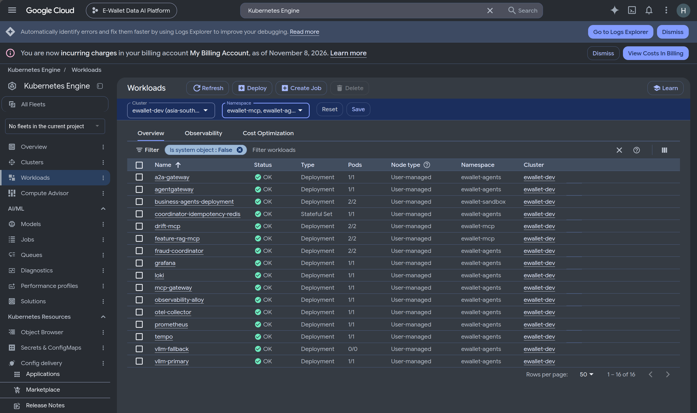](../../evidence/edai2/agents/replay-20261118T161231Z/screenshots/AGENT_A01_GKE_WORKLOADS.png)

**Figure 1 — GKE console, Workloads, namespaces `ewallet-agents`, `ewallet-sandbox`, `ewallet-mcp`.** All 16 user workloads have Status OK:

- **Agents:** `fraud-coordinator` 2/2 and `business-agents-deployment` 2/2 (the WorkerPool workers).
- **MCP servers:** `drift-mcp` 2/2 and `feature-rag-mcp` 2/2.
- **Gateways:** `a2a-gateway`, `mcp-gateway` and `agentgateway`, 1/1 each.
- **Observability:** Prometheus, Grafana, Tempo, Loki, `otel-collector` and Alloy.
- **LLM runtime:** `vllm-primary` 1/1 and `vllm-fallback` 0/0.

[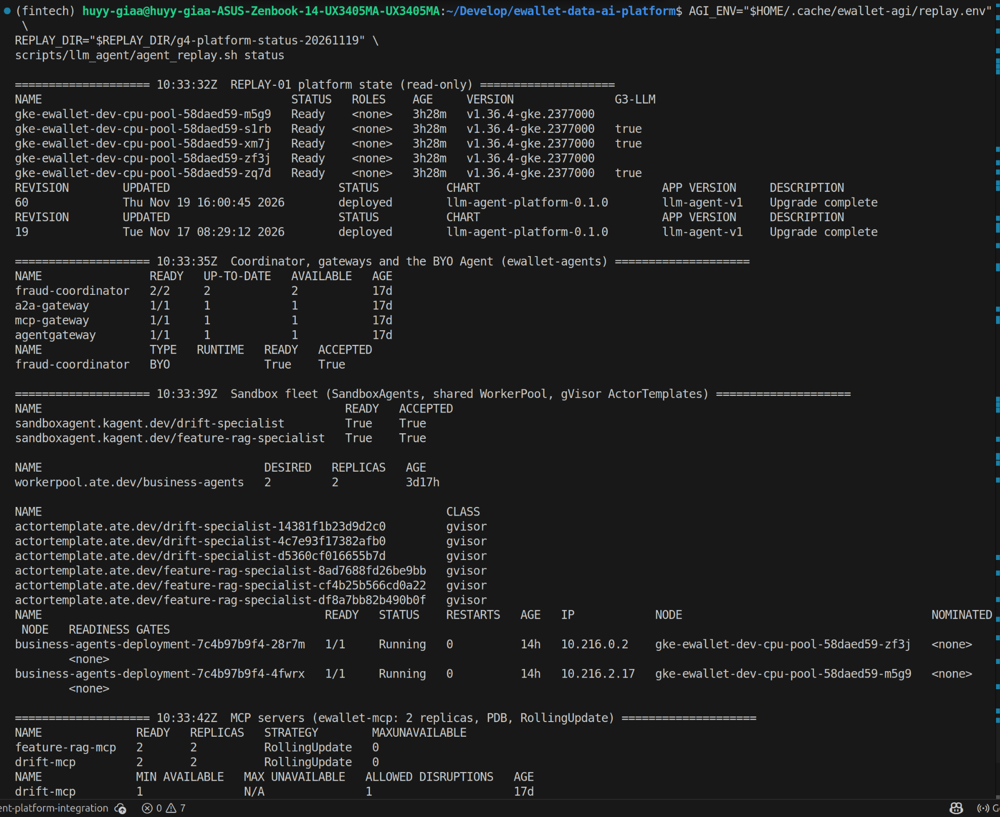](../../evidence/edai2/agents/replay-20261118T161231Z/screenshots/AGENT_A02_PLATFORM_OVERVIEW.png)

**Figure 2 — `agent_replay.sh status`, part 1 (10:33:32Z).** The status output shows:

- 5 nodes Ready on `v1.36.4-gke.2377000`, three of them labelled `G3-LLM=true`;
- Helm revisions 60 and 19, both `deployed`;
- `fraud-coordinator` 2/2 and the kagent Agent `fraud-coordinator`, `TYPE BYO`, Ready and Accepted;
- SandboxAgents `drift-specialist` and `feature-rag-specialist` Ready and Accepted;
- `workerpool.ate.dev/business-agents` desired and actual 2;
- six `actortemplate.ate.dev` objects of class `gvisor`;
- two worker pods Running.

[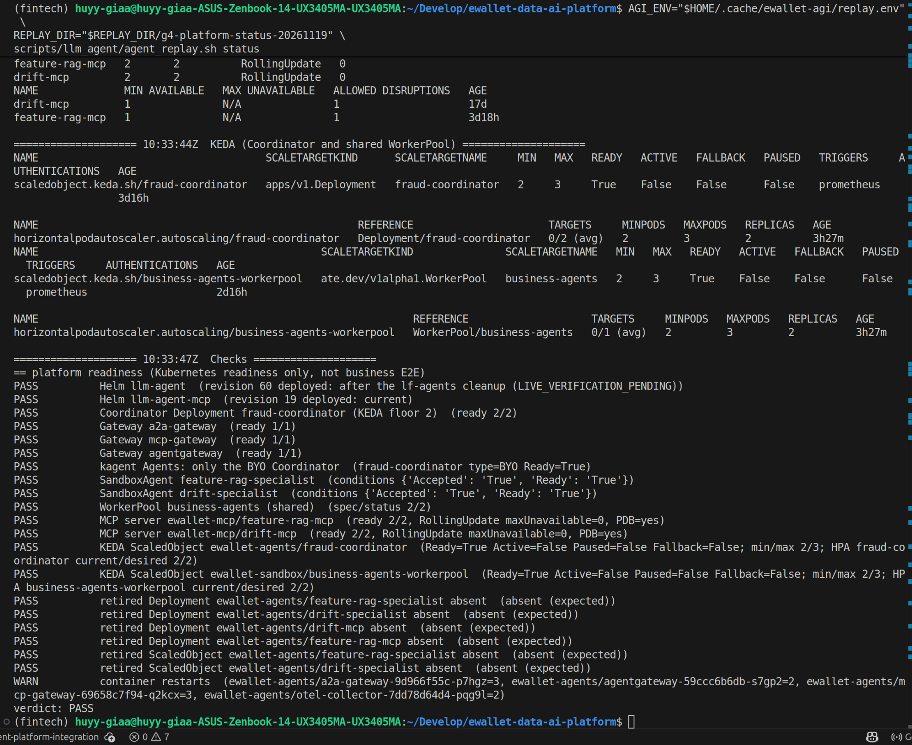](../../evidence/edai2/agents/replay-20261118T161231Z/screenshots/AGENT_A02_PLATFORM_STATUS.png)

**Figure 3 — `agent_replay.sh status`, part 2: checks and verdict.** The output shows:

- MCP strategy `RollingUpdate` with `MAXUNAVAILABLE 0`, and PDBs `MIN AVAILABLE 1`;
- both ScaledObjects `READY True` and `PAUSED False`, with HPAs at 2/2;
- 20 PASS rows, including all six retired Deployments and ScaledObjects absent;
- one WARN for container restarts, from the cold start after wake;
- `verdict: PASS`.

The saved verdict is [`g4-platform-status-verdict.json`](../../evidence/edai2/agents/replay-20261118T161231Z/artifacts/g4-platform-status-verdict.json).

**Conclusion:** the deployed topology matches the architecture. The Specialists exist only as SandboxAgents, and the Coordinator is the only kagent Agent.

## 4. Agent Registry

- **Requirement:** an Agent Registry is deployed, and the agents, MCP servers and prompts are published to it for governance (rows 8, 21, 26).
- **Implementation:**
  - the catalog is built from the chart values and prompts by [`registry_catalog.build_catalog`](../../../ops/llm_agent/registry_catalog.py#L126);
  - it is published with [`publish`](../../../ops/llm_agent/registry_catalog.py#L233) and checked with [`readback`](../../../ops/llm_agent/registry_catalog.py#L279) (GET only);
  - the registry runs in namespace `ewallet-prompts`.

[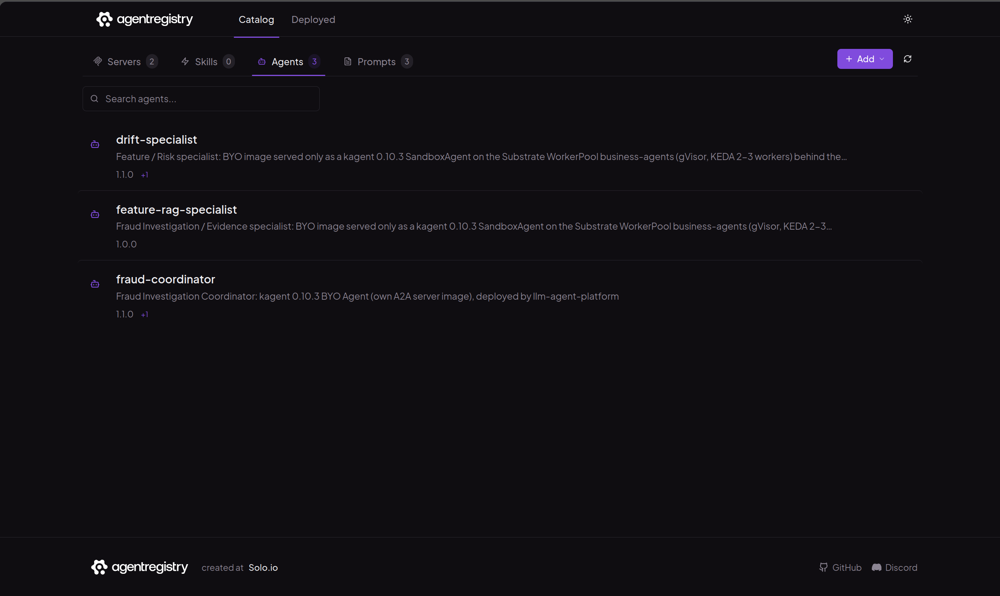](../../evidence/edai2/agents/replay-20261118T161231Z/screenshots/AGENT_A04_REGISTRY_AGENTS.png)

**Figure 4 — agentregistry UI, Catalog → Agents (3).**

- `drift-specialist` 1.1.0 and `feature-rag-specialist` 1.0.0 are described as "BYO image served only as a kagent 0.10.3 SandboxAgent on the Substrate WorkerPool business-agents (gVisor, KEDA 2–3 workers)".
- `fraud-coordinator` 1.1.0 is described as "kagent 0.10.3 BYO Agent (own A2A server image)".

[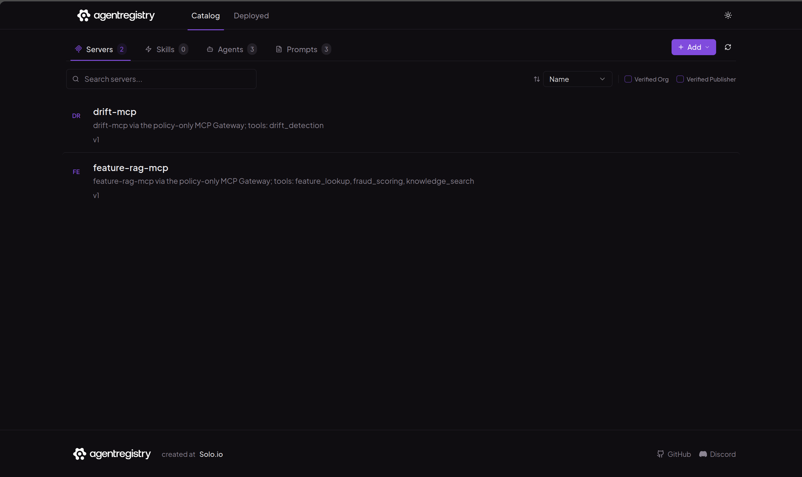](../../evidence/edai2/agents/replay-20261118T161231Z/screenshots/AGENT_A05_REGISTRY_MCP_SERVERS.png)

**Figure 5 — Catalog → Servers (2).** Both servers are registered "via the policy-only MCP Gateway":

- `drift-mcp` v1, tools `drift_detection`;
- `feature-rag-mcp` v1, tools `feature_lookup`, `fraud_scoring` and `knowledge_search`.

[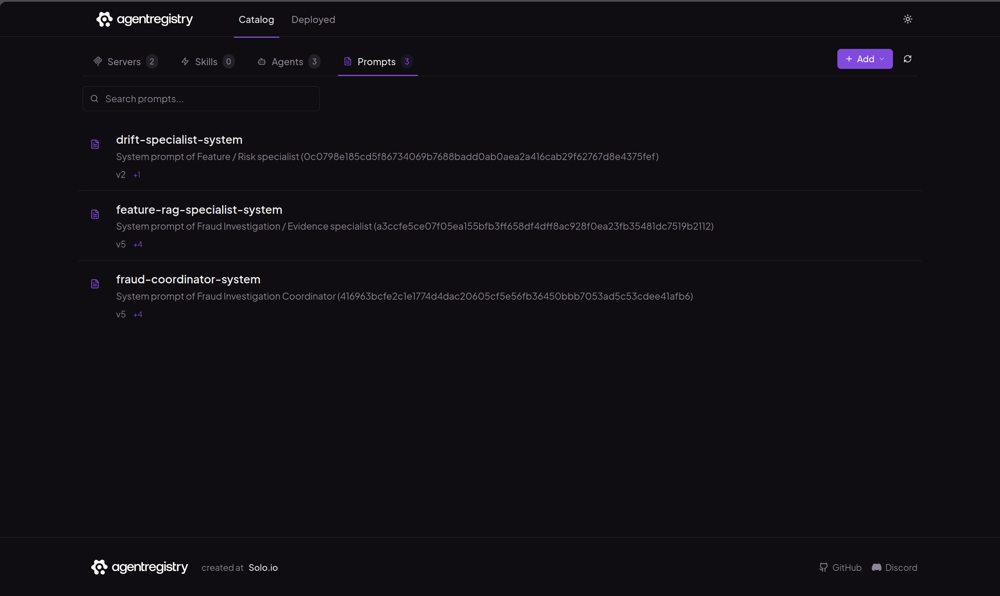](../../evidence/edai2/agents/replay-20261118T161231Z/screenshots/AGENT_A05_REGISTRY_MCP_PROMPTS.png)

**Figure 6 — Catalog → Prompts (3).** The system prompts of the three agents are published with their SHA-256:

- `drift-specialist-system` v2;
- `feature-rag-specialist-system` v5;
- `fraud-coordinator-system` v5.

[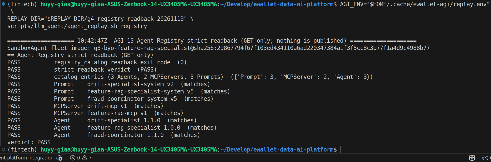](../../evidence/edai2/agents/replay-20261118T161231Z/screenshots/AGENT_A06_REGISTRY_READBACK.png)

**Figure 7 — `agent_replay.sh registry` (10:42:47Z), strict readback, GET only.**

- The readback names the SandboxAgent fleet image digest.
- Catalog entries: `{'Prompt': 3, 'MCPServer': 2, 'Agent': 3}`.
- Every entry is `matches`.
- `verdict: PASS` ([`g4-registry-readback-verdict.json`](../../evidence/edai2/agents/replay-20261118T161231Z/artifacts/g4-registry-readback-verdict.json)).

**Conclusion:** the registry holds exactly the deployed catalog. Nothing was published during the replay; the readback only compared.

## 5. kagent chat

- **Requirement:** use the kagent UI to chat with the Coordinator (row 25).
- **Implementation:**
  - natural-language intake through the global ModelConfig ([architecture §12](AGENT_PLATFORM_ARCHITECTURE.md#12-modelconfig-and-the-llm-integration));
  - delegation to the Feature-RAG Specialist.

[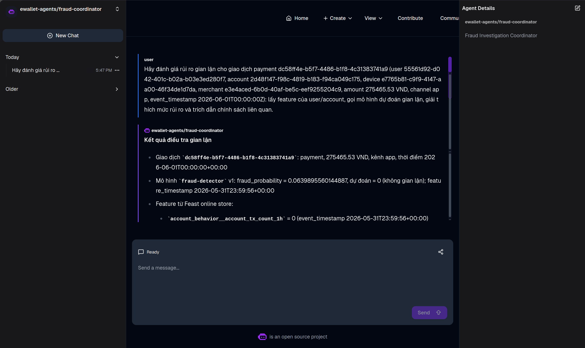](../../evidence/edai2/agents/replay-20261118T161231Z/screenshots/AGENT_B01_KAGENT_CHAT_FRAUD.png)

**Figure 8 — kagent UI, agent `ewallet-agents/fraud-coordinator`.** The user asks, in Vietnamese, for a fraud risk assessment of payment `dc58ff4e-…` (275465.53 VND, channel app, 2026-06-01T00:00:00Z). The answer "Kết quả điều tra gian lận" reports:

- model `fraud-detector` v1 with `fraud_probability = 0.0639895560144887`, prediction 0 (not fraud);
- feature timestamp 2026-05-31T23:59:56Z;
- Feast online features, starting with `account_behavior__account_tx_count_1h = 0`.

[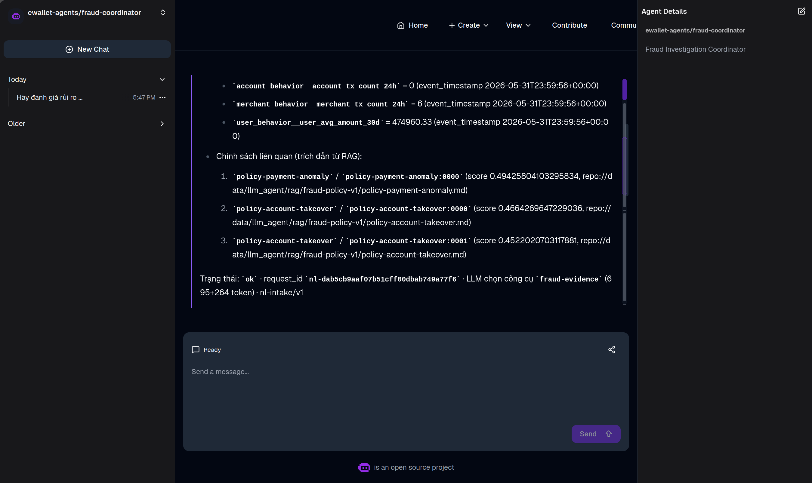](../../evidence/edai2/agents/replay-20261118T161231Z/screenshots/AGENT_B01_KAGENT_CHAT_FRAUD_CITATIONS.png)

**Figure 9 — Same answer, continued.** The rest of the answer contains:

- the remaining features: `account_tx_count_24h = 0`, `merchant_tx_count_24h = 6`, `user_avg_amount_30d = 474960.33`;
- three RAG citations, `policy-payment-anomaly:0000`, `policy-account-takeover:0000` and `policy-account-takeover:0001`, each with its retrieval score and `repo://data/llm_agent/rag/fraud-policy-v1/…` source;
- the footer: status `ok`, request ID `nl-dab5cb9a…`, "LLM chọn công cụ `fraud-evidence` (695+264 token)", contract `nl-intake/v1`.

**Conclusion:** the UI chat reaches the Coordinator. The LLM was used only to select the tool and extract its arguments (695 prompt and 264 completion tokens). The probability is identical to the typed E2E result in §6, which shows that the business values come from the tools.

## 6. Fraud workflow

- **Requirement:** the Coordinator delegates a fraud investigation through the A2A Gateway to the Feature-RAG Specialist. The Specialist uses Feast, KServe and RAG through the MCP Gateway (rows 22, 24).
- **Implementation:**
  - [`_handle_fraud`](../../../ai_platform/llm_agent/programmatic_coordinator.py#L615);
  - [`FeatureRagMCPClient`](../../../ai_platform/llm_agent/byo_feature_rag_specialist.py#L215).

[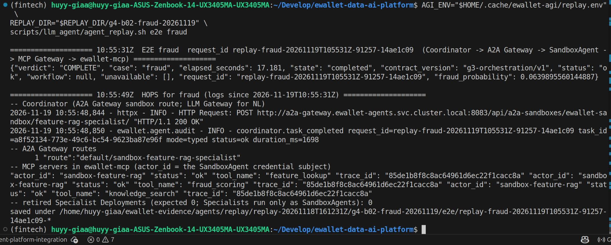](../../evidence/edai2/agents/replay-20261118T161231Z/screenshots/AGENT_B02_FRAUD_HOPS.png)

**Figure 10 — `agent_replay.sh e2e fraud` (10:55:31Z).** The verdict and the hop checks:

- **Verdict:** `COMPLETE`, state `completed`, contract `g3-orchestration/v1`, status `ok`, `fraud_probability 0.0639895560144887`, elapsed 17.181 s.
- **Coordinator log:** `POST http://a2a-gateway…:8083/api/a2a-sandboxes/ewallet-sandbox/feature-rag-specialist/ "HTTP/1.1 200 OK"` and `coordinator.task_completed … mode=typed status=ok`.
- **A2A Gateway:** route `default/sandbox-feature-rag-specialist`.
- **MCP servers:** `feature_lookup`, `fraud_scoring` and `knowledge_search`, all `status ok`, `actor_id "sandbox-feature-rag"`, one shared `trace_id`.
- **Retired Specialist Deployments:** 0.

The saved verdict is [`g4-e2e-fraud-verdict.json`](../../evidence/edai2/agents/replay-20261118T161231Z/artifacts/g4-e2e-fraud-verdict.json).

**Conclusion:** the fraud path uses only the declared gateway routes. The MCP server identifies the caller by the Sandbox credential subject.

## 7. Drift workflow

- **Requirement:** the Coordinator delegates drift analysis to the Drift Specialist.
- **Implementation:**
  - [`_handle_workflow`](../../../ai_platform/llm_agent/programmatic_coordinator.py#L728);
  - [`DriftMCPClient`](../../../ai_platform/llm_agent/byo_drift_specialist.py#L146).

[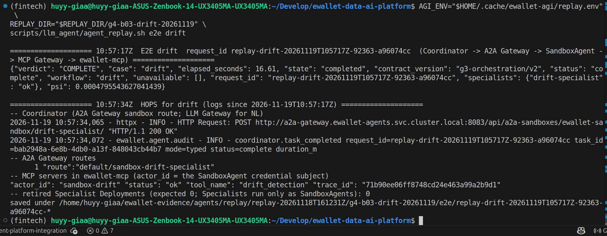](../../evidence/edai2/agents/replay-20261118T161231Z/screenshots/AGENT_B03_DRIFT_HOPS.png)

**Figure 11 — `agent_replay.sh e2e drift` (10:57:17Z).** The verdict and the hop checks:

- **Verdict:** `COMPLETE`, contract `g3-orchestration/v2`, workflow `drift`, `specialists {"drift-specialist": "ok"}`, `psi 0.0004795543627041439`, elapsed 16.61 s.
- **Coordinator:** POST to `/api/a2a-sandboxes/ewallet-sandbox/drift-specialist/` returned 200.
- **A2A Gateway:** route `default/sandbox-drift-specialist`.
- **MCP:** `actor_id "sandbox-drift"`, tool `drift_detection`, `status ok`.

The saved verdict is [`g4-e2e-drift-verdict.json`](../../evidence/edai2/agents/replay-20261118T161231Z/artifacts/g4-e2e-drift-verdict.json).

**Conclusion:** the drift workflow works end to end, and the PSI comes from `drift-mcp`.

## 8. Combined workflow

- **Requirement:** one request uses both Specialists.
- **Implementation:** [`_handle_workflow`](../../../ai_platform/llm_agent/programmatic_coordinator.py#L728) runs its members in a thread pool.

[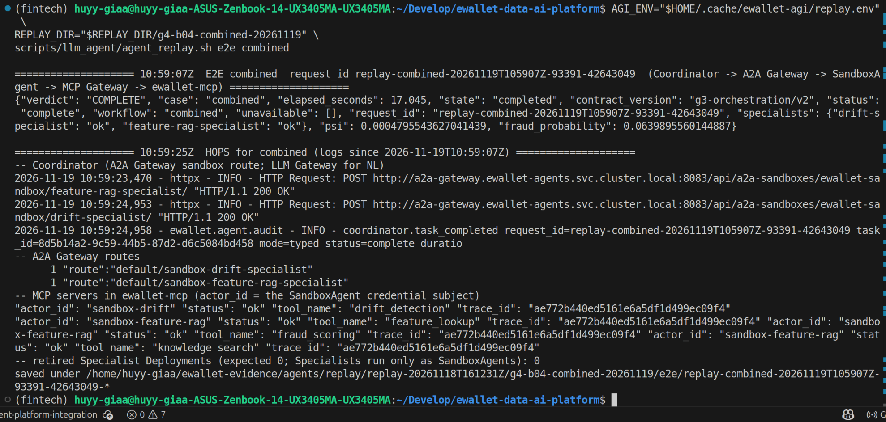](../../evidence/edai2/agents/replay-20261118T161231Z/screenshots/AGENT_B04_COMBINED_WORKFLOW.png)

**Figure 12 — `agent_replay.sh e2e combined` (10:59:07Z).** The verdict and the hop checks:

- **Verdict:** `COMPLETE`, workflow `combined`, status `complete`, both Specialists `ok`, `psi 0.0004795543627041439`, `fraud_probability 0.0639895560144887`, elapsed 17.045 s.
- **Coordinator:** two POSTs, one to `feature-rag-specialist/` at 10:59:23.470 and one to `drift-specialist/` at 10:59:24.953, then a single `task_completed`.
- **Gateway and MCP:** both A2A routes are used; both MCP `actor_id`s appear in one trace.

The saved verdict is [`g4-e2e-combined-verdict.json`](../../evidence/edai2/agents/replay-20261118T161231Z/artifacts/g4-e2e-combined-verdict.json).

**Conclusion:** the Coordinator combines both evidence sets into one result with the same values as the single-Specialist runs.

## 9. Security and negative tests

- **Requirement:** agents run in a sandbox (row 20), and the MCP and A2A gateways enforce security policy (rows 23, 24).
- **Implementation:** [architecture §13](AGENT_PLATFORM_ARCHITECTURE.md#13-security-and-sandbox-isolation) and [operations §11](AGENT_PLATFORM_OPERATIONS.md#11-gateway-security-policies).

[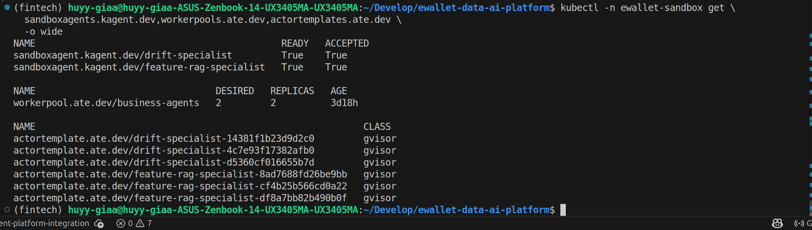](../../evidence/edai2/agents/replay-20261118T161231Z/screenshots/AGENT_C01_SANDBOX_GVISOR_RBAC.png)

**Figure 13 — Sandbox resources in `ewallet-sandbox`.** Both SandboxAgents are Ready and Accepted. WorkerPool `business-agents` is at 2/2. All six ActorTemplates are `CLASS gvisor`.

[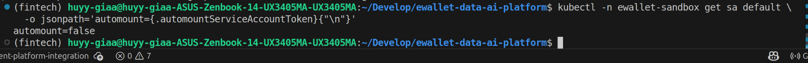](../../evidence/edai2/agents/replay-20261118T161231Z/screenshots/AGENT_C01_TOKEN_AUTOMOUNT_FALSE.png)
[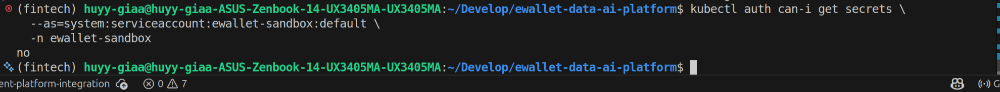](../../evidence/edai2/agents/replay-20261118T161231Z/screenshots/AGENT_C01_RBAC_DENY_SECRETS.png)

**Figures 14–15 — Worker identity has no Kubernetes credential.**

- `kubectl -n ewallet-sandbox get sa default` returns `automount=false`.
- `kubectl auth can-i get secrets --as=system:serviceaccount:ewallet-sandbox:default` returns `no`.

[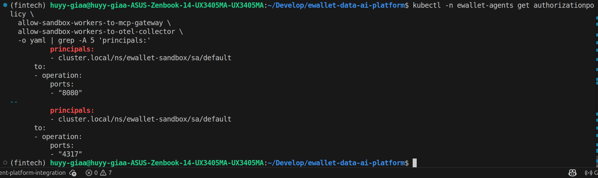](../../evidence/edai2/agents/replay-20261118T161231Z/screenshots/AGENT_C02_GATEWAY_PRINCIPALS.png)

**Figure 16 — AuthorizationPolicies `allow-sandbox-workers-to-mcp-gateway` and `allow-sandbox-workers-to-otel-collector` in `ewallet-agents`.** Each admits only the principal `cluster.local/ns/ewallet-sandbox/sa/default`:

- to the MCP Gateway on port 8080;
- to the OTel collector on port 4317.

[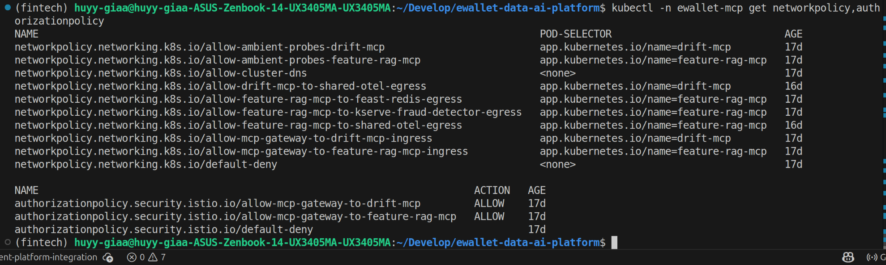](../../evidence/edai2/agents/replay-20261118T161231Z/screenshots/AGENT_C02_GATEWAY_POLICIES.png)

**Figure 17 — `ewallet-mcp` network and authorization policies.**

- **NetworkPolicies:** `default-deny`, plus explicit allows:
  - ingress from the MCP Gateway;
  - egress `feature-rag-mcp` → Feast Redis, KServe `fraud-detector` and the shared OTel collector;
  - `drift-mcp` → OTel;
  - cluster DNS and ambient probes.
- **Istio:** `default-deny` plus `allow-mcp-gateway-to-drift-mcp` and `allow-mcp-gateway-to-feature-rag-mcp`.

[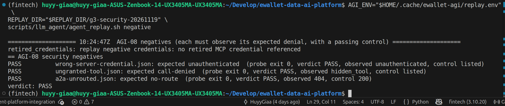](../../evidence/edai2/agents/replay-20261118T161231Z/screenshots/AGENT_C03_SECURITY_NEGATIVES.png)

**Figure 18 — `agent_replay.sh negative` (10:24:47Z).** The guard confirms that no retired MCP credential is used. Each negative has a control that passes. The probes are in [`agent_replay.sh` L255–L292](../../../scripts/llm_agent/agent_replay.sh#L255-L292).

| Probe | Attack | Expected | Observed | Control |
|---|---|---|---|---|
| `wrong-server-credential` | Feature-RAG Sandbox token presented to `/drift/mcp` | unauthenticated | unauthenticated | the drift token is accepted on the same route |
| `ungranted-tool` | kagent controller's list-only credential calls `drift_detection` | call denied | `hidden_tool` | the drift token can call it |
| `a2a-unrouted` | A2A request with `x-kagent-host` of an undeclared agent | no route | HTTP **404** | the declared Sandbox route returns 200 |

The saved verdict is [`g3-security-negatives-verdict.json`](../../evidence/edai2/agents/replay-20261118T161231Z/artifacts/g3-security-negatives-verdict.json).

**Conclusion:**

- Isolation holds: gVisor actors, no Kubernetes credential on the worker identity, and exact principals on the gateway paths.
- The negatives show that a credential is bound to its server, that tools are granted per subject and that the A2A Gateway forwards only declared routes.
- Not tested in this replay: an actor trying to reach a domain outside `allowedDomains` (egress block).

## 10. KEDA autoscaling (G5)

- **Requirement:** the Coordinator and the agent runtime scale automatically under load (rows 19, 25).
- **Implementation:**
  - Coordinator ScaledObject on `ewallet_agent_inflight_tasks`, threshold 2 per replica;
  - WorkerPool ScaledObject on `ewallet_sandbox_delegations_inflight`, threshold 1 per worker;
  - both with min 2, max 3 ([operations §4–§6](AGENT_PLATFORM_OPERATIONS.md#4-keda-for-the-fraud-coordinator)).
- **Method:** the owner ran `REPLAY_AUTOSCALE_APPROVED=yes agent_replay.sh autoscale` once:
  - 100 typed business tasks (load fixture `agent-load-request`), concurrency 8, at most 900 s, sent to the Coordinator;
  - the load ran from 19:23:08Z until 19:36:19Z, with exit code 0;
  - the script then waited for both autoscalers to return to 2.

Because the requests are typed, the LLM is not in this path.

[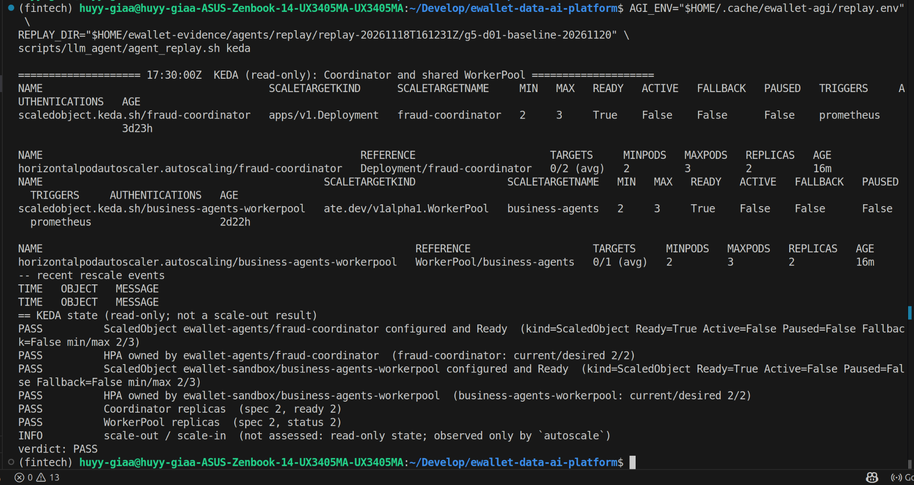](../../evidence/edai2/agents/replay-20261118T161231Z/screenshots/AGENT_D01_KEDA_BASELINE.png)

**Figure 19 — Baseline before G5 (17:30:00Z), `agent_replay.sh keda`.** Both ScaledObjects are Ready, Active False and Paused False, with min/max 2/3. The HPAs read `0/2 (avg)` and `0/1 (avg)` at 2 replicas, and the verdict is PASS. The check is read-only, so scale-out is not assessed here ([`g5-d01-keda-baseline-verdict.json`](../../evidence/edai2/agents/replay-20261118T161231Z/artifacts/g5-d01-keda-baseline-verdict.json)).

[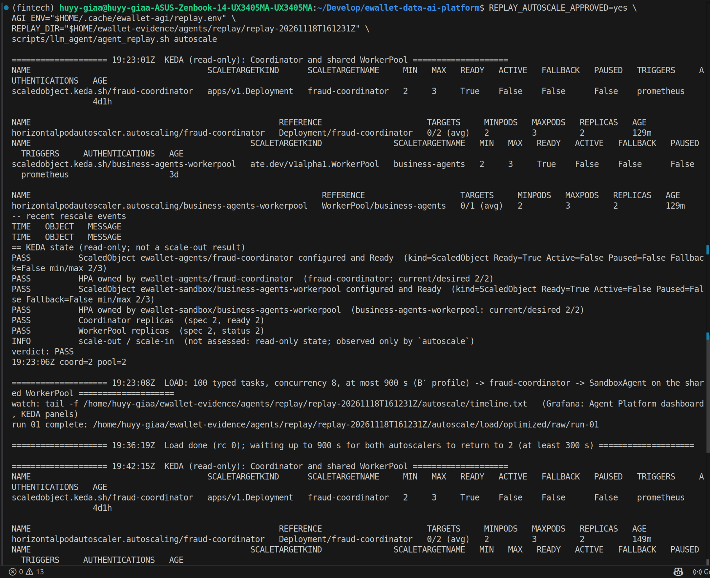](../../evidence/edai2/agents/replay-20261118T161231Z/screenshots/AGENT_D06_AUTOSCALE_EXECUTION.png)

**Figure 20 — The G5 run, from the command line to "Load done (rc 0)".** The run had three phases:

1. The pre-load KEDA check passed, with `coord=2 pool=2` at 19:23:06Z.
2. "LOAD: 100 typed tasks, concurrency 8, at most 900 s (B′ profile) → fraud-coordinator → SandboxAgent on the shared WorkerPool" started.
3. At 19:36:19Z "Load done (rc 0); waiting up to 900 s for both autoscalers to return to 2".

[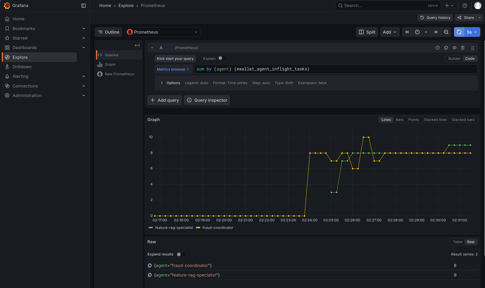](../../evidence/edai2/agents/replay-20261118T161231Z/screenshots/AGENT_D02_AGENT_INFLIGHT_BY_ROLE.png)

**Figure 21 — Grafana Explore, `sum by (agent) (ewallet_agent_inflight_tasks)`, 02:17–02:31 ICT (19:17–19:31Z).**

- The `fraud-coordinator` series rises from 0 to 8 at about 02:24 ICT and stays mostly at 8, with short dips to 6–7 and one peak at 10.
- A `feature-rag-specialist` series, exported by the Sandbox actors, also appears, reaching 9. It is not an input of either ScaledObject, and this campaign did not analyse it further.

[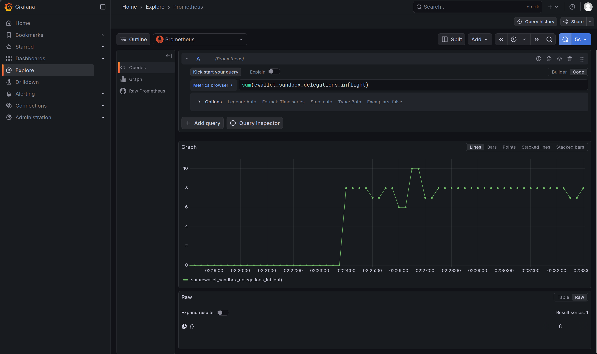](../../evidence/edai2/agents/replay-20261118T161231Z/screenshots/AGENT_D02_WORKERPOOL_INFLIGHT.png)

**Figure 22 — `sum(ewallet_sandbox_delegations_inflight)`, the WorkerPool's KEDA signal.** The signal goes 0 → 8 at about 02:24 ICT and stays mostly at 8, with one peak at 10. With threshold 1 per worker, KEDA wants more workers than the maximum, so the pool runs at its cap of 3.

[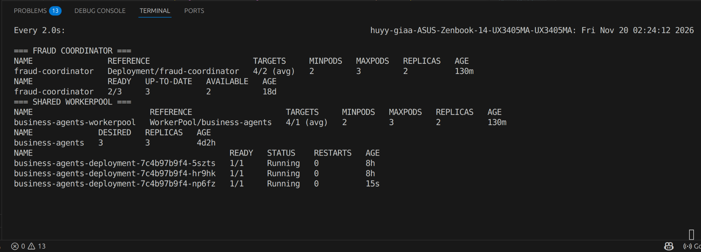](../../evidence/edai2/agents/replay-20261118T161231Z/screenshots/AGENT_D03_COORDINATOR_SCALEOUT.png)

**Figure 23 — `watch`, 02:24:12 ICT (19:24:12Z).**

- **Coordinator:** HPA target `4/2 (avg)`; the Deployment is `2/3` with 3 up to date, so the third pod is starting.
- **WorkerPool:** HPA `4/1 (avg)`; WorkerPool desired 3, replicas 3; the new worker `…-np6fz` is Running, age 15 s.

[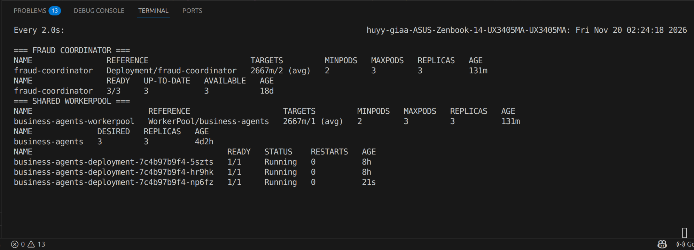](../../evidence/edai2/agents/replay-20261118T161231Z/screenshots/AGENT_D04_WORKERPOOL_SCALEOUT.png)

**Figure 24 — 6 s later (19:24:18Z).** Both autoscalers are at 3 replicas, the Coordinator is 3/3 available, the HPA targets read `2667m/2` and `2667m/1`, and three workers are Running.

[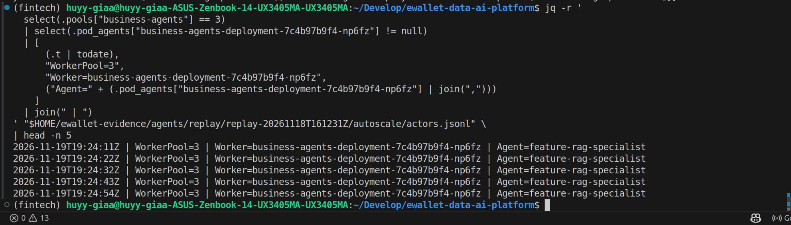](../../evidence/edai2/agents/replay-20261118T161231Z/screenshots/AGENT_D05_THIRD_WORKER_ACTORS.png)

**Figure 25 — `jq` over the saved Substrate actor samples (`autoscale/actors.jsonl`).** These are the first samples in which the WorkerPool had 3 workers and the added worker held actors. From 19:24:11Z, worker `business-agents-deployment-7c4b97b9f4-np6fz` holds `Agent=feature-rag-specialist` actors.

[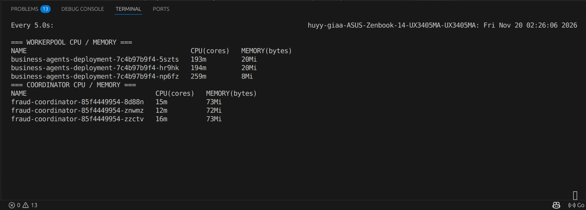](../../evidence/edai2/agents/replay-20261118T161231Z/screenshots/AGENT_D07_RESOURCE_USAGE.png)

**Figure 26 — `kubectl top`, 19:26:06Z, under load.**

| Pods | CPU | Memory |
|---|---|---|
| Workers (3) | 193m, 194m, 259m | 20Mi, 20Mi, 8Mi |
| Coordinators (3) | 15m, 12m, 16m | 72–73Mi |

[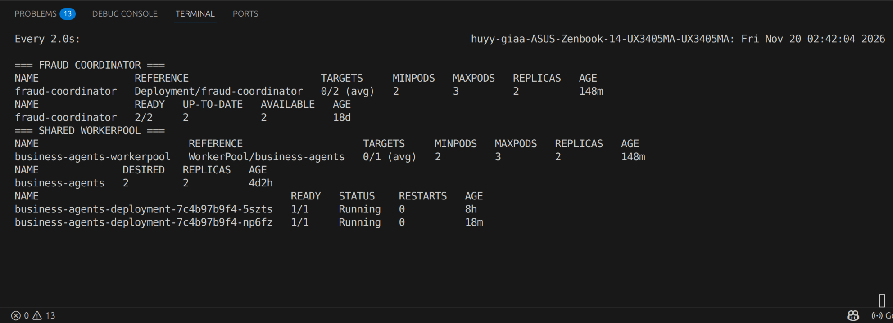](../../evidence/edai2/agents/replay-20261118T161231Z/screenshots/AGENT_D06_KEDA_SCALEIN.png)

**Figure 27 — After scale-in (19:42:04Z).**

- **Coordinator:** HPA `0/2`, 2 replicas, `2/2` ready.
- **WorkerPool:** desired 2, replicas 2. The remaining workers are `…-5szts` (8 h old) and the added `…-np6fz` (18 min old). The original worker `…-hr9hk` was the one removed.

[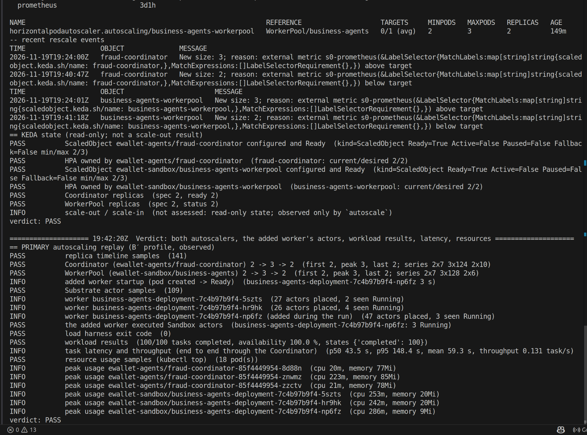](../../evidence/edai2/agents/replay-20261118T161231Z/screenshots/AGENT_D06_AUTOSCALE_VERDICT.png)

**Figure 28 — Verdict at 19:42:20Z.** The KEDA rescale events and the replay verdict:

| Time (UTC) | Object | Event |
|---|---|---|
| 19:24:00Z | `fraud-coordinator` | New size 3, metric above target |
| 19:24:01Z | `business-agents-workerpool` | New size 3, metric above target |
| 19:40:47Z | `fraud-coordinator` | New size 2, metric below target |
| 19:41:18Z | `business-agents-workerpool` | New size 2, metric below target |

The saved verdict is [`g5-autoscale-verdict.json`](../../evidence/edai2/agents/replay-20261118T161231Z/artifacts/g5-autoscale-verdict.json), and the per-sample replica timeline is [`g5-autoscale-replica-timeline.txt`](../../evidence/edai2/agents/replay-20261118T161231Z/artifacts/g5-autoscale-replica-timeline.txt).

| Check | Result |
|---|---|
| Replica timeline samples | 141 |
| Coordinator `ewallet-agents/fraud-coordinator` | **2 → 3 → 2** (series 2×7, 3×124, 2×10) |
| WorkerPool `ewallet-sandbox/business-agents` | **2 → 3 → 2** (series 2×7, 3×128, 2×6) |
| Added worker startup (pod created → Ready) | `…-np6fz` 3 s |
| Actor placement (109 Substrate samples) | `…-5szts` 27 actors (2 seen Running); `…-hr9hk` 26 (4 Running); **`…-np6fz` (added) 47 (3 Running)** |
| Added worker executed Sandbox actors | **PASS** (3 Running) |
| Load harness exit code | 0 |
| Workload results | **100/100 completed**, availability 100.0 %, states `{'completed': 100}` |
| Task latency, end to end through the Coordinator | p50 **43.5 s**, p95 **148.4 s**, mean 59.3 s |
| Throughput | **0.131 task/s** |
| Peak usage (18 pods sampled) | Coordinators 20m/77Mi, **223m**/85Mi, 21m/78Mi; workers 253m/20Mi, 242m/20Mi, 286m/9Mi |
| Verdict | **PASS** |

**Conclusion.** Both autoscalers reacted to the in-flight signals: the harness measured scale-out 55.3 s after the load started ([`g5-load-summary.json`](../../evidence/edai2/agents/replay-20261118T161231Z/artifacts/g5-load-summary.json)). They held 3 replicas while the load lasted and returned to 2 after it ended. The added worker received and executed Sandbox actors, and all 100 tasks completed.

**Interpretation of the latency.** It reflects the capacity cap: 8 concurrent tasks share at most 3 workers that each run one actor at a time. This run does not show a latency improvement over a fixed pool, because no fixed-pool control run was made in this replay.

## 11. Shared WorkerPool (G6)

- **Requirement:** a warm pool lets many agent sessions run on few workers (row 27, Agent Fleet).
- **Implementation:** both SandboxAgents reference WorkerPool `business-agents`. Actors are suspended after each turn and resumed by session ([operations §7](AGENT_PLATFORM_OPERATIONS.md#7-actor-lifecycle-running-suspended-resume)).
- **Method:** `REPLAY_SESSIONS_APPROVED=yes agent_replay.sh workers` ran sequential sessions of both SandboxAgents from 20:21:34Z to 20:27:49Z. Each session had a new turn and then a resumed turn. Golden snapshot actors were excluded from the counts.

[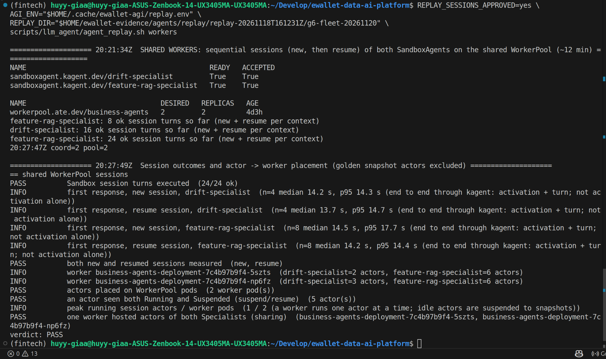](../../evidence/edai2/agents/replay-20261118T161231Z/screenshots/AGENT_E01_E02_FLEET_SESSIONS_LIFECYCLE.png)

**Figure 29 — G6 output and verdict.** The run used WorkerPool 2/2 throughout (`coord=2 pool=2` at 20:27:47Z). The saved verdict is [`g6-workers-verdict.json`](../../evidence/edai2/agents/replay-20261118T161231Z/artifacts/g6-workers-verdict.json).

| Check | Result |
|---|---|
| Sandbox session turns executed | **24/24 ok** |
| First response, new session, `drift-specialist` | n=4, median 14.2 s, p95 14.3 s |
| First response, resumed session, `drift-specialist` | n=4, median 13.7 s, p95 14.7 s |
| First response, new session, `feature-rag-specialist` | n=8, median 14.5 s, p95 17.7 s |
| First response, resumed session, `feature-rag-specialist` | n=8, median 14.2 s, p95 14.4 s |
| Both new and resumed sessions measured | PASS |
| Actor placement | `…-5szts`: drift 2, feature-rag 6; `…-np6fz`: drift 3, feature-rag 6 |
| Actors placed on WorkerPool pods | PASS (2 worker pods) |
| An actor seen both Running and Suspended | **PASS (5 actors)** |
| Peak running session actors / worker pods | 1 / 2 (a worker runs one actor at a time; idle actors are suspended to snapshots) |
| One worker hosted actors of both Specialists | **PASS** (both workers) |
| Verdict | **PASS** |

The first-response times are measured end to end through kagent. They include actor activation or resume plus the turn, so they are not activation time alone.

**Conclusion:**

- Two warm workers served 24 session turns of two different agents, and each worker hosted actors of both Specialists.
- Actors moved between Running and Suspended as sessions were resumed.
- Resumed and new sessions had similar first-response medians (13.7–14.5 s). This replay did not break down where that time is spent.

## 12. Grafana agent metrics

- **Requirement:** telemetry for calls per agent and per tool, and failures (row 51).
- **Implementation:** the OTel spanmetrics connector and the "E-Wallet LLM + Agent Platform" dashboard ([operations §12](AGENT_PLATFORM_OPERATIONS.md#12-prometheus-grafana-tempo-and-loki)).

[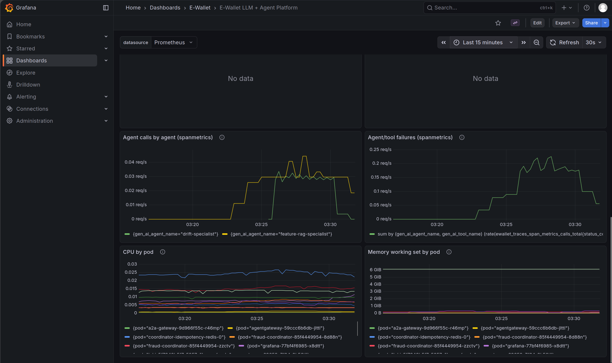](../../evidence/edai2/agents/replay-20261118T161231Z/screenshots/AGENT_F01_AGENT_OBSERVABILITY.png)

**Figure 30 — Dashboard "E-Wallet LLM + Agent Platform", last 15 minutes, about 03:17–03:32 ICT (20:17–20:32Z, during G6).**

- **Agent calls by agent (spanmetrics):** `gen_ai_agent_name="feature-rag-specialist"` rises from about 03:23 to roughly 0.03–0.045 req/s, and `drift-specialist` from about 03:25 to roughly 0.03 req/s.
- **Agent/tool failures (spanmetrics):** a series by `gen_ai_agent_name, gen_ai_tool_name` rises to about 0.2 req/s in the same window.
- **CPU and memory by pod:** populated.
- **Top panels:** the two panels at the top, whose titles are cut off in the capture, show "No data" for this window.

**Conclusion:**

- Agent calls are counted per agent from traces.
- The failure panel is **non-zero during a run in which all 24 turns succeeded** (§11). This campaign did not determine which spans it counts, so it is recorded as an open observation, not as a workflow failure.
- Per-tool call counts are shown here by the Tempo spans (§13), not by a dashboard panel capture.

## 13. Tempo distributed tracing

- **Requirement:** a distributed trace of an agent request across components.
- **Implementation:**
  - W3C trace propagation in the agents and the MCP client;
  - gateway tracing;
  - OTLP export from the Sandbox actors to the collector ([fleet L56–L60](../../../infra/kubernetes/agent-sandbox/fleet.yaml.tmpl#L56-L60)).

[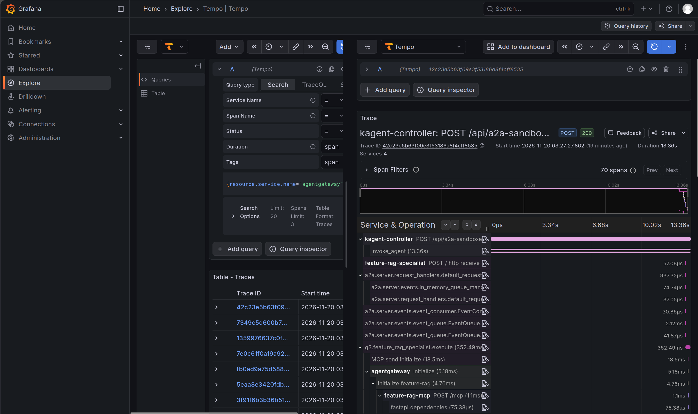](../../evidence/edai2/agents/replay-20261118T161231Z/screenshots/AGENT_F02_TEMPO_TRACE_OVERVIEW.png)

**Figure 31 — Trace `42c23e5b63f09e3f53186a8f4cff8535`, recorded during the G6 run.**

- **Root span:** `kagent-controller: POST /api/a2a-sandbo…`, HTTP 200, started 2026-11-20 03:27:27.862 ICT (20:27:27Z).
- **Size:** duration 13.36 s, 4 services, 70 spans.
- **Span tree:**
  1. `invoke_agent` (13.36 s);
  2. `feature-rag-specialist POST / http receive`;
  3. A2A server spans;
  4. `g3.feature_rag_specialist.execute` (352.49 ms);
  5. MCP `initialize` through `agentgateway` → `initialize feature-rag` → `feature-rag-mcp POST /mcp`.

[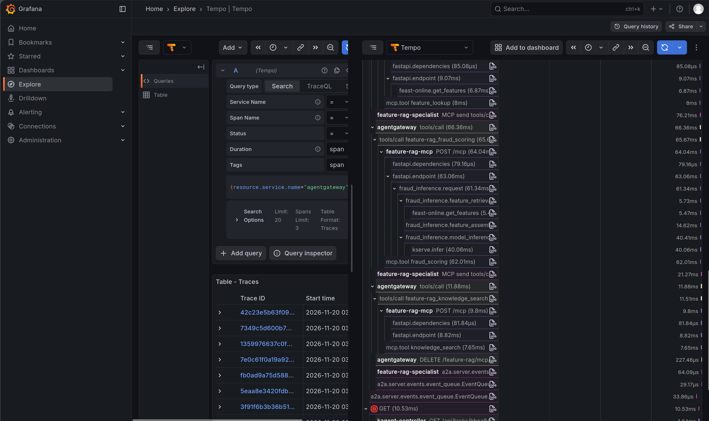](../../evidence/edai2/agents/replay-20261118T161231Z/screenshots/AGENT_F02_TEMPO_MCP_TOOLS.png)

**Figure 32 — Same trace, tool calls.** Every tool call goes through the MCP Gateway (`agentgateway tools/call`), and the session closes with `DELETE /feature-rag/mcp`:

| Tool | Gateway span | Inner spans |
|---|---|---|
| `feature_lookup` | — | `feast-online.get_features` 6.87 ms; tool span 8 ms |
| `fraud_scoring` | `tools/call` 66.36 ms | `fraud_inference.request` 61.34 ms → `feast-online.get_features` 5.47 ms and `fraud_inference.model_inference` 40.41 ms → **`kserve.infer` 40.06 ms**; tool span 62.01 ms |
| `knowledge_search` | `tools/call` 11.88 ms | tool span 7.65 ms |

[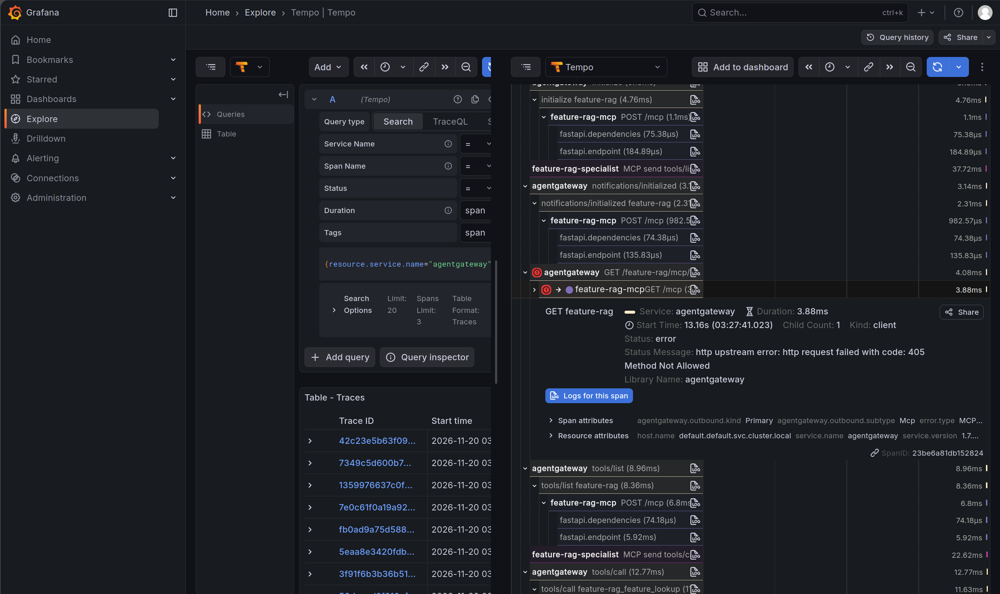](../../evidence/edai2/agents/replay-20261118T161231Z/screenshots/AGENT_F02_TEMPO_HTTP_405_FINDING.png)

**Figure 33 — Finding: HTTP 405 on `GET /feature-rag/mcp`.** In the same trace there is one error span:

- **Spans:** `agentgateway GET /feature-rag/mcp/` (4.08 ms) → `feature-rag-mcp GET /mcp` (3.88 ms, kind client).
- **Status:** `error`, with the message "http upstream error: http request failed with code: 405 Method Not Allowed".
- **Timing:** start offset 13.16 s (03:27:41.023 ICT).
- **Position:** it sits between `notifications/initialized` and `tools/list`, and the `tools/list` and `tools/call` spans that follow complete normally.

**Finding, recorded without a diagnosis.**

- *Observed:* each traced Feature-RAG MCP session contains one `GET` to the MCP route answered with HTTP 405, while the tool calls in the same session succeed and the turn returns 200.
- *Code fact:* the MCP server registers only [`POST /mcp`](../../../ai_platform/llm_agent/tools/service.py#L246) ("JSON responses only, no sessions"), so the application has no `GET` handler on that path.
- *Not established:* this campaign did not test which client component sends the `GET` or whether the client depends on its answer.
- *Impact:* the 405 is not counted as a workflow failure, because G5 (100/100) and G6 (24/24) completed every task through this same path.

**Conclusion:**

- One trace covers the kagent controller, the Sandbox Specialist, the MCP Gateway and the MCP server, down to Feast and KServe.
- Most of the 13.36 s root span lies outside the Specialist's own `execute` span (352 ms). This is consistent with the G6 first-response figures (§11), but this campaign did not break that time down further.

## 14. Loki logs

- **Requirement:** logs of the agent path are collected and searchable.
- **Implementation:** Alloy `loki.source.kubernetes` → Loki; the gateways log JSON ([operations §12](AGENT_PLATFORM_OPERATIONS.md#12-prometheus-grafana-tempo-and-loki)).

[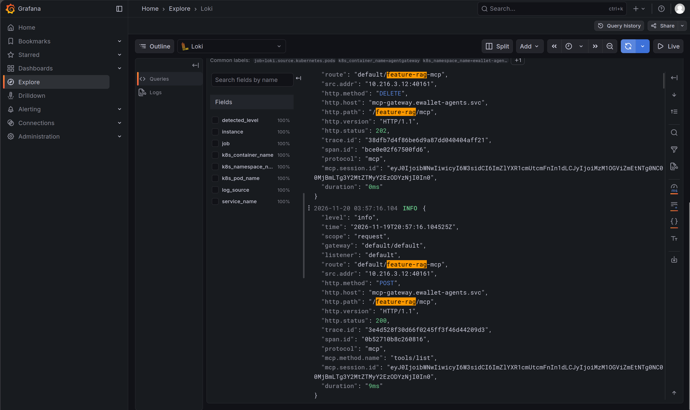](../../evidence/edai2/agents/replay-20261118T161231Z/screenshots/AGENT_F03_LOKI_MCP_GATEWAY_LOGS.png)

**Figure 34 — Grafana Explore → Loki.** The common labels are `job=loki.source.kubernetes.pods`, `k8s_container_name=agentgateway` and `k8s_namespace_name=ewallet-agen…`. The entries are MCP Gateway request logs for route `default/feature-rag-mcp`, host `mcp-gateway.ewallet-agents.svc`:

| Method | Path | Status | MCP method | Duration |
|---|---|---|---|---|
| `DELETE` | `/feature-rag/mcp` | 202 | (session end) | 0 ms |
| `POST` | `/feature-rag/mcp` | 200 | `tools/list` | 9 ms |

Each entry carries `trace.id`, `span.id` and `mcp.session.id`, captured at 2026-11-19T20:57:16Z.

**Conclusion:** gateway logs are in Loki with the trace ID, so a request can be followed from logs to traces. The Grafana Tempo datasource is configured with trace-to-logs links ([`observability-stack.yaml` L184](../../../infra/helm/llm-agent-platform/templates/observability-stack.yaml#L184)).

## 15. MCP availability and RollingUpdate

- **Requirement:** the MCP tools are deployed on Kubernetes with Helm, RollingUpdate and automatic fallback (row 18).
- **Implementation:**
  - [`agi/mcp-reliability.yaml`](../../../infra/helm/llm-agent-platform/agi/mcp-reliability.yaml): 2 replicas, topology spread, PDB;
  - [`mcp-services.yaml` L74](../../../infra/helm/llm-agent-platform/templates/mcp-services.yaml#L74): `maxUnavailable: 0`, `maxSurge: 1`;
  - client failover [`with_failover`](../../../ai_platform/llm_agent/mcp_failover.py#L177).

[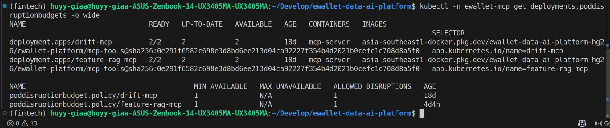](../../evidence/edai2/agents/replay-20261118T161231Z/screenshots/AGENT_G01_MCP_REPLICAS_PDB.png)

**Figure 35 — `kubectl -n ewallet-mcp get deployments,poddisruptionbudgets -o wide`.**

- `drift-mcp` and `feature-rag-mcp` are each 2/2 ready and available, both running the image `mcp-tools@sha256:0e291f65…`.
- PDBs `drift-mcp` and `feature-rag-mcp` have `MIN AVAILABLE 1` and `ALLOWED DISRUPTIONS 1`.

[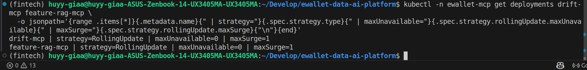](../../evidence/edai2/agents/replay-20261118T161231Z/screenshots/AGENT_G02_MCP_ROLLING_UPDATE.png)

**Figure 36 — Deployment strategy.** Both MCP Deployments show `strategy=RollingUpdate | maxUnavailable=0 | maxSurge=1`.

The same values were read again right before the final sleep: [`final-sleep-mcp-coordinator-strategy-pdb.txt`](../../evidence/edai2/agents/replay-20261118T161231Z/artifacts/final-sleep-mcp-coordinator-strategy-pdb.txt).

**What this replay shows, and what it does not:**

- **Shown:** both MCP servers run 2 ready replicas. Their roll strategy cannot take a replica down before its replacement is Ready, and a voluntary disruption must leave at least one replica.
- **Not shown:** no MCP rollout, pod deletion or failover was performed during this replay. The screenshots show configuration and state, not behaviour under failure.
- **Earlier failover run:** on 2026-11-15 an isolated failover experiment (`AGR-02`, namespace `ewallet-mcp-exp`, forced pod deletion at 10 calls/s) recorded:
  - optimized arm (2 replicas, 3 client attempts): 1188/1188 calls, with 1 client retry;
  - baseline arm (1 replica, 1 attempt): 1129/1189 calls, 12.0 s recovery.

  See [`AGR-02-RESULT.txt`](../../evidence/edai2/agents/agi-20261115T145608Z/agr/AGR-02/AGR-02-RESULT.txt). The MCP client code changed afterwards (commits `0b8f945d`, `a5406c5b` and `132b6bfc` on 2026-11-16, which handle gateway rate limiting). That run is therefore historical evidence for the failover design, not a test of the build deployed during this replay.

## 16. Observed limitations

1. **Capacity cap.** One actor per worker and at most 3 workers bound throughput: 0.131 task/s with p95 148.4 s at concurrency 8 (§10).
2. **The gateways run one replica each.** `a2a-gateway`, `mcp-gateway` and `agentgateway` are 1/1, and their failover was not tested.
3. **No MCP rollout or failover test in this replay.** Only the configuration was verified (§15).
4. **No egress-block negative.** An actor reaching a domain outside `allowedDomains` was not tested (§9).
5. **HTTP 405 on `GET /feature-rag/mcp`.** Recorded as a finding with no diagnosis (§13).
6. **The failure panel is non-zero.** "Agent/tool failures (spanmetrics)" showed a non-zero rate during a fully successful run; the counted spans were not analysed (§12).
7. **Observability data is ephemeral.** Prometheus, Loki and Tempo use `emptyDir` storage, so data does not survive restarts or sleep. The screenshots and saved replay results are the durable record ([operations §15](AGENT_PLATFORM_OPERATIONS.md#15-observed-operational-limitations)).
8. **Single run.** G5 and G6 were each run once. The latencies are observed values from one run, not stable estimates.
