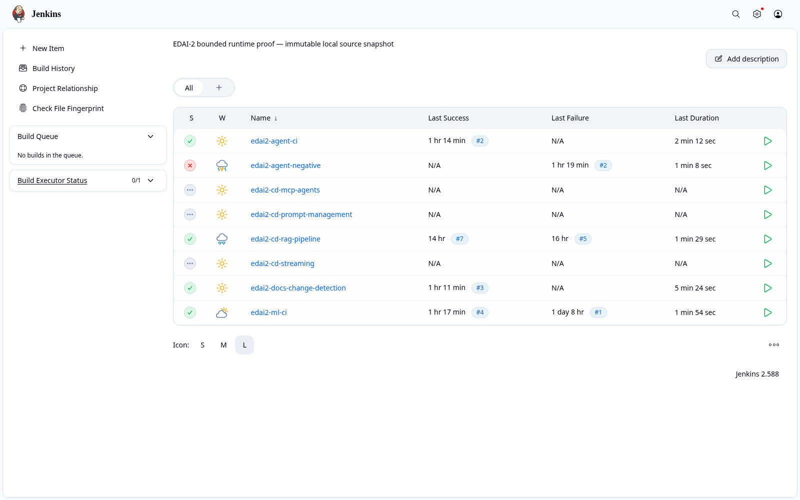
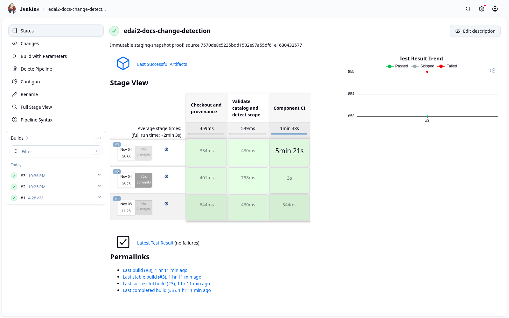
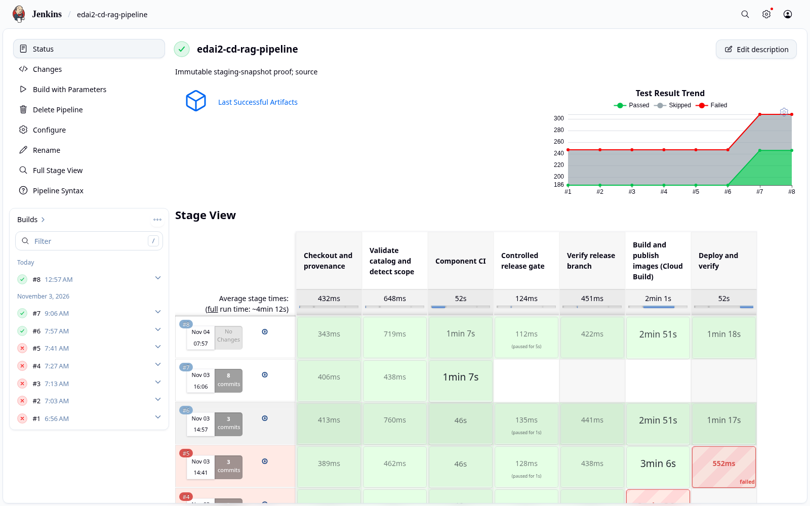
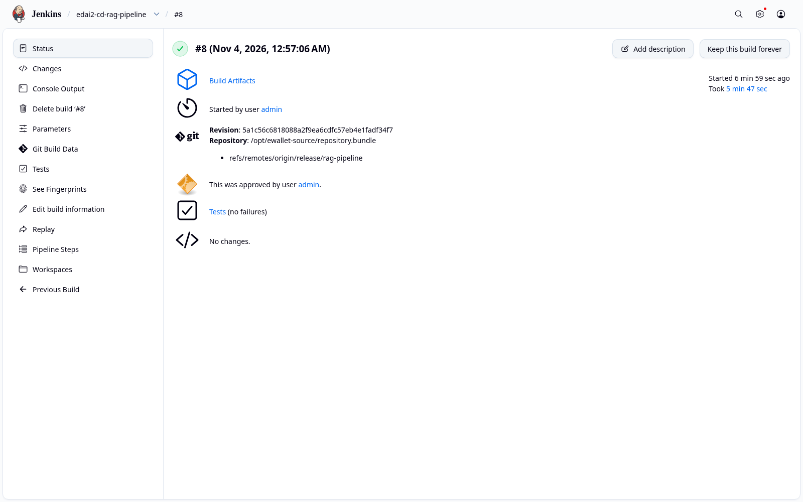
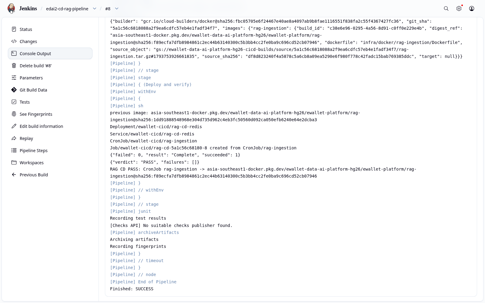

# CI/CD with Jenkins

This report covers:

- how the platform is built, tested and released with Jenkins;
- how one shared pipeline serves every component;
- how a release reaches Kubernetes;
- the end-to-end delivery of the RAG ingestion pipeline.

Test design and test results are described in [Testing and Continuous Verification](../testing/TESTING.md).

## 1. Overview and motivation

The repository contains many independently deployable parts:

- data-platform jobs;
- the Feast repository;
- the training pipeline;
- the KServe model image and the Fraud API;
- MCP tool servers and agents;
- the RAG ingestion job.

Separate, hand-written pipelines for each would drift apart. The platform therefore uses **one parameterised pipeline** and a **component catalog**. A component is described by data (source paths, test commands, build artifact, deploy handler), and the pipeline decides what to test, build and deploy from that description.

The pipeline is built around three safety properties:

- **Provenance.** Every build checks out an exact commit, and fails if HEAD differs from `EXPECTED_GIT_SHA`.
- **Immutability.** Images are built once by Cloud Build from a `git archive` of that commit, published create-only, and deployed by digest, never by tag.
- **Least privilege.** The Jenkins service account can write only to the target namespace, and every release requires an explicit approval input.

## 2. Pipeline architecture

```text
 (1) commit / parameters        (2) scope = changed components
Jenkins job ───────────────▶ Checkout & provenance ───▶ Validate catalog & detect scope
                                                                │ (3) per component, in parallel
                                                                ▼
                                                     Component CI (uv --locked, JUnit)
                                                                │ (4) only if DEPLOY_APPROVED
                                                                ▼
                         Release gate (input) ──▶ Verify release branch ──▶ Cloud Build (create-only image)
                                                                                     │ (5) digest
                                                                                     ▼
                                                     Deploy & verify (namespace-scoped) ──▶ Smoke test ──▶ Cleanup (always)
```

| File | Role |
|---|---|
| [`jenkins/pipeline/componentPipeline.groovy`](../../../jenkins/pipeline/componentPipeline.groovy) | Shared pipeline: stages, parallel component CI, JUnit publishing, release gate, deploy and cleanup |
| [`Jenkinsfile`](../../../Jenkinsfile) | Platform profile: change detection across all components |
| [`Jenkinsfile.ml`](../../../Jenkinsfile.ml) | ML profile: Feast, training, MLflow, serving, Fraud API |
| [`Jenkinsfile.llm-agent`](../../../Jenkinsfile.llm-agent) | LLM/agent profile: MCP, agents, RAG, observability, prompts |
| [`Jenkinsfile.rag`](../../../Jenkinsfile.rag) | Standalone RAG pipeline: lockfile check → tests → Trivy scan → DAG parse in a real Airflow → runtime build → DAG trigger |
| [`jenkins/catalog/components.json`](../../../jenkins/catalog/components.json) | Component catalog |
| [`scripts/ci/change_detection.py`](../../../scripts/ci/change_detection.py), [`catalog.py`](../../../scripts/ci/catalog.py) | Scope selection and catalog validation |
| [`scripts/ci/cloud_build.py`](../../../scripts/ci/cloud_build.py), [`release_policy.py`](../../../scripts/ci/release_policy.py), [`release_request.py`](../../../scripts/ci/release_request.py), [`deploy_release.sh`](../../../scripts/ci/deploy_release.sh) | Immutable build, digest-only release plan, deploy entry point |
| [`scripts/ci/deploy/rag_pipeline.sh`](../../../scripts/ci/deploy/rag_pipeline.sh), [`jenkins/cd/rag-pipeline.contract.json`](../../../jenkins/cd/rag-pipeline.contract.json), [`scripts/ci/verify_rag_smoke.py`](../../../scripts/ci/verify_rag_smoke.py) | RAG deploy handler and smoke-test contract |

Jenkins itself runs on GKE in the namespace `ewallet-ci`. Its jobs are defined as code: Job DSL in the Jenkins configuration under [`infra/kubernetes/jenkins/`](../../../infra/kubernetes/jenkins).

## 3. Continuous integration

Every pipeline begins with the same three stages. They are shown in the platform job below:



*The Jenkins controller and its EDAI-2 jobs: platform change detection, ML CI, agent CI, the negative gate and the RAG CD pipeline.*



*`edai2-docs-change-detection`: checkout and provenance, catalog validation and scope detection, then Component CI. Build #3 tested 14 component suites, with 855 tests and no failures.*

Per-component test counts, and the intentional negative gate that proves a failing contract blocks the release, are reported in [Testing §4](../testing/TESTING.md#4-execution-in-jenkins).

## 4. Continuous delivery of the RAG ingestion pipeline

The RAG ingestion job builds the knowledge base that the agents search. Its release unit is a container image (`infra/docker/rag-ingestion/Dockerfile`), run by a Kubernetes CronJob in the namespace `ewallet-cicd`.

### 4.1 Stages

| # | Stage | What it does |
|---|---|---|
| 1 | Checkout and provenance | Checks out `release/rag-pipeline` from the immutable source bundle; fails unless HEAD equals `EXPECTED_GIT_SHA` |
| 2 | Validate catalog and detect scope | Validates the catalog and selects the RAG pipeline and its dependent components |
| 3 | Component CI | `uv lock --check`, `uv sync --locked`, then the catalog test commands with JUnit output |
| 4 | Controlled release gate | Jenkins `input` approval: "Approve immutable release of `<sha>` to gke-cpu" |
| 5 | Verify release branch | `origin/release/rag-pipeline` must resolve to the same commit |
| 6 | Build and publish | `cloud_build.py`: `git archive` of the commit, create-only upload, Cloud Build of `rag-ingestion`, provenance recorded |
| 7 | Deploy and verify | Digest-only release plan; the CronJob is updated to the new digest; a smoke Job runs all six ingestion stages against an ephemeral Redis and is verified against the smoke contract; an always-run cleanup removes the smoke resources |

### 4.2 Execution

Build `edai2-cd-rag-pipeline` #8:

| Parameter | Value |
|---|---|
| Commit | `5a1c56c6818088a2f9ea6cdfc57eb4e1fadf34f7` |
| `ENVIRONMENT` | `gke-cpu` |
| `DEPLOY_APPROVED` | `true` |



*All seven stages of build #8 succeeded, in 347.8 s.*



*Build #8:*

- *revision `5a1c56c6…` from `release/rag-pipeline`;*
- *the release approval recorded;*
- *tests with no failures.*



*The end of the console log:*

- *Cloud Build `c38e6e96` produced `rag-ingestion@sha256:f89ecfa7…`;*
- *the previous digest `1dd91888…` was recorded for rollback;*
- *the smoke Job `rag-cd-5a1c56c68180-8` completed with `{"verdict": "PASS", "failures": []}`;*
- *the CronJob now points to the new digest.*

**What the smoke test proves.** The smoke Job read back 4 chunks with publication identity `b85ae796…`. This is the identity of the production RAG publication, so the released image reproduces exactly the same chunking and embeddings.

**Cleanup and production isolation.**

- After the run, no smoke Job, Pod or Redis remained.
- A comparison of 127 production objects before and after the build showed no change. Copies are in [`text/prod_objects_before_rag_cd.txt`](../../evidence/edai2/text/prod_objects_before_rag_cd.txt) and [`text/prod_objects_after_rag_cd.txt`](../../evidence/edai2/text/prod_objects_after_rag_cd.txt).

### 4.3 Rollback

The previous CronJob specification is captured before deployment. To roll back, it is re-applied as the Jenkins service account: server-side dry-run first, then the apply. This was exercised after build #8: the CronJob returned to the previous image `1dd91888…`, at generation 3, suspended.

The pipeline also contains an automatic rollback that runs only when deployment verification fails. Because build #8 succeeded, that path was not triggered.

### 4.4 Least privilege

`kubectl auth can-i` was evaluated as `system:serviceaccount:ewallet-ci:jenkins`:

- **Allowed:** the five write verbs that deployment needs, in `ewallet-cicd`.
- **Denied:** writes in `ml-platform`, `fraud-serving`, `ewallet-agents`, `ewallet-mcp`, `default`, `feature-store`, `kubeflow` and `ewallet-ci`, and at cluster scope.

A compromised pipeline therefore cannot modify the serving or agent workloads.

## 5. MCP servers, agents and prompts

The MCP servers and agents are covered by CI: the `mcp-agents`, `agents` and `prompt-management` suites in `edai2-agent-ci`. They are released with Helm:

- `llm-agent-mcp` for the MCP servers;
- `llm-agent` for the gateways and agents.

**Image provenance.** Images are built by Cloud Build and pinned by digest in the chart values.

**Prompt management.** System prompts are versioned in the Agent Registry (agentregistry), next to the published agents and MCP servers. [`ops/llm_agent/prompt_registry.py`](../../../ops/llm_agent/prompt_registry.py) resolves an explicit prompt version. It refuses unknown or tampered versions, and falls back to the Git copy only when the registry is unavailable and fallback is allowed. The drift specialist's deployed system prompt is byte-identical to registry version `drift-specialist-system/v2`.

## 6. Limitations

- The Jenkins delivery jobs for the MCP servers with their agents, for the coordinator, and for the streaming feature jobs are defined in the catalog but have not been executed. These components are currently released with Helm by an operator.
- The agents still read their system prompt from a Helm-rendered ConfigMap rather than fetching it from the registry at start-up.
- The pipeline's automatic rollback has not been triggered by an injected failure; only the manual rollback was exercised.
