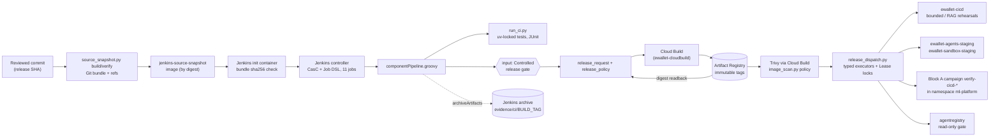
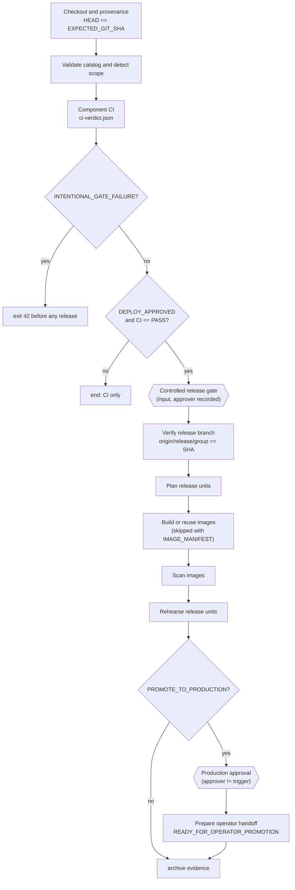
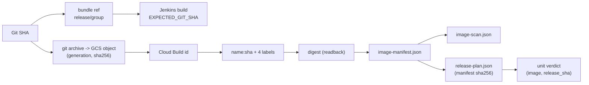

# CI/CD V2 Architecture

This document describes how EDAI-2 tests, builds, scans and releases its components:
- the mechanisms CI/CD V2 implements;
- the reasons behind the main design choices;
- the boundary between what was exercised on the `ewallet-dev` GKE cluster and what exists only in source.

[CICD_OPERATIONS.md](CICD_OPERATIONS.md) explains how to run and troubleshoot the system. [CICD_RELEASE_EVIDENCE.md](CICD_RELEASE_EVIDENCE.md) reports the real executions.

## Contents

1. [Design goals](#1-design-goals)
2. [System overview](#2-system-overview)
3. [Jenkins runtime and the immutable source snapshot](#3-jenkins-runtime-and-the-immutable-source-snapshot)
4. [The shared pipeline](#4-the-shared-pipeline)
5. [Continuous integration](#5-continuous-integration)
6. [Image build and provenance](#6-image-build-and-provenance)
7. [Vulnerability gate](#7-vulnerability-gate)
8. [Release orchestration](#8-release-orchestration)
9. [Rehearsal mechanisms](#9-rehearsal-mechanisms)
10. [The production boundary](#10-the-production-boundary)
11. [Identities, isolation and least privilege](#11-identities-isolation-and-least-privilege)
12. [Limitations](#12-limitations)

## 1. Design goals

CI/CD V2 was rebuilt around one constraint: **a release must be traceable from a reviewed Git SHA to the digest that ran, and nothing may reach production by side effect.** The earlier pipeline let a change-detection scope select deployment handlers directly. V2 separates the concerns:

- **Components** say what to test and which images to build ([catalog.py](../../../scripts/ci/catalog.py)).
- **Release units** say what is deployed, how, and in which order ([release_units.py](../../../scripts/ci/release_units.py)). Changing a file can never deploy anything by itself.
- **Jenkins does not use GitHub as its source.** Every job checks out a Git bundle baked into an image, so a release needs a deliberate snapshot rebuild and controller rollout (§3.2).
- **Every gate fails closed.** A missing registry permission, a scanner error, an empty test run or a stale plan stops the release. None of them is skipped.
- **Jenkins holds no production identity.** Its CD jobs end in rehearsals. Most run in dedicated namespaces (`ewallet-cicd` and the two Agent staging namespaces). The streaming campaign runs in the shared `ml-platform` namespace under a separate identity whose rights are broader than its task (§11.2). A production promotion is designed as an operator-run transaction on a verified Jenkins handoff (§10).

## 2. System overview

*Figure 1. CI/CD V2 components. Every arrow corresponds to code. The production path in §10 is not shown, because no build executed it.*

The controller runs on GKE in namespace `ewallet-ci`. Release workloads land in four kinds of targets:
- the CD namespace `ewallet-cicd`;
- the two Agent staging namespaces;
- a per-build streaming campaign whose workloads run in the existing `ml-platform` namespace, under their own identity;
- the Prompt Registry, which is only read.

## 3. Jenkins runtime and the immutable source snapshot

### 3.1 Controller

The controller is rendered from a single template, [jenkins.yaml](../../../infra/kubernetes/jenkins/jenkins.yaml). [render_jenkins_runtime.py](../../../scripts/ci/render_jenkins_runtime.py#L15-L35) substitutes:
- two images, each accepted only as `name@sha256:<digest>`;
- five 40-character SHAs;
- the Jenkins Google service account.

The rendered Deployment has these properties:
- **Single replica, `Recreate` strategy.** It uses one executor (`numExecutors: 1`) and the 32 GiB PVC `jenkins-home` for build history.
- **Hardened pods.** Non-root user 1000, `readOnlyRootFilesystem`, all capabilities dropped, `RuntimeDefault` seccomp ([jenkins.yaml L164-L243](../../../infra/kubernetes/jenkins/jenkins.yaml#L164-L243)).
- **No default service-account token.** `automountServiceAccountToken: false`. The controller receives a projected, one-hour token instead ([L259-L262](../../../infra/kubernetes/jenkins/jenkins.yaml#L259-L262)), used only for its namespace-scoped Roles.
- **Restricted network.** A default-deny NetworkPolicy plus an allow-list: DNS, outbound HTTPS (TCP 443) to any address, and the GKE metadata endpoints for Workload Identity ([L282-L334](../../../infra/kubernetes/jenkins/jenkins.yaml#L282-L334)).

Configuration as Code seeds the jobs with Job DSL ([L78-L140](../../../infra/kubernetes/jenkins/jenkins.yaml#L78-L140)). Each pipeline job is defined as follows:
- `cpsScm` checks out `/opt/ewallet-source/repository.bundle`, not a network remote.
- `disableConcurrentBuilds()` is set, and log rotation keeps 10 builds.
- A fixed parameter set applies. Release jobs have no default SHA and `DEPLOY_APPROVED=false`.

| Job | Branch in the bundle | Jenkinsfile (profile) | Purpose |
|---|---|---|---|
| `edai2-ml-ci`, `edai2-agent-ci`, `edai2-docs-change-detection` | `proof/{ml,agent,docs}` | `Jenkinsfile.ml`, `Jenkinsfile.llm-agent`, `Jenkinsfile` | CI-only proofs |
| `edai2-agent-negative` | `proof/agent` | `Jenkinsfile.llm-agent` | `INTENTIONAL_GATE_FAILURE=true`: must fail before any release action |
| `edai2-cd-rag-pipeline`, `-mcp-agents`, `-agent-fleet`, `-coordinator`, `-prompt-management`, `-agent-staging` | `release/<group>` | `Jenkinsfile.llm-agent` (profile `llm-agent`) | Release groups |
| `edai2-cd-streaming` | `release/streaming` | `Jenkinsfile` (profile `platform`) | Streaming release group |

Each Jenkinsfile is three lines: it loads [componentPipeline.groovy](../../../jenkins/pipeline/componentPipeline.groovy) and passes a profile.

### 3.2 Why a Git bundle instead of a Git remote

The jobs' SCM is a local Git bundle, so pipeline execution does not fetch source from GitHub and the configured SCM needs no GitHub credential. This is a source-of-truth decision, not network isolation: the controller's NetworkPolicy allows outbound HTTPS to any address ([jenkins.yaml L321-L325](../../../infra/kubernetes/jenkins/jenkins.yaml#L321-L325)), so the configuration does not block GitHub at the network level.

[source_snapshot.py](../../../scripts/ci/source_snapshot.py) builds the bundle in a throw-away bare clone ([`build`, L82](../../../scripts/ci/source_snapshot.py#L82)). The bundle contains:
- `release/<group>` for every group in [release-units.json](../../../jenkins/catalog/release-units.json), at the reviewed SHA;
- `proof/{ml,agent,docs}` at the same SHA;
- `base` at the change-detection base, which must be an ancestor;
- `provenance/*` refs for historical commits that tests read by SHA.

The output is the bundle plus a `source-metadata.txt` that records every ref and the bundle's sha256. [`verify`](../../../scripts/ci/source_snapshot.py#L112) re-reads the bundle with git alone.

The bundle is copied into a `busybox`-based image ([Dockerfile](../../../infra/docker/jenkins-source-snapshot/Dockerfile)). The controller's init container refuses to start Jenkins unless the bundle's sha256 equals the recorded value ([jenkins.yaml L174-L184](../../../infra/kubernetes/jenkins/jenkins.yaml#L174-L184)).

As a result, a branch pushed to GitHub changes nothing for the Jenkins jobs. A new release SHA requires:
- a new bundle;
- a new snapshot image, referenced by digest;
- a controller rollout.

The cost is deliberate. A release cannot silently follow a moving branch, and the exact source Jenkins tested is pinned by a digest in the Deployment.

## 4. The shared pipeline

[componentPipeline.groovy](../../../jenkins/pipeline/componentPipeline.groovy) only orders stages and passes parameters. Policy lives in `scripts/ci/*.py`, where it is unit-tested.

*Figure 2. Stage order and gates of the shared pipeline ([L45-L241](../../../jenkins/pipeline/componentPipeline.groovy#L45-L241)).*

Five properties matter for the rest of this document:

- **A release refuses anything but a CI PASS** ([L112-L115](../../../jenkins/pipeline/componentPipeline.groovy#L112-L115)). `NOT_APPLICABLE` means no test ran, so it is refused too.
- **The approval is a Jenkins `input` step** with `submitterParameter`. The approver's id flows into the release request ([L116-L123](../../../jenkins/pipeline/componentPipeline.groovy#L116-L123)).
- **Release-branch verification** compares `refs/remotes/origin/release/<group>` inside the bundle with `EXPECTED_GIT_SHA` ([L125-L134](../../../jenkins/pipeline/componentPipeline.groovy#L125-L134)).
- **Evidence is always archived.** The `finally` block records JUnit and archives `evidence/ci/<BUILD_TAG>/**` with fingerprints, even on failure ([L244-L248](../../../jenkins/pipeline/componentPipeline.groovy#L244-L248)). Empty JUnit is tolerated only when CI decided nothing needed testing.
- **The whole pipeline runs under a 90-minute timeout**, which includes the time an approval waits.

## 5. Continuous integration

**Catalog.** [components.json](../../../jenkins/catalog/components.json) defines 17 components. Each one declares source paths, locked Python projects, check and test commands, and the images it builds. Profiles select subsets:
- `platform` covers 16 components;
- `llm-agent` covers 7;
- `ml` covers 5.

`python3 -m scripts.ci.catalog validate` checks the catalog and the release units together.

**Change detection.** [change_detection.py](../../../scripts/ci/change_detection.py#L55-L111) computes the files changed between the merge base and `EXPECTED_GIT_SHA`. It maps them to components and adds the reverse dependency closure, so a change in a shared library also tests its dependents. Jenkins passes `TARGET_BRANCH` as an immutable base SHA inside the bundle, not as a moving branch.

**Execution.** [run_ci.py](../../../scripts/ci/run_ci.py) runs the selected components' commands ([`execute_components`, L134](../../../scripts/ci/run_ci.py#L134)):
- Each project runs `uv lock --check` and `uv sync --locked`, so a lock file that drifts from `pyproject.toml` fails CI.
- Each test command gets a JUnit report injected ([L90-L114](../../../scripts/ci/run_ci.py#L90-L114)).

The verdict ([L305-L344](../../../scripts/ci/run_ci.py#L305-L344)) is one of three values:

| Verdict | Condition |
|---|---|
| `PASS` | Every command passed and every test command reported at least one test case. |
| `FAILED` | A command failed, a test command executed no test case (`NO_TESTS_EXECUTED`), or the scope was empty without a reason. |
| `NOT_APPLICABLE` | Nothing needed testing, for a stated reason. |

**Pinned tools.** The controller image has no Helm. [provision_tools.py](../../../scripts/ci/provision_tools.py) fetches the version named in [ci-tools.json](../../../jenkins/ci-tools.json) and verifies the archive and the binary against pinned SHA-256 values; any mismatch fails closed.

The controller image itself pins its Python interpreters with `UV_PYTHON_DOWNLOADS=manual`, so CI never downloads an interpreter at run time ([Dockerfile](../../../infra/docker/jenkins-controller/Dockerfile)).

## 6. Image build and provenance

### 6.1 Building from an exact SHA

Jenkins has no Docker daemon. [cloud_build.py](../../../scripts/ci/cloud_build.py) works as follows:
1. Jenkins authenticates as `ewallet-jenkins` through Workload Identity.
2. It uploads `git archive <sha>` (tracked files of that commit only) to the build bucket ([`source_archive`](../../../scripts/ci/cloud_build.py#L121), [`stage_source`](../../../scripts/ci/cloud_build.py#L160)).
3. It submits a Cloud Build that runs as `ewallet-cloudbuild` with a pinned `gcr.io/cloud-builders/docker@sha256:…` builder ([`build_request`, L138-L157](../../../scripts/ci/cloud_build.py#L138-L157)).

The image is tagged `<name>:<sha>` and carries four labels ([L131-L135](../../../scripts/ci/cloud_build.py#L131-L135)):
- `org.opencontainers.image.revision` (the SHA);
- the Dockerfile;
- the build target;
- the builder digest.

Each manifest entry records the source object with its GCS generation, the source sha256, the Cloud Build id and the pushed digest.

### 6.2 Reuse and digest readback

Artifact Registry tags are immutable, so the same `<name>:<sha>` can never be pushed twice. [`build_or_reuse`](../../../scripts/ci/cloud_build.py#L310-L325) therefore first looks the tag up:

- **Tag exists:** [`reuse_existing`](../../../scripts/ci/cloud_build.py#L292-L307) accepts it only if all four labels match this SHA, Dockerfile, target and builder. A tag built from another revision fails the release.
- **Tag absent:** the image is built, then the tag is read back. It must resolve to exactly the digest Cloud Build reported.

Reuse is visible in the real evidence. Coordinator #2 consumed the two images that MCP Agents #3 had built from the same SHA, and recorded `reused: true` with `registry_readback: VERIFIED` (see [CICD_RELEASE_EVIDENCE.md §5](CICD_RELEASE_EVIDENCE.md#5-coordinator-2-image-reuse-across-release-groups)).

The registry client ([`Registry`, L233-L289](../../../scripts/ci/cloud_build.py#L233-L289)) is a read-only Docker Registry v2 client. It:
- authenticates with the OAuth token;
- disables automatic redirects for the authenticated request;
- follows a blob redirect **without** the credential.

Artifact Registry answers a config-blob request with `302 Location: /artifacts-downloads/...`, a **relative** URL. Since commit `e73e85a3` the client resolves the location against the registry URL and refuses any non-https target ([L252-L261](../../../scripts/ci/cloud_build.py#L252-L261)). Streaming Build #2 failed exactly here ([CICD_OPERATIONS.md §6.2](CICD_OPERATIONS.md#62-streaming-build-2-relative-registry-redirect)).

With `REGISTRY_LOOKUP=off` the job always builds, performs no readback, and records `SKIPPED_BY_PARAMETER`. All six successful builds used `required`.

*Figure 3. Source-to-artifact chain as recorded in the archived JSON files of each build.*

## 7. Vulnerability gate

[image_scan.py](../../../scripts/ci/image_scan.py) scans every image of the manifest by digest. The scanner is the pinned `aquasec/trivy:0.75.0@sha256:…`, run as a Cloud Build step (Jenkins has no Docker daemon). Trivy always writes its JSON report; the policy is decided in Python ([`evaluate`, L65](../../../scripts/ci/image_scan.py#L65), [`gate`, L123](../../../scripts/ci/image_scan.py#L123)):

| Outcome | Meaning |
|---|---|
| `PASS` | No HIGH or CRITICAL finding with a fix (`--ignore-unfixed`) that is not covered by an unexpired exception. |
| `VULNERABLE` | Such a finding exists; each one is listed. |
| `SCANNER_ERROR` | The scan failed or produced no readable report. Never a pass. |

Exceptions live in [vulnerability-exceptions.json](../../../jenkins/security/vulnerability-exceptions.json). Each exception:
- names a CVE, a package, the images it covers, a reason and an expiry;
- applies only to that id and package in those images;
- stops applying once it has expired, and the expiry is reported.

The images released in this campaign carry these exceptions, **all expiring on 2026-12-20**:

| Image | Covered CVEs | Mitigation recorded in the exception |
|---|---|---|
| `rag-ingestion` | CVE-2026-104851 (fsspec) | Fixed fsspec requires a gcsfs upgrade outside this release |
| `flink-block-a` | CVE-2026-35194 (flink-table-planner, flink-table-runtime), CVE-2023-47248 (pyarrow), CVE-2025-4565 and CVE-2026-0994 (protobuf), CVE-2026-59939 (httplib2), CVE-2026-114605 and CVE-2026-128089 (dnspython) | Versions pinned by Apache Flink's Python runtime. For the Flink SQL issue: the job's SQL is fixed in the repository, no SQL gateway exists, and the JobManager REST port admits no network peer (§11.3). |

A `PASS` for these two images therefore means **no unexcepted fixable HIGH or CRITICAL finding**, not "no known vulnerabilities". The other released images (`mcp-tools`, `g3-byo-coordinator`, `streaming-sinks`) passed with no excepted findings.

## 8. Release orchestration

### 8.1 Request, plan, verification

After the gate, three steps turn the approved scope into an executable plan:

1. [release_request.py](../../../scripts/ci/release_request.py#L20-L44) writes the request. It contains the components from the scope (restricted to the job profile), the approver, the triggering user, the branch, the SHA, the environment and the context. The stage is `rehearsal` unless the production gate set it.
2. [release_policy.py](../../../scripts/ci/release_policy.py) runs twice. Its `images` mode lists the images the selected units need, which is all Cloud Build is allowed to build. Its `build` mode creates the plan ([L144-L173](../../../scripts/ci/release_policy.py#L144-L173)). The plan:
   - selects the group's units from `release/<group>` ([`select_units`](../../../scripts/ci/release_policy.py#L119-L138)); an unknown branch is an error;
   - requires at least one changed component of the group;
   - pins every image by digest and requires it to be built from the release SHA;
   - records the manifest's sha256;
   - orders units by `depends_on`.
3. [release_dispatch.py](../../../scripts/ci/release_dispatch.py) re-verifies the plan against the catalog, the units, the checked-out SHA and the manifest bytes ([`verify_release_plan`](../../../scripts/ci/release_policy.py#L175-L237)) before running anything.

### 8.2 Typed executors and locks

The executor is chosen from the unit's `kind`, never from a path in the plan ([`commands_for`, L60-L86](../../../scripts/ci/release_dispatch.py#L60-L86)). An edited plan therefore cannot reach an arbitrary script.

[`dispatch_rehearsal`](../../../scripts/ci/release_dispatch.py#L99-L156) runs the units in order under their locks and stops at the first failure. Units that did not run are listed in `not_run`. The release verdict always states `stage`, `production_changed` and the locks held.

Locks are Kubernetes Leases in `ewallet-cicd` ([release_lock.py](../../../scripts/ci/release_lock.py)):
- created with POST, so an existing lock returns 409 and is never overwritten;
- deleted only at the exact resourceVersion the holder created;
- acquired in sorted order, so two releases with overlapping locks cannot deadlock ([`hold`, L216](../../../scripts/ci/release_lock.py#L216)).

The real builds held `prompt-registry`, `cicd-agent-platform`, `cicd-rag-pipeline`, `agent-staging` and `block-a-verification`.

### 8.3 Release units

[release-units.json](../../../jenkins/catalog/release-units.json) defines 11 units in 7 groups. Status uses the evidence levels of this report: *runtime observed* means a real Jenkins build on `ewallet-dev` executed the unit.

| Kind | Units | Stage | Executor | Status |
|---|---|---|---|---|
| `registry-gate` | `prompt-registry-gate` | rehearsal | [registry_gate.py](../../../scripts/ci/registry_gate.py) | Runtime observed |
| `bounded-rehearsal` | `mcp-servers`, `agent-fleet`, `coordinator` | rehearsal | [bounded_cd.py](../../../scripts/ci/bounded_cd.py) | Runtime observed |
| `rag-rehearsal` | `rag-pipeline` | rehearsal | [rag_pipeline.sh](../../../scripts/ci/deploy/rag_pipeline.sh) | Runtime observed |
| `agent-staging` | `agent-staging` | rehearsal | [agent_staging.py](../../../scripts/ci/agent_staging.py) | Runtime observed |
| `streaming-verification` | `streaming-block-a` | rehearsal | [bounded_cd.py](../../../scripts/ci/bounded_cd.py) (image smoke) + [streaming_verify.py](../../../scripts/ci/streaming_verify.py) | Runtime observed |
| `sandbox-candidate` | `agent-fleet-candidate` | production | [sandbox_candidate.py](../../../scripts/ci/sandbox_candidate.py) | Implemented, not executed |
| `helm-image-promotion` | `mcp-servers-production`, `coordinator-production` | production | [promote.py](../../../scripts/ci/promote.py) | Implemented, not executed |
| `fleet-image-promotion` | `agent-fleet-production` | production | [fleet_promote.py](../../../scripts/ci/fleet_promote.py) | Implemented, not executed |

## 9. Rehearsal mechanisms

The five rehearsal kinds prove different things. Their limits are part of the design.

### 9.1 `registry-gate`: Prompt Management

[registry_gate.py](../../../scripts/ci/registry_gate.py#L64-L72) runs two fail-closed checks:
1. Every prompt pinned in `infra/helm/llm-agent-platform/prompts/manifest.json` exists and hashes to its pinned sha256.
2. `ops/llm_agent/prompt_registry.py verify-all` confirms every pinned version is byte-identical in agentregistry. An empty registry URL fails.

The gate publishes nothing. Its verdict also records `runtime_consumption: NOT_PROVEN`:
- the BYO Coordinator sends the system prompt fixed in `ai_platform/llm_agent/nl_intake.py`;
- the Specialists are typed-only.

So registry consistency is proven, but runtime prompt consumption is not.

### 9.2 `bounded-rehearsal`: MCP servers, Specialists, Coordinator

[bounded_cd.py](../../../scripts/ci/bounded_cd.py#L258-L361) reads a contract such as `jenkins/cd/mcp-servers.contract.json` and then:
1. refuses any manifest outside `ewallet-cicd`;
2. rolls the workload to the release digest and reads the digest back;
3. runs a smoke Job from the same image ([cd_smoke.py](../../../scripts/ci/cd_smoke.py)) and compares its summary with the contract;
4. **parks the workload at zero replicas**, or restores the previous workload if the verdict fails.

The smoke modes check concrete behaviour:
- **`mcp`:** readiness, refusal of an anonymous call, and an authenticated `tools/list` with no missing tool.
- **`agent`:** the Agent Card is served and a malformed A2A task is rejected.

A per-run token lives only in a temporary ConfigMap, because Jenkins cannot read or write Secrets.

These rehearsals prove that the released image starts with its production configuration and authentication. They do not exercise business answers: Feast, KServe and drift data are unreachable from `ewallet-cicd`.

### 9.3 `rag-rehearsal`: RAG ingestion

[rag_pipeline.sh](../../../scripts/ci/deploy/rag_pipeline.sh) works in `ewallet-cicd`:
1. rolls the suspended CronJob `rag-ingestion` to the new digest;
2. runs one smoke Job against an ephemeral Redis;
3. judges the Job with [verify_rag_smoke.py](../../../scripts/ci/verify_rag_smoke.py) against [rag-pipeline.contract.json](../../../jenkins/cd/rag-pipeline.contract.json);
4. removes the Job and the Redis, or restores the previous CronJob on failure.

A PASS requires all of the following:
- the release SHA in the image;
- the frozen corpus, chunking and embedding identity;
- an exact online readback;
- the retrieval quality in the contract.

The rehearsal does not prove that the production Airflow DAG ran.

### 9.4 `agent-staging`: the real Agent stack in isolation

[agent_staging.py](../../../scripts/ci/agent_staging.py) deploys the real Agent runtime into `ewallet-agents-staging` and `ewallet-sandbox-staging`, verifies it, and removes it ([`run`, L390](../../../scripts/ci/agent_staging.py#L390)):

1. **Preflight** ([L183](../../../scripts/ci/agent_staging.py#L183)), read-only:
   - the contract names only staging namespaces;
   - the images are release digests;
   - the CRDs are served;
   - every staging Secret exists (metadata only);
   - no earlier run is left behind.
2. **Install.** `helm template` the staging profile ([values-staging.yaml](../../../infra/helm/llm-agent-platform/values-staging.yaml)), refuse any object outside the staging namespace, then `helm install llm-agent-staging` with `HELM_DRIVER=configmap`, so Jenkins never writes a Secret.
3. **Create the fleet.** The WorkerPool `staging-agents`, two ServiceAccounts and two SandboxAgents, created create-only and labelled with the execution id. Then wait for readiness.
4. **Verify** ([L292](../../../scripts/ci/agent_staging.py#L292)):
   - each Specialist directly through the kagent SandboxAgent route, with pinned answers ([specialist_e2e.py](../../../scripts/ci/specialist_e2e.py)); every request carries its own `contextId`, so each opens a separate sandbox session;
   - the Coordinator fraud, drift and combined workflows through the staging A2A Gateway;
   - security negatives: undeclared and production A2A hosts unrouted, anonymous MCP refused.
5. **Clean up, always** ([L349](../../../scripts/ci/agent_staging.py#L349)): delete exactly the objects this run created (same uid and label), then `helm uninstall`. Anything not proven gone is reported in `left_behind`.

Nothing falls back to production. Two staging dependencies are operator-applied and persist between runs: `feast-staging-redis`, seeded from production by an owner-run script, and `fraud-detector-predictor`.

### 9.5 `streaming-verification`: Block A on GKE

This kind runs two commands ([release_dispatch.py L76-L84](../../../scripts/ci/release_dispatch.py#L76-L84)):

1. **Image smoke** in `ewallet-cicd` ([streaming.contract.json](../../../jenkins/cd/streaming.contract.json)). It runs Block A's event semantics on a deterministic scenario and builds the real Flink job far enough to prove that watermarks follow event time. It does not start a Flink cluster.
2. **A full campaign.** [streaming_verify.py](../../../scripts/ci/streaming_verify.py) drives the reviewed Block A operator [block_a_cloud.sh](../../../scripts/streaming/block_a_cloud.sh) in a fixed order ([`plan_steps`, L128](../../../scripts/ci/streaming_verify.py#L128)): render, preflight, registry apply, deploy, run, collect, cleanup.
   - **Preflight claims** a non-production Redis database.
   - **Registry apply** is create-only.
   - **Deploy** starts Redpanda and the Flink JobManager and TaskManager.
   - **Run** creates the topics, submits the Flink job, and starts the publisher and the online, offline and history sink Jobs.
   - **Collect** reads Flink REST state and runs the validator Job.
   - **Cleanup** always runs.

Each build gets a logical campaign identifier, `verify-cicd-<sha12>-<build>` ([`campaign_namespace`, L69](../../../scripts/ci/streaming_verify.py#L69)). It is **not** a Kubernetes namespace. The Block A workloads run in the existing `ml-platform` namespace: every operator command uses `kubectl -n ml-platform` ([block_a_cloud.sh L41](../../../scripts/streaming/block_a_cloud.sh#L41)). The code calls the identifier `namespace`, and the report has a `namespace` field, but in both places the value is the campaign identifier.

The identifier is used for:
- campaign ownership;
- the `ewallet.block-a/namespace` label on every campaign resource;
- the GCS prefixes and the Feast registry path;
- the Redis campaign identity;
- the report's identity.

[`verify_evidence`](../../../scripts/ci/streaming_verify.py#L143-L187) accepts a PASS only when:
- the consistency report's campaign identifier, run id and campaign id are this build's;
- its Git SHA is the release SHA;
- offline verification, source-event parity and the direct offline/online comparison pass with a non-zero number of comparisons;
- Flink reports at least one job and none failed.

Objects left over from another run cannot satisfy these checks.

The comparison itself is implemented in [consistency.py](../../../data_platform/streaming/verification/consistency.py):
- online values are read through Feast `get_online_features` ([L328](../../../data_platform/streaming/verification/consistency.py#L328)), i.e. from the claimed Redis database;
- offline values are read through Feast from the campaign's GCS offline root ([L365](../../../data_platform/streaming/verification/consistency.py#L365));
- the two are compared feature by feature ([L479](../../../data_platform/streaming/verification/consistency.py#L479)).

Cleanup deletes, in `ml-platform`, only the Jobs, Deployments, Services and ConfigMaps that carry both `app.kubernetes.io/part-of=ewallet-block-a` and this campaign's `ewallet.block-a/namespace` label ([block_a_cloud.sh L425-L438](../../../scripts/streaming/block_a_cloud.sh#L425-L438)). No namespace is created or deleted. Two things remain by design: the campaign's GCS prefixes and the claimed Redis database.

## 10. The production boundary

Jenkins holds no production identity (owner decision D1). With `PROMOTE_TO_PRODUCTION=true`, a second `input` must be approved by someone other than the triggering user ([componentPipeline.groovy L197-L208](../../../jenkins/pipeline/componentPipeline.groovy#L197-L208)). Jenkins then:
1. builds a production plan;
2. archives a handoff directory ([release_handoff.py](../../../scripts/ci/release_handoff.py#L71-L129)) that binds the plan, manifest, CI and scan verdicts, build record and source metadata to a sha256 printed on the console;
3. ends with `READY_FOR_OPERATOR_PROMOTION`.

The operator verifies the handoff ([`verify`](../../../scripts/ci/release_handoff.py#L209)) and runs [production_release.py](../../../scripts/ci/production_release.py#L261) with their own identity. The transaction:
- runs `sandbox-candidate` (create, verify, always delete), then `helm-image-promotion`, then `fleet-image-promotion`;
- takes a lock checkpoint and writes a durable journal entry before each mutation;
- uses `helm upgrade --atomic`, with a [release_state.py](../../../scripts/ci/release_state.py) check that the change touches only image identity;
- applies a guarded JSON patch for the non-Helm SandboxAgents;
- verifies the runtime;
- rolls back in reverse order on failure.

**None of this ran in the evaluated builds.** All six successful CD builds set `PROMOTE_TO_PRODUCTION=false`, and every release verdict reports `production_changed: false`. The production transaction, its rollback and its recovery plan are implemented and unit-tested only. They are not runtime-verified.

This section describes the **release-path** boundary: the only designed route to production is the operator workflow above. It is not a complete **permission** boundary. The streaming identity holds namespace-wide `pods/exec` in `ml-platform`, where production-serving workloads also run (§11.2). Its RBAC therefore does not by itself prevent every possible production change.

`production_changed: false` is what the evaluated rehearsals recorded about their own actions. It is not an independent proof that no production change was possible.

## 11. Identities, isolation and least privilege

### 11.1 Identities

| Identity | Used for | Rights (source) |
|---|---|---|
| `ewallet-ci/jenkins` (KSA) → `ewallet-jenkins` (GSA) | Controller, CI, Cloud Build submission, registry reads, rehearsals | Jobs, Deployments, ConfigMaps, pods and Leases in `ewallet-cicd`, with no Secret verbs; get/list/watch on pods and services in `ewallet-prompts` ([batch-b-isolated.yaml](../../../infra/kubernetes/jenkins/rbac/batch-b-isolated.yaml)); the Agent staging Roles in the two staging namespaces plus kagent port-forward ([agent-staging-cd.proposed.yaml](../../../infra/kubernetes/jenkins/rbac/agent-staging-cd.proposed.yaml)) |
| `ewallet-cloudbuild` (GSA) | Builds and Trivy scans | Push to the approved Artifact Registry repository |
| `ewallet-ci/ewallet-cicd-streaming` (KSA) | The streaming campaign only | Defined in [streaming-cd-identity.proposed.yaml](../../../infra/kubernetes/jenkins/rbac/streaming-cd-identity.proposed.yaml); see §11.2 |
| KSA `training` → GSA `ewallet-training` | Streaming sink writes to GCS | Two conditional bucket bindings (§11.2, B3) |

Jenkins obtains the streaming identity by requesting a one-hour TokenRequest token for that one ServiceAccount ([streaming_identity.py](../../../scripts/ci/streaming_identity.py#L57)). The kubeconfig is written outside the archived evidence and removed after the unit. Without the identity, the unit is `BLOCKED`; it never falls back to the Jenkins identity.

The `.proposed.yaml` RBAC files for Agent staging and streaming were applied with owner approval before their runs. Their header comments still describe them as proposals.

### 11.2 Streaming prerequisites B1–B4

| | Prerequisite | Classification |
|---|---|---|
| **B1** | Streaming SA and RBAC: Jenkins may mint tokens only for this SA. In `ml-platform` the SA may create and delete Jobs, Deployments, Services and ConfigMaps, read pods and logs, `create pods/exec`, and read the one Secret `feast-online-redis-stream`. In `feature-store` it may exec into `redis-0` only. | Reusable campaign configuration |
| **B2** | NetworkPolicy `block-a-flink-jobmanager-ingress`: the JobManager accepts only the TaskManager on 6123/6124; port 8081 admits no network peer ([manifest](../../../infra/kubernetes/streaming-block-a/jobmanager-ingress.networkpolicy.yaml)). | Persistent security control (also the mitigation behind the Flink CVE exception) |
| **B3** | Two IAM-conditioned bindings for `ewallet-training` on the rehearsal bucket: object create limited to the campaign prefixes, and object user on the registry prefix. **They expire 2026-11-27.** | Time-limited permission |
| **B4** | Secret `ml-platform/feast-online-redis-stream` points to Redis DB 10. Only the `db=` option changed; host and password stayed byte-identical. | Data-bearing configuration |

**Redis isolation.** Production features live in DB 0 of `feature-store/redis`. Earlier rehearsals hold DB 8 and DB 9. The preflight claims a database only if it is empty or already owned by the same campaign; otherwise it reports `CONFLICT`. After Build #3, DB 10 holds that campaign's keys and owner marker, so a new campaign on DB 10 would be refused until the owner frees it or points B4 at another database.

**Residual risk: `pods/exec` in `ml-platform`.** The operator submits the Flink job with `kubectl exec` into the JobManager pod. Pod names are generated, so the Role cannot use `resourceNames`. The streaming SA can therefore exec into any pod in `ml-platform`, including the production-serving `feature-api` and `fraud-api` and `mlflow` with its database, and could run arbitrary commands there. The streaming rehearsal shares that namespace with production workloads; it does not run in a dedicated namespace.

Two factors limit, but do not remove, the exposure:
- the token lasts one hour;
- only the Jenkins ServiceAccount may mint it, and only for this one SA.

A compromised Jenkins controller or a misused token could still reach those pods. The privilege is broader than the task needs.

Two hardening options exist, and neither is implemented:
- run Block A in a dedicated namespace;
- remove the three streaming RoleBindings while Streaming CD is not in use.

### 11.3 Network controls

| Control | Effect |
|---|---|
| `jenkins-default-deny` + `jenkins-runtime-allow` | The controller accepts traffic only on 8080 from its own namespace. Egress is limited to DNS, outbound HTTPS to any address (which includes public endpoints such as GitHub) and the metadata server. |
| `block-a-flink-jobmanager-ingress` | No pod can reach the Flink REST API. Operators reach it only through `kubectl port-forward`, which goes through the kubelet and is not subject to NetworkPolicy. |
| Prompt Registry access ([prompt-registry-access.proposed.yaml](../../../infra/kubernetes/jenkins/prompt-registry-access.proposed.yaml)) | Lets the controller reach agentregistry on the pod port 8080 for the read-only gate. |

## 12. Limitations

- **Production promotion is not runtime-verified.** This covers the handoff, the transaction, `helm --atomic` promotion, the fleet patch, reverse rollback and journal recovery (§10).
- **Rehearsals are bounded by design.** Bounded rehearsals check start-up, authentication and protocol behaviour, not business answers. The RAG rehearsal does not run the production Airflow DAG.
- **Prompt runtime consumption is not proven.** The registry gate proves registry consistency only.
- **Streaming verifies one small, deterministic campaign.** It ran with parallelism 1 and pod-local `file://` checkpoints, with no savepoint. Stateful upgrade of a long-running job, failover recovery and throughput were not tested.
- **Trivy exceptions expire on 2026-12-20** (§7). After that date the `rag-ingestion` and `flink-block-a` scans fail until the dependencies are upgraded or the exceptions are re-reviewed.
- **Residual privileges remain.** The streaming SA holds namespace-wide `pods/exec` in `ml-platform`, alongside production-serving workloads (§11.2). The Agent staging Role's `get` on Secrets allows reading values in the two staging namespaces; those namespaces hold only staging credentials.
- **Snapshot rebuilds are manual.** Every new release SHA needs a snapshot rebuild and a controller rollout, and an owner runs them ([CICD_OPERATIONS.md §2](CICD_OPERATIONS.md#2-preparing-a-release)).
- **Jenkins logic is validated in two layers.** Groovy is checked by parse and text-contract tests. CPS behaviour and Job DSL resolution are confirmed only by the real controller runs.
