# CI/CD V2 Release Evidence

This report covers what CI/CD V2 actually did on the `ewallet-dev` GKE cluster between 2026-11-20 and 2026-11-21:
- six selected successful CD executions across six of the seven release groups in [release-units.json](../../../jenkins/catalog/release-units.json); the seventh group, `release/agent-fleet`, is outside this evidence set (§11);
- the failures that preceded two of them;
- what each verdict proves, and what it leaves unverified.

The mechanisms referred to here are described in [CICD_ARCHITECTURE.md](CICD_ARCHITECTURE.md). The procedures are in [CICD_OPERATIONS.md](CICD_OPERATIONS.md).

Every number in this report comes from a file archived by Jenkins, copied byte-for-byte into [docs/evidence/edai2/cicd/cicd-v2-20261121/](../../evidence/edai2/cicd/cicd-v2-20261121/README.md). Screenshots were taken by the owner during the runs and are unedited.

## Contents

1. [Summary](#1-summary)
2. [How to read the evidence](#2-how-to-read-the-evidence)
3. [Prompt Management #5: registry gate](#3-prompt-management-5-registry-gate)
4. [MCP Agents #3: build and bounded rehearsals](#4-mcp-agents-3-build-and-bounded-rehearsals)
5. [Coordinator #2: image reuse across release groups](#5-coordinator-2-image-reuse-across-release-groups)
6. [Agent Staging #2: the Agent stack in isolated namespaces](#6-agent-staging-2-the-agent-stack-in-isolated-namespaces)
7. [RAG Pipeline #11: ingestion image rehearsal](#7-rag-pipeline-11-ingestion-image-rehearsal)
8. [Streaming #3: Block A on GKE](#8-streaming-3-block-a-on-gke)
9. [Source-to-artifact traceability](#9-source-to-artifact-traceability)
10. [Failure history](#10-failure-history)
11. [Production boundary and limitations](#11-production-boundary-and-limitations)

## 1. Summary

| Release group | Jenkins build | Source SHA | Release units (all PASS) | Images | CI (tests / failures) |
|---|---|---|---|---|---|
| Prompt Management | `edai2-cd-prompt-management` #5 | `e6b190ed97b0ce8e2ff79be293063922bdfe355d` | `prompt-registry-gate` | none | 1558 / 0 |
| MCP Agents | `edai2-cd-mcp-agents` #3 | `e6b190ed97b0ce8e2ff79be293063922bdfe355d` | `prompt-registry-gate`, `mcp-servers`, `agent-fleet` | built: `g3-byo-coordinator`, `mcp-tools` | 1558 / 0 |
| Coordinator | `edai2-cd-coordinator` #2 | `e6b190ed97b0ce8e2ff79be293063922bdfe355d` | `mcp-servers`, `agent-fleet`, `coordinator` | reused: the same two | 1558 / 0 |
| Agent Staging | `edai2-cd-agent-staging` #2 | `7f841ecdeb66d45fe4a7207fadd84518941be8ba` | `agent-staging` | built: `g3-byo-coordinator`, `mcp-tools` | 1558 / 0 |
| RAG Pipeline | `edai2-cd-rag-pipeline` #11 | `7f841ecdeb66d45fe4a7207fadd84518941be8ba` | `rag-pipeline` | built: `rag-ingestion` | 1558 / 0 |
| Streaming | `edai2-cd-streaming` #3 | `e73e85a3ecac81461d73ab790f367bb82b1f0976` | `streaming-block-a` | built: `flink-block-a`, `streaming-sinks` | 4499 / 0 |

All six builds share these properties:
- They ran the same nine stages with the result SUCCESS.
- Each was approved at the `Controlled release gate`; the console records `Approved by admin`.
- Each ended with `release-verdict.json` = `verdict: PASS, stage: rehearsal, production_changed: false`.

The five Agent-side jobs use the `llm-agent` CI profile (1558 test cases, 10 skipped). Streaming uses the `platform` profile (4499 test cases, 74 skipped).

The three SHAs are **three different releases**. Their evidence is kept apart and never combined.

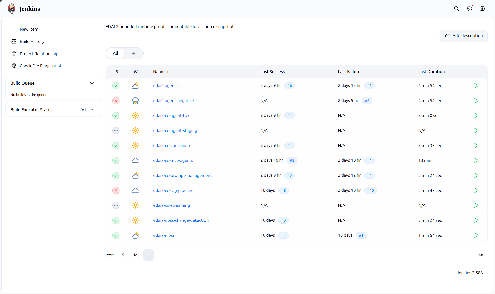

*Figure 1. The Jenkins 2.588 controller and its 11 seeded jobs, with an empty build queue and one executor.*

Figure 1 was captured early in the campaign: the Agent Staging and Streaming jobs had not run yet, and RAG still showed an earlier failure. It illustrates the controller and the job set. It is not evidence for the final runs.

## 2. How to read the evidence

Each Jenkins build archives `evidence/ci/jenkins-<job>-<n>/`. The published copy keeps, per build:
- `ci-verdict.json`, the CI status and test counts;
- `release-request.json`, with the approver, branch, SHA and environment;
- `release-plan.json`, the verified units, digests and manifest sha256;
- `image-manifest.json`, with digest, revision label, Cloud Build id, source object and readback per image;
- `image-scan.json`, the Trivy verdict per digest;
- `source-metadata.txt`, the Jenkins source snapshot's refs and bundle sha256;
- `release-verdict.json`;
- the unit verdicts (`unit-*.json`).

These files reference each other through the SHA and the digests. That cross-referencing is what §9 uses to establish traceability.

## 3. Prompt Management #5: registry gate

**Mechanism.** The group `release/prompt-management` has one unit, `prompt-registry-gate` (kind `registry-gate`). It builds no image, so the Cloud Build and Scan stages had nothing to do (`image-scan.json`: `NOT_APPLICABLE`).

**Result.** [`unit-prompt-registry-gate-verdict.json`](../../evidence/edai2/cicd/cicd-v2-20261121/prompt-management-5/json/unit-prompt-registry-gate-verdict.json) reports:
- `git-manifest: PASS`: the 13 prompt versions pinned in `prompts/manifest.json` at `e6b190ed` hash to their pinned sha256;
- `registry: PASS`: agentregistry holds each version byte-for-byte (Figure 3 shows the 13 `MATCH` lines).

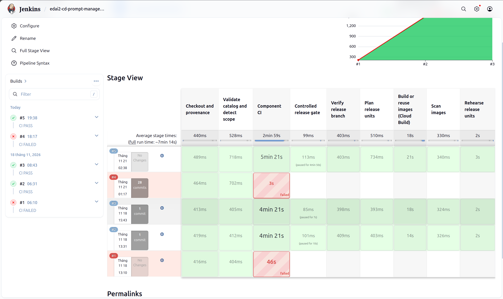

*Figure 2. `edai2-cd-prompt-management` Stage View. Build #5 passed all nine stages after a 4 min 50 s wait at the release gate. Build #4 failed in Component CI because the controller lacked Python 3.11 (§10).*

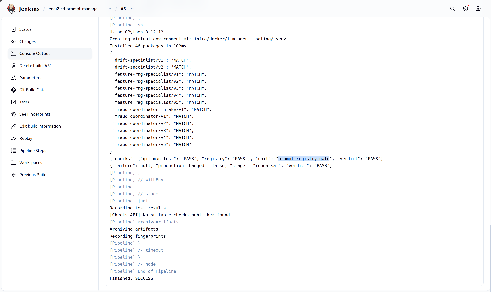

*Figure 3. Console of build #5. Every pinned prompt version matches agentregistry, the gate passes, and the release verdict is a rehearsal with `production_changed: false`.*

**Interpretation.** The gate proves that the managed prompts in the registry are the reviewed bytes. The same verdict records `runtime_consumption: NOT_PROVEN`: no running agent reads these prompts, because the BYO Coordinator sends a system prompt fixed in code. Prompt management is therefore verified as registry consistency, not as runtime behaviour.

## 4. MCP Agents #3: build and bounded rehearsals

**Mechanism.** `release/mcp-agents` runs `prompt-registry-gate`, then two `bounded-rehearsal` units in `ewallet-cicd`. Both images were built from `e6b190ed`:

| Image | Digest | Cloud Build |
|---|---|---|
| `g3-byo-coordinator` | `sha256:d086248c007b04d85fe42edf186240aae162121eb9a4e112a10c4dec57d52e52` | `0c72d7a6-52e6-4539-aea5-15659156b6e9` |
| `mcp-tools` | `sha256:06e145456367635742797d976ad8671796d2a08014e0959fb2c4a7c6ba090603` | `2c58d956-beaa-4d46-b918-7c1485b8c2be` |

Both digests were read back from Artifact Registry (`registry_readback: VERIFIED`). Trivy found no HIGH or CRITICAL finding, and neither image needed an exception.

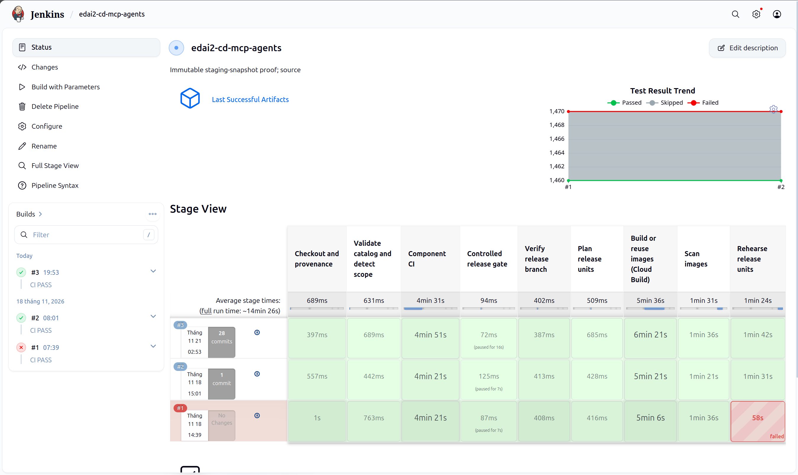

*Figure 4. `edai2-cd-mcp-agents` Stage View. Build #3 spent 6 min 21 s building images and 1 min 42 s rehearsing.*

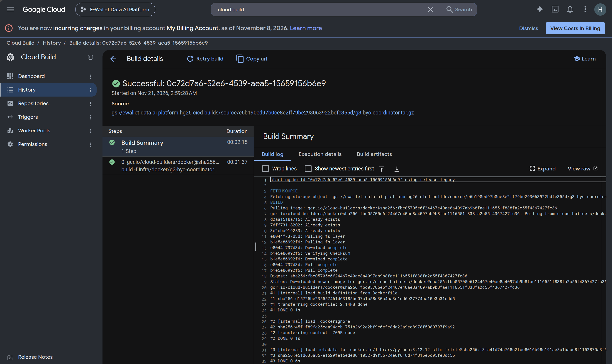

*Figure 5. Cloud Build `0c72d7a6`. The source is `gs://…-cicd-builds/source/e6b190ed…/g3-byo-coordinator.tar.gz`, and the pinned `gcr.io/cloud-builders/docker@sha256:fbc05705…` builder ran `build -f infra/docker/g3-byo-coordinator…`.*

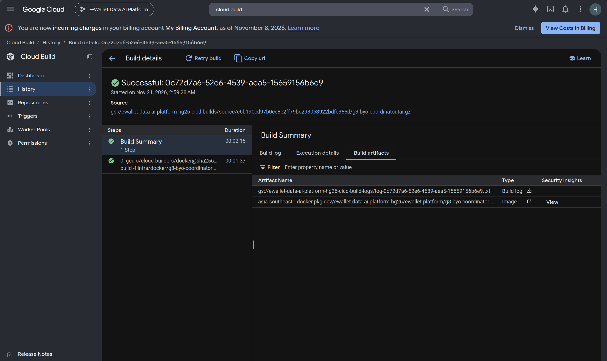

*Figure 6. The same build's artifacts: the build log in the logs bucket and the pushed `g3-byo-coordinator` image.*

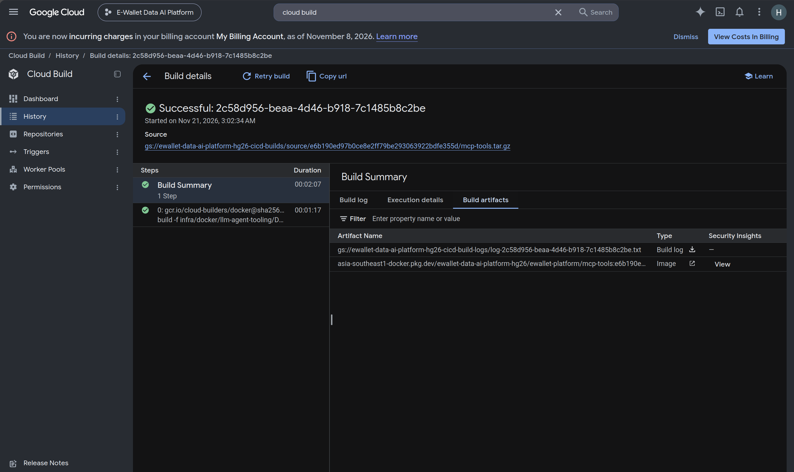

*Figure 7. Cloud Build `2c58d956`, which built `mcp-tools` from `infra/docker/llm-agent-tooling` and tagged it with the release SHA.*

**Rehearsal results.** Each smoke Job ran from the release digest inside `ewallet-cicd`:
- [`unit-mcp-servers-verdict.json`](../../evidence/edai2/cicd/cicd-v2-20261121/mcp-agents-3/json/unit-mcp-servers-verdict.json): for both `drift-mcp` and `feature-rag-mcp`, readiness returned 200, an anonymous call was refused with 401, and an authenticated `tools/list` returned 200 with `tools_missing: []`.
- [`unit-agent-fleet-verdict.json`](../../evidence/edai2/cicd/cicd-v2-20261121/mcp-agents-3/json/unit-agent-fleet-verdict.json): both Specialists served their Agent Card (200, matching name) and rejected a malformed A2A task.

Both verdicts record the digest the workloads ran before the release. For example, `mcp-cd-*` moved from `mcp-tools@sha256:999e4698…` to `06e14545…`. The workloads were parked at zero replicas afterwards.

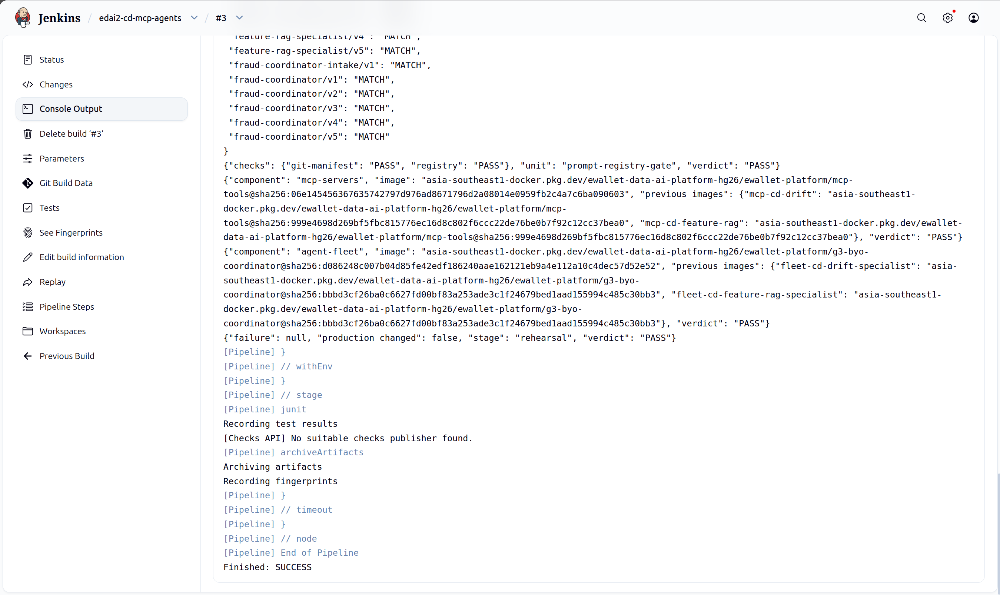

*Figure 8. Console of build #3: the registry gate, then `mcp-servers` and `agent-fleet` with their new and previous digests, then the release verdict.*

**Interpretation.** The released images start with their production configuration and authentication stack, enforce authentication, and expose the expected tool set and Agent protocol. Business answers are not exercised in `ewallet-cicd`, because Feast, KServe and the drift data are unreachable from there. Those are verified by Agent Staging (§6).

## 5. Coordinator #2: image reuse across release groups

**Mechanism.** `release/coordinator` deploys `mcp-servers`, `agent-fleet` and `coordinator`, in that order, from one SHA. It ran at the same SHA as MCP Agents #3.

The tags `g3-byo-coordinator:e6b190ed…` and `mcp-tools:e6b190ed…` already existed. `cloud_build.py` therefore checked their provenance labels and reused them instead of building. [`image-manifest.json`](../../evidence/edai2/cicd/cicd-v2-20261121/coordinator-2/json/image-manifest.json) records `reused: true`, `registry_readback: VERIFIED`, no build id, and **the same two digests as §4**.

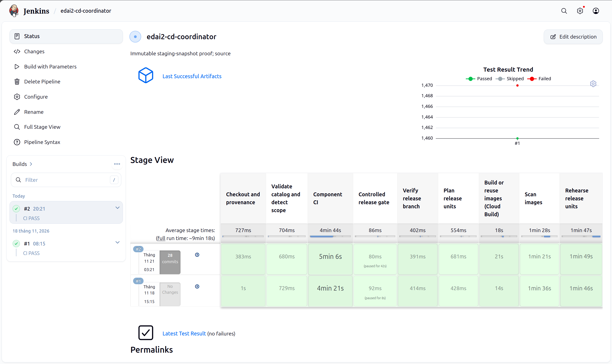

*Figure 9. `edai2-cd-coordinator` Stage View. In build #2 the image stage took 21 s, the cost of a label check and readback instead of a build.*

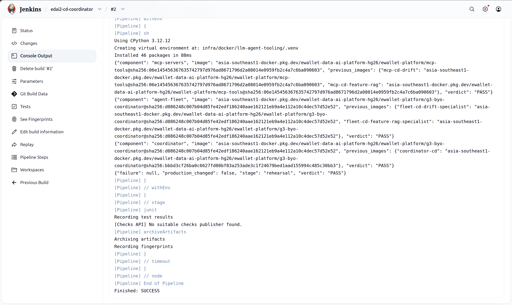

*Figure 10. Console of build #2. `mcp-servers` and `agent-fleet` already ran the reused digests; `coordinator-cd` moved from `g3-byo-coordinator@sha256:bbbd3cf2…` to `d086248c…`.*

**Result.** [`unit-coordinator-verdict.json`](../../evidence/edai2/cicd/cicd-v2-20261121/coordinator-2/json/unit-coordinator-verdict.json): the Coordinator, started with its idempotency Redis and the production Sandbox-only routing configuration, served its Agent Card and rejected a malformed task.

**Interpretation.** Reuse is safe because it is proven, not assumed. The registry's labels for the reused tag name the same revision, Dockerfile, target and builder that a fresh build would have used. Reuse also means the Coordinator group added no new artifact: its evidence is a rehearsal of artifacts built and scanned in §4.

## 6. Agent Staging #2: the Agent stack in isolated namespaces

**Mechanism.** The `agent-staging` unit deploys the real Agent runtime from release digests into `ewallet-agents-staging` and `ewallet-sandbox-staging`, verifies it end to end, and removes it. It used two images built from `7f841ecd`:

| Image | Digest | Cloud Build |
|---|---|---|
| `g3-byo-coordinator` | `sha256:967da5c3e5dd47aa5e6767caeb81debdfa617f0e5e1d4ae7354c4974c9b3b808` | `9eece995-a0dc-43b5-8e8c-0d10d106fe30` |
| `mcp-tools` | `sha256:25ccb75b9f41314c4838f080579a31770a9a3bc66f4c3512fba76a2533f0b0da` | `8be4e219-53e3-4759-9d7d-6f7596c0fe30` |

The staging runtime looks as follows.

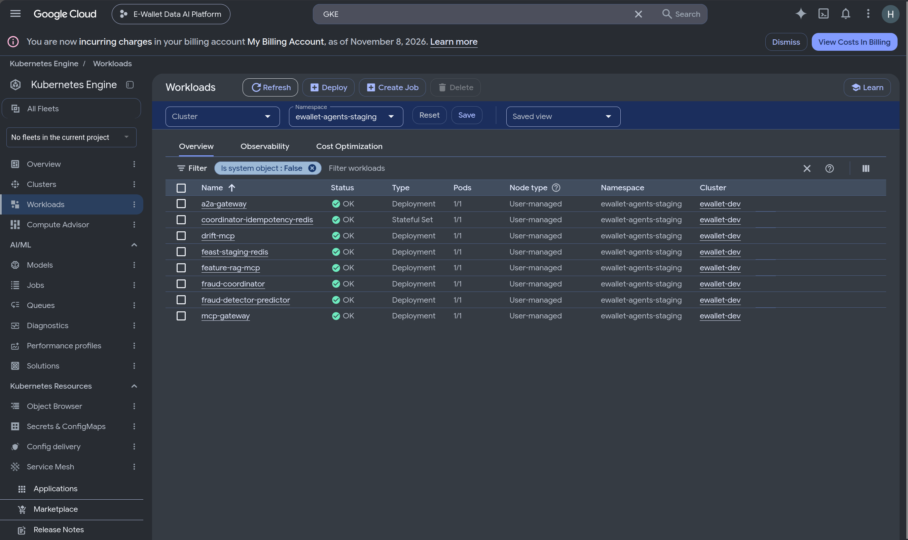

*Figure 11. Workloads in `ewallet-agents-staging`, all OK at 1/1.*

The Helm profile `llm-agent-staging` provides:
- the Fraud Coordinator;
- the A2A and MCP Gateways;
- both MCP servers;
- the Coordinator's idempotency Redis (a StatefulSet).

Two dependencies are operator-applied and persist between runs: `feast-staging-redis` and `fraud-detector-predictor`.

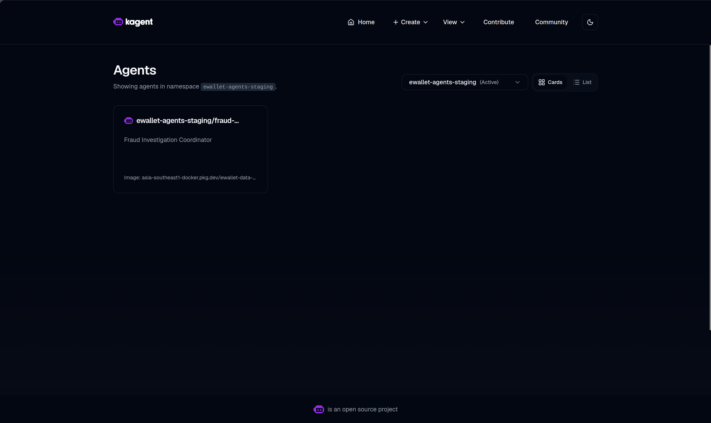

*Figure 12. The kagent UI for `ewallet-agents-staging`. The Fraud Investigation Coordinator is registered as a kagent Agent, with its image from the project's Artifact Registry.*

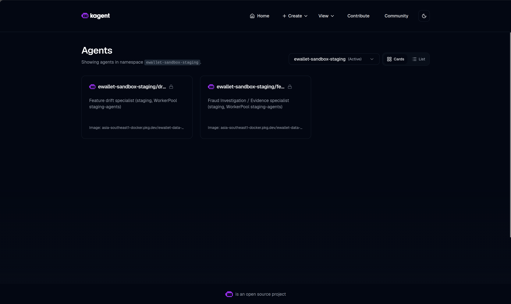

*Figure 13. The two Specialists in `ewallet-sandbox-staging`: the feature drift specialist and the fraud evidence specialist. Both are SandboxAgents bound to the staging WorkerPool `staging-agents`; the lock icon marks sandboxed agents.*

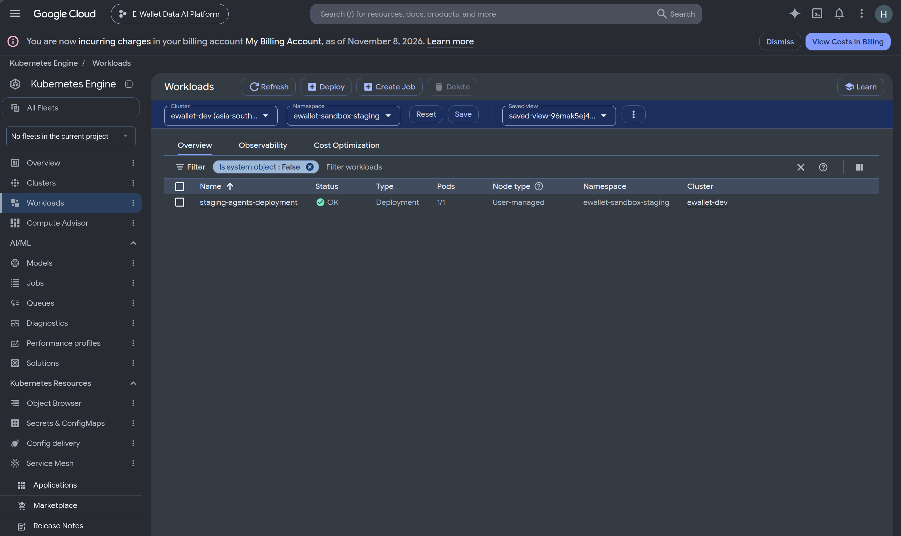

*Figure 14. `staging-agents-deployment`, the worker Deployment behind the staging WorkerPool, which hosts the Specialists' sandbox actors.*

**Result.** [`unit-agent-staging-verdict.json`](../../evidence/edai2/cicd/cicd-v2-20261121/agent-staging-2/json/unit-agent-staging-verdict.json) (execution `20261120t225842-af18d5`) reports `status: PASS`. Its steps were `preflight → helm-template → helm-install → fleet-created → ready → verified`, followed by cleanup.

| Verification | Observed result |
|---|---|
| Feature-RAG Specialist, direct SandboxAgent route | `completed`, gate PASS, `fraud_probability` 0.0639895560144887 equals the pinned answer, 16.7 s |
| Drift Specialist, direct SandboxAgent route | `completed`, gate PASS, `psi` 0.0004795543627041439 equals the pinned answer, 14.4 s |
| Coordinator fraud workflow (staging A2A Gateway) | PASS, 14.8 s |
| Coordinator drift workflow | PASS, 14.5 s |
| Coordinator combined workflow | PASS, both Specialists `ok`, 28.8 s |
| Negatives | `payments-agent.ewallet-agents-staging` and the production `fraud-coordinator.ewallet-agents` unrouted; anonymous calls to `/feature-rag/mcp` and `/drift/mcp` refused |
| Cleanup | 5 created objects (WorkerPool, 2 ServiceAccounts, 2 SandboxAgents) deleted by uid; Helm release uninstalled; `left_behind: []` |

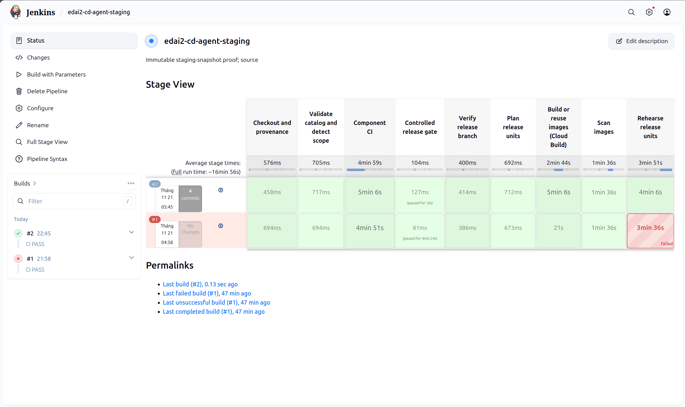

*Figure 15. `edai2-cd-agent-staging` Stage View. Build #2 passed all stages, with 4 min 6 s in the staging rehearsal. The earlier failed build is described in §10.*

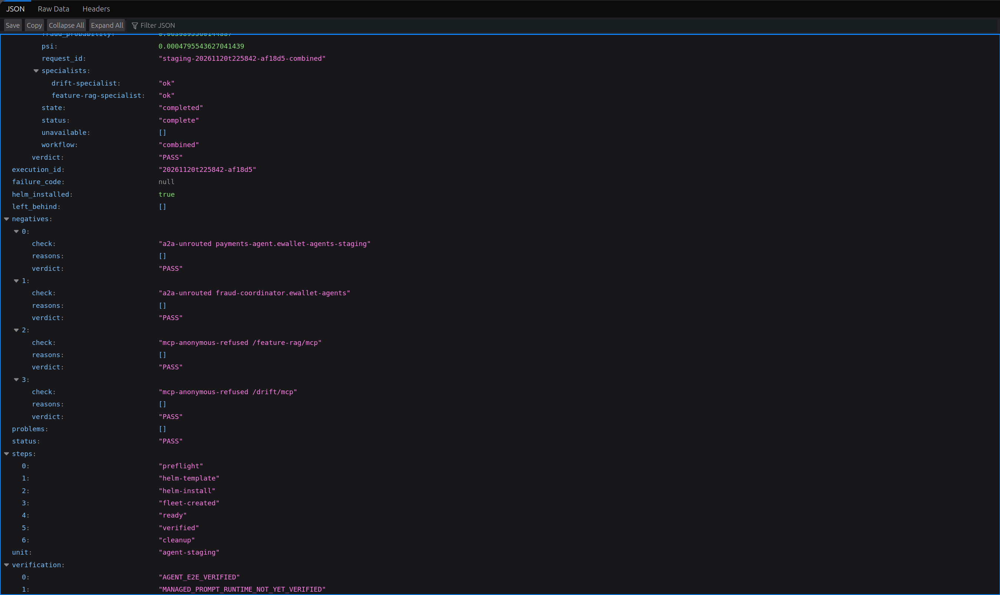

*Figure 16. The archived staging verdict: the combined workflow with both Specialists `ok`, the four negatives, the step list ending in `cleanup`, and the verification flags.*

**Interpretation.** This is the strongest Agent evidence in the set. The released images ran as a complete Agent Platform on Substrate SandboxAgents and returned the pinned numerical answers through both the direct route and the Coordinator. Unrouted and unauthenticated paths were refused, and the run removed everything it created.

Its limits are stated in the verdict itself (`MANAGED_PROMPT_RUNTIME_NOT_YET_VERIFIED`):
- it ran in staging namespaces, not production;
- the staging Feast Redis is a seeded copy.

## 7. RAG Pipeline #11: ingestion image rehearsal

**Mechanism.** `rag-rehearsal` rolls the suspended CronJob `ewallet-cicd/rag-ingestion` to the release digest. It runs one smoke Job against an ephemeral Redis and judges the result against [rag-pipeline.contract.json](../../../jenkins/cd/rag-pipeline.contract.json). The image was built from `7f841ecd`:
- `rag-ingestion@sha256:de6446a594e21fbecd2d961d3e3771ef7d692330f2e0cb5fc02cbef1b7c2f200`;
- Cloud Build `3925636d-a7f6-47f2-9e8e-715da8a784dc`.

Trivy passed with one finding covered by the reviewed exception CVE-2026-104851 (fsspec), which expires on 2026-12-20.

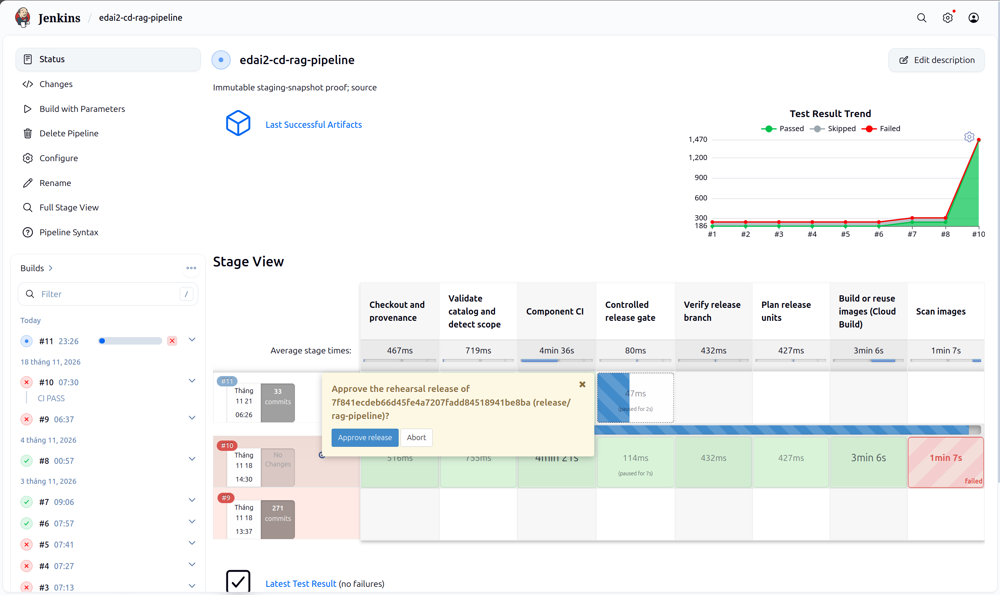

*Figure 17. The release gate of build #11 asks to approve the rehearsal release of `7f841ecd…` on `release/rag-pipeline`.*

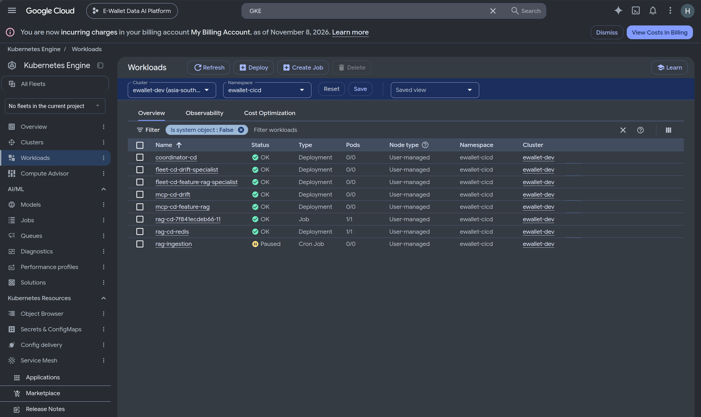

*Figure 18. `ewallet-cicd` during the rehearsal. The smoke Job `rag-cd-7f841ecdeb66-11` and the ephemeral `rag-cd-redis` are running, the CronJob `rag-ingestion` is paused, and the bounded-rehearsal Deployments are parked at 0/0.*

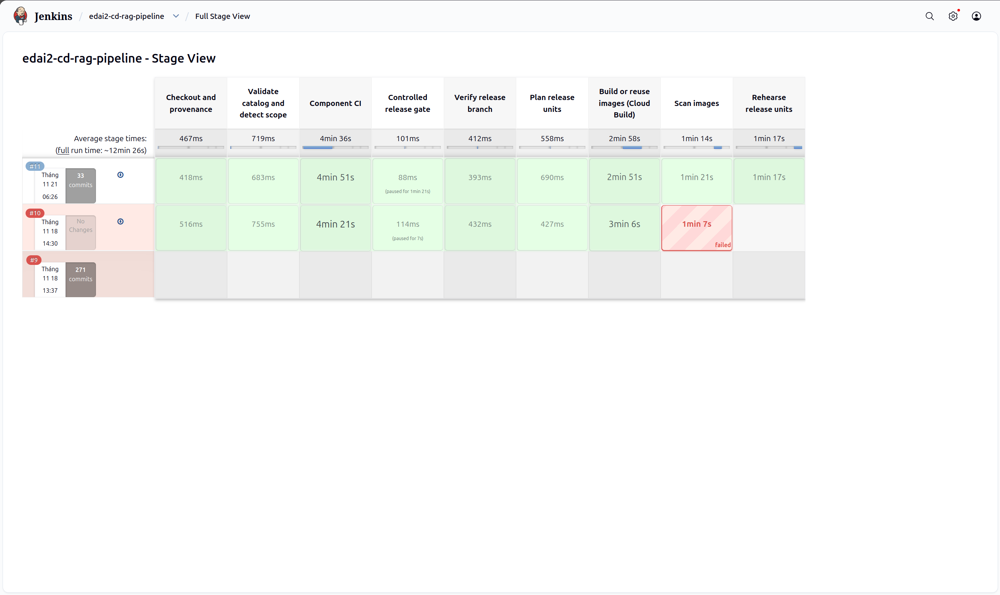

*Figure 19. Full Stage View of `edai2-cd-rag-pipeline`: build #11 passed every stage. Build #10 failed at Scan images and build #9 did not complete (§10).*

**Result.** [`unit-rag-pipeline-verdict.json`](../../evidence/edai2/cicd/cicd-v2-20261121/rag-pipeline-11/json/unit-rag-pipeline-verdict.json) reports:
- `published_rows` 4 and `online_row_count` 4, with `readback_status: MATCH` against Redis database 2 of the ephemeral store;
- `recall_at_k` 1.0 and `mean_reciprocal_rank` 1.0 at `top_k` 2, `empty_retrieval_rate` 0.0 and `citation_errors` 0;
- the frozen identity: corpus `fraud-policy-v1-20261030`, `sentence-transformers/all-MiniLM-L6-v2` at revision `1110a243…`, 384 dimensions, and publication identity `b85ae796…`.

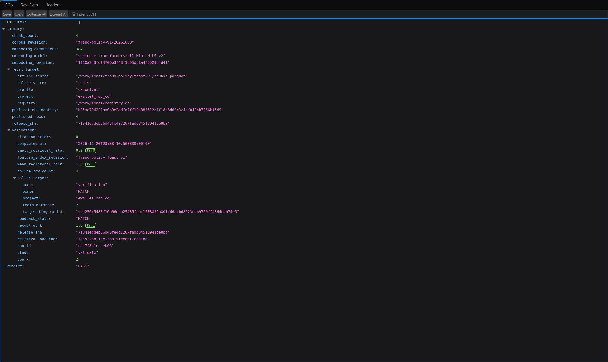

*Figure 20. The archived RAG verdict, with `verdict: PASS`.*

**Interpretation.** The released ingestion image reproduces the production RAG publication on a tiny fixed corpus, and its online readback and retrieval quality meet the contract. Recall 1.0 on four chunks is a correctness check, not a retrieval benchmark. The production Airflow DAG was not run by this release.

## 8. Streaming #3: Block A on GKE

### 8.1 Provenance and gates

Build #3 ran for release `e73e85a3ecac81461d73ab790f367bb82b1f0976`. The Jenkins source snapshot carried `release/streaming` at that SHA ([`source-metadata.txt`](../../evidence/edai2/cicd/cicd-v2-20261121/streaming-3/json/source-metadata.txt)), and the console records `Approved by admin` at the release gate.

Both images were built fresh. Reuse is looked up by the release SHA, and no tag for `e73e85a3` existed:

| Image | Digest | Cloud Build | Trivy |
|---|---|---|---|
| `flink-block-a` | `sha256:ac23bbd4f4ff8b487c573830a390e8906a2ccf3464fc28e55e667af14b787c6c` | `e051f0fe-dd78-4dfe-96cc-bf80d6f0cd4d` | PASS, 0 unexcepted findings; 9 findings covered by reviewed exceptions (7 CVE ids, expiring 2026-12-20) |
| `streaming-sinks` | `sha256:2154c991da45dda969d9ff51409add22001c226fce96058d03430e9af7bf0c32` | `1ea37823-5ea6-484b-90c4-6158933b3b7e` | PASS, no findings |

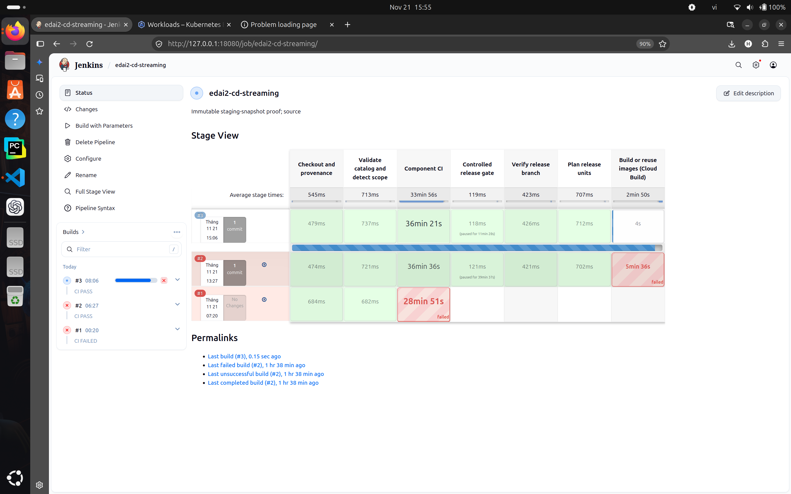

*Figure 21. `edai2-cd-streaming` seconds after build #3 passed its release gate (paused for 11 min 28 s). Cloud Build has just started; builds #2 and #1 show their earlier failures.*

### 8.2 Image smoke

[`unit-image-smoke-verdict.json`](../../evidence/edai2/cicd/cicd-v2-20261121/streaming-3/json/unit-image-smoke-verdict.json) ran `flink-block-a@sha256:ac23bbd4…` in `ewallet-cicd` and reports:
- a 7-operator job plan;
- `event_time_after_source: true`;
- one duplicate removed;
- history written;
- positive online updates.

### 8.3 The campaign

The campaign `verify-cicd-e73e85a3ecac-3` ran under the `ewallet-cicd-streaming` identity. That name is the logical campaign identifier, not a Kubernetes namespace: the workloads ran in the existing `ml-platform` namespace, and every resource carried the identifier as its `ewallet.block-a/namespace` label ([CICD_ARCHITECTURE.md §9.5](CICD_ARCHITECTURE.md#95-streaming-verification-block-a-on-gke)). The campaign ran these steps:
- preflight PASS, with Redis DB 10 `claim=CLAIMED`;
- Feast apply Job `fs-apply-cicd-e73e85a3ecac-3`;
- Redpanda, Flink JobManager and Flink TaskManager;
- topic creation, then the Flink job, then the publisher and three sink Jobs, then the validator.

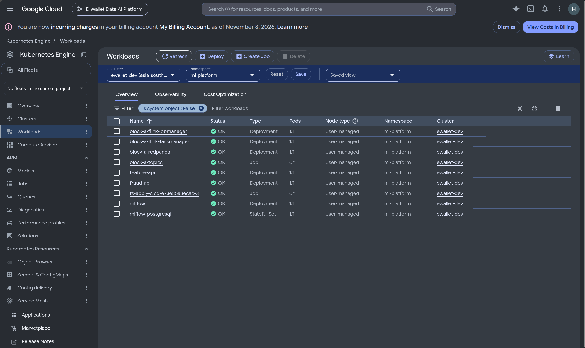

*Figure 22. `ml-platform` during the campaign, before the sink Jobs started. `block-a-flink-jobmanager`, `block-a-flink-taskmanager` and `block-a-redpanda` are running; `block-a-topics` and `fs-apply-cicd-e73e85a3ecac-3` have completed. Completed Jobs show `0/1` pods ready.*

The sink logs give the volumes:

| Source | Records |
|---|---|
| Publisher ([log](../../evidence/edai2/cicd/cicd-v2-20261121/streaming-3/json/block-a-publish.log.txt)) | 19 events in six scenario phases: 13 `normal`, 1 `out_of_order`, 1 `late_accepted`, 1 `too_late`, 2 `replayed_and_invalid`, 1 `closing` |
| Feast online sink ([log](../../evidence/edai2/cicd/cicd-v2-20261121/streaming-3/json/block-a-feast.log.txt)) | 45 written, 0 dead-lettered |
| History sink ([log](../../evidence/edai2/cicd/cicd-v2-20261121/streaming-3/json/block-a-history.log.txt)) | 16 records, 7 objects |
| Offline sink (raw archive) | 45 rows persisted, 90 objects created |

The offline sink's log is 57 KB of per-object write records, so it is kept in the raw archive rather than published.

### 8.4 Flink runtime

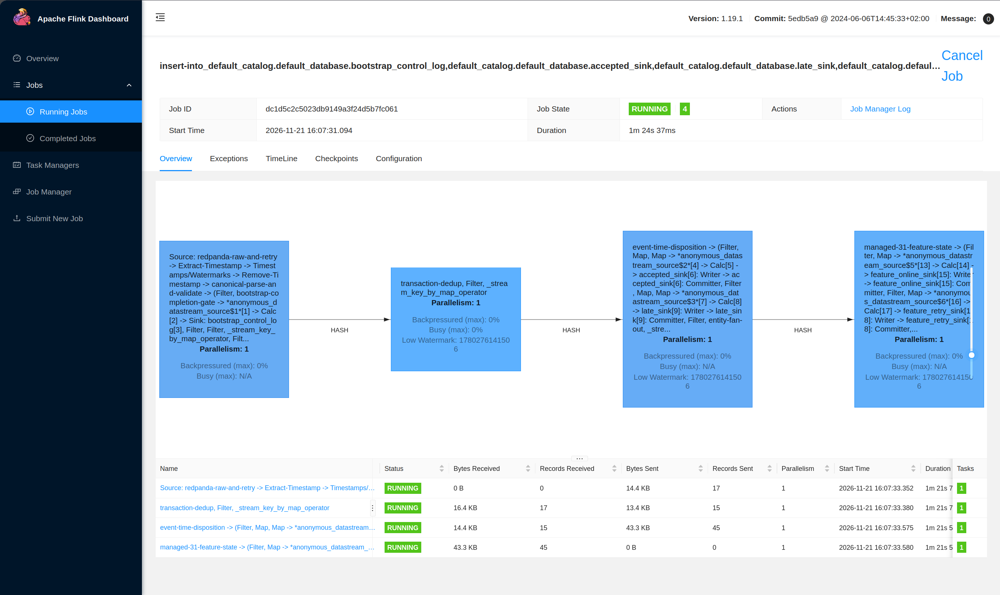

*Figure 23. Flink 1.19.1 dashboard, job `dc1d5c2c5023db9149a3f24d5b7fc061`, RUNNING for 1 min 24 s with four operators at parallelism 1.*

The graph in Figure 23 runs from the Redpanda source through `transaction-dedup` and `event-time-disposition` to `managed-31-feature-state`. Records sent and received chain consistently: 17 → 17 → 15 → 15 → 45 → 45, and backpressure is 0 %.

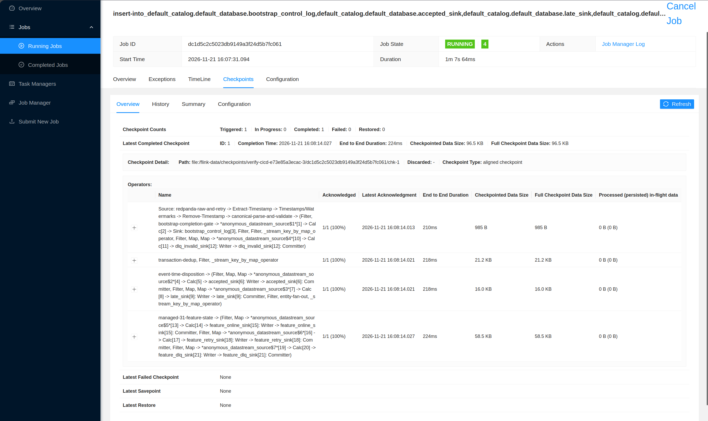

*Figure 24. Checkpoints of the same job.*

Figure 24 shows:
- 1 triggered and 1 completed, 0 failed, 0 restored;
- checkpoint 1 is an aligned checkpoint of 96.5 KB, completed in 224 ms end to end;
- all four operators acknowledged it;
- the path is `file:/flink-data/checkpoints/verify-cicd-e73e85a3ecac-3/…/chk-1`, and there is no savepoint.

[`flink-jobs.json`](../../evidence/edai2/cicd/cicd-v2-20261121/streaming-3/json/flink-jobs.json) is Flink REST state captured by the collect step. It shows the same job RUNNING after 345 s, with 4 tasks running and 0 failed.

The cleanup then deleted the session-cluster Deployments. **The job was therefore terminated by the intended cleanup, not cancelled through Flink and not failed.**

The record counts in this report come from different instants and stages. The Flink source had emitted 17 records when Figure 23 was captured. The history sink stored 16 accepted transactions after deduplication and the event-time disposition. These figures do not contradict each other.

### 8.5 Consistency verification

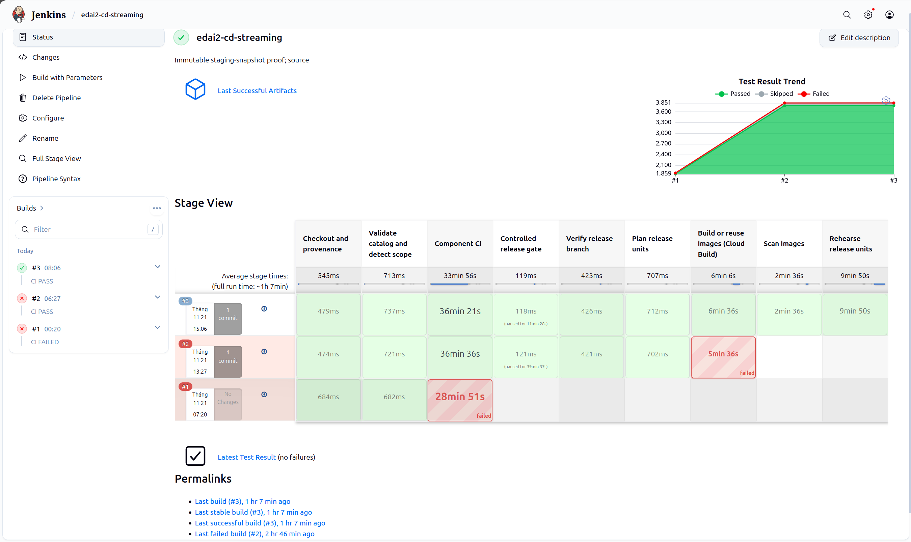

*Figure 25. Build #3 passed all nine stages: Component CI 36 min 21 s, images 6 min 36 s, scan 2 min 36 s, rehearsal 9 min 50 s.*

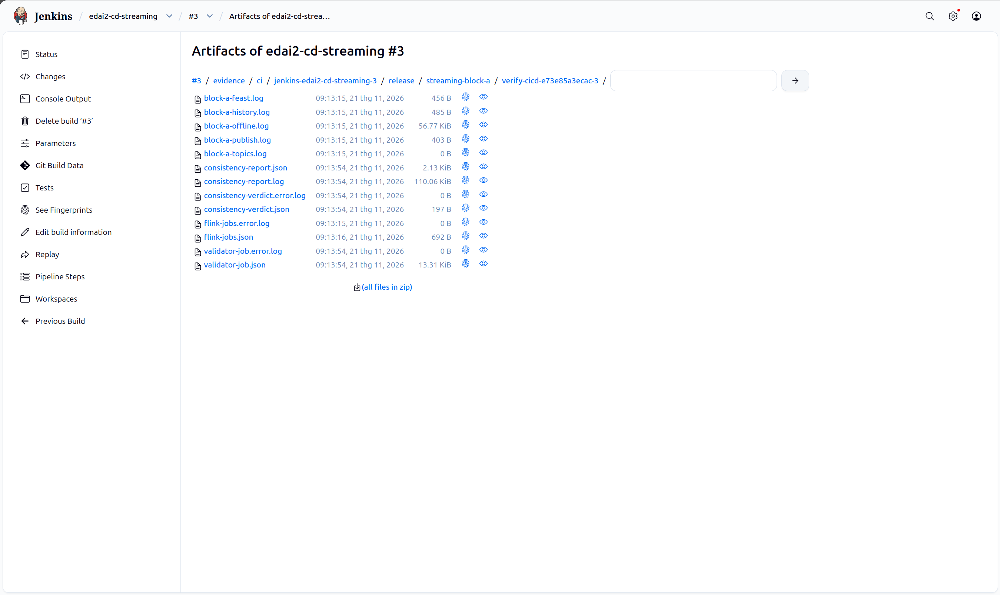

*Figure 26. Artifacts archived for `verify-cicd-e73e85a3ecac-3`: the sink logs, the consistency report and verdict, Flink job state and the validator Job. Every `*.error.log` is 0 bytes.*

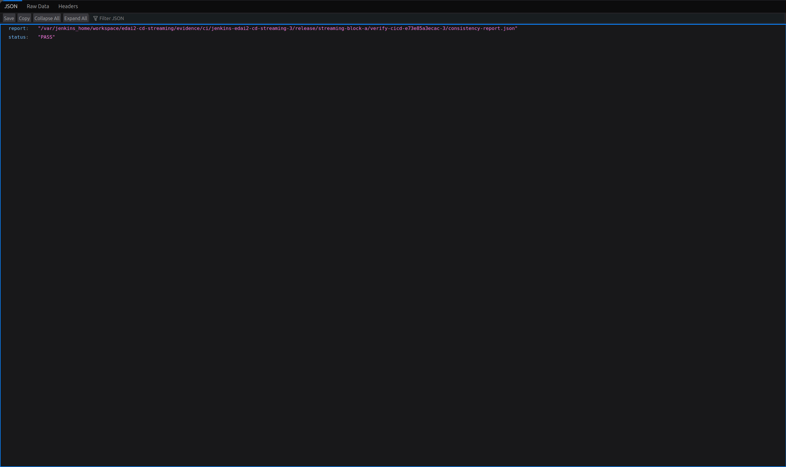

*Figure 27. `consistency-verdict.json` of build #3: `status: PASS`.*

[`consistency-report.json`](../../evidence/edai2/cicd/cicd-v2-20261121/streaming-3/json/consistency-report.json) (schema `block-a-consistency-report-v2`) reports:

| Metric | Observed value |
|---|---|
| Online state vs replay of the offline history: MATCH / MISMATCH / MISSING / STALE / NOT_REALTIME_OWNED | 182 / 0 / 0 / 0 / 0 |
| Timestamp mismatches | 0 |
| Entities × features compared | 23 entities, 182 features, 4 feature views (`account_behavior`, `device_behavior`, `merchant_behavior`, `user_behavior`) |
| Direct offline/online comparison (Feast offline store vs Feast online store) | PASS, 182 comparisons, 0 mismatches |
| Offline point-in-time verification | PASS, 23 rows retrieved, `PIT_VALUES_VERIFIED` 23, 31 historical features |
| Source-event verification | PASS, 16 transactions, 182 comparisons |
| History repeats dropped, disposition problems | 0, none |
| Identity | campaign and run id `verify-cicd-e73e85a3ecac-3` (also in the report's `namespace` field), Git SHA `e73e85a3…` |

The validator Job ran 09:13:16–09:13:54Z and completed successfully ([`validator-job.json`](../../evidence/edai2/cicd/cicd-v2-20261121/streaming-3/json/validator-job.json)). On top of the report, `streaming_verify.py` checked that its campaign identifier, run id and SHA belong to this build and found no evidence problems ([`unit-streaming-block-a-verdict.json`](../../evidence/edai2/cicd/cicd-v2-20261121/streaming-3/json/unit-streaming-block-a-verdict.json)).

**What the metrics mean.**
- **Online state is consistent with history.** The 182 values Flink wrote to the online store (Redis DB 10, read through Feast) equal the values recomputed by replaying the accepted history. No feature is missing, stale or timestamped differently.
- **The two stores agree.** The offline store on GCS and the online store hold the same values for every compared entity and feature.
- **The run is self-contained.** Every GCS path and Redis key prefix is derived from the build's own campaign identifier, and the report's identity matches it. Data from another run cannot have produced this PASS.

**What they do not mean.** This is a correctness check of one deterministic 19-event scenario at parallelism 1. It measures neither throughput nor latency. It does not test recovery: the single checkpoint was stored on the JobManager pod's local filesystem and disappeared with the pod. Durable checkpoint recovery, failover and stateful upgrade remain unverified.

### 8.6 Cleanup

The cleanup step deleted, in `ml-platform`, the campaign-owned Jobs, Deployments, Services and ConfigMaps that carried both Block A labels for this campaign (every `block-a-*` object). Afterwards no campaign-labelled object remained. No namespace had been created, so none was deleted. By design, three things stayed:
- the campaign's GCS prefixes;
- Redis DB 10, which now holds 24 keys and the campaign's owner marker;
- the Feast apply Job, which Kubernetes removes after its 24-hour TTL.

## 9. Source-to-artifact traceability

Each row links records from different systems through the shared SHA and digest. The source object is the `git archive` of the SHA uploaded to `gs://ewallet-data-ai-platform-hg26-cicd-builds/source/<sha>/<image>.tar.gz`; `image-manifest.json` records its GCS generation and sha256.

| Source SHA | Jenkins build | Cloud Build | Image digest | Consumed by (verdict) |
|---|---|---|---|---|
| `e6b190ed…` | mcp-agents #3 | `0c72d7a6-52e6-4539-aea5-15659156b6e9` | `g3-byo-coordinator@sha256:d086248c007b04d85fe42edf186240aae162121eb9a4e112a10c4dec57d52e52` | `agent-fleet` (mcp-agents #3); `agent-fleet`, `coordinator` (coordinator #2) |
| `e6b190ed…` | mcp-agents #3 | `2c58d956-beaa-4d46-b918-7c1485b8c2be` | `mcp-tools@sha256:06e145456367635742797d976ad8671796d2a08014e0959fb2c4a7c6ba090603` | `mcp-servers` (mcp-agents #3, coordinator #2) |
| `e6b190ed…` | coordinator #2 | none (reused, labels verified) | same two digests | as above |
| `7f841ecd…` | agent-staging #2 | `9eece995-a0dc-43b5-8e8c-0d10d106fe30` | `g3-byo-coordinator@sha256:967da5c3e5dd47aa5e6767caeb81debdfa617f0e5e1d4ae7354c4974c9b3b808` | `agent-staging` (Coordinator, Specialists) |
| `7f841ecd…` | agent-staging #2 | `8be4e219-53e3-4759-9d7d-6f7596c0fe30` | `mcp-tools@sha256:25ccb75b9f41314c4838f080579a31770a9a3bc66f4c3512fba76a2533f0b0da` | `agent-staging` (MCP servers) |
| `7f841ecd…` | rag-pipeline #11 | `3925636d-a7f6-47f2-9e8e-715da8a784dc` | `rag-ingestion@sha256:de6446a594e21fbecd2d961d3e3771ef7d692330f2e0cb5fc02cbef1b7c2f200` | `rag-pipeline` |
| `e73e85a3…` | streaming #3 | `e051f0fe-dd78-4dfe-96cc-bf80d6f0cd4d` | `flink-block-a@sha256:ac23bbd4f4ff8b487c573830a390e8906a2ccf3464fc28e55e667af14b787c6c` | image smoke; Flink JobManager/TaskManager |
| `e73e85a3…` | streaming #3 | `1ea37823-5ea6-484b-90c4-6158933b3b7e` | `streaming-sinks@sha256:2154c991da45dda969d9ff51409add22001c226fce96058d03430e9af7bf0c32` | publisher, sink and validator Jobs |

Prompt Management #5 consumed no image. Its traceability is the SHA in its request, its plan and the snapshot metadata.

Two caveats apply to this chain:
- **Integrity, not signatures.** The SHA-256 values and labels prove integrity within the archive, but nothing is cryptographically signed.
- **Reproducibility not re-tested.** Rebuilding an identical image from the same SHA was not tried, and immutable tags prevent it by design.

## 10. Failure history

The successful builds were preceded by failures that the gates caught. Root causes and fixes are analysed in [CICD_OPERATIONS.md §6](CICD_OPERATIONS.md#6-troubleshooting-the-verified-failures).

| Build | SHA | Stopped at | Cause → fix |
|---|---|---|---|
| prompt-management #4 | `e6b190ed` | Component CI | Controller had no Python 3.11 for `uv lock --check` → `b0ab052a`, `34fdfbb7` (new controller image) |
| agent-staging #1 | `e6b190ed` | Rehearse release units | Direct Specialist requests shared one sandbox session → `7f841ecd` |
| rag-pipeline #10 | `f9dbe884` | Scan images | Trivy findings → targeted upgrades and the reviewed fsspec exception (`e6b190ed`) |
| streaming #1 | `7f841ecd` | Component CI | `vllm_bench.sh` used `ss`, absent from the controller → `da8822c9` ([ci-verdict](../../evidence/edai2/cicd/cicd-v2-20261121/streaming-failures/streaming-1-ci-verdict.json)) |
| streaming #2 | `da8822c9` | Build or reuse images | Relative Artifact Registry redirect during digest readback, after Cloud Build `5c998f9d` succeeded ([build record](../../evidence/edai2/cicd/cicd-v2-20261121/streaming-failures/streaming-2-cloud-build-flink-block-a.json)) → `e73e85a3` |

In every case the pipeline stopped before any later stage and archived its evidence.

## 11. Production boundary and limitations

**The recorded outcome is that production was not changed.** Every release verdict reports `stage: rehearsal, production_changed: false`, and no build set `PROMOTE_TO_PRODUCTION`. The production Helm releases had the same revisions after the campaign as before it: `llm-agent` 60, `llm-agent-mcp` 19, `kagent` 10.

This is the observed outcome of the evaluated rehearsals, not a proof that RBAC made production changes impossible. The streaming identity holds namespace-wide `pods/exec` in `ml-platform`, which also hosts production-serving workloads ([CICD_ARCHITECTURE.md §11.2](CICD_ARCHITECTURE.md#112-streaming-prerequisites-b1b4)).

The production promotion path is implemented in source but has no runtime evidence. That path consists of the operator handoff, the candidate SandboxAgents, the image-only Helm promotion, the fleet patch and reverse rollback.

Other limitations:
- **Rehearsal scope.** Each verdict proves only what its kind checks (§3–§8). Prompt runtime consumption is `NOT_PROVEN`.
- **Streaming scale and resilience.** One 19-event campaign at parallelism 1. No throughput, latency, failover or checkpoint-recovery test was run.
- **Vulnerability exceptions.** `rag-ingestion` and `flink-block-a` pass only with reviewed exceptions that expire on 2026-12-20.
- **Time-bound access.** The streaming campaign's GCS bindings expire on 2026-11-27. The streaming identity keeps a broad `pods/exec` right in `ml-platform` ([CICD_ARCHITECTURE.md §11.2](CICD_ARCHITECTURE.md#112-streaming-prerequisites-b1b4)).
- **Cluster state.** After the campaign the cluster was put into guarded sleep: `verify --expect sleep` PASS, node pool at 0 ([evidence](../../evidence/edai2/cicd/cicd-v2-20261121/gke-sleep/verify-sleep.txt)). The staging Feast Redis must be reseeded after the next wake ([CICD_OPERATIONS.md §8.2](CICD_OPERATIONS.md#82-data-that-does-not-survive)).
- **One further build outside this set.** `edai2-cd-agent-fleet` #1 (`d84ea4e9`) also succeeded, but it predates the final releases and is not part of this evidence set.
