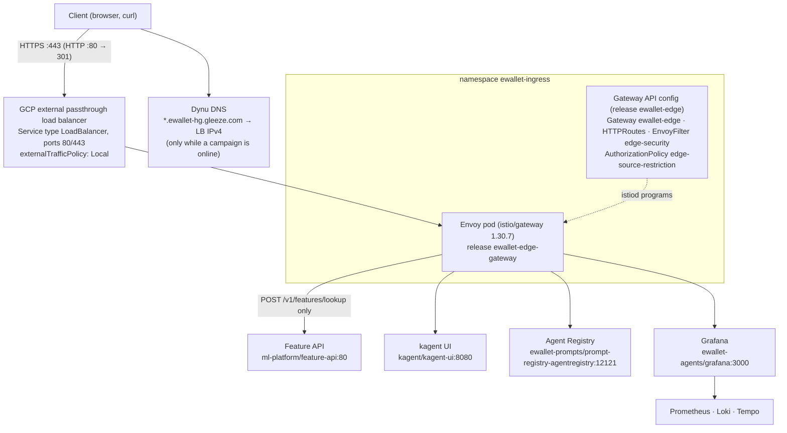

# External Gateway: Architecture

This report describes how the E-Wallet platform publishes a small set of internal services on
the Internet: the routing design, the security controls in the request path, and the reasons
behind them. Day-to-day operation is in
[EXTERNAL_GATEWAY_OPERATIONS.md](EXTERNAL_GATEWAY_OPERATIONS.md). The results of the owner's
acceptance campaign on GKE are in [EXTERNAL_GATEWAY_EVIDENCE.md](EXTERNAL_GATEWAY_EVIDENCE.md).

## 1. Scope and system context

The platform runs on a GKE cluster, `ewallet-dev`, that is scaled to zero nodes when not in use.
Its operator interfaces and APIs normally stay private and are reached with `kubectl
port-forward` from an authorized network. Some of them must also be reachable through a
domain, over HTTPS, with authentication. The external gateway publishes exactly four of them:

| Public host | Backend | What it serves |
|---|---|---|
| `features.<domain>` | Feature API (`ml-platform`) | one endpoint: online feature lookup |
| `agents.<domain>` | kagent UI (`kagent`) | the agent test interface |
| `registry.<domain>` | Agent Registry (`ewallet-prompts`) | the agent, MCP server and prompt catalog |
| `observe.<domain>` | Grafana (`ewallet-agents`) | dashboards, plus Loki logs and Tempo traces through Grafana's data sources |

`<domain>` is `ewallet-hg.gleeze.com` (Dynu DNS). Everything else stays internal: the Fraud API,
the Coordinator's A2A endpoint, MCP servers, model serving, vLLM, Redis, MLflow, Jenkins,
Prometheus and Vault. The acceptance campaign checked this from the Internet: ten other
hostnames under the domain answered 404 even with valid credentials
([evidence §4](EXTERNAL_GATEWAY_EVIDENCE.md#4-authentication-source-restriction-and-the-public-surface)).

The gateway is **private by default**. Its Service is `ClusterIP`, and no DNS record points at
it. Public exposure is a temporary state that a supervised campaign creates and removes
(§3.3, and the operations report).

## 2. Architecture overview



A request passes these stages in order:

1. **DNS.** During a campaign the four names resolve to the load balancer's IPv4 address. No AAAA
   records are published.
2. **Load balancer.** It forwards TCP to the node that runs the gateway pod, preserving the
   client's source address.
3. **Envoy listener.** Port 80 only redirects to HTTPS. Port 443 terminates TLS with the
   `edge-tls` certificate.
4. **Envoy filter chain on 443:** rate limiter → Basic Auth → source restriction (`agents` host
   only) → router (§4).
5. **Route.** The host and path select one HTTPRoute rule. Anything else returns 404 from the gateway.
6. **Backend.** Envoy connects to the backend Service in its own namespace. A NetworkPolicy
   there admits the gateway pod, and only for that port.

## 3. Ownership and deployment model

### 3.1 Two releases, two responsibilities

The gateway is split between two Helm releases in `ewallet-ingress`. This split is the core of the design:

| Release | Chart | Owns |
|---|---|---|
| `ewallet-edge-gateway` | official `istio/gateway` 1.30.7, values [`values-gateway.yaml`](../../../infra/helm/ewallet-edge/values-gateway.yaml) | the proxy: one Envoy Deployment, its Service and ServiceAccount, and the mount of the Basic Auth users file |
| `ewallet-edge` | repository chart [`infra/helm/ewallet-edge`](../../../infra/helm/ewallet-edge) 0.2.0 | the configuration: Gateway, HTTPRoutes, ReferenceGrants, the security EnvoyFilter, the source-restriction AuthorizationPolicy, the backend NetworkPolicies, and the ACME HTTP-01 responder used only during certificate issuance |

**Proxy ownership** and **routing ownership** are therefore separate. The proxy release
changes rarely: replica count, resources, Service type. The configuration release changes
whenever a route or a policy changes. Neither can silently replace the other's objects.

### 3.2 Binding the Gateway to an existing proxy

A Gateway API `Gateway` normally makes Istio provision its own Deployment and a `LoadBalancer`
Service. Here the `Gateway` names the existing Service in `spec.addresses`
([`gateway.yaml` L50](../../../infra/helm/ewallet-edge/templates/gateway.yaml#L50)):

```yaml
addresses:
  - type: Hostname
    value: ewallet-edge-gateway.ewallet-ingress.svc.cluster.local
```

istiod then programs the pods of the `ewallet-edge-gateway` release, which carry the label
`istio: ewallet-edge-gateway`, and creates no second workload and no second load balancer.
[`ownership_preflight.py`](../../../scripts/edge/ownership_preflight.py) checks this before
every rollout, on both the rendered manifests and the live cluster. It reports any Gateway
without an address binding, and any unapproved `LoadBalancer`. That includes the legacy Gateway
that the Agent Platform chart's `values-gcp.yaml` would render.

### 3.3 Private by default, public by overlay

| State | Proxy release values | Service | Reachable from |
|---|---|---|---|
| Private (default) | `values-gateway.yaml` | `ClusterIP`; ports 80, 443 and 15021 | inside the cluster, or `kubectl port-forward` |
| Public (campaign) | `values-gateway.yaml` + [`values-gateway-public.yaml`](../../../infra/helm/ewallet-edge/values-gateway-public.yaml) + [`values-gateway-public-open.yaml`](../../../infra/helm/ewallet-edge/values-gateway-public-open.yaml) | `LoadBalancer` with `externalTrafficPolicy: Local`, ports 80 and 443 only; `loadBalancerSourceRanges: ["0.0.0.0/0"]` | the Internet |

Both states are the **same Helm release** with different value files. Going public changes only
the Service of the existing Deployment, so it never creates a second gateway. Returning to
private is a `helm upgrade` with the base file alone: the Service becomes `ClusterIP` again and
GCP releases the load balancer and its address. The status port 15021 is never published.

In the public state, the load balancer accepts any source address. The orchestrator always
applies the "open" overlay
([`gateway_upgrade`, `g3b_campaign.py` L343](../../../scripts/edge/g3b_campaign.py#L343)),
for two reasons:
- Let's Encrypt HTTP-01 validation must reach port 80 from Let's Encrypt's servers.
- Reviewers need to reach `features`, `registry` and `observe` from their own networks.

Protection is therefore not at the load balancer, but in Envoy:
- Basic Auth and a rate limit on every route;
- a source-address allowlist on `agents`.

Before the open overlay is used, `ownership_preflight.py live --allow-public-loadbalancer` must
prove that these controls are present in the rendered or live objects
([`public_security_problems`, L119](../../../scripts/edge/ownership_preflight.py#L119)).

A stricter mode exists in source but was not used: `values-gateway-public.yaml` without the
open overlay requires an owner-approved `loadBalancerSourceRanges` list, which GKE enforces as
a VPC firewall rule.

### 3.4 Render-time guards

The `ewallet-edge` chart refuses to render an unsafe configuration
([`gateway.yaml`](../../../infra/helm/ewallet-edge/templates/gateway.yaml)):

- the release namespace must equal `values.namespace` (`ewallet-ingress`);
- the domain must be a valid DNS name, and every enabled route needs a host prefix, a match and a complete backend;
- routes on a real domain need `securityFiltersVerified: true`
  ([`values.yaml` L34](../../../infra/helm/ewallet-edge/values.yaml#L34)). While it is false, the
  EnvoyFilter is not rendered and only a reserved `.test` domain is accepted, so a real hostname
  is never routed without authentication;
- on install or upgrade, the cluster's `HTTPRoute` CRD must support `rules[].retry` (Gateway API
  v1.7.0 Standard). Otherwise the chart's explicit no-retry rule would be silently pruned.

## 4. Routing

### 4.1 Listeners and routes

The `Gateway` `ewallet-edge` (class `istio`) has two listeners, both for `*.<domain>`, and accepts
routes only from its own namespace:

| Listener | Port | Behaviour |
|---|---|---|
| `https` | 443 | TLS terminated with Secret `edge-tls`; carries the four application routes |
| `http` | 80 | carries only `https-redirect`: `301` to the same host and path over HTTPS ([L72](../../../infra/helm/ewallet-edge/templates/gateway.yaml#L72)) |

The application routes come from
[`values.yaml` `routes`](../../../infra/helm/ewallet-edge/values.yaml#L79), rendered by
[`httproutes.yaml`](../../../infra/helm/ewallet-edge/templates/httproutes.yaml):

| HTTPRoute | Host | Match | Backend Service:port (pod port) | Timeout | Rate limit (tokens / refill per 1 s) |
|---|---|---|---|---|---|
| `feature-api` | `features` | `POST`, exact `/v1/features/lookup` | `ml-platform/feature-api:80` (8080) | 5 s | 100 / 100 |
| `kagent-ui` | `agents` | prefix `/` | `kagent/kagent-ui:8080` (8080) | default | 100 / 100 |
| `agent-registry` | `registry` | prefix `/` | `ewallet-prompts/prompt-registry-agentregistry:12121` (8080) | default | 50 / 50 |
| `grafana` | `observe` | prefix `/` | `ewallet-agents/grafana:3000` (3000) | default | 50 / 50 |
| any route without its own limit | — | — | — | — | 200 / 200 (`defaultRateLimit`) |

Every rule also has the following properties:

- **Header stripping.** It removes `authorization`, `x-user-id`, `x-forwarded-user`,
  `x-remote-user` and `x-edge-user` before the request leaves Envoy. A client cannot inject an
  identity header, and the Basic Auth password never reaches an application.
- **No retries.** `retry: {attempts: 0}`
  ([`httproutes.yaml` L44](../../../infra/helm/ewallet-edge/templates/httproutes.yaml#L44)):
  without it, Istio would retry twice on connection failures. The edge makes exactly one attempt
  per request.
- **Rule names.** Each rule is named after its route. Istio uses the name for the Envoy route,
  which is how the per-route rate limit (§5.4) finds it.

### 4.2 Cross-namespace backends

The HTTPRoutes live in `ewallet-ingress`, but every backend lives elsewhere. Gateway API forbids a
cross-namespace `backendRef` unless the target namespace allows it. The chart therefore renders
one `ReferenceGrant` per backend, in the backend's namespace. Each grant allows `HTTPRoute`
objects from `ewallet-ingress` to reference exactly that one Service
([`httproutes.yaml` L51](../../../infra/helm/ewallet-edge/templates/httproutes.yaml#L51)).

### 4.3 Backend network access

The backend namespaces are protected by default-deny NetworkPolicies, and two of them (`kagent`,
`ewallet-agents`) run in Istio ambient mode. For each route the chart adds an additive policy,
`allow-edge-to-<route>`, in the backend namespace
([`destination-access.yaml`](../../../infra/helm/ewallet-edge/templates/destination-access.yaml#L8)).
It admits only the gateway pods, and only on the backend port:

- For ambient namespaces it also opens port 15008, the HBONE tunnel used by ztunnel.
- For `kagent` it opens the UI's probe port to the kubelet's SNAT address `169.254.7.127/32`.
  This allow is the first policy on that pod, so without it the pod's own health probes would fail.
- For Grafana, whose namespace already uses ALLOW-only Istio policies, it also adds an Istio
  `AuthorizationPolicy` that allows the gateway's ServiceAccount principal. In `kagent` no such
  policy is rendered: a first ALLOW policy there would deny every other caller.

## 5. Security in the request path

### 5.1 Filter order

The [`edge-security` EnvoyFilter](../../../infra/helm/ewallet-edge/templates/envoyfilter.yaml)
inserts two HTTP filters before Envoy's router, on the 443 listener only. Istio places the
source-restriction RBAC filter in the same chain. The effective order is:

```text
TLS termination → local rate limit → Basic Auth → RBAC (agents host only) → router → backend
```

- **The limiter runs first**
  ([L31](../../../infra/helm/ewallet-edge/templates/envoyfilter.yaml#L31)), so failed password
  attempts also consume tokens. The campaign confirmed the order from outside: an unauthenticated
  burst produced only 401 or 429 answers (§5.4).
- **Basic Auth** ([L55](../../../infra/helm/ewallet-edge/templates/envoyfilter.yaml#L55)) reads its
  users from the file the proxy release mounts at `/etc/edge-auth/htpasswd`.
- **No external service.** Both are built-in Envoy filters in the pinned proxy image, so no
  separate authentication or rate-limit service sits in the request path, and a check cannot
  fail open because such a service is unavailable.
- **Port 80 has no filters.** It can only redirect, so no client is ever asked for a password
  over plaintext HTTP.

### 5.2 TLS

The 443 listener terminates TLS with the Kubernetes Secret `ewallet-ingress/edge-tls`:

- **Issuer.** Let's Encrypt (issuer `YE1`), with one certificate for the four hostnames as Subject
  Alternative Names. It was issued on 2026-11-22 by an earlier campaign run, over HTTP-01 through
  the gateway itself ([`issue_certificate.sh`](../../../scripts/edge/issue_certificate.sh) and the
  temporary ACME responder route).
- **Reuse.** It is valid until 2027-02-20, and it survives cluster sleep and wake because it is
  stored as a Secret.
- **Verification before reuse.** A campaign in reuse mode first verifies it, read-only, with
  [`verify_edge_tls.py`](../../../scripts/edge/verify_edge_tls.py): chain trusted by the system
  CA bundle, all four names present, at least 14 days left, and private key matching the certificate.
- **Optional cert-manager.** The chart can also request the certificate from cert-manager
  (`tls.certificate.enabled`), but that path is off.

### 5.3 Basic Authentication

- **Credential format.** One shared credential protects all four hosts.
  [`create_basic_auth.sh`](../../../scripts/edge/create_basic_auth.sh) builds an htpasswd line in
  Envoy's `{SHA}` format ([L46](../../../scripts/edge/create_basic_auth.sh#L46)) from a
  `user:password` file kept outside the repository. It stores the line as Secret
  `ewallet-ingress/edge-basic-auth`. The password is never a command-line argument or output.
  `--check` compares the live Secret with the file without printing either.
- **Browser prompt.** A `local_reply_config` mapper
  ([L72](../../../infra/helm/ewallet-edge/templates/envoyfilter.yaml#L72)) adds
  `www-authenticate: Basic realm="E-Wallet"` to every 401, so browsers show a login dialog.
- **Rejected inputs.** Missing, wrong or unknown credentials, a bearer token, and
  identity-like headers in place of credentials are all rejected with 401 before routing.
- **Applications never see it.** `authorization` is removed before the request reaches a backend.
  Grafana therefore keeps its own login form behind the gateway, which is a second, independent
  authentication.
- **Weak hash format.** Envoy accepts only `{SHA}` (unsalted SHA-1) password hashes, which are fast
  to attack offline. The design compensates with a long random password and with the hash never
  leaving the cluster's Secret.

### 5.4 Rate limiting

- **Mechanism.** Rate limiting uses Envoy's `local_ratelimit` filter, a token bucket held in each
  gateway pod. The listener-level bucket is the default, 200 tokens refilled to 200 every second.
  Each application route overrides it with its own bucket (the table in §4.1) through a per-route
  `typed_per_filter_config` ([L79](../../../infra/helm/ewallet-edge/templates/envoyfilter.yaml#L79)).
- **Response.** When a bucket is empty, Envoy answers `429` with the header `x-edge-rate-limited: true`.
- **Scope.** Buckets are per route, so a burst on one host does not starve another. They are also
  per pod: with the configured single replica the limit is effectively global, but it would
  multiply with more replicas. No shared rate-limit service is used.
- **Purpose.** It is a coarse abuse and brute-force brake, not a quota system. It does not
  distinguish clients: all callers of a route share its bucket.

### 5.5 Source-address restriction on the agent UI

The kagent UI proxies the kagent controller API, which has no authentication of its own (kagent
`auth.mode: unsecure`). Anyone holding the shared Basic Auth credential could therefore create,
change or delete agents through `agents.<domain>`. That host gets a second control, rendered from
[`source-restriction.yaml`](../../../infra/helm/ewallet-edge/templates/source-restriction.yaml#L48):

- **The policy.** An Istio `AuthorizationPolicy` with `action: DENY` on the gateway pods refuses
  requests for `agents.<domain>` (and `agents.<domain>:*`) on port 443 whose source is not in
  `allowedCidrs`. The other three hosts are not restricted by address.
- **What is matched.** `ipBlocks` matches the TCP peer address that Envoy sees, never
  `X-Forwarded-For`, so a client cannot claim an allowed address in a header.
- **Why `externalTrafficPolicy: Local`.** On GKE this preserves the client's real address all the
  way to the pod. With the default `Cluster` policy the source would be SNAT'd to a node address,
  and the allowlist would become meaningless.
- **Allowlist validation.** The chart rejects an empty list, `/0`, prefixes wider than `/16`,
  non-IPv4 entries, and private or shared ranges (a SNAT'd node or pod address could fall inside
  them). In the campaign it held one owner-approved address, which is not published.
- **Ordering relative to Basic Auth.** It runs after the limiter and Basic Auth, so a request from
  outside the allowlist is answered `403 RBAC: access denied` once it carries valid credentials.
  Basic Auth answers "who are you"; the allowlist answers "where may this privileged UI be used from".

### 5.6 Minimal public exposure of the Feature API

The Feature API serves several endpoints, among them `/v1/features/lookup`,
`/internal/v1/entity-timestamps`, `/health/*`, `/metrics`, `/docs` and `/openapi.json`. The public
route matches exactly one: `POST /v1/features/lookup`. Every other path or method on `features`
returns 404 from the gateway, without reaching the application. The campaign tested `/metrics`,
`/internal/v1/entity-timestamps`, `/docs`, `/health/ready`, `/openapi.json`, and `GET` on the
lookup path.

This follows least privilege. A reviewer can call the one operation that the API exists for,
while these stay off the Internet:
- the internal preflight endpoint used by the Fraud API;
- the Prometheus metrics;
- the health probes;
- the interactive schema pages.

The other three hosts are user interfaces that need their full path space, so they use a `/`
prefix and rely on authentication (and, for `agents`, the allowlist).

## 6. Design decisions

| Decision | Reason grounded in this platform |
|---|---|
| **Istio gateway, not a separate ingress controller (NGINX).** The rubric names the NGINX Ingress Controller; this deployment implements the same functions — per-service routing, Basic Auth, rate limiting, domain and HTTPS — with Istio | istiod and ambient mode already run in the cluster. A second ingress controller would add another control plane, CRDs and upgrade path. The Envoy filters used here cover the required functions without an extra service |
| **Gateway API resources** | Standard, portable route objects (`Gateway`, `HTTPRoute`, `ReferenceGrant`). Cross-namespace access is explicit and granted per Service, instead of implicit Ingress annotations |
| **Official `istio/gateway` chart for the proxy, repository chart for the configuration** | One owner per object (§3.1). The proxy follows Istio's release cadence; routes follow the platform's |
| **Private default, temporary public exposure** | The cluster sleeps most of the time; a permanent load balancer would cost money and keep an attack surface open with nobody watching. The public state exists only inside a supervised campaign that always ends with DNS offline, the load balancer released and the cluster asleep |
| **Open load balancer plus Envoy-level controls** | HTTP-01 issuance and reviewer access need reachability from arbitrary addresses. Authentication and rate limiting therefore live in Envoy, and the most sensitive UI gets an additional address allowlist |
| **Certificate reuse** | A trusted certificate valid for three months already exists. Reusing it avoids Let's Encrypt rate limits and the fragile issuance window, and nothing is issued that is not needed |
| **Stronger control on `agents`** | It is the only host whose backend can change platform state without its own authentication |

## 7. Source map

| Concern | Source |
|---|---|
| Route catalogue, buckets, stripped headers, allowlist settings | [`infra/helm/ewallet-edge/values.yaml`](../../../infra/helm/ewallet-edge/values.yaml) |
| Gateway, listeners, redirect, render guards | [`templates/gateway.yaml`](../../../infra/helm/ewallet-edge/templates/gateway.yaml) |
| HTTPRoutes and ReferenceGrants | [`templates/httproutes.yaml`](../../../infra/helm/ewallet-edge/templates/httproutes.yaml) |
| Rate limit, Basic Auth, 401 challenge | [`templates/envoyfilter.yaml`](../../../infra/helm/ewallet-edge/templates/envoyfilter.yaml) |
| Source restriction | [`templates/source-restriction.yaml`](../../../infra/helm/ewallet-edge/templates/source-restriction.yaml) |
| Backend NetworkPolicies and Grafana ALLOW policy | [`templates/destination-access.yaml`](../../../infra/helm/ewallet-edge/templates/destination-access.yaml) |
| ACME HTTP-01 responder (issuance only) | [`templates/acme-http01.yaml`](../../../infra/helm/ewallet-edge/templates/acme-http01.yaml) |
| Proxy release values (private, public, open) | [`values-gateway.yaml`](../../../infra/helm/ewallet-edge/values-gateway.yaml), [`values-gateway-public.yaml`](../../../infra/helm/ewallet-edge/values-gateway-public.yaml), [`values-gateway-public-open.yaml`](../../../infra/helm/ewallet-edge/values-gateway-public-open.yaml) |
| Ownership and public-exposure preflight | [`scripts/edge/ownership_preflight.py`](../../../scripts/edge/ownership_preflight.py) |
| Basic Auth Secret | [`scripts/edge/create_basic_auth.sh`](../../../scripts/edge/create_basic_auth.sh) |
| Certificate verification and issuance | [`scripts/edge/verify_edge_tls.py`](../../../scripts/edge/verify_edge_tls.py), [`scripts/edge/issue_certificate.sh`](../../../scripts/edge/issue_certificate.sh) |

## 8. Limitations

- **Shared credential.** One shared Basic Auth credential: no per-user identity, audit trail or
  lockout. Envoy reads the users file only at start-up, so a rotation needs a gateway pod restart.
- **Weak hash.** `{SHA}` htpasswd hashes are weak (§5.3).
- **Coarse rate limiting.** The limit is per pod and per route, not per client: one client can
  exhaust a route's bucket for everyone.
- **Address-based security is limited.** The only address-based control is the IPv4 allowlist on
  `agents`. The load balancer itself is open in the public state, and nothing is published over
  IPv6.
- **Single proxy replica.** A pod restart interrupts public traffic. With `externalTrafficPolicy:
  Local`, the load balancer only sends traffic to the node that runs the pod.
- **Limited Feature API scope.** The public API is the Feature API lookup only. The Fraud API
  (`POST /v1/fraud/predict`) is not published.
- **Certificate expiry.** The certificate expires on 2027-02-20. Issuing a new one needs the
  HTTP-01 path and a public port 80.
- **No WAF.** There is no web application firewall, bot protection or request-body inspection
  at the edge.
