# External Gateway: Acceptance Evidence on GKE

This report presents what the owner's acceptance campaign actually observed on GKE, and what each
observation does and does not establish. The mechanisms behind the results are explained in
[EXTERNAL_GATEWAY_ARCHITECTURE.md](EXTERNAL_GATEWAY_ARCHITECTURE.md); the procedure is in
[EXTERNAL_GATEWAY_OPERATIONS.md](EXTERNAL_GATEWAY_OPERATIONS.md).

All figures are the owner's own screenshots, unmodified. The machine-readable results and their
provenance are in
[`docs/evidence/edai2/gateway/g3b-owner-evidence-20261124T083106Z/`](../../evidence/edai2/gateway/g3b-owner-evidence-20261124T083106Z/README.md).

## 1. Campaign context

| | |
|---|---|
| Campaign | `g3b-owner-evidence-20261124T083106Z` |
| Date (UTC) | 2026-11-24: `run` started 08:43:06; deadline 11:43:06 |
| Scope / mode | `g3b`, `supervised`; not simulated |
| TLS | reuse (`TLS_MODE: REUSE_EXISTING`); no certificate was issued (`ACME_PRODUCTION_ATTEMPTS: 0`) |
| Cluster | `ewallet-dev`, `asia-southeast1-b`, project `ewallet-data-ai-platform-hg26`; woken 0 → 5 nodes |
| Domain | `ewallet-hg.gleeze.com` |
| Public address while online | `136.85.20.207` (released at cleanup) |
| Source | branch `feature/edai2-external-gateway-api` at `4ba50241`. `state.json` does not record a commit; this is the branch head at campaign time in Git history |
| Final state | `G3B_STATUS: PASS`, `DNS_TARGET_STATE: offline`, `CLEANUP_STATUS: COMPLETE`, `SLEEP_STATUS: VERIFIED`, `LAST_VERIFIED_NODE_COUNT: 0`, `cleanup_failed_steps: []` |

Every phase in §4 of the operations report ended `PASS`, apart from the two issuance phases
(`SKIPPED_REUSE`) and the evidence window (`closed: owner continue`). The orchestrator's summary
verdicts were:

| Verdict | Value |
|---|---|
| `G3B_DEPLOYMENT_STATUS` | `PASS` |
| `G3B_SECURITY_STATUS` | `G3B_SECURITY_COMPLETE` |
| `G3B_PUBLIC_E2E_STATUS` | `PASS` |
| `G4_AUTOMATED_CHECKS_STATUS` | `COMPLETE` |

These verdicts come from automated checks. The screenshots below are independent, human-facing
observations made during the evidence window.

## 2. Gateway deployment and public routing

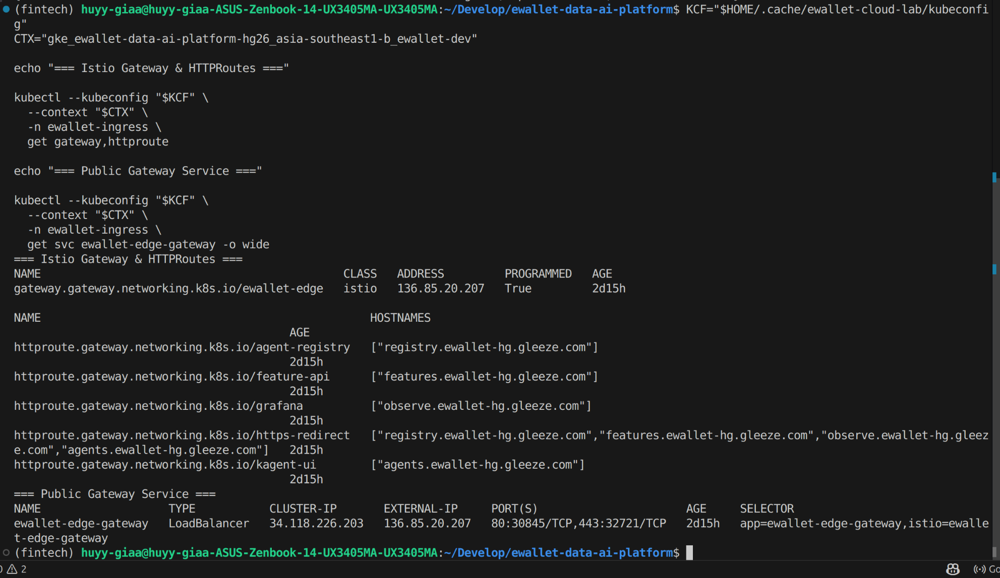

**Figure 1.** `kubectl get gateway,httproute` and the proxy Service in `ewallet-ingress`, during the
online window (`GW-01-gateway-httproutes.png`).

- **The Gateway is accepted and programmed.** `ewallet-edge` (class `istio`) reports
  `PROGRAMMED True`, with address `136.85.20.207`.
- **The routes match the design.** There are exactly five HTTPRoutes: `agent-registry`,
  `feature-api`, `grafana` and `kagent-ui`, each bound to one hostname, plus `https-redirect`
  covering all four.
- **One Service, no duplicate.** The address is the external IP of the existing
  `ewallet-edge-gateway` Service, now `LoadBalancer` on `80:30845/TCP,443:32721/TCP`, with
  selector `istio=ewallet-edge-gateway`. The Gateway is bound to that Service; Istio did not
  create a second one. The status port 15021 is not published.

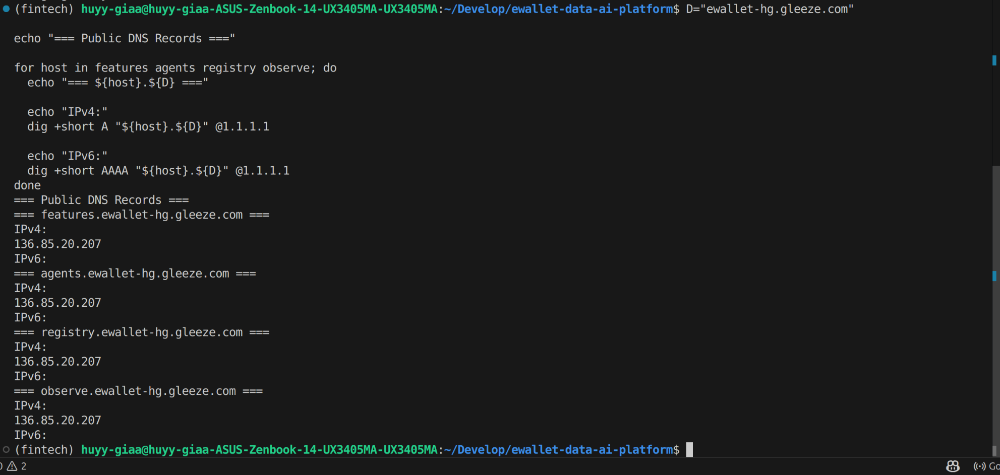

**Figure 2.** `dig A/AAAA … @1.1.1.1` for the four names, during the online window (`GW-02-public-dns.png`).

All four names returned the load balancer address, and no AAAA record, from the resolver used
(Cloudflare 1.1.1.1). This is one resolver at one moment, not proof of global propagation. The
orchestrator's own `dns_check.py`, which checks authoritative servers and several public
resolvers, passed in `dns-online` before any test ran.

The baseline before exposure (`results/02-backends.jsonl`, `results/baseline.json`) recorded all
four backends Ready, with ready endpoints.

## 3. TLS and HTTPS

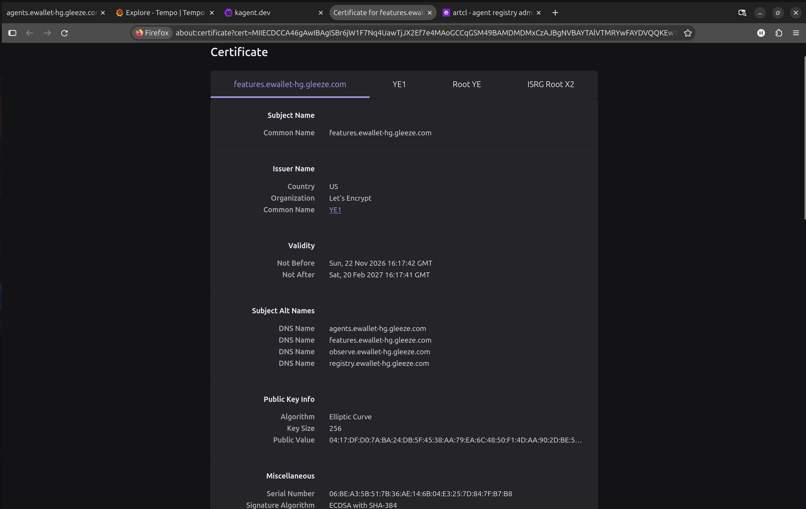

**Figure 3.** The served certificate in Firefox (`GW-43-tls-certificate.png`). Additional detail:
`GW-43-tls-security-details.png` (fingerprints, Basic Constraints `CA: No`, Key Usage Digital
Signature, EKU Server Authentication) and `GW-43-tls-certificate-transparency.png` (CRL and AIA
endpoints, Domain Validation policy, embedded SCTs from Let's Encrypt `Sycamore2027h1` and
DigiCert `Wyvern2027h1`).

| Field | Observed |
|---|---|
| Subject / issuer | `features.ewallet-hg.gleeze.com`; `C=US, O=Let's Encrypt, CN=YE1`; chain YE1 → Root YE → ISRG Root X2 |
| Validity | 2026-11-22 16:17:42 GMT → 2027-02-20 16:17:41 GMT |
| SANs | `agents`, `features`, `observe`, `registry` `.ewallet-hg.gleeze.com` |
| Key | ECDSA P-256, signature ECDSA with SHA-384 |

The automated checks agree from the public Internet (`results/14-e2e.jsonl`):
- the chain verifies with system trust (`Verify return code: 0`);
- the certificate names exactly the four hosts;
- a TLS 1.1 handshake is refused.

This campaign **reused** the certificate that an earlier issuance run obtained on 2026-11-22. The
orchestrator verified it before use (`TLS_CERTIFICATE_STATUS: VERIFIED_TRUSTED`, source
`EXISTING_EDGE_TLS`), and placed no new Let's Encrypt order.

## 4. Authentication, source restriction and the public surface

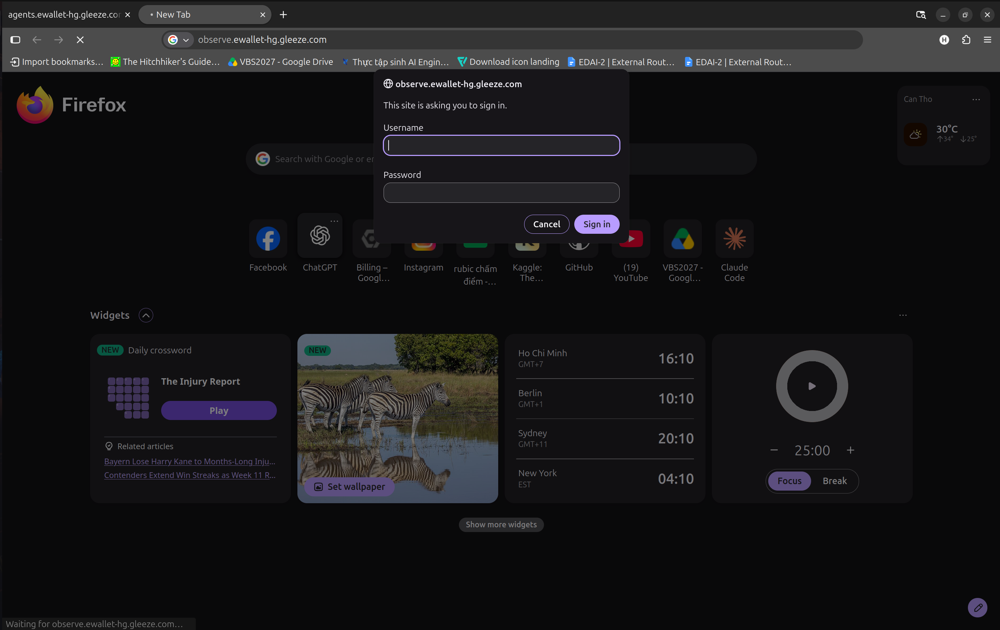

**Figure 4.** Opening `https://observe.ewallet-hg.gleeze.com` without credentials
(`GW-05-basic-auth-dialog.png`). The same dialog appears for `agents` and `registry`
(`GW-42-agents-basic-auth.png`, `GW-42-registry-basic-auth.png`). The browser shows the dialog
because the gateway's 401 carries a `WWW-Authenticate` header.

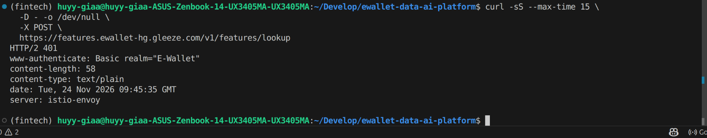

**Figure 5.** `curl -X POST https://features…/v1/features/lookup` without credentials, at 09:45:35
GMT (`GW-42-basic-auth-401.png`).

The response shows that:
- the request reached the edge over HTTP/2 and TLS;
- it was refused by the edge itself: `server: istio-envoy`, `401` with the configured realm
  `E-Wallet`;
- it never reached the Feature API.

It does not by itself show how other inputs behave. That comes from the negative suite
(`results/14-negative.jsonl`, final run): missing credentials, a wrong password, an unknown user,
a bearer token, and identity headers in place of credentials were all answered 401 before
routing. Unauthenticated requests to undeclared paths (`/metrics`, `/api/agents`, unknown hosts)
also got 401, so an anonymous client cannot even probe the route table.

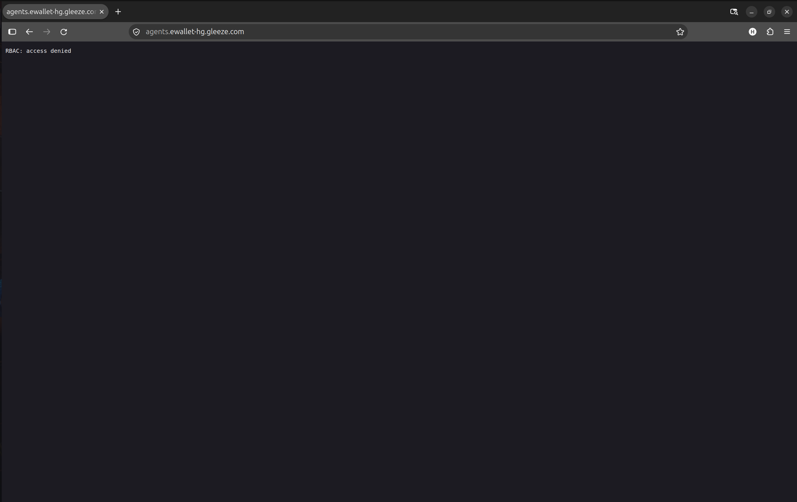

**Figure 6.** `https://agents.ewallet-hg.gleeze.com`, opened from the phone hotspot outside the
approved CIDRs (`GW-08-source-ip-403.png`).

The page text is Envoy's RBAC denial. The browser does not show the status code, but the
orchestrator's `L4-denied` phase does. It ran from the same outside network with valid
credentials, and verified that the client address was outside the allowlist both before and after
the request. It recorded `agents: refused from a non-allowed address → 403`, while the
`features` and `registry` checks from that network still succeeded (`results/11-l4-denied.jsonl`,
`L4: PASS`). The restriction therefore applies to the `agents` host only, still refuses a client
that holds valid credentials, and is based on the real client address. These results show
behaviour; they do not show where the RBAC filter sits in Envoy's chain. From the approved network, the same host served its UI
(`L5: PASS`).

The public surface is as narrow as designed (`results/14-negative.jsonl`):

- **Plain HTTP:** answered with a `301` to the same HTTPS URL.
- **Undeclared paths on `features`:** `/metrics`, `/internal/v1/entity-timestamps`, `/docs`,
  `/health/ready` and `/openapi.json` returned 404, even with valid credentials. So did `GET` on
  the lookup path. The Swagger UI and the OpenAPI schema are not publicly routed.
- **Other hostnames under the domain:** `a2a`, `fraud`, `vllm`, `mlflow`, `jenkins`, `vault`,
  `redis`, `mcp`, `kserve`, `prometheus` and a random name each returned 401 anonymously and 404
  with valid credentials.

## 5. Rate limiting

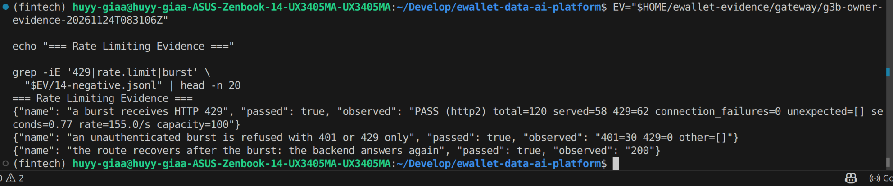

**Figure 7.** The rate-limit lines of the final negative suite, shown in a terminal
(`GW-42-rate-limiting-429.png`). The figure shows the recorded results, not a live 429 response.

The burst ran against the `registry` route, whose bucket holds 50 tokens and refills 50 every
second, per gateway pod ([`run_rate_limit`](../../../scripts/edge/negative_tests.py#L305)):

| Measurement | Value |
|---|---|
| Requests sent (HTTP/2, authenticated) | 120 in 0.77 s (≈ 155 requests/s) |
| Served by the backend | 58 |
| Answered 429 | 62 |
| Connection failures, other statuses | 0, none |
| Unauthenticated burst of 30 right after | 401 × 30, 429 × 0 |
| Another route (`features`) during the burst | reached the application (422) |
| `registry` after 2 s | 200 |

**How to read the numbers.**

- **`capacity=100` is not a throughput figure.** It is the most tokens one pod could hand out
  during that 0.77 s: 50 in the full bucket plus one refill of 50. The PASS rule
  ([`rate_limit_verdict`](../../../scripts/edge/negative_tests.py#L279)) requires real 429s and
  real successes, and no unexpected status. 58 served (between 50 and 100) and 62 limited fits
  that bucket.
- **The unauthenticated burst** got only 401s and 429s, which is consistent with the limiter
  running before Basic Auth; by then the bucket had refilled.
- **Isolation and recovery:** the bucket is per route, and the route recovers within seconds.

This is a bounded functional test of the configured limit. It is not a load test, and it says
nothing about capacity at production scale.

## 6. Feature API over HTTPS

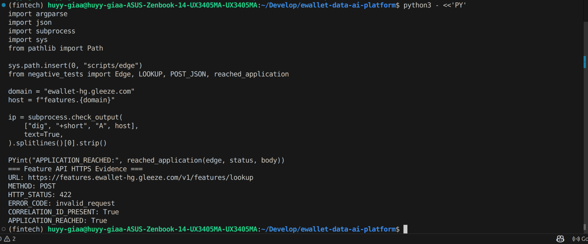

**Figure 8.** An authenticated `POST https://features.ewallet-hg.gleeze.com/v1/features/lookup`
with an intentionally incomplete body (`GW-43-feature-api-https.png`): `HTTP_STATUS 422`,
`ERROR_CODE invalid_request`, `CORRELATION_ID_PRESENT True`.

The response establishes four things:

1. The hostname and the `POST` route matched.
2. The request passed TLS, the rate limiter and Basic Auth.
3. The gateway forwarded it to the Feature API in `ml-platform`.
4. The application validated the body and rejected it with its own error schema, including a
   correlation id.

It does **not** show a successful feature lookup: the body was deliberately invalid, and no
feature values were returned through the gateway. A successful business path that uses the same
online features is shown, through the agent UI, in §8.

## 7. Observability through the gateway

Grafana is published at `observe.ewallet-hg.gleeze.com`, behind the edge's Basic Auth and then
Grafana's own login. Its campaign root URL setting makes redirects stay on the public host
(`results/14-e2e.jsonl`: `302 https://observe.ewallet-hg.gleeze.com:443/login`, appUrl equal to
the public root URL). The automated checks read real data through each data source:
- **Prometheus:** `up` returned 18 series.
- **Loki:** 20 lines for `{k8s_namespace_name="ewallet-agents"}`.
- **Tempo:** 5 traces.
- **Dashboards:** 9 listed.

How the observability stack itself is built is described in
[Observability](../observability/OBSERVABILITY.md).

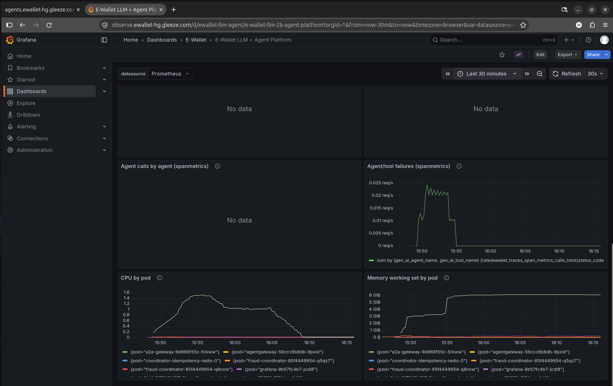

**Figure 9.** The *E-Wallet LLM + Agent Platform* dashboard with the range "Last 30 minutes", axis
15:50–16:15 local time (08:50–09:15 UTC) (`GW-12-grafana-metrics.png`).

- *CPU by pod* and *Memory working set by pod* have data for the platform pods.
- *Agent/tool failures (spanmetrics)* shows a non-zero rate of about 0.02 req/s around 08:50–08:55 UTC.
- *Agent calls by agent* and two other panels show **No data**: no agent traffic had happened yet in that range.

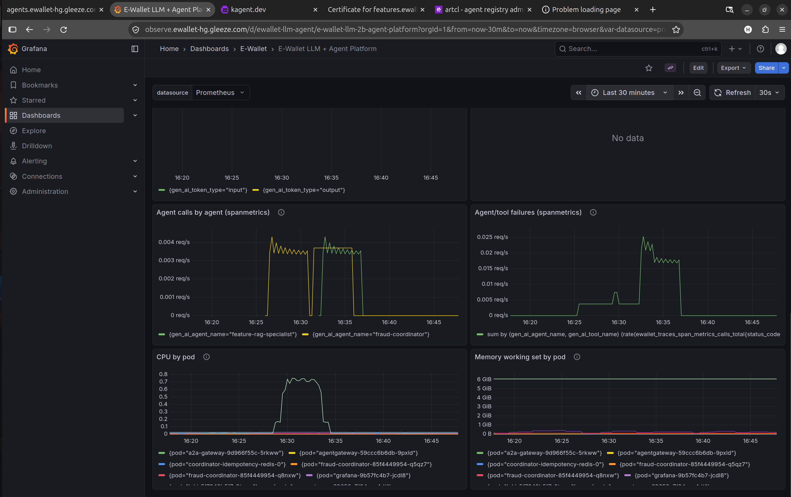

**Figure 10.** The same dashboard after the owner's agent requests, with the range "Last
30 minutes", axis 16:20–16:45 local time (09:20–09:45 UTC) (`GW-37-grafana-agent-metrics.png`).

- **Agent calls by agent** now has series for `fraud-coordinator` and `feature-rag-specialist`,
  between about 09:27 and 09:37 UTC.
- **Agent/tool failures** is non-zero again at the same time, about 0.02 req/s. The panel
  aggregates spans whose status code is an error. The screenshot does not identify which calls
  failed, and this report does not interpret them further.
- **A token panel** at the top shows input/output token series.
- **One panel shows No data.**

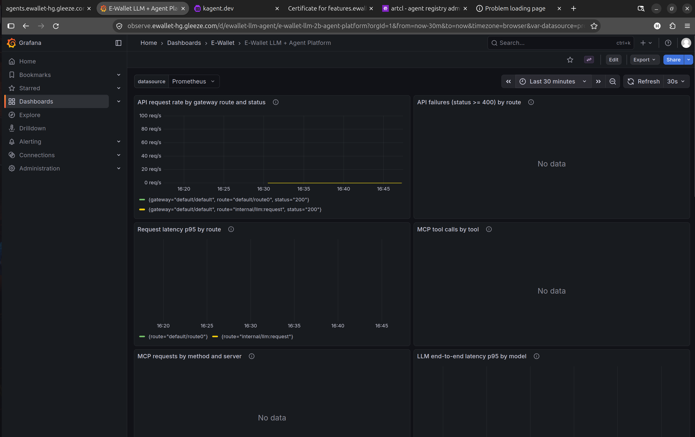

**Figure 11.** The API panels of the same dashboard (`GW-37-grafana-api-metrics.png`).

- *API request rate by gateway route and status* has series, `default/route0` and
  `internal/llm:request`, both status 200, at a very low rate.
- *Request latency p95 by route* lists the same two routes, but no line is visible at this scale.
- *API failures*, *MCP tool calls by tool*, *MCP requests by method and server* and *LLM
  end-to-end latency p95* show **No data**.

The "gateway" in these panel titles is **agentgateway**, the internal LLM and MCP gateway of the
Agent Platform. It is not the external Istio edge. These panels say nothing about edge traffic,
and no edge-specific dashboard is part of this evidence.

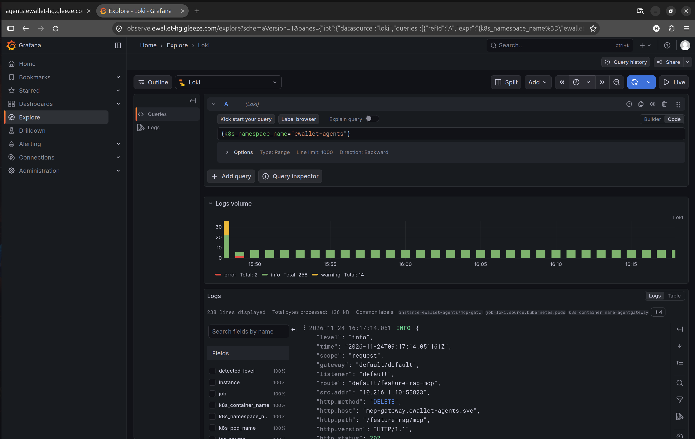

**Figure 12.** Loki through Grafana Explore (`GW-13-grafana-loki.png`).

- The query `{k8s_namespace_name="ewallet-agents"}` displays 238 lines. The volume histogram
  counts 2 error, 258 info and 14 warning entries over the range.
- The expanded entry is a structured agentgateway access log for route
  `default/feature-rag-mcp` (`DELETE /feature-rag/mcp` to `mcp-gateway.ewallet-agents.svc`, status
  202). It shows the fields Loki returns: time, scope, gateway, listener, route, source address,
  method, host, path, version, status.

The log line contains in-cluster addresses only, and no credentials.

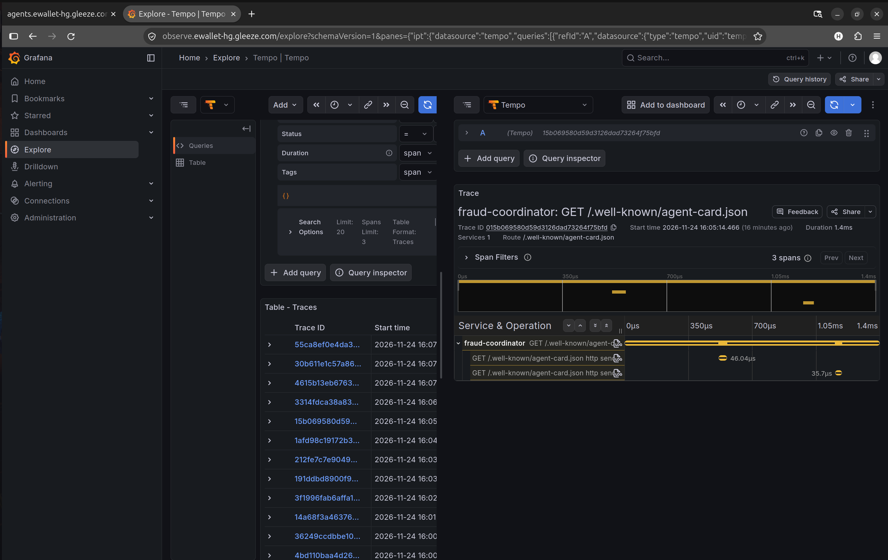

**Figure 13.** Tempo through Grafana Explore (`GW-14-grafana-tempo.png`).

- The trace table lists traces from 09:00–09:07 UTC.
- The opened trace is `fraud-coordinator: GET /.well-known/agent-card.json`: 3 spans in 1.4 ms,
  one service.

This is an agent-card discovery request, **not** the owner's business request in §8. No trace
id links the two.

**What this section establishes.** Metrics, logs and traces of the running platform were
readable from the Internet through the gateway, with authentication. It does **not** establish:
- that every dashboard panel is populated (several were not);
- that the failure series were investigated;
- that any trace corresponds to a specific user request.

## 8. Agent UI through the gateway

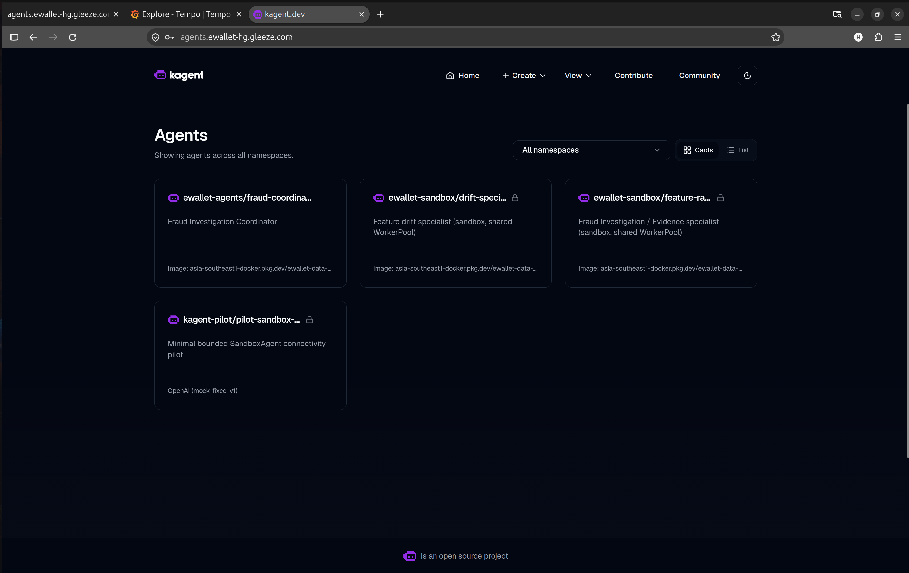

**Figure 14.** The kagent UI from the approved network (`GW-40-agent-list.png`). It lists four
agents across namespaces:
- `ewallet-agents/fraud-coordinator`;
- the two sandbox specialists `ewallet-sandbox/drift-specialist` and `ewallet-sandbox/feature-rag-specialist`;
- the `kagent-pilot` connectivity pilot.

The automated check read the same count from the UI's API (`/api/agents`: `items=4`).

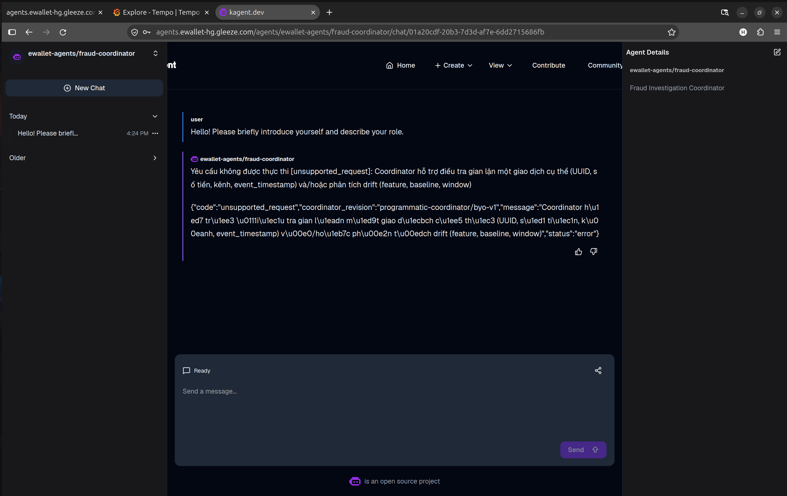

**Figure 15.** A free-text greeting to `fraud-coordinator` (`GW-40-agent-validation-response.png`).
The Coordinator refused it with `unsupported_request` (`coordinator_revision
programmatic-coordinator/byo-v1`): it accepts only transaction investigations or drift analyses.
This is the application's own input validation, shown through the gateway; it is not a gateway error.

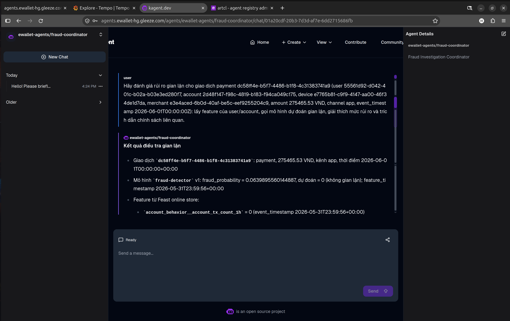

**Figure 16.** An investigation request for a payment from the project's synthetic test data,
with entity ids taken from the dataset (`GW-40-business-fraud-score.png`). The response reports
model `fraud-detector` v1 with `fraud_probability = 0.0639…` and prediction 0, and starts the
list of Feast online features.

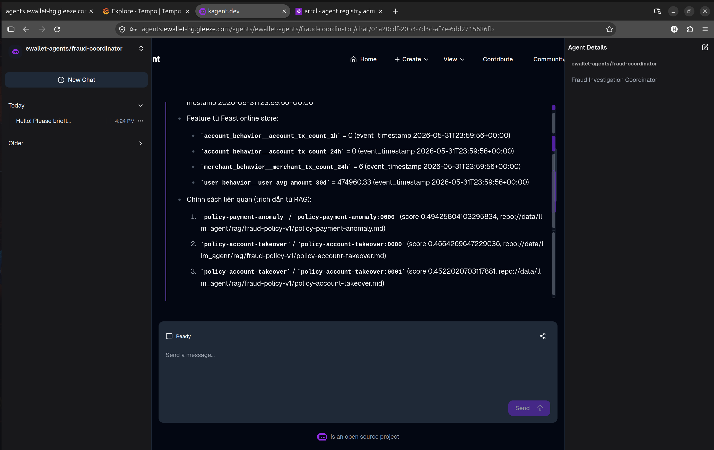

**Figure 17.** The rest of the answer (`GW-40-business-feast-rag.png`):
- four Feast online feature values, all with feature timestamp 2026-05-31T23:59:56Z
  (`account_tx_count_1h = 0`, `account_tx_count_24h = 0`, `merchant_tx_count_24h = 6`,
  `user_avg_amount_30d = 474960.33`);
- three policy citations retrieved by RAG from the `fraud-policy-v1` corpus, with scores.

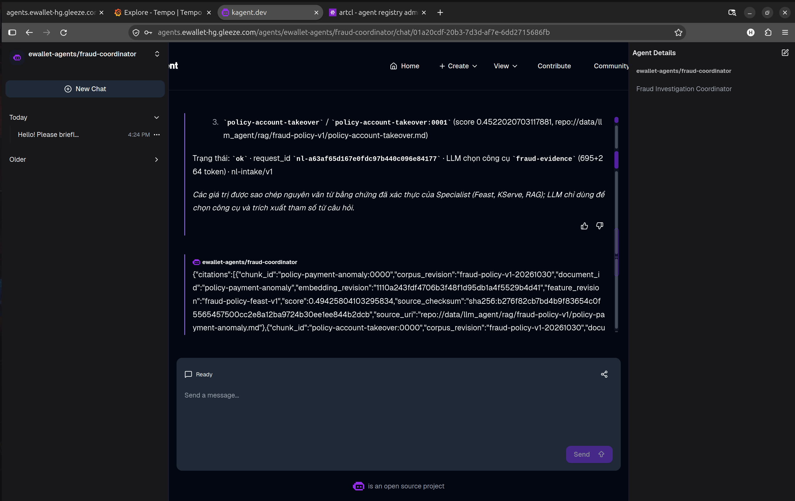

**Figure 18.** The status line and the structured citations (`GW-40-business-success.png`):
`status ok`, a request id, the LLM-selected tool `fraud-evidence` (695 + 264 tokens), and intake
`nl-intake/v1`.

**Interpretation.**

- **For the gateway:** a real, stateful UI with a chat workflow ran through
  `agents.ewallet-hg.gleeze.com`, behind TLS, Basic Auth and the source allowlist.
- **For the Agent Platform**, as supporting end-to-end evidence: the Coordinator, the
  `fraud-evidence` tool, the fraud model, Feast online features and RAG retrieval all answered
  within one request.
- **What it does not establish:** the prediction's correctness or the model's quality, which one
  request cannot show. The Agent Platform is evaluated in its own
  [evidence report](../agents/AGENT_PLATFORM_EVIDENCE.md).

## 9. Agent Registry through the gateway

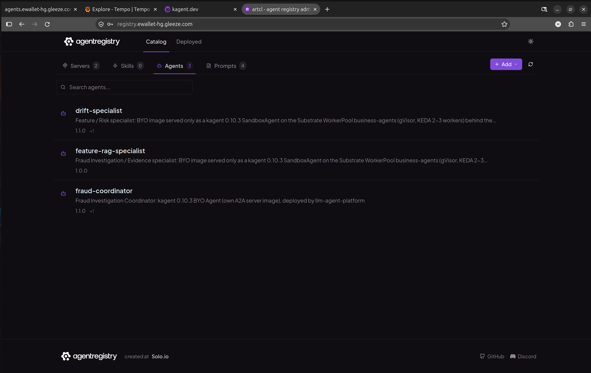

**Figure 19.** The Agent Registry catalog at `registry.ewallet-hg.gleeze.com`
(`GW-41-registry-agents.png`). The tab counts are Servers 2, Skills 0, Agents 3 and Prompts 4.
The agents are `drift-specialist` (1.1.0), `feature-rag-specialist` (1.0.0) and
`fraud-coordinator` (1.1.0).

The other catalog views:
- **MCP servers** (`GW-41-registry-mcp-servers.png`): `drift-mcp` (tool `drift_detection`) and
  `feature-rag-mcp` (`feature_lookup`, `fraud_scoring`, `knowledge_search`), both via the
  policy-only MCP Gateway.
- **Prompts** (`GW-41-registry-prompts.png`): four system prompts, each with its content hash and version.

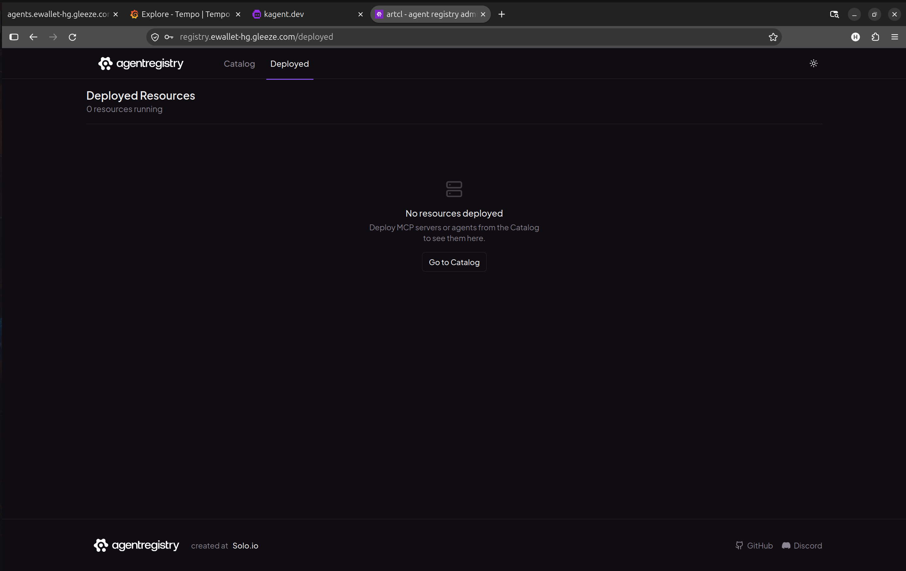

**Figure 20.** The Registry's *Deployed* tab: `0 resources running`, `No resources deployed`
(`GW-41-registry-deployed-empty.png`).

The Catalog and Deployed views measure different things:
- **Catalog** lists registered metadata for agents, MCP servers and prompts.
- **Deployed** lists only resources that the Registry itself deployed through its own deployment
  feature. The platform's agents and MCP servers are deployed by the project's Helm releases, not
  by the Registry, so an empty Deployed tab is expected. It does not mean the agents were not
  running: §8 shows them answering at the same time.

The automated check read the Registry API (`/v0/agents`) with status 200 and counted one item.
That check only asserts a readable JSON answer, and its count differs from the three catalog
entries in the UI. This report does not reconcile the two.

## 10. Cleanup and post-campaign state

The owner ended the evidence window with `continue` at 09:49:25 UTC. Cleanup then ran in the
designed order:

| Step | Time (UTC) | Result |
|---|---|---|
| Evidence window closed | 09:49:34 | `closed: owner continue` |
| DNS offline (Dynu sign-off) | 09:52:21 | `DNS_OFFLINE_OK verified` |
| Fresh DNS check before release | 09:52:23 | `DNS_OFFLINE_OK` |
| Load balancer released | 09:52:42 | `ClusterIP; no LoadBalancer` |
| Recovery manifest recorded | 09:52:55 | written |
| Guarded sleep | 09:56:40 | exit 0 |
| Sleep verified | 09:56:46 | `nodes=0` |

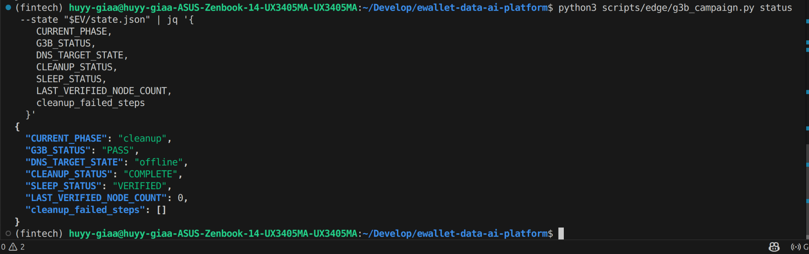

**Figure 21.** The orchestrator's final status (`GW-44-cleanup-status.png`).

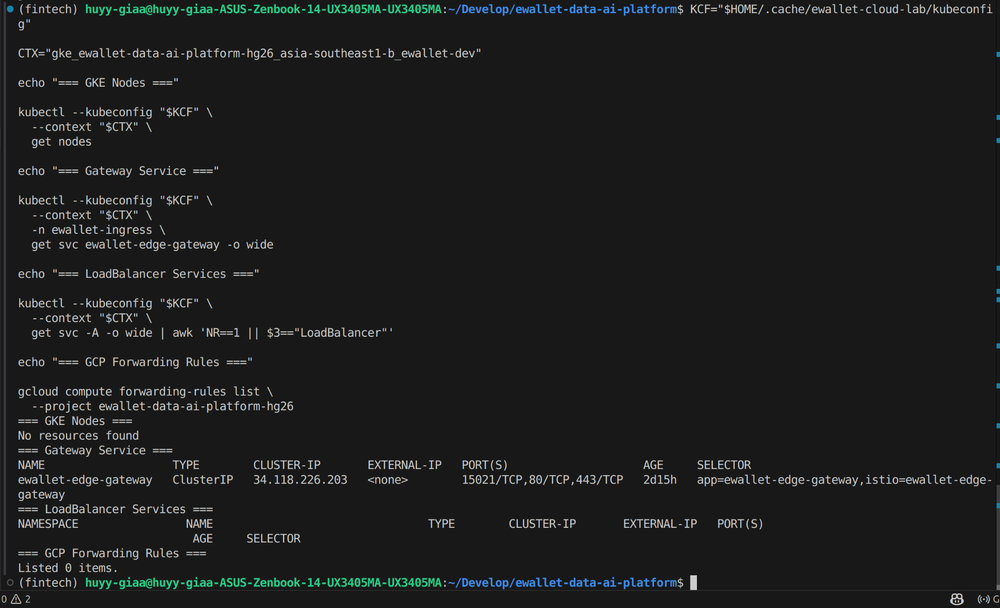

**Figure 22.** The owner's independent read-back after cleanup (`GW-45-gke-sleep-lb-released.png`):

- `kubectl get nodes`: `No resources found`;
- `ewallet-edge-gateway`: `ClusterIP`, external IP `<none>`;
- no `LoadBalancer` Service in any namespace;
- `gcloud compute forwarding-rules list`: 0 items.

These are four different kinds of evidence:

1. **Campaign state:** what the orchestrator recorded about its own steps.
2. **DNS verification:** `dns_check.py` against authoritative servers and public resolvers, at
   09:52. It establishes the DNS state at that time, not cache expiry on every resolver afterwards.
3. **Kubernetes read-back:** no nodes, no `LoadBalancer` Service.
4. **GCP read-back:** no forwarding rule, so no external load balancer remains billable.

Together they show that the public state was fully removed and that the cluster returned to zero
nodes. `DNS_TARGET_STATE: offline` alone would not show that.

## 11. Findings and limitations

**Established by this campaign:**

- The Istio gateway, configured through Gateway API, served four hosts on a public domain with a
  trusted certificate, from one proxy and one load balancer.
- TLS, Basic Auth, per-route rate limiting and the `agents` source allowlist all behaved as
  designed. This is shown both by black-box tests from the Internet and by human observation.
- The public surface was limited to the four declared routes: one endpoint on the Feature API,
  no other paths or hosts.
- The full lifecycle of wake, private checks, exposure, evidence window, DNS offline, load
  balancer release and sleep completed without a failed step.

**Not established, or limited:**

- **Feature API.** The external call to the Feature API returned a validation error by design
  (422). A successful lookup through the public `features` route was not recorded. The successful
  feature path in §8 went through the agent platform.
- **Grafana coverage.** Several panels showed No data, and the agent/tool failure series was
  non-zero and not investigated here. The panels labelled "gateway" are agentgateway metrics, not
  edge metrics.
- **Tempo.** The shown trace is an agent-card request; no trace was tied to the business request.
- **Registry.** The Deployed tab is empty by design of the deployment model, and the API item
  count (1) differs from the UI catalog (3).
- **Rate limiting.** A single 0.77 s burst on one route and one pod: functional, not a capacity
  measurement.
- **Browser evidence.** Browser screenshots show rendered pages, not status codes. Status codes
  come from the machine-readable results.
- **DNS.** The DNS figure is one resolver at one time; propagation and cache expiry elsewhere were
  not measured.
- **IPv6.** It is not served: no AAAA records exist by design.

## 12. Evidence provenance

Screenshots, results and a derived state summary are published in
[`docs/evidence/edai2/gateway/g3b-owner-evidence-20261124T083106Z/`](../../evidence/edai2/gateway/g3b-owner-evidence-20261124T083106Z/README.md).
Its README records the source, the checksum manifest and what was withheld.
