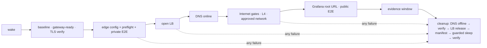

# External Gateway: Operations

How the public gateway is brought up, verified, held open for evidence and returned to an
offline state. The design is in
[EXTERNAL_GATEWAY_ARCHITECTURE.md](EXTERNAL_GATEWAY_ARCHITECTURE.md). The results of the
owner's GKE campaign are in [EXTERNAL_GATEWAY_EVIDENCE.md](EXTERNAL_GATEWAY_EVIDENCE.md).

Commands are marked **READ-ONLY** or **MUTATING**. A mutating command changes the cluster, DNS or
cloud resources, and needs an owner-approved campaign.

## 1. Operational model

Several independent states combine. The campaign moves them in a fixed order:

| Layer | Offline / private | Online / public |
|---|---|---|
| GKE `cpu-pool` | 0 nodes (asleep); the control plane stays reachable | woken from a recovery manifest |
| Gateway Service | `ClusterIP`; no external address | `LoadBalancer`; external IPv4, ports 80/443 |
| DNS (`*.ewallet-hg.gleeze.com`) | Dynu offline (sign-off mode answers Dynu's offline server) | the four names answer the load balancer IPv4 |
| Certificate | Secret `edge-tls` kept through sleep | the same Secret served on 443 |

The safe resting state is: asleep, `ClusterIP`, DNS offline, certificate kept. A campaign moves
to the public state only after private checks pass. Cleanup back to the resting state is
**attempted** after every ending: success, a failed phase, the deadline or SIGTERM/SIGINT. A
`kill -9` skips it until the owner runs `cleanup` or the watchdog does. The attempt does not
always succeed:

- **Fail-closed.** The load balancer is released only after DNS is proven offline. Otherwise it is
  kept on purpose, so that no public name is left pointing at an address the project no longer owns.
- **Complete.** All cleanup steps pass. `status` then reports `CLEANUP_STATUS COMPLETE` and
  `SLEEP_STATUS VERIFIED` with zero nodes.
- **Incomplete.** Any step fails (DNS not proven offline, load balancer kept, sleep blocked or not
  verified). The state is then `CLEANUP_INCOMPLETE`, `ALERT.txt` is written, and the owner fixes the
  cause and resumes cleanup (§7). Until then the cluster may still have nodes, or a public address.

The whole sequence is driven by one orchestrator,
[`scripts/edge/g3b_campaign.py`](../../../scripts/edge/g3b_campaign.py), so that ordering,
deadlines and cleanup do not depend on remembering steps. It runs in **supervised** mode: the
owner is at the laptop, changes networks once for the outside-access test, takes screenshots
and ends the evidence window. It is not an unattended deployment tool.

## 2. Prerequisites

| Item | Requirement |
|---|---|
| Tools | `kubectl`, Helm 3, `gcloud`, Python 3 with PyYAML, `dig`, `openssl`, `curl`. `uvx`/certbot only when a new certificate is issued |
| Cluster access | the cloud-lab kubeconfig `~/.cache/ewallet-cloud-lab/kubeconfig` (DNS endpoint of the control plane), context `gke_ewallet-data-ai-platform-hg26_asia-southeast1-b_ewallet-dev`. Every command pins both |
| Cluster software | Istio 1.30.7 (istiod, ambient); Gateway API CRDs **v1.7.0 Standard** (the chart refuses older CRDs); the official `istio/gateway` 1.30.7 chart archive (sha256 `f8b350a2…125f`) |
| Helm releases | `ewallet-edge-gateway` (proxy) and `ewallet-edge` (configuration) in `ewallet-ingress`, private and installed by earlier stages. A campaign only upgrades them |
| Private inputs (outside Git, mode 600) | edge Basic Auth credential (`user:password`), Grafana credential, Dynu update credential (JSON), approved client CIDRs (one per line) |
| Certificate | Secret `ewallet-ingress/edge-tls` with a trusted certificate for the four names (reuse mode), or approval to issue one |
| Recovery manifest | a `cloud_lab.py record-manifest` directory from the last awake state. The wake restores workloads from it |
| DNS | Dynu offline before the campaign, with the approved offline IPv4/IPv6 recorded. One earlier proven online→offline DNS transition (`--dns-transition-evidence`) |
| Network | the laptop on an approved address (inside the CIDRs) for most phases, plus a second network outside the CIDRs (a phone hotspot) for the outside-access test |

## 3. Campaign initialization

`init` creates the campaign directory and `state.json`, records approvals, and evaluates every
pre-wake gate. It changes nothing in the cloud. **READ-ONLY** with respect to the cluster:

```bash
D=ewallet-hg.gleeze.com; PRIV=<private dir>; KC=~/.cache/ewallet-cloud-lab/kubeconfig
CTX=gke_ewallet-data-ai-platform-hg26_asia-southeast1-b_ewallet-dev
CID=g3b-<label>-$(date -u +%Y%m%dT%H%M%SZ); EV=~/ewallet-evidence/gateway/$CID

python3 scripts/edge/dns_check.py --domain $D --expect-offline --offline-ip <OFF4> --offline-ipv6 <OFF6>   # DNS_OFFLINE_OK
python3 scripts/edge/verify_edge_tls.py --domain $D --kubeconfig $KC --context $CTX                      # TLS_REUSE_VERIFIED
bash scripts/edge/create_basic_auth.sh --credentials-file $PRIV/edge-cred --check --kubeconfig $KC --context $CTX   # EDGE_AUTH_MATCH

python3 scripts/edge/g3b_campaign.py init --scope g3b --mode supervised --campaign $CID --campaign-dir $EV \
  --manifest <recovery-manifest> --approved-cidrs $PRIV/approved-cidrs.txt --edge-credentials $PRIV/edge-cred \
  --grafana-credentials $PRIV/grafana-cred --dns-credentials $PRIV/dynu.json --dns-offline-mode signoff \
  --dns-offline-ip <OFF4> --dns-offline-ipv6 <OFF6> --dns-offline-verified --dns-transition-evidence <transition state.json> \
  --reuse-existing-production-certificate \
  --approve-live-campaign --approve-production-certificate --approve-grafana-root-url \
  --approve-guarded-sleep --approve-keda-pause --also-approve <namespace/pdb approved for this campaign> \
  --evidence-window-minutes 45
```

`init` exits 0 only if every gate passes. A failed gate means no cloud change at all.

| Gate | Meaning |
|---|---|
| `CLOUD_LAB_RECOVERY_MANIFEST_VALID` | the wake manifest exists and is complete |
| `PDB_APPROVAL_COMPLETE`, `KEDA_SLEEP_APPROVAL_READY`, `GUARDED_SLEEP_PLAN_VALID` | the final guarded sleep is possible with the given approvals: PodDisruptionBudgets that would block the drain, KEDA pause |
| `CLIENT_ADDRESS_APPROVED` | the approved CIDR list is valid (IPv4, public, no wider than /16) |
| `SAFE_CLEANUP_READY` | DNS automation and offline addresses are configured, so cleanup can prove DNS offline |
| `L0_RENDER_READY` | the edge and proxy releases render cleanly and pass `ownership_preflight.py render` |
| `EDGE_AUTH_READY` | the live Basic Auth Secret matches the credential file |
| `TLS_REUSE_READY` (reuse) / `CERTBOT_READY` (issuance) | a trusted certificate can be reused, or the pinned certbot is available |
| `OWNER_LIVE_APPROVAL` | the owner approved a live campaign |

Notes on the flags:

- **`--reuse-existing-production-certificate`** selects reuse mode. The issuance phases are then
  skipped, and the ACME responder is never deployed.
- **`--approve-edge-secret-sync`** is deliberately not part of the normal command. It is a
  separate approval, used only when the live Secret differs from the credential file.
- **`--also-approve`** names PodDisruptionBudgets the owner accepts scaling around during sleep.
  Each campaign needs its own approval for them.

## 4. Lifecycle

`run` executes the phases in a fixed order
([`phases`, L897](../../../scripts/edge/g3b_campaign.py#L897)). For `--scope g3b` in reuse mode,
the orchestrator records **20 phases**: 19 fixed ones plus `evidence-window`, which is appended
when an evidence window is configured. The table groups them into **18 entries**: rows 6 and 14
each cover two phases that are recorded separately in `state.json`.

| # | Phase | What it does | Changes |
|---|---|---|---|
| 1 | `wake` | `cloud_lab.py wake-full --manifest … --nodes 5` | **MUTATING**: node pool 0 → 5, workloads restored |
| 2 | `baseline` | readiness, restarts and endpoints of the four backends and their callers (`platform_checks.py backends`) | read-only |
| 3 | `gateway-ready` | the proxy Deployment is rolled out with a Ready replica (25-minute budget) | read-only |
| 4 | `tls-reuse-verify` | `verify_edge_tls.py`: trusted chain, four SANs, ≥ 14 days, key match | read-only |
| 5 | `edge-restricted` | upgrade `ewallet-edge` with the final values (real domain, source restriction on, no ACME responder); check Gateway conditions, the Envoy config and that kagent-ui stays Ready | **MUTATING** (configuration only; Service still `ClusterIP`) |
| 6 | `L0-render`, `L0-live` | render both releases with the public overlays and run `ownership_preflight.py` on the render and on the live cluster | read-only |
| 7 | `edge-auth` | Basic Auth Secret matches the credential file (sync only with its own approval) | read-only normally |
| 8 | `private-e2e` | `negative_tests.py` and `public_e2e.py` through a port-forward, before anything is public | read-only |
| 9 | `open-lb` | `PUBLIC_LB_CREATED` is recorded **first**; then `ewallet-edge-gateway` is upgraded with the public and open overlays, and the external IPv4 is read and stored as `LB_IP` | **MUTATING**: Service → `LoadBalancer` |
| 10 | `dns-online` | `DNS_TARGET_STATE=unknown` is recorded **first**; then `dynu_dns.py online --ip <LB IP>`, verified by `dns_check.py` | **MUTATING**: public DNS |
| 11 | `internet-gates` | from the approved network: the full negative suite and end-to-end checks against the public address | read-only |
| 12 | `L4-denied` | the owner switches the laptop to a network outside the CIDRs. The orchestrator verifies the client address before and after, and the `agents` host must answer 403 | read-only |
| 13 | `approved-network` | waits up to 15 min for the laptop to return inside the CIDRs | read-only |
| 14 | `staging-certificate`, `production-certificate` | `SKIPPED_REUSE` (issuance mode: Let's Encrypt staging, then production, through the ACME responder) | none in reuse mode |
| 15 | `responder-off` | confirms no ACME responder or port-80 challenge route remains | read-only in reuse mode |
| 16 | `grafana` | upgrade `llm-agent` with Grafana's public root URL, then wait for the Grafana rollout | **MUTATING** (approved separately) |
| 17 | `public-e2e` | the final public end-to-end and negative checks | read-only |
| 18 | `evidence-window` | holds the public state unchanged for owner screenshots (§6) | none |
| — | cleanup | attempted after the last phase, a failure, the deadline or a signal; may end `CLEANUP_INCOMPLETE` (§7) | **MUTATING** |

A failed phase stops the sequence, and cleanup follows immediately. SIGTERM and SIGINT are
handled: the current phase ends, and cleanup runs to its end. A second signal during cleanup is
ignored. The campaign has a fixed three-hour deadline from `run`. A command started near it
still gets at least 30 s, and cleanup itself is never cut short by the deadline.



## 5. DNS and TLS lifecycle

- **Online.** [`dynu_dns.py`](../../../scripts/edge/dynu_dns.py) uses Dynu's IP Update Protocol:
  `myip=<LB IPv4>&myipv6=no`. Dynu's reply word (`good`, `nochg`) never decides anything; only
  [`dns_check.py`](../../../scripts/edge/dns_check.py) does.
- **How `dns_check.py` decides.** It queries the authoritative servers and public resolvers for
  the four names, the bare domain and a random name. Online means every name answers exactly the
  LB address and none has an AAAA record.
- **It fails closed.** A timeout, SERVFAIL, a missing `aa` flag or a malformed reply makes the
  whole check `DNS_CHECK_FAILED`. An unanswered query never counts as "no record".
- **Offline.** `offline --mode signoff` (`offline=yes`) puts the hostname into Dynu's offline
  mode, which answers Dynu's own offline server on both families. `dns_check.py --expect-offline`
  accepts only no record, or exactly the owner-approved offline IPv4/IPv6. It also requires the
  released LB address to be gone.
- **TLS.** In reuse mode the certificate is not touched; the campaign only verifies it before use.
  In issuance mode (used once, on 2026-11-22), the campaign deploys the ACME responder and a
  port-80 route for `/.well-known/acme-challenge/`. It obtains a staging and then a production
  certificate with the pinned certbot, imports it into `edge-tls`, and removes the responder.

## 6. Evidence window

After a passing `public-e2e`, the gateway stays public and unchanged while the owner takes
screenshots ([`evidence_window`, L716](../../../scripts/edge/g3b_campaign.py#L716)):

- `status` shows `EVIDENCE_WINDOW: open` and the minutes left.
- The window ends at the earliest of:
  - the owner's `continue` (`EVIDENCE_WINDOW: closed: owner continue`);
  - the configured length (at most 60 minutes);
  - 30 minutes before the deadline (the cleanup reserve);
  - a signal.
- `continue` ([`request_continue`, L1396](../../../scripts/edge/g3b_campaign.py#L1396)) only writes a
  marker file. It is accepted only while a window is open, and the main process notices it within 10 s.
- A failed `public-e2e` never opens the window, and the window changes no verdict.

What must be captured while public (DNS answers, the certificate, login dialogs, the UIs) is
listed in the evidence report.

```bash
python3 scripts/edge/g3b_campaign.py status   --state $EV/state.json     # READ-ONLY
python3 scripts/edge/g3b_campaign.py continue --state $EV/state.json     # ends the window; cleanup follows
```

## 7. Cleanup and recovery

[`cleanup`](../../../scripts/edge/g3b_campaign.py#L977) is idempotent. Each finished step is
recorded and skipped when cleanup is resumed. In order:

1. **ACME** (issuance mode only): let an in-flight certbot finish for a bounded time, then remove
   the responder and its route.
2. **DNS offline:** if DNS is `online` or `unknown`, set Dynu to sign-off mode and verify with `dns_check.py`.
3. **Verify before release:** a fresh, read-only `dns_check.py --expect-offline --released-ip <LB IP>`
   ([L1036](../../../scripts/edge/g3b_campaign.py#L1036)). It runs whatever `state.json` claims.
4. **Release the load balancer:** only if step 3 passed. Upgrade `ewallet-edge-gateway` with the
   private values (Service back to `ClusterIP`), then `ownership_preflight.py live`. If DNS was not
   proven offline, the load balancer is **kept** on purpose: releasing it while a name still points
   at the address would leave a dangling record that someone else could later take over.
5. **Record a fresh recovery manifest** for the next wake.
6. **Guarded sleep:** `cloud_lab.py plan-sleep`, then `sleep --scale-pdb-guarded --pause-keda` with
   the campaign's approvals. Only PodDisruptionBudgets covered by the approved record or by
   `--also-approve` may be scaled around. Anything else is reported as `SLEEP_BLOCKED`.
7. **Verify:** `cloud_lab.py verify --expect sleep`, and a node count of 0.

**Recovery:**

- If cleanup stops (for example, DNS cannot be proven offline), `status` lists
  `cleanup_failed_steps`, and the campaign directory contains `ALERT.txt`. Fix the cause (for
  example, take DNS offline from the Dynu panel and confirm with `dns_check.py`), then resume
  with `g3b_campaign.py cleanup --state $EV/state.json` (**MUTATING**).
- A campaign lock prevents two cleanups at once.
- An optional systemd watchdog ([`install_watchdog.sh`](../../../scripts/edge/install_watchdog.sh),
  [`watchdog`, L1190](../../../scripts/edge/g3b_campaign.py#L1190)) runs cleanup if the campaign
  is past its deadline, or if its heartbeat is stale and the main process is gone. It gives up
  after three attempts and leaves `ALERT.txt`. The owner campaign of 2026-11-24 ran without the watchdog timer.

**Final verification after cleanup (READ-ONLY):**

```bash
python3 scripts/edge/g3b_campaign.py status --state $EV/state.json   # CLEANUP_STATUS COMPLETE, SLEEP_STATUS VERIFIED
kubectl --kubeconfig $KC --context $CTX get nodes                                  # No resources found
kubectl --kubeconfig $KC --context $CTX -n ewallet-ingress get svc ewallet-edge-gateway   # ClusterIP, no external IP
kubectl --kubeconfig $KC --context $CTX get svc -A | grep LoadBalancer                     # nothing
gcloud compute forwarding-rules list --project ewallet-data-ai-platform-hg26               # 0 items
python3 scripts/edge/dns_check.py --domain $D --expect-offline --offline-ip <OFF4> --offline-ipv6 <OFF6>
```

## 8. Running a campaign

From the repository root, after a successful `init`:

```bash
systemd-inhibit --what=sleep:idle python3 scripts/edge/g3b_campaign.py run --state $EV/state.json   # MUTATING; terminal 1
watch -n 30 "python3 scripts/edge/g3b_campaign.py status --state $EV/state.json"                    # READ-ONLY; terminal 2
```

At `CURRENT_PHASE: L4-denied`, move the laptop to the outside network. When `L4: PASS` appears,
return to the approved network, reconnecting once. At `EVIDENCE_WINDOW: open`, take the
screenshots, then run `continue`.

Offline validation needs no cloud:
- the orchestrator has a `--simulate` mode;
- the edge tests run in `tests/ops`;
- [`scripts/edge/local_validate.sh`](../../../scripts/edge/local_validate.sh) exercises the chart on
  a local kind cluster with real Envoy and stub backends.

A live campaign should not be repeated just to reproduce documentation; the recorded evidence is
in the evidence report.

## 9. Operational limitations

- **Supervision.** The owner must be present to switch networks for the outside-access test and to
  close the evidence window. That test needs a second network outside the allowlist.
- **Fixed budget.** The public window is bounded by the three-hour campaign deadline and the
  30-minute cleanup reserve.
- **DNS depends on Dynu.** Offline mode is proven by resolution, not by the provider's reply.
  Resolver caches may still hold the old address for the record's TTL after cleanup.
- **Credential rotation.** Rotating the Basic Auth credential is a separate, approved Secret update
  followed by a gateway restart.
- **Certificate renewal.** It needs issuance mode, and therefore a public port 80 during the
  campaign, before 2027-02-20.
