# LLM Benchmark Results (EXP-V1 and EXP-V2)

This is the authoritative report of the two LLM serving benchmarks submitted for EDAI-2, and of the agentgateway policy evidence captured with them. The owner ran both sessions on GKE on 2026-11-09/10 and captured every screenshot by hand during the sessions. The platform that was benchmarked is described in [LLM_PLATFORM.md](LLM_PLATFORM.md).

## 1. Executive Summary

| Experiment | Question | Execution validity | Observed outcome |
|---|---|---|---|
| [EXP-V1](#3-exp-v1--cpu-thread-binding) | Does binding vLLM's OpenMP threads to CPUs 0-1 improve throughput over `auto`? | `VALID` | `OBSERVED_IMPROVEMENT` |
| [EXP-V2](#4-exp-v2--kubernetes-service-vs-llm-d-epp) | Does llm-d EPP routing improve E2E p95 over a Kubernetes Service, with two replicas? | `VALID` | `OBSERVED_MIXED` |

**Status:** `SINGLE_RUN_RESULTS=COMPLETE`, `OWNER_SCREENSHOTS=INTEGRATED`.

- **EXP-V1.** With `0-1`, output tokens/s rose by 52.7 % at c=2 and 54.5 % at c=4 (3.543 → 5.475 tok/s), and E2E p95 at c=4 fell from 154.75 s to 98.51 s. The pod used more of the CPU it already had: mean vLLM CPU at c=4 rose from 1.64 to 2.58 cores, and tokens per core actually used hardly changed. Failures: 1/36 → 0/36.
- **EXP-V2.** llm-d EPP routing had 47.5 % lower E2E p95 at c=2, but 101.9 % higher at c=4 and 71.5 % higher at c=8, and 7.3 % higher (within the threshold) at c=1. Failures: 0/48 in both arms. EPP routing did not show a general gain, and llm-d is not part of the production deployment.
- **Each experiment is one baseline run and one optimized run.** The percentages are observed differences of one pair, with no confidence interval and no significance test.

Every number comes from the campaign's raw artifacts (`comparison/metrics.json`, `summary.json`, `raw_requests.jsonl`). Screenshots prove what ran and what was on screen; they are not the source of the numbers. Which screenshot backs which claim is listed in the [evidence matrix](../../rubric/EDAI2_LLM_BENCHMARK_EVIDENCE_MATRIX.md).

## 2. Experimental Environment and Methodology

### 2.1 Environment and isolation

| Item | Value (both experiments) |
|---|---|
| Cluster | GKE `ewallet-dev`, `asia-southeast1-b` |
| Namespace and nodes | Temporary namespace `ewallet-bench` on a dedicated tainted pool `bench-pool` of e2-standard-4 nodes: 1 node for EXP-V1, 2 for EXP-V2. Both were deleted after each session |
| Image | `vllm-cpu-model@sha256:f695b23e…` (vLLM 0.32.0 CPU), the digest of the production image |
| Model | Qwen3-0.6B at revision `c1899de2…`, baked into the image |
| Gateway | agentgateway v1.7.0, one replica, no fallback backend |
| Source | commit `263c1d1f`. `source_dirty` is `true` because each session writes its evidence inside the worktree |
| Workload | `o1-workload-v1`, sha256 `c4816ca1…` |

Production was not touched: `production-before.txt` equals `production-after.txt` in both sessions, and llm-d existed only in `ewallet-bench` during the campaign.

### 2.2 Workload

Each arm starts with fresh pods, then sends 3 cold-prefix requests and 2 warm-up requests, which are reported separately, then **12 measured requests at each concurrency level**: 2 short chats, 2 long prompts (about 1,617 input tokens, 128 output), 3 repeated-prefix and 2 unique-prefix requests (about 600 tokens), 2 streamed tool calls with a real tool schema, and 1 non-streamed chat. Levels are c=1, 2, 4 for EXP-V1 and c=1, 2, 4, 8 for EXP-V2, run in sequence on the same pods.

### 2.3 Single-run methodology and reporting rules

The runner supports three profiles. All use the same image, model, workload, request counts, gateway policy, fresh pods per run, observability, policy probe, watchdog and cleanup:

| `EXP_PROFILE` | Runs per arm | Comparator | Use |
|---|---|---|---|
| `single` | exactly 1 | [`single_run.py`](../../../ops/experiments/single_run.py): observed differences | **The EDAI-2 submission (this report)** |
| `formal` | 3 (2–5), order AB, BA, AB | [`compare.py`](../../../ops/experiments/compare.py): threshold plus run-to-run spread | The historical 3-run rehearsal (§6) |
| `smoke` | 1, reduced levels | `compare.py`, always `INCONCLUSIVE` | Workflow check, never a result |

The profile is recorded in the manifest (`settings.profile`, `settings.methodology`), in every checkpoint banner (`EXP-V1 SINGLE-RUN / BASELINE run 01`) and in the comparison, so single-run and multi-run evidence cannot be mixed up. The rubric asks for a benchmark and an optimization, not for repeated measurements, so the owner chose one run per arm at every level, which can be replayed and captured personally in one sitting.

**What one pair cannot show:**

- no confidence interval and no repetition-based variance estimate;
- no statistical significance test;
- no claim of a stable improvement, and no general claim that one routing path or binding always wins;
- the arm order is fixed (baseline, then optimized), so drift between the two runs cannot be separated from the effect.

**Rules enforced by the single-run comparator.** Execution validity and the observed outcome are reported separately.

| Rule | Effect |
|---|---|
| Exactly one run per arm, both with evidence | Otherwise `INVALID` (or `NOT_EXECUTED`) |
| Every control matches, read from the live pods | Otherwise `INVALID`, with the differing controls listed |
| Every level measured in both arms; raw rows match the summary | Otherwise `INVALID` |
| Failed requests and timeouts stay in the counts | An arm with more failures at any level cannot be an observed improvement |
| The primary metric changes by at least 10 % (the spec's `significant_percent`) | A fixed reporting rule, not a statistical test |
| A baseline of 0, or a value missing in one arm | No percentage, with the reason |

| Observed outcome | Meaning |
|---|---|
| `OBSERVED_IMPROVEMENT` | Better by at least the threshold at one or more levels, worse at none, no extra failures |
| `OBSERVED_REGRESSION` | Worse by at least the threshold, or extra failures, and better at no level |
| `OBSERVED_MIXED` | Better at some levels, and worse at others or with extra failures |
| `NO_CLEAR_OBSERVED_CHANGE` | Every level within the threshold |

`VALID` means the pair is comparable; it does not require the optimized arm to win, and a run is not repeated because the optimized arm lost. **In every table, a positive percentage means better**, whichever way the metric points, so a CPU row of −89.8 % means the optimized arm used more CPU. Besides the primary metric, each level reports ITL p50, error and timeout rates, valid tool calls, tokens/s per allocated CPU and tokens/s per CPU core actually used (output tokens/s ÷ mean vLLM CPU cores). For EXP-V2 it also shows each arm's per-replica request share and the EPP counters, which are shown but not compared.

### 2.4 Fairness measures

- **One difference.** Both arms render from one template, [`vllm-bench.yaml.tmpl`](../../../infra/kubernetes/experiments/vllm-bench.yaml.tmpl), and one arm table in [`render_bench.py`](../../../scripts/experiments/render_bench.py). The `plan` step prints the difference, and a test pins it.
- **Clean start.** vLLM and the gateway restart before each run, which clears the prefix cache and refills the token budget.
- **Same workload and machines.** The workload hash, the image digest, the model revision, the CPU and memory requests, the node type, `max_num_seqs`, the prefix cache, the token budget and `node_names` are controls. A node replaced mid-session invalidates the comparison.
- **Provenance before traffic.** The running image digest and model revision must match the pins before the first request.
- **No fallback.** The stack has one backend, so a failed request stays failed and cannot flatter an arm.
- **Complete records.** The raw request count must match the summary, or the level is refused.

### 2.5 Observability and safety of the sessions

Each session brings its own Prometheus and Grafana inside `ewallet-bench`. Prometheus scrapes every vLLM pod, the gateway, the EPP (EXP-V2 only) and a pod-usage exporter every 5 s, with per-pod and per-run labels, so the two EXP-V2 replicas are two targets and a counter reset never mixes runs. The dashboard `EDAI-2 — LLM CPU Benchmark` has three groups: serving (tokens/s, TTFT and E2E, running and waiting requests, gateway status codes), resources (CPU and memory per container, queue time, prefix-cache hit ratio) and routing (per-replica completions and share, EPP endpoints, decisions, errors and scheduler latency). After each run every panel query is replayed against Prometheus for that window and recorded (`prometheus-readback.json`). The benchmark client stays the authoritative source: Grafana percentiles are bucket interpolations and can differ from the client's exact percentiles with 12 requests per level.

The sessions were bounded so that a lost laptop could not leave resources billing:

- `bench-pool` autoscales with a minimum of 0. An in-cluster CronJob watchdog, whose Role exists only in `ewallet-bench`, deletes the namespace's workloads at the time limit + 10 min, and a laptop timer runs the teardown at the limit + 20 min. A GKE drill showed the node removed about 16 minutes after it emptied, with no laptop action.
- The time limit is wall-clock and at most 215 minutes; the session refuses to start if the worst-case cost exceeds USD 5 (estimates: USD 0.91 for EXP-V1, USD 1.82 for EXP-V2, from list prices).
- Teardown deletes only resources carrying the session's ownership marks, and proves that the pool, the namespace and every `gke-ewallet-dev-bench-pool-*` VM and disk are gone. Helm releases and the `cpu-pool` size are compared before and after, and any difference fails the session.
- Node auto-upgrade cannot be disabled on the cluster's release channel. A node replaced mid-session would change `node_names` and make the comparison `INVALID`: it wastes the session but cannot mislead.

Running the stack on GKE before the campaign exposed defects that were fixed before any official run: Secrets carried a trailing newline, DNS egress missed NodeLocal DNSCache, API server egress needed the Service address, and the EPP metrics URL got `/metrics` twice.

### 2.6 Differences from the historical O1 and G2 runs

The benchmark stack reuses the O1/G2 vLLM settings, image, model and gateway timeouts, but differs in three ways, so its numbers should be compared only with each other:

| Item | O1/G2 (2026-11-01) | EXP-V1/EXP-V2 |
|---|---|---|
| Gateway replicas | 2 | 1 |
| vLLM fallback | Present | Absent |
| Istio ambient | Enrolled | Not enrolled |

## 3. EXP-V1 — CPU Thread Binding

### 3.1 Problem and motivation

The serving pods are given 2 CPU (limit 3), but earlier measurements showed the server using far less under load. In the historical [O1 benchmark](../../../archive/legacy-docs/docs/edai2/llm/vllm_cpu_o1_benchmark.md) the `auto` setting used about 1.66 cores under concurrent load. vLLM's CPU worker runs inference on OpenMP threads, and `VLLM_CPU_OMP_THREADS_BIND` decides which CPUs those threads are pinned to. If the threads share a core, the pod pays for capacity that inference never uses. This experiment measures the effect of binding them explicitly.

### 3.2 Configuration

| | Baseline B0 (`b0-prime`) | Optimized C1 (`c1-thread-bind`) |
|---|---|---|
| `VLLM_CPU_OMP_THREADS_BIND` | `auto` | `0-1` |
| `OMP_NUM_THREADS` | 2 | 2 |
| `VLLM_CPU_NUM_OF_RESERVED_CPU` | 1 | 1 |
| KV cache | 2 GiB | 2 GiB |
| vLLM args | `--max-num-seqs 4 --max-num-queued-reqs 8 --enable-prefix-caching --max-model-len 4096` | same |
| Resources | requests 2 CPU / 6 Gi, limits 3 CPU / 10 Gi | same |
| Replicas and route | 1, gateway → Service → vLLM | same |
| Gateway | timeouts and limits of §5, token budget 400000/h | same |

The `plan` step renders both arms from one template, [`vllm-bench.yaml.tmpl`](../../../infra/kubernetes/experiments/vllm-bench.yaml.tmpl) with [`render_bench.py`](../../../scripts/experiments/render_bench.py). Production uses the same variable in [`templates/vllm.yaml`](../../../infra/helm/llm-agent-platform/templates/vllm.yaml).

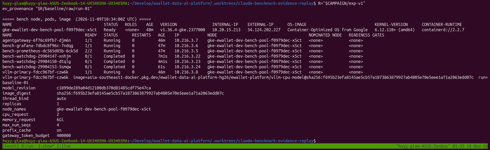

*S1-01, baseline-01. One `bench-pool` node, the vLLM pod Running on it, the image digest, the model revision and `thread_bind auto` read back from the live pod. Proves which model and image were measured. Raw: [`controls.json`](../../evidence/edai2/llm/owner_single_run_20261109/exp-v1/baseline/raw/run-01/controls.json).*

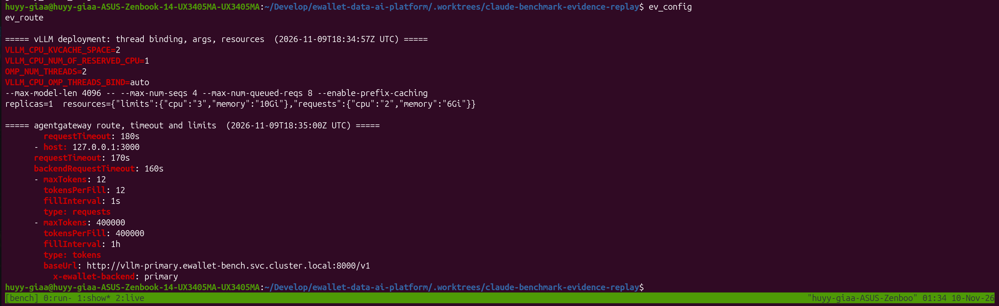

*S1-02, baseline-01. `VLLM_CPU_OMP_THREADS_BIND=auto`, vLLM arguments, resources and the gateway route with its timeouts and limits. Raw: [`config/run-01.yaml`](../../evidence/edai2/llm/owner_single_run_20261109/exp-v1/baseline/config/run-01.yaml).*

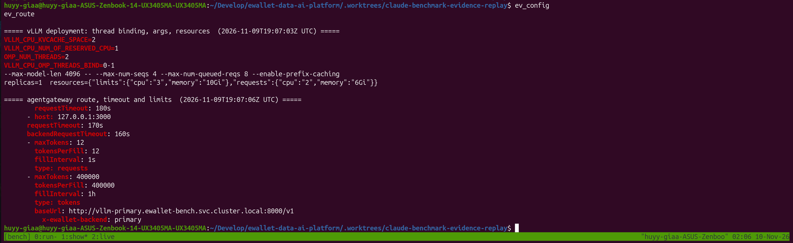

*S1-07, optimized-01. The only difference from S1-02 is `VLLM_CPU_OMP_THREADS_BIND=0-1`. Raw: [`config/run-01.yaml`](../../evidence/edai2/llm/owner_single_run_20261109/exp-v1/optimized/config/run-01.yaml).*


### 3.3 Controls, workload and method

Equal in both arms and verified by the comparator: workload hash, image digest, model revision, CPU and memory requests, node type, `max_num_seqs`, prefix cache, gateway token budget and the node itself (`bench-pool-f0979dec-x5ct`).

Each arm starts with fresh pods, then sends 3 cold-prefix and 2 warm-up requests (reported separately), then 12 measured requests at each of c=1, 2 and 4: short chats, long prompts, repeated and unique prefixes, streamed tool calls and a non-streamed chat. Client windows, including the cold and warm-up requests: baseline 18:06:40–18:24:57Z, optimized 18:53:57–19:05:17Z. The primary metric is output tokens per second.

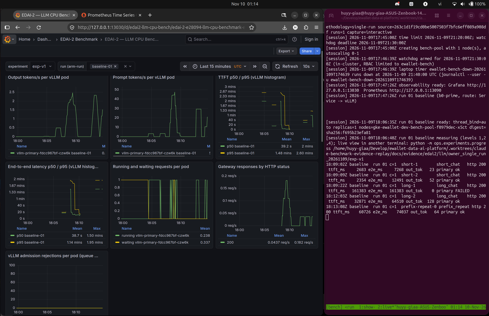

*S1-03, baseline-01, during c=1 (the capture stops there; later levels are in [`raw_requests.jsonl`](../../evidence/edai2/llm/owner_single_run_20261109/exp-v1/baseline/raw/run-01/raw_requests.jsonl)). The live view shows real requests, including the `long-1` request marked FAILED that §3.4 discusses, next to Grafana.*

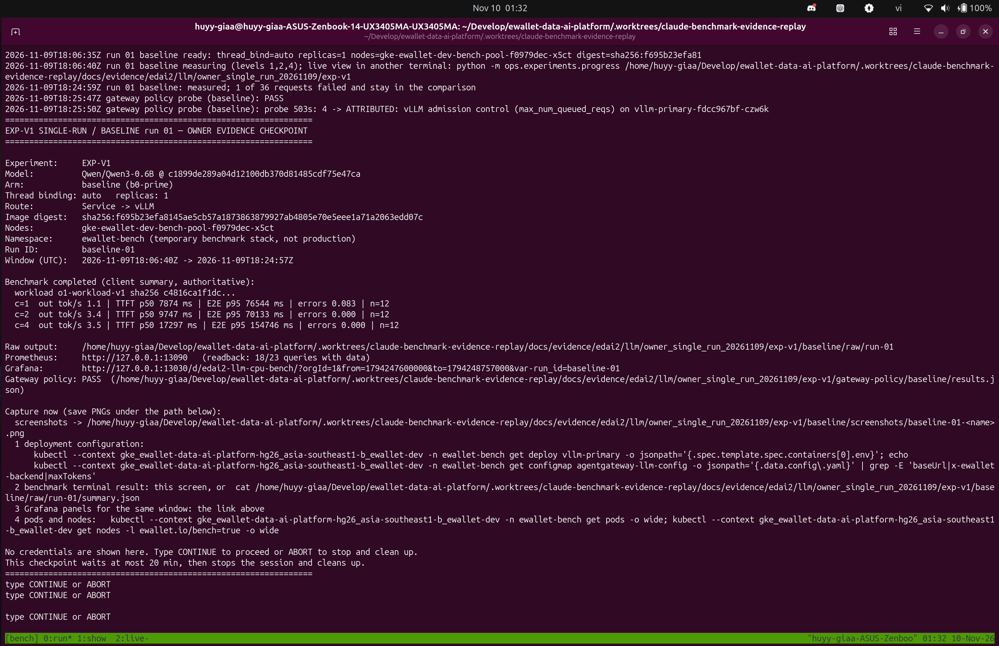

*S1-04, baseline-01. The checkpoint banner, labelled SINGLE-RUN, with the per-level results and the recorded failure. Raw: [`summary.json`](../../evidence/edai2/llm/owner_single_run_20261109/exp-v1/baseline/raw/run-01/summary.json).*


### 3.4 Results

Baseline → optimized, with the observed change. Source: [`comparison/metrics.json`](../../evidence/edai2/llm/owner_single_run_20261109/exp-v1/comparison/metrics.json).

| Level | Output tok/s | Requests/s | TTFT p50 (s) | TTFT p95 (s) | E2E p50 (s) | E2E p95 (s) |
|---|---|---|---|---|---|---|
| c=1 | 1.083 → 2.176 (+100.9 %) | 0.022 → 0.037 (+64.8 %) | 7.87 → 5.02 (+36.2 %) | 63.02 → 62.33 (+1.1 %) | 13.62 → 11.16 (+18.0 %) | 76.54 → 76.82 (-0.4 %) |
| c=2 | 3.357 → 5.127 (+52.7 %) | 0.057 → 0.086 (+52.7 %) | 9.75 → 5.48 (+43.8 %) | 15.52 → 8.97 (+42.2 %) | 35.37 → 22.88 (+35.3 %) | 70.13 → 46.53 (+33.7 %) |
| c=4 | 3.543 → 5.475 (+54.5 %) | 0.060 → 0.092 (+54.5 %) | 17.30 → 10.00 (+42.2 %) | 24.24 → 13.44 (+44.6 %) | 61.22 → 40.91 (+33.2 %) | 154.75 → 98.51 (+36.3 %) |

| Level | TPOT p50 (ms) | ITL p50 (ms) | vLLM CPU cores (mean) | Memory peak (MiB) | tok/s per allocated CPU | tok/s per used core |
|---|---|---|---|---|---|---|
| c=1 | 211.3 → 143.4 (+32.1 %) | 205.3 → 159.6 (+22.3 %) | 1.201 → 2.279 (-89.8 %) | 6,469 → 6,629 (-2.5 %) | 0.542 → 1.088 (+100.9 %) | 0.902 → 0.955 (+5.8 %) |
| c=2 | 448.4 → 301.2 (+32.8 %) | 397.8 → 270.7 (+31.9 %) | 1.709 → 2.641 (-54.5 %) | 6,458 → 6,625 (-2.6 %) | 1.679 → 2.563 (+52.7 %) | 1.964 → 1.942 (-1.2 %) |
| c=4 | 810.5 → 544.9 (+32.8 %) | 709.1 → 511.0 (+27.9 %) | 1.639 → 2.584 (-57.6 %) | 6,459 → 6,625 (-2.6 %) | 1.772 → 2.737 (+54.5 %) | 2.161 → 2.119 (-2.0 %) |

| Level | Baseline failed | Optimized failed | Valid tool calls (B → O) |
|---|---|---|---|
| c=1 | 1/12 | 0/12 | 2 → 2 |
| c=2 | 0/12 | 0/12 | 2 → 2 |
| c=4 | 0/12 | 0/12 | 2 → 2 |

**One baseline request failed, and it matters at c=1.** `long-1` returned HTTP 200, then ended after 161.4 s with no tokens. The gateway logged `response body failed: response idle timeout` after 160013 ms ([`gateway.log`](../../evidence/edai2/llm/owner_single_run_20261109/exp-v1/baseline/logs/run-01/gateway.log)), which is the 160 s `responseIdleTimeout`. The request counts as failed and stays in the comparison (the manifest records it as a deviation). Three details affect how to read c=1:

- `timeout_rate` is 0 because the client only flags its own 220 s socket timeout ([`o1_benchmark.py`](../../../scripts/llm_agent/o1_benchmark.py)). A gateway-side cut-off appears as a failure, not a timeout.
- Latency percentiles use successful requests only, so the baseline's c=1 percentiles exclude that 161 s request.
- The throughput does include it: the baseline c=1 pass took 540.0 s and produced 585 output tokens, against 327.7 s and 713 for the optimized arm. So the +100.9 % at c=1 is inflated by the failure. c=2 (+52.7 %) and c=4 (+54.5 %), with no failures in either arm, are the cleaner observations.

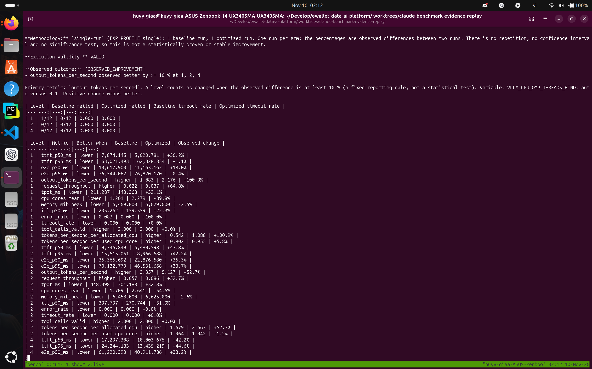

*S1-11. Single-run comparison as printed in the session: execution validity VALID, observed outcome OBSERVED_IMPROVEMENT, failure table, first metric rows.*

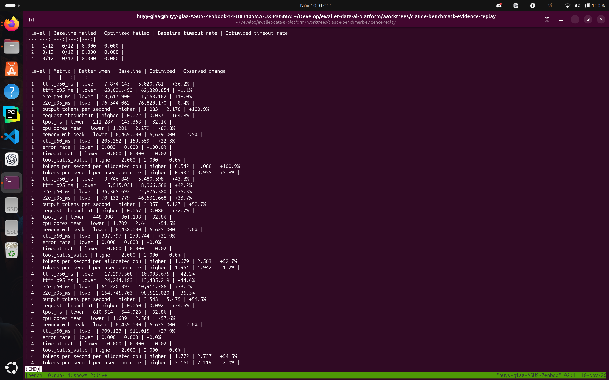

*S1-11, full table for c=1, 2 and 4. A dedicated optimized checkpoint banner (S1-09) was not captured; the optimized values are visible here and the banner text is preserved in [`checkpoint.txt`](../../evidence/edai2/llm/owner_single_run_20261109/exp-v1/optimized/logs/run-01/checkpoint.txt).*


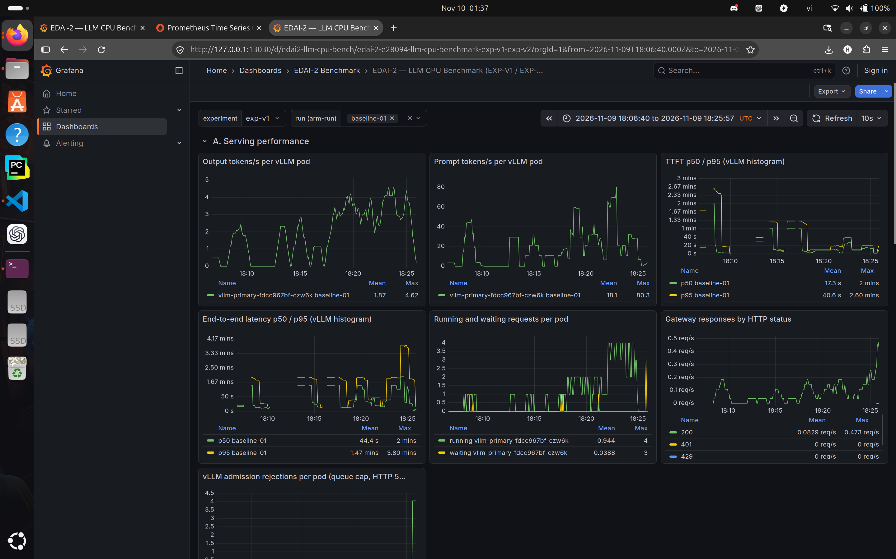

*S1-05, baseline-01. Prometheus and Grafana serving panels. The displayed range runs 60 s past the measured window, so the admission-rejection spike at the right edge is the gateway policy probe, not the benchmark.*

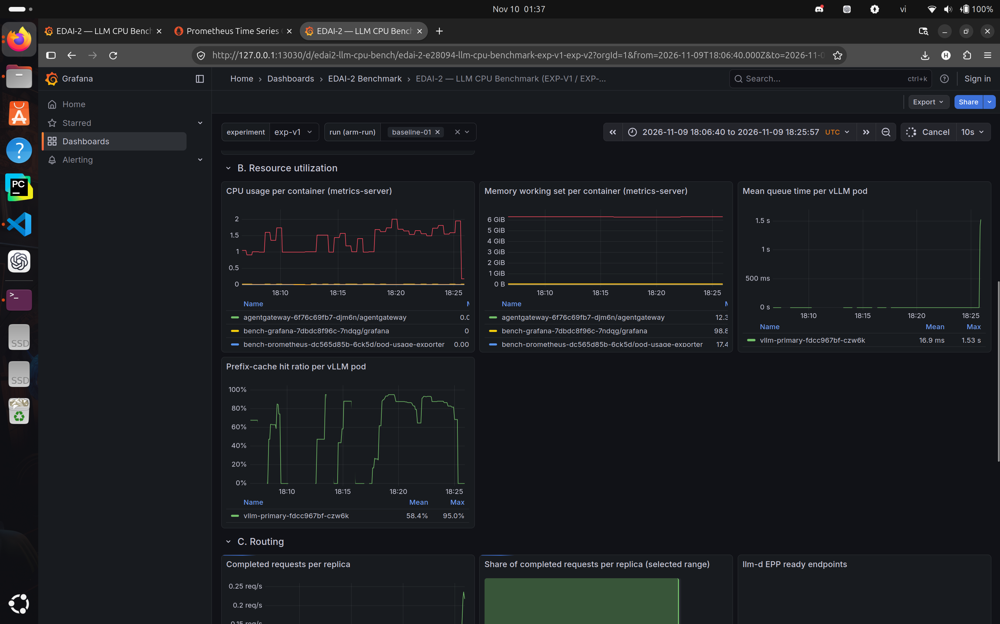

*S1-05, baseline-01. CPU stays between about 1 and 2 cores, under the 2-core request.*

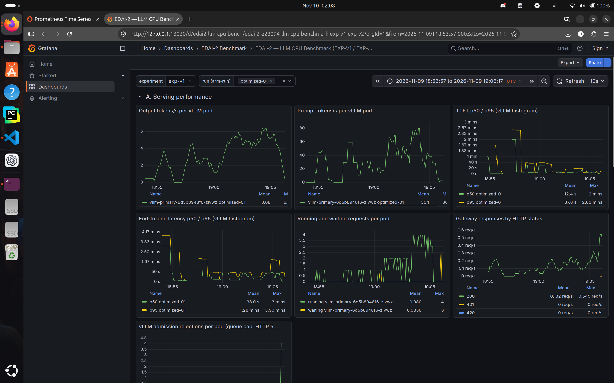

*S1-10, optimized-01. Same panels; the rejection spike at the right edge is again the policy probe.*

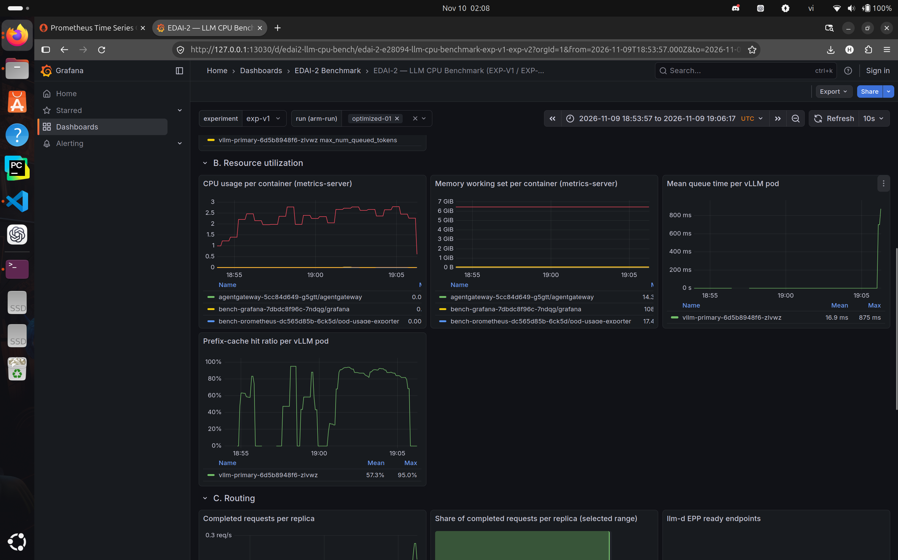

*S1-10, optimized-01. CPU sits between about 2 and 2.8 cores for most of the window, which is the trade-off discussed below.*


### 3.5 Interpretation

**Observed.**

- Output tokens/s improved at every level, and TTFT p50 improved by 36–44 %. E2E p95 improved by 33.7 % at c=2 and 36.3 % at c=4, and did not change at c=1 (−0.4 %).
- **The pod used more CPU.** Mean vLLM CPU rose from 1.20 to 2.28 cores at c=1 (−89.8 %), 1.71 to 2.64 at c=2 and 1.64 to 2.58 at c=4. Memory peak rose by about 2.5 %.
- **Tokens per CPU core actually used hardly changed:** +5.8 %, −1.2 % and −2.0 %. Tokens per *allocated* CPU improved by the same percentage as throughput, because the allocation is fixed.

**What this supports.** The gain is consistent with the optimized arm using more of the CPU it already had, rather than doing more work per core-second. On the same 2-CPU request and 3-CPU limit, the serving pod produced more tokens per second, at the cost of running closer to its CPU limit.

**Possible explanation, not proven here.** The O1 report attributes the `auto` behaviour to inference effectively running on one core. This experiment did not record per-thread CPU affinity or CFS throttling, so it measures the effect and does not prove that mechanism.

### 3.6 Limitations and conclusion

Beyond the general limits of §2.3: 12 requests per level, so a p95 rests on very few values; the failed baseline request affects c=1; the optimized arm always ran second.

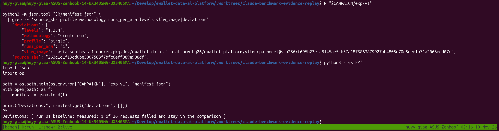

*S1-12. The manifest identifies this as single-run evidence: `profile single`, `methodology single-run`, one run per arm, the image and the source commit, and the recorded deviation.*

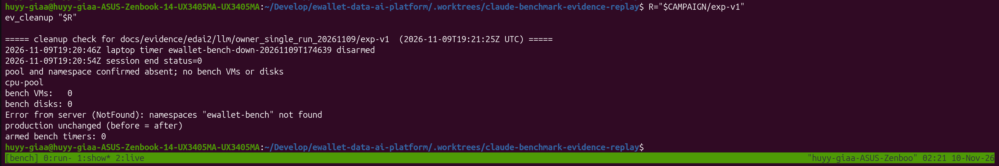

*S1-14. After the session: pool and namespace absent, no benchmark VMs or disks, production unchanged, no armed timer. Raw: [`safety/cleanup.txt`](../../evidence/edai2/llm/owner_single_run_20261109/exp-v1/safety/cleanup.txt).*


**Conclusion.** Execution was `VALID` and the observed outcome is `OBSERVED_IMPROVEMENT` under the fixed 10 % rule. In this run, `0-1` produced about 53–55 % more output tokens/s at c=2 and c=4 on the same pod budget, with higher CPU use and no additional failures. It is one observed pair, not a proven or general improvement.

## 4. EXP-V2 — Kubernetes Service vs llm-d EPP

### 4.1 Problem and motivation

With two replicas, a Kubernetes Service balances connections without knowing which replica holds a request's prefix in cache or how long its queue is. On CPU a cache miss is expensive: in O1, a cold 800-token prefill took about 44–87 s against a few seconds when warm. llm-d's Endpoint Picker (EPP) scores replicas using queue, KV-cache and prefix-cache signals. The hypothesis was that this improves latency for shared-prefix traffic at higher concurrency without harming low concurrency.

### 4.2 Architecture

```text
B2 baseline
  benchmark client → agentgateway (:4000 → llm listener :3000) → Service vllm-primary :8000 ─┬─> vLLM replica 1
                                                                                             └─> vLLM replica 2

O2 optimized
  benchmark client → agentgateway (:4000 → llm listener :3000) → Service llmd-router-epp :8081
                                              router pod (2/2 containers):
                                              envoy-proxy ⇄ epp (picks the endpoint)
                                                       ├─> vLLM replica 1 :8000
                                                       └─> vLLM replica 2 :8000
```

The client reaches the gateway through a laptop port-forward. In O2, Envoy carries the traffic and the EPP picks the destination per request.

**What changes between the arms:** only the gateway's `baseUrl` and the `x-ewallet-backend` response header (`primary` or `llm-d`), plus the router, which is installed for O2 only.

**What stays the same:** two `0-1` replicas, one per node; image, model and vLLM arguments; 2 CPU / 6 Gi requests; gateway limits and timeouts; workload and request counts; the two nodes (`8c4e9b77-38kl` and `8c4e9b77-g4tk`). EPP scorers are the G2 values (`queue-scorer` 2, `kv-cache-utilization-scorer` 2, `prefix-cache-scorer` 3) from [`standalone-values-g2.yaml`](../../../infra/helm/llm-d/standalone-values-g2.yaml) and the chart defaults recorded in the [G2 report](../../../archive/legacy-docs/docs/edai2/llm/llmd_g2_routing_benchmark.md); they were not tuned.

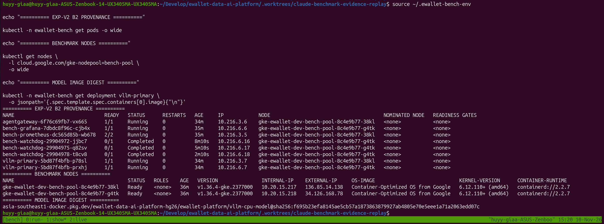

*S2-01, baseline-01. Two benchmark nodes, two vLLM replicas with one on each node, and the image digest.*

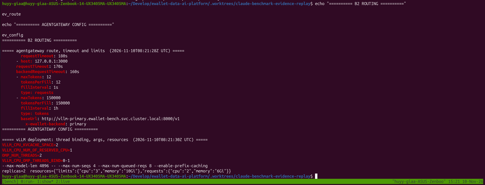

*S2-02, baseline-01. The gateway sends traffic to the `vllm-primary` Service and labels it `primary`. Binding is `0-1` and `replicas=2`. Raw: [`config/run-01.yaml`](../../evidence/edai2/llm/owner_single_run_20261109/exp-v2/baseline/config/run-01.yaml).*

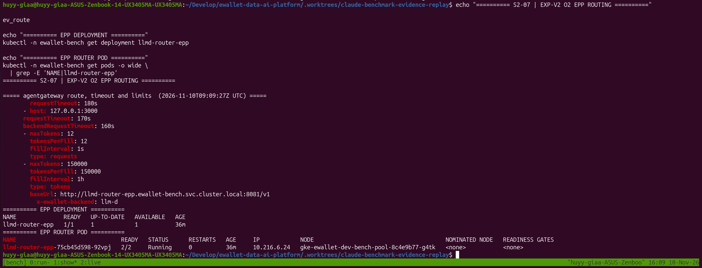

*S2-07, optimized-01. The gateway sends traffic to `llmd-router-epp:8081` and labels it `llm-d`. The router pod is 2/2 Running.*


### 4.3 Workload and execution

The workload and method are those of EXP-V1 (§3.3), at c=1, 2, 4 and 8: 12 measured requests per level per arm, so **48 baseline and 48 optimized benchmark requests, all 48 successful in each arm**. Levels run in sequence on the same pods, so the cache state at one level depends on the earlier levels. The primary metric is `e2e_p95_ms`. Client windows, including the cold and warm-up requests: B2 08:01:47–08:16:47Z, O2 08:48:01–09:03:22Z.

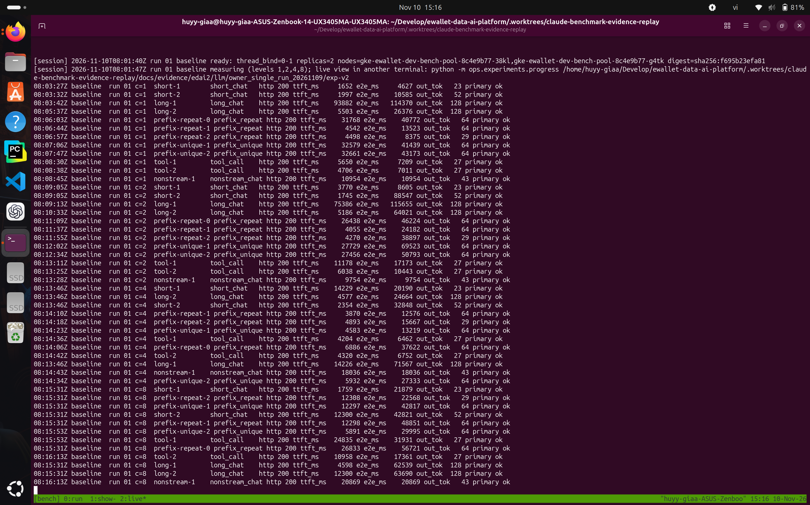

*S2-03, baseline-01. Every B2 request at each level, all answered through backend `primary`.*

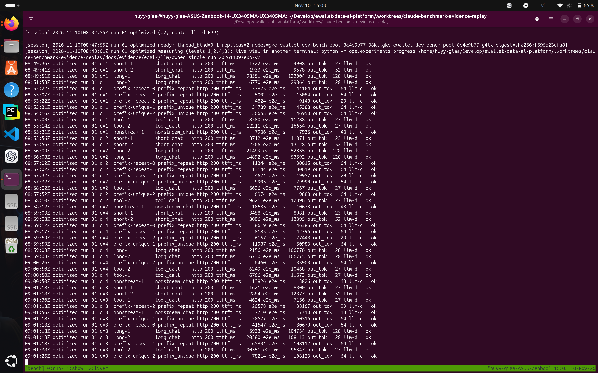

*S2-10, optimized-01. Every O2 request at each level, all answered through backend `llm-d`.*

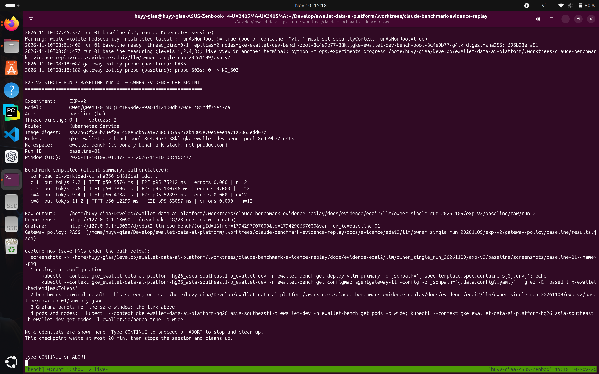

*S2-04, baseline-01. SINGLE-RUN banner with per-level results. The PodSecurity line is a warn-mode notice about the benchmark vLLM container; it did not block the pod.*

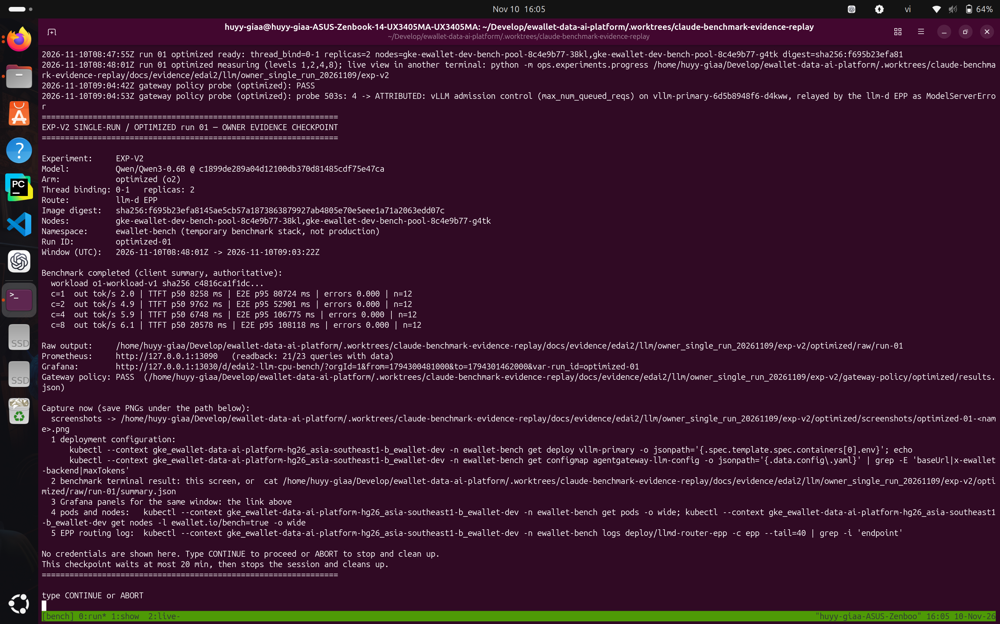

*S2-09, optimized-01. Same banner for the llm-d route.*


### 4.4 Results

Baseline (B2) → optimized (O2), with the observed change; a positive percentage means O2 was better. Source: [`comparison/metrics.json`](../../evidence/edai2/llm/owner_single_run_20261109/exp-v2/comparison/metrics.json).

**Primary metric and throughput:**

| Level | E2E p95 (s) | Output tok/s | Requests/s |
|---|---|---|---|
| c=1 | 75.21 → 80.72 (-7.3 %) | 2.171 → 1.964 (-9.5 %) | 0.037 → 0.033 (-9.5 %) |
| c=2 | 100.75 → 52.90 (+47.5 %) | 2.610 → 4.865 (+86.4 %) | 0.044 → 0.082 (+86.4 %) |
| c=4 | 52.90 → 106.78 (-101.9 %) | 9.400 → 5.912 (-37.1 %) | 0.158 → 0.099 (-37.1 %) |
| c=8 | 63.06 → 108.12 (-71.5 %) | 11.194 → 6.124 (-45.3 %) | 0.188 → 0.103 (-45.3 %) |

**Other latency:**

| Level | TTFT p50 (s) | TTFT p95 (s) | E2E p50 (s) | TPOT p50 (ms) | ITL p50 (ms) |
|---|---|---|---|---|---|
| c=1 | 5.58 → 8.26 (-48.1 %) | 60.21 → 64.51 (-7.1 %) | 12.24 → 15.86 (-29.6 %) | 141.6 → 161.7 (-14.2 %) | 150.0 → 159.9 (-6.6 %) |
| c=2 | 7.90 → 9.76 (-23.6 %) | 49.17 → 17.87 (+63.7 %) | 42.56 → 19.92 (+53.2 %) | 318.3 → 260.1 (+18.3 %) | 247.5 → 27.7 (+88.8 %) |
| c=4 | 4.74 → 6.75 (-42.4 %) | 15.94 → 12.91 (+19.0 %) | 19.11 → 30.68 (-60.5 %) | 214.6 → 489.3 (-128.1 %) | 190.6 → 494.1 (-159.2 %) |
| c=8 | 12.30 → 20.58 (-67.3 %) | 25.73 → 83.68 (-225.2 %) | 37.37 → 70.60 (-88.9 %) | 430.4 → 547.9 (-27.3 %) | 324.3 → 514.0 (-58.5 %) |

**Resources, cache and queue:**

| Level | vLLM CPU cores (mean) | Memory peak (MiB) | tok/s per allocated CPU | tok/s per used core | Prefix-cache hit ratio | Mean queue time (ms) |
|---|---|---|---|---|---|---|
| c=1 | 2.201 → 2.511 (-14.1 %) | 12,437 → 13,002 (-4.5 %) | 0.543 → 0.491 (-9.5 %) | 0.986 → 0.782 (-20.7 %) | 0.427 → 0.408 (-4.5 %) | 0.2 → 0.6 (-150.7 %) |
| c=2 | 2.286 → 2.450 (-7.2 %) | 12,397 → 13,000 (-4.9 %) | 0.652 → 1.216 (+86.4 %) | 1.142 → 1.986 (+73.9 %) | 0.408 → 0.894 (+119.0 %) | 0.0 → 0.6 (-2576.3 %) |
| c=4 | 4.337 → 2.725 (+37.2 %) | 12,367 → 12,999 (-5.1 %) | 2.350 → 1.478 (-37.1 %) | 2.167 → 2.169 (+0.1 %) | 0.894 → 0.894 (+0.0 %) | 0.4 → 0.0 (+94.7 %) |
| c=8 | 2.742 → 3.409 (-24.3 %) | 12,366 → 12,998 (-5.1 %) | 2.799 → 1.531 (-45.3 %) | 4.082 → 1.796 (-56.0 %) | 0.894 → 0.894 (+0.0 %) | 2,851.9 → 19,169.0 (-572.1 %) |

| Level | Baseline failed | Optimized failed | Valid tool calls (B → O) |
|---|---|---|---|
| c=1 | 0/12 | 0/12 | 2 → 2 |
| c=2 | 0/12 | 0/12 | 2 → 2 |
| c=4 | 0/12 | 0/12 | 2 → 2 |
| c=8 | 0/12 | 0/12 | 2 → 2 |

CPU is the sum over the vLLM pods and excludes the router. The router's own mean CPU was about 0.06 cores for the EPP and 0.005 for Envoy.

**Why the outcome is `OBSERVED_MIXED`.** The E2E p95 rule gives a different answer per level:

| Level | E2E p95, B2 → O2 | O2 relative to B2 | Rule (±10 %) |
|---|---|---|---|
| c=1 | 75.21 s → 80.72 s | 7.3 % higher latency | within the threshold |
| c=2 | 100.75 s → 52.90 s | 47.5 % lower latency | better |
| c=4 | 52.90 s → 106.78 s | 101.9 % higher latency | worse |
| c=8 | 63.06 s → 108.12 s | 71.5 % higher latency | worse |

Better at one level and worse at two is `OBSERVED_MIXED`. Output tokens/s moves the same way: +86.4 % at c=2, −37.1 % at c=4, −45.3 % at c=8.

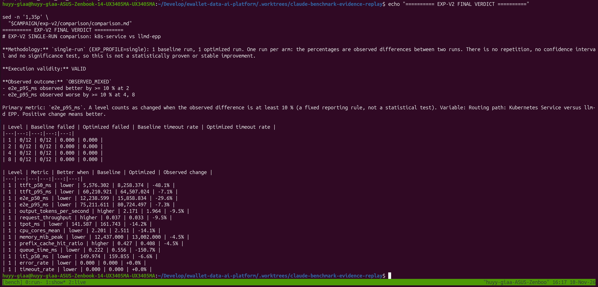

*S2-11. The verdict printed by the comparator: single-run, VALID, OBSERVED_MIXED, with both reasons and zero failed requests.*

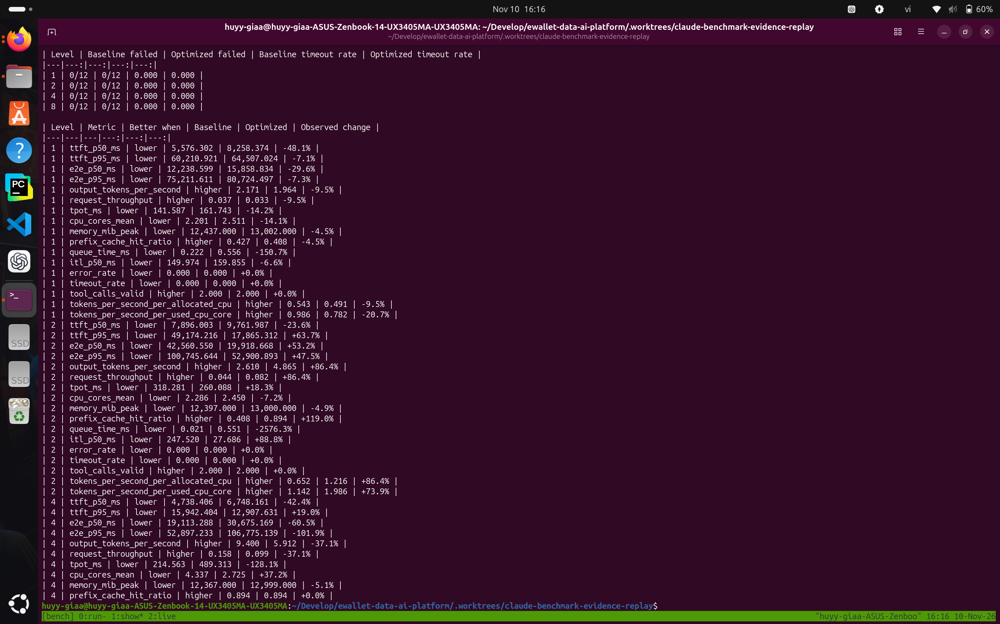

*S2-11. Metric rows for c=1 and c=2.*

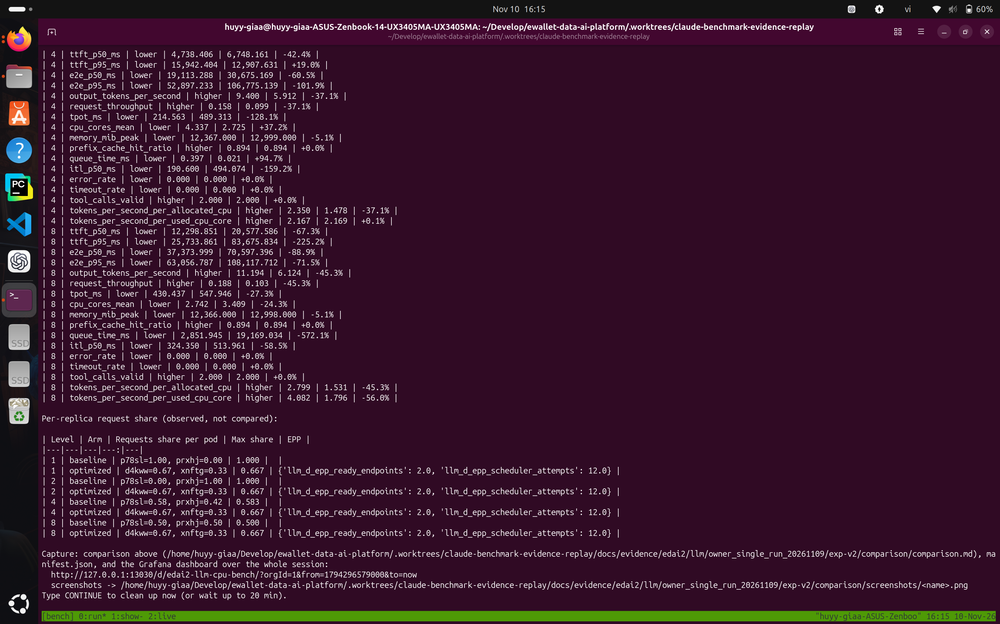

*S2-11. Metric rows for c=4 and c=8, and the per-replica request share.*


### 4.5 Request distribution and EPP evidence

Per-pod values during each level, from the vLLM counters in [`B2 summary.json`](../../evidence/edai2/llm/owner_single_run_20261109/exp-v2/baseline/raw/run-01/summary.json) and [`O2 summary.json`](../../evidence/edai2/llm/owner_single_run_20261109/exp-v2/optimized/raw/run-01/summary.json):

| Level | Arm | Requests per pod | Prompt tokens per pod | Generated tokens per pod | Mean vLLM CPU per pod (cores) | Pods serving |
|---|---|---|---|---|---|---|
| c=1 | B2 | p78sl: 12, prxhj: 0 | p78sl: 6588, prxhj: 0 | p78sl: 713, prxhj: 0 | p78sl: 2.19, prxhj: 0.02 | 1 |
| c=1 | O2 | d4kww: 8, xnftg: 4 | d4kww: 6350, xnftg: 238 | d4kww: 568, xnftg: 145 | d4kww: 2.02, xnftg: 0.49 | 2 |
| c=2 | B2 | p78sl: 0, prxhj: 12 | p78sl: 0, prxhj: 6588 | p78sl: 0, prxhj: 713 | p78sl: 0.33, prxhj: 1.95 | 1 |
| c=2 | O2 | d4kww: 8, xnftg: 4 | d4kww: 6350, xnftg: 238 | d4kww: 568, xnftg: 145 | d4kww: 2.16, xnftg: 0.29 | 2 |
| c=4 | B2 | p78sl: 7, prxhj: 5 | p78sl: 3439, prxhj: 3149 | p78sl: 403, prxhj: 310 | p78sl: 1.98, prxhj: 2.36 | 2 |
| c=4 | O2 | d4kww: 8, xnftg: 4 | d4kww: 6350, xnftg: 238 | d4kww: 568, xnftg: 145 | d4kww: 2.12, xnftg: 0.60 | 2 |
| c=8 | B2 | p78sl: 6, prxhj: 6 | p78sl: 3001, prxhj: 3587 | p78sl: 358, prxhj: 355 | p78sl: 1.44, prxhj: 1.31 | 2 |
| c=8 | O2 | d4kww: 8, xnftg: 4 | d4kww: 6350, xnftg: 238 | d4kww: 568, xnftg: 145 | d4kww: 2.38, xnftg: 1.03 | 2 |

**Observed.**

- **B2 did not balance evenly at low concurrency.** All 12 requests went to one pod at c=1 and all 12 to the other pod at c=2. At c=4 the split was 7/5 and at c=8 it was 6/6.
- **O2 used both pods at every level, with the same 8/4 split.** By request count that is 67 % / 33 %, but `d4kww` received 6350 of the 6588 prompt tokens (96 %) and 568 of the 713 generated tokens (80 %). A request share therefore understates how uneven the work was.
- **At c=4 and c=8, B2 was more evenly distributed than O2.** More even routing is not what the EPP produced at those levels, and "EPP routing is better balanced" is not a conclusion of this run.
- At c=2 the prefix-cache hit ratio was 0.408 for B2, whose requests had moved to the pod that served none at c=1, and 0.894 for O2. At c=4 and c=8 both arms show 0.894.
- At c=8, mean queue time was 2.85 s for B2 and 19.17 s for O2.

**Possible explanations, not proven by this run.**

- At c=2, O2's advantage may come mostly from keeping requests where the prefix was already cached, while B2 paid a second cold pass on the other pod. The hit ratios fit this, but one run cannot separate it from other causes.
- At c=4 and c=8, O2's loss may come from concentrating the long-prompt requests on one replica. The `prefix-cache-scorer` weight may outweigh the queue signal for this workload. One pod did most of the work (about 2.1–2.4 cores against 0.6–1.0) while its queue grew.
- Additional routing components can add overhead in general. Here the EPP's scheduling latency was small (p95 mean 1.54 ms, maximum 9 ms in S2-09), far below the differences of tens of seconds, so it is unlikely to be the main factor. Envoy's added latency was not measured separately.

**Reading the EPP counters.** The counters on S2-08 are cumulative since the router started, so 49/20 is **not** the split of the 48 benchmark requests:

| Point | `d4kww` / `xnftg` | Total | What it contains |
|---|---|---|---|
| End of the measured window ([`epp-metrics-after.txt`](../../evidence/edai2/llm/owner_single_run_20261109/exp-v2/optimized/raw/run-01/epp-metrics-after.txt)) | 33 / 20 | 53 | 48 benchmark + 3 cold-prefix + 2 warm-up requests |
| Benchmark requests only (vLLM counters, table above) | 32 / 16 | 48 | the official result |
| After the policy probe (S2-08) | 49 / 20 | 69 | +16 probe requests, all on `d4kww` |

Likewise, the Grafana share of 62.2 % / 37.8 % on S2-09 applies to the displayed Prometheus range, which includes the cold and warm-up requests. The official split is 32/16.

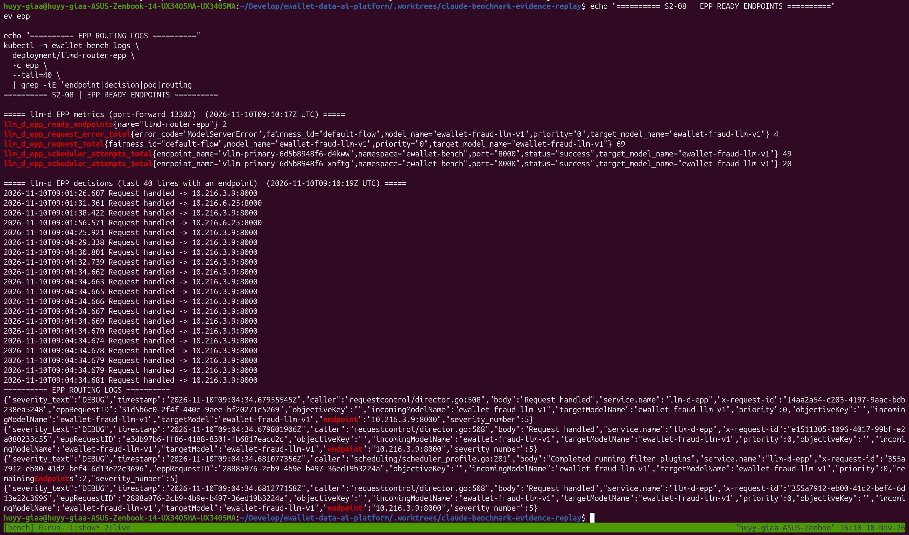

*S2-08, optimized-01. Two ready endpoints, scheduling decisions on both pods, and log lines naming both pod IPs (10.216.3.9 is `d4kww`, 10.216.6.25 is `xnftg`). Counters are cumulative, and most of the log tail is the policy-probe burst.*

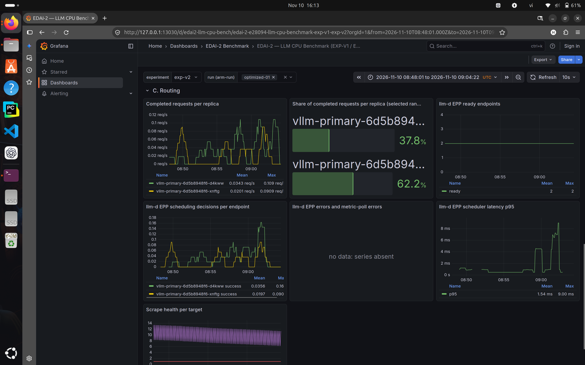

*S2-09, optimized-01. Routing panels: per-replica completions, two ready endpoints, scheduling decisions per endpoint and scheduler latency. The error panel has no series because no EPP error occurred in this range.*

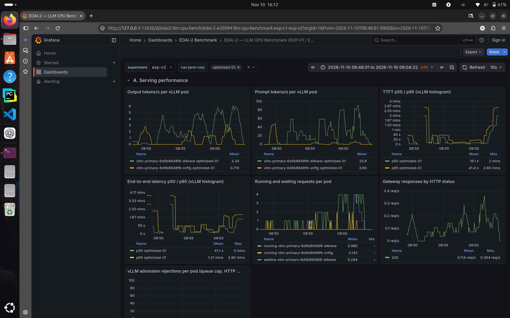

*S2-09, optimized-01. Per-pod serving panels. One pod carries most of the tokens and the waiting requests.*

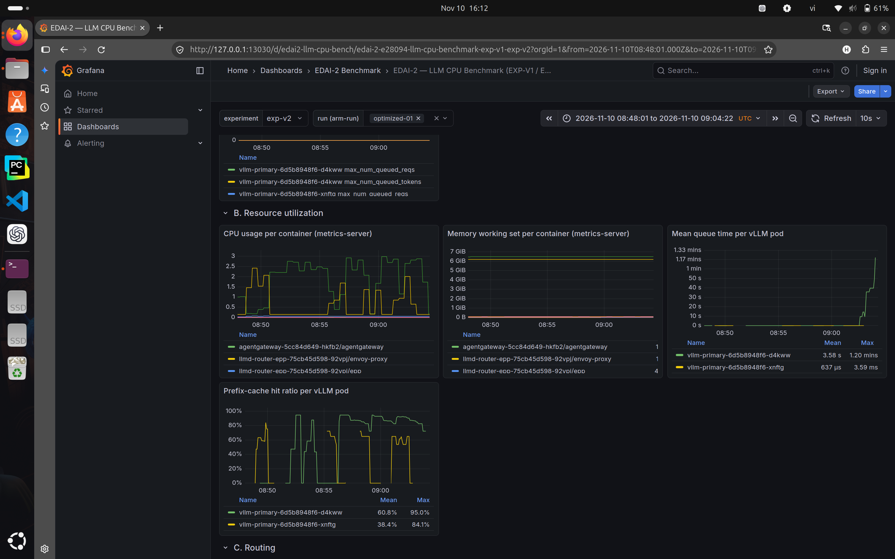

*S2-09, optimized-01. Per-container CPU and memory, including `envoy-proxy` and `epp`, per-pod queue time and prefix-cache hit ratio.*

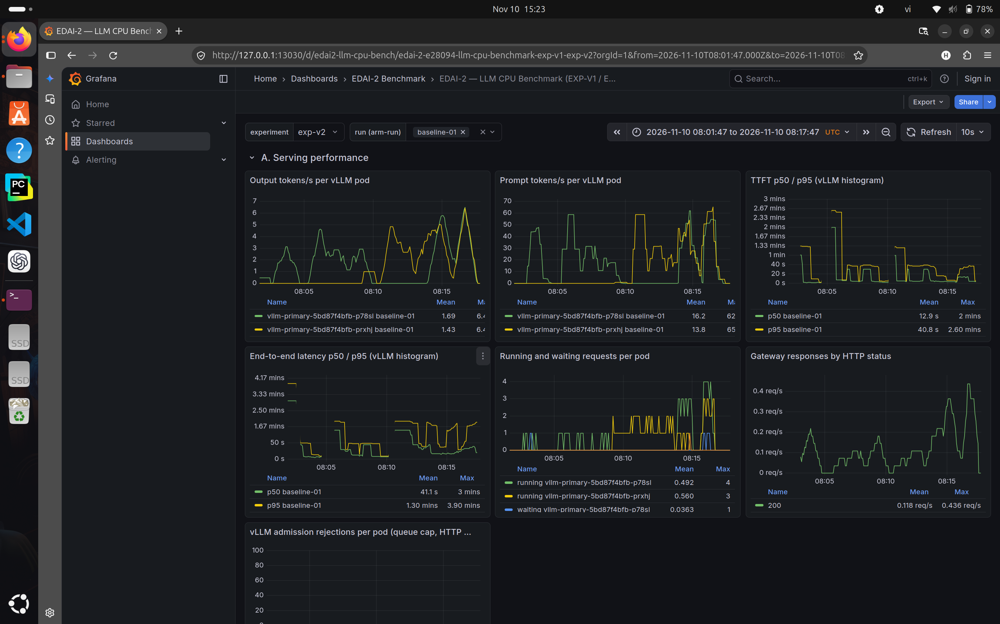

*S2-05, baseline-01. Per-pod serving panels; both pods work at c=4 and c=8. The request-share panels of section C were not captured for B2; the table above has those values.*

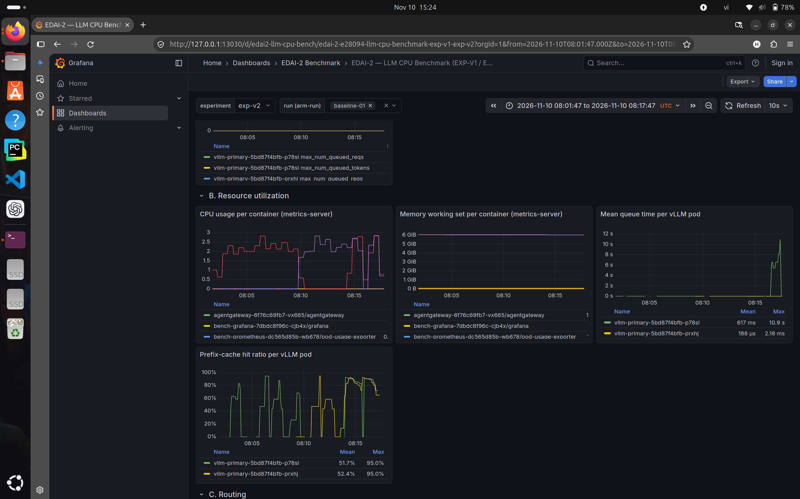

*S2-05, baseline-01. Per-container CPU and memory, and per-pod queue time and prefix-cache hit ratio.*


### 4.6 Limitations and conclusion

Beyond the general limits of §2.3:

- Levels are not independent, because the cache state carries over from one level to the next.
- This run and the historical 3-run rehearsal disagree at c=4 and c=8. In the rehearsal the O2 medians were better and within the spread (`NO_SIGNIFICANT_CHANGE`). Here O2 was worse beyond the threshold. The official B2 p95 at c=4 (52.9 s) is inside the rehearsal's B2 range (48.1–102.9 s); the official O2 p95 (106.8 s) is above the rehearsal's O2 range (43.5–69.0 s). Variation of this size is a reason not to generalize from either result.
- Results apply to this CPU deployment, model and workload.

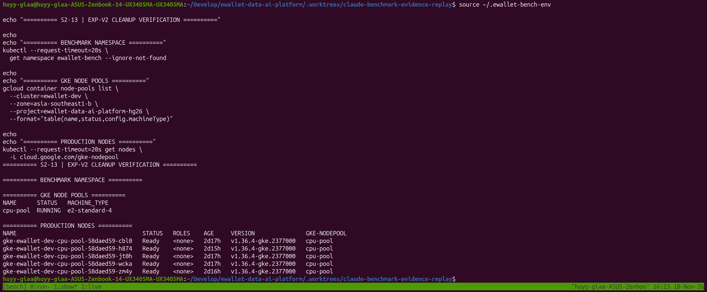

*S2-13. After the session: namespace absent, only `cpu-pool`, five production nodes Ready. The VM and disk counts and the production comparison are in [`safety/cleanup.txt`](../../evidence/edai2/llm/owner_single_run_20261109/exp-v2/safety/cleanup.txt) and `production-*.txt`.*


**Conclusion.** Execution was `VALID` and the observed outcome is `OBSERVED_MIXED`. In this run EPP routing was better on E2E p95 at c=2, and worse at c=4 and c=8. It did not show a general gain over a Kubernetes Service, and the production inference path remains without llm-d.

## 5. Agentgateway Security and Policy Evidence

The policy evidence comes from the same benchmark gateway. agentgateway is configured by [`vllm-bench.yaml.tmpl`](../../../infra/kubernetes/experiments/vllm-bench.yaml.tmpl); the recorded configuration is [`gateway-policy-config.yaml`](../../evidence/edai2/llm/owner_single_run_20261109/exp-v2/gateway-policy/baseline/gateway-policy-config.yaml). Keys are random per session, held in Secrets and removed from the recorded file by the runner. The production gateway's policies are described in [LLM_PLATFORM §4](LLM_PLATFORM.md#4-agentgateway).

| Control | Recorded value | Why it is configured |
|---|---|---|
| Client authentication | `apiKey`, `mode: strict` | Only clients with the gateway key can reach the model; a request without a valid key is refused before any inference |
| Backend authentication | a separate key from the gateway to vLLM (template, not in the filtered file) | The vLLM key is never given to clients, and it is refused if a client presents it |
| Request rate limit | 12 requests per 1 s | Protects a CPU server that handles few concurrent requests from bursts |
| Token budget | 150000 tokens per 1 h in EXP-V2 (400000 in EXP-V1) | Bounds the resources a client can consume |
| Timeouts | route `requestTimeout` 180 s; LLM `requestTimeout` 170 s; `backendRequestTimeout` 160 s; `responseIdleTimeout` 160 s | A request cannot remain in flight indefinitely, and each layer gives up after the one below it |
| Routing header | `x-ewallet-backend: primary` or `llm-d` | Makes the selected route observable in every response |

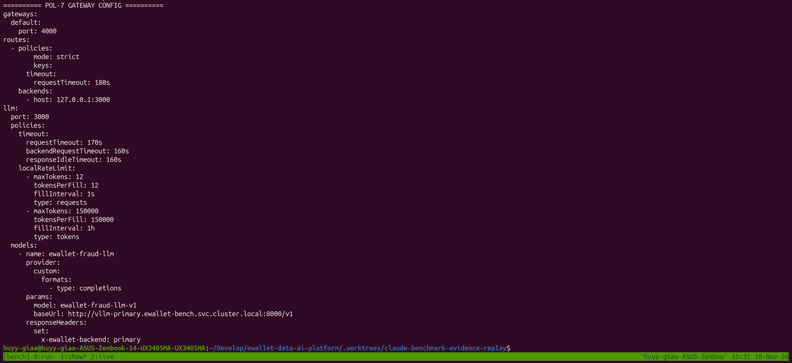

*POL-7, baseline-01 checkpoint. The recorded policy: strict authentication (key values removed), timeouts, request and token limits, and the backend header.*

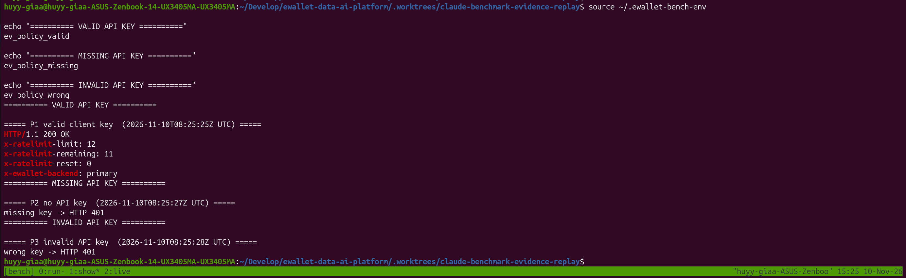

*POL-1, POL-2, POL-3, B2 checkpoint. Valid key: 200 with rate-limit headers and backend `primary`. Missing key: 401. Invalid key: 401. The case of the backend key used as a client key (also 401) is in [`results.json`](../../evidence/edai2/llm/owner_single_run_20261109/exp-v2/gateway-policy/baseline/results.json), not on this screen.*

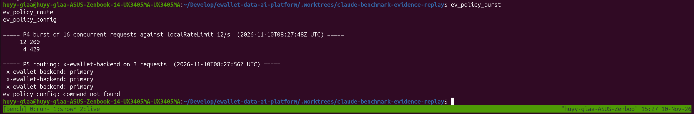

*POL-4 and POL-5, B2 checkpoint, 08:27:48Z. A burst of 16 returns 12×200 and 4×429. Three more requests are routed to `primary`.*

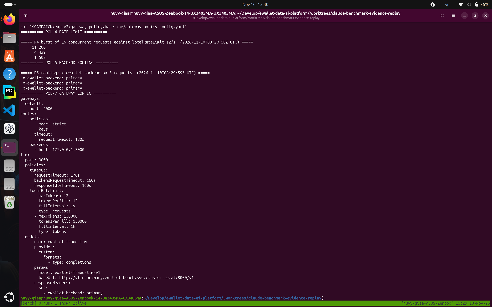

*POL-4b, B2 checkpoint, 08:29:50Z. A later owner-triggered burst returns 11×200, 4×429 and 1×503. This 503 is unattributed (see below).*

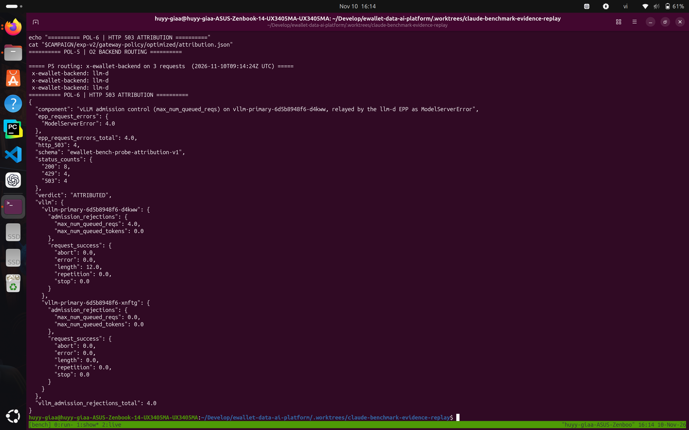

*POL-5 and POL-6, O2 checkpoint. Three requests routed to `llm-d`, and the attribution of the automatic O2 probe. Raw: [`attribution.json`](../../evidence/edai2/llm/owner_single_run_20261109/exp-v2/gateway-policy/optimized/attribution.json).*


**HTTP status meanings.**

| Status | Meaning here |
|---|---|
| 401 | Authentication rejection by the gateway |
| 429 | Local rate limit enforced by the gateway |
| 503 | A backend or admission failure that needs attribution. **It is not rate-limit enforcement** |

**Burst results** (16 concurrent requests; these are policy probes and never part of the 48 benchmark requests):

| Burst | Time (UTC) | 200 | 429 | 503 | Attribution of the 503s |
|---|---|---:|---:|---:|---|
| EXP-V1 B0, automatic | 18:25 | 8 | 4 | 4 | `ATTRIBUTED`: vLLM `max_num_queued_reqs` |
| EXP-V1 C1, automatic | 19:05 | 8 | 4 | 4 | `ATTRIBUTED`: vLLM `max_num_queued_reqs` |
| EXP-V2 B2, automatic | 08:18 | 13 | 3 | 0 | `NO_503` |
| EXP-V2 B2, owner, first | 08:27:48 | 12 | 4 | 0 | none to attribute |
| EXP-V2 B2, owner, later | 08:29:50 | 11 | 4 | 1 | **unattributed**: no counters were captured around this manual burst |
| EXP-V2 O2, automatic | 09:04 | 8 | 4 | 4 | `ATTRIBUTED`: vLLM `max_num_queued_reqs`, relayed by the EPP |

**The O2 503s.** The four 503s of the automatic O2 probe were observed together with +4 `max_num_queued_reqs` rejections on `d4kww` and +4 EPP `ModelServerError`. The path is:

```text
vLLM admission control (max_num_queued_reqs = 8) on d4kww
        ↓ HTTP 503
llm-d EPP (counts it as ModelServerError)
        ↓
agentgateway → client
```

These happened in the policy probe, after the measured window. **The official O2 benchmark failure rate is 0/48, not 4/48.** The burst repeats one prompt, and the probe's 16 EPP-routed requests all went to `d4kww`, so that pod reached its queue cap. The later B2 burst shows that a 503 can also occur on the Service route; its cause was not recorded, so this report does not assign one.

**Failover was not tested.** The benchmark stack has no fallback backend, on purpose, because a fallback would hide failed requests. Failover evidence is historical and separate (G1, [LLM_PLATFORM §6](LLM_PLATFORM.md#6-runtime-verification)).

## 6. Comparative Analysis

Four sets of measurements exist for these two questions. Only the first is the submission result; the others are context and their numbers are never mixed into the tables above.

| Result set | Date | Runs per arm | EXP-V1 / O1 (thread binding) | EXP-V2 / G2 (llm-d EPP) |
|---|---|---|---|---|
| **Official owner single-run campaign** (this report) | 2026-11-09/10 | 1 | `OBSERVED_IMPROVEMENT`: +52.7 % / +54.5 % tok/s at c=2 / c=4 | `OBSERVED_MIXED`: E2E p95 better at c=2, worse at c=4 and c=8 |
| Unattended formal rehearsal ([README](../../evidence/edai2/llm/benchmark_rehearsal_20261109/README.md)) | 2026-11-09 | 3 (AB, BA, AB) | `IMPROVED`: +87 / +73 / +76 % tok/s at c=1/2/4, about −45 % TTFT p50 | `NO_SIGNIFICANT_CHANGE`: EPP medians better at c=4 and c=8, but within the run-to-run spread |
| Historical O1 ([record](../../../archive/legacy-docs/docs/edai2/llm/vllm_cpu_o1_benchmark.md)) | 2026-11-01 | 1 | +51.4 % tok/s and −37.4 % TTFT p50 at c=4; the automated evaluator said `NO_GAIN` because of one baseline timeout, and the configuration was selected by owner review | — |
| Historical G2 ([record](../../../archive/legacy-docs/docs/edai2/llm/llmd_g2_routing_benchmark.md)) | 2026-11-01 | 1 | — | `MIXED`: +27.5 % and +45.9 % tok/s at c=4 and c=8; −10.7 % and −11.5 % at c=1 and c=2 |

The O1 and G2 runs used a different stack (§2.6); the rehearsal used the same stack with three runs per arm and no owner screenshots.

**Thread binding is consistent across every set.** O1, the rehearsal and the official run all show higher throughput with `0-1` at the same pod budget, and in each case the pod used more of its allocated CPU (§3.5). The direction is stable; the size varies (+51 % to +87 % depending on level and run), and none of these sets supports a statistical claim.

**EPP routing is not consistent.** G2 and the rehearsal favoured the EPP at c=4 and c=8; the official run was worse there by more than the threshold. The official O2 p95 at c=4 lies above the rehearsal's whole O2 range (§4.6). The per-pod data of §4.5 points to placement: in the official run the EPP sent 96 % of the prompt tokens to one replica. The effect of cache-aware routing on this CPU deployment therefore depends on workload and placement, and is not established by any single result.

**Benchmark failures and policy-probe failures are different things.** The only benchmark failure in the campaign is EXP-V1's baseline `long-1` (a gateway idle timeout, §3.4). The 503s of §5 happened in policy probes after the measured windows: they do not change any failure rate in §3 or §4.

## 7. Limitations

- **One run per arm.** No confidence interval, no significance test, fixed arm order; each verdict is an observation of one pair (§2.3).
- **Few requests.** 12 requests per level, so a p95 rests on very few values and sits close to the maximum.
- **EXP-V1 baseline timeout.** The failed `long-1` request is excluded from the baseline's c=1 latency percentiles but included in its throughput, so the +100.9 % at c=1 is inflated; c=2 and c=4 are the cleaner observations.
- **EXP-V2 levels are not independent.** Cache state carries over from one level to the next, and the request distribution was uneven in both arms (one pod at c=1 and c=2 for B2; 96 % of prompt tokens on one pod for O2).
- **Mechanism not proven.** Per-thread CPU affinity and CFS throttling were not recorded, so EXP-V1 measures the effect of binding, not the cause; the EPP's prefix-cache weight as the cause of the EXP-V2 imbalance is a hypothesis.
- **Scope.** Results apply to this CPU deployment, model, image and synthetic workload. Tool-call validity is checked structurally only.
- **Benchmark gateway, not production gateway.** The policy screenshots show the temporary benchmark gateway with raised token budgets; failover was not exercised in this campaign (§5).

## 8. Conclusions

- **EXP-V1 (`VALID / OBSERVED_IMPROVEMENT`).** On the same 2-CPU request and 3-CPU limit, binding the OpenMP threads to CPUs 0-1 produced about 53–55 % more output tokens/s at c=2 and c=4 and removed the baseline's one failure, at the cost of running closer to the CPU limit. The gain comes from using more of the allocated CPU, not from more work per core. The same direction appeared in O1 and in the rehearsal.
- **EXP-V2 (`VALID / OBSERVED_MIXED`).** llm-d EPP routing was better on E2E p95 at c=2 and worse at c=4 and c=8, with no failures in either arm. It did not show a general gain over a Kubernetes Service on this deployment, and the production inference path stays without llm-d.
- **Gateway policy.** The benchmark gateway enforced strict client authentication (401), the request rate limit (429), nested timeouts and backend attribution in every session.

## 9. Evidence and Reproducibility

**Where the evidence is.**

| What | Location |
|---|---|
| Campaign index, file provenance | [`owner_single_run_20261109/README.md`](../../evidence/edai2/llm/owner_single_run_20261109/README.md) |
| Claim-by-claim screenshot and raw-artifact mapping (`VERIFIED` / `PARTIAL` status per item) | [EDAI2_LLM_BENCHMARK_EVIDENCE_MATRIX.md](../../rubric/EDAI2_LLM_BENCHMARK_EVIDENCE_MATRIX.md) |
| Screenshot provenance (source name, SHA-256, arm, limitation of every screenshot) | [`screenshot_provenance.json`](../../evidence/edai2/llm/owner_single_run_20261109/screenshot_provenance.json) |
| Comparisons | [`exp-v1/comparison/metrics.json`](../../evidence/edai2/llm/owner_single_run_20261109/exp-v1/comparison/metrics.json), [`exp-v2/comparison/metrics.json`](../../evidence/edai2/llm/owner_single_run_20261109/exp-v2/comparison/metrics.json) |
| Manifests | [`exp-v1/manifest.json`](../../evidence/edai2/llm/owner_single_run_20261109/exp-v1/manifest.json), [`exp-v2/manifest.json`](../../evidence/edai2/llm/owner_single_run_20261109/exp-v2/manifest.json) |
| Validation smoke runs and cleanup drill (not results) | [`benchmark_reproduction_20261109/`](../../evidence/edai2/llm/benchmark_reproduction_20261109/README.md) |
| Historical rehearsal (not results) | [`benchmark_rehearsal_20261109/`](../../evidence/edai2/llm/benchmark_rehearsal_20261109/README.md) |

**Integrity check:**

```bash
(cd docs/evidence/edai2/llm/owner_single_run_20261109 && sha256sum -c --quiet sha256sums.txt)
```

**Reproduce.** The owner procedure, commands and screenshot checkpoints are in the [benchmark evidence runbook](../../runbooks/edai2/BENCHMARK_EVIDENCE_RUNBOOK.md). The runner is [`vllm_bench.sh`](../../../scripts/experiments/vllm_bench.sh) with `EXP_PROFILE=single`; the comparison is recomputed from the evidence directory with `ops.experiments.cli compare`, which selects the comparator from the session manifest.

**Archived records** (historical, not current results): the earlier [methodology page](../../../archive/legacy-docs/docs/edai2/llm/BENCHMARK_METHODOLOGY.md), the [replay design and GKE validation record](../../../archive/legacy-docs/docs/edai2/llm/BENCHMARK_REPLAY.md) with measured stage durations, the pre-run [safety audit](../../../archive/legacy-docs/docs/edai2/llm/EXP_V1_V2_SAFETY_AUDIT.md), and the complete [O1](../../../archive/legacy-docs/docs/edai2/llm/vllm_cpu_o1_benchmark.md) and [G2](../../../archive/legacy-docs/docs/edai2/llm/llmd_g2_routing_benchmark.md) experiment logs.

### 9.1 EDAI-2 rubric alignment

The wording comes from the repository's workbook extract, [`edai_k11_workbook_extract.json`](../../rubric/edai_k11_workbook_extract.json).

| Row | Requirement | Implementation and configuration | Runtime evidence | Benchmark evidence | Gaps |
|---|---|---|---|---|---|
| 3 | Deploy LLM inference platform; document setup, benchmark and results | [LLM_PLATFORM](LLM_PLATFORM.md), Helm chart | Production deployment evidence in [LLM_PLATFORM §6](LLM_PLATFORM.md#6-runtime-verification) | §3, §4 | None for this row |
| 4 | Setup a custom LLM model | Qwen3-0.6B baked into a digest-pinned image | S1-01, S1-04: digest and model revision | Same model in both experiments | None |
| 5 | agentgateway with suitable security and policy | §5 table, template and chart; [LLM_PLATFORM §4](LLM_PLATFORM.md#4-agentgateway) | POL-1 to POL-7 on the benchmark gateway | — | Screenshots show the temporary benchmark gateway; production policy evidence is G1 raw. Failover not exercised in this campaign |
| 6 | Benchmark the model server and optimize | §2 to §4 | S1-*, S2-* | `OBSERVED_IMPROVEMENT`, `OBSERVED_MIXED` | Single run per arm (§2.3) |
| 50 | LLM telemetry | [OBSERVABILITY §6](../observability/OBSERVABILITY.md#6-llm-telemetry) | Production Grafana captures | See below | The benchmark alone does not cover this row |

**Row 50 detail.**

| Metric | This benchmark | Production telemetry ([OBSERVABILITY §6](../observability/OBSERVABILITY.md#6-llm-telemetry)) |
|---|---|---|
| Input tokens per request | Per request in `raw_requests.jsonl`; Grafana prompt tokens/s | Yes |
| Output tokens per request | Per request in `raw_requests.jsonl`; Grafana output tokens/s | Yes |
| Total tokens per request | Derivable from the raw rows; no panel | Yes |
| Generation round-trip time | Yes (E2E p50, p95) | Yes |
| TTFT | Yes | Yes |
| Prompts caught by PII/safety | **No:** the benchmark traffic does not pass through the agent PII screen | Yes |

The row rests on the production telemetry. The benchmark adds runtime measurements for tokens, round-trip time and TTFT, but no PII evidence.
