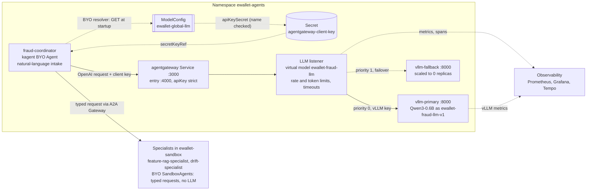
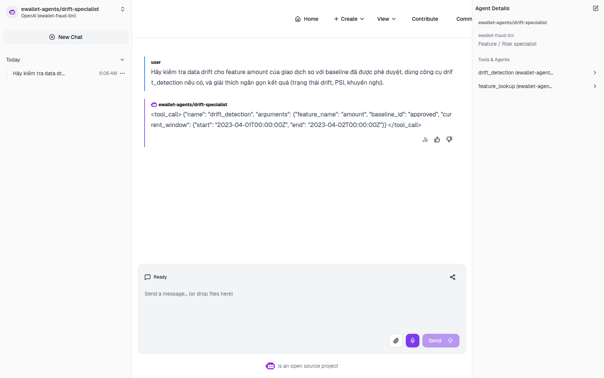
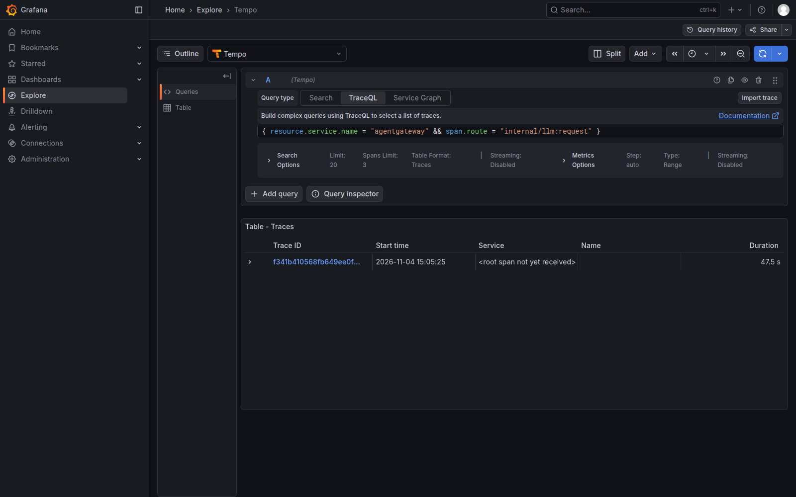
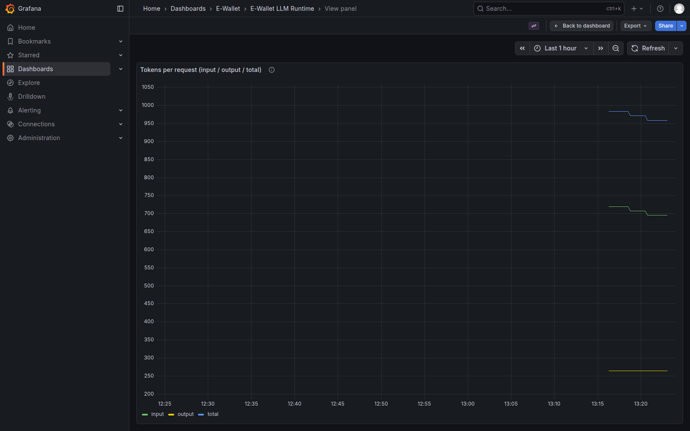

# LLM Inference Platform

This is the canonical report for the platform that serves the custom LLM of the fraud-investigation agents:

- **CPU vLLM** on GKE, serving a pinned Qwen3-0.6B;
- **agentgateway** in front of vLLM, which authenticates clients, enforces budgets and routes to the backends;
- one **Global ModelConfig**, `ewallet-global-llm`, that holds the shared model settings, and a **BYO ModelConfig Resolver** that lets BYO agents read it.

The two serving optimizations, EXP-V1 and EXP-V2, are reported in [BENCHMARK_RESULTS.md](BENCHMARK_RESULTS.md).

## 1. Overview

In the current Agent Platform only the Fraud Coordinator calls the LLM, and for a narrow task: understand an analyst's question, then choose a tool and its arguments. The two Specialists receive typed requests from the Coordinator and do not call the LLM (see [Agent Platform architecture §12](../agents/AGENT_PLATFORM_ARCHITECTURE.md#12-modelconfig-and-the-llm-integration)). That task does not need a large model, so the platform serves **Qwen3-0.6B on CPU nodes**. Three constraints drove this choice:

- the GKE project has no GPU quota;
- the same nodes also run the MLOps workloads;
- tool calling with a small model is accurate enough when every argument is validated against the analyst's text.

**Design goals.**

- **One entry point.** Agents never call vLLM directly. agentgateway authenticates them, enforces request and token budgets, applies nested timeouts and fails over between backends.
- **One model configuration.** A single ModelConfig defines the model, the endpoint and the credential reference ([§5](#5-global-modelconfig-and-byo-resolver)).
- **Reproducible serving.** The model weights are baked into a digest-pinned image, so a pod never downloads weights at start-up and needs no Internet egress.

## 2. Architecture



**How to read it.** Solid arrows are runtime network requests; the generated tokens stream back along the same path. Dashed arrows are configuration references, the failover path, or telemetry. The ModelConfig is configuration, not a network hop: the Coordinator reads it once at startup, and at runtime it calls agentgateway, which calls vLLM. The arrow to the Specialists marks where the LLM's output ends: the Coordinator turns it into a typed request and delegates over A2A, and the Specialists run that request through MCP tools without calling the LLM. A2A, MCP and the shared WorkerPool are described in [AGENT_PLATFORM_ARCHITECTURE.md](../agents/AGENT_PLATFORM_ARCHITECTURE.md).

**Deployable units** (Helm chart [`infra/helm/llm-agent-platform`](../../../infra/helm/llm-agent-platform/Chart.yaml)):

| Unit | Kind | Runtime state |
|---|---|---|
| `vllm-primary` | Deployment | 1/1 Running |
| `vllm-fallback` | Deployment | Deployed, scaled to 0 replicas to save CPU on the shared nodes |
| `agentgateway` | Deployment | Running |
| `ewallet-global-llm` | kagent `ModelConfig` | Deployed |
| `fraud-coordinator` | kagent BYO `Agent`, Deployment in `ewallet-agents`; the only LLM client | Deployed by the same release; operated as part of the [Agent Platform](../agents/AGENT_PLATFORM_OPERATIONS.md) |
| `feature-rag-specialist`, `drift-specialist` | kagent BYO `SandboxAgent` on the shared WorkerPool (namespace `ewallet-sandbox`) | Not rendered by this chart (they come from [`fleet.yaml.tmpl`](../../../infra/kubernetes/agent-sandbox/fleet.yaml.tmpl)); listed only to show that they do not call the LLM |

The chart also has an optional llm-d route (`llmd.mode`). It is off in the deployed configuration; llm-d was used only as the benchmark arm of EXP-V2.

## 3. vLLM inference platform

### 3.1 Model and serving

| Item | Value |
|---|---|
| Model | `Qwen/Qwen3-0.6B`, revision `c1899de289a04d12100db370d81485cdf75e47ca`, bfloat16 |
| Names | vLLM serves it as `ewallet-fraud-llm-v1`; agentgateway exposes it as the virtual model `ewallet-fraud-llm` |
| Image | vLLM 0.32.0 CPU, with the model baked into `vllm-cpu-model@sha256:f695b23e…` ([`infra/docker/vllm-cpu-model`](../../../infra/docker/vllm-cpu-model)) |
| API | OpenAI-compatible Chat Completions (`/v1/chat/completions`), streaming and non-streaming |
| Tool calling | `--tool-call-parser hermes`, `--reasoning-parser qwen3`, thinking disabled |
| Readiness | A warm-up request shaped like a real tool call runs before the pod reports Ready, so the first user request does not pay the cold compile and prefill cost |

### 3.2 CPU deployment parameters

| Parameter | Value | Reason |
|---|---|---|
| Resources per pod | requests 2 CPU / 6 GiB, limits 3 CPU / 10 GiB | One vLLM pod per e2-standard-4 node, leaving room for MLOps |
| KV cache | `VLLM_CPU_KVCACHE_SPACE` 2 GiB | A 4 GiB cache was OOMKilled at the 8 GiB limit; 2 GiB still holds about 18k tokens (4 sequences × 4096) |
| Context | `--max-model-len 4096` | Fits the agent prompts (about 700 tokens with the tool schema) |
| Concurrency | primary `--max-num-seqs 4`, `--max-num-queued-reqs 8`; fallback 2 and 4 | Bounds latency on 2 cores; extra requests get a fast 503 instead of an unbounded queue |
| Prefix caching | on | Disabling it made every request pay a full prefill (about 87 s for 800 tokens against 4.4 s warm) in the historical O1 benchmark |
| OpenMP threads | `OMP_NUM_THREADS=2`; `VLLM_CPU_OMP_THREADS_BIND` from `vllm.cpuThreadsBind` | Chart default `auto`. EXP-V1 measured `0-1`; see below |
| Rollout | `maxSurge 0`, `maxUnavailable 1` | A surge pod would need 2 more free CPUs, which the node budget does not have |

**Thread binding.** The chart exposes the binding as one value, `vllm.cpuThreadsBind` ([`values.yaml`](../../../infra/helm/llm-agent-platform/values.yaml), default `auto`), and the `0-1` setting as the overlay [`o1/c1-thread-bind.yaml`](../../../infra/helm/llm-agent-platform/o1/c1-thread-bind.yaml). EXP-V1 observed about 53–55 % more output tokens/s with `0-1` on the same pod budget ([BENCHMARK_RESULTS §3](BENCHMARK_RESULTS.md#3-exp-v1--cpu-thread-binding)). The GKE values file does not set the binding, and the recorded evidence does not show a promotion of `0-1` into the production release, so this report does not claim that production runs with `0-1`.

Source: [`templates/vllm.yaml`](../../../infra/helm/llm-agent-platform/templates/vllm.yaml), [`values-gke-cpu.yaml`](../../../infra/helm/llm-agent-platform/values-gke-cpu.yaml), [`values-gke-cpu-g1.yaml`](../../../infra/helm/llm-agent-platform/values-gke-cpu-g1.yaml).

## 4. agentgateway

The gateway is configured by [`templates/agentgateway.yaml`](../../../infra/helm/llm-agent-platform/templates/agentgateway.yaml) and the `agentgateway` block of the values.

### 4.1 Request path

1. The agent sends an OpenAI-format request with its client key to the `agentgateway` Service on port 3000, which targets the `entry` port 4000.
2. The entry route enforces `apiKey: mode: strict`, then forwards to the in-process LLM listener on `127.0.0.1:3000`.
3. The listener applies the rate and token limits and the timeouts, and resolves the virtual model `ewallet-fraud-llm` to its backends: primary at priority 0, fallback at priority 1.
4. The gateway replaces the client key with the vLLM backend key and calls vLLM, which serves `ewallet-fraud-llm-v1`.

### 4.2 Policies

| Policy | Configuration | Reason |
|---|---|---|
| Client authentication | `apiKey: mode: strict` with a dedicated client key (Secret `agentgateway-client-key`) | No client reaches the model without its own key |
| Backend authentication | a separate key for vLLM, held only by the gateway | vLLM rejects every caller except the gateway, and the backend key is refused if a client presents it |
| Request rate | `localRateLimit`: 12 requests per 1 s | Protects a 2-core server from bursts; excess requests get 429 |
| Token budget | `localRateLimit` on tokens: 24,000 per 1 h in production | Bounds token spend per client. Benchmarks used raised budgets (150,000 or 400,000 per hour) |
| Timeouts | GKE: route `requestTimeout` 180 s > LLM `llmRequestTimeout` 170 s > `backendRequestTimeout` 160 s ≥ `responseIdleTimeout` 160 s; ModelConfig 200 s outermost | Each layer gives up after the one below it. The chart refuses to render if the nesting is broken |
| Retry | 502/503 only, at most one attempt; the chart refuses any 500/504 retry | A timed-out CPU generation is never replayed |
| Failover | virtual model with primary → fallback; a backend is evicted after 2 consecutive failures | Keeps serving if one vLLM pod is lost |
| Routing header | `x-ewallet-backend` (`primary`, `fallback`, or `llm-d` in EXP-V2) | Shows which backend served each response |
| Tracing | OpenTelemetry spans for gateway hops | Gateway hops appear inside agent traces |

**Configured versus available.** Failover is configured and was demonstrated on the cluster (§6). In the current deployment the fallback is scaled to zero, so failover is **not available** until it is scaled up; with the primary down, requests fail.

## 5. Global ModelConfig and BYO Resolver

### 5.1 The ModelConfig

One kagent `ModelConfig`, `ewallet-agents/ewallet-global-llm`, is the single configuration of the e-wallet LLM route:

```yaml
apiVersion: kagent.dev/v1alpha2
kind: ModelConfig
metadata: {name: ewallet-global-llm, namespace: ewallet-agents}
spec:
  provider: OpenAI                      # OpenAI-compatible Chat Completions
  model: ewallet-fraud-llm              # agentgateway's virtual model, not a vLLM name
  openAI:
    apiFormat: chatCompletions
    baseUrl: http://agentgateway.ewallet-agents.svc.cluster.local:3000/v1
    timeout: 200                        # outermost timeout budget
  apiKeySecret: agentgateway-client-key # gateway client key, never the vLLM backend key
  apiKeySecretKey: api-key
```

| Field (chart value) | Value | What it does |
|---|---|---|
| `metadata.name` (`modelConfig.name`) | `ewallet-global-llm` | The one name agents reference |
| `metadata.namespace` (`namespace.name`) | `ewallet-agents` | A ModelConfig is namespaced, so "global" means shared by every agent of the platform namespace, not cluster-wide |
| `spec.provider` | `OpenAI` | agentgateway and vLLM speak the OpenAI API, so kagent uses its OpenAI client. No OpenAI service is involved |
| `spec.model` | `ewallet-fraud-llm` | The gateway's virtual model, so agents depend neither on a backend nor on the served name |
| `spec.openAI.baseUrl` | agentgateway Service, port 3000 | Every request goes through the gateway, never directly to vLLM |
| `spec.apiKeySecret`, `apiKeySecretKey` | `agentgateway-client-key`, `api-key` | A reference to the gateway client key. The chart stores only the reference; agents never hold the vLLM key |
| `spec.openAI.timeout` | 200 s on GKE (35 s chart default) | The outermost budget; the chart refuses to render unless it exceeds the gateway timeouts |

Changing the model or the route is a change of this one object.

### 5.2 How each agent gets the configuration

In the current release all three logical agents are BYO implementations, but only one of them needs the LLM configuration:

| Agent | Runtime | Calls the LLM? | LLM configuration |
|---|---|---|---|
| `fraud-coordinator` | kagent BYO `Agent`, Deployment in `ewallet-agents` | Yes, for natural-language intake only | BYO resolver: reads `ewallet-global-llm` at startup (§5.3) |
| `feature-rag-specialist` | BYO `SandboxAgent` on the shared WorkerPool | No. The module can build a planner, but the SandboxAgent sets `EWALLET_NL_INTAKE_ENABLED=false` and has no LLM credential ([fleet manifest L47](https://github.com/HuyyGiaa/ewallet-data-ai-platform/blob/8934328cf8a73ff770994696c77f538a6247c680/infra/kubernetes/agent-sandbox/fleet.yaml.tmpl#L47)) | None |
| `drift-specialist` | BYO `SandboxAgent` on the shared WorkerPool | No. Deterministic, with no LLM path in the code ([`byo_drift_specialist.py`](https://github.com/HuyyGiaa/ewallet-data-ai-platform/blob/8934328cf8a73ff770994696c77f538a6247c680/ai_platform/llm_agent/byo_drift_specialist.py#L6)) | None |

Typed requests, whether sent by an operator or produced by the Coordinator's intake, never reach the LLM.

**Why a BYO agent needs a resolver.** In the installed CRD (`kagent-crds-0.10.3`, [kagent-api.txt](../../evidence/edai2/llm/global_modelconfig_20261109/compat/kagent-api.txt)), `spec.byo` has only `deployment`, so a BYO Agent cannot reference a ModelConfig and kagent injects none. A BYO agent runs its own A2A runtime and calls the gateway itself. Without the resolver, the chart renders the model and URL as environment variables from the same values as the ModelConfig (the "Helm bridge"); editing the CR then changes nothing for the agent, because the Helm values are its real source.

**Earlier topology.** In the release documented on 2026-11-08–10, `drift-specialist` was a kagent Declarative Agent that referenced the ModelConfig natively (`spec.declarative.modelConfig`), and the Coordinator and Feature-RAG ran as BYO Deployments configured through the Helm bridge. The historical records in §5.5 and §6 refer to that release. The current release has no Declarative agent.

### 5.3 The BYO ModelConfig Resolver

The resolver closes that gap without a new controller and without changing kagent 0.10.3. It is [`ai_platform/llm_agent/model_config.py`](../../../ai_platform/llm_agent/model_config.py), called from `planner_from_env()` in [`nl_intake.py`](../../../ai_platform/llm_agent/nl_intake.py). The Coordinator executor builds its planner when it is constructed ([`byo_coordinator.py` L204–L207](https://github.com/HuyyGiaa/ewallet-data-ai-platform/blob/8934328cf8a73ff770994696c77f538a6247c680/ai_platform/llm_agent/byo_coordinator.py#L204-L207)). `planner_from_env()` returns before any resolution when natural-language intake is off ([L374–L375](https://github.com/HuyyGiaa/ewallet-data-ai-platform/blob/8934328cf8a73ff770994696c77f538a6247c680/ai_platform/llm_agent/nl_intake.py#L374-L375)), which is why the Sandbox Specialists never contact the API server. With `EWALLET_LLM_CONFIG_SOURCE=modelconfig`, at startup the Coordinator:

1. refuses a second authority: `EWALLET_LLM_BASE_URL` or `EWALLET_LLM_MODEL` in the environment stops the agent;
2. requires the gateway client key (`EWALLET_LLM_API_KEY`, a kubelet-resolved Secret reference);
3. sends `GET /apis/kagent.dev/v1alpha2/namespaces/<own namespace>/modelconfigs/ewallet-global-llm` with a projected ServiceAccount token, over TLS verified against the cluster CA. It retries 3 times on 5xx, 429 or connection errors, and never on 401, 403 or 404;
4. validates the object and **fails closed**:

   | Check | Failure code |
   |---|---|
   | `kagent.dev/v1alpha2` ModelConfig, the requested name and namespace, not being deleted | `modelconfig_invalid` |
   | `provider == OpenAI` | `modelconfig_provider_unsupported` |
   | `model` is a logical name; `apiFormat` is `chatCompletions` | `modelconfig_invalid` |
   | `baseUrl` is exactly the agentgateway URL | `modelconfig_endpoint_unauthorized` |
   | `timeout` between 1 and 200 s | `modelconfig_invalid` |
   | `apiKeySecret`/`apiKeySecretKey` equal the Secret mounted in the pod | `modelconfig_secret_mismatch` |
   | `Accepted=True` at the current generation | `modelconfig_not_accepted` |
   | RBAC or token rejected; object absent; API unreachable | `modelconfig_forbidden`, `modelconfig_not_found`, `modelconfig_unavailable` |

5. builds the planner from the CR: model and base URL from it, and a timeout of `min(agent deadline, CR timeout)`, so the CR is the ceiling;
6. logs one JSON line, `modelconfig.resolved`, with the CR's uid, generation, model, URL, timeout and Secret *names*, never a value.

Any failure raises at startup, so the pod never becomes Ready and a rolling update stops with the previous pods still serving. The code default `EWALLET_LLM_CONFIG_SOURCE=env` keeps the Helm-bridge behaviour.

**Why the Secret is not read from the API.** The pod gets the key the usual way (`secretKeyRef`), so no Secret-read permission exists. The resolver only proves that the CR still names that Secret: a CR that points to another Secret stops the agent instead of running with a key the CR no longer authorises.

**Propagation.** The resolver reads once at startup; there is no watch. After editing the CR, restart the Coordinator (`kubectl -n ewallet-agents rollout restart deploy/fraud-coordinator`). A CR that fails validation leaves the new pods un-Ready and the old ones serving.

### 5.4 Least-privilege access

[`templates/modelconfig-rbac.yaml`](../../../infra/helm/llm-agent-platform/templates/modelconfig-rbac.yaml) renders only with `modelConfig.byoResolver.enabled=true`:

- **Role** `ewallet-global-llm-reader`: `get` on `modelconfigs.kagent.dev` with `resourceNames: [ewallet-global-llm]`. No `list`, `watch`, `update`, Secrets or other kinds.
- **RoleBinding**: only the ServiceAccounts of BYO agents with natural-language intake on. In the current release that is `fraud-coordinator` alone; the Sandbox Specialists have no Deployment in this chart and no intake.
- **NetworkPolicy** `allow-byo-modelconfig-to-kube-apiserver`: egress from those pods (today `ewallet.io/agent=fraud-coordinator`) to the API server on 443 only; the chart refuses to render without the API server CIDRs.
- **Token**: a projected volume per BYO pod (API-server audience, 3600 s, cluster CA, namespace); the ServiceAccounts keep `automountServiceAccountToken: false`.

The RBAC matrix was first read in the isolated GKE canary with `kubectl auth can-i --as` ([06-rbac-can-i.txt](../../evidence/edai2/llm/global_modelconfig_20261109/canary/06-rbac-can-i.txt)): the bound ServiceAccounts answer `yes` only to `get modelconfigs/ewallet-global-llm`, and an unbound ServiceAccount gets `no` everywhere. The same checks (named `get` allowed, no `list`, no Secrets) were repeated on the production Coordinator in the Agent integration run of 2026-11-15 (§5.5).

### 5.5 Status and rollout

The chart default is `modelConfig.byoResolver.enabled: false` ([`values.yaml`](https://github.com/HuyyGiaa/ewallet-data-ai-platform/blob/8934328cf8a73ff770994696c77f538a6247c680/infra/helm/llm-agent-platform/values.yaml#L889-L896)). The Agent integration profile [`agi/agents.yaml`](https://github.com/HuyyGiaa/ewallet-data-ai-platform/blob/8934328cf8a73ff770994696c77f538a6247c680/infra/helm/llm-agent-platform/agi/agents.yaml#L16-L20) turns it on. Neither file alone says what production runs, so the table separates source configuration, the configuration read back from the release, and runtime observations.

| What | State | Evidence kind | Record |
|---|---|---|---|
| Global ModelConfig CR | Deployed (read back 2026-11-08) | Production read-back | [`00-production-modelconfig.json`](../../evidence/edai2/llm/global_modelconfig_20261109/canary/00-production-modelconfig.json) |
| Resolver source and chart switch | In `main`; off in the chart defaults, on in the AGI profile | Source | links above |
| Resolver flag in the `llm-agent` release | `modelConfig.byoResolver.enabled: true`, with the API-server CIDRs set | Live Helm values, revision 59 (2026-11-17) and revision 60 (2026-11-19) | revision 59: [`llm-agent-live-values.yaml`](../../evidence/edai2/agents/lc-20261117T002220Z/f-regression/replay/registry/llm-agent-live-values.yaml); revision 60: owner evidence store, `agents/replay/replay-20261118T161231Z/g4-registry-readback-20261119/` (not mirrored in the repo) |
| Coordinator Deployment, revision 60 | `EWALLET_LLM_CONFIG_SOURCE=modelconfig`, `EWALLET_LLM_MODELCONFIG_NAME=ewallet-global-llm`, Secret reference `agentgateway-client-key/api-key`, projected volume `kube-api-modelconfig`; no `EWALLET_LLM_BASE_URL` or `EWALLET_LLM_MODEL`; 2/2 ready | Deployment read-back (2026-11-19) | owner evidence store, `agents/replay/replay-20261118T161231Z/g4-platform-status-20261119/status/deployments-ewallet-agents.json` (not mirrored) |
| Least-privilege objects | Role `ewallet-global-llm-reader` (`get` on the one name), RoleBinding to `fraud-coordinator` only, egress NetworkPolicy for `fraud-coordinator` | Live manifest read-back, revision 59 | owner evidence store, `agents/replay/replay-20261118T161231Z/lf-preflight/gate-equivalent/` (not mirrored) |
| Resolver at runtime in production pods | Both Coordinator pods and both Feature-RAG pods (then still a BYO Deployment with intake) logged `modelconfig.resolved` for `ewallet-global-llm` (generation 1, model `ewallet-fraud-llm`, the agentgateway URL); RBAC checks passed | Production runtime, Agent integration run `agi-20261115T145608Z` (2026-11-15, an earlier release) | owner evidence store, `agents/integration/agi-20261115T145608Z/stage2/AGI-01-verify.json` (not mirrored) |
| Resolver log in the final release (revision 60) | Not captured. The Ready Coordinator pods and the natural-language answer recorded in the [Agent evidence §4](../agents/AGENT_PLATFORM_EVIDENCE.md#4-kagent-chat) are consistent with a successful resolution, because the resolver fails closed at startup, but no `modelconfig.resolved` line from revision 60 was saved | — | — |
| Resolver tests | 21 resolver tests and 6 chart tests passed locally during the ModelConfig work; not re-run for this report | Local tests, historical | §6 |
| Resolver with the chart's RBAC, token and egress policy | Verified in an isolated GKE canary, since deleted | Isolated canary, historical | §6 |
| `drift-specialist` native reference | Deployed and verified in the 2026-11-08 release, when `drift-specialist` was Declarative; no longer applies | Production runtime, historical | [`drift-native-reference.txt`](../../evidence/edai2/llm/global_modelconfig_20261109/production/drift-native-reference.txt) |
| Production BYO configuration on 2026-11-08–10 | Helm bridge, resolver off | Production read-back, historical | [`verify-current-production.json`](../../evidence/edai2/llm/global_modelconfig_20261109/production/verify-current-production.json) |

**Rollout history.** On 2026-11-10 the planned promotion was two owner-run steps in the [Global ModelConfig runbook](../../runbooks/edai2/GLOBAL_MODELCONFIG_RUNBOOK.md): first the BYO images built from this source with the flag off, then `helm upgrade` with `modelConfig.byoResolver.enabled=true` and the API-server CIDRs, a diff of exactly five objects ([helm-diff-resolver-on.txt](../../evidence/edai2/llm/global_modelconfig_20261109/production/helm-diff-resolver-on.txt)). The live values above show the flag on in the later Agent integration releases, whose profile ([`agi/agents.yaml`](../../../infra/helm/llm-agent-platform/agi/agents.yaml)) sets it. This report does not reconstruct the exact Helm revision in which it was first enabled.

## 6. Runtime verification

Each claim is labelled with the kind of evidence behind it.

| Evidence kind | What was verified | Record |
|---|---|---|
| **Production runtime** | `vllm-primary` 1/1 behind agentgateway; `vllm-fallback` deployed at 0 replicas | Deployment readback |
| **Production runtime, earlier release (screenshot committed 2026-11-04)** | The then-Declarative drift agent answers through `ewallet-global-llm` and agentgateway (screenshot below) | session `01a1a419` |
| **Production runtime** | Gateway spans inside a real agent trace (screenshot below) | trace `f341b410…` |
| **Production runtime, earlier release (2026-11-08)** | With the resolver flag off, the chart renders the deployed manifest exactly; `llm-agent` stayed at revision 42 during the ModelConfig work | [before.txt](../../evidence/edai2/llm/global_modelconfig_20261109/production/before.txt), [after.txt](../../evidence/edai2/llm/global_modelconfig_20261109/production/after.txt) |
| **Historical runtime (G1, 2026-10-31)** | Streaming and non-streaming tool calls through the gateway (`x-ewallet-backend: primary`); wrong key, missing key and backend key as client key each rejected with 401; with the primary at zero, the fallback served (`vllm:request_success_total` 1 → 6) | [`g1_20261031T231145Z/`](../../evidence/llm_agent/g1_20261031T231145Z) |
| **Isolated canary (GKE `kagent-pilot`, 2026-11-08, deleted)** | Resolver in BYO pods with the chart's RBAC and egress: resolved and Ready. Unbound ServiceAccount: `modelconfig_forbidden`. Other egress blocked. CR model change: picked up after restart. `baseUrl` to vLLM: `modelconfig_endpoint_unauthorized`. Other Secret: `modelconfig_secret_mismatch`. CR deleted: `modelconfig_not_found`; restored: Ready | [canary](../../evidence/edai2/llm/global_modelconfig_20261109/canary/), built by [`infra/k8s/modelconfig-canary/`](../../../infra/k8s/modelconfig-canary/) |
| **Operator-side runtime check (2026-11-08)** | Live production CR → resolver → Coordinator planner → agentgateway → CPU vLLM, run from the laptop with the operator's token and a port-forward (not from a production pod): 4/4 business cases chose `investigate_transaction` with grounded arguments, the off-topic case was refused, backend `primary`, p50 60 s / p95 83 s | [summary.json](../../evidence/edai2/llm/global_modelconfig_20261109/runtime/summary.json), [`modelconfig_runtime_check.py`](../../../scripts/llm_agent/modelconfig_runtime_check.py) |
| **Benchmark gateway (2026-11-09/10)** | Strict authentication, 429 rate limiting, timeouts and the routing header on the temporary benchmark gateway | [BENCHMARK_RESULTS §5](BENCHMARK_RESULTS.md#5-agentgateway-security-and-policy-evidence) |
| **Local tests** | [`test_global_modelconfig_resolver.py`](../../../tests/llm_agent/test_global_modelconfig_resolver.py) (21): resolution, every rejection code, retries, no credential in the log. [`test_global_modelconfig_chart.py`](../../../tests/llm_agent/test_global_modelconfig_chart.py) (6): flag off renders the Helm bridge; flag on adds exactly Role, RoleBinding and NetworkPolicy | — |
| **Production runtime, Agent integration (2026-11-15)** | The resolver in production BYO pods: `modelconfig.resolved` logged by the Coordinator and the then-Deployment Feature-RAG pods | §5.5 (owner evidence store, not mirrored) |
| **Deployed configuration (2026-11-17/19)** | Resolver flag on in the live `llm-agent` values (revisions 59 and 60); Coordinator Deployment configured with `EWALLET_LLM_CONFIG_SOURCE=modelconfig` | §5.5 |



*A kagent conversation with the Declarative drift agent (session `01a1a419`). The header shows provider `OpenAI` and model `ewallet-fraud-llm`: the answer was generated by the deployed Qwen3-0.6B through ModelConfig `ewallet-global-llm` and agentgateway. This is evidence from an earlier release (the screenshot was committed on 2026-11-04). The current `drift-specialist` is a BYO SandboxAgent that does not call the LLM, so this screenshot does not describe the current agent topology.*



*Tempo spans of the LLM gateway (route `internal/llm`) inside a real agent trace (`f341b410…`): the agent's planning call passes through agentgateway to vLLM.*

## 7. Observability

The LLM telemetry of the deployed platform is documented once, in [OBSERVABILITY §6](../observability/OBSERVABILITY.md#6-llm-telemetry): vLLM and agentgateway metrics on the Grafana `llm-runtime` dashboard (tokens per request, TTFT, generation round-trip time, PII screening) and gateway spans in Tempo. Under real agent traffic the deployed server reported:

- 707 / 264 / 971 input / output / total tokens per request;
- TTFT p50 / p95 of 5 s / 38 s;
- end-to-end generation p50 / p95 of 50 s / 114 s.

These are longer than the benchmark figures because agent prompts, about 700 tokens with the tool schema, are much longer than the benchmark's short chats.



*Grafana `llm-runtime` dashboard: tokens per request, measured both by vLLM and by agentgateway.*

## 8. Limitations

- **CPU latency.** First tokens take seconds and generations tens of seconds. This suits an analyst assistant, not interactive chat at scale.
- **Fallback scaled to zero.** Failover is configured and was demonstrated, but it is unavailable until the fallback is scaled up.
- **ModelConfig changes need a Coordinator restart.** The resolver reads the CR once at startup (no watch, by design), and the approved endpoint is fixed in code, so moving the gateway is a code change.
- **Resolver runtime log not captured in the final release.** The resolver is enabled in revisions 59 and 60, but the latest saved `modelconfig.resolved` lines are from the 2026-11-15 integration run (§5.5).
- **Thread binding.** The `0-1` binding observed in EXP-V1 is available through `vllm.cpuThreadsBind`, but its promotion into the production values is not recorded.
- **One model version.** Only Qwen3-0.6B is served. The model A/B design is documented separately in [LLM A/B design](../platform/LLM_AB_DESIGN.md) and has not run on the cluster.

## 9. Source references

Repository paths are in the first column. Line ranges are pinned to the GitHub commit where they were verified.

| File | Lines | What it configures |
|---|---|---|
| [`templates/vllm.yaml`](../../../infra/helm/llm-agent-platform/templates/vllm.yaml) | [L128–129](https://github.com/HuyyGiaa/ewallet-data-ai-platform/blob/22018233adb172767a267a9bf76ad295d17ac6cf/infra/helm/llm-agent-platform/templates/vllm.yaml#L128-L129) | vLLM Deployments, arguments and served model name; `VLLM_CPU_OMP_THREADS_BIND` from `vllm.cpuThreadsBind` |
| [`values.yaml`](../../../infra/helm/llm-agent-platform/values.yaml) | [L200](https://github.com/HuyyGiaa/ewallet-data-ai-platform/blob/22018233adb172767a267a9bf76ad295d17ac6cf/infra/helm/llm-agent-platform/values.yaml#L200-L200) | Served name `ewallet-fraud-llm-v1`; chart defaults including `cpuThreadsBind: auto` and the request and token rates |
| [`values-gke-cpu.yaml`](../../../infra/helm/llm-agent-platform/values-gke-cpu.yaml) | [L64–65](https://github.com/HuyyGiaa/ewallet-data-ai-platform/blob/22018233adb172767a267a9bf76ad295d17ac6cf/infra/helm/llm-agent-platform/values-gke-cpu.yaml#L64-L65) | GKE profile: image source, resources, KV cache, gateway timeouts, ModelConfig timeout of 200 s |
| [`o1/c1-thread-bind.yaml`](../../../infra/helm/llm-agent-platform/o1/c1-thread-bind.yaml) | — | The `0-1` thread-binding overlay |
| [`templates/agentgateway.yaml`](../../../infra/helm/llm-agent-platform/templates/agentgateway.yaml) | [L6–12](https://github.com/HuyyGiaa/ewallet-data-ai-platform/blob/22018233adb172767a267a9bf76ad295d17ac6cf/infra/helm/llm-agent-platform/templates/agentgateway.yaml#L6-L12) | Timeout nesting guard |
| same | [L43–56](https://github.com/HuyyGiaa/ewallet-data-ai-platform/blob/22018233adb172767a267a9bf76ad295d17ac6cf/infra/helm/llm-agent-platform/templates/agentgateway.yaml#L43-L56) | Entry route: strict client authentication, forward to the LLM listener |
| same | [L101–110](https://github.com/HuyyGiaa/ewallet-data-ai-platform/blob/22018233adb172767a267a9bf76ad295d17ac6cf/infra/helm/llm-agent-platform/templates/agentgateway.yaml#L101-L110) | Primary backend: vLLM URL and backend key |
| same | [L157–167](https://github.com/HuyyGiaa/ewallet-data-ai-platform/blob/22018233adb172767a267a9bf76ad295d17ac6cf/infra/helm/llm-agent-platform/templates/agentgateway.yaml#L157-L167) | Virtual model `ewallet-fraud-llm` and failover priorities |
| same | [L264–272](https://github.com/HuyyGiaa/ewallet-data-ai-platform/blob/22018233adb172767a267a9bf76ad295d17ac6cf/infra/helm/llm-agent-platform/templates/agentgateway.yaml#L264-L272) | Service port 3000 to the entry port |
| [`values.yaml`](../../../infra/helm/llm-agent-platform/values.yaml) | [L279–281](https://github.com/HuyyGiaa/ewallet-data-ai-platform/blob/22018233adb172767a267a9bf76ad295d17ac6cf/infra/helm/llm-agent-platform/values.yaml#L279-L281) | Gateway client-key Secret reference |
| [`templates/modelconfig.yaml`](../../../infra/helm/llm-agent-platform/templates/modelconfig.yaml) | [L1–17](https://github.com/HuyyGiaa/ewallet-data-ai-platform/blob/b95b160f3dbfb295bda483c5324873bb58505ae2/infra/helm/llm-agent-platform/templates/modelconfig.yaml#L1-L17) | The ModelConfig resource |
| [`values.yaml`](../../../infra/helm/llm-agent-platform/values.yaml) | [L851–861](https://github.com/HuyyGiaa/ewallet-data-ai-platform/blob/22018233adb172767a267a9bf76ad295d17ac6cf/infra/helm/llm-agent-platform/values.yaml#L851-L861) | ModelConfig name, model, default timeout, Secret reference |
| same | [L868–874](https://github.com/HuyyGiaa/ewallet-data-ai-platform/blob/b95b160f3dbfb295bda483c5324873bb58505ae2/infra/helm/llm-agent-platform/values.yaml#L868-L874) | `modelConfig.byoResolver`, `enabled: false` by default |
| [`templates/agents.yaml`](../../../infra/helm/llm-agent-platform/templates/agents.yaml) | [L8–9](https://github.com/HuyyGiaa/ewallet-data-ai-platform/blob/22018233adb172767a267a9bf76ad295d17ac6cf/infra/helm/llm-agent-platform/templates/agents.yaml#L8-L9) | Agents cannot render without the ModelConfig |
| same | [L183–207](https://github.com/HuyyGiaa/ewallet-data-ai-platform/blob/22018233adb172767a267a9bf76ad295d17ac6cf/infra/helm/llm-agent-platform/templates/agents.yaml#L183-L207) | BYO agents: endpoint, model and client key through environment variables |
| same | [L190–205](https://github.com/HuyyGiaa/ewallet-data-ai-platform/blob/b95b160f3dbfb295bda483c5324873bb58505ae2/infra/helm/llm-agent-platform/templates/agents.yaml#L190-L205) | Resolver flag on: resolver environment; off: the Helm bridge |
| same | [L263–266](https://github.com/HuyyGiaa/ewallet-data-ai-platform/blob/22018233adb172767a267a9bf76ad295d17ac6cf/infra/helm/llm-agent-platform/templates/agents.yaml#L263-L266) | Declarative agents reference the ModelConfig (used by the earlier Declarative `drift-specialist`; the current release has no Declarative agent) |
| [`templates/modelconfig-rbac.yaml`](../../../infra/helm/llm-agent-platform/templates/modelconfig-rbac.yaml) | [L1–72](https://github.com/HuyyGiaa/ewallet-data-ai-platform/blob/b95b160f3dbfb295bda483c5324873bb58505ae2/infra/helm/llm-agent-platform/templates/modelconfig-rbac.yaml#L1-L72) | Role, RoleBinding and egress NetworkPolicy, rendered only with the flag on |
| [`n11/values-n11-agents.yaml`](../../../infra/helm/llm-agent-platform/n11/values-n11-agents.yaml) | [L5–15](https://github.com/HuyyGiaa/ewallet-data-ai-platform/blob/22018233adb172767a267a9bf76ad295d17ac6cf/infra/helm/llm-agent-platform/n11/values-n11-agents.yaml#L5-L15) | Enabled natural-language intake for the two BYO Deployments of the earlier release; today only the Coordinator has it |
| [`agi/agents.yaml`](../../../infra/helm/llm-agent-platform/agi/agents.yaml) | [L16–20](https://github.com/HuyyGiaa/ewallet-data-ai-platform/blob/8934328cf8a73ff770994696c77f538a6247c680/infra/helm/llm-agent-platform/agi/agents.yaml#L16-L20) | Agent integration profile: `modelConfig.byoResolver.enabled: true` |
| [`agent-sandbox/fleet.yaml.tmpl`](../../../infra/kubernetes/agent-sandbox/fleet.yaml.tmpl) | [L47](https://github.com/HuyyGiaa/ewallet-data-ai-platform/blob/8934328cf8a73ff770994696c77f538a6247c680/infra/kubernetes/agent-sandbox/fleet.yaml.tmpl#L47) | Sandbox Specialists: natural-language intake off, no LLM credential |
| [`byo_coordinator.py`](../../../ai_platform/llm_agent/byo_coordinator.py) | [L204–207](https://github.com/HuyyGiaa/ewallet-data-ai-platform/blob/8934328cf8a73ff770994696c77f538a6247c680/ai_platform/llm_agent/byo_coordinator.py#L204-L207) | The Coordinator builds its planner, and so resolves the ModelConfig, at construction |
| [`model_config.py`](../../../ai_platform/llm_agent/model_config.py) | [L40–42](https://github.com/HuyyGiaa/ewallet-data-ai-platform/blob/b95b160f3dbfb295bda483c5324873bb58505ae2/ai_platform/llm_agent/model_config.py#L40-L42), [L109–258](https://github.com/HuyyGiaa/ewallet-data-ai-platform/blob/b95b160f3dbfb295bda483c5324873bb58505ae2/ai_platform/llm_agent/model_config.py#L109-L258) | Approved endpoint; parsing, fetch and validation |
| [`nl_intake.py`](../../../ai_platform/llm_agent/nl_intake.py) | [L329–341](https://github.com/HuyyGiaa/ewallet-data-ai-platform/blob/b95b160f3dbfb295bda483c5324873bb58505ae2/ai_platform/llm_agent/nl_intake.py#L329-L341) | Selects the configuration source with `EWALLET_LLM_CONFIG_SOURCE` (default `env`) |

Tests: [`test_global_modelconfig_resolver.py`](../../../tests/llm_agent/test_global_modelconfig_resolver.py), [`test_global_modelconfig_chart.py`](../../../tests/llm_agent/test_global_modelconfig_chart.py), [`test_r1_runtime_prep.py`](../../../tests/llm_agent/test_r1_runtime_prep.py).

The earlier detailed ModelConfig report, with the full canary case list and the original test log, is archived as [GLOBAL_MODELCONFIG.md](../../../archive/legacy-docs/docs/edai2/llm/GLOBAL_MODELCONFIG.md).
