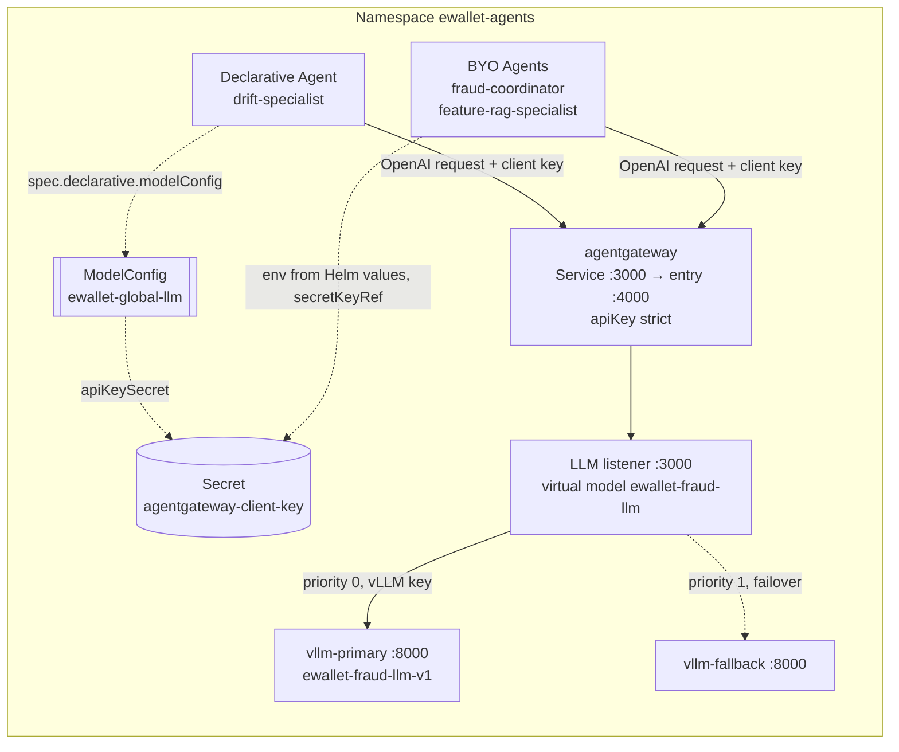

# LLM Inference Platform

This report describes the platform that serves the custom LLM used by the fraud-investigation agents:

- vLLM on CPU nodes in GKE;
- agentgateway in front of vLLM;
- one global kagent ModelConfig that holds the shared model settings ([§3.3](#33-global-modelconfig)).

It also reports the two optimisation experiments that shaped the current serving configuration.

## 1. Overview and motivation

The agents use the LLM for a narrow task: understand an analyst's question and select a tool with its arguments (see [Agents](../agents/AGENTS_REGISTRY_GATEWAYS.md)). This task does not need a large model, so the platform serves **Qwen3-0.6B** on CPU nodes. Three reasons drove that choice:

- the GKE project has no GPU quota;
- the same nodes also run the MLOps workloads;
- tool calling with a small model is accurate enough when every argument is validated against the analyst's text.

**Design goals:**

- **One entry point.** Agents never talk to vLLM directly. agentgateway authenticates clients, enforces rate and token budgets, applies timeouts, and fails over between backends.
- **One model configuration.** A single ModelConfig defines the model, endpoint and credential reference. Declarative agents reference it; BYO agents get the same model name and client key from the same Helm values ([§3.3](#33-global-modelconfig)).
- **Reproducible serving.** The model weights are baked into a digest-pinned image, so a pod never downloads weights at start-up.

## 2. Architecture

```text
 (1) chat / A2A task                  (2) OpenAI-compatible request
kagent agents ───────────────▶ ModelConfig ewallet-global-llm ─────────────▶ agentgateway :3000 (llm listener)
(coordinator, specialists)       (provider OpenAI, baseUrl = agentgateway)       │ (3) apiKey strict, rate limit, timeouts
                                                                                  ▼
                                                     virtual model ewallet-fraud-llm (failover)
                                                     (4a) vllm-primary :8000 ──┐   (4b) vllm-fallback :8000
                                                                               ▼
                                                                   Qwen3-0.6B on vLLM 0.32 CPU
```

**Deployable units:**

- `vllm-primary` and `vllm-fallback` are Deployments;
- `agentgateway` is a Deployment;
- the ModelConfig is a kagent resource.

Arrows follow the request; the generated tokens stream back along the same path.

## 3. Implementation

### 3.1 Model server

| Item | Value |
|---|---|
| Model | `Qwen/Qwen3-0.6B`, revision `c1899de2…`, bfloat16; vLLM serves it as `ewallet-fraud-llm-v1`, and agentgateway exposes it as the virtual model `ewallet-fraud-llm` |
| Image | vLLM 0.32.0 CPU image, with the model baked into `vllm-cpu-model@sha256:f695b23e…` |
| Resources per pod | requests 2 CPU / 6 GiB; limits 3 CPU / 10 GiB; KV cache 2 GiB; `max-model-len 4096` |
| Scheduling | primary `max-num-seqs 4`; fallback `max-num-seqs 2` |
| Tool calling | `--tool-call-parser hermes`; `--reasoning-parser qwen3`; thinking disabled |
| Readiness | A warm-up request shaped like a real tool call is sent before the pod reports ready, so the first user request does not pay the cold compile and prefill cost |

Source:

- [`templates/vllm.yaml`](../../../infra/helm/llm-agent-platform/templates/vllm.yaml);
- values [`values-gke-cpu.yaml`](../../../infra/helm/llm-agent-platform/values-gke-cpu.yaml) and [`values-gke-cpu-g1.yaml`](../../../infra/helm/llm-agent-platform/values-gke-cpu-g1.yaml).

### 3.2 agentgateway

The gateway is configured in [`templates/agentgateway.yaml`](../../../infra/helm/llm-agent-platform/templates/agentgateway.yaml).

| Policy | Setting | Reason |
|---|---|---|
| Client authentication | `apiKey: mode: strict` with a dedicated client key | Clients cannot reach the model without their own key, and the vLLM key never leaves the gateway |
| Backend authentication | a separate `apiKey` for vLLM | vLLM rejects any caller other than the gateway |
| Rate limits | two `localRateLimit` buckets per model: requests and tokens | Bounds both request rate and token spend on a 2-core server |
| Timeouts | nested budgets. The chart refuses to render unless `modelConfig.timeoutSeconds > requestTimeout > llmRequestTimeout > backendRequestTimeout ≥ responseIdleTimeout` | Each layer gives up after the one beneath it, so a slow generation is never cut by an outer hop while still running inside |
| Retry | 502/503 only, at most one attempt. The chart refuses any 500/504 retry | A timed-out CPU generation is never replayed |
| Failover | virtual model `ewallet-fraud-llm` with primary → fallback; a backend is evicted after 2 consecutive failures | Keeps serving if one vLLM pod is lost |
| Observability | response header `x-ewallet-backend`; OpenTelemetry spans | Shows which backend served a request; gateway hops appear in traces |

### 3.3 Global ModelConfig

**Purpose.** One kagent `ModelConfig` resource, `ewallet-global-llm`, holds the model name, endpoint, credential reference and timeout, so these settings are defined once instead of once per agent. It is deployed by the `llm-agent` Helm release in namespace `ewallet-agents`. An agent reuses it by naming it, and changing the Helm values changes every agent that references it.

**A ModelConfig is configuration, not a network hop.** kagent reads it to build the agent's model client. At runtime the agent calls agentgateway directly.



Dashed arrows are configuration references or the failover path; solid arrows are requests. The chart also has an optional llm-d route, which is off in the deployed configuration ([§5.3](#53-experiment-2-cache-aware-routing-with-two-replicas)).

**What is configured.**

| Field (source) | Value | What it does and why |
|---|---|---|
| `metadata.name` | `ewallet-global-llm` (`modelConfig.name`) | The single name agents reference |
| `metadata.namespace` | `ewallet-agents` (`namespace.name`) | A ModelConfig is namespaced, so "global" means shared by the agents of this platform namespace, not cluster-wide |
| `spec.provider` | `OpenAI` | agentgateway and vLLM expose the OpenAI Chat Completions API, so kagent uses its OpenAI client. No OpenAI service is involved |
| `spec.model` | `ewallet-fraud-llm` | The gateway's **virtual** model. Agents do not depend on a backend or on the served name `ewallet-fraud-llm-v1` |
| `spec.openAI.baseUrl` | `http://agentgateway.<ns>.svc.cluster.local:3000/v1` | Sends every request through the gateway, never directly to vLLM |
| `spec.apiKeySecret`, `spec.apiKeySecretKey` | `agentgateway-client-key`, `api-key` | Names the Secret that holds the **gateway client key**. The chart stores only this reference; agents never hold the vLLM key |
| `spec.openAI.timeout` | 200 s on GKE (`values-gke-cpu.yaml`), 35 s chart default | The outermost budget. The chart refuses to render unless it is above the gateway's timeouts |
| Agent `spec.declarative.modelConfig` | `ewallet-global-llm` | The reference that reuses this configuration |

**How the request reaches the model.**

1. The agent sends an OpenAI-format request with the client key to the `agentgateway` Service on port 3000, which targets the `entry` port (4000).
2. The entry route enforces `apiKey: mode: strict`, then forwards to the in-process LLM listener on `127.0.0.1:3000`.
3. The listener applies rate limits, token budgets and timeouts, and resolves `ewallet-fraud-llm` to its backends: primary at priority 0, fallback at priority 1.
4. The gateway replaces the client key with `$VLLM_API_KEY` and calls vLLM, which serves `ewallet-fraud-llm-v1`.

**How each agent uses it.** Reuse is direct for Declarative agents only.

| Agent | Type | Model configuration |
|---|---|---|
| `drift-specialist` | Declarative | References `ewallet-global-llm` through `spec.declarative.modelConfig` |
| `fraud-coordinator`, `feature-rag-specialist` | BYO | They do not read the CR. When `naturalLanguageIntake` is enabled (the N11 overlay enables it for both), Helm injects `EWALLET_LLM_BASE_URL`, `EWALLET_LLM_API_KEY` (same Secret) and `EWALLET_LLM_MODEL`, the last taken from the same `modelConfig.model` value. The endpoint is written separately in the template |

**Source code.** Repository links are in the first column; the second gives commit-pinned GitHub line ranges.

| File | Lines | What it configures |
|---|---|---|
| [`templates/modelconfig.yaml`](../../../infra/helm/llm-agent-platform/templates/modelconfig.yaml) | [L1–17](https://github.com/HuyyGiaa/ewallet-data-ai-platform/blob/22018233adb172767a267a9bf76ad295d17ac6cf/infra/helm/llm-agent-platform/templates/modelconfig.yaml#L1-L17) | The ModelConfig resource |
| [`values.yaml`](../../../infra/helm/llm-agent-platform/values.yaml) | [L851–861](https://github.com/HuyyGiaa/ewallet-data-ai-platform/blob/22018233adb172767a267a9bf76ad295d17ac6cf/infra/helm/llm-agent-platform/values.yaml#L851-L861) | Name, model, default timeout, Secret reference |
| [`values-gke-cpu.yaml`](../../../infra/helm/llm-agent-platform/values-gke-cpu.yaml) | [L64–65](https://github.com/HuyyGiaa/ewallet-data-ai-platform/blob/22018233adb172767a267a9bf76ad295d17ac6cf/infra/helm/llm-agent-platform/values-gke-cpu.yaml#L64-L65) | GKE timeout of 200 s |
| [`n11/values-n11-agents.yaml`](../../../infra/helm/llm-agent-platform/n11/values-n11-agents.yaml) | [L5–15](https://github.com/HuyyGiaa/ewallet-data-ai-platform/blob/22018233adb172767a267a9bf76ad295d17ac6cf/infra/helm/llm-agent-platform/n11/values-n11-agents.yaml#L5-L15) | Enables LLM intake for both BYO agents |
| [`templates/agents.yaml`](../../../infra/helm/llm-agent-platform/templates/agents.yaml) | [L263–266](https://github.com/HuyyGiaa/ewallet-data-ai-platform/blob/22018233adb172767a267a9bf76ad295d17ac6cf/infra/helm/llm-agent-platform/templates/agents.yaml#L263-L266) | Declarative agents reference the ModelConfig |
| [`templates/agents.yaml`](../../../infra/helm/llm-agent-platform/templates/agents.yaml) | [L183–207](https://github.com/HuyyGiaa/ewallet-data-ai-platform/blob/22018233adb172767a267a9bf76ad295d17ac6cf/infra/helm/llm-agent-platform/templates/agents.yaml#L183-L207) | BYO agents: endpoint, model and client key through environment variables |
| [`templates/agents.yaml`](../../../infra/helm/llm-agent-platform/templates/agents.yaml) | [L8–9](https://github.com/HuyyGiaa/ewallet-data-ai-platform/blob/22018233adb172767a267a9bf76ad295d17ac6cf/infra/helm/llm-agent-platform/templates/agents.yaml#L8-L9) | Agents cannot render without the ModelConfig |
| [`templates/agentgateway.yaml`](../../../infra/helm/llm-agent-platform/templates/agentgateway.yaml) | [L6–12](https://github.com/HuyyGiaa/ewallet-data-ai-platform/blob/22018233adb172767a267a9bf76ad295d17ac6cf/infra/helm/llm-agent-platform/templates/agentgateway.yaml#L6-L12) | Timeout nesting guard |
| [`templates/agentgateway.yaml`](../../../infra/helm/llm-agent-platform/templates/agentgateway.yaml) | [L43–56](https://github.com/HuyyGiaa/ewallet-data-ai-platform/blob/22018233adb172767a267a9bf76ad295d17ac6cf/infra/helm/llm-agent-platform/templates/agentgateway.yaml#L43-L56) | Entry route: strict client authentication, forward to the LLM listener |
| [`templates/agentgateway.yaml`](../../../infra/helm/llm-agent-platform/templates/agentgateway.yaml) | [L101–110](https://github.com/HuyyGiaa/ewallet-data-ai-platform/blob/22018233adb172767a267a9bf76ad295d17ac6cf/infra/helm/llm-agent-platform/templates/agentgateway.yaml#L101-L110) | Primary backend: vLLM URL and backend key |
| [`templates/agentgateway.yaml`](../../../infra/helm/llm-agent-platform/templates/agentgateway.yaml) | [L157–167](https://github.com/HuyyGiaa/ewallet-data-ai-platform/blob/22018233adb172767a267a9bf76ad295d17ac6cf/infra/helm/llm-agent-platform/templates/agentgateway.yaml#L157-L167) | Virtual model `ewallet-fraud-llm` and failover priorities |
| [`templates/agentgateway.yaml`](../../../infra/helm/llm-agent-platform/templates/agentgateway.yaml) | [L264–272](https://github.com/HuyyGiaa/ewallet-data-ai-platform/blob/22018233adb172767a267a9bf76ad295d17ac6cf/infra/helm/llm-agent-platform/templates/agentgateway.yaml#L264-L272) | Service port 3000 to the entry port |
| [`values.yaml`](../../../infra/helm/llm-agent-platform/values.yaml) | [L279–281](https://github.com/HuyyGiaa/ewallet-data-ai-platform/blob/22018233adb172767a267a9bf76ad295d17ac6cf/infra/helm/llm-agent-platform/values.yaml#L279-L281) | Gateway client-key Secret reference |
| [`templates/vllm.yaml`](../../../infra/helm/llm-agent-platform/templates/vllm.yaml) | [L128–129](https://github.com/HuyyGiaa/ewallet-data-ai-platform/blob/22018233adb172767a267a9bf76ad295d17ac6cf/infra/helm/llm-agent-platform/templates/vllm.yaml#L128-L129) | vLLM served model name |
| [`values.yaml`](../../../infra/helm/llm-agent-platform/values.yaml) | [L200–200](https://github.com/HuyyGiaa/ewallet-data-ai-platform/blob/22018233adb172767a267a9bf76ad295d17ac6cf/infra/helm/llm-agent-platform/values.yaml#L200-L200) | Served name `ewallet-fraud-llm-v1` |

The contract is checked offline by [`test_r1_runtime_prep.py`](../../../tests/llm_agent/test_r1_runtime_prep.py), from ModelConfig through the gateway to the served model.

**Implementation status.** No live cluster check was made when this section was written. The records below are from earlier runs.

| Item | Status | Record |
|---|---|---|
| Resource, gateway and agent references | Declared in Git | Files above |
| ModelConfig deployed with these fields | Verified 2026-11-02 | [`live-manifest.yaml`](../../evidence/llm_agent/edai2_integration_20261102/observability/live-manifest.yaml) |
| `drift-specialist` references it, Accepted and Ready | Verified 2026-11-02 | [`agents.json`](../../evidence/llm_agent/agent_platform_runtime_20261102T104744Z/preflight/agents.json) |
| Declarative agent answered through it | Verified 2026-11-04 | [§4](#4-runtime-verification), session `01a1a419` |
| Gateway authentication and failover | Verified 2026-10-31 | [G1 evidence](../../evidence/llm_agent/g1_20261031T231145Z) |
| BYO agents read the CR at startup | **Not implemented on this branch or deployed** | BYO agents use the Helm environment bridge above. A resolver exists only on the unmerged branch `feature/global-modelconfig-integration` |
| Failover available today | **Not currently available** | `vllm-fallback` is scaled to zero ([§4](#4-runtime-verification)) |

## 4. Runtime verification

**Deployment readback.**

- `vllm-primary` runs 1/1 behind agentgateway.
- `vllm-fallback` is deployed but currently scaled to zero replicas to save CPU on the shared nodes.


*A kagent conversation with the Declarative drift agent (session `01a1a419`). The header shows provider `OpenAI` and model `ewallet-fraud-llm`: the answer was generated by the deployed Qwen3-0.6B, through ModelConfig `ewallet-global-llm` and agentgateway.*

**Gateway verification.** The gateway was tested on the cluster against both backends. The artefacts are in [`docs/evidence/llm_agent/g1_20261031T231145Z/`](../../evidence/llm_agent/g1_20261031T231145Z).

| Check | Result |
|---|---|
| Tool calls through the gateway | Streaming and non-streaming requests returned valid `feature_lookup` tool calls, served by `x-ewallet-backend: primary` |
| Authentication | A wrong key, a missing key, and the backend key used as a client key were each rejected with 401 |
| Failover | With the primary scaled to zero, requests were served by the fallback; the fallback's `vllm:request_success_total` rose from 1 to 6 |


*Tempo spans of the LLM gateway (route `internal/llm`) inside a real agent trace (`f341b410…`): the agent's planning call passes through agentgateway to vLLM.*

## 5. Performance and optimisation

### 5.1 Baseline

The first deployment was measured through agentgateway: 8 streamed requests, concurrency 1, up to 128 output tokens.

| Metric | Value |
|---|---|
| TTFT p50 / p95 | 3.48 s / 3.69 s |
| Inter-token latency, mean | 206 ms |
| End-to-end p50 / p95 | 11.7 s / 12.0 s |
| Output throughput | 3.48 tokens/s |
| vLLM CPU (two pods) | 1.51 cores mean |
| Errors | 0 % |

### 5.2 Experiment 1: serving parameters

**Problem.** Under concurrent load the server used much less CPU than it was given. Mean usage was about 1.66 cores for two requested cores. At concurrency 4 the output rate was only 3.6 tokens/s.

**Hypothesis.** With `VLLM_CPU_OMP_THREADS_BIND=auto`, the worker effectively computed on one core.

**Method.**

- Three candidate configurations were compared with the baseline. Each changed **exactly one** parameter.
- Every configuration ran on the same two dedicated nodes, with the same resources and the same fixed workload:
  - 3 cold-prefix requests;
  - 2 warm-up requests;
  - 12 measured requests at each of concurrency 1, 2 and 4 (short chats, long ~1.6k-token prompts, repeated and unique 600-token prefixes, streamed tool calls).
- A guard process watched the MLOps workloads on the other nodes throughout.

| Configuration | Single change |
|---|---|
| Baseline | `VLLM_CPU_OMP_THREADS_BIND=auto`, prefix caching on |
| Thread binding | `VLLM_CPU_OMP_THREADS_BIND=0-1` |
| Smaller prefill batches | `--max-num-batched-tokens 512` |
| No prefix cache | `--no-enable-prefix-caching` |

**Results at concurrency 4**, relative to the baseline:

| Configuration | Output tokens/s | TTFT p50 | End-to-end p95 | Errors |
|---|---|---|---|---|
| **Thread binding** | **+51.4 %** (3.62 → 5.48) | **−37.4 %** (12.9 s → 8.1 s) | **−34.7 %** | 0 / 36 |
| Smaller prefill batches | −0.5 % | +23.8 % | +0.2 % | 1 / 36 |
| No prefix cache | −100 % (all requests timed out) | n/a | n/a | 22 / 36 |

**Interpretation.**

- **Thread binding** raised mean vLLM CPU from about 1.66 to 2.65 cores, which confirms the hypothesis. A cold 800-token prefill halved, from 84.8 s to 43.8 s. The cost is mild CPU throttling (4.5 % of CFS periods), because the pod now uses its 3-core limit.
- **Smaller prefill batches** add scheduling steps but free no compute on a single effective core, so nothing improves.
- **Removing the prefix cache** makes every request pay a full prefill (about 87 s for 800 tokens, against 4.4 s with a warm cache). Prefix caching is essential on CPU.
- MLOps workloads were unaffected in every run.

The automated selection script reported "no gain", because one baseline request timed out and its rule disqualifies all candidates whenever the baseline has an error. The thread-binding configuration met every recorded qualification criterion and was selected after manual review. The evaluator output is preserved unchanged with the raw results.

**Raw data:**

- [`o1_20261101T052939Z/o1/comparison.md`](../../evidence/llm_agent/o1_20261101T052939Z/o1/comparison.md) and per-request `raw_requests.jsonl`;
- full experiment record: [vllm_cpu_o1_benchmark.md](vllm_cpu_o1_benchmark.md).

### 5.3 Experiment 2: cache-aware routing with two replicas

**Question.** With two replicas, a plain Kubernetes Service balances per connection. The question was whether routing each request with the llm-d Endpoint Picker (EPP), which scores pods by queue depth, KV-cache use and prefix-cache locality, improves throughput.

**Method.**

- Two thread-bound replicas, the same gateway and the same workload. The workload was extended to concurrency 8, with 12 requests per level.
- Service routing ran first, then EPP routing, in one session.
- Fairness checks (identical prompts, identical output token totals, valid tool calls) were fixed before the runs.

| Concurrency | Throughput, Service → EPP | TTFT p50 | End-to-end p95 | Prefix-cache hit ratio |
|---:|---|---|---|---|
| 1 | 2.23 → 1.99 tok/s (−10.7 %) | +36.7 % | +11.5 % | 0.43 → 0.41 |
| 2 | 5.94 → 5.26 tok/s (−11.5 %) | +27.9 % | −21.4 % | 0.66 → 0.89 |
| 4 | 7.28 → 9.28 tok/s (**+27.5 %**) | **−33.9 %** | **−15.7 %** | 0.74 → 0.89 |
| 8 | 6.77 → 9.87 tok/s (**+45.9 %**) | **−23.4 %** | **−27.3 %** | 0.87 → 0.89 |

All 96 requests succeeded in both runs.

**Interpretation.**

- **Higher concurrency.** The EPP keeps requests that share a prompt prefix on the pod that already holds it. At concurrency 4 and 8 this cuts queueing and prefill work: mean vLLM queue time at concurrency 8 fell by 68 %.
- **Lower concurrency.** At concurrency 1 and 2 the extra router hop and its decisions cost more than they save.
- **Verdict.** The pre-registered verdict is *mixed*.
- **Not in production.** The EPP was installed only for this experiment and is not part of the current deployment.

**Raw data:**

- [`g2_20261101T124444Z/g2/comparison.json`](../../evidence/llm_agent/g2_20261101T124444Z/g2/comparison.json);
- full experiment record: [llmd_g2_routing_benchmark.md](llmd_g2_routing_benchmark.md).

### 5.4 Official benchmark results (owner single-run campaign)

O1 and G2 above are historical single runs. The results submitted for EDAI-2 come from matched sessions that the owner ran and captured personally on 2026-11-09/10, in a temporary `ewallet-bench` namespace on a dedicated node pool. Production was not touched. Each experiment had **one baseline and one optimized run**, at every concurrency level. The percentages are observed differences of one pair, with no confidence interval or significance test.

| Experiment | Change | Execution | Observed outcome | Key figures (baseline → optimized) |
|---|---|---|---|---|
| EXP-V1 | `VLLM_CPU_OMP_THREADS_BIND` `auto` → `0-1` | `VALID` | `OBSERVED_IMPROVEMENT` | Output tokens/s at c=4: 3.54 → 5.48 (+54.5 %). E2E p95 at c=4: 154.7 s → 98.5 s. Mean vLLM CPU at c=4 rose from 1.64 to 2.58 cores. Failures: 1/36 → 0/36 |
| EXP-V2 | Kubernetes Service → llm-d EPP, two replicas | `VALID` | `OBSERVED_MIXED` | E2E p95: 7.3 % higher at c=1, 47.5 % lower at c=2, 101.9 % higher at c=4, 71.5 % higher at c=8. Failures: 0/48 → 0/48 |

Binding raised throughput on the same pod budget by using more of the CPU already allocated. llm-d improved one level and worsened two, and it remains outside the production deployment.

Full analysis with screenshots: **[BENCHMARK_RESULTS.md](BENCHMARK_RESULTS.md)**. Evidence mapping: [BENCHMARK_EVIDENCE_MATRIX.md](BENCHMARK_EVIDENCE_MATRIX.md). Method: [BENCHMARK_METHODOLOGY.md](BENCHMARK_METHODOLOGY.md). Procedure and validation history: [runbook](../../runbooks/edai2/BENCHMARK_EVIDENCE_RUNBOOK.md), [BENCHMARK_REPLAY.md](BENCHMARK_REPLAY.md).

Separate historical engineering evidence: the [3-run rehearsal](../../evidence/edai2/llm/benchmark_rehearsal_20261109/README.md) (EXP-V1 `IMPROVED`, EXP-V2 `NO_SIGNIFICANT_CHANGE`) and the [workflow smoke tests](../../evidence/edai2/llm/benchmark_reproduction_20261109/README.md).

### 5.5 Production telemetry

Under real agent traffic the deployed server reports:

- 707 / 264 / 971 input / output / total tokens per request;
- TTFT p50 / p95 of 5 s / 38 s;
- end-to-end generation time p50 / p95 of 50 s / 114 s.

These are longer than the benchmark figures, because agent prompts (about 700 tokens, including the tool schema) are much longer than the benchmark's short chats. See [Observability §6](../observability/OBSERVABILITY.md#6-llm-telemetry).


*Grafana `llm-runtime` dashboard: tokens per request, measured both by vLLM and by agentgateway.*

## 6. Limitations

- **CPU latency.** Serving on CPU gives first-token latencies of seconds and generations of tens of seconds. This is acceptable for an analyst assistant, but not for interactive chat at scale.
- **Fallback.** The fallback replica is scaled to zero in the current deployment. Failover is configured and was demonstrated, but it is not available until the fallback is scaled up.
- **Model versions.** Only one model version is served. Comparing model versions, or agent model configurations, side by side has not been done.
