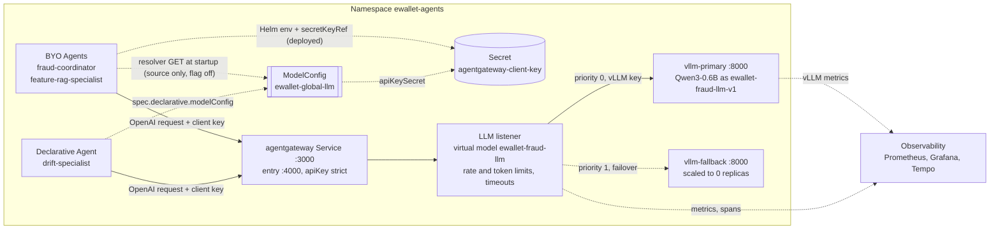

# LLM Inference Platform

This is the canonical report for the platform that serves the custom LLM of the fraud-investigation agents:

- **CPU vLLM** on GKE, serving a pinned Qwen3-0.6B;
- **agentgateway** in front of vLLM, which authenticates clients, enforces budgets and routes to the backends;
- one **Global ModelConfig**, `ewallet-global-llm`, that holds the shared model settings, and a **BYO ModelConfig Resolver** that lets BYO agents read it.

The two serving optimizations, EXP-V1 and EXP-V2, are reported in [BENCHMARK_RESULTS.md](BENCHMARK_RESULTS.md).

| Rubric row | Section |
|---|---|
| 3 — Deploy the LLM inference platform | [§2](#2-architecture), [§3](#3-vllm-inference-platform), [§6](#6-runtime-verification) |
| 4 — Custom model | [§3](#3-vllm-inference-platform) |
| 5 — agentgateway with security and policy | [§4](#4-agentgateway); policy probes in [BENCHMARK_RESULTS §5](BENCHMARK_RESULTS.md#5-agentgateway-security-and-policy-evidence) |
| 7 — Global ModelConfig | [§5](#5-global-modelconfig-and-byo-resolver) |
| 50 — LLM telemetry | [§7](#7-observability), canonical in [OBSERVABILITY §6](../observability/OBSERVABILITY.md#6-llm-telemetry) |

## 1. Overview

The agents use the LLM for a narrow task: understand an analyst's question, then choose a tool and its arguments (see [Agents](../agents/AGENTS_REGISTRY_GATEWAYS.md)). That task does not need a large model, so the platform serves **Qwen3-0.6B on CPU nodes**. Three constraints drove this choice:

- the GKE project has no GPU quota;
- the same nodes also run the MLOps workloads;
- tool calling with a small model is accurate enough when every argument is validated against the analyst's text.

**Design goals.**

- **One entry point.** Agents never call vLLM directly. agentgateway authenticates them, enforces request and token budgets, applies nested timeouts and fails over between backends.
- **One model configuration.** A single ModelConfig defines the model, the endpoint and the credential reference ([§5](#5-global-modelconfig-and-byo-resolver)).
- **Reproducible serving.** The model weights are baked into a digest-pinned image, so a pod never downloads weights at start-up and needs no Internet egress.

## 2. Architecture



**How to read it.** Solid arrows are runtime network requests; the generated tokens stream back along the same path. Dashed arrows are configuration references, the failover path, or telemetry. The ModelConfig is configuration, not a network hop: at runtime every agent calls agentgateway, which calls vLLM.

**Deployable units** (Helm chart [`infra/helm/llm-agent-platform`](../../../infra/helm/llm-agent-platform/Chart.yaml)):

| Unit | Kind | Runtime state |
|---|---|---|
| `vllm-primary` | Deployment | 1/1 Running |
| `vllm-fallback` | Deployment | Deployed, scaled to 0 replicas to save CPU on the shared nodes |
| `agentgateway` | Deployment | Running |
| `ewallet-global-llm` | kagent `ModelConfig` | Deployed |
| Agents | kagent `Agent` (1 Declarative, 2 BYO) | Running |

The chart also has an optional llm-d route (`llmd.mode`). It is off in the deployed configuration; llm-d was used only as the benchmark arm of EXP-V2.

## 3. vLLM inference platform

### 3.1 Model and serving

| Item | Value |
|---|---|
| Model | `Qwen/Qwen3-0.6B`, revision `c1899de289a04d12100db370d81485cdf75e47ca`, bfloat16 |
| Names | vLLM serves it as `ewallet-fraud-llm-v1`; agentgateway exposes it as the virtual model `ewallet-fraud-llm` |
| Image | vLLM 0.32.0 CPU, with the model baked into `vllm-cpu-model@sha256:f695b23e…` ([`infra/docker/vllm-cpu-model`](../../../infra/docker/vllm-cpu-model)) |
| API | OpenAI-compatible Chat Completions (`/v1/chat/completions`), streaming and non-streaming |
| Tool calling | `--tool-call-parser hermes`, `--reasoning-parser qwen3`, thinking disabled |
| Readiness | A warm-up request shaped like a real tool call runs before the pod reports Ready, so the first user request does not pay the cold compile and prefill cost |

### 3.2 CPU deployment parameters

| Parameter | Value | Reason |
|---|---|---|
| Resources per pod | requests 2 CPU / 6 GiB, limits 3 CPU / 10 GiB | One vLLM pod per e2-standard-4 node, leaving room for MLOps |
| KV cache | `VLLM_CPU_KVCACHE_SPACE` 2 GiB | A 4 GiB cache was OOMKilled at the 8 GiB limit; 2 GiB still holds about 18k tokens (4 sequences × 4096) |
| Context | `--max-model-len 4096` | Fits the agent prompts (about 700 tokens with the tool schema) |
| Concurrency | primary `--max-num-seqs 4`, `--max-num-queued-reqs 8`; fallback 2 and 4 | Bounds latency on 2 cores; extra requests get a fast 503 instead of an unbounded queue |
| Prefix caching | on | Disabling it made every request pay a full prefill (about 87 s for 800 tokens against 4.4 s warm) in the historical O1 benchmark |
| OpenMP threads | `OMP_NUM_THREADS=2`; `VLLM_CPU_OMP_THREADS_BIND` from `vllm.cpuThreadsBind` | Chart default `auto`. EXP-V1 measured `0-1`; see below |
| Rollout | `maxSurge 0`, `maxUnavailable 1` | A surge pod would need 2 more free CPUs, which the node budget does not have |

**Thread binding.** The chart exposes the binding as one value, `vllm.cpuThreadsBind` ([`values.yaml`](../../../infra/helm/llm-agent-platform/values.yaml), default `auto`), and the `0-1` setting as the overlay [`o1/c1-thread-bind.yaml`](../../../infra/helm/llm-agent-platform/o1/c1-thread-bind.yaml). EXP-V1 observed about 53–55 % more output tokens/s with `0-1` on the same pod budget ([BENCHMARK_RESULTS §3](BENCHMARK_RESULTS.md#3-exp-v1--cpu-thread-binding)). The GKE values file does not set the binding, and the recorded evidence does not show a promotion of `0-1` into the production release, so this report does not claim that production runs with `0-1`.

Source: [`templates/vllm.yaml`](../../../infra/helm/llm-agent-platform/templates/vllm.yaml), [`values-gke-cpu.yaml`](../../../infra/helm/llm-agent-platform/values-gke-cpu.yaml), [`values-gke-cpu-g1.yaml`](../../../infra/helm/llm-agent-platform/values-gke-cpu-g1.yaml).

## 4. agentgateway

The gateway is configured by [`templates/agentgateway.yaml`](../../../infra/helm/llm-agent-platform/templates/agentgateway.yaml) and the `agentgateway` block of the values.

### 4.1 Request path

1. The agent sends an OpenAI-format request with its client key to the `agentgateway` Service on port 3000, which targets the `entry` port 4000.
2. The entry route enforces `apiKey: mode: strict`, then forwards to the in-process LLM listener on `127.0.0.1:3000`.
3. The listener applies the rate and token limits and the timeouts, and resolves the virtual model `ewallet-fraud-llm` to its backends: primary at priority 0, fallback at priority 1.
4. The gateway replaces the client key with the vLLM backend key and calls vLLM, which serves `ewallet-fraud-llm-v1`.

### 4.2 Policies

| Policy | Configuration | Reason |
|---|---|---|
| Client authentication | `apiKey: mode: strict` with a dedicated client key (Secret `agentgateway-client-key`) | No client reaches the model without its own key |
| Backend authentication | a separate key for vLLM, held only by the gateway | vLLM rejects every caller except the gateway, and the backend key is refused if a client presents it |
| Request rate | `localRateLimit`: 12 requests per 1 s | Protects a 2-core server from bursts; excess requests get 429 |
| Token budget | `localRateLimit` on tokens: 24,000 per 1 h in production | Bounds token spend per client. Benchmarks used raised budgets (150,000 or 400,000 per hour) |
| Timeouts | GKE: route `requestTimeout` 180 s > LLM `llmRequestTimeout` 170 s > `backendRequestTimeout` 160 s ≥ `responseIdleTimeout` 160 s; ModelConfig 200 s outermost | Each layer gives up after the one below it. The chart refuses to render if the nesting is broken |
| Retry | 502/503 only, at most one attempt; the chart refuses any 500/504 retry | A timed-out CPU generation is never replayed |
| Failover | virtual model with primary → fallback; a backend is evicted after 2 consecutive failures | Keeps serving if one vLLM pod is lost |
| Routing header | `x-ewallet-backend` (`primary`, `fallback`, or `llm-d` in EXP-V2) | Shows which backend served each response |
| Tracing | OpenTelemetry spans for gateway hops | Gateway hops appear inside agent traces |

**Configured versus available.** Failover is configured and was demonstrated on the cluster (§6). In the current deployment the fallback is scaled to zero, so failover is **not available** until it is scaled up; with the primary down, requests fail.

## 5. Global ModelConfig and BYO Resolver

### 5.1 The ModelConfig

One kagent `ModelConfig`, `ewallet-agents/ewallet-global-llm`, is the single configuration of the e-wallet LLM route:

```yaml
apiVersion: kagent.dev/v1alpha2
kind: ModelConfig
metadata: {name: ewallet-global-llm, namespace: ewallet-agents}
spec:
  provider: OpenAI                      # OpenAI-compatible Chat Completions
  model: ewallet-fraud-llm              # agentgateway's virtual model, not a vLLM name
  openAI:
    apiFormat: chatCompletions
    baseUrl: http://agentgateway.ewallet-agents.svc.cluster.local:3000/v1
    timeout: 200                        # outermost timeout budget
  apiKeySecret: agentgateway-client-key # gateway client key, never the vLLM backend key
  apiKeySecretKey: api-key
```

| Field (chart value) | Value | What it does |
|---|---|---|
| `metadata.name` (`modelConfig.name`) | `ewallet-global-llm` | The one name agents reference |
| `metadata.namespace` (`namespace.name`) | `ewallet-agents` | A ModelConfig is namespaced, so "global" means shared by every agent of the platform namespace, not cluster-wide |
| `spec.provider` | `OpenAI` | agentgateway and vLLM speak the OpenAI API, so kagent uses its OpenAI client. No OpenAI service is involved |
| `spec.model` | `ewallet-fraud-llm` | The gateway's virtual model, so agents depend neither on a backend nor on the served name |
| `spec.openAI.baseUrl` | agentgateway Service, port 3000 | Every request goes through the gateway, never directly to vLLM |
| `spec.apiKeySecret`, `apiKeySecretKey` | `agentgateway-client-key`, `api-key` | A reference to the gateway client key. The chart stores only the reference; agents never hold the vLLM key |
| `spec.openAI.timeout` | 200 s on GKE (35 s chart default) | The outermost budget; the chart refuses to render unless it exceeds the gateway timeouts |

Changing the model or the route is a change of this one object.

### 5.2 How each agent gets the configuration

| Agent | kagent type | Deployed today |
|---|---|---|
| `drift-specialist` | Declarative | Native reference `spec.declarative.modelConfig: ewallet-global-llm`; kagent resolves it |
| `fraud-coordinator` | BYO | Helm environment variables (`EWALLET_LLM_MODEL`, `EWALLET_LLM_BASE_URL`) and a `secretKeyRef`, rendered from the same values as the ModelConfig |
| `feature-rag-specialist` | BYO | Same as the Coordinator |

**Why BYO agents need more.** In the installed CRD (`kagent-crds-0.10.3`, [kagent-api.txt](../../evidence/edai2/llm/global_modelconfig_20261109/compat/kagent-api.txt)), `spec.byo` has only `deployment`, so a BYO Agent cannot reference a ModelConfig and kagent injects none. The BYO agents run their own A2A runtime and call the gateway themselves. With the Helm bridge the values match the ModelConfig, but editing the CR changes nothing for the BYO agents: the Helm values are their real source.

**So, today, only the Declarative `drift-specialist` resolves the ModelConfig CR directly.** The two BYO agents use the Helm environment configuration.

### 5.3 The BYO ModelConfig Resolver

The resolver closes that gap without a new controller and without changing kagent 0.10.3. It is [`ai_platform/llm_agent/model_config.py`](../../../ai_platform/llm_agent/model_config.py), called from `planner_from_env()` in [`nl_intake.py`](../../../ai_platform/llm_agent/nl_intake.py), which both BYO executors already use to build their LLM client. With `EWALLET_LLM_CONFIG_SOURCE=modelconfig`, at startup the agent:

1. refuses a second authority: `EWALLET_LLM_BASE_URL` or `EWALLET_LLM_MODEL` in the environment stops the agent;
2. requires the gateway client key (`EWALLET_LLM_API_KEY`, a kubelet-resolved Secret reference);
3. sends `GET /apis/kagent.dev/v1alpha2/namespaces/<own namespace>/modelconfigs/ewallet-global-llm` with a projected ServiceAccount token, over TLS verified against the cluster CA. It retries 3 times on 5xx, 429 or connection errors, and never on 401, 403 or 404;
4. validates the object and **fails closed**:

   | Check | Failure code |
   |---|---|
   | `kagent.dev/v1alpha2` ModelConfig, the requested name and namespace, not being deleted | `modelconfig_invalid` |
   | `provider == OpenAI` | `modelconfig_provider_unsupported` |
   | `model` is a logical name; `apiFormat` is `chatCompletions` | `modelconfig_invalid` |
   | `baseUrl` is exactly the agentgateway URL | `modelconfig_endpoint_unauthorized` |
   | `timeout` between 1 and 200 s | `modelconfig_invalid` |
   | `apiKeySecret`/`apiKeySecretKey` equal the Secret mounted in the pod | `modelconfig_secret_mismatch` |
   | `Accepted=True` at the current generation | `modelconfig_not_accepted` |
   | RBAC or token rejected; object absent; API unreachable | `modelconfig_forbidden`, `modelconfig_not_found`, `modelconfig_unavailable` |

5. builds the planner from the CR: model and base URL from it, and a timeout of `min(agent deadline, CR timeout)`, so the CR is the ceiling;
6. logs one JSON line, `modelconfig.resolved`, with the CR's uid, generation, model, URL, timeout and Secret *names*, never a value.

Any failure raises at startup, so the pod never becomes Ready and a rolling update stops with the previous pods still serving. The default `EWALLET_LLM_CONFIG_SOURCE=env` keeps the Helm behaviour.

**Why the Secret is not read from the API.** The pod gets the key the usual way (`secretKeyRef`), so no Secret-read permission exists. The resolver only proves that the CR still names that Secret: a CR that points to another Secret stops the agent instead of running with a key the CR no longer authorises.

**Propagation.** The resolver reads once at startup; there is no watch. After editing the CR, restart the BYO Deployments (`kubectl -n ewallet-agents rollout restart deploy/fraud-coordinator deploy/feature-rag-specialist`). A CR that fails validation leaves the new pods un-Ready and the old ones serving.

### 5.4 Least-privilege access

[`templates/modelconfig-rbac.yaml`](../../../infra/helm/llm-agent-platform/templates/modelconfig-rbac.yaml) renders only with `modelConfig.byoResolver.enabled=true`:

- **Role** `ewallet-global-llm-reader`: `get` on `modelconfigs.kagent.dev` with `resourceNames: [ewallet-global-llm]`. No `list`, `watch`, `update`, Secrets or other kinds.
- **RoleBinding**: only the ServiceAccounts of BYO agents with natural-language intake on (today the two above).
- **NetworkPolicy** `allow-byo-modelconfig-to-kube-apiserver`: egress from those pods to the API server on 443 only; the chart refuses to render without the API server CIDRs.
- **Token**: a projected volume per BYO pod (API-server audience, 3600 s, cluster CA, namespace); the ServiceAccounts keep `automountServiceAccountToken: false`.

The RBAC matrix was read on GKE with `kubectl auth can-i --as` ([06-rbac-can-i.txt](../../evidence/edai2/llm/global_modelconfig_20261109/canary/06-rbac-can-i.txt)): the bound ServiceAccounts answer `yes` only to `get modelconfigs/ewallet-global-llm`, and an unbound ServiceAccount gets `no` everywhere.

### 5.5 Status and rollout

| Component | Status | Record |
|---|---|---|
| Global ModelConfig CR | **Deployed** (read back 2026-11-08) | [`00-production-modelconfig.json`](../../evidence/edai2/llm/global_modelconfig_20261109/canary/00-production-modelconfig.json) |
| `drift-specialist` native reference | **Deployed and verified** | [`drift-native-reference.txt`](../../evidence/edai2/llm/global_modelconfig_20261109/production/drift-native-reference.txt) |
| BYO resolver source and chart switch | Integrated in `main`; feature flag `modelConfig.byoResolver.enabled`, **off by default** | §9 |
| BYO resolver tests | Verified locally (21 resolver tests, 6 chart tests) | §6 |
| Resolver in a BYO pod with the chart's RBAC, token and egress policy | Verified in an isolated GKE canary, since deleted | §6 |
| BYO resolver in production | **Not deployed** | [`verify-current-production.json`](../../evidence/edai2/llm/global_modelconfig_20261109/production/verify-current-production.json) |
| Production BYO configuration | Helm environment variables | same |

Promotion is two owner-run steps in the [Global ModelConfig runbook](../../runbooks/edai2/GLOBAL_MODELCONFIG_RUNBOOK.md): first the BYO images built from this source, with the flag off (behaviour unchanged); then `helm upgrade` with `modelConfig.byoResolver.enabled=true` and the API server CIDRs, a diff of exactly five objects ([helm-diff-resolver-on.txt](../../evidence/edai2/llm/global_modelconfig_20261109/production/helm-diff-resolver-on.txt)).

## 6. Runtime verification

Each claim is labelled with the kind of evidence behind it.

| Evidence kind | What was verified | Record |
|---|---|---|
| **Production runtime** | `vllm-primary` 1/1 behind agentgateway; `vllm-fallback` deployed at 0 replicas | Deployment readback |
| **Production runtime** | The Declarative drift agent answers through `ewallet-global-llm` and agentgateway (screenshot below) | session `01a1a419` |
| **Production runtime** | Gateway spans inside a real agent trace (screenshot below) | trace `f341b410…` |
| **Production runtime** | With the resolver flag off, the chart renders the deployed manifest exactly; `llm-agent` stayed at revision 42 during the ModelConfig work | [before.txt](../../evidence/edai2/llm/global_modelconfig_20261109/production/before.txt), [after.txt](../../evidence/edai2/llm/global_modelconfig_20261109/production/after.txt) |
| **Historical runtime (G1, 2026-10-31)** | Streaming and non-streaming tool calls through the gateway (`x-ewallet-backend: primary`); wrong key, missing key and backend key as client key each rejected with 401; with the primary at zero, the fallback served (`vllm:request_success_total` 1 → 6) | [`g1_20261031T231145Z/`](../../evidence/llm_agent/g1_20261031T231145Z) |
| **Isolated canary (GKE `kagent-pilot`, 2026-11-08, deleted)** | Resolver in BYO pods with the chart's RBAC and egress: resolved and Ready. Unbound ServiceAccount: `modelconfig_forbidden`. Other egress blocked. CR model change: picked up after restart. `baseUrl` to vLLM: `modelconfig_endpoint_unauthorized`. Other Secret: `modelconfig_secret_mismatch`. CR deleted: `modelconfig_not_found`; restored: Ready | [canary](../../evidence/edai2/llm/global_modelconfig_20261109/canary/), built by [`infra/k8s/modelconfig-canary/`](../../../infra/k8s/modelconfig-canary/) |
| **Operator-side runtime check (2026-11-08)** | Live production CR → resolver → Coordinator planner → agentgateway → CPU vLLM, run from the laptop with the operator's token and a port-forward (not from a production pod): 4/4 business cases chose `investigate_transaction` with grounded arguments, the off-topic case was refused, backend `primary`, p50 60 s / p95 83 s | [summary.json](../../evidence/edai2/llm/global_modelconfig_20261109/runtime/summary.json), [`modelconfig_runtime_check.py`](../../../scripts/llm_agent/modelconfig_runtime_check.py) |
| **Benchmark gateway (2026-11-09/10)** | Strict authentication, 429 rate limiting, timeouts and the routing header on the temporary benchmark gateway | [BENCHMARK_RESULTS §5](BENCHMARK_RESULTS.md#5-agentgateway-security-and-policy-evidence) |
| **Local tests** | [`test_global_modelconfig_resolver.py`](../../../tests/llm_agent/test_global_modelconfig_resolver.py) (21): resolution, every rejection code, retries, no credential in the log. [`test_global_modelconfig_chart.py`](../../../tests/llm_agent/test_global_modelconfig_chart.py) (6): flag off renders the Helm bridge; flag on adds exactly Role, RoleBinding and NetworkPolicy | — |
| **Source only** | The BYO resolver path in production pods | Not deployed (§5.5) |


*A kagent conversation with the Declarative drift agent (session `01a1a419`). The header shows provider `OpenAI` and model `ewallet-fraud-llm`: the answer was generated by the deployed Qwen3-0.6B through ModelConfig `ewallet-global-llm` and agentgateway.*


*Tempo spans of the LLM gateway (route `internal/llm`) inside a real agent trace (`f341b410…`): the agent's planning call passes through agentgateway to vLLM.*

## 7. Observability

The LLM telemetry of the deployed platform is documented once, in [OBSERVABILITY §6](../observability/OBSERVABILITY.md#6-llm-telemetry): vLLM and agentgateway metrics on the Grafana `llm-runtime` dashboard (tokens per request, TTFT, generation round-trip time, PII screening) and gateway spans in Tempo. Under real agent traffic the deployed server reported:

- 707 / 264 / 971 input / output / total tokens per request;
- TTFT p50 / p95 of 5 s / 38 s;
- end-to-end generation p50 / p95 of 50 s / 114 s.

These are longer than the benchmark figures because agent prompts, about 700 tokens with the tool schema, are much longer than the benchmark's short chats.


*Grafana `llm-runtime` dashboard: tokens per request, measured both by vLLM and by agentgateway.*

## 8. Limitations

- **CPU latency.** First tokens take seconds and generations tens of seconds. This suits an analyst assistant, not interactive chat at scale.
- **Fallback scaled to zero.** Failover is configured and was demonstrated, but it is unavailable until the fallback is scaled up.
- **BYO resolver not deployed.** Production BYO agents still use Helm environment variables. Once enabled, a ModelConfig change still needs a BYO restart (no watch, by design), and the approved endpoint is fixed in code, so moving the gateway is a code change.
- **Thread binding.** The `0-1` binding observed in EXP-V1 is available through `vllm.cpuThreadsBind`, but its promotion into the production values is not recorded.
- **One model version.** Only Qwen3-0.6B is served. The model A/B design is documented separately in [LLM A/B design](../platform/LLM_AB_DESIGN.md) and has not run on the cluster.

## 9. Source references

Repository paths are in the first column. Line ranges are pinned to the GitHub commit where they were verified.

| File | Lines | What it configures |
|---|---|---|
| [`templates/vllm.yaml`](../../../infra/helm/llm-agent-platform/templates/vllm.yaml) | [L128–129](https://github.com/HuyyGiaa/ewallet-data-ai-platform/blob/22018233adb172767a267a9bf76ad295d17ac6cf/infra/helm/llm-agent-platform/templates/vllm.yaml#L128-L129) | vLLM Deployments, arguments and served model name; `VLLM_CPU_OMP_THREADS_BIND` from `vllm.cpuThreadsBind` |
| [`values.yaml`](../../../infra/helm/llm-agent-platform/values.yaml) | [L200](https://github.com/HuyyGiaa/ewallet-data-ai-platform/blob/22018233adb172767a267a9bf76ad295d17ac6cf/infra/helm/llm-agent-platform/values.yaml#L200-L200) | Served name `ewallet-fraud-llm-v1`; chart defaults including `cpuThreadsBind: auto` and the request and token rates |
| [`values-gke-cpu.yaml`](../../../infra/helm/llm-agent-platform/values-gke-cpu.yaml) | [L64–65](https://github.com/HuyyGiaa/ewallet-data-ai-platform/blob/22018233adb172767a267a9bf76ad295d17ac6cf/infra/helm/llm-agent-platform/values-gke-cpu.yaml#L64-L65) | GKE profile: image source, resources, KV cache, gateway timeouts, ModelConfig timeout of 200 s |
| [`o1/c1-thread-bind.yaml`](../../../infra/helm/llm-agent-platform/o1/c1-thread-bind.yaml) | — | The `0-1` thread-binding overlay |
| [`templates/agentgateway.yaml`](../../../infra/helm/llm-agent-platform/templates/agentgateway.yaml) | [L6–12](https://github.com/HuyyGiaa/ewallet-data-ai-platform/blob/22018233adb172767a267a9bf76ad295d17ac6cf/infra/helm/llm-agent-platform/templates/agentgateway.yaml#L6-L12) | Timeout nesting guard |
| same | [L43–56](https://github.com/HuyyGiaa/ewallet-data-ai-platform/blob/22018233adb172767a267a9bf76ad295d17ac6cf/infra/helm/llm-agent-platform/templates/agentgateway.yaml#L43-L56) | Entry route: strict client authentication, forward to the LLM listener |
| same | [L101–110](https://github.com/HuyyGiaa/ewallet-data-ai-platform/blob/22018233adb172767a267a9bf76ad295d17ac6cf/infra/helm/llm-agent-platform/templates/agentgateway.yaml#L101-L110) | Primary backend: vLLM URL and backend key |
| same | [L157–167](https://github.com/HuyyGiaa/ewallet-data-ai-platform/blob/22018233adb172767a267a9bf76ad295d17ac6cf/infra/helm/llm-agent-platform/templates/agentgateway.yaml#L157-L167) | Virtual model `ewallet-fraud-llm` and failover priorities |
| same | [L264–272](https://github.com/HuyyGiaa/ewallet-data-ai-platform/blob/22018233adb172767a267a9bf76ad295d17ac6cf/infra/helm/llm-agent-platform/templates/agentgateway.yaml#L264-L272) | Service port 3000 to the entry port |
| [`values.yaml`](../../../infra/helm/llm-agent-platform/values.yaml) | [L279–281](https://github.com/HuyyGiaa/ewallet-data-ai-platform/blob/22018233adb172767a267a9bf76ad295d17ac6cf/infra/helm/llm-agent-platform/values.yaml#L279-L281) | Gateway client-key Secret reference |
| [`templates/modelconfig.yaml`](../../../infra/helm/llm-agent-platform/templates/modelconfig.yaml) | [L1–17](https://github.com/HuyyGiaa/ewallet-data-ai-platform/blob/b95b160f3dbfb295bda483c5324873bb58505ae2/infra/helm/llm-agent-platform/templates/modelconfig.yaml#L1-L17) | The ModelConfig resource |
| [`values.yaml`](../../../infra/helm/llm-agent-platform/values.yaml) | [L851–861](https://github.com/HuyyGiaa/ewallet-data-ai-platform/blob/22018233adb172767a267a9bf76ad295d17ac6cf/infra/helm/llm-agent-platform/values.yaml#L851-L861) | ModelConfig name, model, default timeout, Secret reference |
| same | [L868–874](https://github.com/HuyyGiaa/ewallet-data-ai-platform/blob/b95b160f3dbfb295bda483c5324873bb58505ae2/infra/helm/llm-agent-platform/values.yaml#L868-L874) | `modelConfig.byoResolver`, `enabled: false` by default |
| [`templates/agents.yaml`](../../../infra/helm/llm-agent-platform/templates/agents.yaml) | [L8–9](https://github.com/HuyyGiaa/ewallet-data-ai-platform/blob/22018233adb172767a267a9bf76ad295d17ac6cf/infra/helm/llm-agent-platform/templates/agents.yaml#L8-L9) | Agents cannot render without the ModelConfig |
| same | [L183–207](https://github.com/HuyyGiaa/ewallet-data-ai-platform/blob/22018233adb172767a267a9bf76ad295d17ac6cf/infra/helm/llm-agent-platform/templates/agents.yaml#L183-L207) | BYO agents: endpoint, model and client key through environment variables |
| same | [L190–205](https://github.com/HuyyGiaa/ewallet-data-ai-platform/blob/b95b160f3dbfb295bda483c5324873bb58505ae2/infra/helm/llm-agent-platform/templates/agents.yaml#L190-L205) | Resolver flag on: resolver environment; off: the Helm bridge |
| same | [L263–266](https://github.com/HuyyGiaa/ewallet-data-ai-platform/blob/22018233adb172767a267a9bf76ad295d17ac6cf/infra/helm/llm-agent-platform/templates/agents.yaml#L263-L266) | Declarative agents reference the ModelConfig |
| [`templates/modelconfig-rbac.yaml`](../../../infra/helm/llm-agent-platform/templates/modelconfig-rbac.yaml) | [L1–72](https://github.com/HuyyGiaa/ewallet-data-ai-platform/blob/b95b160f3dbfb295bda483c5324873bb58505ae2/infra/helm/llm-agent-platform/templates/modelconfig-rbac.yaml#L1-L72) | Role, RoleBinding and egress NetworkPolicy, rendered only with the flag on |
| [`n11/values-n11-agents.yaml`](../../../infra/helm/llm-agent-platform/n11/values-n11-agents.yaml) | [L5–15](https://github.com/HuyyGiaa/ewallet-data-ai-platform/blob/22018233adb172767a267a9bf76ad295d17ac6cf/infra/helm/llm-agent-platform/n11/values-n11-agents.yaml#L5-L15) | Enables natural-language intake for both BYO agents |
| [`model_config.py`](../../../ai_platform/llm_agent/model_config.py) | [L40–42](https://github.com/HuyyGiaa/ewallet-data-ai-platform/blob/b95b160f3dbfb295bda483c5324873bb58505ae2/ai_platform/llm_agent/model_config.py#L40-L42), [L109–258](https://github.com/HuyyGiaa/ewallet-data-ai-platform/blob/b95b160f3dbfb295bda483c5324873bb58505ae2/ai_platform/llm_agent/model_config.py#L109-L258) | Approved endpoint; parsing, fetch and validation |
| [`nl_intake.py`](../../../ai_platform/llm_agent/nl_intake.py) | [L329–341](https://github.com/HuyyGiaa/ewallet-data-ai-platform/blob/b95b160f3dbfb295bda483c5324873bb58505ae2/ai_platform/llm_agent/nl_intake.py#L329-L341) | Selects the configuration source with `EWALLET_LLM_CONFIG_SOURCE` (default `env`) |

Tests: [`test_global_modelconfig_resolver.py`](../../../tests/llm_agent/test_global_modelconfig_resolver.py), [`test_global_modelconfig_chart.py`](../../../tests/llm_agent/test_global_modelconfig_chart.py), [`test_r1_runtime_prep.py`](../../../tests/llm_agent/test_r1_runtime_prep.py).

The earlier detailed ModelConfig report, with the full canary case list and the original test log, is archived as [GLOBAL_MODELCONFIG.md](../../../archive/legacy-docs/docs/edai2/llm/GLOBAL_MODELCONFIG.md).
