# Feature Store

This document describes the platform's Feature Store: what it is for, how it is
built, how features reach the Online Store in batch and in streaming, how
Offline/Online consistency is checked, and how the system is deployed and
operated. All results come from the `rehearsal-5gb-v1` dataset and runs on GKE
and GCS. The step-by-step procedure is in the
[Feature Store runbook](../../runbooks/edai2/FEATURE_STORE_RUNBOOK.md).

**Contents**

1. [Introduction](#1-introduction)
2. [System architecture](#2-system-architecture)
3. [Dataset and feature definitions](#3-dataset-and-feature-definitions)
4. [Feast Offline and Online Stores](#4-feast-offline-and-online-stores)
5. [Batch incremental materialization](#5-batch-incremental-materialization)
6. [Streaming feature pipeline](#6-streaming-feature-pipeline)
7. [Data consistency and point-in-time validation](#7-data-consistency-and-point-in-time-validation)
8. [Deployment architecture](#8-deployment-architecture)
9. [Runtime verification results](#9-runtime-verification-results)
10. [Reproducibility and operations](#10-reproducibility-and-operations)
11. [Limitations and future improvements](#11-limitations-and-future-improvements)

## 1. Introduction

The fraud model scores a payment from 41 inputs. 31 of them are behavioural
aggregates: how many transactions a user made in the last hour, how much an
account spent in 24 hours, how old a device is, how many distinct users a
merchant served in 10 minutes. The Feature Store makes those 31 values available
in two forms:

- **Offline**, for training and analysis. Every value keeps its event time, so
  a training example can be joined with the feature values that existed *at
  that moment* and never with later ones. Without this point-in-time join a
  model learns from the future and its offline metrics are meaningless.
- **Online**, for the Fraud API. When a payment arrives, the latest value for
  each entity must be one key lookup away (milliseconds). Aggregating history
  at request time would take far too long.

The two forms must agree. A model trained on Offline values and served Online
values that are computed or loaded differently will behave differently in
production than in evaluation. Most of this design is about proving that
agreement rather than assuming it.

The Feature Store is built on [Feast](https://feast.dev) 0.66. Feature
definitions live in one place and are shared by training, batch loading,
streaming updates and serving. Offline data is immutable Parquet in Google Cloud
Storage. The Online Store is Redis.

## 2. System architecture

Features reach the Online Store in two complementary ways.

**Batch.** The data platform computes historical features. They are frozen
into an immutable Offline snapshot, and an Airflow DAG loads them into Redis one
bounded time window at a time.

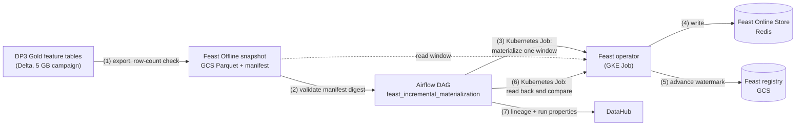

**Streaming.** New transactions update features in real time. Flink keeps
feature state and emits each update to a Redpanda topic. Two independent
consumers write the same update to the Offline Store (Parquet in GCS) and to the
Online Store (Feast → Redis). A validator then checks that both stores, and an
independent recomputation from the source events, agree.

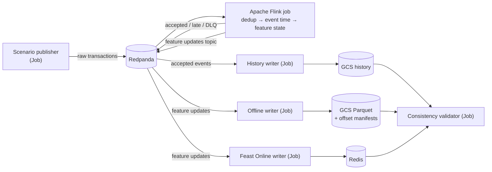

Two points in the streaming design are deliberate:

- **The writers run outside Flink.** They are separate Kubernetes Jobs with
  their own Kafka consumer groups; they are not Flink sinks. Flink's
  responsibility ends at a durable topic. Each writer can be replayed from Kafka
  offsets without touching the Flink job. In the Flink Job Graph
  (Figure 9) the writers therefore do not appear.
- **The validator does not trust either store.** It recomputes the expected
  feature values from the accepted-event history and compares Offline, Online
  and the recomputation.

## 3. Dataset and feature definitions

### 3.1 Source dataset

The source is the `rehearsal-5gb-v1` dataset, processed by the data platform's
DP1–DP3 pipeline in campaign `ab-20261110225456`. DP3 writes four Gold feature
tables (`feat_user_behavior`, `feat_account_behavior`, `feat_device_behavior`,
`feat_merchant_behavior`) in Delta format. Each row holds one entity's feature
values right after one of its transactions, with a UTC microsecond
`event_timestamp`.

The Feature Store reads only the DP3 run that the pipeline marked complete.
[`export_gold_to_parquet.py`](../../../ai_platform/features/feast/sources/export_gold_to_parquet.py)
selects the run from DP3's completion handoff
([`provenance.py`](../../../ai_platform/features/feast/provenance.py)). It
exports the four tables to Parquet, drops the write-time `created` audit column,
and writes a manifest with the row count, Delta version and timestamp type of
every table. The result is snapshot `feast-r5gb-20261111-214544`:

| FeatureView | Rows |
|---|---:|
| `user_behavior` | 18,599,553 |
| `account_behavior` | 18,599,553 |
| `device_behavior` | 18,599,560 |
| `merchant_behavior` | 7,439,478 |
| **Total** | **63,238,144** |

Events span 2026-01-01T00:00:01Z to 2026-05-31T23:59:58Z. The manifest's SHA-256
is `3aa7e2f2b017d7375eaa506974562929c0983077edfa3825a2babb9a81ed2bca`, and every
consumer checks it before reading.

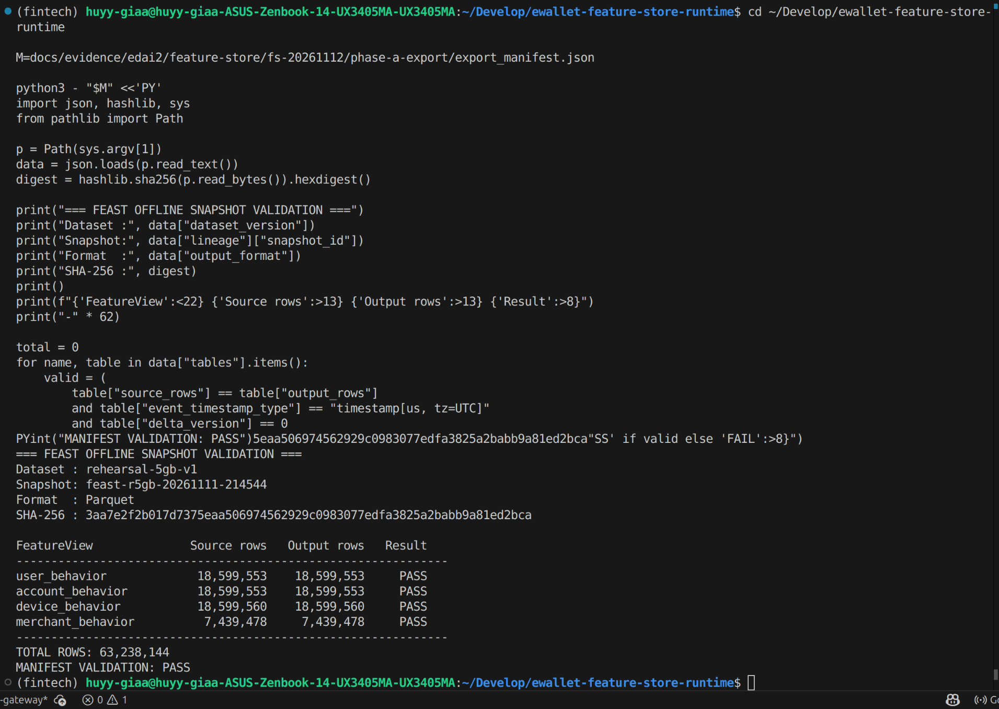

*Figure 1 — The snapshot manifest checked against its digest. For every
FeatureView the source row count equals the exported row count, 63,238,144 rows
in total. The snapshot's four table folders and `_control/` in GCS are shown in
[`batch-01`](../../evidence/edai2/feature-store/screenshots/batch-01_feast_offline_snapshot_gcs.png).*

### 3.2 Entities and features

[`schema.py`](../../../ai_platform/features/feast/schema.py) declares four
entities and their features. That one declaration generates the Feast objects in
[`feature_definitions.py`](../../../ai_platform/features/feast/feature_repo/feature_definitions.py)
(Offline, file sources) and in the
[Online repository](../../../ai_platform/features/feast/online_repo/feature_definitions.py),
and it also defines the features the Flink job computes. A feature therefore
cannot exist in one path and be missing from another.

| Entity (join key) | FeatureView | Features | Examples |
|---|---|---:|---|
| user (`user_id`) | `user_behavior` | 9 | transactions in 5 min / 1 h / 24 h, amount sum 1 h, 30-day mean and std, 24 h failure rate, distinct merchants 24 h |
| account (`account_id`) | `account_behavior` | 10 | transactions 5 min / 1 h / 24 h, amount sums 1 h / 24 h, 30-day mean and std, failure rate, seconds since last transaction |
| device (`device_id`) | `device_behavior` | 5 | device age, transactions 1 h / 24 h, amount 24 h, failure rate |
| merchant (`merchant_id`) | `merchant_behavior` | 7 | transactions 10 min / 1 h / 24 h, unique users 10 min / 1 h, amount sum 1 h, 24 h mean |

All four views are 31 features in total. Counts are `Int64`; amounts and rates
are `Float64`.

## 4. Feast Offline and Online Stores

### 4.1 Offline Store

The Offline Store is Feast's file source over the immutable Parquet snapshot,
read with the Dask engine. Snapshots are addressed by identifiers, never by
`latest`:

```text
gs://<bucket>/features/offline/snapshots/<dataset>/<feature-run>/<snapshot>/
    _control/export_manifest.json
    feat_user_behavior/  feat_account_behavior/  feat_device_behavior/  feat_merchant_behavior/
```

A snapshot is written once and never changed. A rerun produces a new snapshot
ID, so the training data, the materialization and the lineage all keep pointing
at exactly the bytes they used.

**Point-in-time retrieval.**
[`snapshot_retrieval.py`](../../../ai_platform/features/feast/validation/snapshot_retrieval.py)
checks that Feast's `get_historical_features()` really returns, for each entity,
the latest row at or before the requested time. It samples entities from the
snapshot, asks Feast for their features at a fixed `as_of`, and independently
finds the latest eligible Parquet row for each entity. The two answers must be
equal. Entities whose candidate rows tie on time but differ in value are counted
as ambiguous, so a lucky match cannot hide them.

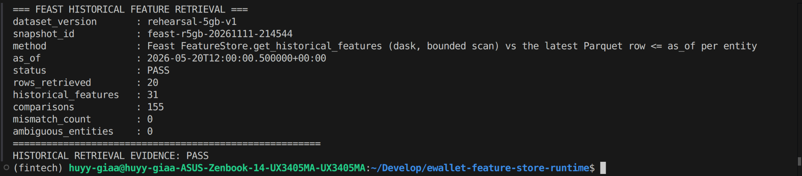

*Figure 2 — `get_historical_features` on the 5 GB snapshot at
2026-05-20T12:00:00.5Z: 20 rows and 31 features, 155 comparisons, 0 mismatches,
0 ambiguous entities.*

### 4.2 Online Store

The Online Store is Redis 7 in the `feature-store` namespace, with
`maxmemory-policy noeviction`, so Redis refuses writes instead of silently
evicting features. Feast keys are persistent (`key_ttl_seconds: null`), and
readers judge freshness from the stored feature timestamps. Feast's Redis writer
also refuses to replace a value with an older one, so replaying data cannot move
a feature backwards in time.

The Online repository
([`feature_store.yaml`](../../../ai_platform/features/feast/online_repo/feature_store.yaml))
takes its registry location and Redis connection from the environment. The
connection string comes from a Kubernetes Secret and is never written to a file
or a log.

**Isolation of Online targets.** One Redis instance serves production and
verification, separated by database number and by an ownership marker:

| Logical store | Secret | Redis DB | Use |
|---|---|---|---|
| `canonical-online` | `feast-online-redis` | 0 | production, used by the Fraud API |
| `canonical-verify` | `feast-online-redis-verify` | 1 | earlier verification of the production path |
| `rehearsal-online` | `feast-online-redis-rehearsal` | one empty DB in 2–7 | batch materialization runs |
| `rehearsal-stream` | `feast-online-redis-stream` | one empty DB in 8–15 | streaming verification campaigns |

The mapping is enforced in
[`materialization_plan.py`](../../../ai_platform/features/feast/materialization_plan.py)
and [`feast_online_job.sh`](../../../scripts/mlops/feast_online_job.sh): a
verification run cannot use DB 0, and production cannot use a verification
store. Before writing, a run claims its database atomically
([`redis_isolation.py`](../../../ai_platform/features/feast/redis_isolation.py)). A
Lua script stores a marker key naming the campaign, dataset, registry, snapshot
and a fingerprint of the Redis server, but only if the database is empty. Every
later write checks that marker. A database that is non-empty and unclaimed, or
claimed by another campaign, stops the run. Nothing ever flushes Redis.

### 4.3 Registry

Each materialization or streaming campaign has its own Feast registry in GCS
(`features/registries/<dataset>/online/<id>/registry.db`). The registry records,
for each FeatureView, the time up to which it has been materialized (its
watermark). Every command records the registry's GCS object generation before
and after it runs. A write that did not happen, or happened twice, is therefore
visible in the evidence.

## 5. Batch incremental materialization

### 5.1 Why incremental, and why windows

The Online Store needs only the latest value per entity, but loading the full
history at once would push every row of every table through Redis. The DAG
instead materializes one bounded window at a time. Each window starts exactly
where the registry says the previous one stopped. If a window fails, it can be
retried without reloading earlier data.

### 5.2 The DAG

[`feast_incremental_materialization`](../../../data_platform/orchestration/airflow/dags/feast_incremental_materialization.py)
contains no materialization logic. It orders eight tasks. Each task calls one
stage of [`ops/mlops/feast_incremental.py`](../../../ops/mlops/feast_incremental.py),
and all Feast work runs as Kubernetes Jobs on GKE through the operator
[`online_operator.py`](../../../ai_platform/features/feast/online_operator.py).

| Task | What it does |
|---|---|
| `validate_config` | Checks the run parameters and, in execute mode, the approval token |
| `validate_source_identity` | Reads the snapshot manifest and checks its SHA-256 against the expected value |
| `determine_window` | Runs `state` in a Job, reads each view's watermark, verifies the Redis owner marker and capacity, and decides the window |
| `materialize_window` | Runs one Job (`feast-inc-<window>-a<attempt>`) that materializes the window into Redis |
| `verify_job_completion` | Confirms that the Job succeeded and that every view's watermark reached the window end |
| `verify_online_readback` | Runs `parity` in a Job: reads sampled entities from Redis through Feast and compares them with the Offline snapshot |
| `record_run_provenance` | Records the run, window, source commit, image digest and evidence digests |
| `publish_datahub_lineage` | Publishes the lineage *snapshot datasets → `materialize_window` → Online FeatureViews* with the run's properties to DataHub, then reads it back |

`determine_window` returns one of four outcomes:

- `NEW_WINDOW` starts where all views stopped and ends at the requested end,
  capped by `max_window_hours`, the snapshot's last event and an optional
  streaming cutover.
- `PARTIAL` means only some views need the window, and only those are loaded.
- `COMPLETED` and `NO_NEW_DATA` are honest no-ops. They succeed without loading
  anything, and nobody may present them as incremental movement.

A view that has never been materialized is an error, never an implicit full
history load. A new registry therefore gets one explicit base load first
(Section 10).

**Dry run before execution.** By default the DAG runs in `dry_run` mode. It
validates everything, renders the Job manifests and DataHub records, and changes
nothing. The dry run emits an approval token derived from the registry, the
snapshot, the Online store and the window end. An execute run must carry that
token. If any of these changed, the token no longer matches and the run stops.

**Retries.** A retry finds an existing Job for the same window through a label
and joins it instead of starting a second one. The registry advances only after a
Job succeeds. Because Redis ignores older values, re-materializing the same
window is harmless.

### 5.3 Lineage and metadata

The `publish_datahub_lineage` task writes the DataJob `materialize_window`. Its
inputs are the four snapshot datasets in GCS and its outputs are the four Feast
Online datasets of the run's registry. The run's decision, window, DagRun ID,
image and source commit are stored as properties. The task then reads the
aspects back from DataHub and compares them. It passes only if every aspect
matches.

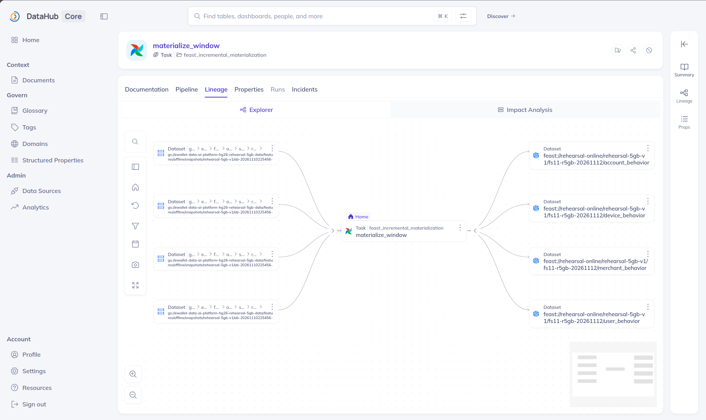

*Figure 3 — DataHub lineage of the `materialize_window` task. Four snapshot
tables in GCS feed the task, which writes the four Feast Online FeatureViews of
registry `fs11-r5gb-20261112`.*

## 6. Streaming feature pipeline

### 6.1 Components

The streaming path is implemented in
[`data_platform/streaming/`](../../../data_platform/streaming) and deployed by
[`block_a_cloud.sh`](../../../scripts/streaming/block_a_cloud.sh) from the
templates in
[`infra/kubernetes/streaming-block-a/`](../../../infra/kubernetes/streaming-block-a).

| Component | Kind | Source | Role |
|---|---|---|---|
| Redpanda | Deployment | [`messaging/`](../../../data_platform/streaming/messaging) | Kafka-compatible broker. Topics are suffixed with the campaign namespace |
| Flink JobManager / TaskManager | Deployments (Flink 1.19.1) | [`flink/job.py`](../../../data_platform/streaming/flink/job.py) | Runs the feature job |
| `block-a-topics` | Job | [`verification/cli.py`](../../../data_platform/streaming/verification/cli.py) | Creates the campaign's topics |
| `block-a-publish` | Job | [`verification/scenario.py`](../../../data_platform/streaming/verification/scenario.py) | Publishes the test scenario |
| `block-a-history` | Job | [`sinks/historical_service.py`](../../../data_platform/streaming/sinks/historical_service.py) | Writes accepted transactions to GCS history |
| `block-a-offline` | Job | [`sinks/offline_features.py`](../../../data_platform/streaming/sinks/offline_features.py) | Writes feature updates as Parquet to the Offline Store |
| `block-a-feast` | Job | [`feast/service.py`](../../../data_platform/streaming/feast/service.py) | Pushes feature updates to the Feast Online Store |
| `block-a-validate` | Job | [`verification/consistency.py`](../../../data_platform/streaming/verification/consistency.py) | Compares the stores and writes the signed report |

### 6.2 Inside the Flink job

The job reads raw and retried transactions and runs four operator chains (Figure 9):

1. **Source and validation.** Extracts the event time, assigns watermarks and
   parses each event against the
   [event contract](../../../data_platform/streaming/contracts/events.py).
   Invalid events go to a dead-letter topic.
2. **Deduplication** by transaction ID
   ([`dedup.py`](../../../data_platform/streaming/flink/dedup.py)), so a
   replayed event is counted once.
3. **Event-time disposition**
   ([`event_time.py`](../../../data_platform/streaming/flink/event_time.py)).
   On-time and late-but-allowed events are accepted. Events later than the
   allowed lateness go to a late topic for reconciliation and never change
   feature state.
4. **Feature state**
   ([`feature_state.py`](../../../data_platform/streaming/flink/feature_state.py)).
   Keyed managed state per entity produces the same 31 features as the batch
   tables and emits a complete FeatureView update with the event's timestamp.

Checkpoints run in exactly-once mode at a fixed interval (the
[profile](../../../configs/streaming/flink-baseline.yaml)). In a verification
campaign they are stored on pod-local disk (Section 11).

### 6.3 Writing both stores

Both writers consume the same feature-update topic, each in its own consumer
group:

- **Offline writer.** For each update it writes one Parquet row under
  `streaming-features/campaigns/<campaign>/runs/<run>/offline/feat_<view>/`. The
  object is named after a deterministic row ID and written create-only. It also
  writes an offset manifest under `_provenance/<view>/partition=…/offset=….json`
  that records the Kafka topic, partition and offset, the Parquet URI and the
  Parquet SHA-256. If the writer replays, the objects already exist and are
  reused, never overwritten. Every Offline row can be traced back to the exact
  Kafka record that produced it (Figure 12).
- **Feast Online writer.** It pushes each update through Feast's supported push
  path into the campaign's Redis database. Malformed updates go to a dead-letter
  topic.

The Offline path written by the streaming writer is a Feast file source in its
own right. The validator reads it with `get_historical_features()`, exactly
like the batch snapshot.

### 6.4 Verification campaigns

A campaign is identified by a namespace such as `verify-fs12-<UTC timestamp>`.
That ID scopes the topics, consumer groups, GCS prefixes, the registry, the
Redis owner marker and the Kubernetes object labels, so campaigns cannot see each
other's data.

The input is a deterministic scenario, not a replay of the 5 GB dataset. It
publishes six phases: normal traffic, an out-of-order event, a late but accepted
event, a too-late event, replayed and invalid events, and a closing event that
moves the watermark past the end. Entity keys are derived from the namespace, so
every campaign uses fresh keys and never touches a real customer's features. The
point of the scenario is coverage of every event path, not volume. Throughput on
the full dataset belongs to the batch path.

## 7. Data consistency and point-in-time validation

Three checks run at different points, each against a different reference.

| Check | Where | Reference | Passes when |
|---|---|---|---|
| Historical retrieval | Snapshot, after export | Latest Parquet row ≤ `as_of`, found independently | Every sampled value matches and no entity is ambiguous |
| Online readback (`parity`) | After each batch window | The Offline snapshot at the window's end | Every sampled Online value equals the Offline value; an unknown entity returns nulls |
| Streaming consistency | After each streaming campaign | Recomputation from accepted-event history, plus both stores | All four sub-checks below pass with at least one comparison |

The streaming validator
([`consistency.py`](../../../data_platform/streaming/verification/consistency.py))
produces one report with four results:

1. **Source-event recomputation.** It replays the deduplicated accepted-event
   history through a dependency-free reference implementation of the feature
   state. It derives the value each feature must have and compares it with the
   Online Store. It has no access to Flink state, which is what makes the check
   independent.
2. **Offline verification.** For each entity it calls the real Feast
   `get_historical_features()` on the campaign's Offline path and separately
   determines the latest eligible Parquet row. The two must agree, and each
   entity is counted as `PIT_VALUES_VERIFIED` only then.
3. **Online readback** through Feast, using the exact stored timestamp. Feast's
   `get_online_features` reports whole seconds, so the validator reads the
   precise timestamp through the provider.
4. **Direct Offline↔Online comparison** of every feature of every entity.

The report carries a SHA-256 digest over its content.
`verification.cli check-report` recomputes it independently, so a report that was
edited, truncated or produced by a different run fails.

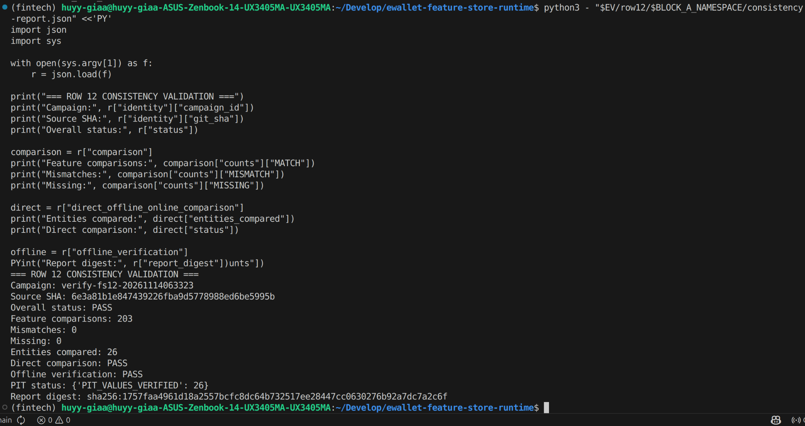

*Figure 4 — The consistency report of campaign `verify-fs12-20261114063323`
(source commit `6e3a81b1`). 203 feature comparisons over 26 entities with 0
mismatches and 0 missing values. Direct comparison and Offline verification both
pass, with 26/26 point-in-time values verified.*

## 8. Deployment architecture

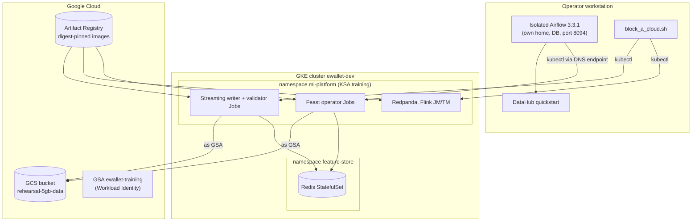

- **Control plane.** Airflow and DataHub run on the operator's machine. They
  reach GKE through the cluster's IAM-authenticated DNS endpoint, so no network
  allowlist has to change. All Feature Store data work runs inside GKE.
- **Identity.** The Jobs run as Kubernetes service account `ml-platform/training`.
  Through Workload Identity it maps to the Google service account
  `ewallet-training`. On the rehearsal bucket that account holds three
  conditional, prefix-scoped bindings (Section 10.1). No key file exists.
- **Images.** Three images are built from one source commit, pushed to Artifact
  Registry and always referenced by digest: `feast-online` (operator and IAM
  probe), `streaming-sinks` (publisher, writers, validator) and `flink-block-a`.
  The runners refuse tags. They also require each image's source commit, read
  from its `org.opencontainers.image.revision` label, to equal the checked-out
  commit.
- **Kubernetes objects.** The streaming stack uses fixed object names, and
  every object is labelled `app.kubernetes.io/part-of=ewallet-block-a` and
  `ewallet.block-a/namespace=<campaign>`. Only one campaign can be active at a
  time. Cleanup deletes only objects that carry the matching campaign label.
- **Python environments.** Each deployment boundary has its own `uv` project
  and lockfile. Feast export and validation use `ai_platform/features/feast`,
  the operator image uses `ai_platform/inference`, the streaming images use
  `infra/docker/streaming-sinks` and `infra/docker/flink-benchmark`, and
  DataHub publishing uses `data_platform/metadata/datahub`. Images run
  `uv sync --locked`.

## 9. Runtime verification results

### 9.1 Batch materialization on GKE

The execute DagRun `manual__fs11-20261112T084109Z` ran on 2026-11-12 from
08:41:12Z to 08:55:30Z (14 min 18 s). The operator image was
`feast-online@sha256:30b23392…f3c5`, built from commit `e913224f`. Before the
run, a base load had brought registry `fs11-r5gb-20261112` (Redis DB 2) to
2026-05-31 18:00 UTC.

| Result | Value |
|---|---|
| DagRun | `success`, 8/8 tasks |
| Window decision | `NEW_WINDOW`, 2026-05-31 18:00 → 23:00 UTC, all four views |
| Materialization Job | `feast-inc-ff31f721d1f8-a1`. Registry generation `1794472043803171 → 1794473045394725` |
| Completion | All four views' watermark at 23:00 |
| Online readback | 155 comparisons (5 entities × 31 features), 0 mismatches |
| DataHub | Lineage published and read back, 7 aspects `MATCH` |
| Redis after the run | DB 2 holds 204,934 keys. Production DB 0 is unchanged at 173,382 keys |

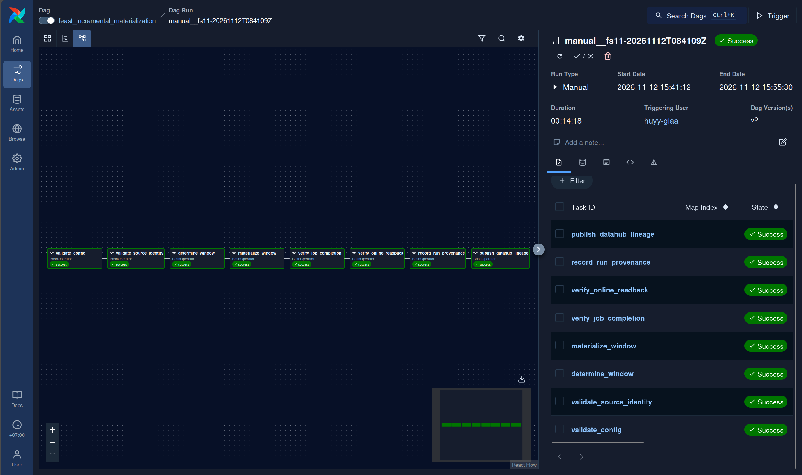

*Figure 5 — The execute DagRun in Airflow: eight tasks from `validate_config`
to `publish_datahub_lineage`, all successful.*

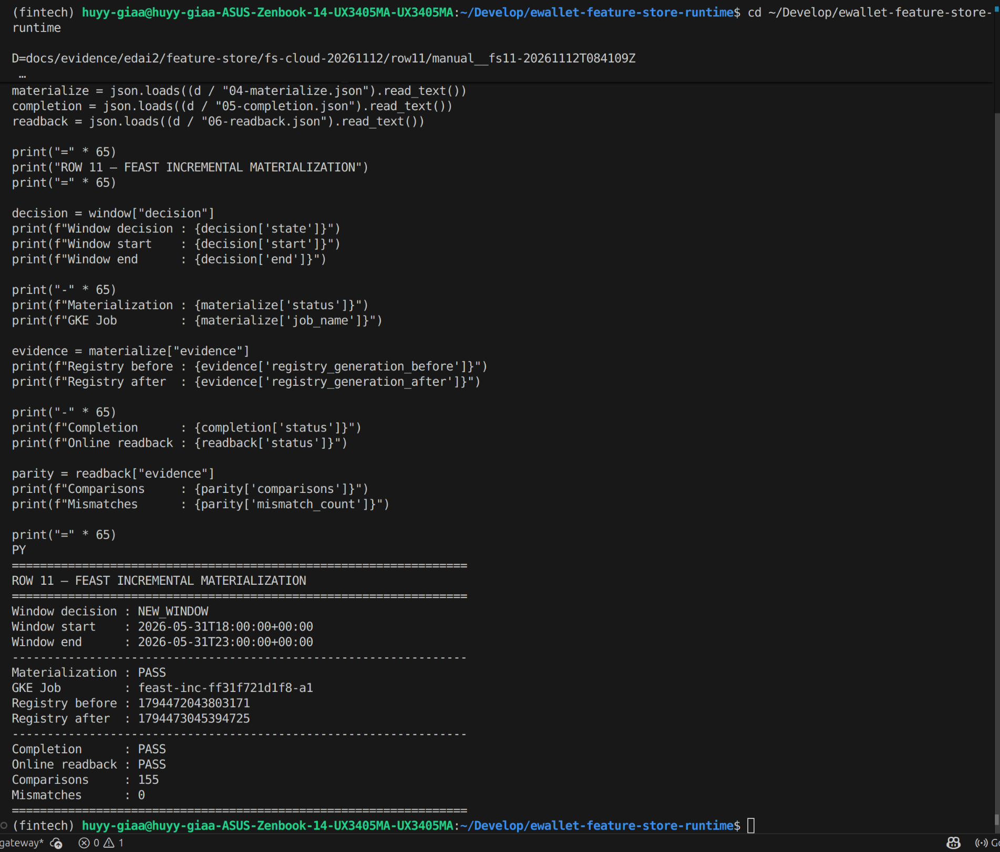

*Figure 6 — The run's evidence files: decision `NEW_WINDOW` for 18:00–23:00,
the GKE Job, the registry generation before and after, completion PASS, and
readback with 155 comparisons and 0 mismatches. The run's source commit, image
digest and snapshot ID are in
[`batch-07`](../../evidence/edai2/feature-store/screenshots/batch-07_materialization_source_and_image_provenance.png).*

Raw evidence:
[`fs-cloud-20261112/row11/`](../../evidence/edai2/feature-store/fs-cloud-20261112/README.md#row-11-row11).
The export and the historical retrieval are in
[`fs-20261112/`](../../evidence/edai2/feature-store/fs-20261112/README.md).

### 9.2 Streaming verification on GKE

Campaign `verify-fs12-20261114063323` ran on 2026-11-14. All images were built
from commit `6e3a81b1`. The Flink job started at 06:45:56Z, and the validator
finished at 07:16:46Z.

| Result | Value |
|---|---|
| Flink | 1.19.1. Job `3dca1e262210328f14d0585f3f8ea70e` `RUNNING`, 4/4 tasks, 1 TaskManager |
| Checkpoints | 13 completed, 0 failed |
| Kubernetes Jobs | 6/6 `Complete` (topics, publish, history, offline, feast, validate) |
| Offline Store | 47 Parquet files (user 14, account 14, device 14, merchant 5) plus 47 offset manifests |
| Online Store | Redis DB 9: 26 entity keys and the campaign owner marker |
| Consistency | 203 comparisons over 26 entities. 0 mismatches, 0 missing, 0 stale |
| Point in time | `PIT_VALUES_VERIFIED` 26/26 |
| Report | `PASS`, digest `sha256:1757faa4961d18a2557bcfc8dc64b732517ee28447cc0630276b92a7dc7a2c6f`, independent `check-report` PASS |

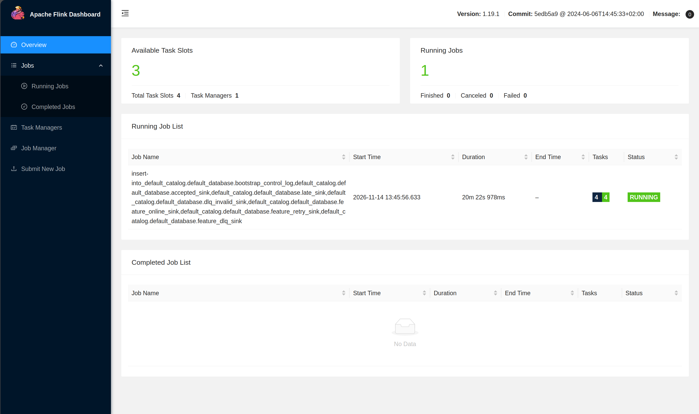

*Figure 7 — Flink Dashboard on GKE: one running job with 4/4 tasks, one
TaskManager, and 0 failed or cancelled jobs.*

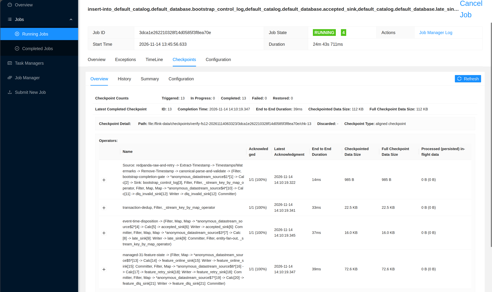

*Figure 8 — Checkpoints of job `3dca1e26…`: 13 triggered, 13 completed, 0
failed. The latest checkpoint was acknowledged by all four operator chains.*

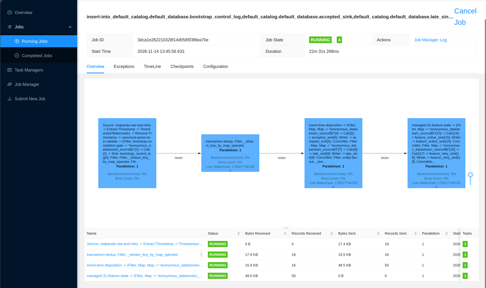

*Figure 9 — The job graph. Source and validation, then deduplication, event-time
disposition and feature state, connected by hash partitioning on the entity key.
The record counts show 18 raw records in, 16 after deduplication, and 50 records
out of the disposition chain into feature state.*

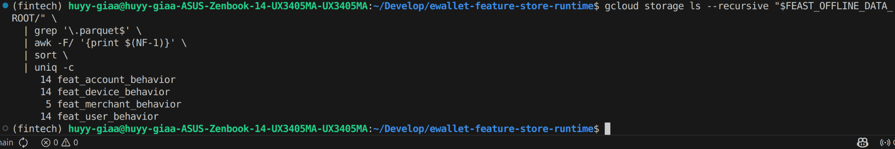

*Figure 10 — Offline Store in GCS: Parquet files per FeatureView under the
campaign's Offline path, 47 in total.*

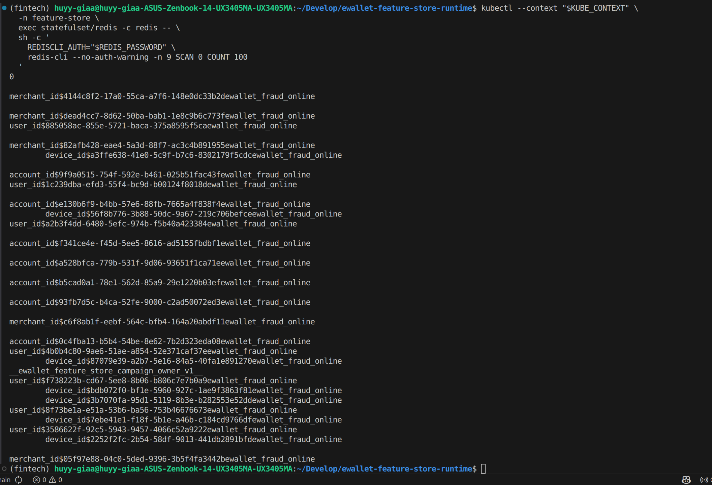

*Figure 11 — Online Store, Redis DB 9: Feast entity keys of the four entity
types for this campaign, and the campaign owner marker
`__ewallet_feature_store_campaign_owner_v1__`.*

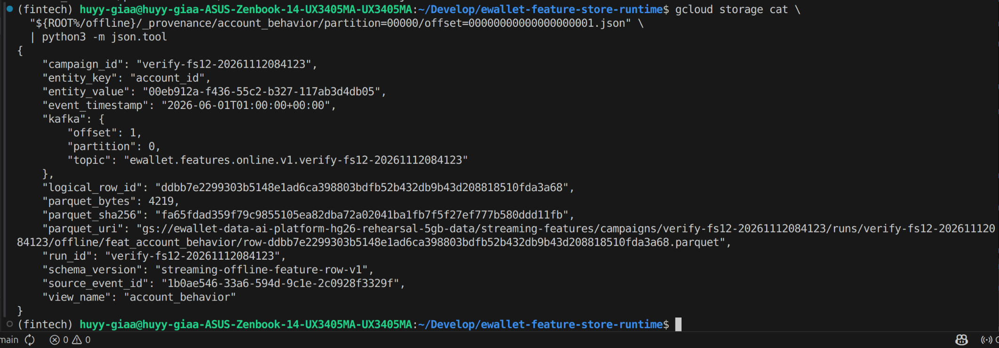

*Figure 12 — One offset manifest written by the Offline writer. It links a
Parquet row to its Kafka topic, partition and offset, and stores the Parquet
SHA-256. This capture comes from the earlier campaign
`verify-fs12-20261112084123` (code `e913224f`), which used the same writer; the
2026-11-14 campaign writes the same manifests (`block-a-offline.log`).*

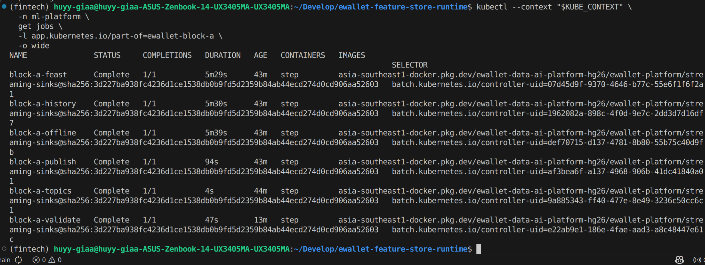

*Figure 13 — The six campaign Jobs `Complete 1/1`, all running the
digest-pinned `streaming-sinks` image.*

Raw evidence:
[`fs12-cloud-20261114/`](../../evidence/edai2/feature-store/fs12-cloud-20261114/README.md).
An earlier campaign on 2026-11-12 (`verify-fs12-20261112084123`, Redis DB 8)
gave the same result: 26 entities, 203 comparisons, 0 mismatches, 26/26
point-in-time values
([`fs-cloud-20261112/row12/`](../../evidence/edai2/feature-store/fs-cloud-20261112/README.md#row-12-row12)).
Replay was tested on a local stack of the same components. All three writer
groups were rewound and re-read, and the consistency check passed again with the
Offline files and Redis keys unchanged
([`fs-20261112/`](../../evidence/edai2/feature-store/fs-20261112/README.md#row-12-row12-local-verify-fs12-local-20261112062709)).

All screenshots and their digests are listed in
[`screenshots/README.md`](../../evidence/edai2/feature-store/screenshots/README.md).

## 10. Reproducibility and operations

The [Feature Store runbook](../../runbooks/edai2/FEATURE_STORE_RUNBOOK.md) is
the complete procedure. Every command in it is marked as read-only, local,
dry-run or cloud mutation. This section summarizes what is needed and what
usually goes wrong.

### 10.1 Prerequisites

- A source commit on `main`, with the three images built from it and pushed
  by digest.
- GKE access through the DNS endpoint, and a cluster with enough capacity. The
  rehearsal cluster needed 5 nodes, because shared workloads request about 9 CPU
  and a streaming campaign adds about 2.3 CPU.
- On the data bucket, for the Jobs' Google service account, all bindings
  conditioned on prefixes:
  - read on `features/`, `streaming-features/` and `streaming-history/`;
  - read/write on the campaign registries (Feast overwrites `registry.db` with a
    generation check, which needs delete);
  - create-only on the streaming campaign prefixes and the probe prefix.

  [`feature_store_iam_probe.sh`](../../../scripts/mlops/feature_store_iam_probe.sh)
  checks these bindings from inside the cluster. It fails if reads are missing
  or if writes outside the allowed prefixes are possible.
- An empty Redis database in the allowed range for each run, and a projected
  memory use below 90 % of `maxmemory`.
- For the batch path: Airflow 3 (the isolated launcher
  [`fs11_isolated_airflow.sh`](../../../scripts/mlops/fs11_isolated_airflow.sh)
  keeps it apart from other Airflow instances) and DataHub.

### 10.2 A fresh run

1. Export a snapshot from a completed DP3 run, or reuse an existing one, and
   note its manifest digest.
2. Batch: create a new registry ID, claim a Redis DB, apply the four views and
   do one base load. Then trigger the DAG in dry-run mode and trigger it again
   in execute mode with the returned approval token.
3. Streaming: choose a new `verify-fs12-<timestamp>` namespace, run the
   runner's `preflight`, `deploy`, `run` and `collect` commands, and check the
   report with `check-report`.
4. Collect the evidence, clean up the campaign's Kubernetes objects, and put the
   cluster back to sleep.

Campaign IDs, registry IDs and Redis databases are always new. Nothing in the
code depends on the IDs of the runs in Section 9.

### 10.3 Troubleshooting

| Symptom | Cause and action |
|---|---|
| `determine_window` returns `COMPLETED` or `NO_NEW_DATA` | Nothing new to load: the registry already reached the requested end, or the snapshot has no rows there. Choose a later `target_end` within the snapshot, or a new registry |
| Run stops with `CONFLICT` or `AMBIGUOUS_NONEMPTY` on Redis | The database belongs to another campaign or holds data. Choose another empty database; never flush |
| Fingerprint mismatch after a Redis restart | The server's `run_id` changed, so the old owner marker no longer authorizes writes. Use a new database and a new campaign (runbook, Redis recovery) |
| Execute DagRun rejects the approval token | The request differs from the dry run. Rerun the dry run with the exact parameters |
| `kubectl logs` fails with "No agent available" right after waking the cluster | Konnectivity agents are still starting. Wait and retry |
| Runner refuses to start: source SHA mismatch | The checkout is not the commit the images were built from. Rebuild the images, or check out that commit |
| DataHub task fails, or lineage is missing in the UI | Check OpenSearch disk usage. Above the flood-stage watermark the indices become read-only and writes are lost from search. Free disk, clear the read-only block, and restore the indices for the affected URNs |
| Validator reports timestamp mismatches of under one second | Use the provider-precision Online read in the validator (already the default) |

## 11. Limitations and future improvements

- **Not redeployed from the merged `main`.** The batch run used images from
  commit `e913224f`, and the streaming run used images from `6e3a81b1`. Merging
  into `main` added documentation, EDAI-1 work outside the Feature Store, and
  the reusable IAM probe module. The Feature Store runtime code is unchanged,
  but no GKE run has used images built from the merged commit.
- **Streaming throughput.** The verification scenario proves correctness on
  every event path with 26 entities. It does not measure throughput on the
  full dataset. Flink runs with parallelism 1 on single-partition campaign
  topics, and checkpoints go to pod-local storage. That is enough for a bounded
  verification but is not durable recovery. Production needs a GCS checkpoint
  path, higher parallelism and multi-partition topics.
- **Replay on GKE.** The cloud runner has no replay command. Replay and
  idempotency were shown on the local stack only.
- **Shared Redis.** Verification and production share one Redis instance,
  separated by database and owner markers. A dedicated instance per
  environment would remove the remaining blast radius, such as memory pressure.
- **Control plane outside the cluster.** Airflow and DataHub run on the
  operator's machine. A production deployment would run them as managed or
  in-cluster services with their own credentials.
- **Time-limited permissions.** The bucket bindings used for these runs expire
  on 2026-11-27. Later runs need the same bindings again, scoped to the new
  campaign prefixes.
- **DataHub search index.** The local DataHub stopped indexing during the batch
  run because OpenSearch ran out of disk. Its search index was rebuilt
  afterwards from the records the run had written (see the
  [screenshot notes](../../evidence/edai2/feature-store/screenshots/README.md)).
  The DAG cannot detect this condition: its readback queries GMS, which reads
  the primary store, not the search index.
